# Administrative Dashboard

<cite>
**Referenced Files in This Document**
- [dashboard.blade.php](file://backend/resources/views/admin/dashboard.blade.php)
- [layout.blade.php](file://backend/resources/views/admin/layout.blade.php)
- [sidebar.blade.php](file://backend/resources/views/admin/partials/sidebar.blade.php)
- [DashboardController.php](file://backend/app/Http/Controllers/Admin/DashboardController.php)
- [BaseAdminController.php](file://backend/app/Http/Controllers/Admin/BaseAdminController.php)
- [AdminDashboardService.php](file://backend/app/Services/AdminDashboardService.php)
- [AdminDashboardAnalyticsService.php](file://backend/app/Services/AdminDashboardAnalyticsService.php)
- [AdminSessionService.php](file://backend/app/Services/AdminSessionService.php)
- [EnsureUserHasMenuPermission.php](file://backend/app/Http/Middleware/EnsureUserHasMenuPermission.php)
- [EnforceAdminSessionTimeout.php](file://backend/app/Http/Middleware/EnforceAdminSessionTimeout.php)
- [ApplySessionLifetime.php](file://backend/app/Http/Middleware/ApplySessionLifetime.php)
- [User.php](file://backend/app/Models/User.php)
- [dashboard-overview.blade.php](file://backend/resources/views/admin/partials/dashboard-overview.blade.php)
- [dashboard-overview.js](file://backend/resources/js/admin/dashboard-overview.js)
- [theme-toggle.blade.php](file://backend/resources/views/admin/partials/theme-toggle.blade.php)
- [site-settings.blade.php](file://backend/resources/views/admin/partials/site-settings.blade.php)
- [profile.blade.php](file://backend/resources/views/admin/partials/profile.blade.php)
- [reports.blade.php](file://backend/resources/views/admin/partials/reports.blade.php)
- [ReportController.php](file://backend/app/Http/Controllers/Admin/ReportController.php)
- [ExcelExportService.php](file://backend/app/Services/ExcelExportService.php)
- [buses.blade.php](file://backend/resources/views/admin/partials/buses.blade.php)
- [schedules.blade.php](file://backend/resources/views/admin/partials/schedules.blade.php)
- [BusController.php](file://backend/app/Http/Controllers/Admin/BusController.php)
- [ScheduleController.php](file://backend/app/Http/Controllers/Admin/ScheduleController.php)
- [buses.js](file://backend/resources/js/admin/buses.js)
- [layout.js](file://backend/resources/js/admin/layout.js)
- [session.php](file://backend/config/session.php)
</cite>

## Update Summary
**Changes Made**
- Enhanced profile page to display current session expiration time with notice directing administrators to relevant settings page
- Updated DashboardController to inject AdminSessionService and pass session minutes to views
- Added comprehensive documentation for AdminSessionService functionality and session management
- Updated Session Configuration section to document dynamic session lifetime management through site settings
- Enhanced troubleshooting guide with session-related issues and resolutions

## Table of Contents
1. [Introduction](#introduction)
2. [Project Structure](#project-structure)
3. [Core Components](#core-components)
4. [Architecture Overview](#architecture-overview)
5. [Detailed Component Analysis](#detailed-component-analysis)
6. [Dependency Analysis](#dependency-analysis)
7. [Performance Considerations](#performance-considerations)
8. [Troubleshooting Guide](#troubleshooting-guide)
9. [Conclusion](#conclusion)

## Introduction
This document explains the administrative dashboard built with Laravel Blade templates and JavaScript components. It covers the dashboard overview, analytics charts, filter controls, key metrics display, management modules for buses, routes, schedules, bookings, users, and site settings. It also documents role-based access control, menu permissions, theme customization, reporting capabilities, export functionality, and administrative workflows. Recent enhancements include improved search functionality for fleet coaches and schedules sections, updated session configuration with dynamic lifetime management through site settings, intelligent JavaScript tab navigation that handles search parameters alongside pagination, and an enhanced profile page that displays current session expiration time with guidance to adjust settings.

## Project Structure
The admin panel is a server-rendered Blade application with client-side interactivity:
- Controllers under `app/Http/Controllers/Admin` render views and delegate data loading to services.
- Services encapsulate analytics, filtering, export logic, and session management.
- Blade templates compose the layout, sidebar, dashboard tabs, and report pages.
- JavaScript files enhance the dashboard with Chart.js analytics, theme switching, and enhanced navigation.

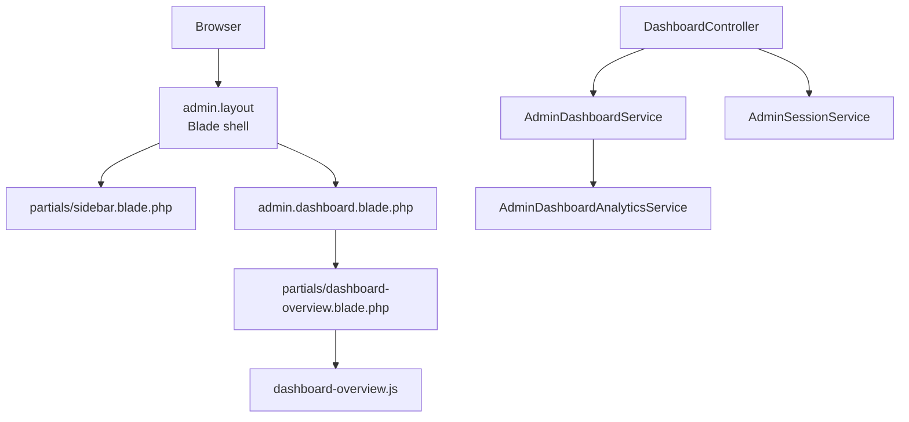

**Diagram sources**
- [layout.blade.php:1-800](file://backend/resources/views/admin/layout.blade.php#L1-L800)
- [sidebar.blade.php:1-120](file://backend/resources/views/admin/partials/sidebar.blade.php#L1-L120)
- [dashboard.blade.php:1-104](file://backend/resources/views/admin/dashboard.blade.php#L1-L104)
- [dashboard-overview.blade.php:1-125](file://backend/resources/views/admin/partials/dashboard-overview.blade.php#L1-L125)
- [dashboard-overview.js:1-276](file://backend/resources/js/admin/dashboard-overview.js#L1-L276)
- [DashboardController.php:1-35](file://backend/app/Http/Controllers/Admin/DashboardController.php#L1-L35)
- [AdminDashboardService.php:1-82](file://backend/app/Services/AdminDashboardService.php#L1-L82)
- [AdminDashboardAnalyticsService.php:1-228](file://backend/app/Services/AdminDashboardAnalyticsService.php#L1-L228)
- [AdminSessionService.php:1-121](file://backend/app/Services/AdminSessionService.php#L1-L121)

**Section sources**
- [layout.blade.php:1-800](file://backend/resources/views/admin/layout.blade.php#L1-L800)
- [dashboard.blade.php:1-104](file://backend/resources/views/admin/dashboard.blade.php#L1-L104)

## Core Components
- Admin layout and sidebar provide navigation, branding, and permission-gated menu items.
- Dashboard controller delegates data preparation to services and integrates session management.
- Dashboard service aggregates metrics, paginated lists, and site settings.
- Analytics service computes period-based metrics and chart datasets.
- **New**: AdminSessionService manages configurable session lifetimes for both admin panel and customer tokens.
- Middleware enforces authentication, menu permissions, and session timeout policies.
- User model implements role checks and menu permission evaluation.
- Dashboard overview partial renders metric cards and Chart.js canvases; JavaScript handles filters and re-renders.
- Reports index and controller support multiple report types with preview, Excel, and PDF exports.
- Site settings partial manages identity, footer, maintenance mode, SEO, integrations, and session security.
- **Enhanced**: Profile page now displays current session expiration time with guidance to adjust settings.
- Fleet coaches and schedules sections include advanced search functionality.
- JavaScript tab navigation intelligently handles search parameters alongside pagination.

**Section sources**
- [BaseAdminController.php:1-15](file://backend/app/Http/Controllers/Admin/BaseAdminController.php#L1-L15)
- [DashboardController.php:1-35](file://backend/app/Http/Controllers/Admin/DashboardController.php#L1-L35)
- [AdminDashboardService.php:1-82](file://backend/app/Services/AdminDashboardService.php#L1-L82)
- [AdminDashboardAnalyticsService.php:1-228](file://backend/app/Services/AdminDashboardAnalyticsService.php#L1-L228)
- [AdminSessionService.php:1-121](file://backend/app/Services/AdminSessionService.php#L1-L121)
- [EnsureUserHasMenuPermission.php:1-41](file://backend/app/Http/Middleware/EnsureUserHasMenuPermission.php#L1-L41)
- [EnforceAdminSessionTimeout.php:1-43](file://backend/app/Http/Middleware/EnforceAdminSessionTimeout.php#L1-L43)
- [ApplySessionLifetime.php:1-40](file://backend/app/Http/Middleware/ApplySessionLifetime.php#L1-L40)
- [User.php:1-76](file://backend/app/Models/User.php#L1-L76)
- [dashboard-overview.blade.php:1-125](file://backend/resources/views/admin/partials/dashboard-overview.blade.php#L1-L125)
- [dashboard-overview.js:1-276](file://backend/resources/js/admin/dashboard-overview.js#L1-L276)
- [reports.blade.php:1-127](file://backend/resources/views/admin/partials/reports.blade.php#L1-L127)
- [ReportController.php:1-648](file://backend/app/Http/Controllers/Admin/ReportController.php#L1-L648)
- [site-settings.blade.php:1-430](file://backend/resources/views/admin/partials/site-settings.blade.php#L1-L430)
- [profile.blade.php:1-66](file://backend/resources/views/admin/partials/profile.blade.php#L1-L66)

## Architecture Overview
The admin dashboard follows a layered architecture with enhanced session management:
- Presentation layer: Blade templates (layout, sidebar, dashboard, reports, site settings, profile).
- Controller layer: Admin controllers handle requests and return views or JSON responses.
- Service layer: Business logic for dashboard analytics, report queries, exports, and session management.
- Data layer: Eloquent models for bookings, buses, routes, schedules, stations, promotions, users, and site settings.

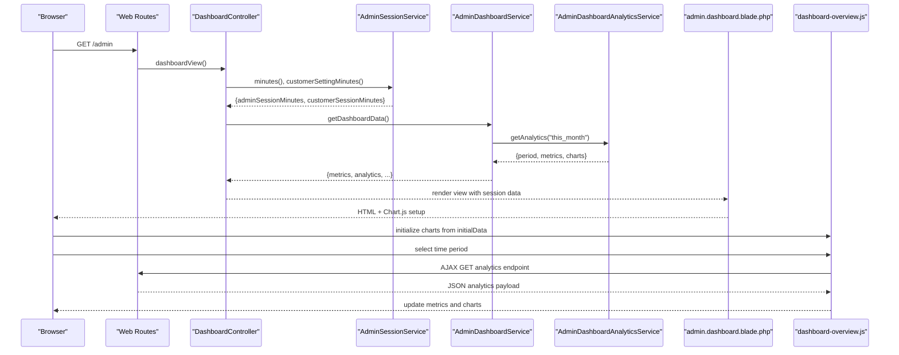

**Diagram sources**
- [DashboardController.php:1-35](file://backend/app/Http/Controllers/Admin/DashboardController.php#L1-L35)
- [AdminSessionService.php:1-121](file://backend/app/Services/AdminSessionService.php#L1-L121)
- [AdminDashboardService.php:1-82](file://backend/app/Services/AdminDashboardService.php#L1-L82)
- [AdminDashboardAnalyticsService.php:1-228](file://backend/app/Services/AdminDashboardAnalyticsService.php#L1-L228)
- [dashboard.blade.php:1-104](file://backend/resources/views/admin/dashboard.blade.php#L1-L104)
- [dashboard-overview.blade.php:1-125](file://backend/resources/views/admin/partials/dashboard-overview.blade.php#L1-L125)
- [dashboard-overview.js:1-276](file://backend/resources/js/admin/dashboard-overview.js#L1-L276)

## Detailed Component Analysis

### Dashboard Overview and Analytics
The dashboard overview displays six metric cards and six charts:
- Metrics: sales revenue, confirmed bookings, pending bookings, cancelled tickets, cancel requests, average fare.
- Charts: booking status distribution, payment methods, daily revenue trend, daily bookings trend, coach type mix, top routes.

Data flow:
- The controller passes precomputed analytics to the Blade view.
- The view initializes Chart.js and sets up an AJAX endpoint for period changes.
- JavaScript reads CSS variables for theme-aware colors and updates charts on theme change.

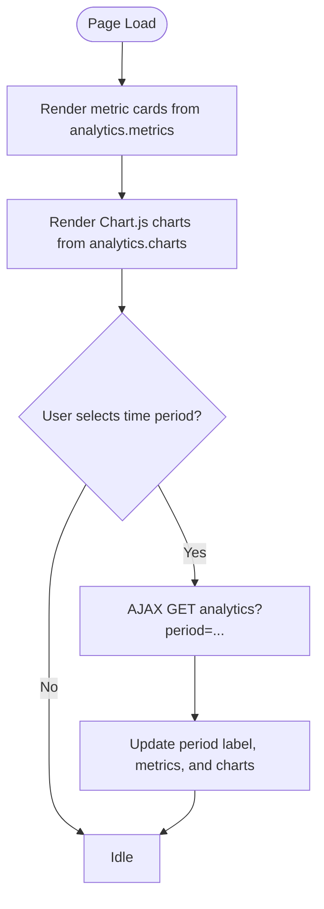

**Diagram sources**
- [dashboard-overview.blade.php:1-125](file://backend/resources/views/admin/partials/dashboard-overview.blade.php#L1-L125)
- [dashboard-overview.js:1-276](file://backend/resources/js/admin/dashboard-overview.js#L1-L276)
- [AdminDashboardAnalyticsService.php:1-228](file://backend/app/Services/AdminDashboardAnalyticsService.php#L1-L228)

**Section sources**
- [dashboard.blade.php:1-104](file://backend/resources/views/admin/dashboard.blade.php#L1-L104)
- [dashboard-overview.blade.php:1-125](file://backend/resources/views/admin/partials/dashboard-overview.blade.php#L1-L125)
- [dashboard-overview.js:1-276](file://backend/resources/js/admin/dashboard-overview.js#L1-L276)
- [AdminDashboardService.php:1-82](file://backend/app/Services/AdminDashboardService.php#L1-L82)
- [AdminDashboardAnalyticsService.php:1-228](file://backend/app/Services/AdminDashboardAnalyticsService.php#L1-L228)

### Enhanced Profile Page with Session Expiration Display
The admin profile page has been enhanced to provide transparency about session security:
- **Session Expiration Notice**: Displays the current session lifetime configured in site settings
- **Direct Guidance**: Provides clear instructions to navigate to Site Settings → Session Security to modify timeout values
- **Dynamic Values**: Shows actual configured minutes rather than hardcoded defaults
- **Contextual Information**: Helps administrators understand why their sessions expire when they do

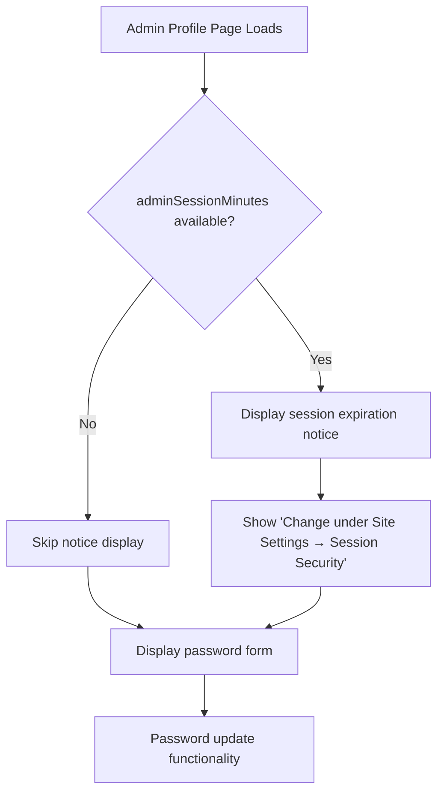

**Diagram sources**
- [profile.blade.php:8-14](file://backend/resources/views/admin/partials/profile.blade.php#L8-L14)
- [DashboardController.php:25-32](file://backend/app/Http/Controllers/Admin/DashboardController.php#L25-L32)

**Section sources**
- [profile.blade.php:1-66](file://backend/resources/views/admin/partials/profile.blade.php#L1-L66)
- [DashboardController.php:1-35](file://backend/app/Http/Controllers/Admin/DashboardController.php#L1-L35)

### AdminSessionService and Session Management
The AdminSessionService provides centralized management of session lifetimes:
- **Configurable Lifetimes**: Reads session settings from database via SiteSetting model
- **Validation and Clamping**: Ensures values stay within safe bounds (1 minute to 7 days for admin, 0 to 30 days for customers)
- **Default Fallbacks**: Uses sensible defaults when settings are missing or invalid
- **Dual Purpose**: Manages both admin panel idle timeouts and customer API token lifetimes
- **Integration Points**: Used by middleware, controllers, and views throughout the application

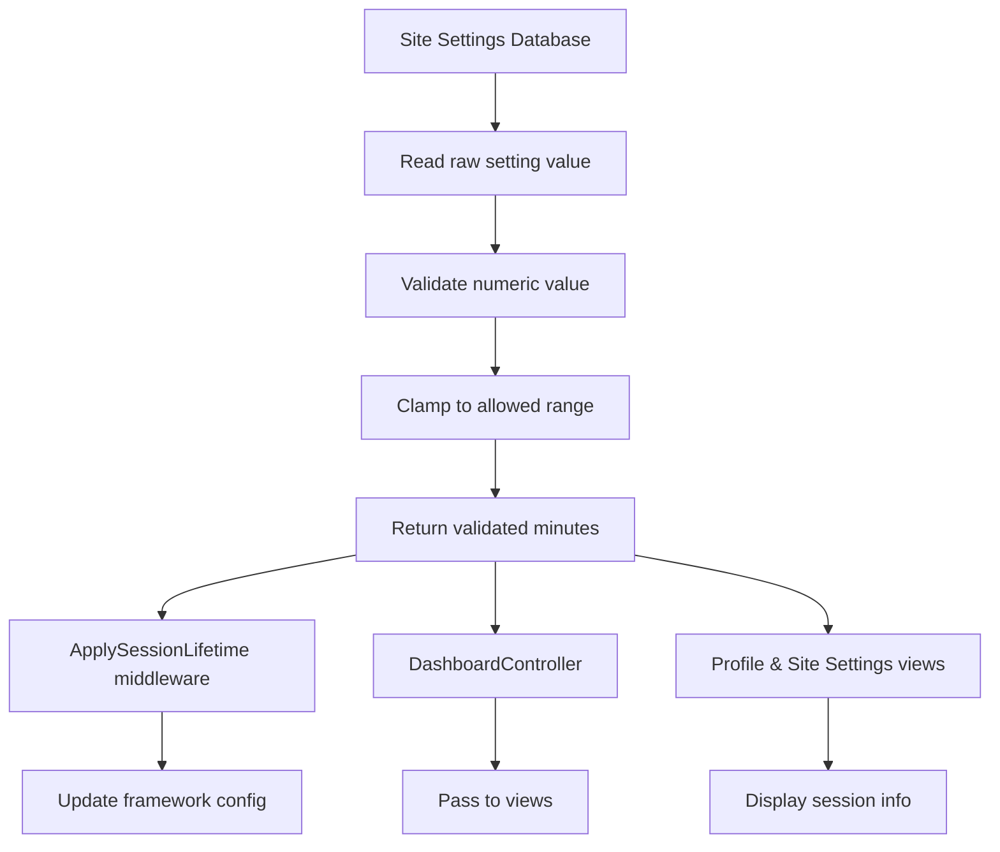

**Diagram sources**
- [AdminSessionService.php:41-81](file://backend/app/Services/AdminSessionService.php#L41-L81)
- [ApplySessionLifetime.php:27-40](file://backend/app/Http/Middleware/ApplySessionLifetime.php#L27-L40)
- [DashboardController.php:25-32](file://backend/app/Http/Controllers/Admin/DashboardController.php#L25-L32)

**Section sources**
- [AdminSessionService.php:1-121](file://backend/app/Services/AdminSessionService.php#L1-L121)
- [ApplySessionLifetime.php:1-40](file://backend/app/Http/Middleware/ApplySessionLifetime.php#L1-L40)
- [DashboardController.php:1-35](file://backend/app/Http/Controllers/Admin/DashboardController.php#L1-L35)

### Management Modules

#### Fleet Coaches Management
The fleet coaches section provides comprehensive bus management with enhanced search capabilities:
- **Enhanced Search**: Users can search coaches by registration number using the dedicated search form
- **CRUD Operations**: Full create, read, update, and delete functionality for bus records
- **Seat Layout Designer**: Advanced drag-and-drop interface for customizing seat arrangements
- **Logo Management**: Support for operator logos with preview and upload capabilities
- **Pagination Integration**: Seamless integration with search results and pagination controls

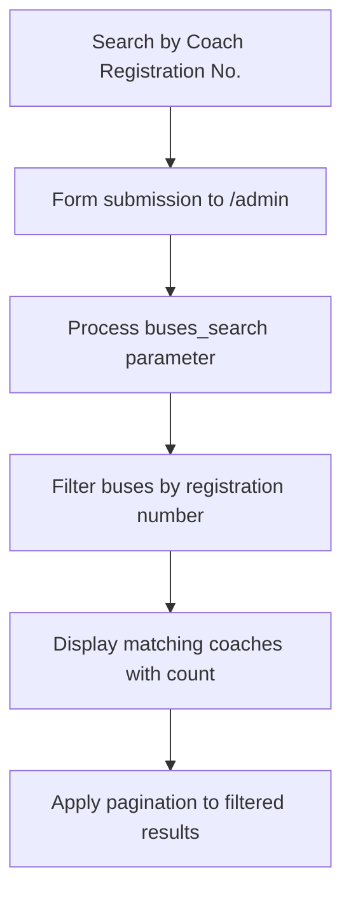

**Diagram sources**
- [buses.blade.php:3-29](file://backend/resources/views/admin/partials/buses.blade.php#L3-L29)
- [BusController.php:27-95](file://backend/app/Http/Controllers/Admin/BusController.php#L27-L95)

**Section sources**
- [buses.blade.php:1-467](file://backend/resources/views/admin/partials/buses.blade.php#L1-L467)
- [BusController.php:1-97](file://backend/app/Http/Controllers/Admin/BusController.php#L1-L97)
- [buses.js:1-596](file://backend/resources/js/admin/buses.js#L1-L596)

#### Timetables Management
The timetables section manages departure schedules with enhanced search functionality:
- **Enhanced Search**: Users can search schedules by operator name or coach registration number
- **Schedule Management**: Create, edit, and delete scheduled coach runs
- **Route Integration**: Link schedules to specific routes and buses
- **Fare Management**: Configure pricing for each scheduled run
- **Search-Aware Pagination**: Pagination works seamlessly with search results

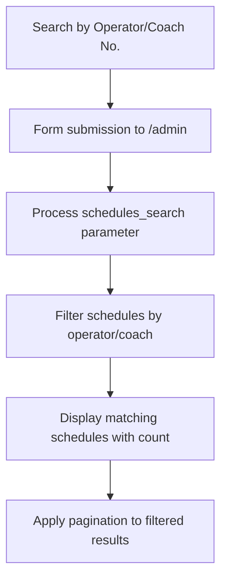

**Diagram sources**
- [schedules.blade.php:3-29](file://backend/resources/views/admin/partials/schedules.blade.php#L3-L29)
- [ScheduleController.php:10-47](file://backend/app/Http/Controllers/Admin/ScheduleController.php#L10-L47)

**Section sources**
- [schedules.blade.php:1-152](file://backend/resources/views/admin/partials/schedules.blade.php#L1-L152)
- [ScheduleController.php:1-49](file://backend/app/Http/Controllers/Admin/ScheduleController.php#L1-L49)

### Role-Based Access Control and Menu Permissions
Access control combines middleware and model-level checks:
- Middleware ensures authentication and menu permission before allowing access to protected routes.
- User model provides helper methods for role checks and menu permission evaluation.
- Super admins bypass menu permission checks and can access system-level features like license, site settings, and gateways.

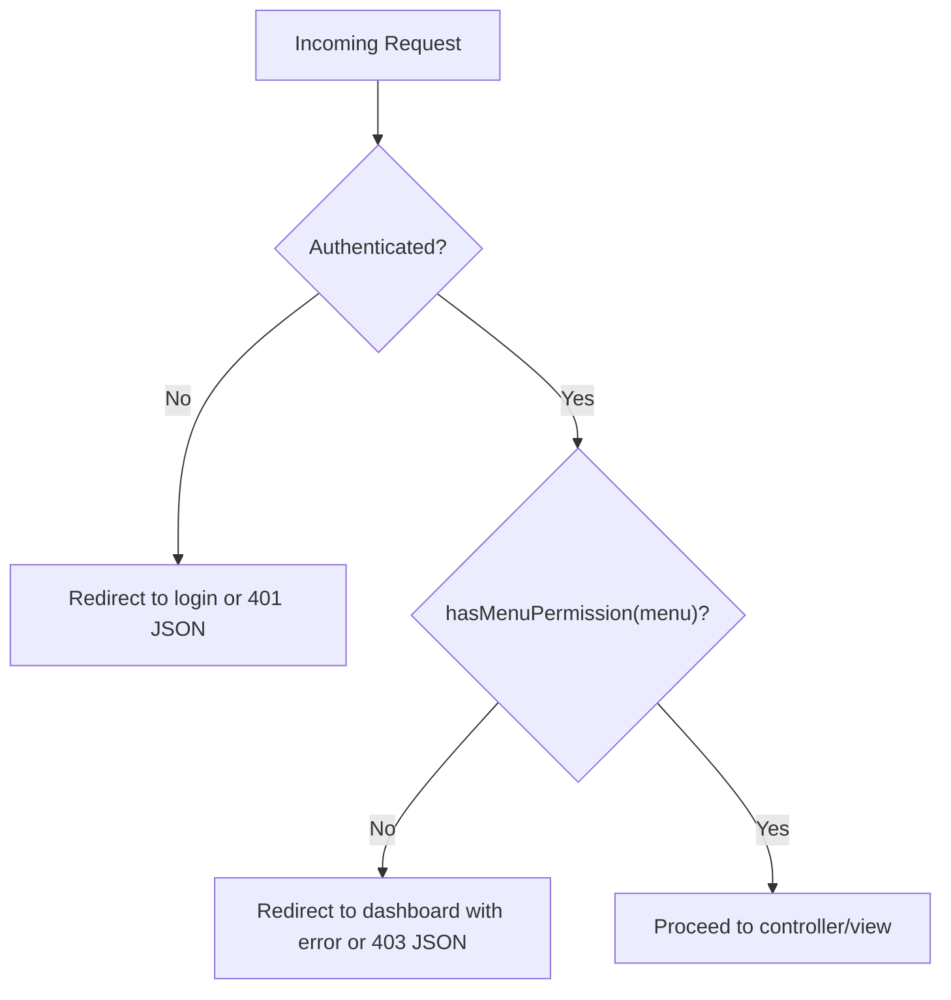

**Diagram sources**
- [EnsureUserHasMenuPermission.php:1-41](file://backend/app/Http/Middleware/EnsureUserHasMenuPermission.php#L1-L41)
- [User.php:1-76](file://backend/app/Models/User.php#L1-L76)

**Section sources**
- [EnsureUserHasMenuPermission.php:1-41](file://backend/app/Http/Middleware/EnsureUserHasMenuPermission.php#L1-L41)
- [User.php:1-76](file://backend/app/Models/User.php#L1-L76)
- [sidebar.blade.php:1-120](file://backend/resources/views/admin/partials/sidebar.blade.php#L1-L120)
- [dashboard.blade.php:1-104](file://backend/resources/views/admin/dashboard.blade.php#L1-L104)

### Theme Customization
Theme customization uses CSS custom properties and a toggle button:
- The layout applies theme variables via Blade partials.
- The theme toggle button switches between light and dark themes.
- JavaScript listens for theme change events and re-renders charts using current CSS variable values.

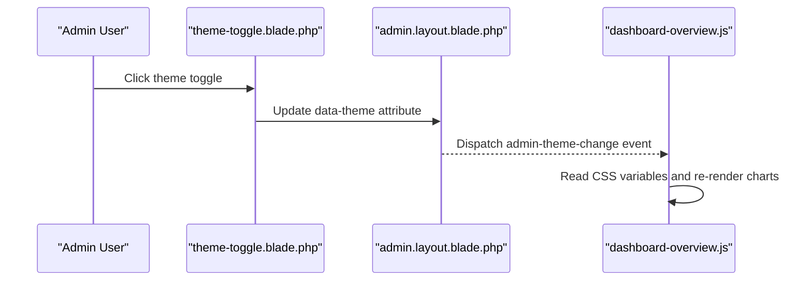

**Diagram sources**
- [theme-toggle.blade.php:1-10](file://backend/resources/views/admin/partials/theme-toggle.blade.php#L1-L10)
- [layout.blade.php:1-800](file://backend/resources/views/admin/layout.blade.php#L1-L800)
- [dashboard-overview.js:1-276](file://backend/resources/js/admin/dashboard-overview.js#L1-L276)

**Section sources**
- [layout.blade.php:1-800](file://backend/resources/views/admin/layout.blade.php#L1-L800)
- [theme-toggle.blade.php:1-10](file://backend/resources/views/admin/partials/theme-toggle.blade.php#L1-L10)
- [dashboard-overview.js:1-276](file://backend/resources/js/admin/dashboard-overview.js#L1-L276)

### Reporting Capabilities and Export Functionality
Reports are organized by type with a card gallery index:
- Report types include selling, booking, revenue, passenger, seat occupancy, cancellation, refund, payment, route-wise sales, and agent sales.
- Each report supports preview (JSON), Excel export, and PDF export.
- The report controller validates filters, builds query results, formats rows, and returns either JSON previews or downloadable files.

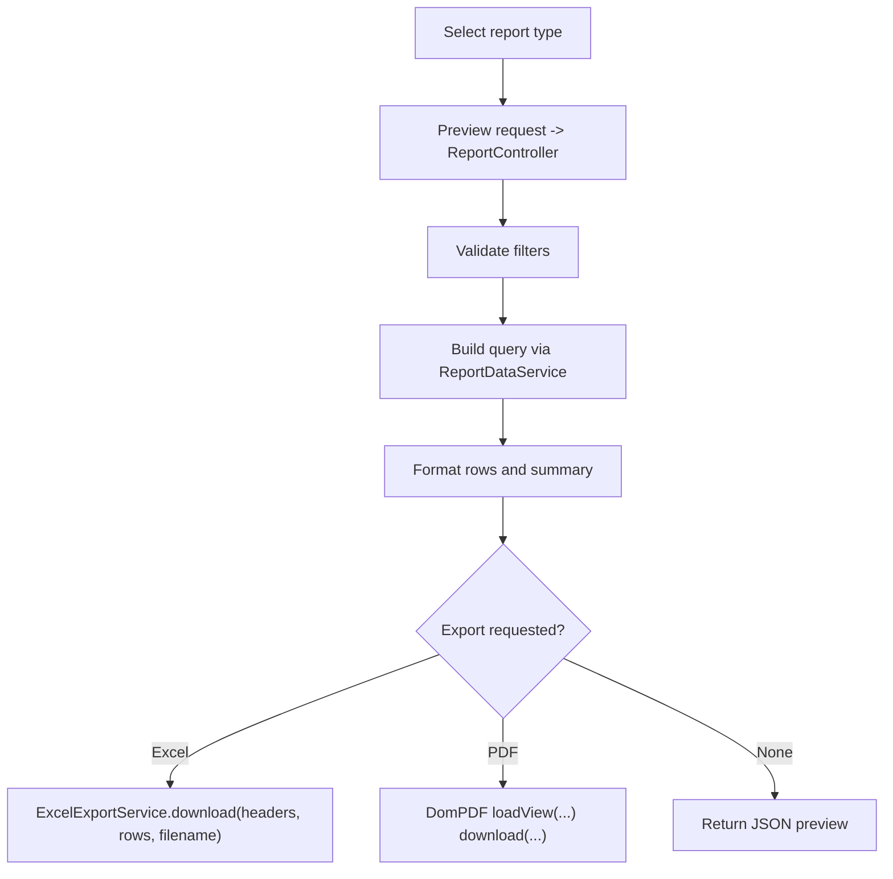

**Diagram sources**
- [reports.blade.php:1-127](file://backend/resources/views/admin/partials/reports.blade.php#L1-L127)
- [ReportController.php:1-648](file://backend/app/Http/Controllers/Admin/ReportController.php#L1-L648)
- [ExcelExportService.php:1-67](file://backend/app/Services/ExcelExportService.php#L1-L67)

**Section sources**
- [reports.blade.php:1-127](file://backend/resources/views/admin/partials/reports.blade.php#L1-L127)
- [ReportController.php:1-648](file://backend/app/Http/Controllers/Admin/ReportController.php#L1-L648)
- [ExcelExportService.php:1-67](file://backend/app/Services/ExcelExportService.php#L1-L67)

### Dynamic Session Configuration
Session management has evolved from hardcoded configuration to dynamic, user-configurable settings:
- **Dynamic Lifetime**: Admin panel session lifetime is now configurable through Site Settings → Session Security
- **Customer Token Management**: Separate configuration for customer API token lifetimes (0 = never expires)
- **Validation and Safety**: Built-in validation prevents unsafe values (instant lockout or infinite sessions)
- **Framework Integration**: Middleware automatically applies configured values to Laravel's session and Sanctum configuration
- **Real-time Updates**: Changes take effect immediately without requiring application restart

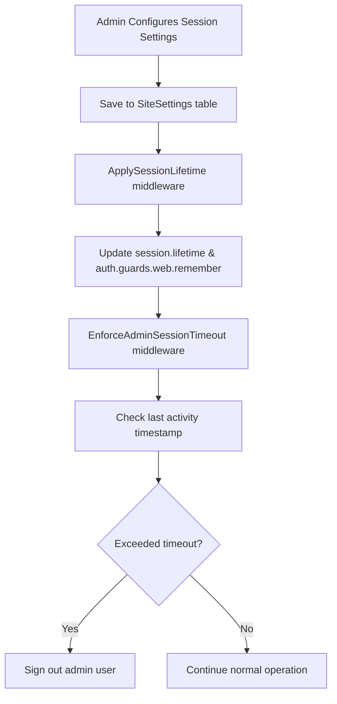

**Diagram sources**
- [AdminSessionService.php:41-81](file://backend/app/Services/AdminSessionService.php#L41-L81)
- [ApplySessionLifetime.php:27-40](file://backend/app/Http/Middleware/ApplySessionLifetime.php#L27-L40)
- [EnforceAdminSessionTimeout.php:27-43](file://backend/app/Http/Middleware/EnforceAdminSessionTimeout.php#L27-L43)

**Section sources**
- [AdminSessionService.php:1-121](file://backend/app/Services/AdminSessionService.php#L1-L121)
- [ApplySessionLifetime.php:1-40](file://backend/app/Http/Middleware/ApplySessionLifetime.php#L1-L40)
- [EnforceAdminSessionTimeout.php:1-43](file://backend/app/Http/Middleware/EnforceAdminSessionTimeout.php#L1-L43)
- [site-settings.blade.php:298-339](file://backend/resources/views/admin/partials/site-settings.blade.php#L298-L339)

### Enhanced JavaScript Tab Navigation
The JavaScript tab navigation system has been enhanced to intelligently handle search parameters alongside pagination:
- **Search Parameter Detection**: Automatically detects `_search` and `_page` query parameters for all known tabs
- **Tab Resolution Logic**: Prioritizes hash-based navigation, then falls back to query parameter detection
- **Known Tab Recognition**: Supports all administrative tabs including stations, buses, routes, schedules, promotions, users, coach-services, bookings, cancel-requests, reports, license, site-settings, gateways, and profile
- **Seamless Integration**: Works transparently with existing pagination and search functionality

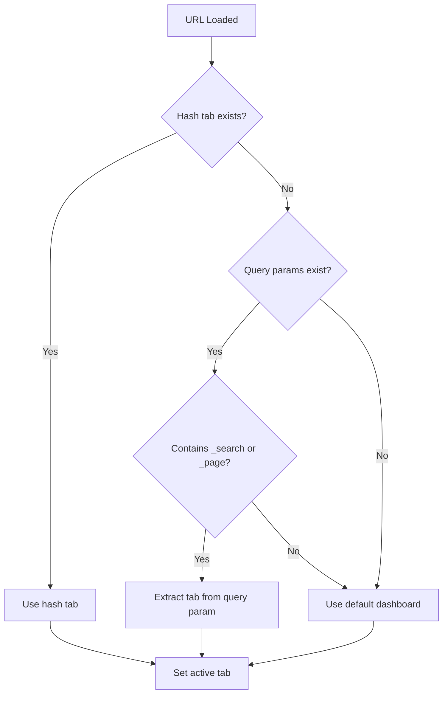

**Diagram sources**
- [layout.js:54-68](file://backend/resources/js/admin/layout.js#L54-L68)

**Section sources**
- [layout.js:54-78](file://backend/resources/js/admin/layout.js#L54-L78)

## Dependency Analysis
Key dependencies:
- DashboardController depends on AdminDashboardService and AdminSessionService.
- AdminDashboardService depends on AdminDashboardAnalyticsService and Eloquent models.
- ReportController depends on ReportFilterService, ReportDataService, and ExcelExportService.
- Views depend on Blade partials and Vite-loaded JavaScript modules.
- **Enhanced**: Profile page depends on AdminSessionService for displaying session expiration information.
- **Enhanced**: Session management involves multiple middleware components working together.

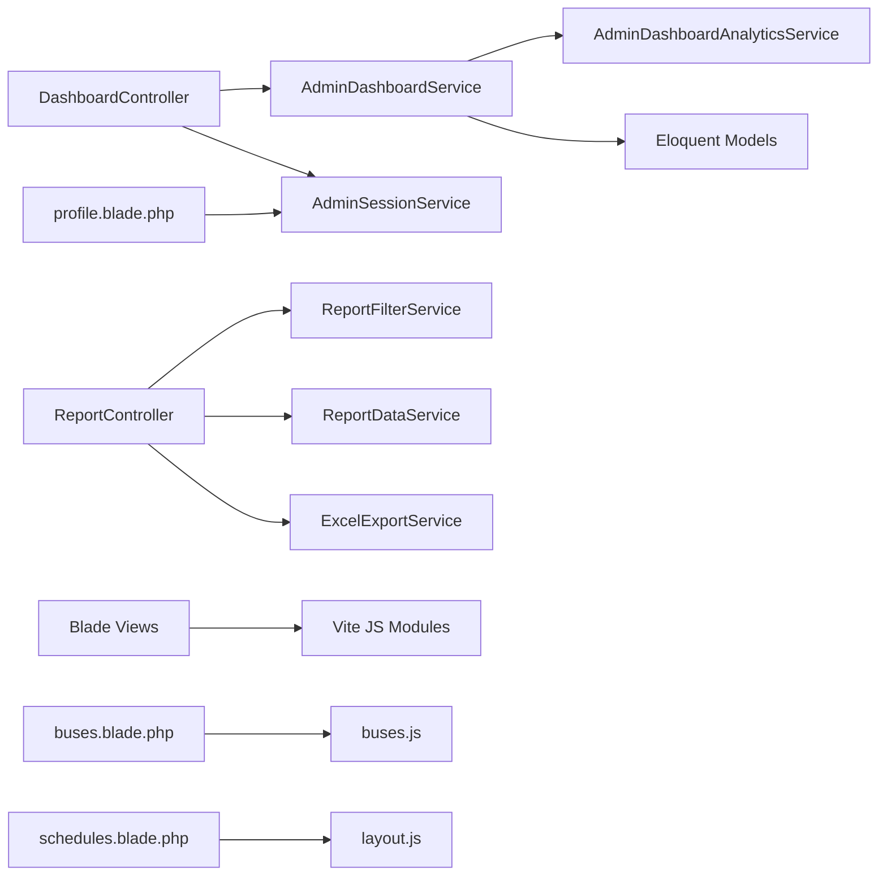

**Diagram sources**
- [DashboardController.php:1-35](file://backend/app/Http/Controllers/Admin/DashboardController.php#L1-L35)
- [AdminDashboardService.php:1-82](file://backend/app/Services/AdminDashboardService.php#L1-L82)
- [AdminDashboardAnalyticsService.php:1-228](file://backend/app/Services/AdminDashboardAnalyticsService.php#L1-L228)
- [AdminSessionService.php:1-121](file://backend/app/Services/AdminSessionService.php#L1-L121)
- [ReportController.php:1-648](file://backend/app/Http/Controllers/Admin/ReportController.php#L1-L648)
- [ExcelExportService.php:1-67](file://backend/app/Services/ExcelExportService.php#L1-L67)
- [buses.blade.php:459-467](file://backend/resources/views/admin/partials/buses.blade.php#L459-L467)
- [schedules.blade.php:152](file://backend/resources/views/admin/partials/schedules.blade.php#L152)
- [profile.blade.php:1-66](file://backend/resources/views/admin/partials/profile.blade.php#L1-L66)

**Section sources**
- [DashboardController.php:1-35](file://backend/app/Http/Controllers/Admin/DashboardController.php#L1-L35)
- [AdminDashboardService.php:1-82](file://backend/app/Services/AdminDashboardService.php#L1-L82)
- [ReportController.php:1-648](file://backend/app/Http/Controllers/Admin/ReportController.php#L1-L648)

## Performance Considerations
- Use pagination for large lists (routes, schedules, promotions, buses, stations, users) to reduce memory and rendering overhead.
- Limit preview queries to a reasonable number of rows (e.g., 500) to avoid heavy payloads.
- Prefer aggregated queries for summaries and top-N charts to minimize client-side processing.
- Reuse computed analytics data across charts instead of recomputing per chart.
- Cache frequently accessed settings and lookup tables where appropriate.
- Avoid unnecessary eager loading; load only required relationships for each view.
- **Enhanced**: Search functionality leverages server-side filtering to optimize performance with large datasets.
- **Enhanced**: Dynamic session configuration eliminates need for application restarts when changing session settings.
- **Enhanced**: AdminSessionService uses efficient database queries with fallback mechanisms for optimal performance.

[No sources needed since this section provides general guidance]

## Troubleshooting Guide
Common issues and resolutions:
- Unauthorized access: Ensure the user is authenticated and has the required menu permission. Check middleware behavior for JSON vs web requests.
- Missing menu items: Verify the user's role and menu_permissions array; super admins bypass menu checks.
- Charts not updating: Confirm that the analytics endpoint returns valid JSON and that JavaScript initializes correctly with initialData.
- Theme mismatch: Ensure CSS variables are defined and that the theme toggle dispatches the expected event for chart re-rendering.
- Export failures: Validate that headers and rows conform to the expected structure for Excel export and that PDF templates have required data.
- **Enhanced**: Search not working: Verify that the search parameters (`buses_search`, `schedules_search`) are properly passed in the URL and that the Blade templates are processing them correctly.
- **Enhanced**: Tab navigation issues: Check that the JavaScript tab resolution logic correctly identifies tabs from both hash and query parameters.
- **Enhanced**: Session expiration problems: Review AdminSessionService configuration and ensure site settings are properly saved and retrieved.
- **Enhanced**: Profile page not showing session info: Verify that DashboardController is passing `adminSessionMinutes` to the view and that the profile partial is included.
- **Enhanced**: Session timeout too short/long: Check Site Settings → Session Security configuration and verify AdminSessionService validation ranges.
- **Enhanced**: Customer tokens expiring unexpectedly: Verify customer_session_lifetime setting and check if it's set to 0 for non-expiring tokens.

**Section sources**
- [EnsureUserHasMenuPermission.php:1-41](file://backend/app/Http/Middleware/EnsureUserHasMenuPermission.php#L1-L41)
- [User.php:1-76](file://backend/app/Models/User.php#L1-L76)
- [dashboard-overview.js:1-276](file://backend/resources/js/admin/dashboard-overview.js#L1-L276)
- [ExcelExportService.php:1-67](file://backend/app/Services/ExcelExportService.php#L1-L67)
- [buses.blade.php:3-29](file://backend/resources/views/admin/partials/buses.blade.php#L3-L29)
- [schedules.blade.php:3-29](file://backend/resources/views/admin/partials/schedules.blade.php#L3-L29)
- [layout.js:54-68](file://backend/resources/js/admin/layout.js#L54-L68)
- [AdminSessionService.php:1-121](file://backend/app/Services/AdminSessionService.php#L1-L121)
- [profile.blade.php:8-14](file://backend/resources/views/admin/partials/profile.blade.php#L8-L14)
- [DashboardController.php:25-32](file://backend/app/Http/Controllers/Admin/DashboardController.php#L25-L32)
- [site-settings.blade.php:298-339](file://backend/resources/views/admin/partials/site-settings.blade.php#L298-L339)

## Conclusion
The administrative dashboard provides a comprehensive, permission-controlled interface for managing bus operations, analyzing performance, and exporting reports. Its layered architecture separates concerns between presentation, controllers, services, and data models. Role-based access control and menu permissions ensure secure navigation, while theme customization enhances usability. Reporting capabilities offer flexible previews and exports, supporting operational decision-making and compliance needs. Recent enhancements include improved search functionality for fleet coaches and schedules, dynamic session configuration through site settings, intelligent JavaScript tab navigation that seamlessly handles search parameters alongside pagination, and an enhanced profile page that displays current session expiration time with guidance to adjust settings. The integration of AdminSessionService provides robust, configurable session management that adapts to organizational security requirements while maintaining optimal user experience. These improvements significantly enhance the administrative user experience by providing greater transparency, flexibility, and control over the dashboard environment.