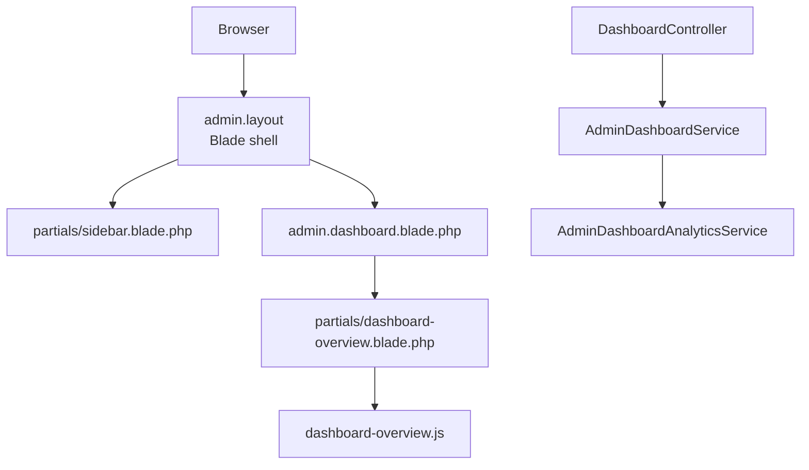
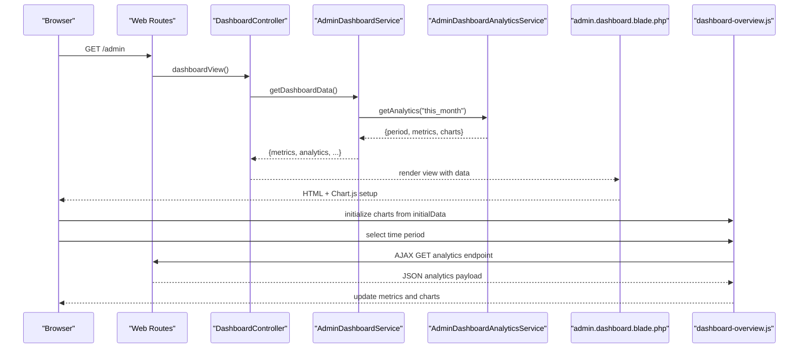
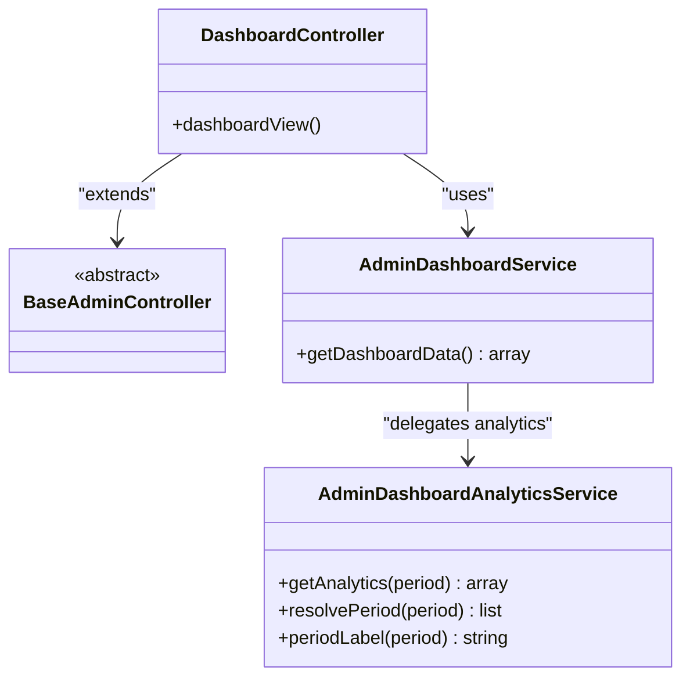
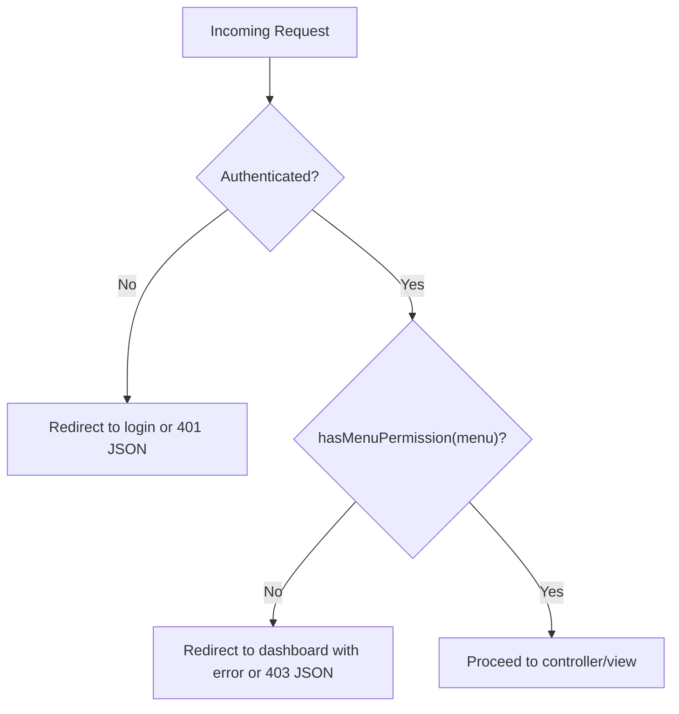
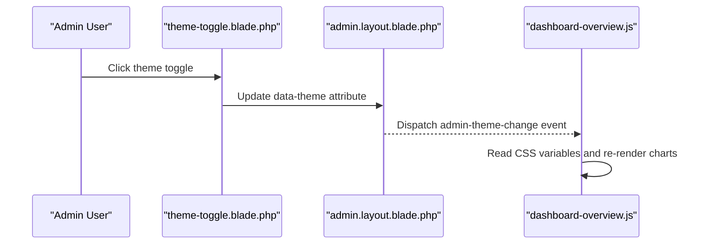
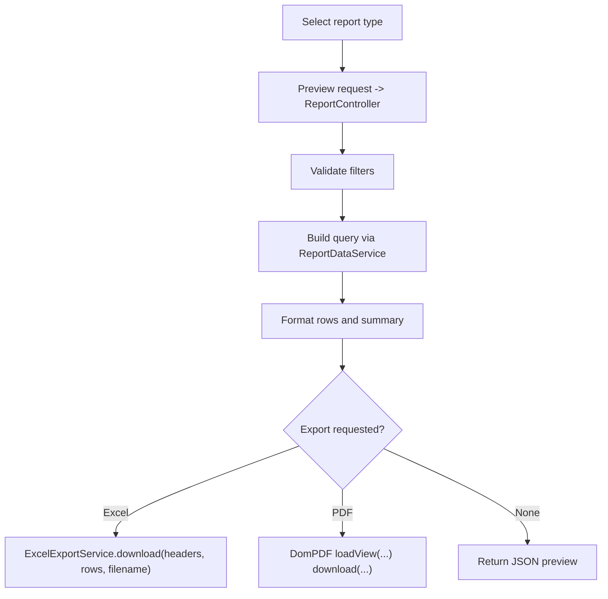
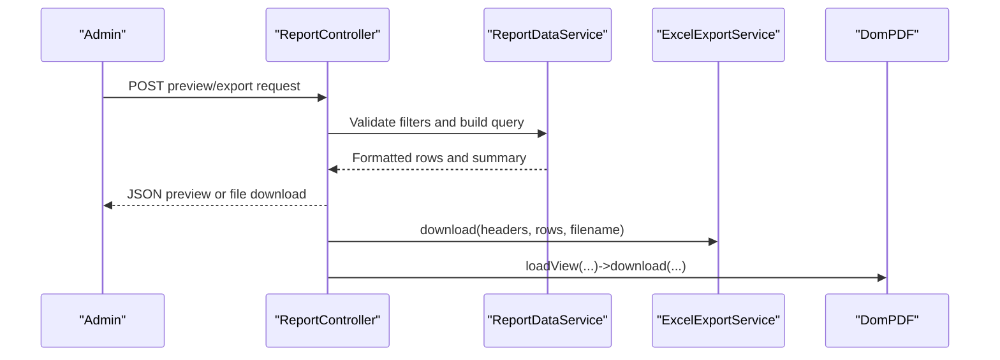
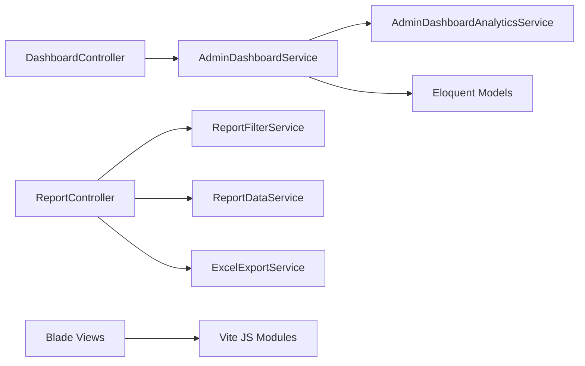

# Administrative Dashboard

<cite>
**Referenced Files in This Document**
- [dashboard.blade.php](file://backend/resources/views/admin/dashboard.blade.php)
- [layout.blade.php](file://backend/resources/views/admin/layout.blade.php)
- [sidebar.blade.php](file://backend/resources/views/admin/partials/sidebar.blade.php)
- [DashboardController.php](file://backend/app/Http/Controllers/Admin/DashboardController.php)
- [BaseAdminController.php](file://backend/app/Http/Controllers/Admin/BaseAdminController.php)
- [AdminDashboardService.php](file://backend/app/Services/AdminDashboardService.php)
- [AdminDashboardAnalyticsService.php](file://backend/app/Services/AdminDashboardAnalyticsService.php)
- [EnsureUserHasMenuPermission.php](file://backend/app/Http/Middleware/EnsureUserHasMenuPermission.php)
- [User.php](file://backend/app/Models/User.php)
- [dashboard-overview.blade.php](file://backend/resources/views/admin/partials/dashboard-overview.blade.php)
- [dashboard-overview.js](file://backend/resources/js/admin/dashboard-overview.js)
- [theme-toggle.blade.php](file://backend/resources/views/admin/partials/theme-toggle.blade.php)
- [site-settings.blade.php](file://backend/resources/views/admin/partials/site-settings.blade.php)
- [reports.blade.php](file://backend/resources/views/admin/partials/reports.blade.php)
- [ReportController.php](file://backend/app/Http/Controllers/Admin/ReportController.php)
- [ExcelExportService.php](file://backend/app/Services/ExcelExportService.php)
</cite>

## Table of Contents
1. [Introduction](#introduction)
2. [Project Structure](#project-structure)
3. [Core Components](#core-components)
4. [Architecture Overview](#architecture-overview)
5. [Detailed Component Analysis](#detailed-component-analysis)
6. [Dependency Analysis](#dependency-analysis)
7. [Performance Considerations](#performance-considerations)
8. [Troubleshooting Guide](#troubleshooting-guide)
9. [Conclusion](#conclusion)

## Introduction
This document explains the administrative dashboard built with Laravel Blade templates and JavaScript components. It covers the dashboard overview, analytics charts, filter controls, key metrics display, management modules for buses, routes, schedules, bookings, users, and site settings. It also documents role-based access control, menu permissions, theme customization, reporting capabilities, export functionality, and administrative workflows.

## Project Structure
The admin panel is a server-rendered Blade application with client-side interactivity:
- Controllers under `app/Http/Controllers/Admin` render views and delegate data loading to services.
- Services encapsulate analytics, filtering, and export logic.
- Blade templates compose the layout, sidebar, dashboard tabs, and report pages.
- JavaScript files enhance the dashboard with Chart.js analytics and theme switching.

**Diagram sources**
- [layout.blade.php:1-800](file://backend/resources/views/admin/layout.blade.php#L1-L800)
- [sidebar.blade.php:1-120](file://backend/resources/views/admin/partials/sidebar.blade.php#L1-L120)
- [dashboard.blade.php:1-98](file://backend/resources/views/admin/dashboard.blade.php#L1-L98)
- [dashboard-overview.blade.php:1-125](file://backend/resources/views/admin/partials/dashboard-overview.blade.php#L1-L125)
- [dashboard-overview.js:1-276](file://backend/resources/js/admin/dashboard-overview.js#L1-L276)
- [DashboardController.php:1-18](file://backend/app/Http/Controllers/Admin/DashboardController.php#L1-L18)
- [AdminDashboardService.php:1-82](file://backend/app/Services/AdminDashboardService.php#L1-L82)
- [AdminDashboardAnalyticsService.php:1-228](file://backend/app/Services/AdminDashboardAnalyticsService.php#L1-L228)

**Section sources**
- [layout.blade.php:1-800](file://backend/resources/views/admin/layout.blade.php#L1-L800)
- [dashboard.blade.php:1-98](file://backend/resources/views/admin/dashboard.blade.php#L1-L98)

## Core Components
- Admin layout and sidebar provide navigation, branding, and permission-gated menu items.
- Dashboard controller delegates data preparation to services.
- Dashboard service aggregates metrics, paginated lists, and site settings.
- Analytics service computes period-based metrics and chart datasets.
- Middleware enforces authentication and menu permissions.
- User model implements role checks and menu permission evaluation.
- Dashboard overview partial renders metric cards and Chart.js canvases; JavaScript handles filters and re-renders.
- Reports index and controller support multiple report types with preview, Excel, and PDF exports.
- Site settings partial manages identity, footer, maintenance mode, SEO, and integrations.

**Section sources**
- [BaseAdminController.php:1-15](file://backend/app/Http/Controllers/Admin/BaseAdminController.php#L1-L15)
- [DashboardController.php:1-18](file://backend/app/Http/Controllers/Admin/DashboardController.php#L1-L18)
- [AdminDashboardService.php:1-82](file://backend/app/Services/AdminDashboardService.php#L1-L82)
- [AdminDashboardAnalyticsService.php:1-228](file://backend/app/Services/AdminDashboardAnalyticsService.php#L1-L228)
- [EnsureUserHasMenuPermission.php:1-41](file://backend/app/Http/Middleware/EnsureUserHasMenuPermission.php#L1-L41)
- [User.php:1-76](file://backend/app/Models/User.php#L1-L76)
- [dashboard-overview.blade.php:1-125](file://backend/resources/views/admin/partials/dashboard-overview.blade.php#L1-L125)
- [dashboard-overview.js:1-276](file://backend/resources/js/admin/dashboard-overview.js#L1-L276)
- [reports.blade.php:1-127](file://backend/resources/views/admin/partials/reports.blade.php#L1-L127)
- [ReportController.php:1-648](file://backend/app/Http/Controllers/Admin/ReportController.php#L1-L648)
- [site-settings.blade.php:1-430](file://backend/resources/views/admin/partials/site-settings.blade.php#L1-L430)

## Architecture Overview
The admin dashboard follows a layered architecture:
- Presentation layer: Blade templates (layout, sidebar, dashboard, reports, site settings).
- Controller layer: Admin controllers handle requests and return views or JSON responses.
- Service layer: Business logic for dashboard analytics, report queries, and exports.
- Data layer: Eloquent models for bookings, buses, routes, schedules, stations, promotions, users, and site settings.

**Diagram sources**
- [DashboardController.php:1-18](file://backend/app/Http/Controllers/Admin/DashboardController.php#L1-L18)
- [AdminDashboardService.php:1-82](file://backend/app/Services/AdminDashboardService.php#L1-L82)
- [AdminDashboardAnalyticsService.php:1-228](file://backend/app/Services/AdminDashboardAnalyticsService.php#L1-L228)
- [dashboard.blade.php:1-98](file://backend/resources/views/admin/dashboard.blade.php#L1-L98)
- [dashboard-overview.blade.php:1-125](file://backend/resources/views/admin/partials/dashboard-overview.blade.php#L1-L125)
- [dashboard-overview.js:1-276](file://backend/resources/js/admin/dashboard-overview.js#L1-L276)

## Detailed Component Analysis

### Dashboard Overview and Analytics
The dashboard overview displays six metric cards and six charts:
- Metrics: sales revenue, confirmed bookings, pending bookings, cancelled tickets, cancel requests, average fare.
- Charts: booking status distribution, payment methods, daily revenue trend, daily bookings trend, coach type mix, top routes.

Data flow:
- The controller passes precomputed analytics to the Blade view.
- The view initializes Chart.js and sets up an AJAX endpoint for period changes.
- JavaScript reads CSS variables for theme-aware colors and updates charts on theme change.

**Diagram sources**
- [dashboard-overview.blade.php:1-125](file://backend/resources/views/admin/partials/dashboard-overview.blade.php#L1-L125)
- [dashboard-overview.js:1-276](file://backend/resources/js/admin/dashboard-overview.js#L1-L276)
- [AdminDashboardAnalyticsService.php:1-228](file://backend/app/Services/AdminDashboardAnalyticsService.php#L1-L228)

**Section sources**
- [dashboard.blade.php:1-98](file://backend/resources/views/admin/dashboard.blade.php#L1-L98)
- [dashboard-overview.blade.php:1-125](file://backend/resources/views/admin/partials/dashboard-overview.blade.php#L1-L125)
- [dashboard-overview.js:1-276](file://backend/resources/js/admin/dashboard-overview.js#L1-L276)
- [AdminDashboardService.php:1-82](file://backend/app/Services/AdminDashboardService.php#L1-L82)
- [AdminDashboardAnalyticsService.php:1-228](file://backend/app/Services/AdminDashboardAnalyticsService.php#L1-L228)

### Management Modules
The dashboard includes tabbed sections for:
- Coach services (live availability)
- Bookings logs
- Cancel requests
- Stations terminal management
- Bus fleet registration
- Transport route connections
- Departure schedules timetables
- Coupon vouchers generation
- Users & roles management
- Reports
- License management (super admin only)
- Site settings (super admin only)
- Integrations & gateways (SMS, mail, ZiniPay) (super admin only)
- Admin profile

Visibility is controlled by menu permissions and super-admin checks.

**Diagram sources**
- [DashboardController.php:1-18](file://backend/app/Http/Controllers/Admin/DashboardController.php#L1-L18)
- [BaseAdminController.php:1-15](file://backend/app/Http/Controllers/Admin/BaseAdminController.php#L1-L15)
- [AdminDashboardService.php:1-82](file://backend/app/Services/AdminDashboardService.php#L1-L82)
- [AdminDashboardAnalyticsService.php:1-228](file://backend/app/Services/AdminDashboardAnalyticsService.php#L1-L228)

**Section sources**
- [dashboard.blade.php:1-98](file://backend/resources/views/admin/dashboard.blade.php#L1-L98)
- [sidebar.blade.php:1-120](file://backend/resources/views/admin/partials/sidebar.blade.php#L1-L120)

### Role-Based Access Control and Menu Permissions
Access control combines middleware and model-level checks:
- Middleware ensures authentication and menu permission before allowing access to protected routes.
- User model provides helper methods for role checks and menu permission evaluation.
- Super admins bypass menu permission checks and can access system-level features like license, site settings, and gateways.

**Diagram sources**
- [EnsureUserHasMenuPermission.php:1-41](file://backend/app/Http/Middleware/EnsureUserHasMenuPermission.php#L1-L41)
- [User.php:1-76](file://backend/app/Models/User.php#L1-L76)

**Section sources**
- [EnsureUserHasMenuPermission.php:1-41](file://backend/app/Http/Middleware/EnsureUserHasMenuPermission.php#L1-L41)
- [User.php:1-76](file://backend/app/Models/User.php#L1-L76)
- [sidebar.blade.php:1-120](file://backend/resources/views/admin/partials/sidebar.blade.php#L1-L120)
- [dashboard.blade.php:1-98](file://backend/resources/views/admin/dashboard.blade.php#L1-L98)

### Theme Customization
Theme customization uses CSS custom properties and a toggle button:
- The layout applies theme variables via Blade partials.
- The theme toggle button switches between light and dark themes.
- JavaScript listens for theme change events and re-renders charts using current CSS variable values.

**Diagram sources**
- [theme-toggle.blade.php:1-10](file://backend/resources/views/admin/partials/theme-toggle.blade.php#L1-L10)
- [layout.blade.php:1-800](file://backend/resources/views/admin/layout.blade.php#L1-L800)
- [dashboard-overview.js:1-276](file://backend/resources/js/admin/dashboard-overview.js#L1-L276)

**Section sources**
- [layout.blade.php:1-800](file://backend/resources/views/admin/layout.blade.php#L1-L800)
- [theme-toggle.blade.php:1-10](file://backend/resources/views/admin/partials/theme-toggle.blade.php#L1-L10)
- [dashboard-overview.js:1-276](file://backend/resources/js/admin/dashboard-overview.js#L1-L276)

### Reporting Capabilities and Export Functionality
Reports are organized by type with a card gallery index:
- Report types include selling, booking, revenue, passenger, seat occupancy, cancellation, refund, payment, route-wise sales, and agent sales.
- Each report supports preview (JSON), Excel export, and PDF export.
- The report controller validates filters, builds query results, formats rows, and returns either JSON previews or downloadable files.

**Diagram sources**
- [reports.blade.php:1-127](file://backend/resources/views/admin/partials/reports.blade.php#L1-L127)
- [ReportController.php:1-648](file://backend/app/Http/Controllers/Admin/ReportController.php#L1-L648)
- [ExcelExportService.php:1-67](file://backend/app/Services/ExcelExportService.php#L1-L67)

**Section sources**
- [reports.blade.php:1-127](file://backend/resources/views/admin/partials/reports.blade.php#L1-L127)
- [ReportController.php:1-648](file://backend/app/Http/Controllers/Admin/ReportController.php#L1-L648)
- [ExcelExportService.php:1-67](file://backend/app/Services/ExcelExportService.php#L1-L67)

### Administrative Workflows
Typical workflows:
- Dashboard load: controller calls service, service aggregates analytics and lists, view renders metrics and charts, JavaScript enables interactive filters.
- Report generation: user selects report type, filters apply, preview loads via AJAX, export triggers file download.
- Settings management: super admin uploads logo/favicon, toggles maintenance mode, edits SEO metadata, saves configuration.

**Diagram sources**
- [ReportController.php:1-648](file://backend/app/Http/Controllers/Admin/ReportController.php#L1-L648)
- [ExcelExportService.php:1-67](file://backend/app/Services/ExcelExportService.php#L1-L67)

**Section sources**
- [ReportController.php:1-648](file://backend/app/Http/Controllers/Admin/ReportController.php#L1-L648)
- [ExcelExportService.php:1-67](file://backend/app/Services/ExcelExportService.php#L1-L67)

## Dependency Analysis
Key dependencies:
- DashboardController depends on AdminDashboardService.
- AdminDashboardService depends on AdminDashboardAnalyticsService and Eloquent models.
- ReportController depends on ReportFilterService, ReportDataService, and ExcelExportService.
- Views depend on Blade partials and Vite-loaded JavaScript modules.

**Diagram sources**
- [DashboardController.php:1-18](file://backend/app/Http/Controllers/Admin/DashboardController.php#L1-L18)
- [AdminDashboardService.php:1-82](file://backend/app/Services/AdminDashboardService.php#L1-L82)
- [AdminDashboardAnalyticsService.php:1-228](file://backend/app/Services/AdminDashboardAnalyticsService.php#L1-L228)
- [ReportController.php:1-648](file://backend/app/Http/Controllers/Admin/ReportController.php#L1-L648)
- [ExcelExportService.php:1-67](file://backend/app/Services/ExcelExportService.php#L1-L67)

**Section sources**
- [DashboardController.php:1-18](file://backend/app/Http/Controllers/Admin/DashboardController.php#L1-L18)
- [AdminDashboardService.php:1-82](file://backend/app/Services/AdminDashboardService.php#L1-L82)
- [ReportController.php:1-648](file://backend/app/Http/Controllers/Admin/ReportController.php#L1-L648)

## Performance Considerations
- Use pagination for large lists (routes, schedules, promotions, buses, stations, users) to reduce memory and rendering overhead.
- Limit preview queries to a reasonable number of rows (e.g., 500) to avoid heavy payloads.
- Prefer aggregated queries for summaries and top-N charts to minimize client-side processing.
- Reuse computed analytics data across charts instead of recomputing per chart.
- Cache frequently accessed settings and lookup tables where appropriate.
- Avoid unnecessary eager loading; load only required relationships for each view.

[No sources needed since this section provides general guidance]

## Troubleshooting Guide
Common issues and resolutions:
- Unauthorized access: Ensure the user is authenticated and has the required menu permission. Check middleware behavior for JSON vs web requests.
- Missing menu items: Verify the user’s role and menu_permissions array; super admins bypass menu checks.
- Charts not updating: Confirm that the analytics endpoint returns valid JSON and that JavaScript initializes correctly with initialData.
- Theme mismatch: Ensure CSS variables are defined and that the theme toggle dispatches the expected event for chart re-rendering.
- Export failures: Validate that headers and rows conform to the expected structure for Excel export and that PDF templates have required data.

**Section sources**
- [EnsureUserHasMenuPermission.php:1-41](file://backend/app/Http/Middleware/EnsureUserHasMenuPermission.php#L1-L41)
- [User.php:1-76](file://backend/app/Models/User.php#L1-L76)
- [dashboard-overview.js:1-276](file://backend/resources/js/admin/dashboard-overview.js#L1-L276)
- [ExcelExportService.php:1-67](file://backend/app/Services/ExcelExportService.php#L1-L67)

## Conclusion
The administrative dashboard provides a comprehensive, permission-controlled interface for managing bus operations, analyzing performance, and exporting reports. Its layered architecture separates concerns between presentation, controllers, services, and data models. Role-based access control and menu permissions ensure secure navigation, while theme customization enhances usability. Reporting capabilities offer flexible previews and exports, supporting operational decision-making and compliance needs.