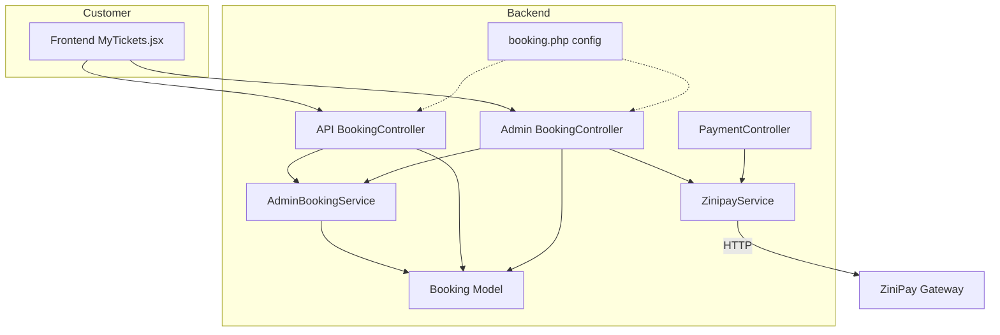
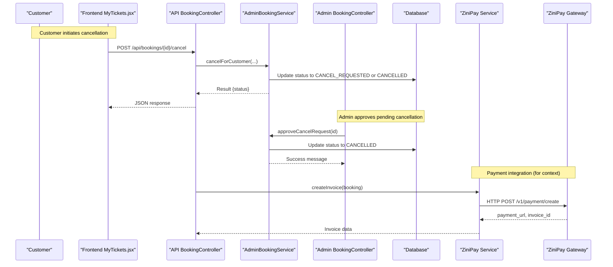
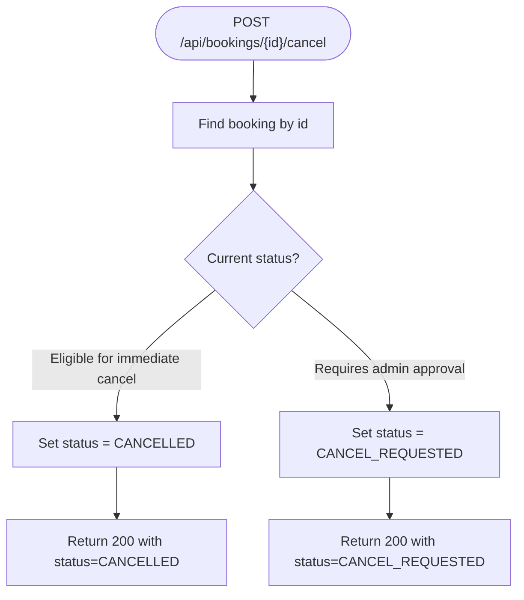
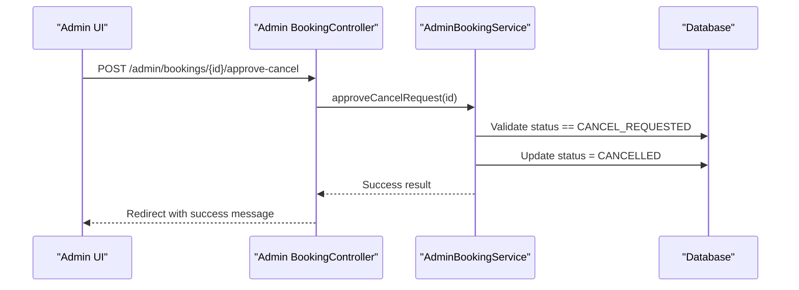
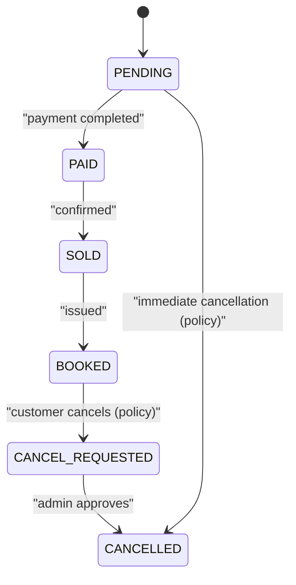
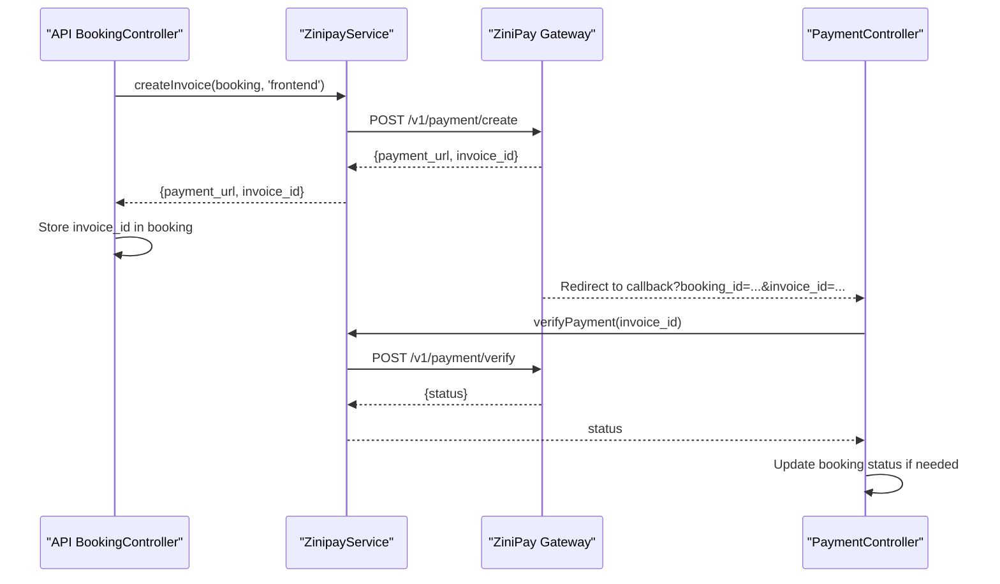
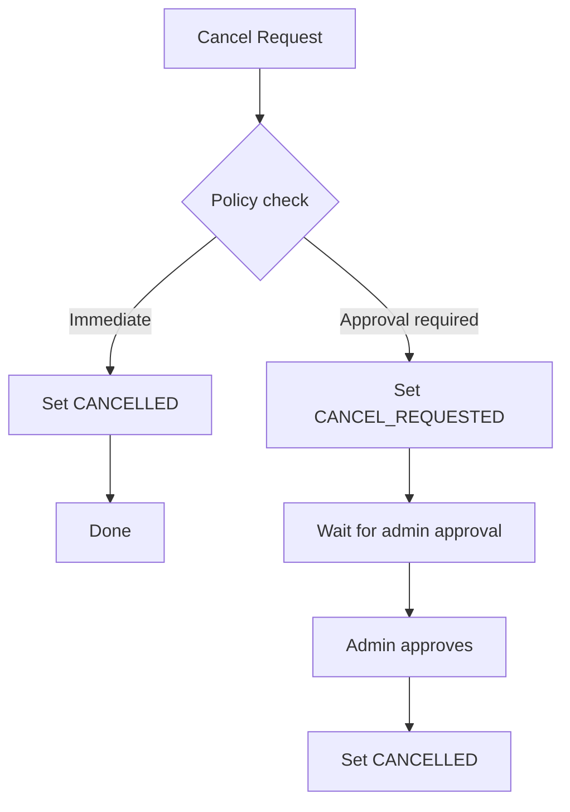
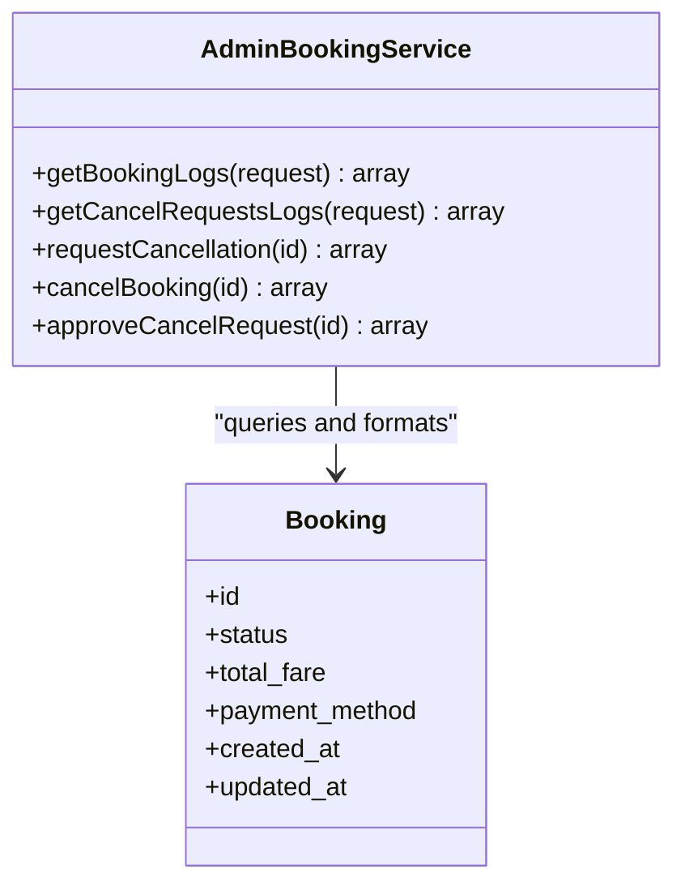
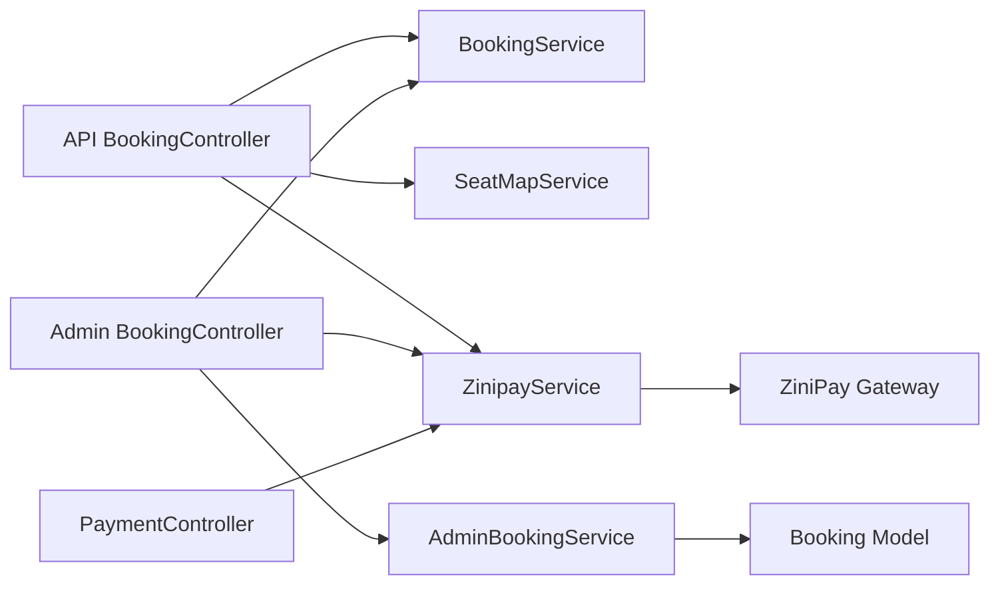

# Booking Cancellation & Refunds

<cite>
**Referenced Files in This Document**
- [API BookingController.php](file://backend/app/Http/Controllers/API/BookingController.php)
- [Admin BookingController.php](file://backend/app/Http/Controllers/Admin/BookingController.php)
- [AdminBookingService.php](file://backend/app/Services/AdminBookingService.php)
- [ZinipayService.php](file://backend/app/Services/ZinipayService.php)
- [PaymentController.php](file://backend/app/Http/Controllers/PaymentController.php)
- [Booking.php](file://backend/app/Models/Booking.php)
- [booking.php config](file://backend/config/booking.php)
- [MyTickets.jsx](file://frontend/src/components/MyTickets.jsx)
- [admin bookings.js](file://backend/resources/js/admin/bookings.js)
- [AdminApiControllerTest.php](file://backend/tests/Feature/AdminApiControllerTest.php)
- [BookingFlowTest.php](file://backend/tests/Feature/BookingFlowTest.php)
- [k6 admin.js](file://k6/flows/admin.js)
</cite>

## Table of Contents
1. [Introduction](#introduction)
2. [Project Structure](#project-structure)
3. [Core Components](#core-components)
4. [Architecture Overview](#architecture-overview)
5. [Detailed Component Analysis](#detailed-component-analysis)
6. [Dependency Analysis](#dependency-analysis)
7. [Performance Considerations](#performance-considerations)
8. [Troubleshooting Guide](#troubleshooting-guide)
9. [Conclusion](#conclusion)

## Introduction
This document explains the booking cancellation and refund processing system. It covers:
- The customer-initiated cancellation workflow and status transitions from CANCEL_REQUESTED to CANCELLED.
- The admin approval process for pending cancellations.
- Payment gateway integration with ZiniPay for payments and how refunds are intended to be handled.
- Policy enforcement, partial vs full refund scenarios, and audit trails.
- API examples, error handling, and notification workflows.

## Project Structure
Cancellation and refund logic spans controllers, services, models, configuration, frontend UI, tests, and load-testing flows:
- Customer-facing API endpoints for cancel and pay.
- Admin endpoints for cancel request submission and approval.
- Services that encapsulate business rules and payment gateway interactions.
- A model representing bookings with status fields.
- Configuration for pricing-related settings.
- Frontend components that expose cancellation actions and notices.
- Tests validating permission checks and state transitions.
- k6 flows demonstrating end-to-end admin workflows including approve-cancel.

**Diagram sources**
- [API BookingController.php:19-73](file://backend/app/Http/Controllers/API/BookingController.php#L19-L73)
- [Admin BookingController.php:88-118](file://backend/app/Http/Controllers/Admin/BookingController.php#L88-L118)
- [AdminBookingService.php:107-223](file://backend/app/Services/AdminBookingService.php#L107-L223)
- [PaymentController.php:21-45](file://backend/app/Http/Controllers/PaymentController.php#L21-L45)
- [ZinipayService.php:27-97](file://backend/app/Services/ZinipayService.php#L27-L97)
- [Booking.php:12-31](file://backend/app/Models/Booking.php#L12-L31)
- [booking.php config:4-10](file://backend/config/booking.php#L4-L10)

**Section sources**
- [API BookingController.php:19-73](file://backend/app/Http/Controllers/API/BookingController.php#L19-L73)
- [Admin BookingController.php:88-118](file://backend/app/Http/Controllers/Admin/BookingController.php#L88-L118)
- [AdminBookingService.php:107-223](file://backend/app/Services/AdminBookingService.php#L107-L223)
- [PaymentController.php:21-45](file://backend/app/Http/Controllers/PaymentController.php#L21-L45)
- [ZinipayService.php:27-97](file://backend/app/Services/ZinipayService.php#L27-L97)
- [Booking.php:12-31](file://backend/app/Models/Booking.php#L12-L31)
- [booking.php config:4-10](file://backend/config/booking.php#L4-L10)

## Core Components
- API BookingController: Exposes customer endpoints for creating bookings, listing user bookings, cancelling bookings, initiating ZiniPay payments, and seat hold/release.
- Admin BookingController: Provides admin UI endpoints for creating/updating/deleting bookings, requesting cancellation, approving cancellation requests, and initiating ZiniPay payments for admin-created bookings.
- AdminBookingService: Encapsulates admin-side cancellation operations (request, approve, direct cancel), and provides logs for recent bookings and pending cancellation requests.
- ZinipayService: Integrates with ZiniPay to create invoices and verify payment status; handles API key validation, timeouts, and logging.
- PaymentController: Handles ZiniPay callback redirection, verifies invoice status, and updates booking state accordingly.
- Booking Model: Defines fillable fields including status and total_fare, relationships, and a PNR attribute.
- booking.php config: Holds service and gateway charge settings used by pricing logic elsewhere in the system.

Key responsibilities:
- Status management: PENDING, PAID, SOLD, BOOKED, CANCEL_REQUESTED, CANCELLED.
- Cancellation policy enforcement: Immediate cancellation for certain states; otherwise requires admin approval.
- Payment flow: Invoice creation and verification via ZiniPay.
- Audit trail: Logs for bookings and cancellation requests.

**Section sources**
- [API BookingController.php:19-73](file://backend/app/Http/Controllers/API/BookingController.php#L19-L73)
- [Admin BookingController.php:20-118](file://backend/app/Http/Controllers/Admin/BookingController.php#L20-L118)
- [AdminBookingService.php:58-223](file://backend/app/Services/AdminBookingService.php#L58-L223)
- [ZinipayService.php:27-139](file://backend/app/Services/ZinipayService.php#L27-L139)
- [PaymentController.php:21-45](file://backend/app/Http/Controllers/PaymentController.php#L21-L45)
- [Booking.php:12-31](file://backend/app/Models/Booking.php#L12-L31)
- [booking.php config:4-10](file://backend/config/booking.php#L4-L10)

## Architecture Overview
The cancellation and refund architecture integrates customer and admin flows with a payment gateway.

**Diagram sources**
- [API BookingController.php:62-73](file://backend/app/Http/Controllers/API/BookingController.php#L62-L73)
- [AdminBookingService.php:107-223](file://backend/app/Services/AdminBookingService.php#L107-L223)
- [Admin BookingController.php:109-118](file://backend/app/Http/Controllers/Admin/BookingController.php#L109-L118)
- [ZinipayService.php:27-97](file://backend/app/Services/ZinipayService.php#L27-L97)

## Detailed Component Analysis

### Customer Cancellation Workflow
- Entry point: Customer calls the cancel endpoint on the API controller.
- Business logic: Delegates to a service method that enforces policy based on current booking status.
- Outcomes:
  - If eligible for immediate cancellation, status becomes CANCELLED.
  - Otherwise, status becomes CANCEL_REQUESTED, requiring admin approval.
- Response: JSON payload with updated status.

**Diagram sources**
- [API BookingController.php:62-73](file://backend/app/Http/Controllers/API/BookingController.php#L62-L73)
- [BookingFlowTest.php:320-364](file://backend/tests/Feature/BookingFlowTest.php#L320-L364)

**Section sources**
- [API BookingController.php:62-73](file://backend/app/Http/Controllers/API/BookingController.php#L62-L73)
- [BookingFlowTest.php:320-364](file://backend/tests/Feature/BookingFlowTest.php#L320-L364)

### Admin Approval Process
- Admin UI exposes an approve action for pending cancellation requests.
- Controller delegates to AdminBookingService.approveCancelRequest.
- Service validates that the booking is in CANCEL_REQUESTED and updates it to CANCELLED.
- Redirects back with success or error messages.

**Diagram sources**
- [Admin BookingController.php:109-118](file://backend/app/Http/Controllers/Admin/BookingController.php#L109-L118)
- [AdminBookingService.php:192-223](file://backend/app/Services/AdminBookingService.php#L192-L223)

**Section sources**
- [Admin BookingController.php:109-118](file://backend/app/Http/Controllers/Admin/BookingController.php#L109-L118)
- [AdminBookingService.php:192-223](file://backend/app/Services/AdminBookingService.php#L192-L223)
- [AdminApiControllerTest.php:126-159](file://backend/tests/Feature/AdminApiControllerTest.php#L126-L159)

### Status Transitions
- Allowed statuses include PENDING, PAID, SOLD, BOOKED, CANCEL_REQUESTED, CANCELLED.
- Typical transitions:
  - CANCEL_REQUESTED → CANCELLED upon admin approval.
  - Immediate cancellation may transition directly to CANCELLED depending on policy.

**Diagram sources**
- [API BookingController.php:34](file://backend/app/Http/Controllers/API/BookingController.php#L34)
- [Admin BookingController.php:33](file://backend/app/Http/Controllers/Admin/BookingController.php#L33)
- [AdminBookingService.php:107-223](file://backend/app/Services/AdminBookingService.php#L107-L223)

**Section sources**
- [API BookingController.php:34](file://backend/app/Http/Controllers/API/BookingController.php#L34)
- [Admin BookingController.php:33](file://backend/app/Http/Controllers/Admin/BookingController.php#L33)
- [AdminBookingService.php:107-223](file://backend/app/Services/AdminBookingService.php#L107-L223)

### Payment Gateway Integration (ZiniPay)
- Invoice creation:
  - API and Admin controllers call ZinipayService.createInvoice.
  - Service constructs redirect/cancel/webhook URLs and posts to ZiniPay.
  - On success, returns payment_url and invoice_id; booking.payment_invoice_id is stored.
- Payment verification:
  - PaymentController.callback receives redirect from ZiniPay.
  - Verifies invoice status via ZinipayService.verifyPayment.
  - Updates booking status accordingly.

**Diagram sources**
- [API BookingController.php:118-148](file://backend/app/Http/Controllers/API/BookingController.php#L118-L148)
- [ZinipayService.php:27-97](file://backend/app/Services/ZinipayService.php#L27-L97)
- [PaymentController.php:21-45](file://backend/app/Http/Controllers/PaymentController.php#L21-L45)

**Section sources**
- [API BookingController.php:118-148](file://backend/app/Http/Controllers/API/BookingController.php#L118-L148)
- [ZinipayService.php:27-97](file://backend/app/Services/ZinipayService.php#L27-L97)
- [PaymentController.php:21-45](file://backend/app/Http/Controllers/PaymentController.php#L21-L45)

### Refund Calculation Logic and Scenarios
- Current implementation focuses on cancellation status transitions and does not implement automatic refund calculations or refund execution within the codebase.
- Refund amount determination should consider:
  - Total fare paid (booking.total_fare).
  - Applicable fees (service_charge, gateway_charge) defined in configuration.
  - Partial vs full refund policies based on timing and reason.
- Since no explicit refund calculation or refund initiation is present in the analyzed files, any refund logic must be added to the backend to:
  - Compute refund amounts using configured charges/discounts.
  - Initiate refunds through the payment gateway’s refund API (not implemented here).
  - Record refund transactions and update booking status accordingly.

Note: The existing configuration includes service and gateway charge settings that can inform future refund calculations.

**Section sources**
- [booking.php config:4-10](file://backend/config/booking.php#L4-L10)
- [Booking.php:12-31](file://backend/app/Models/Booking.php#L12-L31)

### Cancellation Policy Enforcement
- Immediate cancellation:
  - Certain statuses allow direct transition to CANCELLED without admin approval.
- Request-based cancellation:
  - Other statuses require admin approval; booking moves to CANCEL_REQUESTED first.
- Validation:
  - Controllers validate allowed statuses and prevent duplicate cancellation requests.

**Diagram sources**
- [API BookingController.php:62-73](file://backend/app/Http/Controllers/API/BookingController.php#L62-L73)
- [AdminBookingService.php:107-223](file://backend/app/Services/AdminBookingService.php#L107-L223)

**Section sources**
- [API BookingController.php:62-73](file://backend/app/Http/Controllers/API/BookingController.php#L62-L73)
- [AdminBookingService.php:107-223](file://backend/app/Services/AdminBookingService.php#L107-L223)

### Audit Trail for Cancellation Activities
- AdminBookingService provides:
  - getBookingLogs: Recent bookings with schedule details.
  - getCancelRequestsLogs: Pending cancellation requests with schedule details.
- These logs support auditing and reporting of cancellation activities.

**Diagram sources**
- [AdminBookingService.php:58-105](file://backend/app/Services/AdminBookingService.php#L58-L105)
- [AdminBookingService.php:225-252](file://backend/app/Services/AdminBookingService.php#L225-L252)
- [Booking.php:12-31](file://backend/app/Models/Booking.php#L12-L31)

**Section sources**
- [AdminBookingService.php:58-105](file://backend/app/Services/AdminBookingService.php#L58-L105)
- [AdminBookingService.php:225-252](file://backend/app/Services/AdminBookingService.php#L225-L252)

### Notification Workflows
- SMS notifications are available via SmsGatewayService and are typically triggered on booking events such as successful payment.
- For cancellations, ensure notifications are sent when:
  - Cancellation request is submitted.
  - Admin approves cancellation.
  - Refund is processed (when implemented).
- Integrate SMS sending into cancellation and approval flows to keep customers informed.

**Section sources**
- [SmsGatewayService.php:43-87](file://backend/app/Services/SmsGatewayService.php#L43-L87)

### Examples of Cancellation API Calls
- Customer cancels a booking:
  - Method: POST
  - Endpoint: /api/bookings/{id}/cancel
  - Authentication: Required (Sanctum)
  - Response: JSON with updated status (CANCELLED or CANCEL_REQUESTED)
- Admin approves a cancellation request:
  - Method: POST
  - Endpoint: /admin/bookings/{id}/approve-cancel
  - Authentication: Admin session
  - Response: Redirect with success/error message

These examples are validated by tests and load-testing flows.

**Section sources**
- [BookingFlowTest.php:320-364](file://backend/tests/Feature/BookingFlowTest.php#L320-L364)
- [AdminApiControllerTest.php:126-159](file://backend/tests/Feature/AdminApiControllerTest.php#L126-L159)
- [k6 admin.js:80-85](file://k6/flows/admin.js#L80-L85)

### Error Handling for Failed Refunds
- While explicit refund failure handling is not implemented in the analyzed files, recommended practices include:
  - Logging gateway errors during refund attempts.
  - Returning structured error responses to clients.
  - Marking refund attempts as failed in an audit log.
  - Notifying customers of refund failures and next steps.
- For payment-related errors, ZinipayService already logs exceptions and non-successful responses.

**Section sources**
- [ZinipayService.php:27-97](file://backend/app/Services/ZinipayService.php#L27-L97)
- [ZinipayService.php:105-139](file://backend/app/Services/ZinipayService.php#L105-L139)

### Frontend Cancellation UX
- MyTickets component shows a notice indicating that cancellation requests require admin verification and that refunds will be processed to the original payment method after approval.
- Admin UI includes buttons to request cancellation and displays appropriate controls based on booking status.

**Section sources**
- [MyTickets.jsx:324-332](file://frontend/src/components/MyTickets.jsx#L324-L332)
- [admin bookings.js:81-88](file://backend/resources/js/admin/bookings.js#L81-L88)

## Dependency Analysis
- API BookingController depends on:
  - BookingService (for booking creation/formatting).
  - SeatMapService (for seat hold/release).
  - ZinipayService (for payment invoice creation).
- Admin BookingController depends on:
  - BookingService (for admin booking creation).
  - ZinipayService (for admin payment initiation).
  - AdminBookingService (for cancellation operations).
- AdminBookingService depends on:
  - Booking model for queries and updates.
- PaymentController depends on:
  - ZinipayService for verification.
- ZinipayService depends on:
  - External ZiniPay gateway via HTTP.

**Diagram sources**
- [API BookingController.php:12-16](file://backend/app/Http/Controllers/API/BookingController.php#L12-L16)
- [Admin BookingController.php:13-17](file://backend/app/Http/Controllers/Admin/BookingController.php#L13-L17)
- [AdminBookingService.php:5-7](file://backend/app/Services/AdminBookingService.php#L5-L7)
- [PaymentController.php:13-16](file://backend/app/Http/Controllers/PaymentController.php#L13-L16)
- [ZinipayService.php:5-7](file://backend/app/Services/ZinipayService.php#L5-L7)

**Section sources**
- [API BookingController.php:12-16](file://backend/app/Http/Controllers/API/BookingController.php#L12-L16)
- [Admin BookingController.php:13-17](file://backend/app/Http/Controllers/Admin/BookingController.php#L13-L17)
- [AdminBookingService.php:5-7](file://backend/app/Services/AdminBookingService.php#L5-L7)
- [PaymentController.php:13-16](file://backend/app/Http/Controllers/PaymentController.php#L13-L16)
- [ZinipayService.php:5-7](file://backend/app/Services/ZinipayService.php#L5-L7)

## Performance Considerations
- Avoid N+1 queries when fetching cancellation logs; use eager loading for schedule, bus, and route details (already applied in AdminBookingService).
- Cache frequently accessed configuration values (e.g., service/gateway charges) to reduce environment lookups.
- Use background jobs for SMS notifications and refund processing to keep request latency low.
- Implement idempotency keys for refund attempts to prevent duplicate charges/refunds.

[No sources needed since this section provides general guidance]

## Troubleshooting Guide
Common issues and resolutions:
- Duplicate cancellation request:
  - Symptom: Error indicating cancellation already requested.
  - Resolution: Wait for admin approval or contact support.
- Unauthorized access to cancel-requests logs:
  - Symptom: 403 Forbidden when accessing admin cancel logs.
  - Resolution: Ensure admin has proper permissions.
- Payment callback errors:
  - Symptom: Missing payment reference or invalid booking.
  - Resolution: Verify booking exists and payment_invoice_id is set; check ZiniPay configuration.
- SMS not sent:
  - Symptom: No SMS after booking or cancellation.
  - Resolution: Check SMS gateway configuration and active status; test message functionality.

**Section sources**
- [AdminApiControllerTest.php:126-159](file://backend/tests/Feature/AdminApiControllerTest.php#L126-L159)
- [PaymentController.php:21-45](file://backend/app/Http/Controllers/PaymentController.php#L21-L45)
- [SmsGatewayService.php:43-87](file://backend/app/Services/SmsGatewayService.php#L43-L87)

## Conclusion
The system implements a robust cancellation workflow with clear status transitions and admin oversight. Payment integration with ZiniPay supports secure invoicing and verification. While refund calculation and execution are not implemented in the analyzed code, the architecture allows for extension to compute refunds based on configured charges and initiate them through the payment gateway. Audit logs and notifications provide visibility and communication throughout the process. Future enhancements should focus on implementing refund logic, comprehensive error handling for refunds, and automated notifications for all cancellation lifecycle events.

[No sources needed since this section summarizes without analyzing specific files]