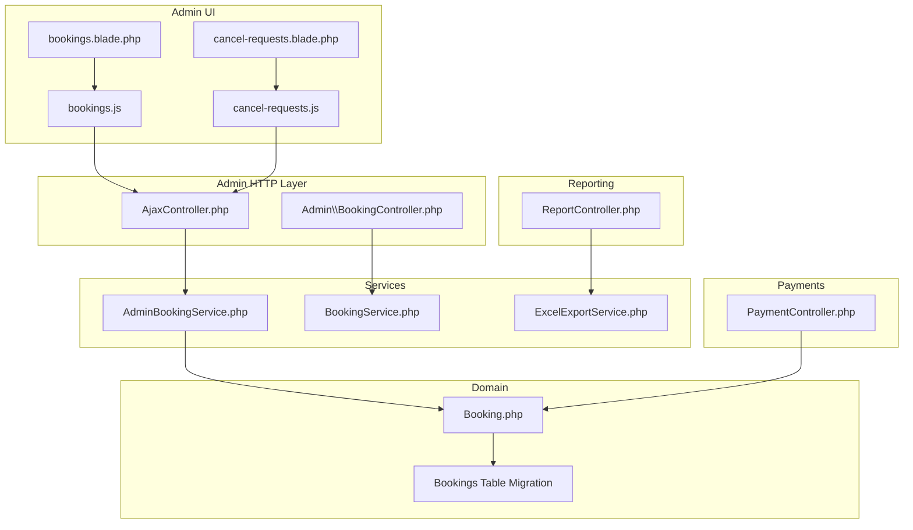
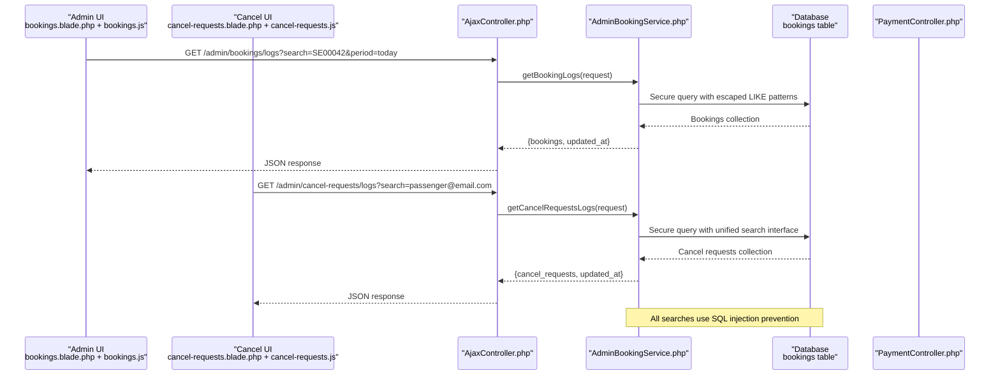
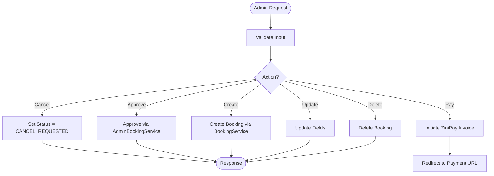
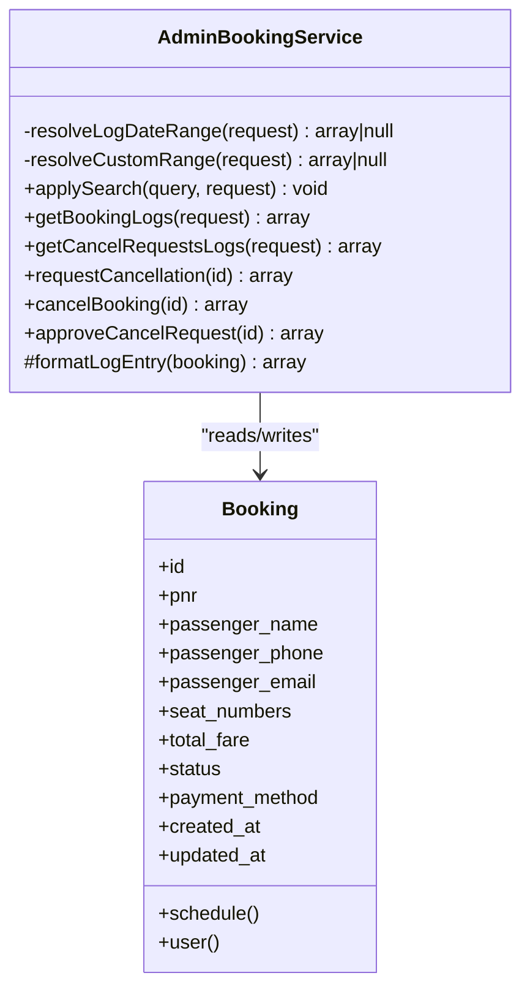
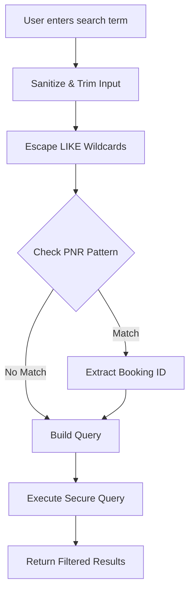
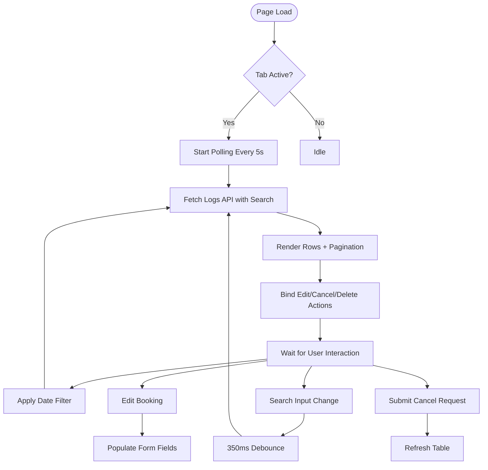
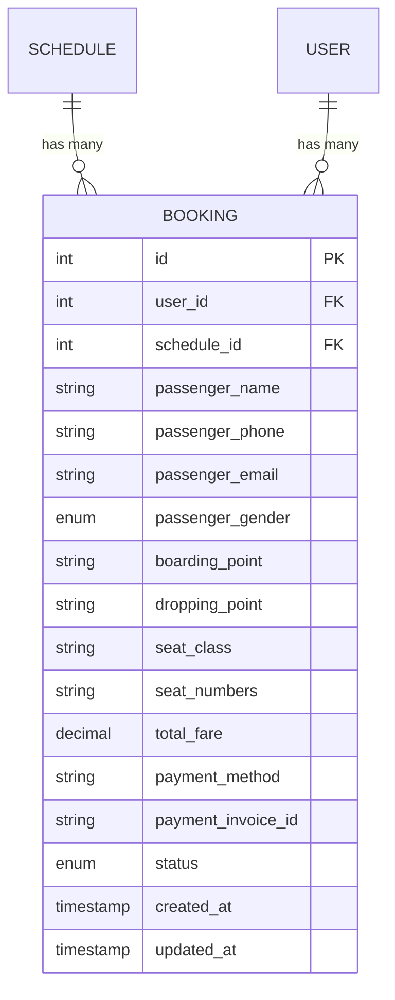
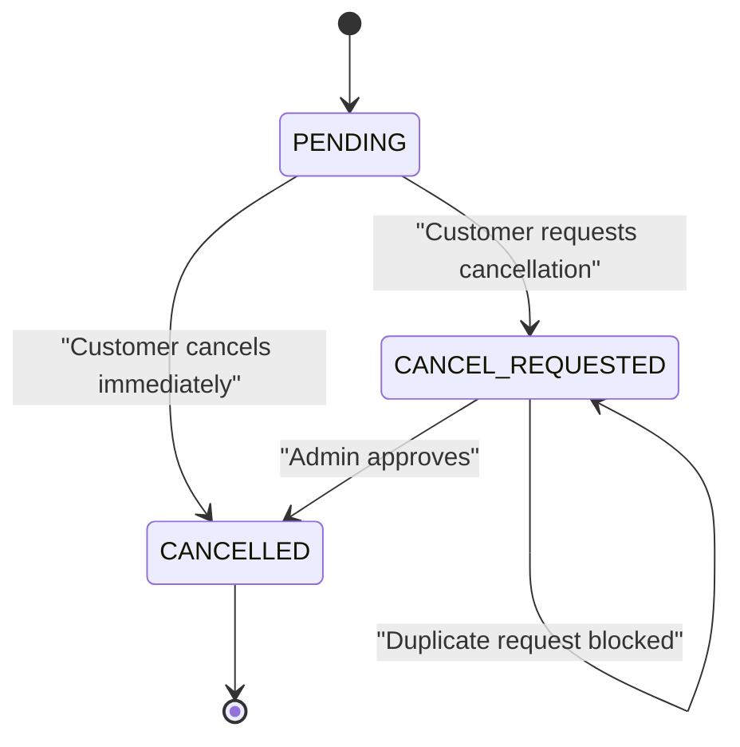
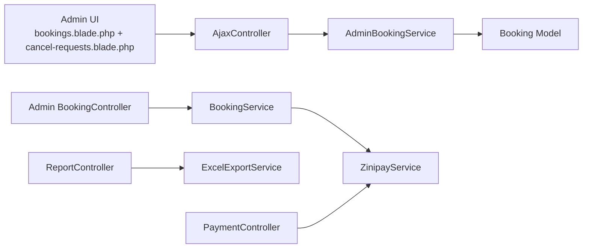

# Booking Management & Oversight

<cite>
**Referenced Files in This Document**
- [BookingController.php](file://backend/app/Http/Controllers/Admin/BookingController.php)
- [AjaxController.php](file://backend/app/Http/Controllers/Admin/AjaxController.php)
- [AdminBookingService.php](file://backend/app/Services/AdminBookingService.php)
- [BookingService.php](file://backend/app/Services/BookingService.php)
- [Booking.php](file://backend/app/Models/Booking.php)
- [bookings.blade.php](file://backend/resources/views/admin/partials/bookings.blade.php)
- [cancel-requests.blade.php](file://backend/resources/views/admin/partials/cancel-requests.blade.php)
- [bookings.js](file://backend/resources/js/admin/bookings.js)
- [cancel-requests.js](file://backend/resources/js/admin/cancel-requests.js)
- [web.php](file://backend/routes/web.php)
- [2026_06_01_000050_create_bookings_table.php](file://backend/database/migrations/2026_06_01_000050_create_bookings_table.php)
- [ReportController.php](file://backend/app/Http/Controllers/Admin/ReportController.php)
- [ExcelExportService.php](file://backend/app/Services/ExcelExportService.php)
- [PaymentController.php](file://backend/app/Http/Controllers/PaymentController.php)
- [SECURITY_IMPLEMENTATION_GUIDE.md](file://SECURITY_IMPLEMENTATION_GUIDE.md)
</cite>

## Update Summary
**Changes Made**
- Enhanced search functionality with intelligent PNR code handling and passenger search capabilities
- Added SQL injection prevention through proper LIKE wildcard escaping
- Unified search interface for both booking logs and cancellation requests
- Improved security measures for search query processing

## Table of Contents
1. [Introduction](#introduction)
2. [Project Structure](#project-structure)
3. [Core Components](#core-components)
4. [Architecture Overview](#architecture-overview)
5. [Detailed Component Analysis](#detailed-component-analysis)
6. [Dependency Analysis](#dependency-analysis)
7. [Performance Considerations](#performance-considerations)
8. [Security Enhancements](#security-enhancements)
9. [Troubleshooting Guide](#troubleshooting-guide)
10. [Conclusion](#conclusion)

## Introduction
This document explains the booking oversight and management system for administrators. It covers how admins view, filter, create, update, cancel, approve cancellations, and export bookings. It also documents the admin booking service that enforces business rules around cancellation workflows and refund-related status transitions. The system supports filtering by date range, route, passenger, and booking status, and provides live polling, inline editing, and reporting/export capabilities.

**Updated** Enhanced search functionality now supports intelligent PNR code recognition, passenger name/email/phone search, and SQL injection prevention across both booking logs and cancellation requests.

## Project Structure
The booking oversight feature spans controllers, services, models, Blade views, JavaScript, routes, migrations, and reports:

- Admin UI: Blade partials and JavaScript provide live tables with unified search interfaces, filters, pagination, inline edit, cancel request, and delete actions.
- Admin API endpoints: Ajax controller exposes JSON endpoints for logs and cancel requests with enhanced search capabilities.
- Business logic: Admin booking service encapsulates cancellation workflows, log formatting, and advanced search functionality with SQL injection protection.
- Data model: Booking model defines fields, relationships, and PNR generation.
- Database schema: Bookings table migration includes indexes for performance.
- Reporting and export: Report controller and Excel export service support bulk export of booking data.
- Payment integration: Payment controller processes ZiniPay webhooks to finalize payments.

**Diagram sources**
- [bookings.blade.php:1-177](file://backend/resources/views/admin/partials/bookings.blade.php#L1-L177)
- [cancel-requests.blade.php:1-87](file://backend/resources/views/admin/partials/cancel-requests.blade.php#L1-L87)
- [bookings.js:1-200](file://backend/resources/js/admin/bookings.js#L1-L200)
- [cancel-requests.js:1-200](file://backend/resources/js/admin/cancel-requests.js#L1-L200)
- [AjaxController.php:1-150](file://backend/app/Http/Controllers/Admin/AjaxController.php#L1-L150)
- [AdminBookingService.php:1-296](file://backend/app/Services/AdminBookingService.php#L1-L296)
- [BookingService.php:1-335](file://backend/app/Services/BookingService.php#L1-L335)
- [Booking.php:1-49](file://backend/app/Models/Booking.php#L1-L49)
- [2026_06_01_000050_create_bookings_table.php:1-53](file://backend/database/migrations/2026_06_01_000050_create_bookings_table.php#L1-L53)
- [ReportController.php:166-197](file://backend/app/Http/Controllers/Admin/ReportController.php#L166-L197)
- [ExcelExportService.php:1-67](file://backend/app/Services/ExcelExportService.php#L1-L67)
- [PaymentController.php:84-119](file://backend/app/Http/Controllers/PaymentController.php#L84-L119)

**Section sources**
- [bookings.blade.php:1-177](file://backend/resources/views/admin/partials/bookings.blade.php#L1-L177)
- [cancel-requests.blade.php:1-87](file://backend/resources/views/admin/partials/cancel-requests.blade.php#L1-L87)
- [bookings.js:1-200](file://backend/resources/js/admin/bookings.js#L1-L200)
- [cancel-requests.js:1-200](file://backend/resources/js/admin/cancel-requests.js#L1-L200)
- [AjaxController.php:1-150](file://backend/app/Http/Controllers/Admin/AjaxController.php#L1-L150)
- [AdminBookingService.php:1-296](file://backend/app/Services/AdminBookingService.php#L1-L296)
- [BookingService.php:1-335](file://backend/app/Services/BookingService.php#L1-L335)
- [Booking.php:1-49](file://backend/app/Models/Booking.php#L1-L49)
- [2026_06_01_000050_create_bookings_table.php:1-53](file://backend/database/migrations/2026_06_01_000050_create_bookings_table.php#L1-L53)
- [ReportController.php:166-197](file://backend/app/Http/Controllers/Admin/ReportController.php#L166-L197)
- [ExcelExportService.php:1-67](file://backend/app/Services/ExcelExportService.php#L1-L67)
- [PaymentController.php:84-119](file://backend/app/Http/Controllers/PaymentController.php#L84-L119)

## Core Components
- Admin Booking Controller: Handles creating, updating, deleting, cancelling, approving cancellation requests, and initiating ZiniPay payment from the admin panel.
- Admin Ajax Controller: Exposes JSON endpoints for live booking logs and cancel request submission with enhanced search validation.
- Admin Booking Service: Implements cancellation workflow helpers, log retrieval with date-range filtering, advanced search functionality with SQL injection prevention, and response formatting.
- Shared Booking Service: Provides booking creation (admin and customer), seat validation, pricing, SMS notifications, and customer cancellation logic.
- Booking Model: Defines fillable fields, casts, relationships, and PNR attribute.
- Admin UI: Blade partials render live tables with unified search interfaces; JavaScript polls APIs, manages pagination, and triggers actions.
- Routes: Define admin endpoints for logs and cancel requests.
- Reports and Export: Report controller and Excel export service enable bulk export of booking data.
- Payment Controller: Processes ZiniPay webhook to finalize paid bookings.

Key responsibilities:
- View and manage all bookings across schedules and routes.
- Filter by date range, route, passenger, and status using unified search interface.
- Create and update bookings with validation and business rules.
- Submit cancellation requests and approve them through admin workflow.
- Initiate ZiniPay payment for pending bookings.
- Export booking data to Excel.

**Section sources**
- [BookingController.php:20-135](file://backend/app/Http/Controllers/Admin/BookingController.php#L20-L135)
- [AjaxController.php:36-48](file://backend/app/Http/Controllers/Admin/AjaxController.php#L36-L48)
- [AdminBookingService.php:58-147](file://backend/app/Services/AdminBookingService.php#L58-L147)
- [BookingService.php:28-193](file://backend/app/Services/BookingService.php#L28-L193)
- [Booking.php:12-47](file://backend/app/Models/Booking.php#L12-L47)
- [bookings.blade.php:12-177](file://backend/resources/views/admin/partials/bookings.blade.php#L12-L177)
- [cancel-requests.blade.php:10-87](file://backend/resources/views/admin/partials/cancel-requests.blade.php#L10-L87)
- [bookings.js:1-200](file://backend/resources/js/admin/bookings.js#L1-L200)
- [cancel-requests.js:1-200](file://backend/resources/js/admin/cancel-requests.js#L1-L200)
- [web.php:104-105](file://backend/routes/web.php#L104-L105)
- [ReportController.php:166-197](file://backend/app/Http/Controllers/Admin/ReportController.php#L166-L197)
- [ExcelExportService.php:9-18](file://backend/app/Services/ExcelExportService.php#L9-L18)
- [PaymentController.php:90-119](file://backend/app/Http/Controllers/PaymentController.php#L90-L119)

## Architecture Overview
The admin booking oversight flow uses a layered architecture:

- Presentation layer: Blade partials and JavaScript render the interface with unified search interfaces and handle user interactions.
- HTTP layer: Controllers validate input and delegate to services with enhanced search validation.
- Service layer: Admin booking service and shared booking service enforce business rules, orchestrate domain operations, and implement secure search functionality.
- Domain layer: Booking model represents the entity and relationships.
- Infrastructure: Database migration defines schema and indexes; report controller and Excel export service provide reporting; payment controller integrates with ZiniPay.

**Diagram sources**
- [bookings.blade.php:12-53](file://backend/resources/views/admin/partials/bookings.blade.php#L12-L53)
- [cancel-requests.blade.php:10-51](file://backend/resources/views/admin/partials/cancel-requests.blade.php#L10-L51)
- [bookings.js:1-200](file://backend/resources/js/admin/bookings.js#L1-L200)
- [cancel-requests.js:1-200](file://backend/resources/js/admin/cancel-requests.js#L1-L200)
- [AjaxController.php:36-48](file://backend/app/Http/Controllers/Admin/AjaxController.php#L36-L48)
- [AdminBookingService.php:58-147](file://backend/app/Services/AdminBookingService.php#L58-L147)
- [PaymentController.php:90-119](file://backend/app/Http/Controllers/PaymentController.php#L90-L119)

## Detailed Component Analysis

### Admin Booking Controller
Responsibilities:
- Create bookings via admin form with validation and optional payment URL redirection.
- Update existing bookings with field-level validation.
- Delete bookings.
- Cancel bookings by setting status to CANCEL_REQUESTED.
- Approve cancellation requests using AdminBookingService.
- Initiate ZiniPay payment for pending bookings.

Validation and behavior highlights:
- Creation validates schedule, passenger details, seats, payment method, fare, gender, boarding/dropping points, and optional status.
- Update validates passenger details, seats, fare, payment method, and status.
- Cancel ensures not already cancelled or requested before transitioning to CANCEL_REQUESTED.
- ApproveCancelRequest delegates to AdminBookingService for state enforcement.
- payAdmin checks PENDING status and ZiniPay method before creating invoice and redirecting.

**Diagram sources**
- [BookingController.php:20-135](file://backend/app/Http/Controllers/Admin/BookingController.php#L20-L135)

**Section sources**
- [BookingController.php:20-135](file://backend/app/Http/Controllers/Admin/BookingController.php#L20-L135)

### Admin Ajax Controller
Responsibilities:
- Provide JSON endpoints for booking logs and cancel requests with enhanced search validation.
- Expose seat hold/release endpoints for admin seat reservation during manual booking.

Key endpoints:
- GET /admin/bookings/logs: Returns recent bookings filtered by period/custom dates and unified search interface.
- GET /admin/cancel-requests/logs: Returns cancellation requests with unified search interface.
- POST /admin/bookings/{id}/request-cancel: Submits cancellation request.
- Seat hold/release: Uses SeatMapService to reserve seats while admin fills forms.

**Section sources**
- [AjaxController.php:36-48](file://backend/app/Http/Controllers/Admin/AjaxController.php#L36-L48)
- [AjaxController.php:86-98](file://backend/app/Http/Controllers/Admin/AjaxController.php#L86-L98)
- [AjaxController.php:100-148](file://backend/app/Http/Controllers/Admin/AjaxController.php#L100-L148)

### Admin Booking Service
Responsibilities:
- Resolve date ranges for logs (today, yesterday, this week/month/year, custom).
- Retrieve recent bookings and cancel requests with related schedule/bus/route data.
- Implement unified search interface with intelligent PNR code handling and passenger search capabilities.
- Enforce cancellation workflow: request cancellation, direct cancellation, and approval.
- Format log entries for UI consumption.
- Apply SQL injection prevention through proper LIKE wildcard escaping.

Business rules:
- Cancellation request cannot be submitted if already cancelled or requested.
- Approval requires status CANCEL_REQUESTED; otherwise returns error.
- Direct cancellation sets status to CANCELLED.
- Search terms are sanitized and LIKE wildcards are properly escaped to prevent SQL injection.

**Diagram sources**
- [AdminBookingService.php:17-94](file://backend/app/Services/AdminBookingService.php#L17-L94)
- [AdminBookingService.php:96-147](file://backend/app/Services/AdminBookingService.php#L96-L147)
- [AdminBookingService.php:267-294](file://backend/app/Services/AdminBookingService.php#L267-L294)
- [Booking.php:12-47](file://backend/app/Models/Booking.php#L12-L47)

**Section sources**
- [AdminBookingService.php:17-94](file://backend/app/Services/AdminBookingService.php#L17-L94)
- [AdminBookingService.php:96-147](file://backend/app/Services/AdminBookingService.php#L96-L147)
- [AdminBookingService.php:149-294](file://backend/app/Services/AdminBookingService.php#L149-L294)

### Enhanced Search Functionality
**New** The AdminBookingService now includes sophisticated search capabilities:

#### Intelligent PNR Code Handling
- Recognizes PNR codes in formats like "SE00042", "se42", or just "42"
- Extracts numeric booking IDs from PNR patterns using regex
- Caps at 6 digits to prevent phone numbers from being mistaken for IDs

#### Passenger Search Capabilities
- Searches across passenger_name, passenger_phone, and passenger_email fields
- Supports partial and full matches for all passenger identifiers
- Debounced search with 350ms delay for optimal performance

#### SQL Injection Prevention
- Escapes LIKE wildcards (%) and underscores (_) to match literally
- Sanitizes backslashes to prevent escape sequence attacks
- Validates and trims search input before processing

#### Unified Search Interface
- Both booking logs and cancellation requests use identical search functionality
- Consistent search experience across all admin interfaces
- Search terms persist across page refreshes and polling cycles

**Diagram sources**
- [AdminBookingService.php:67-94](file://backend/app/Services/AdminBookingService.php#L67-L94)

**Section sources**
- [AdminBookingService.php:67-94](file://backend/app/Services/AdminBookingService.php#L67-L94)

### Shared Booking Service
Responsibilities:
- Create bookings for customers with seat locking and availability checks.
- Create bookings for admins without seat locking but with pricing and SMS handling.
- Handle customer-initiated cancellation: immediate cancellation for PENDING, or request cancellation for other statuses.
- Format booking data for API responses.
- Integrate with ZiniPay for payment initiation.

Key behaviors:
- Customer creation validates seat selection limits and availability, calculates total fare, applies promotions, and sends SMS on confirmed status.
- Admin creation allows explicit status overrides and auto-sets SOLD for cash unless explicitly reserved or cancelled.
- Customer cancellation enforces authorization and prevents duplicate requests.

**Section sources**
- [BookingService.php:28-131](file://backend/app/Services/BookingService.php#L28-L131)
- [BookingService.php:138-193](file://backend/app/Services/BookingService.php#L138-L193)
- [BookingService.php:200-240](file://backend/app/Services/BookingService.php#L200-L240)
- [BookingService.php:242-333](file://backend/app/Services/BookingService.php#L242-L333)

### Admin UI: Blade Partial and JavaScript
Blade partials:
- Render live tables with unified search interfaces for both bookings and cancellation requests
- Provide consistent search box placeholders: "SE00042 · 01712345678 · email · name"
- Include date filter controls (period selector and custom date inputs)
- Support inline forms for creating/editing bookings with comprehensive field validation

JavaScript modules:
- Poll APIs every 5 seconds when tabs are active with unified search persistence
- Render rows, bind edit/cancel buttons, and manage client-side pagination
- Build query parameters from date filters and search terms
- Support debounced search input (350ms delay) with immediate Enter key execution
- Auto-fetch when tabs are displayed and maintain search state across refreshes

**Diagram sources**
- [bookings.blade.php:12-177](file://backend/resources/views/admin/partials/bookings.blade.php#L12-L177)
- [cancel-requests.blade.php:10-87](file://backend/resources/views/admin/partials/cancel-requests.blade.php#L10-L87)
- [bookings.js:1-200](file://backend/resources/js/admin/bookings.js#L1-L200)
- [cancel-requests.js:1-200](file://backend/resources/js/admin/cancel-requests.js#L1-L200)

**Section sources**
- [bookings.blade.php:12-177](file://backend/resources/views/admin/partials/bookings.blade.php#L12-L177)
- [cancel-requests.blade.php:10-87](file://backend/resources/views/admin/partials/cancel-requests.blade.php#L10-L87)
- [bookings.js:1-200](file://backend/resources/js/admin/bookings.js#L1-L200)
- [cancel-requests.js:1-200](file://backend/resources/js/admin/cancel-requests.js#L1-L200)

### Routes
Admin endpoints relevant to booking oversight:
- POST /admin/bookings/{id}/request-cancel: Submits cancellation request via AjaxController.
- GET /admin/bookings/logs: Retrieves booking logs via AjaxController with unified search interface.
- GET /admin/cancel-requests/logs: Retrieves cancellation requests via AjaxController with unified search interface.

These routes are consumed by the admin UI JavaScript and Blade partials with enhanced search capabilities.

**Section sources**
- [web.php:104-105](file://backend/routes/web.php#L104-L105)

### Data Model and Schema
Booking model:
- Fillable fields include user, schedule, passenger details, boarding/dropping points, seat class, seat numbers, fare, payment method, invoice ID, and status.
- Casts total_fare to decimal.
- Relationships: belongsTo Schedule and User.
- PNR attribute generates a formatted ticket code.

Schema migration:
- Defines columns and indexes for efficient querying by user, schedule, status, email, phone, and composite keys.

**Diagram sources**
- [Booking.php:12-47](file://backend/app/Models/Booking.php#L12-L47)
- [2026_06_01_000050_create_bookings_table.php:14-42](file://backend/database/migrations/2026_06_01_000050_create_bookings_table.php#L14-L42)

**Section sources**
- [Booking.php:12-47](file://backend/app/Models/Booking.php#L12-L47)
- [2026_06_01_000050_create_bookings_table.php:14-42](file://backend/database/migrations/2026_06_01_000050_create_bookings_table.php#L14-L42)

### Search and Filter Functionality
**Updated** Enhanced search and filtering capabilities:

#### Unified Search Interface
- Single search box works identically across booking logs and cancellation requests
- Supports multiple search types: PNR codes, passenger names, phone numbers, and email addresses
- Debounced search with 350ms delay for optimal performance
- Search terms persist across page refreshes and polling cycles

#### Advanced PNR Recognition
- Intelligent PNR code detection: "SE00042", "se42", "42" formats
- Regex-based extraction of numeric booking IDs
- Prevents false positives by capping at 6 digits

#### Date Range Filtering
- Period selector: all, today, yesterday, this week, this month, this year, custom
- Custom date range support with from/to date inputs
- Applied consistently across both booking and cancellation interfaces

#### Security Features
- SQL injection prevention through LIKE wildcard escaping
- Input sanitization and validation
- Safe query construction with parameterized queries

**Section sources**
- [AdminBookingService.php:67-94](file://backend/app/Services/AdminBookingService.php#L67-L94)
- [AdminBookingService.php:96-147](file://backend/app/Services/AdminBookingService.php#L96-L147)
- [bookings.blade.php:12-53](file://backend/resources/views/admin/partials/bookings.blade.php#L12-L53)
- [cancel-requests.blade.php:10-51](file://backend/resources/views/admin/partials/cancel-requests.blade.php#L10-L51)
- [bookings.js:45-53](file://backend/resources/js/admin/bookings.js#L45-L53)
- [cancel-requests.js:36-44](file://backend/resources/js/admin/cancel-requests.js#L36-L44)

### Cancellation Workflows and Refund Processing
Workflows:
- Customer cancellation: Immediate cancellation for PENDING; otherwise submits a cancellation request requiring admin approval.
- Admin cancellation request: Sets status to CANCEL_REQUESTED; visible in cancel requests queue.
- Admin approval: Transitions CANCEL_REQUESTED to CANCELLED.

Refund processing:
- The system indicates refunds will be processed after approval to the original payment method.
- Payment controller finalizes payment status upon ZiniPay webhook completion.

**Diagram sources**
- [BookingService.php:200-240](file://backend/app/Services/BookingService.php#L200-L240)
- [AdminBookingService.php:149-265](file://backend/app/Services/AdminBookingService.php#L149-L265)
- [PaymentController.php:90-119](file://backend/app/Http/Controllers/PaymentController.php#L90-L119)

**Section sources**
- [BookingService.php:200-240](file://backend/app/Services/BookingService.php#L200-L240)
- [AdminBookingService.php:149-265](file://backend/app/Services/AdminBookingService.php#L149-L265)
- [PaymentController.php:90-119](file://backend/app/Http/Controllers/PaymentController.php#L90-L119)

### Booking Modification Capabilities
- Inline editing: Admin can edit passenger name, phone, email, seat numbers, total fare, status, and payment method via the form populated by JavaScript.
- Validation: Server-side validation ensures required fields and valid values.
- Status changes: Allowed within defined enum values; cash payment auto-sets SOLD unless explicitly reserved or cancelled.

**Section sources**
- [bookings.js:180-232](file://backend/resources/js/admin/bookings.js#L180-L232)
- [BookingController.php:54-79](file://backend/app/Http/Controllers/Admin/BookingController.php#L54-L79)
- [BookingService.php:138-193](file://backend/app/Services/BookingService.php#L138-L193)

### Bulk Operations and Export Capabilities
- Export to Excel: Report controller provides booking export endpoints that build rows and summaries and stream downloadable files via ExcelExportService.
- Bulk operations: While the live logs do not expose bulk actions, the report system enables exporting large datasets for offline analysis and subsequent bulk processing.

**Section sources**
- [ReportController.php:166-197](file://backend/app/Http/Controllers/Admin/ReportController.php#L166-L197)
- [ExcelExportService.php:9-18](file://backend/app/Services/ExcelExportService.php#L9-L18)

### Audit Logging
- Audit logging infrastructure is defined in the security implementation guide, including a migration for audit_logs with fields for action, model type/id, changes, IP address, and user agent.
- This provides a foundation for tracking booking changes and administrative actions.

**Section sources**
- [SECURITY_IMPLEMENTATION_GUIDE.md:566-603](file://SECURITY_IMPLEMENTATION_GUIDE.md#L566-L603)

## Dependency Analysis
Component dependencies:
- Admin UI depends on AjaxController endpoints and consumes JSON payloads with unified search interface.
- AjaxController depends on AdminBookingService for logs and cancellation requests with enhanced search validation.
- AdminBookingService depends on Booking model and Carbon for date handling, plus implements secure search functionality.
- BookingController depends on BookingService and ZinipayService for creation and payment flows.
- ReportController depends on data/filter services and ExcelExportService for exports.
- PaymentController depends on ZinipayService and Booking model for webhook processing.

**Diagram sources**
- [AjaxController.php:36-48](file://backend/app/Http/Controllers/Admin/AjaxController.php#L36-L48)
- [AdminBookingService.php:58-147](file://backend/app/Services/AdminBookingService.php#L58-L147)
- [BookingController.php:20-135](file://backend/app/Http/Controllers/Admin/BookingController.php#L20-L135)
- [BookingService.php:28-193](file://backend/app/Services/BookingService.php#L28-L193)
- [ReportController.php:166-197](file://backend/app/Http/Controllers/Admin/ReportController.php#L166-L197)
- [ExcelExportService.php:9-18](file://backend/app/Services/ExcelExportService.php#L9-L18)
- [PaymentController.php:90-119](file://backend/app/Http/Controllers/PaymentController.php#L90-L119)

**Section sources**
- [AjaxController.php:36-48](file://backend/app/Http/Controllers/Admin/AjaxController.php#L36-L48)
- [AdminBookingService.php:58-147](file://backend/app/Services/AdminBookingService.php#L58-L147)
- [BookingController.php:20-135](file://backend/app/Http/Controllers/Admin/BookingController.php#L20-L135)
- [BookingService.php:28-193](file://backend/app/Services/BookingService.php#L28-L193)
- [ReportController.php:166-197](file://backend/app/Http/Controllers/Admin/ReportController.php#L166-L197)
- [ExcelExportService.php:9-18](file://backend/app/Services/ExcelExportService.php#L9-L18)
- [PaymentController.php:90-119](file://backend/app/Http/Controllers/PaymentController.php#L90-L119)

## Performance Considerations
- Database indexing: The bookings table includes indexes on user_id, schedule_id, status, passenger_email, passenger_phone, and composite keys to optimize common queries.
- Live polling interval: The UI polls every 5 seconds; consider adjusting based on traffic and server load.
- Log limits: Recent bookings and cancel requests are limited to 100 records to reduce payload size.
- Export streaming: Excel export streams XML content to avoid loading entire datasets into memory.
- Search optimization: Debounced search reduces API calls during typing; unified search interface minimizes code duplication.

Recommendations:
- Use report queries for heavy filtering instead of live logs.
- Monitor polling frequency and adjust based on environment capacity.
- Ensure proper caching strategies for frequently accessed schedule and bus data.
- Leverage unified search interface for consistent performance across admin interfaces.

**Section sources**
- [2026_06_01_000050_create_bookings_table.php:32-42](file://backend/database/migrations/2026_06_01_000050_create_bookings_table.php#L32-L42)
- [bookings.js:152-164](file://backend/resources/js/admin/bookings.js#L152-L164)
- [cancel-requests.js:152-164](file://backend/resources/js/admin/cancel-requests.js#L152-L164)
- [AdminBookingService.php:111-114](file://backend/app/Services/AdminBookingService.php#L111-L114)
- [ExcelExportService.php:9-18](file://backend/app/Services/ExcelExportService.php#L9-L18)

## Security Enhancements
**New** Enhanced security measures implemented in the search functionality:

### SQL Injection Prevention
- LIKE wildcard escaping: Special characters (% and _) are escaped to match literally
- Backslash sanitization: Prevents escape sequence manipulation
- Input validation: Search terms are trimmed and validated before processing
- Parameterized queries: Database queries use safe parameter binding

### Input Sanitization
- Search term trimming: Removes leading/trailing whitespace
- Length validation: Maximum 100 characters enforced at controller level
- Type checking: Ensures search input is treated as string
- XSS prevention: HTML entities are escaped in output rendering

### Secure Query Construction
- Whitelisted search fields: Only passenger_name, passenger_phone, passenger_email, and id are searchable
- Bounded numeric matching: PNR extraction capped at 6 digits to prevent overflow
- Conditional query building: Dynamic WHERE clauses based on validated input

**Section sources**
- [AdminBookingService.php:67-94](file://backend/app/Services/AdminBookingService.php#L67-L94)
- [AjaxController.php:38-45](file://backend/app/Http/Controllers/Admin/AjaxController.php#L38-L45)

## Troubleshooting Guide
Common issues and resolutions:
- Cancellation request already submitted: Ensure the booking is not already in CANCEL_REQUESTED or CANCELLED state before submitting.
- Invalid booking status or payment method for payment: Only PENDING bookings with ZiniPay method can initiate payment.
- Network errors during cancel request: Retry the operation and verify CSRF token and Accept headers.
- Live update failed: Check network connectivity and API availability; the UI displays a failure indicator.
- Search not returning results: Verify search term format and check if SQL injection prevention is blocking malicious input.

Operational tips:
- Verify webhook delivery for ZiniPay to ensure payment status transitions to SOLD.
- Confirm SMS notifications are sent only for confirmed statuses (PAID, SOLD, BOOKED).
- Use report previews to validate filter combinations before exporting.
- Test unified search interface across both booking and cancellation views for consistency.

**Section sources**
- [AdminBookingService.php:149-265](file://backend/app/Services/AdminBookingService.php#L149-L265)
- [BookingController.php:120-135](file://backend/app/Http/Controllers/Admin/BookingController.php#L120-L135)
- [bookings.js:189-204](file://backend/resources/js/admin/bookings.js#L189-L204)
- [cancel-requests.js:186-200](file://backend/resources/js/admin/cancel-requests.js#L186-L200)
- [PaymentController.php:90-119](file://backend/app/Http/Controllers/PaymentController.php#L90-L119)

## Conclusion
The booking oversight and management system provides a robust admin interface for viewing, filtering, creating, updating, and managing bookings. With the enhanced search functionality, administrators now benefit from intelligent PNR code recognition, comprehensive passenger search capabilities, and SQL injection prevention. The unified search interface ensures consistent user experience across both booking logs and cancellation requests. The system enforces clear cancellation workflows with approval steps and integrates payment processing via ZiniPay. It supports live polling, inline editing, and reporting/export capabilities. With well-defined database indexes, structured services, and enhanced security measures, it balances usability and performance while laying groundwork for audit logging and operational reliability.