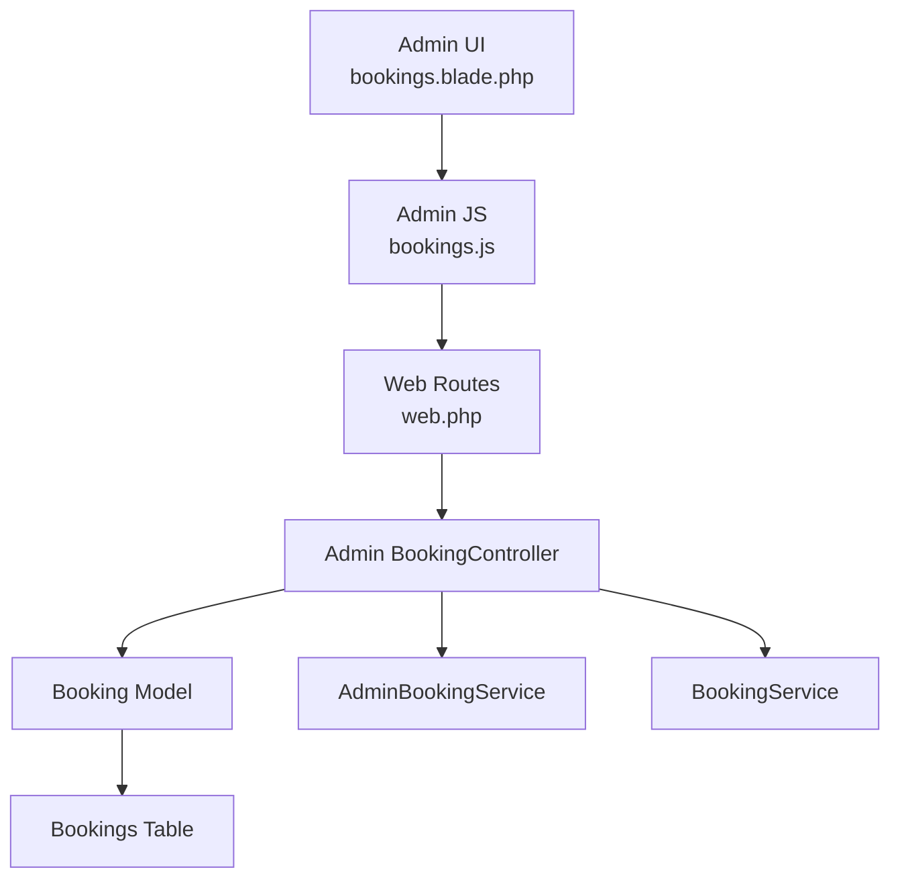
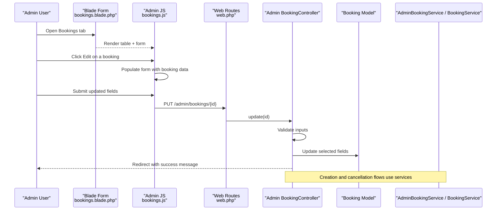
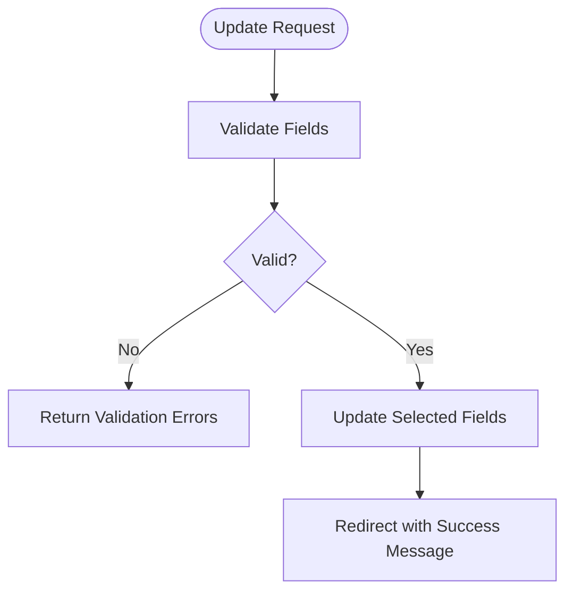
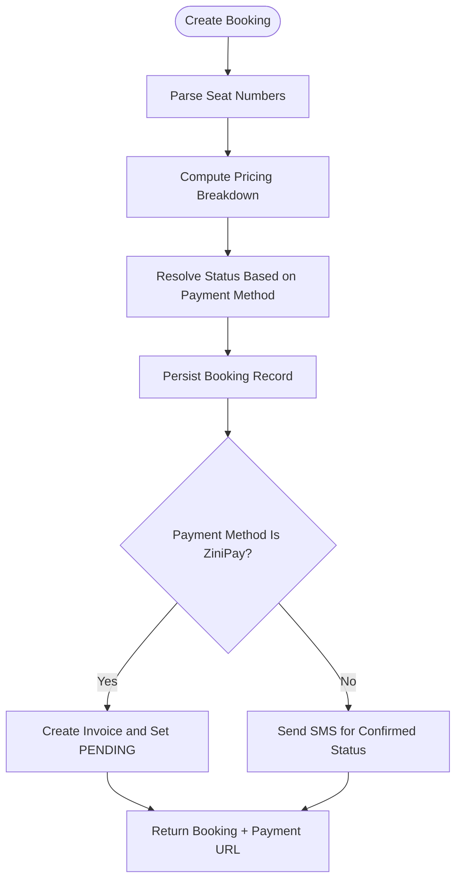
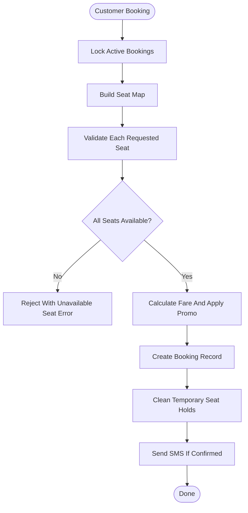
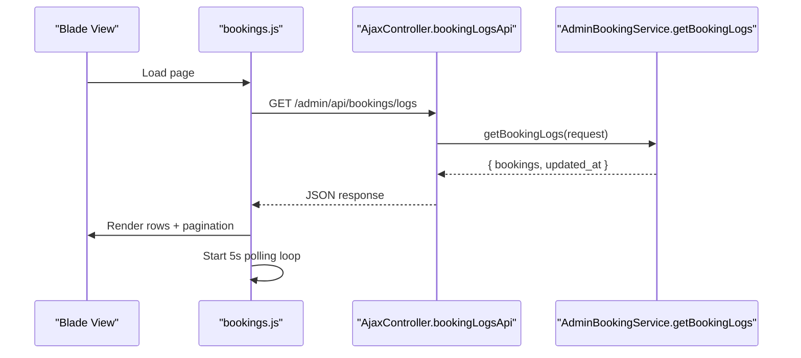
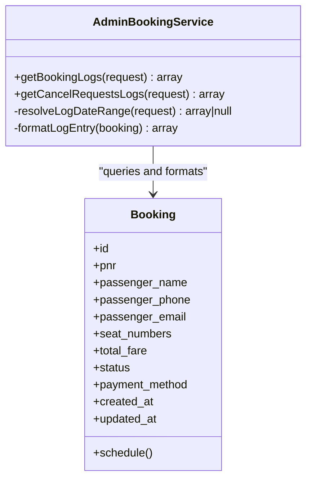
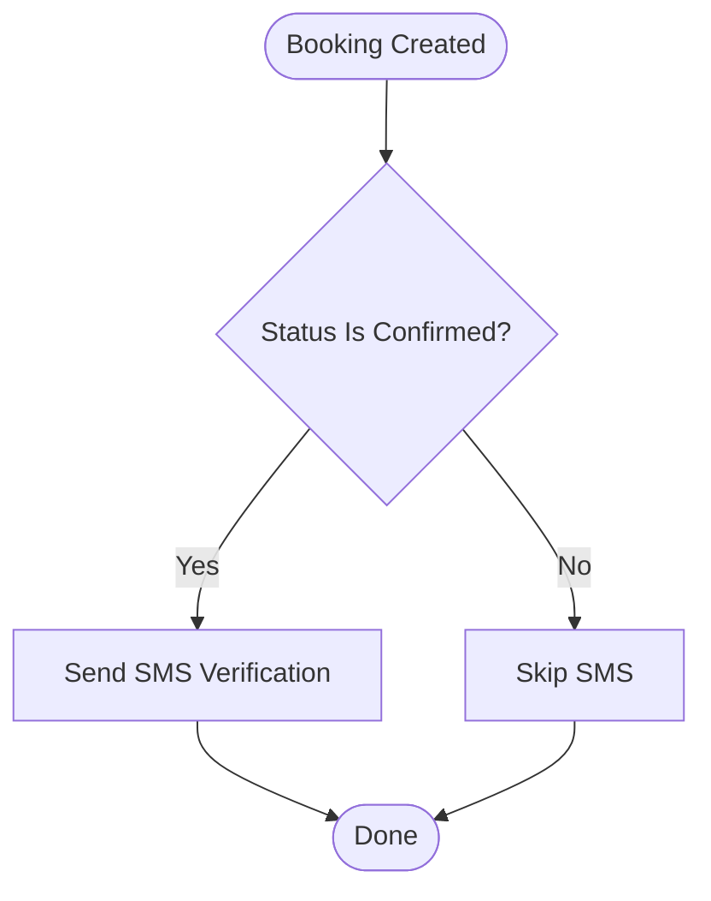
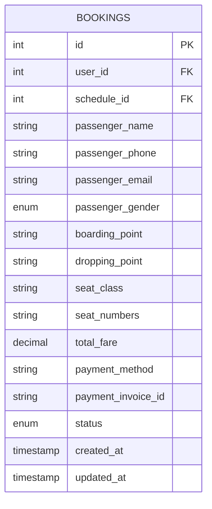
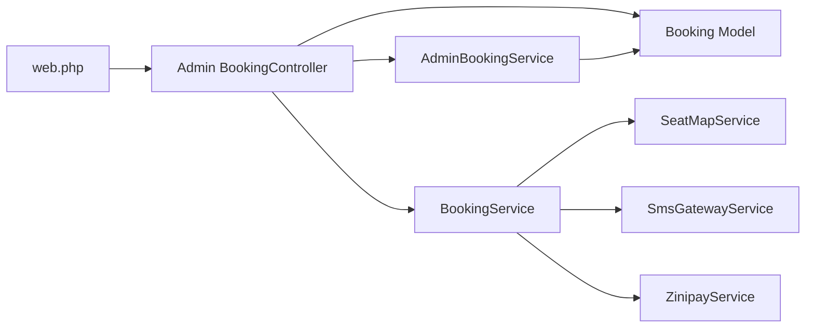

# Booking Modification & Updates

<cite>
**Referenced Files in This Document**
- [BookingController.php](file://backend/app/Http/Controllers/Admin/BookingController.php)
- [web.php](file://backend/routes/web.php)
- [bookings.blade.php](file://backend/resources/views/admin/partials/bookings.blade.php)
- [bookings.js](file://backend/resources/js/admin/bookings.js)
- [AdminBookingService.php](file://backend/app/Services/AdminBookingService.php)
- [BookingService.php](file://backend/app/Services/BookingService.php)
- [Booking.php](file://backend/app/Models/Booking.php)
- [2026_06_01_000050_create_bookings_table.php](file://backend/database/migrations/2026_06_01_000050_create_bookings_table.php)
</cite>

## Table of Contents
1. [Introduction](#introduction)
2. [Project Structure](#project-structure)
3. [Core Components](#core-components)
4. [Architecture Overview](#architecture-overview)
5. [Detailed Component Analysis](#detailed-component-analysis)
6. [Dependency Analysis](#dependency-analysis)
7. [Performance Considerations](#performance-considerations)
8. [Troubleshooting Guide](#troubleshooting-guide)
9. [Conclusion](#conclusion)

## Introduction
This document explains how booking modification and update functionality works for administrators. It covers:
- How administrators modify passenger information, seat assignments, fare adjustments, and booking status changes.
- Validation rules applied during updates.
- Conflict resolution when seats are no longer available.
- Price recalculation logic used during booking creation and related flows.
- Update API endpoints and form handling in the admin interface.
- Real-time seat availability checks during customer bookings.
- Bulk booking updates, change history tracking, and notification triggers.

The system uses a Laravel backend with an admin Blade interface and JavaScript-driven live polling. The core update flow is handled by an admin controller method that validates input and persists selected fields directly to the booking model.

## Project Structure
The booking modification feature spans controllers, services, models, routes, Blade templates, and client-side JavaScript:

**Diagram sources**
- [bookings.blade.php:80-148](file://backend/resources/views/admin/partials/bookings.blade.php#L80-L148)
- [bookings.js:212-231](file://backend/resources/js/admin/bookings.js#L212-L231)
- [web.php:182-187](file://backend/routes/web.php#L182-L187)
- [BookingController.php:54-79](file://backend/app/Http/Controllers/Admin/BookingController.php#L54-L79)
- [Booking.php:12-27](file://backend/app/Models/Booking.php#L12-L27)
- [AdminBookingService.php:58-80](file://backend/app/Services/AdminBookingService.php#L58-L80)
- [BookingService.php:138-193](file://backend/app/Services/BookingService.php#L138-L193)

**Section sources**
- [web.php:182-187](file://backend/routes/web.php#L182-L187)
- [bookings.blade.php:80-148](file://backend/resources/views/admin/partials/bookings.blade.php#L80-L148)
- [bookings.js:212-231](file://backend/resources/js/admin/bookings.js#L212-L231)

## Core Components
- Admin Booking Controller: Handles create, update, delete, cancel, approve cancellation, and payment initiation for admin bookings.
- Admin Booking Service: Provides logs, cancellation request handling, approval, and formatting for recent bookings and cancel requests.
- Booking Service: Shared business logic for creating bookings (customer and admin), pricing, seat parsing, status resolution, SMS notifications, and ZiniPay integration.
- Booking Model: Defines fillable fields, casts, relationships, and PNR generation.
- Web Routes: Define admin booking endpoints including store, update, destroy, pay, cancel, and approve-cancel.
- Blade Template: Renders the booking log table, filters, pagination, and the inline booking form.
- Admin JavaScript: Implements live polling, edit form population, cancel request submission, and UI interactions.

Key responsibilities:
- Validation: Performed in the controller before updating or creating bookings.
- Status management: Controlled via enum values and explicit state transitions.
- Pricing: Calculated through service methods during creation; update does not automatically recalculate price unless explicitly provided.
- Notifications: SMS verification is sent on confirmed statuses during creation.

**Section sources**
- [BookingController.php:20-79](file://backend/app/Http/Controllers/Admin/BookingController.php#L20-L79)
- [AdminBookingService.php:58-252](file://backend/app/Services/AdminBookingService.php#L58-L252)
- [BookingService.php:28-193](file://backend/app/Services/BookingService.php#L28-L193)
- [Booking.php:12-47](file://backend/app/Models/Booking.php#L12-L47)
- [web.php:182-197](file://backend/routes/web.php#L182-L197)
- [bookings.blade.php:80-148](file://backend/resources/views/admin/partials/bookings.blade.php#L80-L148)
- [bookings.js:212-231](file://backend/resources/js/admin/bookings.js#L212-L231)

## Architecture Overview
The admin booking update workflow follows this sequence:

**Diagram sources**
- [bookings.blade.php:80-148](file://backend/resources/views/admin/partials/bookings.blade.php#L80-L148)
- [bookings.js:212-231](file://backend/resources/js/admin/bookings.js#L212-L231)
- [web.php:182-187](file://backend/routes/web.php#L182-L187)
- [BookingController.php:54-79](file://backend/app/Http/Controllers/Admin/BookingController.php#L54-L79)

## Detailed Component Analysis

### Admin Booking Update Endpoint
The update endpoint accepts passenger details, seat numbers, total fare, payment method, and status. It validates required fields and then updates only those specific columns on the booking record.

Validation rules:
- Passenger name: required string, max 100 characters.
- Passenger phone: required string, max 20 characters.
- Passenger email: required email, max 100 characters.
- Seat numbers: required string, max 255 characters.
- Total fare: required numeric, minimum 0.
- Payment method: required string, max 50 characters.
- Status: required enum among PENDING, PAID, SOLD, BOOKED, CANCEL_REQUESTED, CANCELLED.

Update behavior:
- Only the specified fields are persisted.
- No automatic seat availability check or conflict resolution is performed during update.
- No automatic price recalculation occurs; the submitted total_fare is stored as-is.

**Diagram sources**
- [BookingController.php:54-79](file://backend/app/Http/Controllers/Admin/BookingController.php#L54-L79)

**Section sources**
- [BookingController.php:54-79](file://backend/app/Http/Controllers/Admin/BookingController.php#L54-L79)

### Admin Booking Create Flow and Pricing Logic
While not strictly an update, the create flow demonstrates pricing calculation and status resolution:
- Admin creates a booking with schedule, passenger info, seat numbers, payment method, and optional total fare.
- If total fare is omitted, it is calculated using seat count, base fare, and gateway application.
- Cash payments default to SOLD unless explicitly set to BOOKED or a cancel state.
- ZiniPay payments create an invoice and set status to PENDING.
- SMS verification is sent for confirmed statuses.

**Diagram sources**
- [BookingService.php:138-193](file://backend/app/Services/BookingService.php#L138-L193)
- [BookingService.php:304-327](file://backend/app/Services/BookingService.php#L304-L327)

**Section sources**
- [BookingService.php:138-193](file://backend/app/Services/BookingService.php#L138-L193)
- [BookingService.php:304-327](file://backend/app/Services/BookingService.php#L304-L327)

### Real-Time Seat Availability Checks During Customer Bookings
Customer booking creation enforces seat availability:
- Active bookings are locked for update to prevent race conditions.
- A seat map is built from active bookings.
- Each requested seat is validated against the seat map; unavailable seats return an error.
- Maximum four seats per booking are allowed.
- After successful creation, temporary seat holds are cleaned up.

**Diagram sources**
- [BookingService.php:28-131](file://backend/app/Services/BookingService.php#L28-L131)

**Section sources**
- [BookingService.php:28-131](file://backend/app/Services/BookingService.php#L28-L131)

### Admin Booking Logs and Live Polling
The admin interface displays recent bookings with live updates:
- The Blade template defines the table structure, filters, pagination controls, and the inline booking form.
- JavaScript polls the logs API every five seconds while the tab is visible.
- The edit button populates the form with existing booking data and switches the form into edit mode.
- Cancel buttons submit a cancellation request via AJAX and refresh the table on success.

**Diagram sources**
- [bookings.blade.php:1-78](file://backend/resources/views/admin/partials/bookings.blade.php#L1-L78)
- [bookings.js:252-281](file://backend/resources/js/admin/bookings.js#L252-L281)
- [AdminBookingService.php:58-80](file://backend/app/Services/AdminBookingService.php#L58-L80)

**Section sources**
- [bookings.blade.php:1-78](file://backend/resources/views/admin/partials/bookings.blade.php#L1-L78)
- [bookings.js:252-281](file://backend/resources/js/admin/bookings.js#L252-L281)
- [AdminBookingService.php:58-80](file://backend/app/Services/AdminBookingService.php#L58-L80)

### Change History Tracking
Change history tracking is implemented as a recent bookings log:
- AdminBookingService returns recent bookings ordered by creation time, limited to 100 records.
- Date range filtering supports predefined periods and custom ranges.
- Log entries include booking identifiers, passenger details, seat numbers, fares, statuses, and schedule context.

**Diagram sources**
- [AdminBookingService.php:58-80](file://backend/app/Services/AdminBookingService.php#L58-L80)
- [AdminBookingService.php:225-252](file://backend/app/Services/AdminBookingService.php#L225-L252)
- [Booking.php:12-47](file://backend/app/Models/Booking.php#L12-L47)

**Section sources**
- [AdminBookingService.php:58-80](file://backend/app/Services/AdminBookingService.php#L58-L80)
- [AdminBookingService.php:225-252](file://backend/app/Services/AdminBookingService.php#L225-L252)

### Notification Triggers
Notifications are primarily SMS-based:
- During customer booking creation, SMS verification is sent for confirmed statuses.
- During admin booking creation, SMS verification is sent if the resulting status is PAID, SOLD, or BOOKED.
- ZiniPay invoices are created for non-cash payment methods, linking payment invoice IDs to bookings.

**Diagram sources**
- [BookingService.php:113-186](file://backend/app/Services/BookingService.php#L113-L186)

**Section sources**
- [BookingService.php:113-186](file://backend/app/Services/BookingService.php#L113-L186)

### Data Model and Schema
The booking model defines the core attributes and relationships:
- Fillable fields include user reference, schedule reference, passenger details, boarding/dropping points, seat class, seat numbers, total fare, payment method, payment invoice ID, and status.
- Total fare is cast to decimal precision.
- Relationships link to Schedule and User.
- PNR is generated as a zero-padded code prefixed with SE.

**Diagram sources**
- [2026_06_01_000050_create_bookings_table.php:14-42](file://backend/database/migrations/2026_06_01_000050_create_bookings_table.php#L14-L42)
- [Booking.php:12-47](file://backend/app/Models/Booking.php#L12-L47)

**Section sources**
- [2026_06_01_000050_create_bookings_table.php:14-42](file://backend/database/migrations/2026_06_01_000050_create_bookings_table.php#L14-L42)
- [Booking.php:12-47](file://backend/app/Models/Booking.php#L12-L47)

## Dependency Analysis
The booking modification and update features depend on several components:

**Diagram sources**
- [web.php:182-197](file://backend/routes/web.php#L182-L197)
- [BookingController.php:11-18](file://backend/app/Http/Controllers/Admin/BookingController.php#L11-L18)
- [BookingService.php:16-21](file://backend/app/Services/BookingService.php#L16-L21)

Coupling and cohesion:
- AdminBookingService focuses on logs and cancellation workflows, keeping concerns separate from general booking creation.
- BookingService centralizes shared booking logic, including pricing, seat parsing, and notifications.
- The controller remains thin, delegating complex operations to services where applicable.

Potential circular dependencies:
- None observed between these components; services do not import controllers.

External integrations:
- ZiniPay for invoice creation and payment URLs.
- SMS gateway for verification messages.

**Section sources**
- [web.php:182-197](file://backend/routes/web.php#L182-L197)
- [BookingController.php:11-18](file://backend/app/Http/Controllers/Admin/BookingController.php#L11-L18)
- [BookingService.php:16-21](file://backend/app/Services/BookingService.php#L16-L21)

## Performance Considerations
- Live polling interval: The admin bookings tab polls every five seconds; consider adjusting based on traffic and server load.
- Query limits: Recent bookings are limited to 100 records to reduce payload size.
- Indexes: The bookings table includes indexes on common filter columns such as status, schedule_id, user_id, and composite indexes for performance.
- Transactional safety: Customer booking creation locks active bookings to avoid race conditions during seat allocation.

Recommendations:
- For high-traffic environments, increase polling intervals or implement WebSocket-based real-time updates.
- Use database query optimization and caching for frequently accessed reports.
- Ensure SMS gateway rate limiting is configured to avoid throttling.

[No sources needed since this section provides general guidance]

## Troubleshooting Guide
Common issues and resolutions:
- Validation errors during update: Ensure all required fields are present and valid according to controller validation rules.
- Seat conflicts during customer booking: The system rejects unavailable seats; verify seat availability before submission.
- Cancellation state errors: Attempting to cancel already cancelled tickets or duplicate cancellation requests will return errors.
- Payment initiation failures: ZiniPay invoice creation may fail; verify gateway configuration and network connectivity.

Operational tips:
- Use the live bookings log to monitor recent changes and confirm updates.
- Check SMS delivery logs to verify notification triggers.
- Review cancel request logs to track pending approvals.

**Section sources**
- [BookingController.php:54-107](file://backend/app/Http/Controllers/Admin/BookingController.php#L54-L107)
- [AdminBookingService.php:112-223](file://backend/app/Services/AdminBookingService.php#L112-L223)
- [BookingService.php:28-131](file://backend/app/Services/BookingService.php#L28-L131)

## Conclusion
The booking modification and update functionality provides administrators with straightforward tools to adjust passenger details, seat assignments, fares, and statuses. While the update endpoint performs direct field persistence without automatic seat conflict checks or price recalculation, the broader booking system enforces robust validation, seat availability checks, and notification triggers during creation. Administrators can rely on live logs and cancellation workflows to manage bookings effectively. For advanced scenarios like bulk updates or detailed change history, additional features would need to be implemented beyond the current scope.

[No sources needed since this section summarizes without analyzing specific files]