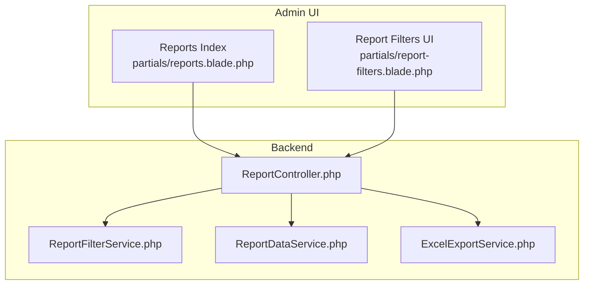
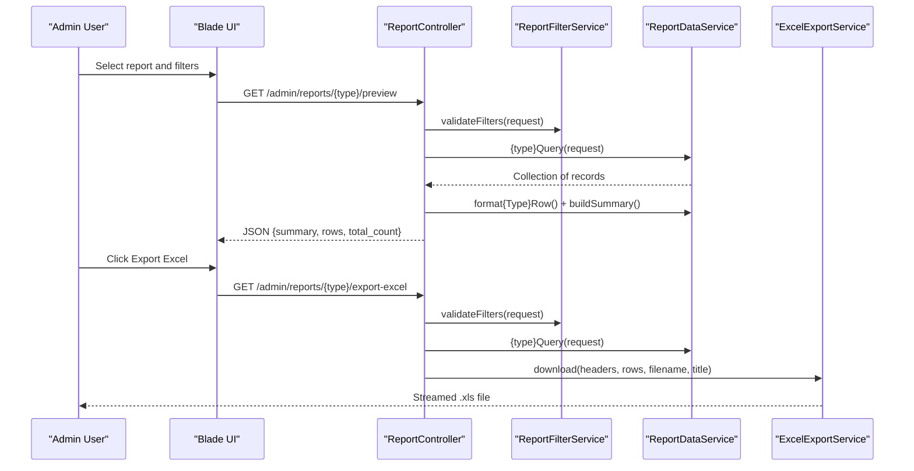
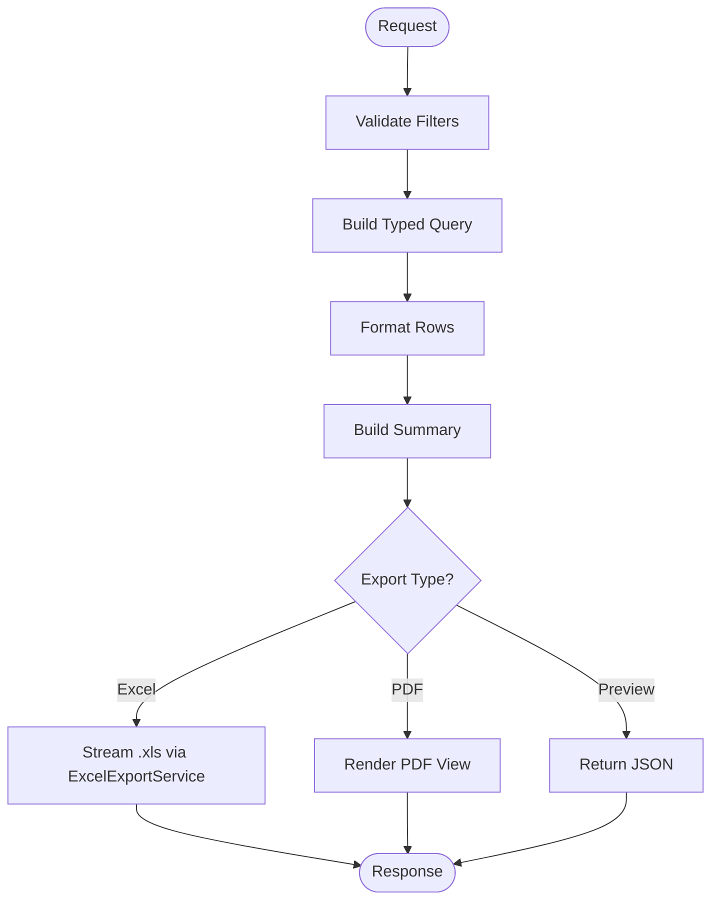
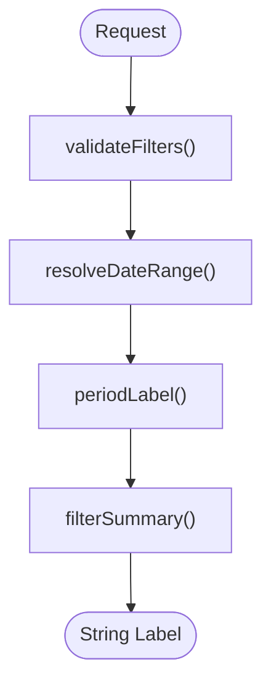
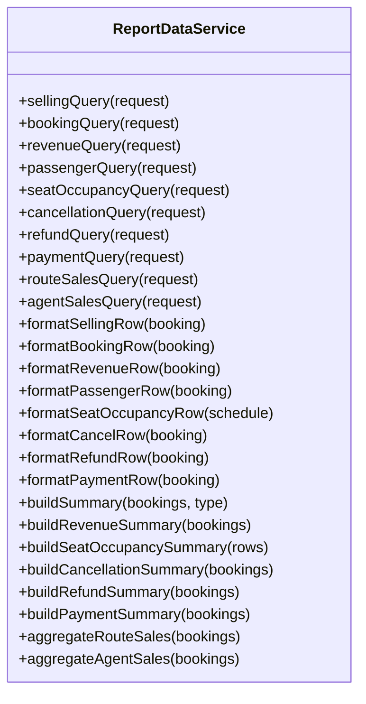
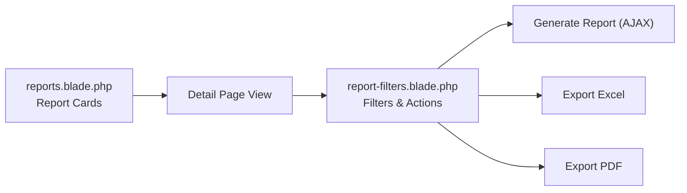
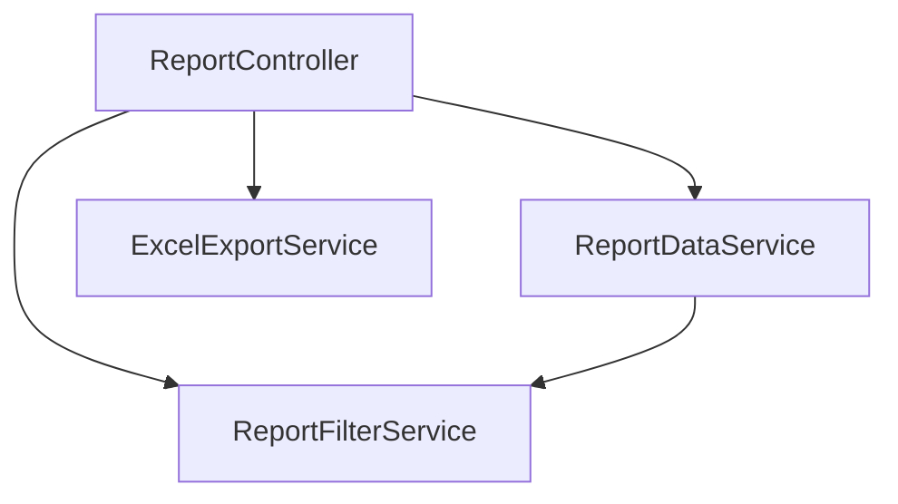

# Export & Reporting

<cite>
**Referenced Files in This Document**
- [ReportController.php](file://backend/app/Http/Controllers/Admin/ReportController.php)
- [ExcelExportService.php](file://backend/app/Services/ExcelExportService.php)
- [ReportDataService.php](file://backend/app/Services/ReportDataService.php)
- [ReportFilterService.php](file://backend/app/Services/ReportFilterService.php)
- [reports.blade.php](file://backend/resources/views/admin/partials/reports.blade.php)
- [report-filters.blade.php](file://backend/resources/views/admin/partials/report-filters.blade.php)
</cite>

## Table of Contents
1. [Introduction](#introduction)
2. [Project Structure](#project-structure)
3. [Core Components](#core-components)
4. [Architecture Overview](#architecture-overview)
5. [Detailed Component Analysis](#detailed-component-analysis)
6. [Dependency Analysis](#dependency-analysis)
7. [Performance Considerations](#performance-considerations)
8. [Troubleshooting Guide](#troubleshooting-guide)
9. [Conclusion](#conclusion)

## Introduction
This document explains the booking export and reporting functionality for the bus application. It covers:
- Excel export capabilities with standardized column sets, date range filtering, and data formatting.
- The reporting dashboard that provides analytics, revenue summaries, and operational metrics.
- Report generation workflows, including preview, Excel/PDF export, and filter handling.
- Guidance on extending reports, integrating with external BI tools, and automating report delivery.

## Project Structure
The reporting feature is implemented as a controller-driven workflow backed by services and Blade templates:
- Controller layer exposes endpoints for previews and exports.
- Services encapsulate query building, row formatting, summary aggregation, and Excel generation.
- Blade partials provide the UI for filters, actions, and result tables.



**Diagram sources**
- [reports.blade.php:1-127](file://backend/resources/views/admin/partials/reports.blade.php#L1-L127)
- [report-filters.blade.php:1-98](file://backend/resources/views/admin/partials/report-filters.blade.php#L1-L98)
- [ReportController.php:1-648](file://backend/app/Http/Controllers/Admin/ReportController.php#L1-L648)
- [ReportFilterService.php:1-85](file://backend/app/Services/ReportFilterService.php#L1-L85)
- [ReportDataService.php:1-774](file://backend/app/Services/ReportDataService.php#L1-L774)
- [ExcelExportService.php:1-67](file://backend/app/Services/ExcelExportService.php#L1-L67)

**Section sources**
- [reports.blade.php:1-127](file://backend/resources/views/admin/partials/reports.blade.php#L1-L127)
- [report-filters.blade.php:1-98](file://backend/resources/views/admin/partials/report-filters.blade.php#L1-L98)

## Core Components
- ReportController: Orchestrates report pages, previews, and exports (Excel/PDF). Validates filters, builds queries via ReportDataService, and streams Excel files via ExcelExportService.
- ReportFilterService: Validates request inputs, resolves date ranges from period presets or custom dates, and generates human-readable filter labels.
- ReportDataService: Builds typed queries per report, formats rows, computes summaries, and defines headers and row mappers for each report type.
- ExcelExportService: Streams an Excel-compatible XML file with typed cells and headers.

Key responsibilities:
- Date range filtering supports weekly, monthly, quarterly, yearly, and custom ranges.
- Common filters include coach type, payment method, route, and operator.
- Each report has dedicated preview endpoints returning JSON with summary, rows, and total count.
- Excel exports append summary rows to the dataset and stream downloadable .xls files.

**Section sources**
- [ReportController.php:1-648](file://backend/app/Http/Controllers/Admin/ReportController.php#L1-L648)
- [ReportFilterService.php:1-85](file://backend/app/Services/ReportFilterService.php#L1-L85)
- [ReportDataService.php:1-774](file://backend/app/Services/ReportDataService.php#L1-L774)
- [ExcelExportService.php:1-67](file://backend/app/Services/ExcelExportService.php#L1-L67)

## Architecture Overview
The system follows a layered architecture:
- UI layer (Blade partials) renders filters and action buttons.
- Controller validates input and delegates to services.
- Services handle data access, transformation, and export logic.
- PDF generation uses a templating engine for printable layouts.



**Diagram sources**
- [ReportController.php:54-104](file://backend/app/Http/Controllers/Admin/ReportController.php#L54-L104)
- [ReportFilterService.php:10-46](file://backend/app/Services/ReportFilterService.php#L10-L46)
- [ReportDataService.php:17-67](file://backend/app/Services/ReportDataService.php#L17-L67)
- [ExcelExportService.php:9-18](file://backend/app/Services/ExcelExportService.php#L9-L18)

## Detailed Component Analysis

### ReportController
Responsibilities:
- Renders full-page detail views for allowed report types.
- Provides preview endpoints returning JSON with summary, rows, and total counts.
- Exports to Excel using ExcelExportService and to PDF using a PDF view.

Highlights:
- Allowed report types are explicitly whitelisted.
- Preview endpoints limit rows for performance while still providing accurate totals.
- Excel exports append summary rows after the dataset.



**Diagram sources**
- [ReportController.php:84-104](file://backend/app/Http/Controllers/Admin/ReportController.php#L84-L104)
- [ReportController.php:181-197](file://backend/app/Http/Controllers/Admin/ReportController.php#L181-L197)
- [ReportController.php:234-251](file://backend/app/Http/Controllers/Admin/ReportController.php#L234-L251)

**Section sources**
- [ReportController.php:1-648](file://backend/app/Http/Controllers/Admin/ReportController.php#L1-L648)

### ReportFilterService
Responsibilities:
- Validates incoming filter parameters.
- Resolves date ranges based on preset periods or custom date inputs.
- Generates readable filter labels for display in reports.

Key behaviors:
- Supports weekly, monthly, quarterly, yearly, and custom date ranges.
- Produces a combined label string including period and active filters.



**Diagram sources**
- [ReportFilterService.php:10-85](file://backend/app/Services/ReportFilterService.php#L10-L85)

**Section sources**
- [ReportFilterService.php:1-85](file://backend/app/Services/ReportFilterService.php#L1-L85)

### ReportDataService
Responsibilities:
- Builds typed queries for each report (selling, booking, revenue, passenger, seat occupancy, cancellation, refund, payment, route sales, agent sales).
- Formats raw records into consistent arrays for UI and exports.
- Computes summaries (totals, AC vs non-AC splits, payment breakdowns, occupancy percentages).
- Defines headers and row-to-array mappers for Excel output.

Notable patterns:
- Common filters applied across multiple queries (coach type, payment method, route, operator).
- Seat parsing and fare calculations are centralized.
- Aggregations for route-wise and agent-wise sales group by route or operator.



**Diagram sources**
- [ReportDataService.php:17-774](file://backend/app/Services/ReportDataService.php#L17-L774)

**Section sources**
- [ReportDataService.php:1-774](file://backend/app/Services/ReportDataService.php#L1-L774)

### ExcelExportService
Responsibilities:
- Streams an Excel-compatible XML file with typed cells and headers.
- Ensures numeric values are exported as numbers and strings as text.

Behavior:
- Uses a streamed response to avoid loading large files into memory.
- Appends header row followed by data rows.

```mermaid
flowchart TD
Start([download(headers, rows, filename, title)]) --> Build["buildSpreadsheetXml()"]
Build --> Stream["response()->streamDownload()"]
Stream --> End([.xls File])
```

**Diagram sources**
- [ExcelExportService.php:9-67](file://backend/app/Services/ExcelExportService.php#L9-L67)

**Section sources**
- [ExcelExportService.php:1-67](file://backend/app/Services/ExcelExportService.php#L1-L67)

### Reporting Dashboard and UI
- Reports index page lists available reports with descriptions and navigation links.
- Filter partial provides controls for period, custom dates, coach type, payment method, route, and operator.
- Action buttons trigger generate, export Excel, and export PDF operations.



**Diagram sources**
- [reports.blade.php:1-127](file://backend/resources/views/admin/partials/reports.blade.php#L1-L127)
- [report-filters.blade.php:1-98](file://backend/resources/views/admin/partials/report-filters.blade.php#L1-L98)

**Section sources**
- [reports.blade.php:1-127](file://backend/resources/views/admin/partials/reports.blade.php#L1-L127)
- [report-filters.blade.php:1-98](file://backend/resources/views/admin/partials/report-filters.blade.php#L1-L98)

## Dependency Analysis
High-level dependencies:
- ReportController depends on ReportFilterService, ReportDataService, and ExcelExportService.
- ReportDataService depends on ReportFilterService for date resolution and common filters.
- ExcelExportService is independent and used only for streaming Excel files.



**Diagram sources**
- [ReportController.php:1-18](file://backend/app/Http/Controllers/Admin/ReportController.php#L1-L18)
- [ReportDataService.php:11-15](file://backend/app/Services/ReportDataService.php#L11-L15)
- [ExcelExportService.php:1-18](file://backend/app/Services/ExcelExportService.php#L1-L18)

**Section sources**
- [ReportController.php:1-18](file://backend/app/Http/Controllers/Admin/ReportController.php#L1-L18)
- [ReportDataService.php:11-15](file://backend/app/Services/ReportDataService.php#L11-L15)

## Performance Considerations
- Preview endpoints limit returned rows to reduce payload size while still computing accurate totals.
- Queries use eager loading for related entities to minimize N+1 issues.
- Excel export streams XML directly to the client to avoid high memory usage.
- Aggregated reports (route-wise, agent-wise) compute sums and counts in-memory over collections; consider pagination or server-side aggregation for very large datasets.

[No sources needed since this section provides general guidance]

## Troubleshooting Guide
Common issues and resolutions:
- Invalid or missing date range: Ensure period is set correctly or provide valid from_date/to_date when using custom ranges.
- Empty results: Verify filters (coach type, payment method, route, operator) match existing data.
- Large exports: Use narrower date ranges or specific filters to reduce dataset size.
- Excel formatting: Numeric fields are exported as numbers; ensure downstream tools interpret them correctly.

Operational checks:
- Confirm filter validation passes before querying.
- Validate that relationships (schedule, bus, route, stations) are present for formatted fields.
- For PDF exports, ensure the PDF rendering environment is configured.

**Section sources**
- [ReportFilterService.php:10-46](file://backend/app/Services/ReportFilterService.php#L10-L46)
- [ReportController.php:54-104](file://backend/app/Http/Controllers/Admin/ReportController.php#L54-L104)

## Conclusion
The reporting subsystem provides a comprehensive suite of booking analytics and export capabilities. It standardizes filtering, formatting, and summarization across multiple report types, supports Excel and PDF outputs, and offers a clear UI for generating and exporting data. To extend the system:
- Add new report types by implementing query, formatter, headers, and summary methods in ReportDataService and corresponding endpoints in ReportController.
- Integrate with external BI tools by exposing preview JSON endpoints or scheduled exports.
- Automate delivery by scheduling jobs that call export endpoints and send files via email or storage.

[No sources needed since this section summarizes without analyzing specific files]