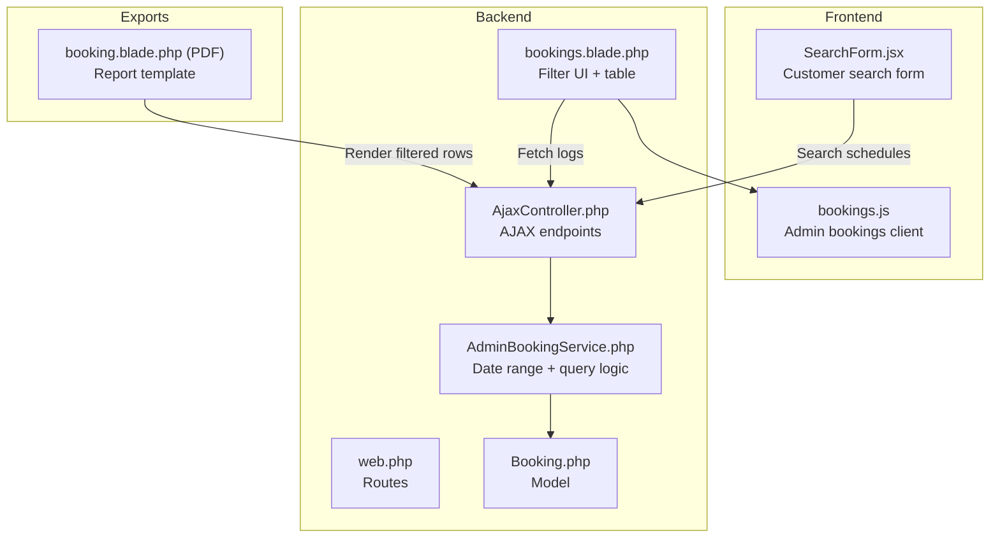
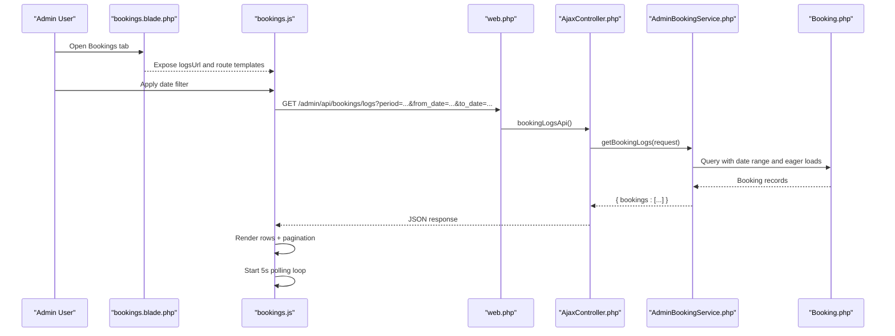
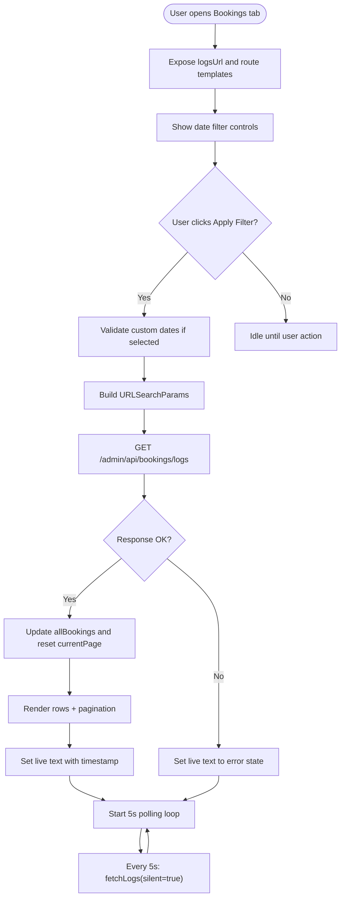
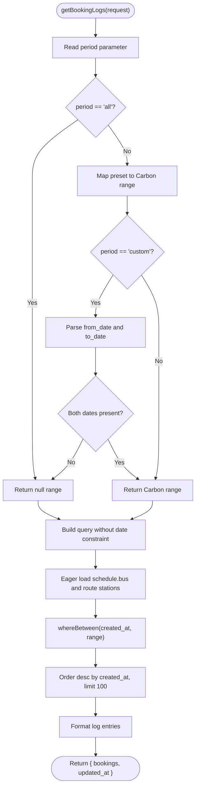
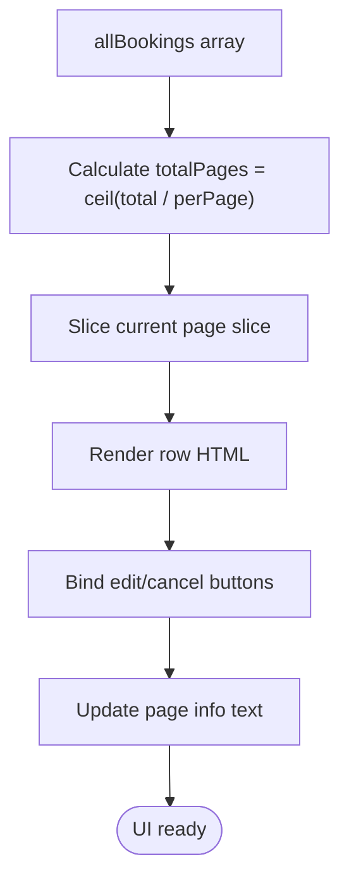
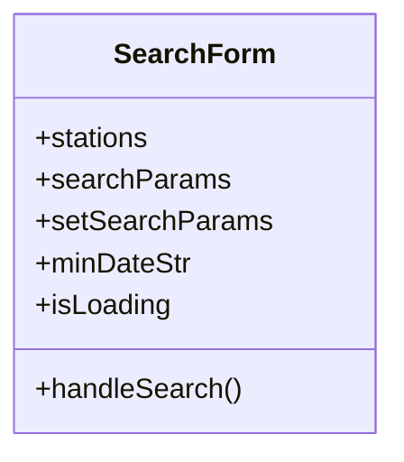
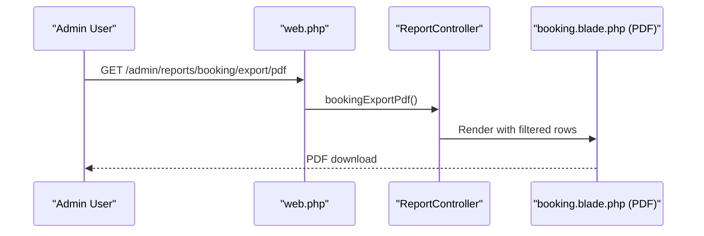
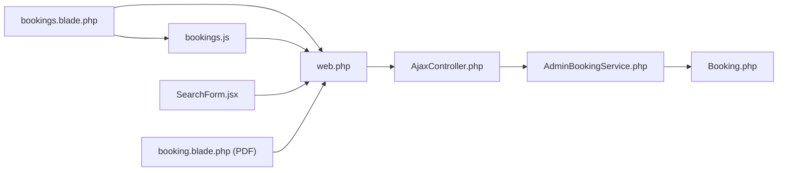

# Search & Filtering System

<cite>
**Referenced Files in This Document**
- [web.php](file://backend/routes/web.php)
- [AjaxController.php](file://backend/app/Http/Controllers/Admin/AjaxController.php)
- [AdminBookingService.php](file://backend/app/Services/AdminBookingService.php)
- [bookings.blade.php](file://backend/resources/views/admin/partials/bookings.blade.php)
- [bookings.js](file://backend/resources/js/admin/bookings.js)
- [Booking.php](file://backend/app/Models/Booking.php)
- [SearchForm.jsx](file://frontend/src/components/SearchForm.jsx)
- [booking.blade.php (report PDF)](file://backend/resources/views/admin/reports/pdf/booking.blade.php)
</cite>

## Table of Contents
1. [Introduction](#introduction)
2. [Project Structure](#project-structure)
3. [Core Components](#core-components)
4. [Architecture Overview](#architecture-overview)
5. [Detailed Component Analysis](#detailed-component-analysis)
6. [Dependency Analysis](#dependency-analysis)
7. [Performance Considerations](#performance-considerations)
8. [Troubleshooting Guide](#troubleshooting-guide)
9. [Conclusion](#conclusion)

## Introduction
This document explains the advanced search and filtering capabilities for the booking management system, focusing on:
- Multi-criteria filtering by date ranges, routes, passengers, booking status, payment methods, and fare amounts.
- Filter UI components in both the admin dashboard and customer-facing portal.
- AJAX-based search implementation for live results.
- Pagination handling and sorting options.
- Export functionality with filters applied.
- Real-time search result updates as filters are applied.

The system separates concerns between:
- Admin-side booking log filtering and live polling.
- Customer-side schedule search by route, date, and coach type.
- Report export endpoints that can render filtered data into Excel or PDF.

## Project Structure
The search and filtering features span several layers:
- Routes define admin API endpoints for booking logs and cancel requests.
- The Ajax controller exposes JSON endpoints used by the admin dashboard.
- The AdminBookingService implements server-side date range resolution and query building.
- Blade templates provide filter controls and tables.
- Client-side JavaScript handles filtering, pagination, and live polling.
- The Booking model defines fields used for filtering and display.
- The frontend SearchForm component supports customer-side search inputs.
- Report PDF templates show how filtered booking data is rendered for exports.

**Diagram sources**
- [web.php:95-109](file://backend/routes/web.php#L95-L109)
- [AjaxController.php:36-44](file://backend/app/Http/Controllers/Admin/AjaxController.php#L36-L44)
- [AdminBookingService.php:58-80](file://backend/app/Services/AdminBookingService.php#L58-L80)
- [bookings.blade.php:12-37](file://backend/resources/views/admin/partials/bookings.blade.php#L12-L37)
- [bookings.js:236-274](file://backend/resources/js/admin/bookings.js#L236-L274)
- [Booking.php:12-27](file://backend/app/Models/Booking.php#L12-L27)
- [SearchForm.jsx:1-108](file://frontend/src/components/SearchForm.jsx#L1-L108)
- [booking.blade.php (report PDF):41-71](file://backend/resources/views/admin/reports/pdf/booking.blade.php#L41-L71)

**Section sources**
- [web.php:95-109](file://backend/routes/web.php#L95-L109)
- [AjaxController.php:36-44](file://backend/app/Http/Controllers/Admin/AjaxController.php#L36-L44)
- [AdminBookingService.php:58-80](file://backend/app/Services/AdminBookingService.php#L58-L80)
- [bookings.blade.php:12-37](file://backend/resources/views/admin/partials/bookings.blade.php#L12-L37)
- [bookings.js:236-274](file://backend/resources/js/admin/bookings.js#L236-L274)
- [Booking.php:12-27](file://backend/app/Models/Booking.php#L12-L27)
- [SearchForm.jsx:1-108](file://frontend/src/components/SearchForm.jsx#L1-L108)
- [booking.blade.php (report PDF):41-71](file://backend/resources/views/admin/reports/pdf/booking.blade.php#L41-L71)

## Core Components
- Admin booking log filtering:
  - Date range filter via period presets and custom from/to dates.
  - Live polling to refresh results every few seconds.
  - Client-side pagination with configurable per-page size.
- Customer schedule search:
  - From/to station selection.
  - Date picker constrained to today or later.
  - Coach type filter.
- Export capability:
  - Report PDF template shows filtered booking rows for export.

Key responsibilities:
- AjaxController exposes JSON endpoints for booking logs and cancel requests.
- AdminBookingService resolves date ranges and builds queries.
- bookings.blade.php provides the filter UI and table structure.
- bookings.js handles filter application, fetching, rendering, and pagination.
- Booking model defines searchable fields like passenger details, seats, fare, payment method, and status.
- SearchForm.jsx provides customer-side search inputs.

**Section sources**
- [AjaxController.php:36-44](file://backend/app/Http/Controllers/Admin/AjaxController.php#L36-L44)
- [AdminBookingService.php:17-56](file://backend/app/Services/AdminBookingService.php#L17-L56)
- [bookings.blade.php:12-37](file://backend/resources/views/admin/partials/bookings.blade.php#L12-L37)
- [bookings.js:236-326](file://backend/resources/js/admin/bookings.js#L236-L326)
- [Booking.php:12-27](file://backend/app/Models/Booking.php#L12-L27)
- [SearchForm.jsx:1-108](file://frontend/src/components/SearchForm.jsx#L1-L108)

## Architecture Overview
The admin booking search flow uses a session-authenticated AJAX endpoint. The Blade view renders filter controls; the client script collects filter parameters and calls the backend. The service resolves date ranges and returns formatted booking entries. The client then renders rows and manages pagination locally.

**Diagram sources**
- [bookings.blade.php:152-160](file://backend/resources/views/admin/partials/bookings.blade.php#L152-L160)
- [bookings.js:236-274](file://backend/resources/js/admin/bookings.js#L236-L274)
- [web.php:102-106](file://backend/routes/web.php#L102-L106)
- [AjaxController.php:36-39](file://backend/app/Http/Controllers/Admin/AjaxController.php#L36-L39)
- [AdminBookingService.php:58-80](file://backend/app/Services/AdminBookingService.php#L58-L80)
- [Booking.php:33-47](file://backend/app/Models/Booking.php#L33-L47)

## Detailed Component Analysis

### Admin Booking Log Filters and Live Results
The admin interface provides:
- A date filter bar with preset periods and custom date range inputs.
- An “Apply Filter” button to trigger a fresh fetch.
- A live indicator showing last update time and polling interval.
- Client-side pagination controls for per-page size, previous/next navigation.

Filtering behavior:
- Period values include all, today, yesterday, this week, this month, this year, and custom.
- Custom range requires both from and to dates.
- The client constructs URLSearchParams and appends them to the logs URL.
- On success, the client resets to page 1 and re-renders the table.

Live polling:
- Polling starts when the bookings tab is visible.
- It fetches logs every 5 seconds while active and pauses when hidden.

**Diagram sources**
- [bookings.blade.php:12-37](file://backend/resources/views/admin/partials/bookings.blade.php#L12-L37)
- [bookings.js:236-326](file://backend/resources/js/admin/bookings.js#L236-L326)

**Section sources**
- [bookings.blade.php:12-37](file://backend/resources/views/admin/partials/bookings.blade.php#L12-L37)
- [bookings.js:236-326](file://backend/resources/js/admin/bookings.js#L236-L326)

### Server-Side Date Range Resolution
The service resolves a date range based on the request’s period parameter:
- Preset periods map to Carbon start/end boundaries.
- Custom range parses from_date and to_date and validates presence.
- If no range is applicable, the query is not constrained by date.

Query construction:
- Eager loads schedule.bus and schedule.route.departureStation/arrivalStation.
- Applies whereBetween on created_at for booking logs.
- Orders by created_at descending and limits to 100 records.

**Diagram sources**
- [AdminBookingService.php:17-56](file://backend/app/Services/AdminBookingService.php#L17-L56)
- [AdminBookingService.php:58-80](file://backend/app/Services/AdminBookingService.php#L58-L80)

**Section sources**
- [AdminBookingService.php:17-56](file://backend/app/Services/AdminBookingService.php#L17-L56)
- [AdminBookingService.php:58-80](file://backend/app/Services/AdminBookingService.php#L58-L80)

### Client-Side Pagination and Rendering
Pagination is handled entirely in the browser:
- Total count comes from the fetched array length.
- Per-page options: 10, 50, 100.
- Previous/Next buttons adjust currentPage and re-render the sliced dataset.
- Row rendering includes PNR, passenger info, journey details, coach number, seats, fare, status badge, and actions.

**Diagram sources**
- [bookings.js:137-155](file://backend/resources/js/admin/bookings.js#L137-L155)
- [bookings.js:157-204](file://backend/resources/js/admin/bookings.js#L157-L204)

**Section sources**
- [bookings.js:137-155](file://backend/resources/js/admin/bookings.js#L137-L155)
- [bookings.js:157-204](file://backend/resources/js/admin/bookings.js#L157-L204)

### Customer-Facing Schedule Search Form
The customer search form supports:
- From/to station selection.
- Date input constrained to today or later.
- Coach type selection.
- Submit triggers a search operation.

This complements the admin-side booking log filtering by enabling customers to find available schedules before booking.

**Diagram sources**
- [SearchForm.jsx:1-108](file://frontend/src/components/SearchForm.jsx#L1-L108)

**Section sources**
- [SearchForm.jsx:1-108](file://frontend/src/components/SearchForm.jsx#L1-L108)

### Export Functionality with Filters Applied
Export endpoints exist for multiple report types, including booking reports. The PDF template for booking reports renders filtered rows, indicating that exported content reflects the selected filters.

**Diagram sources**
- [web.php:139-142](file://backend/routes/web.php#L139-L142)
- [booking.blade.php (report PDF):41-71](file://backend/resources/views/admin/reports/pdf/booking.blade.php#L41-L71)

**Section sources**
- [web.php:139-142](file://backend/routes/web.php#L139-L142)
- [booking.blade.php (report PDF):41-71](file://backend/resources/views/admin/reports/pdf/booking.blade.php#L41-L71)

### Sorting Options
Within the current implementation:
- Admin booking logs are ordered by created_at descending at the database level.
- There is no explicit client-side or server-side multi-column sorting UI exposed in the analyzed files.
- For additional sorting needs, consider adding sort parameters to the logs endpoint and updating the service query accordingly.

[No sources needed since this section provides general guidance]

### Saved Filter Presets
There is no persisted saved filter preset mechanism found in the analyzed files. To implement saved presets:
- Add a new endpoint to save/load user-specific filter configurations.
- Store presets in a dedicated table or user settings.
- Extend the filter UI to list and apply saved presets.
- Persist period, custom dates, and any future filters (routes, passengers, status, payment, fare).

[No sources needed since this section provides general guidance]

## Dependency Analysis
The following diagram maps key dependencies among routes, controllers, services, models, views, and client scripts involved in search and filtering.

**Diagram sources**
- [web.php:95-109](file://backend/routes/web.php#L95-L109)
- [AjaxController.php:36-44](file://backend/app/Http/Controllers/Admin/AjaxController.php#L36-L44)
- [AdminBookingService.php:58-80](file://backend/app/Services/AdminBookingService.php#L58-L80)
- [Booking.php:33-47](file://backend/app/Models/Booking.php#L33-L47)
- [bookings.blade.php:152-160](file://backend/resources/views/admin/partials/bookings.blade.php#L152-L160)
- [bookings.js:236-274](file://backend/resources/js/admin/bookings.js#L236-L274)
- [SearchForm.jsx:1-108](file://frontend/src/components/SearchForm.jsx#L1-L108)
- [booking.blade.php (report PDF):41-71](file://backend/resources/views/admin/reports/pdf/booking.blade.php#L41-L71)

**Section sources**
- [web.php:95-109](file://backend/routes/web.php#L95-L109)
- [AjaxController.php:36-44](file://backend/app/Http/Controllers/Admin/AjaxController.php#L36-L44)
- [AdminBookingService.php:58-80](file://backend/app/Services/AdminBookingService.php#L58-L80)
- [Booking.php:33-47](file://backend/app/Models/Booking.php#L33-L47)
- [bookings.blade.php:152-160](file://backend/resources/views/admin/partials/bookings.blade.php#L152-L160)
- [bookings.js:236-274](file://backend/resources/js/admin/bookings.js#L236-L274)
- [SearchForm.jsx:1-108](file://frontend/src/components/SearchForm.jsx#L1-L108)
- [booking.blade.php (report PDF):41-71](file://backend/resources/views/admin/reports/pdf/booking.blade.php#L41-L71)

## Performance Considerations
- Database-level ordering and limiting:
  - Booking logs are ordered by created_at and limited to 100 records, reducing payload size.
- Eager loading:
  - Relations such as schedule.bus and route stations are eagerly loaded to avoid N+1 queries.
- Client-side pagination:
  - Large datasets are paginated in the browser after a single fetch, minimizing repeated network calls.
- Polling interval:
  - A 5-second polling interval balances freshness with server load.
- Recommendations:
  - Add server-side pagination for very large datasets.
  - Introduce caching for frequent filter combinations.
  - Use indexes on frequently filtered columns (e.g., created_at, status, payment_method).
  - Debounce rapid filter changes to reduce unnecessary requests.

[No sources needed since this section provides general guidance]

## Troubleshooting Guide
Common issues and resolutions:
- Empty results:
  - Ensure the selected period or custom date range is valid.
  - Verify that bookings exist within the chosen timeframe.
- Live update failures:
  - Check network connectivity and CSRF headers.
  - Inspect console errors and ensure the bookings tab is active.
- Pagination not updating:
  - Confirm per-page selection and that allBookings contains data.
- Export not reflecting filters:
  - Verify that the report endpoint receives and applies the same filter parameters as the UI.

Operational checks:
- Confirm routes are registered under the admin middleware group.
- Ensure AjaxController methods return proper JSON responses.
- Validate that AdminBookingService correctly resolves date ranges.

**Section sources**
- [web.php:95-109](file://backend/routes/web.php#L95-L109)
- [AjaxController.php:36-44](file://backend/app/Http/Controllers/Admin/AjaxController.php#L36-L44)
- [AdminBookingService.php:17-56](file://backend/app/Services/AdminBookingService.php#L17-L56)
- [bookings.js:252-274](file://backend/resources/js/admin/bookings.js#L252-L274)

## Conclusion
The booking management system provides robust search and filtering capabilities across admin and customer interfaces:
- Admin users can filter booking logs by date ranges, view live updates, and paginate results.
- Customers can search schedules by route, date, and coach type.
- Export endpoints support generating filtered reports in PDF format.
- The architecture cleanly separates routing, controller logic, service processing, and UI rendering.

Future enhancements could include:
- Additional filter criteria (routes, passengers, status, payment methods, fare amounts) with server-side validation and indexing.
- Saved filter presets for recurring searches.
- Server-side pagination and sorting for improved scalability.
- Caching strategies for high-frequency queries.

[No sources needed since this section summarizes without analyzing specific files]