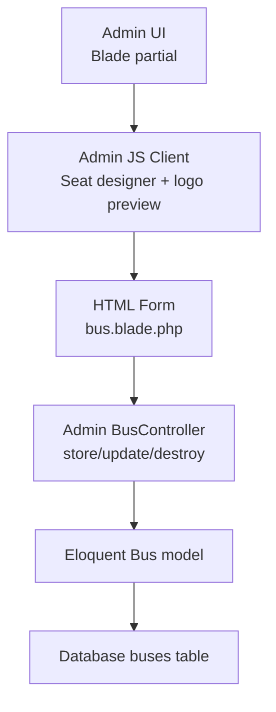
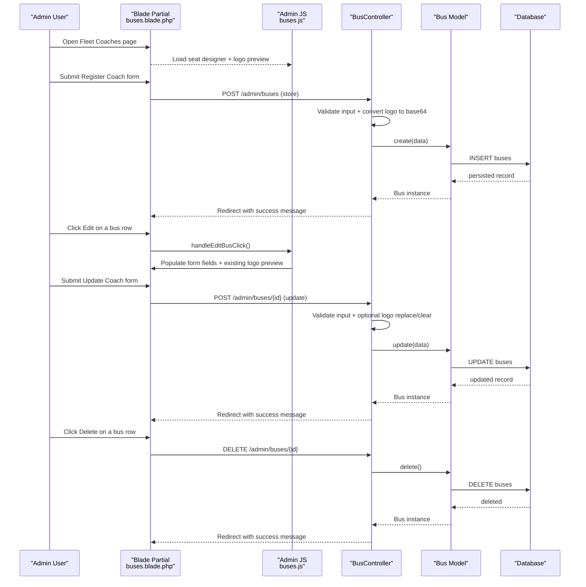
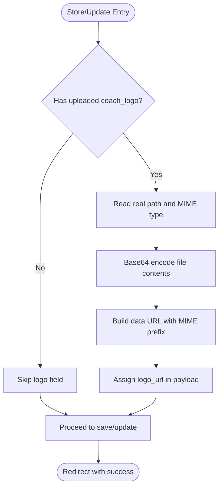
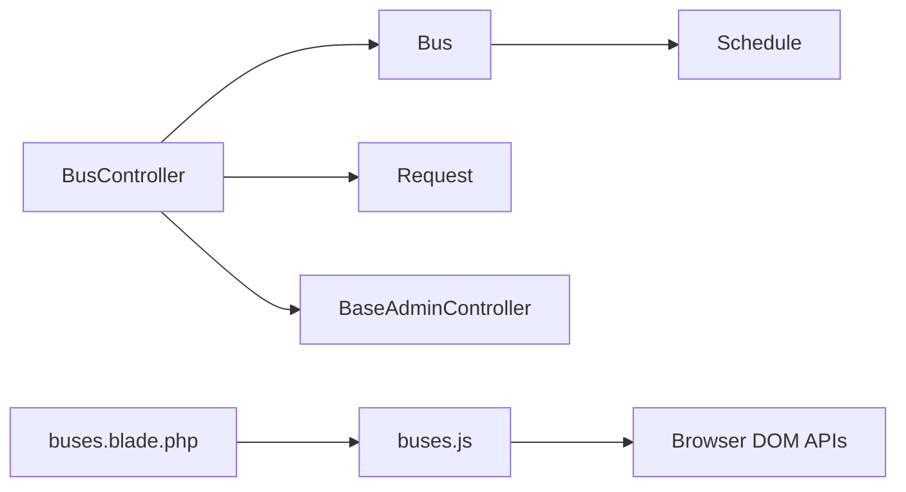

# Bus CRUD Operations

<cite>
**Referenced Files in This Document**
- [BusController.php](file://backend/app/Http/Controllers/Admin/BusController.php)
- [Bus.php](file://backend/app/Models/Bus.php)
- [2026_06_01_000020_create_buses_table.php](file://backend/database/migrations/2026_06_01_000020_create_buses_table.php)
- [buses.js](file://backend/resources/js/admin/buses.js)
- [buses.blade.php](file://backend/resources/views/admin/partials/buses.blade.php)
</cite>

## Table of Contents
1. [Introduction](#introduction)
2. [Project Structure](#project-structure)
3. [Core Components](#core-components)
4. [Architecture Overview](#architecture-overview)
5. [Detailed Component Analysis](#detailed-component-analysis)
6. [Dependency Analysis](#dependency-analysis)
7. [Performance Considerations](#performance-considerations)
8. [Troubleshooting Guide](#troubleshooting-guide)
9. [Conclusion](#conclusion)

## Introduction
This document explains the complete bus entity lifecycle in the fleet management system: creation, reading, updating, and deletion. It covers validation rules for operator names, coach numbers, seat configurations, and image uploads; base64 logo handling; file upload processing; request/response patterns; error handling; database operations; and integration with the admin interface and form workflows.

The bus feature is implemented as a server-rendered admin module backed by Laravel controllers, Eloquent models, migrations, Blade views, and client-side JavaScript for the seat layout designer and logo preview.

## Project Structure
The bus CRUD functionality spans backend controller/model/migration and frontend view/JavaScript:

**Diagram sources**
- [buses.blade.php:81-146](file://backend/resources/views/admin/partials/buses.blade.php#L81-L146)
- [buses.js:1-29](file://backend/resources/js/admin/buses.js#L1-L29)
- [BusController.php:27-95](file://backend/app/Http/Controllers/Admin/BusController.php#L27-L95)
- [Bus.php:8-22](file://backend/app/Models/Bus.php#L8-L22)
- [2026_06_01_000020_create_buses_table.php:14-28](file://backend/database/migrations/2026_06_01_000020_create_buses_table.php#L14-L28)

**Section sources**
- [BusController.php:1-97](file://backend/app/Http/Controllers/Admin/BusController.php#L1-L97)
- [Bus.php:1-23](file://backend/app/Models/Bus.php#L1-L23)
- [2026_06_01_000020_create_buses_table.php:1-39](file://backend/database/migrations/2026_06_01_000020_create_buses_table.php#L1-L39)
- [buses.js:1-596](file://backend/resources/js/admin/buses.js#L1-L596)
- [buses.blade.php:1-437](file://backend/resources/views/admin/partials/buses.blade.php#L1-L437)

## Core Components
- Admin BusController handles store, update, and destroy actions for buses.
- Bus Eloquent model defines fillable fields, JSON casting for seat_layout_grid, and schedule relationship.
- Database migration defines the buses table schema and indexes.
- Blade partial renders the buses list, registration/edit form, and seat layout designer modal.
- Admin JavaScript implements seat layout design, grid serialization, logo preview, and edit mode population.

Key responsibilities:
- Validation and normalization of input data.
- Base64 conversion and storage of uploaded logos.
- Grid-based seat configuration persistence.
- Admin UI interactions for editing and deleting buses.

**Section sources**
- [BusController.php:27-95](file://backend/app/Http/Controllers/Admin/BusController.php#L27-L95)
- [Bus.php:12-21](file://backend/app/Models/Bus.php#L12-L21)
- [2026_06_01_000020_create_buses_table.php:14-28](file://backend/database/migrations/2026_06_01_000020_create_buses_table.php#L14-L28)
- [buses.blade.php:81-146](file://backend/resources/views/admin/partials/buses.blade.php#L81-L146)
- [buses.js:37-87](file://backend/resources/js/admin/buses.js#L37-L87)

## Architecture Overview
The bus CRUD workflow integrates the admin UI, JavaScript, controller, model, and database:

**Diagram sources**
- [buses.blade.php:48-64](file://backend/resources/views/admin/partials/buses.blade.php#L48-L64)
- [buses.blade.php:81-146](file://backend/resources/views/admin/partials/buses.blade.php#L81-L146)
- [buses.js:52-87](file://backend/resources/js/admin/buses.js#L52-L87)
- [BusController.php:27-95](file://backend/app/Http/Controllers/Admin/BusController.php#L27-L95)
- [Bus.php:18-21](file://backend/app/Models/Bus.php#L18-L21)

## Detailed Component Analysis

### BusController Lifecycle
The controller manages three primary operations:

- Store: Validates incoming data, converts an optional uploaded logo into a base64 data URL, optionally decodes a JSON seat layout grid, creates a new bus, and redirects with a success flash message.
- Update: Finds the bus by ID, validates input with uniqueness excluding the current ID, handles optional logo replacement or clearing via a keep flag, updates the bus, and redirects with a success flash message.
- Destroy: Finds the bus by ID, deletes it, and redirects with a success flash message.

Validation rules:
- operator_name: required string, max 100 characters.
- coach_number: required string, max 50 characters, unique across buses (excluding current ID on update).
- coach_type: required enum AC or Non AC.
- total_seats: required integer between 10 and 100.
- seat_layout: required enum among 2+2_last5, 2+2, 1+2, sleeper.
- seat_layout_grid: optional string containing JSON; decoded to array when present.
- coach_logo: optional image file with allowed types jpeg,png,jpg,gif,webp,svg and max size 1MB.

Logo handling:
- Uploaded files are converted to base64 data URLs using a private helper method.
- On update, if no new logo is provided but the keep flag is set to 0, the existing logo is cleared; otherwise, the existing logo remains unchanged.

Error handling:
- Validation errors are handled by Laravel’s default validation pipeline.
- Missing records trigger not found exceptions before update/destroy.

Request/response patterns:
- All endpoints return HTTP redirects to the admin tab with session flash messages indicating success.
- No explicit JSON API responses are returned from these routes; they integrate with server-rendered admin pages.

**Section sources**
- [BusController.php:14-25](file://backend/app/Http/Controllers/Admin/BusController.php#L14-L25)
- [BusController.php:27-53](file://backend/app/Http/Controllers/Admin/BusController.php#L27-L53)
- [BusController.php:55-88](file://backend/app/Http/Controllers/Admin/BusController.php#L55-L88)
- [BusController.php:90-95](file://backend/app/Http/Controllers/Admin/BusController.php#L90-L95)

#### Base64 Logo Conversion Flow

**Diagram sources**
- [BusController.php:14-25](file://backend/app/Http/Controllers/Admin/BusController.php#L14-L25)
- [BusController.php:45-48](file://backend/app/Http/Controllers/Admin/BusController.php#L45-L48)
- [BusController.php:77-83](file://backend/app/Http/Controllers/Admin/BusController.php#L77-L83)

### Bus Model and Database Schema
The Bus model exposes fillable attributes and casts seat_layout_grid to an array. It also defines a one-to-many relationship with schedules.

Database schema highlights:
- Columns include operator_name, coach_number, coach_type (enum), total_seats (integer default 36), seat_layout (string default 2+2), seat_layout_grid (nullable longText), logo_url (nullable longText).
- An index exists on coach_number for efficient lookups.

Data flow:
- seat_layout_grid is stored as JSON text in the database and cast to PHP arrays by the model.
- logo_url stores a base64 data URL string directly in the database.

Complexity considerations:
- Storing large base64 strings in longText columns can increase database size; consider external file storage for large logos in future iterations.
- The seat_layout_grid array structure supports both single-deck and double-deck (sleeper) layouts.

**Section sources**
- [Bus.php:8-22](file://backend/app/Models/Bus.php#L8-L22)
- [2026_06_01_000020_create_buses_table.php:14-28](file://backend/database/migrations/2026_06_01_000020_create_buses_table.php#L14-L28)

### Admin UI and Form Submission Workflow
The Blade partial provides:
- A table listing buses with Edit and Delete actions.
- A registration form with fields for operator name, coach number, comfort class, seat layout pattern, total seats, seat layout grid, and optional logo upload.
- A seat layout designer modal that allows drag-and-drop cell manipulation and grid adjustments.
- Integration points for JavaScript functions to populate edit forms and manage logo previews.

Form submission details:
- The form uses multipart/form-data to support file uploads.
- Hidden inputs include _edit_id (for edit mode), seat_layout_grid (JSON string), and logo_url_keep (flag to preserve or clear existing logo).
- The seat layout designer serializes the grid to JSON and writes it into the hidden seat_layout_grid input before submission.

Edit mode behavior:
- Clicking Edit triggers JavaScript to switch the form into edit mode, populate fields from data attributes, and show the existing logo preview without re-uploading.

Delete confirmation:
- Deleting a bus shows a browser confirmation dialog warning about related schedules being removed.

**Section sources**
- [buses.blade.php:19-76](file://backend/resources/views/admin/partials/buses.blade.php#L19-L76)
- [buses.blade.php:81-146](file://backend/resources/views/admin/partials/buses.blade.php#L81-L146)
- [buses.blade.php:151-214](file://backend/resources/views/admin/partials/buses.blade.php#L151-L214)
- [buses.blade.php:429-435](file://backend/resources/views/admin/partials/buses.blade.php#L429-L435)

### Seat Layout Designer and Grid Serialization
The JavaScript seat layout designer supports:
- Opening the designer modal with either an existing grid or a generated default grid based on layout and seat count.
- Drag-and-drop swapping of cells between positions and decks (lower/upper for sleeper layouts).
- Cell selection and configurator panel to change cell type (seat, empty, aisle, driver, engine) and label.
- Grid resizing with add/remove row/column controls per deck.
- Saving the grid as JSON into the hidden seat_layout_grid input and recalculating total seats based on labeled seat cells.

Default seat counts:
- Changing the seat layout pattern adjusts the default total seats according to predefined values.

Grid state structure:
- For standard layouts: a two-dimensional array of cell objects.
- For sleeper layouts: an object with lower and upper deck grids.

**Section sources**
- [buses.js:37-46](file://backend/resources/js/admin/buses.js#L37-L46)
- [buses.js:109-137](file://backend/resources/js/admin/buses.js#L109-L137)
- [buses.js:161-255](file://backend/resources/js/admin/buses.js#L161-L255)
- [buses.js:259-314](file://backend/resources/js/admin/buses.js#L259-L314)
- [buses.js:318-383](file://backend/resources/js/admin/buses.js#L318-L383)
- [buses.js:387-458](file://backend/resources/js/admin/buses.js#L387-L458)
- [buses.js:500-513](file://backend/resources/js/admin/buses.js#L500-L513)

### Logo Preview and File Upload Handling
Client-side:
- previewBusLogo reads the selected file and displays a live preview using FileReader.
- clearBusLogo clears the preview, resets the file input, and sets the keep flag to 0 to indicate logo removal.
- showExistingLogoPreview displays an existing base64 logo and sets the keep flag to 1.

Server-side:
- logoToBase64 converts the uploaded file to a base64 data URL string including the MIME type prefix.
- On update, if no new logo is provided and the keep flag is 0, the logo_url is set to null; otherwise, the existing logo remains unchanged.

Integration:
- The Blade partial includes a logo preview area and file input wired to the JavaScript handlers.
- The controller assigns the base64 data URL to the logo_url field during store/update.

**Section sources**
- [buses.js:521-573](file://backend/resources/js/admin/buses.js#L521-L573)
- [buses.blade.php:124-138](file://backend/resources/views/admin/partials/buses.blade.php#L124-L138)
- [BusController.php:14-25](file://backend/app/Http/Controllers/Admin/BusController.php#L14-L25)
- [BusController.php:45-48](file://backend/app/Http/Controllers/Admin/BusController.php#L45-L48)
- [BusController.php:77-83](file://backend/app/Http/Controllers/Admin/BusController.php#L77-L83)

## Dependency Analysis
Component relationships:
- BusController depends on Bus model for persistence and on Laravel Request for validation and file handling.
- Bus model depends on Schedule model for relationship definition.
- Blade partial depends on JavaScript for interactive features and on Laravel routing helpers for form actions.
- JavaScript depends on DOM elements defined in Blade partial and global functions exposed by layout utilities.

Potential coupling concerns:
- The controller assumes specific form field names and hidden flags (_edit_id, seat_layout_grid, logo_url_keep).
- The JavaScript expects specific element IDs and window functions (setCrudFormMode, resetCrudForm).

External dependencies:
- Laravel framework for routing, validation, Eloquent ORM, and Blade templating.
- Browser APIs for FileReader and drag-and-drop events.

**Diagram sources**
- [BusController.php:5-8](file://backend/app/Http/Controllers/Admin/BusController.php#L5-L8)
- [Bus.php:18-21](file://backend/app/Models/Bus.php#L18-L21)
- [buses.blade.php:429-435](file://backend/resources/views/admin/partials/buses.blade.php#L429-L435)
- [buses.js:1-29](file://backend/resources/js/admin/buses.js#L1-L29)

**Section sources**
- [BusController.php:1-97](file://backend/app/Http/Controllers/Admin/BusController.php#L1-L97)
- [Bus.php:1-23](file://backend/app/Models/Bus.php#L1-L23)
- [buses.blade.php:1-437](file://backend/resources/views/admin/partials/buses.blade.php#L1-L437)
- [buses.js:1-596](file://backend/resources/js/admin/buses.js#L1-L596)

## Performance Considerations
- Base64 logo storage increases database payload size; consider moving to filesystem storage for large images while retaining base64 for small inline previews.
- Seat layout grid JSON can grow with complex designs; ensure reasonable limits on rows/columns to avoid oversized payloads.
- Index on coach_number improves lookup performance for queries filtering by registration number.
- Avoid unnecessary re-renders in the seat designer by updating only affected cells rather than full grid re-renders where possible.

[No sources needed since this section provides general guidance]

## Troubleshooting Guide
Common issues and resolutions:
- Validation failures: Ensure operator_name and coach_number meet length constraints; verify coach_type and seat_layout enums match allowed values; confirm total_seats is within range.
- Duplicate coach_number: Update the coach_number to a unique value or adjust the update route to exclude the current ID from uniqueness checks.
- Invalid logo file: Accept only allowed image formats and sizes under 1MB; verify MIME type detection and file size limits.
- Seat layout grid parsing errors: Confirm the grid JSON is valid and not double-encoded; the client handles legacy double-encoded strings, but malformed JSON will fall back to defaults.
- Logo not updating on edit: Ensure the keep flag is correctly set; if no new logo is uploaded and keep flag is 0, the logo will be cleared.
- Delete confirmation: Confirm the user intent to remove related schedules; the UI prompts before deletion.

**Section sources**
- [BusController.php:29-37](file://backend/app/Http/Controllers/Admin/BusController.php#L29-L37)
- [BusController.php:59-67](file://backend/app/Http/Controllers/Admin/BusController.php#L59-L67)
- [buses.js:119-127](file://backend/resources/js/admin/buses.js#L119-L127)
- [buses.blade.php:58-63](file://backend/resources/views/admin/partials/buses.blade.php#L58-L63)

## Conclusion
The bus CRUD operations provide a robust admin workflow for managing fleet coaches, including comprehensive validation, flexible seat layout design, and integrated logo handling via base64 data URLs. The integration between Blade templates, JavaScript, controller logic, and database schema ensures a cohesive experience for administrators registering, editing, and deleting buses. Future enhancements may include external file storage for logos and stricter limits on grid complexity to optimize performance.

[No sources needed since this section summarizes without analyzing specific files]