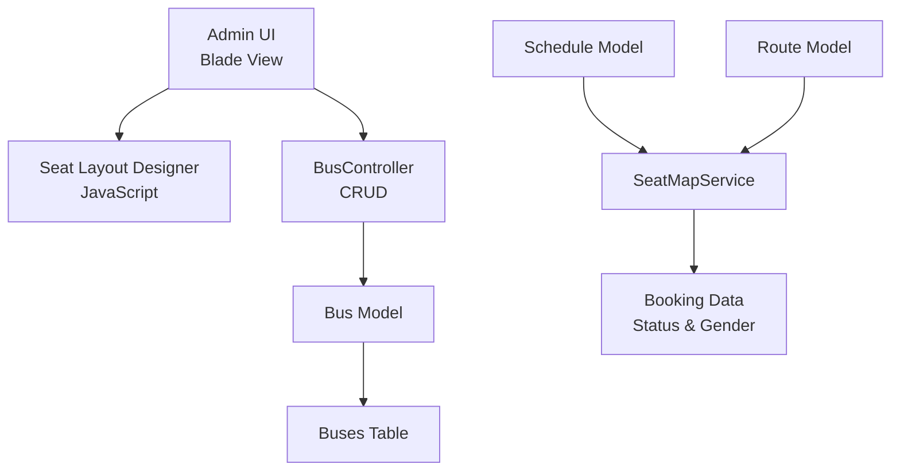
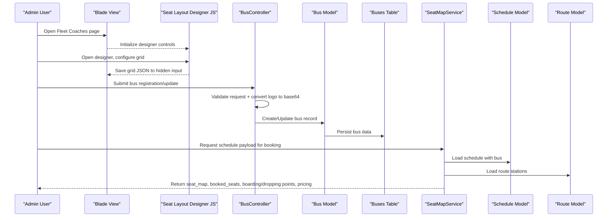
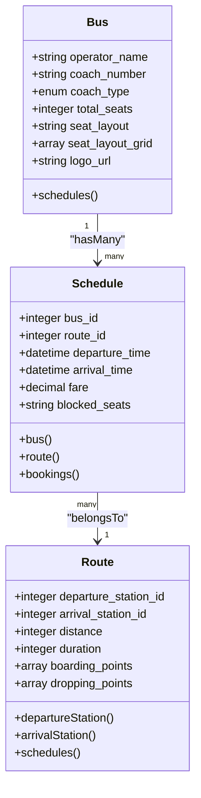
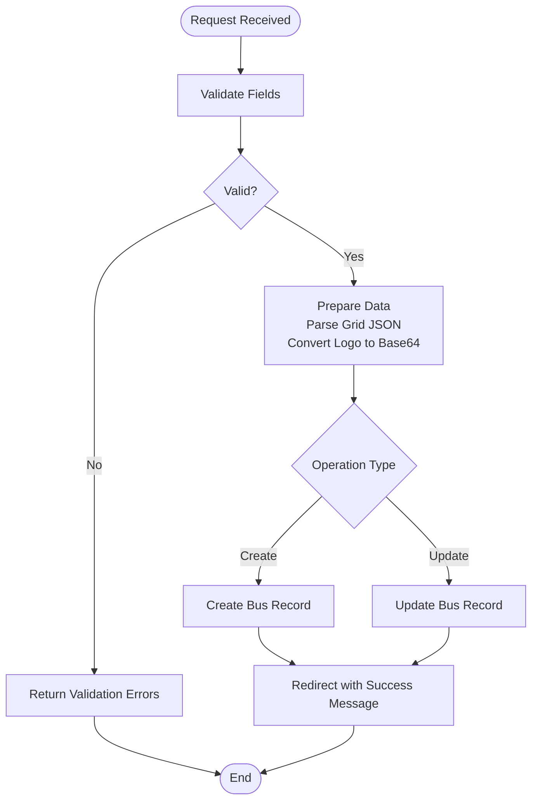
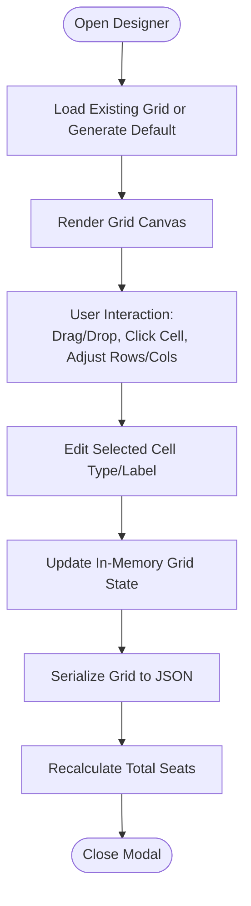
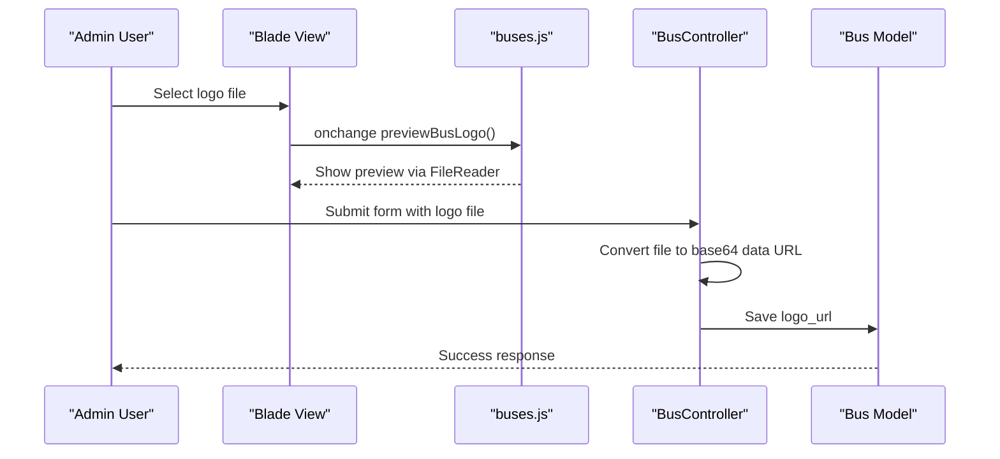
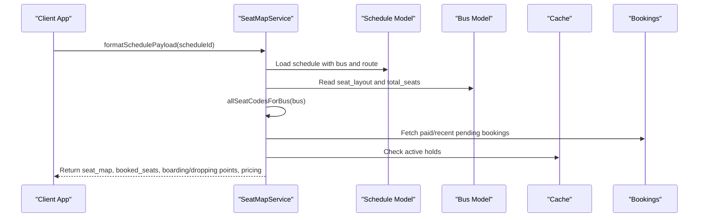
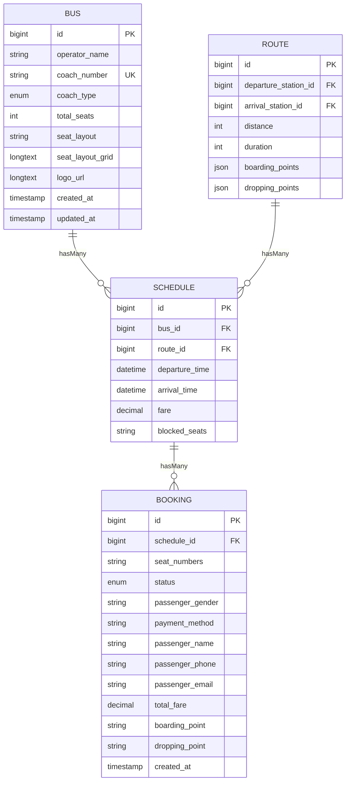
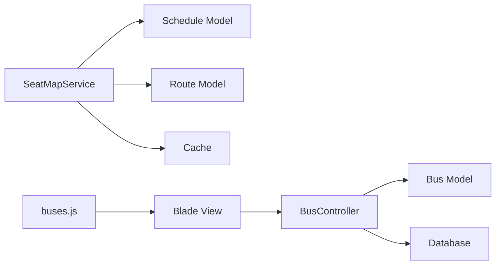

# Bus Fleet Management

<cite>
**Referenced Files in This Document**
- [BusController.php](file://backend/app/Http/Controllers/Admin/BusController.php)
- [Bus.php](file://backend/app/Models/Bus.php)
- [Schedule.php](file://backend/app/Models/Schedule.php)
- [Route.php](file://backend/app/Models/Route.php)
- [SeatMapService.php](file://backend/app/Services/SeatMapService.php)
- [buses.blade.php](file://backend/resources/views/admin/partials/buses.blade.php)
- [buses.js](file://backend/resources/js/admin/buses.js)
- [bus-layout-helper.js](file://backend/resources/js/admin/bus-layout-helper.js)
- [2026_06_01_000020_create_buses_table.php](file://backend/database/migrations/2026_06_01_000020_create_buses_table.php)
</cite>

## Table of Contents
1. [Introduction](#introduction)
2. [Project Structure](#project-structure)
3. [Core Components](#core-components)
4. [Architecture Overview](#architecture-overview)
5. [Detailed Component Analysis](#detailed-component-analysis)
6. [Dependency Analysis](#dependency-analysis)
7. [Performance Considerations](#performance-considerations)
8. [Troubleshooting Guide](#troubleshooting-guide)
9. [Conclusion](#conclusion)

## Introduction
This document explains the bus fleet management module for a bus booking application. It covers:
- CRUD operations for bus entities, including registration, editing, and deletion.
- Capacity configuration and seat layout definition through an interactive drag-and-drop editor.
- Gender-aware seat allocation and visual seat map integration via the seat map service.
- Validation rules, image upload handling for operator logos, and data persistence.
- The relationship between buses, routes, and schedules in the fleet workflow.

The module is primarily implemented in the backend admin layer with Blade views and supporting JavaScript for the interactive seat layout designer.

## Project Structure
The bus fleet management feature spans controllers, models, services, database schema, Blade templates, and frontend JavaScript:
- Admin controller handles bus creation, update, and deletion.
- Eloquent model defines bus attributes, JSON casting for grid layouts, and relationships to schedules.
- Seat map service computes available seats, blocked seats, gender-based status keys, and schedule payloads.
- Blade view renders the fleet table, registration form, logo preview, and the modal-based seat layout designer.
- JavaScript implements default grid generation, drag-and-drop editing, cell selection, and saving the grid as JSON.
- Migration defines the buses table structure and indexes.

**Diagram sources**
- [buses.blade.php:1-147](file://backend/resources/views/admin/partials/buses.blade.php#L1-L147)
- [buses.js:1-596](file://backend/resources/js/admin/buses.js#L1-L596)
- [BusController.php:1-97](file://backend/app/Http/Controllers/Admin/BusController.php#L1-L97)
- [Bus.php:1-23](file://backend/app/Models/Bus.php#L1-L23)
- [2026_06_01_000020_create_buses_table.php:1-39](file://backend/database/migrations/2026_06_01_000020_create_buses_table.php#L1-L39)
- [SeatMapService.php:1-593](file://backend/app/Services/SeatMapService.php#L1-L593)
- [Schedule.php:1-35](file://backend/app/Models/Schedule.php#L1-L35)
- [Route.php:1-41](file://backend/app/Models/Route.php#L1-L41)

**Section sources**
- [BusController.php:1-97](file://backend/app/Http/Controllers/Admin/BusController.php#L1-L97)
- [Bus.php:1-23](file://backend/app/Models/Bus.php#L1-L23)
- [SeatMapService.php:1-593](file://backend/app/Services/SeatMapService.php#L1-L593)
- [buses.blade.php:1-437](file://backend/resources/views/admin/partials/buses.blade.php#L1-L437)
- [buses.js:1-596](file://backend/resources/js/admin/buses.js#L1-L596)
- [bus-layout-helper.js:1-131](file://backend/resources/js/admin/bus-layout-helper.js#L1-L131)
- [2026_06_01_000020_create_buses_table.php:1-39](file://backend/database/migrations/2026_06_01_000020_create_buses_table.php#L1-L39)

## Core Components
- Bus entity: Represents a coach with operator name, registration number, comfort class, total seats, seat layout pattern, optional custom grid, and base64-encoded logo URL.
- Bus controller: Validates input, converts uploaded images to base64 data URLs, persists or updates bus records, and deletes buses.
- Seat map service: Computes seat codes per bus layout, builds seat maps for schedules, manages blocked seats, holds, and provides schedule payloads for the booking UI.
- Interactive seat layout designer: Generates default grids, supports drag-and-drop swapping, cell type editing (seat, aisle, empty, driver, engine), row/column adjustments, and saves the grid as JSON.
- Blade view: Renders the fleet list, edit/delete actions, registration form, logo preview, and the modal-based designer.

Key responsibilities:
- Registration and editing enforce validation rules and handle optional logo uploads.
- Custom seat layouts are serialized into JSON and stored in the bus record.
- Seat availability and gender-specific statuses are computed from bookings and cache-based holds.
- Schedules link buses to routes and carry fare, departure/arrival times, and blocked seats.

**Section sources**
- [BusController.php:27-88](file://backend/app/Http/Controllers/Admin/BusController.php#L27-L88)
- [Bus.php:8-22](file://backend/app/Models/Bus.php#L8-L22)
- [SeatMapService.php:49-189](file://backend/app/Services/SeatMapService.php#L49-L189)
- [SeatMapService.php:194-244](file://backend/app/Services/SeatMapService.php#L194-L244)
- [buses.js:37-46](file://backend/resources/js/admin/buses.js#L37-L46)
- [buses.js:109-137](file://backend/resources/js/admin/buses.js#L109-L137)
- [buses.js:500-513](file://backend/resources/js/admin/buses.js#L500-L513)
- [buses.blade.php:81-147](file://backend/resources/views/admin/partials/buses.blade.php#L81-L147)

## Architecture Overview
The fleet management workflow connects admin UI interactions with backend persistence and seat visualization:

**Diagram sources**
- [buses.blade.php:81-147](file://backend/resources/views/admin/partials/buses.blade.php#L81-L147)
- [buses.js:500-513](file://backend/resources/js/admin/buses.js#L500-L513)
- [BusController.php:27-88](file://backend/app/Http/Controllers/Admin/BusController.php#L27-L88)
- [Bus.php:8-22](file://backend/app/Models/Bus.php#L8-L22)
- [SeatMapService.php:367-382](file://backend/app/Services/SeatMapService.php#L367-L382)
- [Schedule.php:8-34](file://backend/app/Models/Schedule.php#L8-L34)
- [Route.php:8-40](file://backend/app/Models/Route.php#L8-L40)

## Detailed Component Analysis

### Bus Entity and Database Schema
The bus entity stores core fleet information and supports custom seat layout grids:
- Attributes include operator name, coach number, comfort class, total seats, seat layout pattern, optional grid JSON, and base64 logo URL.
- The grid is cast to an array for easy manipulation.
- The bus has a one-to-many relationship with schedules.
- The migration defines the table structure, default values, and indexing on coach number.

**Diagram sources**
- [Bus.php:8-22](file://backend/app/Models/Bus.php#L8-L22)
- [Schedule.php:8-34](file://backend/app/Models/Schedule.php#L8-L34)
- [Route.php:8-40](file://backend/app/Models/Route.php#L8-L40)

**Section sources**
- [Bus.php:8-22](file://backend/app/Models/Bus.php#L8-L22)
- [2026_06_01_000020_create_buses_table.php:14-28](file://backend/database/migrations/2026_06_01_000020_create_buses_table.php#L14-L28)

### Bus CRUD Operations
The admin controller provides create, update, and delete endpoints:
- Store validates operator name, coach number uniqueness, comfort class, total seats range, seat layout pattern, optional grid JSON, and optional image file.
- Update mirrors store validations but allows excluding logo updates via a keep flag.
- Delete removes the bus by ID.
- Uploaded logos are converted to base64 data URLs and stored directly in the bus record.

Validation rules summary:
- operator_name: required string, max 100 characters.
- coach_number: required string, max 50 characters, unique per bus record.
- coach_type: required enum AC or Non AC.
- total_seats: required integer, min 10, max 100.
- seat_layout: required enum 2+2_last5, 2+2, 1+2, sleeper.
- seat_layout_grid: nullable string containing JSON grid.
- coach_logo: nullable image, allowed formats jpeg/png/jpg/gif/webp/svg, max 1MB.

**Diagram sources**
- [BusController.php:27-88](file://backend/app/Http/Controllers/Admin/BusController.php#L27-L88)

**Section sources**
- [BusController.php:27-88](file://backend/app/Http/Controllers/Admin/BusController.php#L27-L88)

### Interactive Seat Map Editor
The seat layout designer enables admins to visually define bus layouts:
- Default grids are generated based on selected layout and total seats.
- Drag-and-drop swaps cells between positions.
- Cell configurator allows changing cell types: seat, empty, aisle, driver, engine.
- Row and column controls add/remove rows/columns per deck for sleeper layouts.
- Saving serializes the grid to JSON and updates the total seat count based on labeled seat cells.

Supported cell types:
- seat: A labeled passenger seat.
- aisle: An aisle marker.
- empty: Spacer or unused slot.
- driver: Driver seat indicator.
- engine: Engine block indicator.

Sleeper layouts use two decks: lower and upper, each with their own grid arrays.

**Diagram sources**
- [buses.js:109-137](file://backend/resources/js/admin/buses.js#L109-L137)
- [buses.js:161-203](file://backend/resources/js/admin/buses.js#L161-L203)
- [buses.js:279-314](file://backend/resources/js/admin/buses.js#L279-L314)
- [buses.js:319-383](file://backend/resources/js/admin/buses.js#L319-L383)
- [buses.js:387-458](file://backend/resources/js/admin/buses.js#L387-L458)
- [buses.js:500-513](file://backend/resources/js/admin/buses.js#L500-L513)
- [bus-layout-helper.js:25-130](file://backend/resources/js/admin/bus-layout-helper.js#L25-L130)

**Section sources**
- [buses.js:109-513](file://backend/resources/js/admin/buses.js#L109-L513)
- [bus-layout-helper.js:25-130](file://backend/resources/js/admin/bus-layout-helper.js#L25-L130)

### Image Upload Handling for Bus Photos
Logo handling uses base64 encoding rather than server-side file storage:
- Frontend previews the selected image using FileReader.
- Backend converts uploaded files to base64 data URLs and stores them in the logo_url field.
- On update, existing logos can be kept or cleared via a hidden keep flag.

**Diagram sources**
- [buses.blade.php:124-138](file://backend/resources/views/admin/partials/buses.blade.php#L124-L138)
- [buses.js:521-573](file://backend/resources/js/admin/buses.js#L521-L573)
- [BusController.php:14-25](file://backend/app/Http/Controllers/Admin/BusController.php#L14-L25)
- [BusController.php:45-48](file://backend/app/Http/Controllers/Admin/BusController.php#L45-L48)
- [BusController.php:77-83](file://backend/app/Http/Controllers/Admin/BusController.php#L77-L83)

**Section sources**
- [buses.blade.php:124-138](file://backend/resources/views/admin/partials/buses.blade.php#L124-L138)
- [buses.js:521-573](file://backend/resources/js/admin/buses.js#L521-L573)
- [BusController.php:14-25](file://backend/app/Http/Controllers/Admin/BusController.php#L14-L25)
- [BusController.php:45-48](file://backend/app/Http/Controllers/Admin/BusController.php#L45-L48)
- [BusController.php:77-83](file://backend/app/Http/Controllers/Admin/BusController.php#L77-L83)

### Seat Map Service Integration
The seat map service integrates with schedules, routes, and bookings to provide visual seat allocation:
- Computes all valid seat codes per bus layout or custom grid.
- Builds a seat map for a schedule, marking seats as available, blocked, sold, or booked with gender suffixes.
- Manages temporary holds via cache to prevent double booking during checkout.
- Provides schedule payloads including seat map, booked seats, boarding/dropping points, seat class, and pricing breakdown.

Gender-specific seating:
- Passenger gender influences status keys such as sold_female or booked_male.
- Seat map status keys combine booking state and gender for display differentiation.

Blocked seats:
- Schedules maintain a comma-separated list of blocked seats.
- Service toggles blocked status and persists changes.

**Diagram sources**
- [SeatMapService.php:367-382](file://backend/app/Services/SeatMapService.php#L367-L382)
- [SeatMapService.php:49-189](file://backend/app/Services/SeatMapService.php#L49-L189)
- [SeatMapService.php:194-244](file://backend/app/Services/SeatMapService.php#L194-L244)
- [SeatMapService.php:502-561](file://backend/app/Services/SeatMapService.php#L502-L561)

**Section sources**
- [SeatMapService.php:49-189](file://backend/app/Services/SeatMapService.php#L49-L189)
- [SeatMapService.php:194-244](file://backend/app/Services/SeatMapService.php#L194-L244)
- [SeatMapService.php:367-382](file://backend/app/Services/SeatMapService.php#L367-L382)
- [SeatMapService.php:502-561](file://backend/app/Services/SeatMapService.php#L502-L561)

### Relationship Between Buses, Routes, and Schedules
Fleet management ties buses to operational schedules along defined routes:
- Bus represents the physical coach asset.
- Route defines origin and destination stations plus optional boarding/dropping points.
- Schedule links a specific bus to a route at given departure and arrival times, carrying fare and blocked seats.
- Bookings reference schedules, enabling seat allocation per trip.

**Diagram sources**
- [2026_06_01_000020_create_buses_table.php:14-28](file://backend/database/migrations/2026_06_01_000020_create_buses_table.php#L14-L28)
- [Schedule.php:8-34](file://backend/app/Models/Schedule.php#L8-L34)
- [Route.php:8-40](file://backend/app/Models/Route.php#L8-L40)

**Section sources**
- [Schedule.php:8-34](file://backend/app/Models/Schedule.php#L8-L34)
- [Route.php:8-40](file://backend/app/Models/Route.php#L8-L40)
- [Bus.php:18-21](file://backend/app/Models/Bus.php#L18-L21)

## Dependency Analysis
The bus fleet management module depends on:
- Admin controller for request handling and validation.
- Eloquent models for data access and relationships.
- Seat map service for seat code computation and availability logic.
- Blade view for rendering forms and tables.
- JavaScript for interactive designer functionality.

Coupling and cohesion:
- BusController is cohesive around bus CRUD and logo handling.
- SeatMapService encapsulates seat mapping, holds, and schedule payload formatting.
- Models expose relationships cleanly, reducing coupling across layers.
- JavaScript is decoupled from backend logic except for form serialization and API calls elsewhere.

Potential circular dependencies:
- None observed among bus, schedule, and route models; relationships are directional.

External dependencies:
- Laravel caching for temporary seat holds.
- Filesystem for reading uploaded images before base64 conversion.

**Diagram sources**
- [BusController.php:1-97](file://backend/app/Http/Controllers/Admin/BusController.php#L1-L97)
- [Bus.php:1-23](file://backend/app/Models/Bus.php#L1-L23)
- [SeatMapService.php:1-593](file://backend/app/Services/SeatMapService.php#L1-L593)
- [Schedule.php:1-35](file://backend/app/Models/Schedule.php#L1-L35)
- [Route.php:1-41](file://backend/app/Models/Route.php#L1-L41)
- [buses.blade.php:1-437](file://backend/resources/views/admin/partials/buses.blade.php#L1-L437)
- [buses.js:1-596](file://backend/resources/js/admin/buses.js#L1-L596)

**Section sources**
- [BusController.php:1-97](file://backend/app/Http/Controllers/Admin/BusController.php#L1-L97)
- [SeatMapService.php:1-593](file://backend/app/Services/SeatMapService.php#L1-L593)
- [buses.blade.php:1-437](file://backend/resources/views/admin/partials/buses.blade.php#L1-L437)
- [buses.js:1-596](file://backend/resources/js/admin/buses.js#L1-L596)

## Performance Considerations
- Base64 logo storage increases payload size; consider optimizing image compression or switching to server-side storage for large fleets.
- Seat map computation iterates over all seat codes and bookings; ensure efficient queries and avoid N+1 loading by preloading necessary relations.
- Cache-based holds should have appropriate TTLs to balance concurrency and memory usage.
- Avoid excessive re-rendering in the designer; batch DOM updates where possible.

[No sources needed since this section provides general guidance]

## Troubleshooting Guide
Common issues and resolutions:
- Validation errors on bus registration: Ensure coach_number is unique, total_seats within range, and seat_layout matches allowed patterns.
- Logo not updating: Verify the keep flag is set correctly when no new logo is uploaded; check that the file input accepts the chosen format and size.
- Seat layout grid not saving: Confirm the hidden input contains valid JSON and that the grid includes labeled seat cells.
- Seat appears unavailable: Check blocked seats on the schedule and active holds in cache; verify booking status and recent pending bookings.
- Gender-specific seat colors not showing: Ensure passenger_gender is set and seat map status keys reflect gender suffixes.

Operational checks:
- Inspect request payloads for seat_layout_grid and coach_logo fields.
- Review database entries for logo_url and seat_layout_grid content.
- Monitor cache entries for schedule holds and expiration timestamps.

**Section sources**
- [BusController.php:27-88](file://backend/app/Http/Controllers/Admin/BusController.php#L27-L88)
- [SeatMapService.php:460-500](file://backend/app/Services/SeatMapService.php#L460-L500)
- [SeatMapService.php:502-561](file://backend/app/Services/SeatMapService.php#L502-L561)

## Conclusion
The bus fleet management module provides comprehensive tools for registering and configuring buses, defining custom seat layouts through an interactive designer, and integrating with a robust seat map service for visual seat allocation. Validation rules protect data integrity, while base64 logo handling simplifies asset management. The relationships between buses, routes, and schedules enable operational scheduling and booking workflows. For large-scale deployments, consider optimizing image storage and query performance to maintain responsiveness.

[No sources needed since this section summarizes without analyzing specific files]