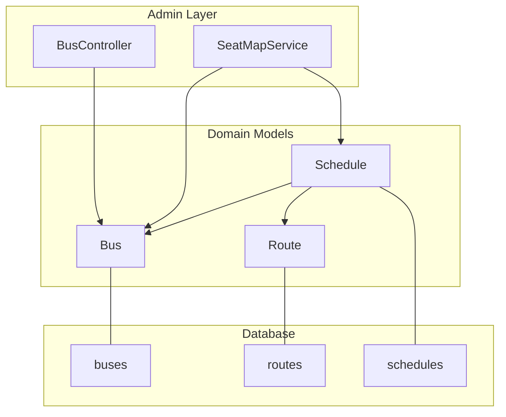
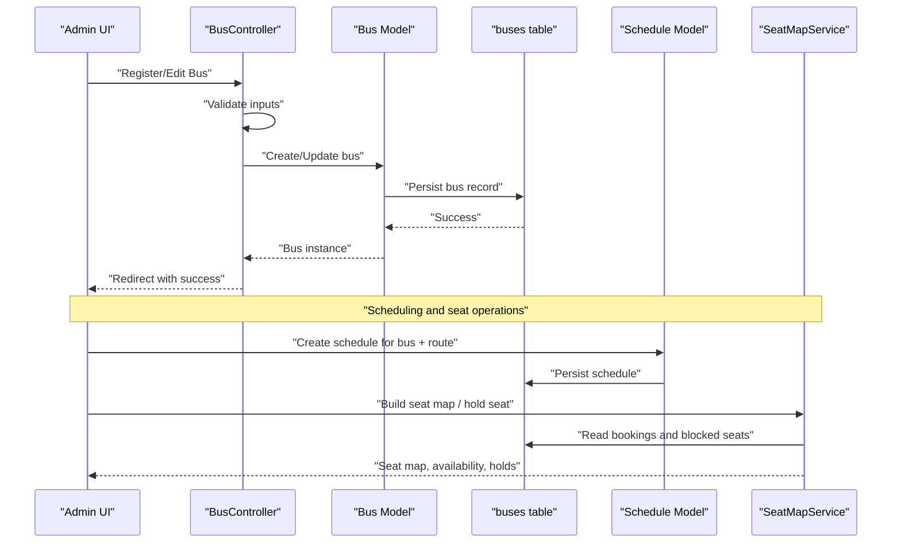
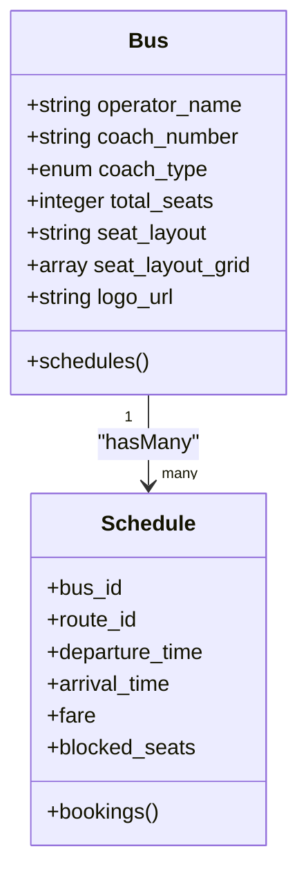
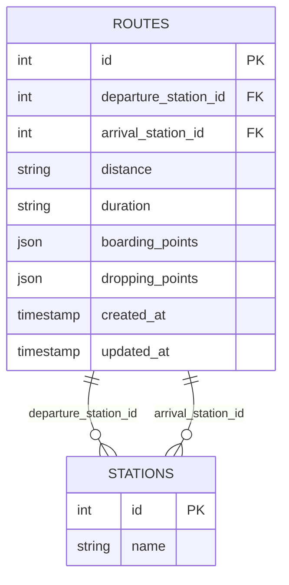
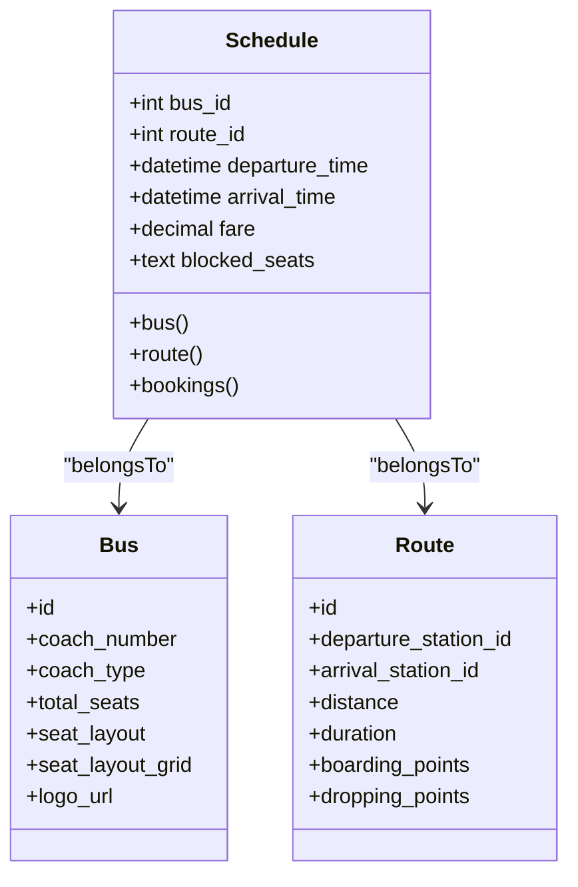
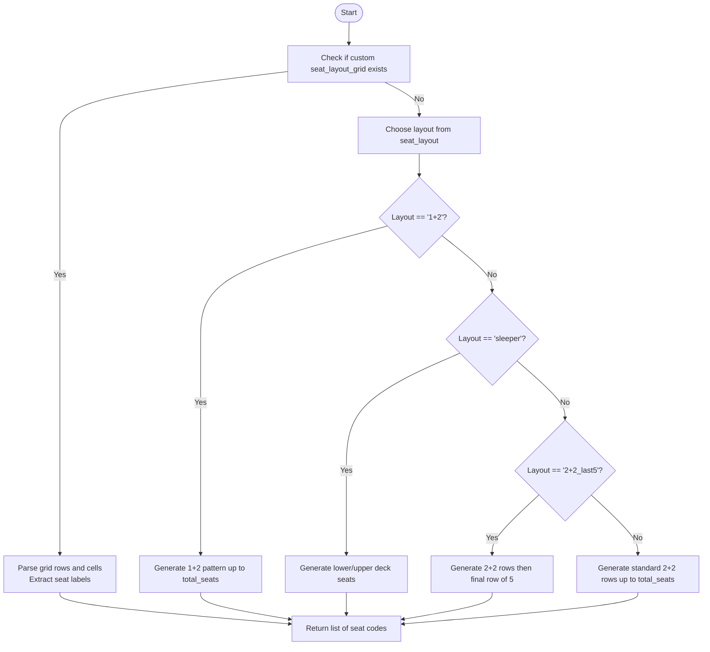
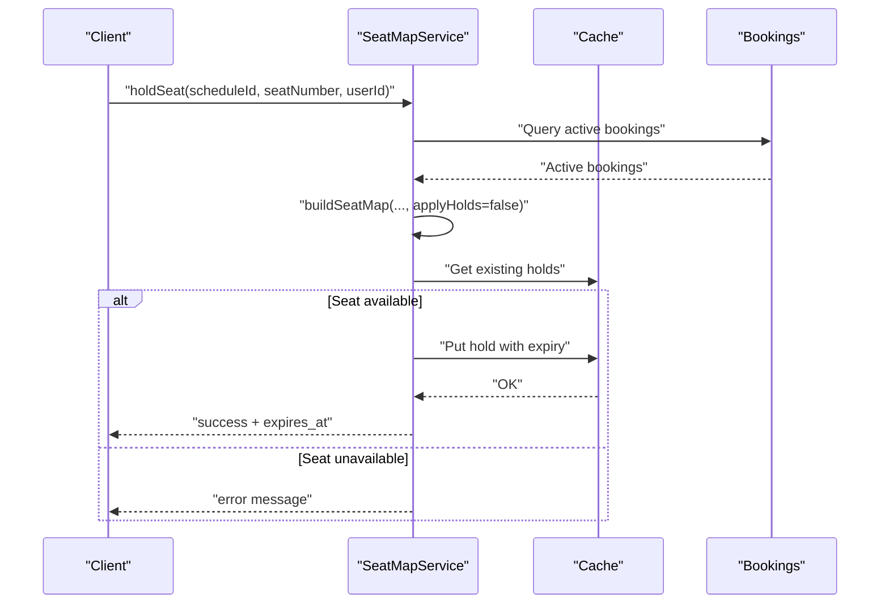
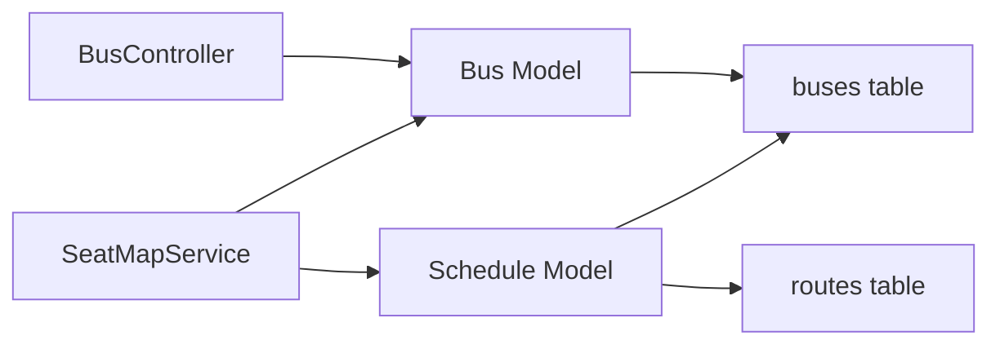

# Fleet Configuration Management

<cite>
**Referenced Files in This Document**
- [Bus.php](file://backend/app/Models/Bus.php)
- [2026_06_01_000020_create_buses_table.php](file://backend/database/migrations/2026_06_01_000020_create_buses_table.php)
- [Route.php](file://backend/app/Models/Route.php)
- [2026_06_01_000030_create_routes_table.php](file://backend/database/migrations/2026_06_01_000030_create_routes_table.php)
- [Schedule.php](file://backend/app/Models/Schedule.php)
- [2026_06_01_000040_create_schedules_table.php](file://backend/database/migrations/2026_06_01_000040_create_schedules_table.php)
- [BusController.php](file://backend/app/Http/Controllers/Admin/BusController.php)
- [SeatMapService.php](file://backend/app/Services/SeatMapService.php)
- [BusSeeder.php](file://backend/database/seeders/BusSeeder.php)
</cite>

## Table of Contents
1. [Introduction](#introduction)
2. [Project Structure](#project-structure)
3. [Core Components](#core-components)
4. [Architecture Overview](#architecture-overview)
5. [Detailed Component Analysis](#detailed-component-analysis)
6. [Dependency Analysis](#dependency-analysis)
7. [Performance Considerations](#performance-considerations)
8. [Troubleshooting Guide](#troubleshooting-guide)
9. [Conclusion](#conclusion)

## Introduction
This document explains fleet configuration management for the bus application. It focuses on how buses, routes, and schedules are modeled and related; how seat capacity and coach classifications are managed; and how operational state is tracked through schedules and bookings. It also covers database schema details, migration strategies, data integrity constraints, and performance considerations for large fleets and bulk updates.

## Project Structure
The fleet configuration domain lives primarily in:
- Eloquent models for Bus, Route, and Schedule
- Database migrations defining tables, indexes, and foreign keys
- Admin controller handling bus registration and updates
- Seat map service implementing seat generation, availability, holds, and pricing helpers

**Diagram sources**
- [Bus.php:8-22](file://backend/app/Models/Bus.php#L8-L22)
- [Route.php:8-40](file://backend/app/Models/Route.php#L8-L40)
- [Schedule.php:8-34](file://backend/app/Models/Schedule.php#L8-L34)
- [BusController.php:8-96](file://backend/app/Http/Controllers/Admin/BusController.php#L8-L96)
- [SeatMapService.php:9-593](file://backend/app/Services/SeatMapService.php#L9-L593)

**Section sources**
- [Bus.php:8-22](file://backend/app/Models/Bus.php#L8-L22)
- [Route.php:8-40](file://backend/app/Models/Route.php#L8-L40)
- [Schedule.php:8-34](file://backend/app/Models/Schedule.php#L8-L34)
- [BusController.php:8-96](file://backend/app/Http/Controllers/Admin/BusController.php#L8-L96)
- [SeatMapService.php:9-593](file://backend/app/Services/SeatMapService.php#L9-L593)

## Core Components
- Bus: Represents a physical coach with operator identity, unique coach number, coach type (AC or Non AC), total seats, seat layout, optional custom grid, and optional logo.
- Route: Connects departure and arrival stations, stores distance/duration strings, and JSON arrays for boarding and dropping points.
- Schedule: Links a Bus to a Route with departure/arrival times, fare, and blocked seats. It is the operational unit where seat availability is computed.

Key relationships:
- Bus has many Schedules.
- Route has many Schedules.
- Schedule belongs to Bus and Route.
- Schedule has many Bookings.

Validation and business rules:
- Coach number must be unique.
- Coach type is restricted to AC or Non AC.
- Total seats must be between 10 and 100.
- Seat layout is restricted to supported layouts.
- Seat codes are validated against generated or custom grids.

Operational status tracking:
- Seat availability is derived from schedule-level blocked seats, active bookings, and temporary holds.
- Booking statuses such as PAID, SOLD, BOOKED, and recent PENDING affect seat visibility.

**Section sources**
- [Bus.php:8-22](file://backend/app/Models/Bus.php#L8-L22)
- [Route.php:8-40](file://backend/app/Models/Route.php#L8-L40)
- [Schedule.php:8-34](file://backend/app/Models/Schedule.php#L8-L34)
- [BusController.php:27-88](file://backend/app/Http/Controllers/Admin/BusController.php#L27-L88)
- [SeatMapService.php:49-189](file://backend/app/Services/SeatMapService.php#L49-L189)
- [SeatMapService.php:194-244](file://backend/app/Services/SeatMapService.php#L194-L244)

## Architecture Overview
The fleet configuration workflow connects administrative bus setup with operational scheduling and seat booking.

**Diagram sources**
- [BusController.php:27-88](file://backend/app/Http/Controllers/Admin/BusController.php#L27-L88)
- [Bus.php:18-21](file://backend/app/Models/Bus.php#L18-L21)
- [Schedule.php:20-33](file://backend/app/Models/Schedule.php#L20-L33)
- [SeatMapService.php:194-244](file://backend/app/Services/SeatMapService.php#L194-L244)
- [SeatMapService.php:502-561](file://backend/app/Services/SeatMapService.php#L502-L561)

## Detailed Component Analysis

### Bus Entity Model
The Bus model defines the core attributes for a coach and its relationship to schedules.

- Fillable fields:
  - operator_name: string
  - coach_number: string, unique at DB level
  - coach_type: enum AC or Non AC
  - total_seats: integer
  - seat_layout: string representing layout type
  - seat_layout_grid: array stored as JSON
  - logo_url: base64 data URL string

- Casts:
  - seat_layout_grid cast to array

- Relationships:
  - schedules(): one-to-many to Schedule

Validation constraints enforced by the admin controller:
- operator_name: required, string, max length
- coach_number: required, unique across buses
- coach_type: required, limited to AC or Non AC
- total_seats: required, integer, range 10–100
- seat_layout: required, limited to supported layouts
- seat_layout_grid: optional stringified JSON
- coach_logo: optional image file with allowed types and size limit

Database schema:
- buses table includes id, operator_name, coach_number, coach_type, total_seats, seat_layout, seat_layout_grid, logo_url, timestamps
- Indexes: coach_number

Migration strategy:
- Create table with explicit column types and defaults
- Add index on coach_number for fast lookups
- Down method drops the table cleanly

**Diagram sources**
- [Bus.php:8-22](file://backend/app/Models/Bus.php#L8-L22)
- [Schedule.php:8-34](file://backend/app/Models/Schedule.php#L8-L34)

**Section sources**
- [Bus.php:8-22](file://backend/app/Models/Bus.php#L8-L22)
- [2026_06_01_000020_create_buses_table.php:12-28](file://backend/database/migrations/2026_06_01_000020_create_buses_table.php#L12-L28)
- [BusController.php:27-88](file://backend/app/Http/Controllers/Admin/BusController.php#L27-L88)

### Route Entity Model
The Route model represents a connection between two stations and carries metadata used by schedules.

- Fillable fields:
  - departure_station_id: foreign key to stations
  - arrival_station_id: foreign key to stations
  - distance: string
  - duration: string
  - boarding_points: JSON array
  - dropping_points: JSON array

- Casts:
  - boarding_points and dropping_points cast to arrays

- Relationships:
  - departureStation(): belongsTo Station
  - arrivalStation(): belongsTo Station
  - schedules(): hasMany Schedule

Database schema:
- routes table includes id, departure_station_id, arrival_station_id, distance, duration, boarding_points, dropping_points, timestamps
- Foreign keys cascade on delete
- Indexes on departure_station_id, arrival_station_id, and their composite

**Diagram sources**
- [2026_06_01_000030_create_routes_table.php:12-28](file://backend/database/migrations/2026_06_01_000030_create_routes_table.php#L12-L28)

**Section sources**
- [Route.php:8-40](file://backend/app/Models/Route.php#L8-L40)
- [2026_06_01_000030_create_routes_table.php:12-28](file://backend/database/migrations/2026_06_01_000030_create_routes_table.php#L12-L28)

### Schedule Entity Model
The Schedule ties a Bus to a Route and captures operational details for a specific trip.

- Fillable fields:
  - bus_id: foreign key to buses
  - route_id: foreign key to routes
  - departure_time: datetime
  - arrival_time: datetime
  - fare: decimal
  - blocked_seats: text (comma-separated seat codes)

- Casts:
  - departure_time and arrival_time cast to datetime
  - fare cast to decimal with precision

- Relationships:
  - bus(): belongsTo Bus
  - route(): belongsTo Route
  - bookings(): hasMany Booking

Database schema:
- schedules table includes id, bus_id, route_id, departure_time, arrival_time, fare, blocked_seats, timestamps
- Foreign keys cascade on delete
- Indexes on bus_id, route_id, departure_time, and composite indexes for common queries

**Diagram sources**
- [Schedule.php:8-34](file://backend/app/Models/Schedule.php#L8-L34)
- [Bus.php:8-22](file://backend/app/Models/Bus.php#L8-L22)
- [Route.php:8-40](file://backend/app/Models/Route.php#L8-L40)

**Section sources**
- [Schedule.php:8-34](file://backend/app/Models/Schedule.php#L8-L34)
- [2026_06_01_000040_create_schedules_table.php:12-30](file://backend/database/migrations/2026_06_01_000040_create_schedules_table.php#L12-L30)

### Seat Capacity and Layout Management
Seat capacity is driven by the Bus’s total_seats and seat_layout, with support for a custom seat_layout_grid. The SeatMapService generates valid seat codes based on these settings.

Supported seat layouts:
- 2+2_last5
- 2+2
- 1+2
- sleeper

Seat code generation behavior:
- If a custom seat_layout_grid exists, it is parsed to extract seat labels.
- Otherwise, seat codes are generated algorithmically according to the selected layout and total_seats.
- Sleeper layout uses lower and upper decks with special row naming.
- 2+2_last5 adds an extra last row with five seats.

Seat validation:
- isValidSeatCode checks whether a seat code is valid for a given Bus or globally.

Blocked seats:
- Schedule.blocked_seats stores comma-separated seat codes that are not bookable.
- toggleBlockedSeat enforces that only available seats can be blocked and persists changes.

**Diagram sources**
- [SeatMapService.php:49-189](file://backend/app/Services/SeatMapService.php#L49-L189)

**Section sources**
- [SeatMapService.php:49-189](file://backend/app/Services/SeatMapService.php#L49-L189)
- [SeatMapService.php:438-447](file://backend/app/Services/SeatMapService.php#L438-L447)
- [SeatMapService.php:460-500](file://backend/app/Services/SeatMapService.php#L460-L500)

### Coach Type Classifications (AC / Non AC)
Coach type is constrained to AC or Non AC at both the database and controller levels. The SeatMapService maps AC coaches to a premium seat class label when building schedule payloads.

- Database constraint: enum('AC', 'Non AC')
- Controller validation: in:AC,Non AC
- Seat class mapping: AC -> E-Class; otherwise default configured value

**Section sources**
- [2026_06_01_000020_create_buses_table.php:18-18](file://backend/database/migrations/2026_06_01_000020_create_buses_table.php#L18-L18)
- [BusController.php:29-37](file://backend/app/Http/Controllers/Admin/BusController.php#L29-L37)
- [SeatMapService.php:334-341](file://backend/app/Services/SeatMapService.php#L334-L341)

### Operational Status Tracking
Operational status is tracked through:
- Schedule-level blocked_seats
- Booking statuses: PAID, SOLD, BOOKED, and recent PENDING within a time window
- Temporary seat holds via cache to prevent race conditions during booking

Seat map construction:
- Initializes all seats as available
- Applies blocked seats
- Applies active holds from cache
- Applies paid/recent pending bookings to mark seats as sold/booked with gender-specific classes

Hold lifecycle:
- holdSeat validates seat availability and sets a short-lived hold in cache
- releaseSeat removes the user’s hold
- buildSeatMap respects holds unless explicitly disabled

**Diagram sources**
- [SeatMapService.php:194-244](file://backend/app/Services/SeatMapService.php#L194-L244)
- [SeatMapService.php:502-561](file://backend/app/Services/SeatMapService.php#L502-L561)

**Section sources**
- [SeatMapService.php:194-244](file://backend/app/Services/SeatMapService.php#L194-L244)
- [SeatMapService.php:502-561](file://backend/app/Services/SeatMapService.php#L502-L561)
- [SeatMapService.php:563-582](file://backend/app/Services/SeatMapService.php#L563-L582)

### Data Integrity Constraints
- Unique constraint: buses.coach_number ensures each coach identifier is unique.
- Foreign key constraints:
  - schedules.bus_id references buses.id with cascade delete
  - schedules.route_id references routes.id with cascade delete
  - routes.departure_station_id and routes.arrival_station_id reference stations.id with cascade delete
- Enum constraint: buses.coach_type restricts values to AC or Non AC.
- Default values:
  - buses.total_seats defaults to 36
  - buses.seat_layout defaults to 2+2

Indexes:
- buses.coach_number
- routes.departure_station_id, routes.arrival_station_id, and their composite
- schedules.bus_id, schedules.route_id, schedules.departure_time, and composites for route+time and bus+time

**Section sources**
- [2026_06_01_000020_create_buses_table.php:14-28](file://backend/database/migrations/2026_06_01_000020_create_buses_table.php#L14-L28)
- [2026_06_01_000030_create_routes_table.php:14-28](file://backend/database/migrations/2026_06_01_000030_create_routes_table.php#L14-L28)
- [2026_06_01_000040_create_schedules_table.php:14-30](file://backend/database/migrations/2026_06_01_000040_create_schedules_table.php#L14-L30)

### Migration Strategies
- Use Laravel migrations to define schema evolution.
- Prefer explicit column types and defaults for clarity and safety.
- Add indexes early to optimize frequent queries.
- Use foreign keys with cascade deletes to maintain referential integrity.
- Provide down methods to drop tables cleanly.

For future changes:
- Introduce new seat layouts by updating controller validation and SeatMapService logic.
- Add new coach types by extending enums and mappings.
- Introduce soft deletes or status flags on Bus/Schedule if needed for operational workflows.

**Section sources**
- [2026_06_01_000020_create_buses_table.php:12-38](file://backend/database/migrations/2026_06_01_000020_create_buses_table.php#L12-L38)
- [2026_06_01_000030_create_routes_table.php:12-38](file://backend/database/migrations/2026_06_01_000030_create_routes_table.php#L12-L38)
- [2026_06_01_000040_create_schedules_table.php:12-40](file://backend/database/migrations/2026_06_01_000040_create_schedules_table.php#L12-L40)

### Seeding and Sample Data
The BusSeeder provides sample buses with different operators and coach types, using updateOrCreate to ensure idempotent seeding.

**Section sources**
- [BusSeeder.php:10-25](file://backend/database/seeders/BusSeeder.php#L10-L25)

## Dependency Analysis
The following diagram shows how components depend on each other:

**Diagram sources**
- [BusController.php:8-96](file://backend/app/Http/Controllers/Admin/BusController.php#L8-L96)
- [Bus.php:8-22](file://backend/app/Models/Bus.php#L8-L22)
- [Schedule.php:8-34](file://backend/app/Models/Schedule.php#L8-L34)
- [SeatMapService.php:9-593](file://backend/app/Services/SeatMapService.php#L9-L593)

**Section sources**
- [BusController.php:8-96](file://backend/app/Http/Controllers/Admin/BusController.php#L8-L96)
- [Bus.php:8-22](file://backend/app/Models/Bus.php#L8-L22)
- [Schedule.php:8-34](file://backend/app/Models/Schedule.php#L8-L34)
- [SeatMapService.php:9-593](file://backend/app/Services/SeatMapService.php#L9-L593)

## Performance Considerations
- Indexing:
  - Ensure queries filtering by coach_number, bus_id, route_id, and departure_time leverage existing indexes.
  - Composite indexes on (route_id, departure_time) and (bus_id, departure_time) support common search patterns.

- Eager loading:
  - When rendering schedules, eager load route.departureStation and route.arrivalStation to avoid N+1 queries.

- Seat map computation:
  - Build seat maps with minimal columns for bookings to reduce payload size.
  - Use cache-based holds to reduce contention and provide immediate feedback.

- Large fleet operations:
  - Batch create/update buses using updateOrCreate or chunked inserts.
  - Avoid storing large base64 logos directly in the database; consider object storage and store URLs instead.
  - For bulk schedule creation, use transactions and batch insertions.

- Concurrency:
  - Use seat holds with short TTLs to mitigate race conditions during high-concurrency booking flows.
  - Validate seat availability against both DB and cache before confirming bookings.

[No sources needed since this section provides general guidance]

## Troubleshooting Guide
Common issues and resolutions:
- Invalid seat code errors:
  - Occur when seat codes do not match the Bus’s layout or custom grid.
  - Resolution: Verify seat_layout and total_seats, or correct seat_layout_grid.

- Only available seats can be blocked:
  - Attempting to block already booked or held seats fails.
  - Resolution: Release holds or wait for booking completion.

- Seat temporarily reserved by another user:
  - Indicates an active hold in cache.
  - Resolution: Wait for hold expiration or ask the user to release the seat.

- Logo upload issues:
  - File size or MIME type restrictions may reject uploads.
  - Resolution: Compress images and ensure allowed formats.

- Unique coach number conflicts:
  - Duplicate coach_number prevents saving.
  - Resolution: Use a different coach_number or update the existing record.

**Section sources**
- [SeatMapService.php:460-500](file://backend/app/Services/SeatMapService.php#L460-L500)
- [SeatMapService.php:502-561](file://backend/app/Services/SeatMapService.php#L502-L561)
- [BusController.php:27-88](file://backend/app/Http/Controllers/Admin/BusController.php#L27-L88)

## Conclusion
Fleet configuration management centers on a clear separation of concerns: Bus defines physical coach properties, Route defines station connections, and Schedule operationalizes trips with fares and timing. Seat capacity and availability are computed dynamically from layout definitions, blocked seats, active bookings, and temporary holds. Strong database constraints and indexes support data integrity and performance. For large fleets, adopt batching, caching, and careful query design to maintain responsiveness during peak operations.