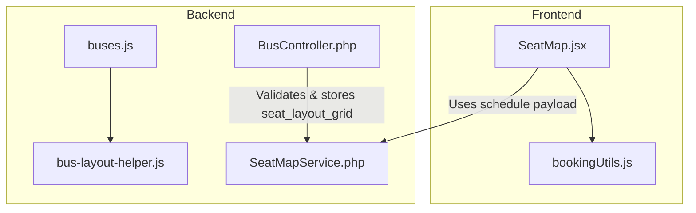
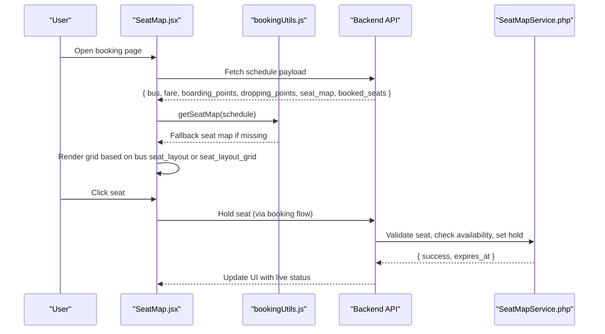
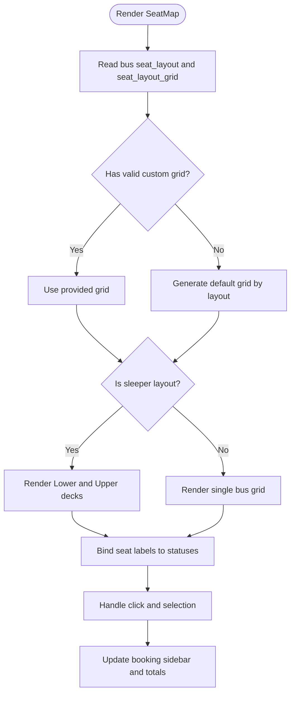
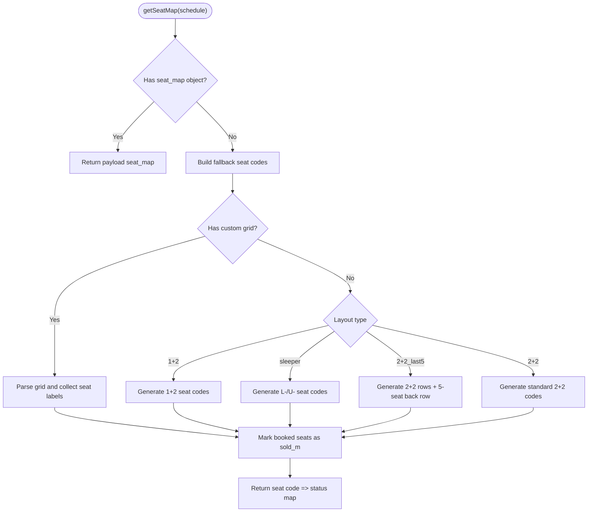
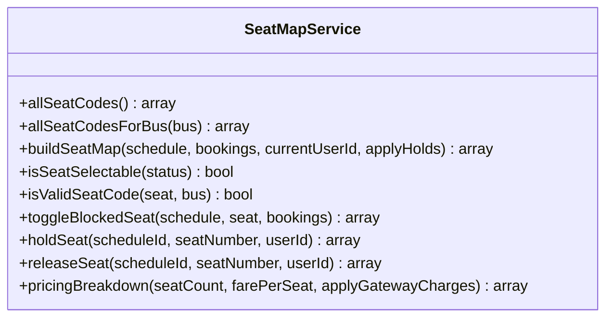
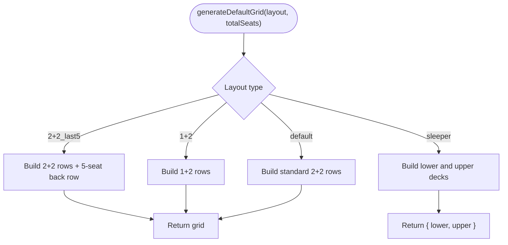
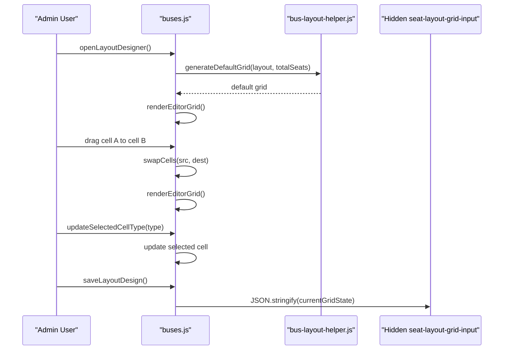
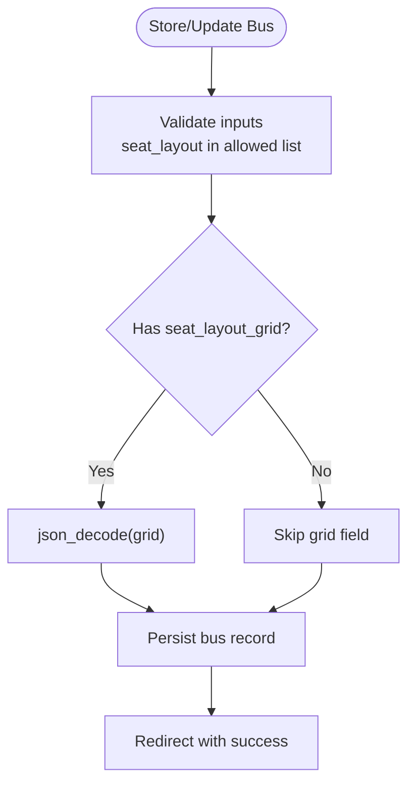
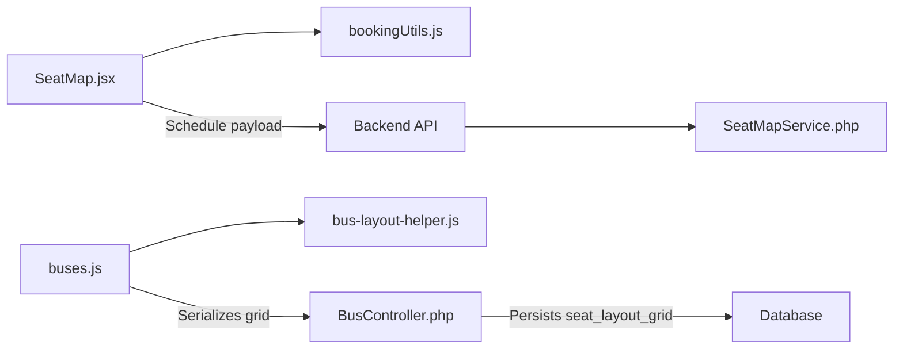

# Interactive Seat Map Editor

<cite>
**Referenced Files in This Document**   
- [SeatMap.jsx](file://frontend/src/components/SeatMap.jsx)
- [bookingUtils.js](file://frontend/src/bookingUtils.js)
- [SeatMapService.php](file://backend/app/Services/SeatMapService.php)
- [bus-layout-helper.js](file://backend/resources/js/admin/bus-layout-helper.js)
- [buses.js](file://backend/resources/js/admin/buses.js)
- [BusController.php](file://backend/app/Http/Controllers/Admin/BusController.php)
</cite>

## Table of Contents
1. [Introduction](#introduction)
2. [Project Structure](#project-structure)
3. [Core Components](#core-components)
4. [Architecture Overview](#architecture-overview)
5. [Detailed Component Analysis](#detailed-component-analysis)
6. [Dependency Analysis](#dependency-analysis)
7. [Performance Considerations](#performance-considerations)
8. [Troubleshooting Guide](#troubleshooting-guide)
9. [Conclusion](#conclusion)

## Introduction
This document explains the interactive seat map editor used by the bus booking system. It covers:
- Visual seat layout configuration for customers and administrators
- Predefined layouts: `2+2_last5`, `2+2`, `1+2`, and `sleeper`
- Custom grid configuration through a drag-and-drop designer
- Seat allocation algorithms, gender-specific seating, and real-time status updates
- JavaScript-based seat mapping, coordinate systems, and user interaction patterns
- JSON structure examples for seat layouts
- Validation rules and integration with the backend seat map service

The documentation is split into customer-facing rendering logic (React frontend) and administrator-facing layout design logic (admin JavaScript and backend services).

## Project Structure
The seat map feature spans both frontend and backend:
- Frontend React component renders the interactive seat map and handles user selection
- Frontend utilities generate fallback seat maps when needed
- Backend service builds authoritative seat maps, validates seats, manages holds, and computes pricing
- Admin JavaScript provides a visual seat layout designer that serializes custom grids to JSON
- Backend controller validates and persists bus configuration including custom seat layout grids

**Diagram sources**
- [SeatMap.jsx:1-612](file://frontend/src/components/SeatMap.jsx#L1-L612)
- [bookingUtils.js:1-173](file://frontend/src/bookingUtils.js#L1-L173)
- [SeatMapService.php:1-593](file://backend/app/Services/SeatMapService.php#L1-L593)
- [bus-layout-helper.js:1-131](file://backend/resources/js/admin/bus-layout-helper.js#L1-L131)
- [buses.js:1-596](file://backend/resources/js/admin/buses.js#L1-L596)
- [BusController.php:1-97](file://backend/app/Http/Controllers/Admin/BusController.php#L1-L97)

**Section sources**
- [SeatMap.jsx:1-612](file://frontend/src/components/SeatMap.jsx#L1-L612)
- [bookingUtils.js:1-173](file://frontend/src/bookingUtils.js#L1-L173)
- [SeatMapService.php:1-593](file://backend/app/Services/SeatMapService.php#L1-L593)
- [bus-layout-helper.js:1-131](file://backend/resources/js/admin/bus-layout-helper.js#L1-L131)
- [buses.js:1-596](file://backend/resources/js/admin/buses.js#L1-L596)
- [BusController.php:1-97](file://backend/app/Http/Controllers/Admin/BusController.php#L1-L97)

## Core Components
- Customer seat map UI: Renders bus layout, seat statuses, selection, and booking sidebar
- Seat mapping utility: Builds seat code lists and fallback seat maps from schedule data
- Backend seat map service: Generates authoritative seat maps, validates codes, manages holds, and exposes pricing
- Admin layout helper: Generates default grids for predefined layouts
- Admin buses script: Provides drag-and-drop designer, row/column controls, and serialization
- Bus controller: Validates and persists bus configuration including custom seat layout grid

Key responsibilities:
- SeatMap.jsx: Rendering, user interactions, sleeper deck display, live status indicators
- bookingUtils.js: Status labels, selection rules, pricing helpers, fallback seat map generation
- SeatMapService.php: Authoritative seat map building, hold management, validation, pricing breakdown
- bus-layout-helper.js: Default grid generators for `2+2_last5`, `1+2`, `sleeper`, and default `2+2`
- buses.js: Designer state, drag-and-drop, cell editing, grid resize, save-to-form
- BusController.php: Input validation for seat layout types and grid JSON

**Section sources**
- [SeatMap.jsx:48-190](file://frontend/src/components/SeatMap.jsx#L48-L190)
- [bookingUtils.js:3-20](file://frontend/src/bookingUtils.js#L3-L20)
- [SeatMapService.php:49-189](file://backend/app/Services/SeatMapService.php#L49-L189)
- [bus-layout-helper.js:21-130](file://backend/resources/js/admin/bus-layout-helper.js#L21-L130)
- [buses.js:89-156](file://backend/resources/js/admin/buses.js#L89-L156)
- [BusController.php:27-88](file://backend/app/Http/Controllers/Admin/BusController.php#L27-L88)

## Architecture Overview
The seat map architecture integrates frontend rendering with backend authority:

**Diagram sources**
- [SeatMap.jsx:192-225](file://frontend/src/components/SeatMap.jsx#L192-L225)
- [bookingUtils.js:52-172](file://frontend/src/bookingUtils.js#L52-L172)
- [SeatMapService.php:194-244](file://backend/app/Services/SeatMapService.php#L194-L244)

## Detailed Component Analysis

### Customer-Facing Seat Map UI (SeatMap.jsx)
SeatMap.jsx renders the interactive seat map and integrates with booking utilities:
- Layout detection: Uses `schedule.bus.seat_layout` and optional `seat_layout_grid`
- Default grid generation: If no custom grid exists, it generates a default grid per layout
- Sleeper decks: Detects `grid.lower` and renders lower and upper decks separately
- Seat cells: Maps seat labels to statuses via `getSeatMap` and applies selectable states
- Real-time indicators: Shows last sync time and refreshes periodically
- Booking sidebar: Collects passenger details, payment method, promo discount, and totals

**Diagram sources**
- [SeatMap.jsx:210-225](file://frontend/src/components/SeatMap.jsx#L210-L225)
- [SeatMap.jsx:227-384](file://frontend/src/components/SeatMap.jsx#L227-L384)
- [SeatMap.jsx:386-611](file://frontend/src/components/SeatMap.jsx#L386-L611)

**Section sources**
- [SeatMap.jsx:48-190](file://frontend/src/components/SeatMap.jsx#L48-L190)
- [SeatMap.jsx:192-225](file://frontend/src/components/SeatMap.jsx#L192-L225)
- [SeatMap.jsx:227-384](file://frontend/src/components/SeatMap.jsx#L227-L384)
- [SeatMap.jsx:386-611](file://frontend/src/components/SeatMap.jsx#L386-L611)

### Seat Mapping Utilities (bookingUtils.js)
bookingUtils.js provides:
- Status labels for UI tooltips and legends
- Selection rules (`isSeatSelectable`)
- Pricing calculation helpers
- Fallback seat map builder (`getSeatMap`) that reconstructs seat codes from:
  - Custom grid (including sleeper decks)
  - Predefined layouts (`1+2`, `sleeper`, `2+2_last5`, default `2+2`)
  - Row letters and numeric columns

**Diagram sources**
- [bookingUtils.js:52-172](file://frontend/src/bookingUtils.js#L52-L172)

**Section sources**
- [bookingUtils.js:3-20](file://frontend/src/bookingUtils.js#L3-L20)
- [bookingUtils.js:30-50](file://frontend/src/bookingUtils.js#L30-L50)
- [bookingUtils.js:52-172](file://frontend/src/bookingUtils.js#L52-L172)

### Backend Seat Map Service (SeatMapService.php)
SeatMapService.php is the authoritative source for seat mapping and validation:
- Seat code generation:
  - Custom grid traversal (including sleeper decks)
  - Predefined layout algorithms (`1+2`, `sleeper`, `2+2_last5`, default `2+2`)
- Seat map construction:
  - Initializes all seats as available
  - Applies blocked seats
  - Applies active holds from cache (excluding current user)
  - Marks paid/recent pending bookings with gender-specific statuses (`booked_m`, `booked_f`, `sold_m`, `sold_f`)
- Validation and operations:
  - `isValidSeatCode`: Checks against generated codes
  - `toggleBlockedSeat`: Adds/removes blocked seats with constraints
  - `holdSeat` / `releaseSeat`: Manages temporary reservations with expiration
- Pricing breakdown: Computes seat fare, service charge, gateway charge, discounts, and total

**Diagram sources**
- [SeatMapService.php:49-189](file://backend/app/Services/SeatMapService.php#L49-L189)
- [SeatMapService.php:194-244](file://backend/app/Services/SeatMapService.php#L194-L244)
- [SeatMapService.php:433-500](file://backend/app/Services/SeatMapService.php#L433-L500)
- [SeatMapService.php:502-582](file://backend/app/Services/SeatMapService.php#L502-L582)
- [SeatMapService.php:343-365](file://backend/app/Services/SeatMapService.php#L343-L365)

**Section sources**
- [SeatMapService.php:49-189](file://backend/app/Services/SeatMapService.php#L49-L189)
- [SeatMapService.php:194-244](file://backend/app/Services/SeatMapService.php#L194-L244)
- [SeatMapService.php:433-500](file://backend/app/Services/SeatMapService.php#L433-L500)
- [SeatMapService.php:502-582](file://backend/app/Services/SeatMapService.php#L502-L582)
- [SeatMapService.php:343-365](file://backend/app/Services/SeatMapService.php#L343-L365)

### Admin Layout Helper (bus-layout-helper.js)
bus-layout-helper.js defines default grid generators for each layout:
- `2+2_last5`: Standard 4-abreast rows plus a 5-seat back row
- `1+2`: 1+2 abreast rows
- `sleeper`: Two decks (`lower`, `upper`) with driver/engine front row on lower deck
- Default `2+2`: Standard 4-abreast rows

**Diagram sources**
- [bus-layout-helper.js:21-130](file://backend/resources/js/admin/bus-layout-helper.js#L21-L130)

**Section sources**
- [bus-layout-helper.js:21-130](file://backend/resources/js/admin/bus-layout-helper.js#L21-L130)

### Admin Buses Script (buses.js)
buses.js implements the interactive seat layout designer:
- State management: Tracks `currentGridState` and `selectedCellCoords`
- Modal lifecycle: Opens/closes designer, loads existing grid or generates defaults
- Rendering: Builds DOM elements for decks and cells, supports sleeper decks
- Drag-and-drop: Swaps cells between positions and decks
- Cell editing: Updates cell type and label; shows/hides label input for seats
- Grid resizing: Add/remove rows and columns per deck or whole grid
- Save: Serializes grid to JSON, updates hidden form input, recalculates total seats

**Diagram sources**
- [buses.js:108-156](file://backend/resources/js/admin/buses.js#L108-L156)
- [buses.js:160-255](file://backend/resources/js/admin/buses.js#L160-L255)
- [buses.js:259-314](file://backend/resources/js/admin/buses.js#L259-L314)
- [buses.js:318-383](file://backend/resources/js/admin/buses.js#L318-L383)
- [buses.js:387-458](file://backend/resources/js/admin/buses.js#L387-L458)
- [buses.js:500-513](file://backend/resources/js/admin/buses.js#L500-L513)

**Section sources**
- [buses.js:31-87](file://backend/resources/js/admin/buses.js#L31-L87)
- [buses.js:89-156](file://backend/resources/js/admin/buses.js#L89-L156)
- [buses.js:160-255](file://backend/resources/js/admin/buses.js#L160-L255)
- [buses.js:259-314](file://backend/resources/js/admin/buses.js#L259-L314)
- [buses.js:318-383](file://backend/resources/js/admin/buses.js#L318-L383)
- [buses.js:387-458](file://backend/resources/js/admin/buses.js#L387-L458)
- [buses.js:500-513](file://backend/resources/js/admin/buses.js#L500-L513)

### Bus Controller Validation (BusController.php)
BusController.php validates and persists bus configuration:
- Allowed seat layouts: `2+2_last5`, `2+2`, `1+2`, `sleeper`
- Optional custom grid JSON stored in `seat_layout_grid`
- Logo handling via base64 data URL

**Diagram sources**
- [BusController.php:27-53](file://backend/app/Http/Controllers/Admin/BusController.php#L27-L53)
- [BusController.php:55-88](file://backend/app/Http/Controllers/Admin/BusController.php#L55-L88)

**Section sources**
- [BusController.php:27-53](file://backend/app/Http/Controllers/Admin/BusController.php#L27-L53)
- [BusController.php:55-88](file://backend/app/Http/Controllers/Admin/BusController.php#L55-L88)

## Dependency Analysis
The seat map feature has clear separation of concerns:
- Frontend rendering depends on schedule payload and utilities
- Backend service owns seat code generation, status computation, and validation
- Admin designer depends on helper functions for default grids and serializes to JSON
- Controller enforces allowed layouts and persists custom grids

**Diagram sources**
- [SeatMap.jsx:1-612](file://frontend/src/components/SeatMap.jsx#L1-L612)
- [bookingUtils.js:1-173](file://frontend/src/bookingUtils.js#L1-L173)
- [SeatMapService.php:1-593](file://backend/app/Services/SeatMapService.php#L1-L593)
- [bus-layout-helper.js:1-131](file://backend/resources/js/admin/bus-layout-helper.js#L1-L131)
- [buses.js:1-596](file://backend/resources/js/admin/buses.js#L1-L596)
- [BusController.php:1-97](file://backend/app/Http/Controllers/Admin/BusController.php#L1-L97)

**Section sources**
- [SeatMap.jsx:1-612](file://frontend/src/components/SeatMap.jsx#L1-L612)
- [bookingUtils.js:1-173](file://frontend/src/bookingUtils.js#L1-L173)
- [SeatMapService.php:1-593](file://backend/app/Services/SeatMapService.php#L1-L593)
- [bus-layout-helper.js:1-131](file://backend/resources/js/admin/bus-layout-helper.js#L1-L131)
- [buses.js:1-596](file://backend/resources/js/admin/buses.js#L1-L596)
- [BusController.php:1-97](file://backend/app/Http/Controllers/Admin/BusController.php#L1-L97)

## Performance Considerations
- Avoid unnecessary re-renders: SeatMap.jsx uses local tick state for live indicators; ensure interval cleanup
- Prefer server-side seat map payloads: When possible, rely on backend-provided `seat_map` instead of rebuilding in client
- Cache holds efficiently: Backend uses cache with TTL; ensure consistent keying by schedule ID
- Minimize DOM operations: Admin designer updates specific cells rather than full re-render where possible
- Validate early: Backend validation prevents invalid seat codes and reduces error paths

[No sources needed since this section provides general guidance]

## Troubleshooting Guide
Common issues and resolutions:
- Seat not selectable:
  - Check status: Only `available` seats are selectable
  - Verify backend holds: Another user may have a temporary hold
- Invalid seat code:
  - Ensure seat code matches bus layout or custom grid
  - Validate using backend service methods
- Sleeper deck mismatch:
  - Confirm grid structure includes `lower` and `upper` arrays
  - Ensure labels follow `L-` and `U-` prefixes
- Custom grid not saving:
  - Verify JSON serialization and hidden input population
  - Check controller validation for `seat_layout_grid`

**Section sources**
- [SeatMapService.php:433-500](file://backend/app/Services/SeatMapService.php#L433-L500)
- [SeatMapService.php:502-582](file://backend/app/Services/SeatMapService.php#L502-L582)
- [buses.js:500-513](file://backend/resources/js/admin/buses.js#L500-L513)
- [BusController.php:27-88](file://backend/app/Http/Controllers/Admin/BusController.php#L27-L88)

## Conclusion
The interactive seat map editor combines a responsive React UI with robust backend services to deliver accurate, real-time seat visualization and management. Predefined layouts and a flexible custom grid designer support diverse bus configurations. Gender-specific seating and hold mechanisms ensure reliable seat allocation. The documented components and flows provide a clear path for maintenance, extension, and troubleshooting.

[No sources needed since this section summarizes without analyzing specific files]