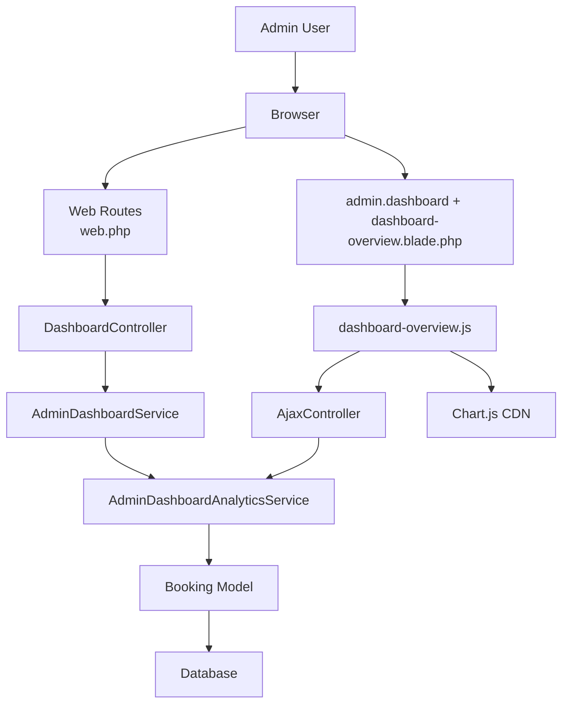
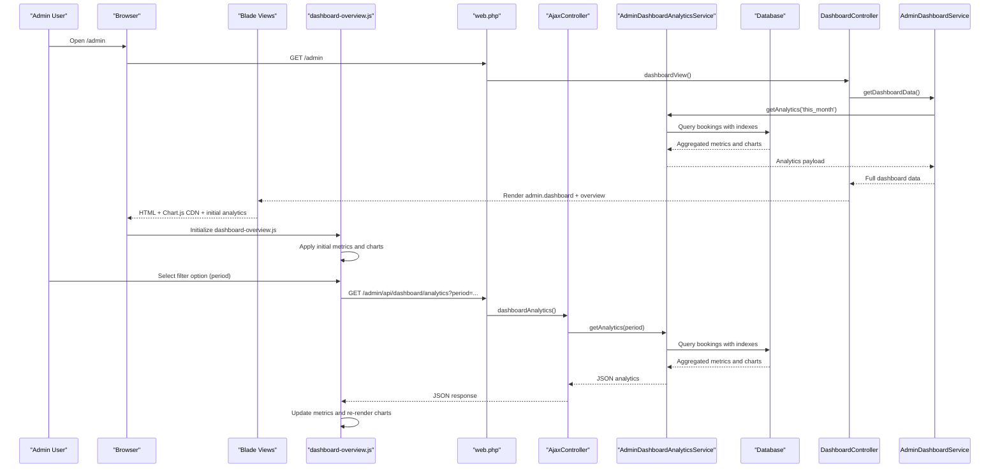
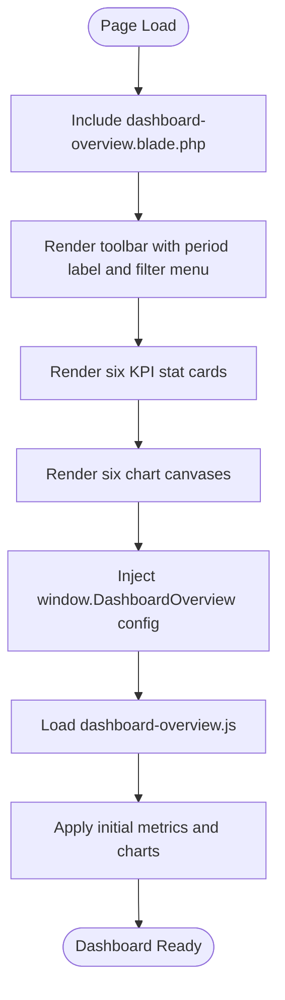
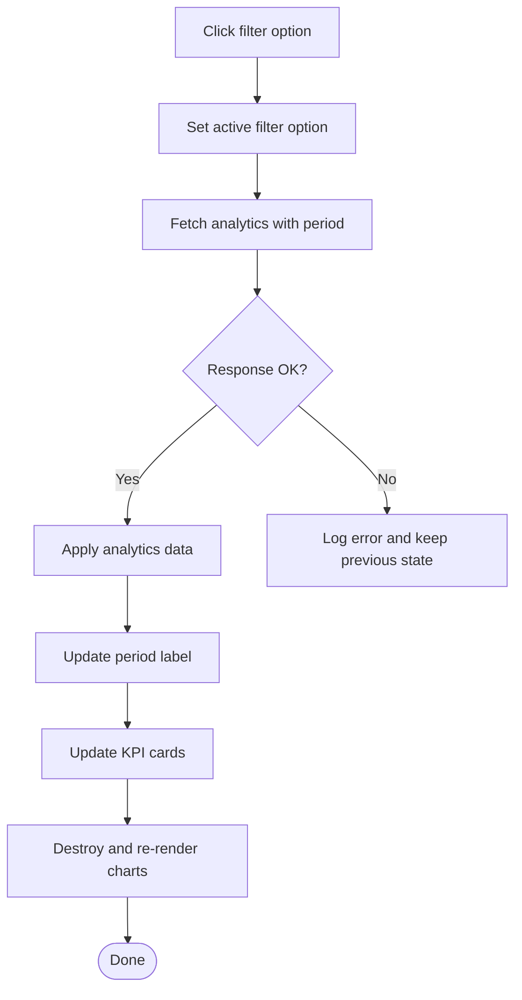
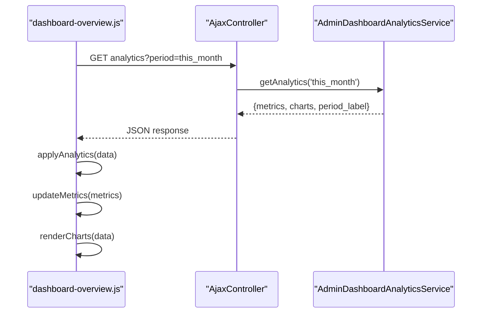
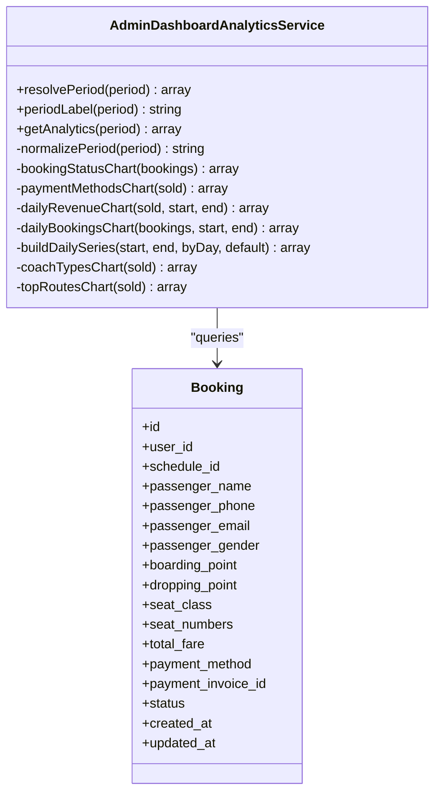
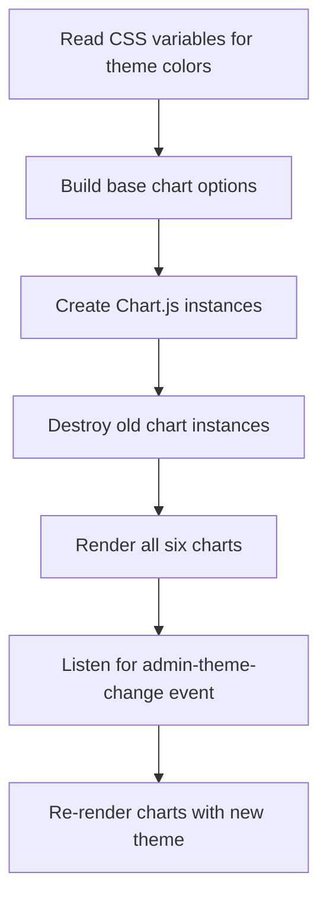
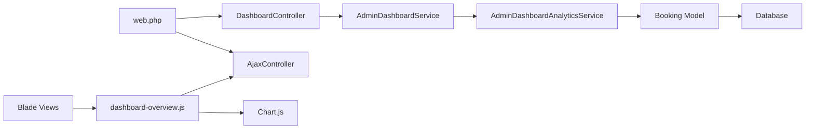

# Dashboard Overview & Analytics

<cite>
**Referenced Files in This Document**
- [dashboard.blade.php](file://backend/resources/views/admin/dashboard.blade.php)
- [dashboard-overview.blade.php](file://backend/resources/views/admin/partials/dashboard-overview.blade.php)
- [dashboard-overview.js](file://backend/resources/js/admin/dashboard-overview.js)
- [DashboardController.php](file://backend/app/Http/Controllers/Admin/DashboardController.php)
- [AjaxController.php](file://backend/app/Http/Controllers/Admin/AjaxController.php)
- [AdminDashboardService.php](file://backend/app/Services/AdminDashboardService.php)
- [AdminDashboardAnalyticsService.php](file://backend/app/Services/AdminDashboardAnalyticsService.php)
- [Booking.php](file://backend/app/Models/Booking.php)
- [2026_06_01_000050_create_bookings_table.php](file://backend/database/migrations/2026_06_01_000050_create_bookings_table.php)
- [web.php](file://backend/routes/web.php)
</cite>

## Table of Contents
1. [Introduction](#introduction)
2. [Project Structure](#project-structure)
3. [Core Components](#core-components)
4. [Architecture Overview](#architecture-overview)
5. [Detailed Component Analysis](#detailed-component-analysis)
6. [Dependency Analysis](#dependency-analysis)
7. [Performance Considerations](#performance-considerations)
8. [Troubleshooting Guide](#troubleshooting-guide)
9. [Conclusion](#conclusion)

## Introduction
This document explains the admin dashboard overview and analytics system for the bus application. It covers the main dashboard layout, key performance indicators, real-time statistics display, filter controls, date range selection, dynamic data refresh, analytics service layer, chart rendering with Chart.js, responsive design behavior, and performance considerations for large datasets.

The dashboard provides:
- A toolbar with a period filter menu (Today, Last 7 Days, This Month, This Year).
- Six KPI cards: Sales Revenue, Confirmed Bookings, Pending Bookings, Cancelled Tickets, Cancel Requests, and Average Ticket Fare.
- Six charts: Booking Status, Payment Methods, Daily Revenue, Daily Bookings, Coach Type Mix, and Top Routes.
- An AJAX-driven analytics endpoint that returns JSON metrics and chart data for the selected period.

## Project Structure
The dashboard is implemented as a Blade view composed by the admin dashboard page, with JavaScript handling interactivity and Chart.js rendering. The backend uses a controller-to-service architecture to compute analytics from bookings and related models.

**Diagram sources**
- [web.php:80-87](file://backend/routes/web.php#L80-L87)
- [DashboardController.php:13-16](file://backend/app/Http/Controllers/Admin/DashboardController.php#L13-L16)
- [AdminDashboardService.php:32-79](file://backend/app/Services/AdminDashboardService.php#L32-L79)
- [AdminDashboardAnalyticsService.php:47-84](file://backend/app/Services/AdminDashboardAnalyticsService.php#L47-L84)
- [booking table migration:14-42](file://backend/database/migrations/2026_06_01_000050_create_bookings_table.php#L14-L42)
- [dashboard.blade.php:1-4](file://backend/resources/views/admin/dashboard.blade.php#L1-L4)
- [dashboard-overview.blade.php:1-124](file://backend/resources/views/admin/partials/dashboard-overview.blade.php#L1-L124)
- [dashboard-overview.js:1-276](file://backend/resources/js/admin/dashboard-overview.js#L1-L276)

**Section sources**
- [dashboard.blade.php:1-4](file://backend/resources/views/admin/dashboard.blade.php#L1-L4)
- [web.php:80-87](file://backend/routes/web.php#L80-L87)

## Core Components
- Dashboard View Layer:
  - `admin.dashboard` includes the overview partial.
  - `dashboard-overview.blade.php` renders the toolbar, KPI cards, chart canvases, and injects initial analytics data into a global configuration object consumed by JavaScript.
- JavaScript Client:
  - `dashboard-overview.js` manages filter UI, theme-aware chart colors, metric updates, chart creation/destroy, and AJAX requests to the analytics endpoint.
- Backend Controllers:
  - `DashboardController` serves the dashboard view with precomputed analytics for the default period.
  - `AjaxController.dashboardAnalytics` validates the period parameter and returns JSON analytics via the analytics service.
- Services:
  - `AdminDashboardService` composes dashboard data including analytics and other admin resources.
  - `AdminDashboardAnalyticsService` computes metrics and chart payloads based on booking data within a resolved time window.
- Data Model:
  - `Booking` model represents tickets with fields such as status, total fare, payment method, and timestamps.
  - The bookings table migration defines indexes for efficient querying by status, created_at, schedule_id, user_id, and payment_method.

**Section sources**
- [dashboard.blade.php:1-4](file://backend/resources/views/admin/dashboard.blade.php#L1-L4)
- [dashboard-overview.blade.php:1-124](file://backend/resources/views/admin/partials/dashboard-overview.blade.php#L1-L124)
- [dashboard-overview.js:1-276](file://backend/resources/js/admin/dashboard-overview.js#L1-L276)
- [DashboardController.php:13-16](file://backend/app/Http/Controllers/Admin/DashboardController.php#L13-L16)
- [AjaxController.php:25-34](file://backend/app/Http/Controllers/Admin/AjaxController.php#L25-L34)
- [AdminDashboardService.php:32-79](file://backend/app/Services/AdminDashboardService.php#L32-L79)
- [AdminDashboardAnalyticsService.php:47-84](file://backend/app/Services/AdminDashboardAnalyticsService.php#L47-L84)
- [Booking.php:12-31](file://backend/app/Models/Booking.php#L12-L31)
- [booking table migration:14-42](file://backend/database/migrations/2026_06_01_000050_create_bookings_table.php#L14-L42)

## Architecture Overview
The dashboard follows a layered architecture:
- Presentation: Blade templates render static structure and initial data; Chart.js renders visualizations.
- Interaction: JavaScript handles user actions (filter selection), fetches updated analytics, and re-renders charts.
- Controller Layer: Validates input and delegates computation to services.
- Service Layer: Encapsulates business logic for analytics aggregation and chart data preparation.
- Data Layer: Eloquent models query the database using indexed columns for performance.

**Diagram sources**
- [web.php:80-87](file://backend/routes/web.php#L80-L87)
- [DashboardController.php:13-16](file://backend/app/Http/Controllers/Admin/DashboardController.php#L13-L16)
- [AdminDashboardService.php:32-79](file://backend/app/Services/AdminDashboardService.php#L32-L79)
- [AdminDashboardAnalyticsService.php:47-84](file://backend/app/Services/AdminDashboardAnalyticsService.php#L47-L84)
- [AjaxController.php:25-34](file://backend/app/Http/Controllers/Admin/AjaxController.php#L25-L34)
- [dashboard-overview.blade.php:116-124](file://backend/resources/views/admin/partials/dashboard-overview.blade.php#L116-L124)
- [dashboard-overview.js:218-235](file://backend/resources/js/admin/dashboard-overview.js#L218-L235)

## Detailed Component Analysis

### Dashboard Layout and KPI Cards
The dashboard overview partial defines:
- A toolbar with a period label and a filter button/menu containing Today, Last 7 Days, This Month, and This Year options.
- Six stat cards displaying:
  - Sales Revenue
  - Confirmed Bookings
  - Pending Bookings
  - Cancelled Tickets
  - Cancel Requests
  - Average Ticket Fare
- Chart panels for Booking Status, Payment Methods, Daily Revenue, Daily Bookings, Coach Type Mix, and Top Routes.
- Initial analytics data injected via a global `window.DashboardOverview` object, which includes the analytics URL, initial period, and initial data payload.

**Diagram sources**
- [dashboard-overview.blade.php:1-124](file://backend/resources/views/admin/partials/dashboard-overview.blade.php#L1-L124)
- [dashboard-overview.js:272-275](file://backend/resources/js/admin/dashboard-overview.js#L272-L275)

**Section sources**
- [dashboard-overview.blade.php:1-124](file://backend/resources/views/admin/partials/dashboard-overview.blade.php#L1-L124)

### Filter Controls and Date Range Selection
The filter control is a dropdown menu toggled by a button. Each option has a `data-period` attribute corresponding to supported periods:
- today
- last_7_days
- this_month
- this_year

When an option is clicked:
- The active option is highlighted.
- The current period is updated.
- An AJAX request is sent to the analytics endpoint with the selected period.
- On success, the period label, metrics, and charts are updated.

**Diagram sources**
- [dashboard-overview.js:237-260](file://backend/resources/js/admin/dashboard-overview.js#L237-L260)
- [dashboard-overview.js:218-235](file://backend/resources/js/admin/dashboard-overview.js#L218-L235)

**Section sources**
- [dashboard-overview.js:237-260](file://backend/resources/js/admin/dashboard-overview.js#L237-L260)

### Real-Time Statistics Display and Dynamic Refresh
Real-time updates are achieved through:
- Initial server-rendered analytics data to avoid an extra request on first load.
- JavaScript applying the initial data to update metrics and charts immediately.
- Period changes triggering an AJAX call to `/admin/api/dashboard/analytics`, returning JSON with metrics and chart data.
- Theme change events causing charts to re-render with updated CSS variable colors.

**Diagram sources**
- [dashboard-overview.js:204-209](file://backend/resources/js/admin/dashboard-overview.js#L204-L209)
- [AjaxController.php:25-34](file://backend/app/Http/Controllers/Admin/AjaxController.php#L25-L34)
- [AdminDashboardAnalyticsService.php:47-84](file://backend/app/Services/AdminDashboardAnalyticsService.php#L47-L84)

**Section sources**
- [dashboard-overview.js:204-209](file://backend/resources/js/admin/dashboard-overview.js#L204-L209)
- [AjaxController.php:25-34](file://backend/app/Http/Controllers/Admin/AjaxController.php#L25-L34)

### Analytics Service Layer
The analytics service layer computes:
- Metrics:
  - Sales revenue: sum of total fare for sold statuses.
  - Confirmed bookings: count of sold statuses.
  - Pending bookings: count of PENDING status.
  - Cancelled bookings: count of CANCELLED status.
  - Cancel requests: count of CANCEL_REQUESTED status.
  - Average ticket fare: sales revenue divided by confirmed bookings.
- Charts:
  - Booking status distribution across statuses.
  - Payment methods breakdown.
  - Daily revenue trend over the selected period.
  - Daily bookings trend over the selected period.
  - Coach type mix (AC vs Non AC vs Unknown).
  - Top routes by number of bookings.

Period resolution supports:
- Today
- Last 7 days
- This month
- This year

**Diagram sources**
- [AdminDashboardAnalyticsService.php:9-227](file://backend/app/Services/AdminDashboardAnalyticsService.php#L9-L227)
- [Booking.php:8-48](file://backend/app/Models/Booking.php#L8-L48)

**Section sources**
- [AdminDashboardAnalyticsService.php:47-84](file://backend/app/Services/AdminDashboardAnalyticsService.php#L47-L84)
- [AdminDashboardAnalyticsService.php:94-226](file://backend/app/Services/AdminDashboardAnalyticsService.php#L94-L226)

### Chart Rendering with JavaScript Libraries
Charts are rendered using Chart.js loaded from a CDN. The JavaScript client:
- Reads theme colors from CSS custom properties to ensure charts match light/dark themes.
- Creates six chart instances: doughnut for booking status and coach types, pie for payment methods, bar for revenue and top routes, line for bookings trend.
- Destroys existing chart instances before re-rendering to prevent memory leaks and duplicate canvases.
- Uses responsive mode and maintains aspect ratio disabled for flexible layouts.

**Diagram sources**
- [dashboard-overview.js:28-55](file://backend/resources/js/admin/dashboard-overview.js#L28-L55)
- [dashboard-overview.js:79-96](file://backend/resources/js/admin/dashboard-overview.js#L79-L96)
- [dashboard-overview.js:98-196](file://backend/resources/js/admin/dashboard-overview.js#L98-L196)
- [dashboard-overview.js:267-270](file://backend/resources/js/admin/dashboard-overview.js#L267-L270)

**Section sources**
- [dashboard-overview.js:28-55](file://backend/resources/js/admin/dashboard-overview.js#L28-L55)
- [dashboard-overview.js:79-96](file://backend/resources/js/admin/dashboard-overview.js#L79-L96)
- [dashboard-overview.js:98-196](file://backend/resources/js/admin/dashboard-overview.js#L98-L196)

### Responsive Design Patterns
- Charts use responsive mode and disable fixed aspect ratios to adapt to container sizes.
- The dashboard grid uses CSS classes for panels and wide wraps to accommodate different screen sizes.
- Theme changes trigger chart re-rendering to reflect updated color variables.

**Section sources**
- [dashboard-overview.js:79-90](file://backend/resources/js/admin/dashboard-overview.js#L79-L90)
- [dashboard-overview.blade.php:71-113](file://backend/resources/views/admin/partials/dashboard-overview.blade.php#L71-L113)

### Performance Optimization for Large Datasets
- Database indexes on bookings table improve query performance for status, created_at, schedule_id, user_id, and payment_method combinations.
- The analytics service groups and aggregates data in-memory after fetching relevant bookings within the selected period.
- Chart instances are destroyed before re-rendering to avoid memory accumulation.
- Initial analytics data is embedded in the page to reduce first-load latency.

**Section sources**
- [booking table migration:32-42](file://backend/database/migrations/2026_06_01_000050_create_bookings_table.php#L32-L42)
- [AdminDashboardAnalyticsService.php:52-84](file://backend/app/Services/AdminDashboardAnalyticsService.php#L52-L84)
- [dashboard-overview.js:92-96](file://backend/resources/js/admin/dashboard-overview.js#L92-L96)
- [dashboard-overview.blade.php:116-124](file://backend/resources/views/admin/partials/dashboard-overview.blade.php#L116-L124)

## Dependency Analysis
The dashboard depends on:
- Web routes defining the dashboard view and analytics endpoint.
- Controllers delegating to services for data computation.
- Services depending on Eloquent models and database indexes.
- Frontend JavaScript depending on Chart.js and CSS variables for theming.

**Diagram sources**
- [web.php:80-87](file://backend/routes/web.php#L80-L87)
- [DashboardController.php:13-16](file://backend/app/Http/Controllers/Admin/DashboardController.php#L13-L16)
- [AdminDashboardService.php:32-79](file://backend/app/Services/AdminDashboardService.php#L32-L79)
- [AdminDashboardAnalyticsService.php:47-84](file://backend/app/Services/AdminDashboardAnalyticsService.php#L47-L84)
- [dashboard-overview.blade.php:116-124](file://backend/resources/views/admin/partials/dashboard-overview.blade.php#L116-L124)
- [dashboard-overview.js:1-276](file://backend/resources/js/admin/dashboard-overview.js#L1-L276)

**Section sources**
- [web.php:80-87](file://backend/routes/web.php#L80-L87)
- [DashboardController.php:13-16](file://backend/app/Http/Controllers/Admin/DashboardController.php#L13-L16)
- [AdminDashboardService.php:32-79](file://backend/app/Services/AdminDashboardService.php#L32-L79)
- [AdminDashboardAnalyticsService.php:47-84](file://backend/app/Services/AdminDashboardAnalyticsService.php#L47-L84)

## Performance Considerations
- Use database indexes effectively:
  - Ensure queries filter by status and created_at ranges.
  - Leverage composite indexes for common filters like status+created_at and schedule_id+status.
- Minimize data transfer:
  - Return only necessary metrics and chart data from the analytics endpoint.
  - Avoid sending full booking objects; aggregate in the service layer.
- Optimize chart rendering:
  - Destroy old chart instances before creating new ones.
  - Use responsive mode and avoid heavy animations for large datasets.
- Cache where appropriate:
  - Consider caching analytics results for short-lived periods if traffic is high.
- Monitor memory usage:
  - Track chart instance lifecycle to prevent leaks.
  - Profile AJAX responses for size and latency.

[No sources needed since this section provides general guidance]

## Troubleshooting Guide
Common issues and resolutions:
- Filters not updating charts:
  - Verify the analytics endpoint returns valid JSON with expected keys: metrics, charts, period_label.
  - Check browser console for errors during fetch requests.
- Charts not reflecting theme changes:
  - Ensure CSS custom properties are defined and accessible.
  - Confirm the admin-theme-change event is fired when toggling themes.
- Slow dashboard load times:
  - Inspect database query performance for bookings within the selected period.
  - Validate that indexes exist on frequently filtered columns.
- Missing or incorrect KPI values:
  - Confirm booking statuses and totals align with business definitions.
  - Check average fare calculation logic for division by zero cases.

**Section sources**
- [dashboard-overview.js:218-235](file://backend/resources/js/admin/dashboard-overview.js#L218-L235)
- [dashboard-overview.js:267-270](file://backend/resources/js/admin/dashboard-overview.js#L267-L270)
- [AdminDashboardAnalyticsService.php:61-69](file://backend/app/Services/AdminDashboardAnalyticsService.php#L61-L69)

## Conclusion
The dashboard overview and analytics system combines server-side aggregation with client-side visualization to deliver actionable insights. The architecture separates concerns between controllers, services, and models, while the frontend leverages Chart.js for interactive, theme-aware charts. Proper indexing, careful data aggregation, and robust error handling contribute to performance and reliability. Future enhancements may include caching strategies, pagination for large datasets, and additional operational metrics.

[No sources needed since this section summarizes without analyzing specific files]