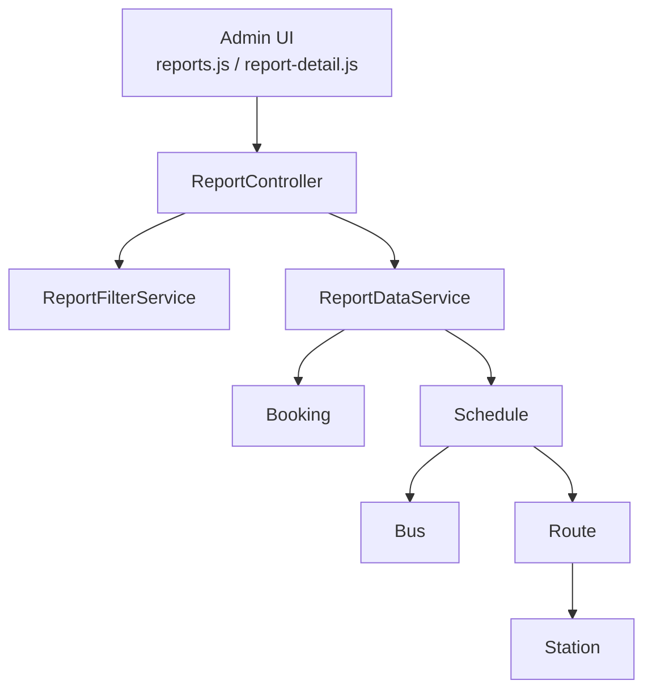
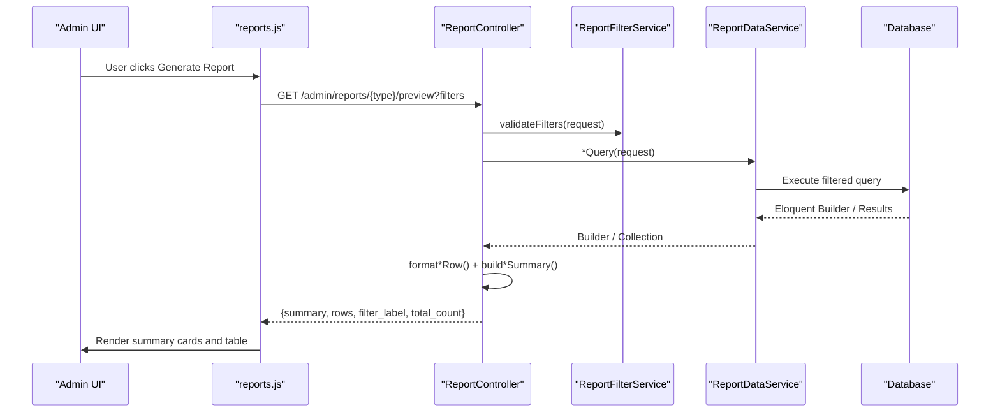
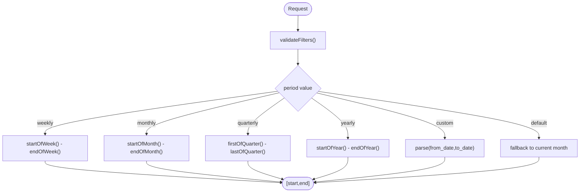
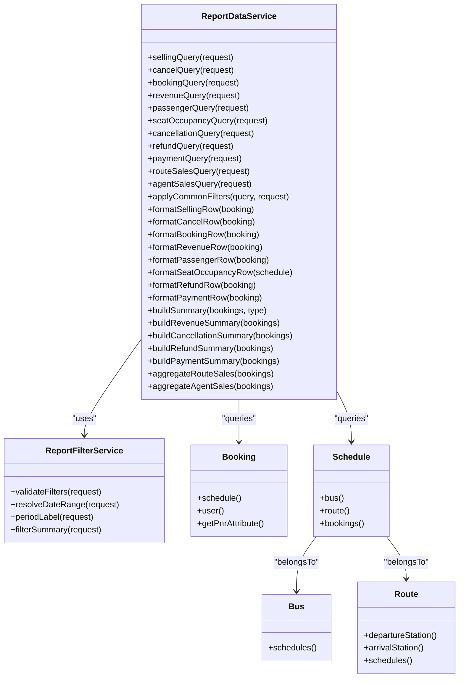
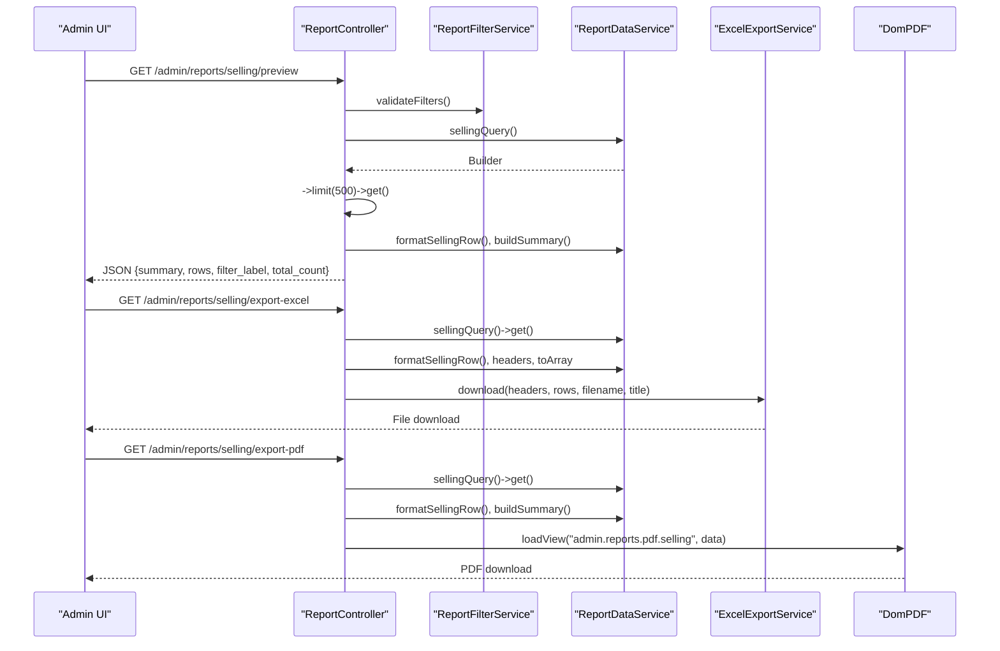
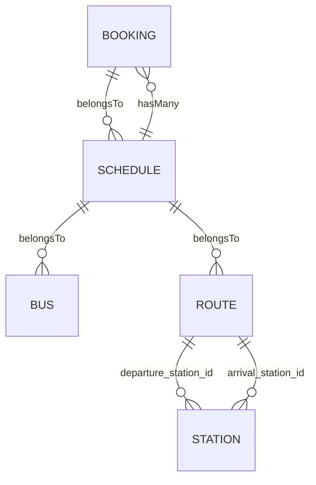
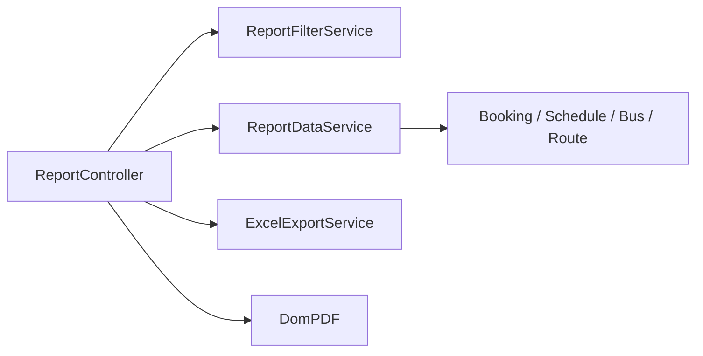

# Data Aggregation & Processing

<cite>
**Referenced Files in This Document**
- [ReportDataService.php](file://backend/app/Services/ReportDataService.php)
- [ReportFilterService.php](file://backend/app/Services/ReportFilterService.php)
- [ReportController.php](file://backend/app/Http/Controllers/Admin/ReportController.php)
- [Booking.php](file://backend/app/Models/Booking.php)
- [Schedule.php](file://backend/app/Models/Schedule.php)
- [Bus.php](file://backend/app/Models/Bus.php)
- [Route.php](file://backend/app/Models/Route.php)
- [reports.js](file://backend/resources/js/admin/reports.js)
- [report-detail.js](file://backend/resources/js/admin/report-detail.js)
</cite>

## Table of Contents
1. [Introduction](#introduction)
2. [Project Structure](#project-structure)
3. [Core Components](#core-components)
4. [Architecture Overview](#architecture-overview)
5. [Detailed Component Analysis](#detailed-component-analysis)
6. [Dependency Analysis](#dependency-analysis)
7. [Performance Considerations](#performance-considerations)
8. [Troubleshooting Guide](#troubleshooting-guide)
9. [Conclusion](#conclusion)

## Introduction
This document explains the report data aggregation service layer that transforms raw booking and schedule data into meaningful metrics, summaries, and exportable reports. It focuses on:

- How `ReportDataService` builds queries for each report type.
- How filtering works across date ranges, routes, bus operators, coach types, and payment methods.
- How Eloquent relationships are used to enrich rows with route, station, operator, and coach information.
- How summaries and aggregations are computed from collections.
- Performance characteristics, memory considerations, and pagination strategies for large datasets.
- The end-to-end flow from admin UI to controller, service, models, and exports.

The system supports multiple report types: selling, booking, revenue, passenger, seat occupancy, cancellation, refund, payment, route-wise sales, and agent/counter sales.

## Project Structure
The reporting subsystem is organized around three main layers:

- Controller layer: Admin endpoints for preview, Excel export, and PDF export.
- Service layer: Query builders, row formatters, and summary/aggregation logic.
- Model layer: Eloquent relationships between bookings, schedules, buses, routes, and stations.

**Diagram sources**
- [ReportController.php:11-18](file://backend/app/Http/Controllers/Admin/ReportController.php#L11-L18)
- [ReportDataService.php:11-15](file://backend/app/Services/ReportDataService.php#L11-L15)
- [Booking.php:33-40](file://backend/app/Models/Booking.php#L33-L40)
- [Schedule.php:20-33](file://backend/app/Models/Schedule.php#L20-L33)
- [Route.php:26-39](file://backend/app/Models/Route.php#L26-L39)

**Section sources**
- [ReportController.php:11-18](file://backend/app/Http/Controllers/Admin/ReportController.php#L11-L18)
- [ReportDataService.php:11-15](file://backend/app/Services/ReportDataService.php#L11-L15)
- [Booking.php:33-40](file://backend/app/Models/Booking.php#L33-L40)
- [Schedule.php:20-33](file://backend/app/Models/Schedule.php#L20-L33)
- [Route.php:26-39](file://backend/app/Models/Route.php#L26-L39)

## Core Components
- `ReportFilterService`: Validates filters and resolves date ranges and period labels.
- `ReportDataService`: Builds typed query builders, formats rows, computes summaries, and provides headers and array converters for exports.
- `ReportController`: Exposes preview, Excel, and PDF endpoints per report type; applies limits for previews and delegates formatting and summarization to the service.
- Models (`Booking`, `Schedule`, `Bus`, `Route`): Provide Eloquent relationships used by the service to join related entities efficiently.

Key responsibilities:
- Filtering: Date range resolution, coach type, payment method, route ID, operator name.
- Query building: Typed `*Query` methods returning Eloquent builders.
- Transformation: `format*Row` methods mapping model instances to normalized arrays.
- Summarization: `build*Summary` or `aggregate*` methods computing totals, averages, and breakdowns.
- Export support: Header definitions and row-to-array converters for Excel/PDF generation.

**Section sources**
- [ReportFilterService.php:10-22](file://backend/app/Services/ReportFilterService.php#L10-L22)
- [ReportFilterService.php:24-46](file://backend/app/Services/ReportFilterService.php#L24-L46)
- [ReportDataService.php:17-67](file://backend/app/Services/ReportDataService.php#L17-L67)
- [ReportController.php:54-67](file://backend/app/Http/Controllers/Admin/ReportController.php#L54-L67)

## Architecture Overview
The reporting pipeline follows a consistent pattern:

1. Admin UI collects filter parameters (period, dates, coach type, payment method, route ID, operator).
2. JavaScript calls the appropriate preview endpoint.
3. Controller validates filters and calls the corresponding service query.
4. Service returns an Eloquent builder; controller executes it with a limit for preview.
5. Rows are formatted and summarized.
6. Preview returns JSON with summary, rows, filter label, and total count.
7. Export endpoints stream full results to Excel or PDF.

**Diagram sources**
- [ReportController.php:54-67](file://backend/app/Http/Controllers/Admin/ReportController.php#L54-L67)
- [ReportFilterService.php:10-22](file://backend/app/Services/ReportFilterService.php#L10-L22)
- [ReportDataService.php:17-67](file://backend/app/Services/ReportDataService.php#L17-L67)
- [reports.js:91-137](file://backend/resources/js/admin/reports.js#L91-L137)

## Detailed Component Analysis

### ReportFilterService
Responsibilities:
- Validate incoming filter inputs.
- Resolve date ranges based on period presets or custom date inputs.
- Produce human-readable period labels and filter summaries.

Date resolution behavior:
- Weekly, monthly, quarterly, yearly presets map to start/end boundaries.
- Custom period requires both `from_date` and `to_date`.
- Default falls back to current month boundaries.

Validation scope includes grouping options, coach type, payment method, route ID, and operator.

**Diagram sources**
- [ReportFilterService.php:10-22](file://backend/app/Services/ReportFilterService.php#L10-L22)
- [ReportFilterService.php:24-46](file://backend/app/Services/ReportFilterService.php#L24-L46)

**Section sources**
- [ReportFilterService.php:10-22](file://backend/app/Services/ReportFilterService.php#L10-L22)
- [ReportFilterService.php:24-46](file://backend/app/Services/ReportFilterService.php#L24-L46)
- [ReportFilterService.php:48-83](file://backend/app/Services/ReportFilterService.php#L48-L83)

### ReportDataService
Responsibilities:
- Build typed query builders for each report type.
- Apply common filters to booking-based queries.
- Format raw model instances into normalized arrays for display and export.
- Compute summaries and aggregated metrics.

Common filters applied to booking queries:
- Coach type via schedule/bus relationship.
- Payment method directly on booking.
- Route ID via schedule relationship.
- Operator name via schedule/bus relationship.

Example query patterns:
- Selling, booking, revenue, passenger, payment, route-sales, agent-sales: filter by status set and created_at range.
- Cancel/cancellation/refund: filter by status and updated_at range; refund further restricts to online payment methods.
- Seat occupancy: query schedules within departure_time range and compute booked seats per schedule.

Row formatting:
- Each report has a dedicated `format*Row` method that maps fields like PNR, dates, passenger info, route string, operator, coach details, seat counts, fare, and payment method.

Summaries:
- Generic summary aggregates tickets, seats, fares, AC vs non-AC splits.
- Revenue summary adds payment-method breakdown.
- Refund summary aggregates refund amounts and seats.
- Payment summary groups transactions by method with counts and amounts.
- Route-wise and agent sales aggregate by route or operator with revenue and seat totals.

**Diagram sources**
- [ReportDataService.php:11-67](file://backend/app/Services/ReportDataService.php#L11-L67)
- [ReportDataService.php:123-163](file://backend/app/Services/ReportDataService.php#L123-L163)
- [ReportDataService.php:207-282](file://backend/app/Services/ReportDataService.php#L207-L282)
- [ReportDataService.php:269-338](file://backend/app/Services/ReportDataService.php#L269-L338)
- [ReportDataService.php:344-395](file://backend/app/Services/ReportDataService.php#L344-L395)
- [ReportDataService.php:401-479](file://backend/app/Services/ReportDataService.php#L401-L479)
- [ReportDataService.php:486-571](file://backend/app/Services/ReportDataService.php#L486-L571)
- [ReportDataService.php:577-642](file://backend/app/Services/ReportDataService.php#L577-L642)
- [ReportDataService.php:648-706](file://backend/app/Services/ReportDataService.php#L648-L706)
- [ReportDataService.php:712-772](file://backend/app/Services/ReportDataService.php#L712-L772)
- [Booking.php:33-40](file://backend/app/Models/Booking.php#L33-L40)
- [Schedule.php:20-33](file://backend/app/Models/Schedule.php#L20-L33)
- [Bus.php:18-21](file://backend/app/Models/Bus.php#L18-L21)
- [Route.php:26-39](file://backend/app/Models/Route.php#L26-L39)

**Section sources**
- [ReportDataService.php:17-67](file://backend/app/Services/ReportDataService.php#L17-L67)
- [ReportDataService.php:123-163](file://backend/app/Services/ReportDataService.php#L123-L163)
- [ReportDataService.php:207-282](file://backend/app/Services/ReportDataService.php#L207-L282)
- [ReportDataService.php:269-338](file://backend/app/Services/ReportDataService.php#L269-L338)
- [ReportDataService.php:344-395](file://backend/app/Services/ReportDataService.php#L344-L395)
- [ReportDataService.php:401-479](file://backend/app/Services/ReportDataService.php#L401-L479)
- [ReportDataService.php:486-571](file://backend/app/Services/ReportDataService.php#L486-L571)
- [ReportDataService.php:577-642](file://backend/app/Services/ReportDataService.php#L577-L642)
- [ReportDataService.php:648-706](file://backend/app/Services/ReportDataService.php#L648-L706)
- [ReportDataService.php:712-772](file://backend/app/Services/ReportDataService.php#L712-L772)

### ReportController
Responsibilities:
- Expose preview endpoints that return JSON with summary, rows, filter label, and total count.
- Provide Excel and PDF export endpoints per report type.
- Apply safe limits on preview queries to avoid loading massive datasets into memory.

Preview behavior:
- Validates filters using `ReportFilterService`.
- Calls the corresponding `*Query` method on `ReportDataService`.
- Applies `.limit()` for preview responses.
- Maps results through `format*Row` and computes summaries.

Export behavior:
- Streams all matching records without limits.
- Uses service-provided headers and row-to-array converters.
- Generates Excel files via `ExcelExportService` and PDFs via DomPDF.

**Diagram sources**
- [ReportController.php:54-67](file://backend/app/Http/Controllers/Admin/ReportController.php#L54-L67)
- [ReportController.php:84-104](file://backend/app/Http/Controllers/Admin/ReportController.php#L84-L104)
- [ReportController.php:128-143](file://backend/app/Http/Controllers/Admin/ReportController.php#L128-L143)

**Section sources**
- [ReportController.php:54-67](file://backend/app/Http/Controllers/Admin/ReportController.php#L54-L67)
- [ReportController.php:84-104](file://backend/app/Http/Controllers/Admin/ReportController.php#L84-L104)
- [ReportController.php:128-143](file://backend/app/Http/Controllers/Admin/ReportController.php#L128-L143)
- [ReportController.php:166-213](file://backend/app/Http/Controllers/Admin/ReportController.php#L166-L213)
- [ReportController.php:219-267](file://backend/app/Http/Controllers/Admin/ReportController.php#L219-L267)
- [ReportController.php:273-320](file://backend/app/Http/Controllers/Admin/ReportController.php#L273-L320)
- [ReportController.php:326-377](file://backend/app/Http/Controllers/Admin/ReportController.php#L326-L377)
- [ReportController.php:383-430](file://backend/app/Http/Controllers/Admin/ReportController.php#L383-L430)
- [ReportController.php:436-483](file://backend/app/Http/Controllers/Admin/ReportController.php#L436-L483)
- [ReportController.php:489-536](file://backend/app/Http/Controllers/Admin/ReportController.php#L489-L536)
- [ReportController.php:542-591](file://backend/app/Http/Controllers/Admin/ReportController.php#L542-L591)
- [ReportController.php:597-646](file://backend/app/Http/Controllers/Admin/ReportController.php#L597-L646)

### Eloquent Relationships Used
- `Booking.schedule`: belongs to `Schedule`.
- `Schedule.bus`: belongs to `Bus`.
- `Schedule.route`: belongs to `Route`.
- `Route.departureStation` / `Route.arrivalStation`: belong to `Station`.
- `Schedule.bookings`: has many `Booking`.

These relationships enable eager loading of route and bus details during query building, reducing N+1 queries when formatting rows.

**Diagram sources**
- [Booking.php:33-40](file://backend/app/Models/Booking.php#L33-L40)
- [Schedule.php:20-33](file://backend/app/Models/Schedule.php#L20-L33)
- [Route.php:26-39](file://backend/app/Models/Route.php#L26-L39)

**Section sources**
- [Booking.php:33-40](file://backend/app/Models/Booking.php#L33-L40)
- [Schedule.php:20-33](file://backend/app/Models/Schedule.php#L20-L33)
- [Route.php:26-39](file://backend/app/Models/Route.php#L26-L39)

### Query Building Methods by Report Type
- Selling: Active statuses, created_at range, common filters.
- Cancel/Cancellation: Cancelled status, updated_at range, common filters.
- Booking: Active statuses, created_at range, common filters.
- Revenue: Paid/Sold statuses, created_at range, common filters.
- Passenger: Active statuses, created_at range, common filters.
- Seat Occupancy: Schedule departure_time range, optional coach/route/operator filters; computes booked seats per schedule.
- Refund: Cancelled status, online payment methods, updated_at range, common filters.
- Payment: Active statuses, created_at range, common filters.
- Route Sales: Active statuses, created_at range, common filters; aggregated by route.
- Agent Sales: Active statuses, created_at range, common filters; aggregated by operator.

Each query method returns an Eloquent Builder, allowing the controller to apply limits for previews and execute full sets for exports.

**Section sources**
- [ReportDataService.php:17-67](file://backend/app/Services/ReportDataService.php#L17-L67)
- [ReportDataService.php:207-282](file://backend/app/Services/ReportDataService.php#L207-L282)
- [ReportDataService.php:269-338](file://backend/app/Services/ReportDataService.php#L269-L338)
- [ReportDataService.php:344-395](file://backend/app/Services/ReportDataService.php#L344-L395)
- [ReportDataService.php:401-479](file://backend/app/Services/ReportDataService.php#L401-L479)
- [ReportDataService.php:486-571](file://backend/app/Services/ReportDataService.php#L486-L571)
- [ReportDataService.php:577-642](file://backend/app/Services/ReportDataService.php#L577-L642)
- [ReportDataService.php:648-706](file://backend/app/Services/ReportDataService.php#L648-L706)
- [ReportDataService.php:712-772](file://backend/app/Services/ReportDataService.php#L712-L772)

### Data Transformation Pipelines
For each report type:
- Raw query returns Eloquent models.
- `format*Row` converts each model into a normalized array with consistent keys.
- For exports, `*RowToArray` flattens the formatted array into ordered columns matching headers.
- Summaries aggregate totals, seat counts, fare amounts, and breakdowns by attributes such as coach type or payment method.

Complex transformations include:
- Parsing comma-separated seat numbers to compute seat counts.
- Building route strings from departure and arrival station names.
- Grouping bookings by route or operator to produce aggregated metrics.

**Section sources**
- [ReportDataService.php:69-121](file://backend/app/Services/ReportDataService.php#L69-L121)
- [ReportDataService.php:222-263](file://backend/app/Services/ReportDataService.php#L222-L263)
- [ReportDataService.php:284-338](file://backend/app/Services/ReportDataService.php#L284-L338)
- [ReportDataService.php:359-395](file://backend/app/Services/ReportDataService.php#L359-L395)
- [ReportDataService.php:424-479](file://backend/app/Services/ReportDataService.php#L424-L479)
- [ReportDataService.php:521-571](file://backend/app/Services/ReportDataService.php#L521-L571)
- [ReportDataService.php:592-642](file://backend/app/Services/ReportDataService.php#L592-L642)
- [ReportDataService.php:663-706](file://backend/app/Services/ReportDataService.php#L663-L706)
- [ReportDataService.php:727-772](file://backend/app/Services/ReportDataService.php#L727-L772)

### Filtering System
The filtering system supports:
- Date ranges via preset periods or custom date inputs.
- Coach type filtering through the bus relationship.
- Payment method filtering directly on bookings.
- Route selection via route ID on schedule.
- Operator filtering via bus operator name.

Filter validation ensures required fields for custom date ranges and constrains allowed values where applicable. Filter summaries provide readable labels for the UI.

**Section sources**
- [ReportFilterService.php:10-22](file://backend/app/Services/ReportFilterService.php#L10-L22)
- [ReportFilterService.php:24-46](file://backend/app/Services/ReportFilterService.php#L24-L46)
- [ReportFilterService.php:48-83](file://backend/app/Services/ReportFilterService.php#L48-L83)
- [ReportDataService.php:47-67](file://backend/app/Services/ReportDataService.php#L47-L67)

### Examples of Complex Queries and Aggregations
- Seat occupancy computation:
  - Query schedules within a departure time window.
  - For each schedule, sum booked seats across active bookings.
  - Calculate occupancy percentage relative to bus capacity.
- Route-wise sales aggregation:
  - Group bookings by route string derived from stations.
  - Sum seats and fares per route; count AC vs non-AC bookings.
- Agent sales aggregation:
  - Group bookings by operator name.
  - Collect unique routes covered per operator.
  - Sum seats and fares; count AC vs non-AC bookings.

These operations leverage Laravel Collections after fetching models, enabling expressive transformations while keeping SQL simple.

**Section sources**
- [ReportDataService.php:401-479](file://backend/app/Services/ReportDataService.php#L401-L479)
- [ReportDataService.php:663-706](file://backend/app/Services/ReportDataService.php#L663-L706)
- [ReportDataService.php:727-772](file://backend/app/Services/ReportDataService.php#L727-L772)

### Caching Strategies
There is no explicit caching implementation in the reported services or controllers. To improve performance for large datasets, consider:
- Caching query results keyed by normalized filter parameters.
- Using cache tags or versioned keys to invalidate stale data after significant updates.
- Precomputing heavy aggregations (e.g., route-wise or agent-wise sales) on scheduled jobs and storing them in a materialized view or cache store.

Note: These recommendations are conceptual and not present in the current codebase.

[No sources needed since this section provides general guidance]

### Memory Management and Pagination
Current behavior:
- Preview endpoints use `.limit()` to cap result sets (e.g., 500 or 2000 rows), preventing excessive memory usage.
- Export endpoints stream all matching records without limits, which can consume significant memory for millions of records.

Recommendations for handling millions of records:
- Implement server-side pagination for previews and detail views.
- Use chunked processing for exports to reduce memory pressure.
- Avoid loading unnecessary relationships; select only required columns where possible.
- Prefer database-level aggregations for large-scale metrics instead of in-memory collection operations.

**Section sources**
- [ReportController.php:54-67](file://backend/app/Http/Controllers/Admin/ReportController.php#L54-L67)
- [ReportController.php:166-178](file://backend/app/Http/Controllers/Admin/ReportController.php#L166-L178)
- [ReportController.php:219-231](file://backend/app/Http/Controllers/Admin/ReportController.php#L219-L231)
- [ReportController.php:273-285](file://backend/app/Http/Controllers/Admin/ReportController.php#L273-L285)
- [ReportController.php:326-339](file://backend/app/Http/Controllers/Admin/ReportController.php#L326-L339)
- [ReportController.php:383-395](file://backend/app/Http/Controllers/Admin/ReportController.php#L383-L395)
- [ReportController.php:436-448](file://backend/app/Http/Controllers/Admin/ReportController.php#L436-L448)
- [ReportController.php:489-501](file://backend/app/Http/Controllers/Admin/ReportController.php#L489-L501)
- [ReportController.php:542-554](file://backend/app/Http/Controllers/Admin/ReportController.php#L542-L554)
- [ReportController.php:597-609](file://backend/app/Http/Controllers/Admin/ReportController.php#L597-L609)

## Dependency Analysis
The reporting subsystem depends on:
- Request validation and date resolution from `ReportFilterService`.
- Eloquent models for data access and relationships.
- External libraries for Excel and PDF generation.

Coupling:
- `ReportController` depends on both `ReportFilterService` and `ReportDataService`.
- `ReportDataService` depends on `ReportFilterService` and Eloquent models.
- Models define relationships but do not depend on services or controllers.

Potential circular dependencies:
- None observed among these components.

External integration points:
- Excel export via `ExcelExportService`.
- PDF export via DomPDF facade.

**Diagram sources**
- [ReportController.php:11-18](file://backend/app/Http/Controllers/Admin/ReportController.php#L11-L18)
- [ReportDataService.php:11-15](file://backend/app/Services/ReportDataService.php#L11-L15)
- [Booking.php:33-40](file://backend/app/Models/Booking.php#L33-L40)
- [Schedule.php:20-33](file://backend/app/Models/Schedule.php#L20-L33)
- [Bus.php:18-21](file://backend/app/Models/Bus.php#L18-L21)
- [Route.php:26-39](file://backend/app/Models/Route.php#L26-L39)

**Section sources**
- [ReportController.php:11-18](file://backend/app/Http/Controllers/Admin/ReportController.php#L11-L18)
- [ReportDataService.php:11-15](file://backend/app/Services/ReportDataService.php#L11-L15)
- [Booking.php:33-40](file://backend/app/Models/Booking.php#L33-L40)
- [Schedule.php:20-33](file://backend/app/Models/Schedule.php#L20-L33)
- [Bus.php:18-21](file://backend/app/Models/Bus.php#L18-L21)
- [Route.php:26-39](file://backend/app/Models/Route.php#L26-L39)

## Performance Considerations
- Eager loading: Reports eagerly load schedule, bus, and route relationships to minimize N+1 queries during row formatting.
- Limits on previews: Controllers apply limits to prevent loading entire datasets into memory for interactive previews.
- Collection aggregations: Many summaries use Laravel Collections; for very large datasets, consider moving aggregation logic to the database level.
- Seat parsing: Seat counts are computed by splitting and trimming seat number strings; ensure indexes on frequently filtered columns if scaling up.
- Export streaming: Export endpoints process all records; implement chunking to handle millions of rows safely.

[No sources needed since this section provides general guidance]

## Troubleshooting Guide
Common issues and resolutions:
- Missing or invalid date range:
  - Ensure `period` is valid or both `from_date` and `to_date` are provided for custom ranges.
  - Check validation messages returned by the controller.
- Empty results:
  - Verify filter combinations (coach type, payment method, route ID, operator) match existing data.
  - Confirm date range aligns with booking or schedule timestamps depending on report type.
- Slow previews:
  - Reduce date range granularity.
  - Add database indexes on `status`, `created_at`, `updated_at`, `route_id`, `payment_method`, and bus-related fields.
- High memory usage during exports:
  - Implement chunked processing for exports.
  - Limit exported columns and avoid loading unnecessary relationships.

**Section sources**
- [ReportFilterService.php:10-22](file://backend/app/Services/ReportFilterService.php#L10-L22)
- [ReportController.php:54-67](file://backend/app/Http/Controllers/Admin/ReportController.php#L54-L67)

## Conclusion
The report data aggregation service layer provides a clear separation of concerns:
- Filters are validated and resolved centrally.
- Query builders encapsulate report-specific logic.
- Row formatters standardize output structures.
- Summaries and aggregations deliver actionable metrics.
- Controllers coordinate previews and exports with safe limits for interactivity.

To scale effectively:
- Introduce caching for expensive aggregations.
- Implement server-side pagination and chunked exports.
- Optimize database indexes and consider materialized views for heavy analytics.
- Monitor memory usage and adjust limits/chunk sizes based on dataset size.

[No sources needed since this section summarizes without analyzing specific files]