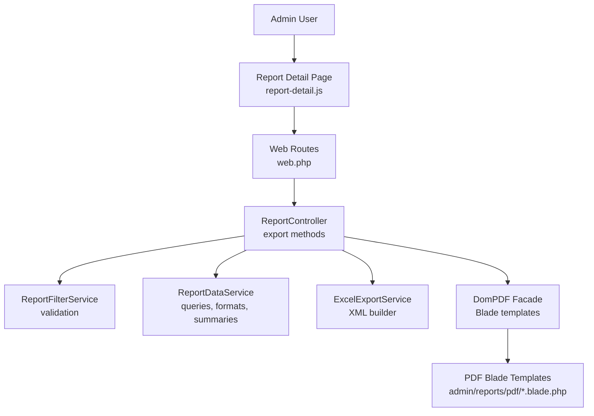
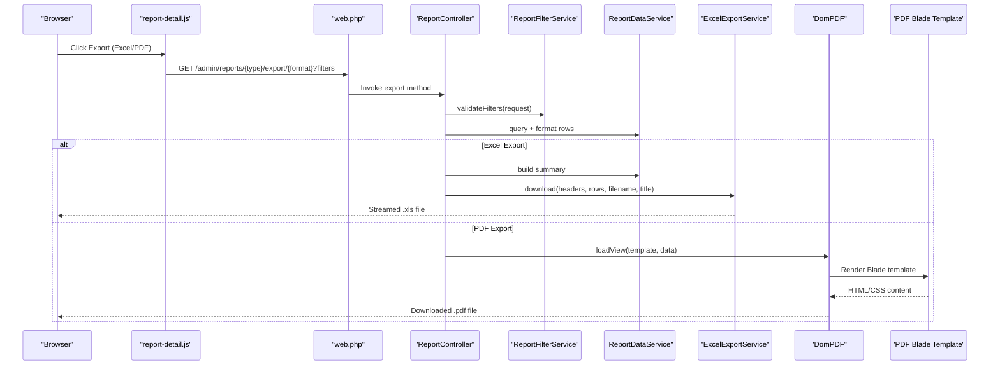
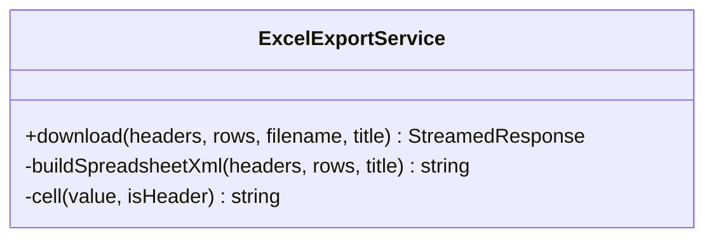
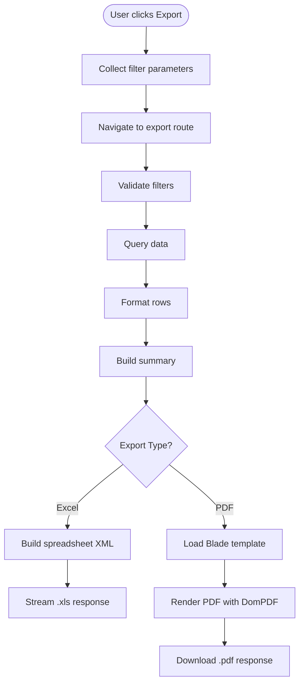
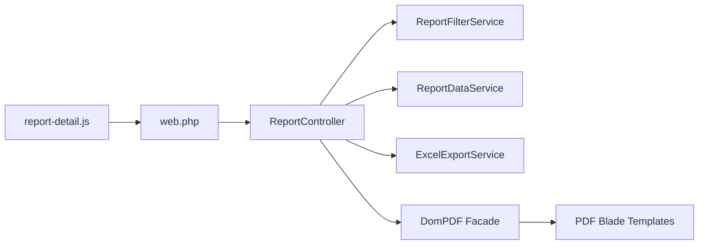

# Export Formats & Templates

<cite>
**Referenced Files in This Document**   
- [ReportController.php](file://backend/app/Http/Controllers/Admin/ReportController.php)
- [ExcelExportService.php](file://backend/app/Services/ExcelExportService.php)
- [ReportDataService.php](file://backend/app/Services/ReportDataService.php)
- [web.php](file://backend/routes/web.php)
- [booking.blade.php](file://backend/resources/views/admin/reports/pdf/booking.blade.php)
- [selling.blade.php](file://backend/resources/views/admin/reports/pdf/selling.blade.php)
- [agent-sales.blade.php](file://backend/resources/views/admin/reports/pdf/agent-sales.blade.php)
- [report-detail.js](file://backend/resources/js/admin/report-detail.js)
</cite>

## Table of Contents
1. [Introduction](#introduction)
2. [Project Structure](#project-structure)
3. [Core Components](#core-components)
4. [Architecture Overview](#architecture-overview)
5. [Detailed Component Analysis](#detailed-component-analysis)
6. [Dependency Analysis](#dependency-analysis)
7. [Performance Considerations](#performance-considerations)
8. [Troubleshooting Guide](#troubleshooting-guide)
9. [Conclusion](#conclusion)

## Introduction
This document explains the export functionality for PDF and Excel reports in the application. It covers:
- The Excel export architecture implemented by `ExcelExportService`.
- The PDF generation workflow using DomPDF with Blade templates.
- The end-to-end export flow from user interaction to file download.
- Report headers, summary sections, currency formatting, and styling options.
- Customization points for report templates, branding, layout, and currency presentation.
- Troubleshooting guidance for memory limits, character encoding issues, and large dataset handling.

## Project Structure
The export feature spans controllers, services, routes, Blade templates, and frontend JavaScript:
- Controllers expose preview and export endpoints for multiple report types.
- Services encapsulate data queries, row formatting, summaries, and Excel XML generation.
- Routes map URL paths to controller methods.
- Blade templates define professional-looking PDF layouts.
- Frontend scripts trigger exports by navigating to the appropriate URLs.

**Diagram sources**
- [web.php:131-174](file://backend/routes/web.php#L131-L174)
- [ReportController.php:84-143](file://backend/app/Http/Controllers/Admin/ReportController.php#L84-L143)
- [ExcelExportService.php:9-18](file://backend/app/Services/ExcelExportService.php#L9-L18)
- [booking.blade.php:1-18](file://backend/resources/views/admin/reports/pdf/booking.blade.php#L1-L18)
- [report-detail.js:110-114](file://backend/resources/js/admin/report-detail.js#L110-L114)

**Section sources**
- [web.php:131-174](file://backend/routes/web.php#L131-L174)
- [ReportController.php:11-18](file://backend/app/Http/Controllers/Admin/ReportController.php#L11-L18)
- [report-detail.js:110-114](file://backend/resources/js/admin/report-detail.js#L110-L114)

## Core Components
- ReportController: Orchestrates export requests, validates filters, retrieves data, builds summaries, and returns either an Excel stream or a PDF download.
- ExcelExportService: Builds Microsoft-compatible spreadsheet XML and streams it as an `.xls` file with UTF-8 encoding.
- ReportDataService: Provides typed queries, row formatters, header definitions, and summary builders for each report type.
- PDF Blade Templates: Define page structure, summary tables, data tables, and CSS styles for professional output.
- Web Routes: Expose `/admin/reports/{type}/export/{excel|pdf}` endpoints per report type.
- Frontend Script: Triggers export by navigating to the correct route with current filter parameters.

Key responsibilities:
- Validation and filtering are centralized through the filter service.
- Data retrieval and transformation are isolated in the data service.
- Excel generation is format-specific and lightweight.
- PDF generation uses Blade templates rendered by DomPDF.

**Section sources**
- [ReportController.php:84-143](file://backend/app/Http/Controllers/Admin/ReportController.php#L84-L143)
- [ExcelExportService.php:9-65](file://backend/app/Services/ExcelExportService.php#L9-L65)
- [ReportDataService.php:17-67](file://backend/app/Services/ReportDataService.php#L17-L67)
- [booking.blade.php:1-18](file://backend/resources/views/admin/reports/pdf/booking.blade.php#L1-L18)
- [web.php:131-174](file://backend/routes/web.php#L131-L174)
- [report-detail.js:110-114](file://backend/resources/js/admin/report-detail.js#L110-L114)

## Architecture Overview
The export architecture follows a layered approach:
- Presentation layer (UI) triggers export via client-side navigation.
- Routing layer maps URLs to controller actions.
- Controller layer coordinates validation, data access, and response generation.
- Service layer encapsulates business logic for querying, formatting, summarizing, and exporting.
- Template layer renders PDFs using Blade and CSS.

**Diagram sources**
- [report-detail.js:110-114](file://backend/resources/js/admin/report-detail.js#L110-L114)
- [web.php:131-174](file://backend/routes/web.php#L131-L174)
- [ReportController.php:84-143](file://backend/app/Http/Controllers/Admin/ReportController.php#L84-L143)
- [ExcelExportService.php:9-18](file://backend/app/Services/ExcelExportService.php#L9-L18)
- [booking.blade.php:1-18](file://backend/resources/views/admin/reports/pdf/booking.blade.php#L1-L18)

## Detailed Component Analysis

### ExcelExportService Architecture
`ExcelExportService` generates a Microsoft-compatible spreadsheet XML document and streams it directly to the client. It supports:
- Header rows with string cells.
- Numeric detection for numeric values and numeric strings that do not start with zero.
- XML-safe escaping of cell content.
- UTF-8 encoding for international characters.

Implementation highlights:
- `download` constructs XML and streams it as an `.xls` file with proper MIME type and charset.
- `buildSpreadsheetXml` creates workbook/worksheet structure, writes header row, then iterates over data rows.
- `cell` determines whether to treat a value as numeric or string and escapes XML entities.

Complexity considerations:
- Time complexity is linear in the number of cells: O(rows × columns).
- Memory usage grows with the size of the generated XML string; streaming avoids loading entire files into memory but still requires building the full XML in memory before streaming.

Customization points:
- Add conditional styling by injecting additional XML attributes into `cell`.
- Introduce worksheet metadata or multiple sheets by extending `buildSpreadsheetXml`.

**Diagram sources**
- [ExcelExportService.php:9-65](file://backend/app/Services/ExcelExportService.php#L9-L65)

**Section sources**
- [ExcelExportService.php:9-65](file://backend/app/Services/ExcelExportService.php#L9-L65)

### PDF Generation with DomPDF and Blade Templates
PDF exports use the DomPDF facade to render Blade templates configured for A4 landscape orientation. Each report type has a dedicated template under `resources/views/admin/reports/pdf/`.

Template characteristics:
- Professional typography using DejaVu Sans.
- Summary section with labeled metrics and formatted currency values.
- Data table with styled headers and alternating row backgrounds.
- Empty-state messaging when no records match filters.

Example template structure:
- Title and metadata (filters and generation timestamp).
- Summary table showing totals, AC vs non-AC breakdowns, and revenue figures.
- Data table listing detailed rows with consistent column ordering.

Styling options:
- Font family and sizes are defined inline in the template `<style>` block.
- Color schemes can be adjusted by modifying header background colors and row striping.
- Currency formatting uses PHP’s `number_format` to present two decimal places.

Branding elements:
- Titles and labels are static within templates; dynamic branding (logo, site name) can be injected by passing variables from the controller or view composer.
- Site settings are available in other parts of the application; integrating them into PDFs would require passing logo URLs and text into the template context.

Layout configurations:
- All PDF exports set paper size to A4 and orientation to landscape.
- Column widths and spacing are controlled by CSS; responsive adjustments are limited due to PDF rendering constraints.

**Section sources**
- [ReportController.php:128-143](file://backend/app/Http/Controllers/Admin/ReportController.php#L128-L143)
- [booking.blade.php:1-72](file://backend/resources/views/admin/reports/pdf/booking.blade.php#L1-L72)
- [selling.blade.php:1-81](file://backend/resources/views/admin/reports/pdf/selling.blade.php#L1-L81)
- [agent-sales.blade.php:1-66](file://backend/resources/views/admin/reports/pdf/agent-sales.blade.php#L1-L66)

### Export Workflow: From Data Retrieval to File Generation
The export workflow integrates several components:

1. User interaction:
   - The admin clicks “Export Excel” or “Export PDF”.
   - The frontend script collects current filter parameters and navigates to the corresponding route.

2. Route resolution:
   - The web route maps the request to a specific controller method based on report type and format.

3. Controller processing:
   - Validates filters via `ReportFilterService`.
   - Retrieves data via `ReportDataService`.
   - For Excel: builds summary rows and delegates to `ExcelExportService`.
   - For PDF: loads the Blade template with data and summary, sets paper orientation, and returns a downloadable PDF.

4. Response delivery:
   - Excel: streamed `.xls` file with UTF-8 encoding.
   - PDF: downloaded `.pdf` file rendered by DomPDF.

**Diagram sources**
- [report-detail.js:110-114](file://backend/resources/js/admin/report-detail.js#L110-L114)
- [web.php:131-174](file://backend/routes/web.php#L131-L174)
- [ReportController.php:84-143](file://backend/app/Http/Controllers/Admin/ReportController.php#L84-L143)
- [ExcelExportService.php:20-48](file://backend/app/Services/ExcelExportService.php#L20-L48)

**Section sources**
- [report-detail.js:110-114](file://backend/resources/js/admin/report-detail.js#L110-L114)
- [web.php:131-174](file://backend/routes/web.php#L131-L174)
- [ReportController.php:84-143](file://backend/app/Http/Controllers/Admin/ReportController.php#L84-L143)

### Data Models and Formatting
`ReportDataService` provides:
- Typed queries per report type (selling, cancel, booking, revenue, passenger, seat-occupancy, cancellation, refund, payment, route-sales, agent-sales).
- Row formatters that normalize relationships (schedule, bus, route, stations) into flat arrays suitable for both Excel and PDF.
- Header definitions aligned with expected column order.
- Summary builders aggregating counts, fares, seats, and optional breakdowns by payment method or coach type.

Key patterns:
- Seat parsing splits comma-separated seat numbers and trims whitespace.
- Fare values are cast to float and rounded where necessary.
- AC vs non-AC classification relies on bus coach type.
- Aggregations group by route or operator for specialized reports.

Complexity notes:
- Aggregation operations iterate over collections and perform grouping; time complexity depends on dataset size.
- Relationship loading is optimized by eager loading in queries to reduce N+1 issues.

**Section sources**
- [ReportDataService.php:17-67](file://backend/app/Services/ReportDataService.php#L17-L67)
- [ReportDataService.php:123-163](file://backend/app/Services/ReportDataService.php#L123-L163)
- [ReportDataService.php:663-684](file://backend/app/Services/ReportDataService.php#L663-L684)
- [ReportDataService.php:727-750](file://backend/app/Services/ReportDataService.php#L727-L750)

### Styling Options and Professional Reports
PDF templates emphasize readability and professionalism:
- Consistent font choices and sizes.
- Clear separation between summary and data sections.
- Styled headers with contrasting background colors.
- Alternating row shading for improved scanning.
- Currency values formatted to two decimal places.

Customization recommendations:
- Adjust color palettes to match brand guidelines by editing template CSS.
- Add company logos by passing image paths from the controller or view composer.
- Include footer text such as confidentiality notices or report IDs.
- Use CSS media queries cautiously; PDF rendering does not support all modern CSS features.

**Section sources**
- [booking.blade.php:6-17](file://backend/resources/views/admin/reports/pdf/booking.blade.php#L6-L17)
- [selling.blade.php:6-18](file://backend/resources/views/admin/reports/pdf/selling.blade.php#L6-L18)
- [agent-sales.blade.php:6-17](file://backend/resources/views/admin/reports/pdf/agent-sales.blade.php#L6-L17)

## Dependency Analysis
The export system exhibits clear separation of concerns:
- Controllers depend on services for validation, data access, and export logic.
- Services are independent of HTTP concerns and focus on domain logic.
- Templates are decoupled from controllers except for passed variables.
- Frontend scripts depend only on route names and filter parameters.

**Diagram sources**
- [report-detail.js:110-114](file://backend/resources/js/admin/report-detail.js#L110-L114)
- [web.php:131-174](file://backend/routes/web.php#L131-L174)
- [ReportController.php:11-18](file://backend/app/Http/Controllers/Admin/ReportController.php#L11-L18)
- [ExcelExportService.php:9-18](file://backend/app/Services/ExcelExportService.php#L9-L18)
- [booking.blade.php:1-18](file://backend/resources/views/admin/reports/pdf/booking.blade.php#L1-L18)

**Section sources**
- [ReportController.php:11-18](file://backend/app/Http/Controllers/Admin/ReportController.php#L11-L18)
- [web.php:131-174](file://backend/routes/web.php#L131-L174)

## Performance Considerations
- Large datasets:
  - Preview endpoints limit results to improve responsiveness; export endpoints retrieve full datasets.
  - Consider pagination or chunked processing for very large exports.
- Memory usage:
  - Excel XML generation builds the entire spreadsheet in memory; monitor PHP memory limits.
  - PDF rendering also consumes memory proportional to content size.
- Database queries:
  - Eager loading reduces N+1 queries; ensure indexes exist on frequently filtered columns (dates, status, route_id, operator).
- Streaming:
  - Excel export streams the XML response, reducing server disk I/O but not eliminating in-memory construction.

Recommendations:
- Increase `memory_limit` if generating large spreadsheets or PDFs.
- Use database indexes on date ranges and common filter fields.
- Implement background jobs for heavy exports and notify users upon completion.
- Cache aggregated summaries for repeated exports within short time windows.

[No sources needed since this section provides general guidance]

## Troubleshooting Guide
Common export issues and resolutions:

- Memory limits exceeded:
  - Symptoms: Server errors during Excel or PDF generation.
  - Actions: Increase PHP `memory_limit`, reduce dataset size, or implement chunked processing.
  - Related code: Excel XML construction and PDF rendering consume significant memory.

- Character encoding problems:
  - Symptoms: Incorrect display of special characters in Excel or PDF.
  - Actions: Ensure UTF-8 encoding is used consistently; Excel export sets charset UTF-8; verify Blade templates declare UTF-8 meta tags.
  - Related code: Excel export response includes UTF-8 charset; templates include UTF-8 meta declarations.

- Large dataset handling:
  - Symptoms: Slow responses or timeouts.
  - Actions: Limit exported rows, add database indexes, or move heavy exports to background jobs.
  - Related code: Export endpoints retrieve full datasets without pagination.

- Missing data or empty reports:
  - Symptoms: Empty tables or zero summaries.
  - Actions: Verify filter parameters and date ranges; check database state for matching records.
  - Related code: Templates show empty-state messages when no rows are found.

- Branding not appearing:
  - Symptoms: Logo or company name missing in PDFs.
  - Actions: Pass branding variables from controller or view composer; ensure image paths are accessible to DomPDF.
  - Related code: Templates currently do not reference logo variables; extend template context accordingly.

**Section sources**
- [ExcelExportService.php:13-17](file://backend/app/Services/ExcelExportService.php#L13-L17)
- [booking.blade.php:1-5](file://backend/resources/views/admin/reports/pdf/booking.blade.php#L1-L5)
- [ReportController.php:128-143](file://backend/app/Http/Controllers/Admin/ReportController.php#L128-L143)

## Conclusion
The export system provides robust PDF and Excel generation for multiple report types. The architecture cleanly separates concerns across controllers, services, templates, and frontend scripts. Excel exports leverage a lightweight XML builder, while PDF exports rely on well-structured Blade templates rendered by DomPDF. With careful attention to memory management, indexing, and template customization, the system can deliver professional, branded reports at scale.

[No sources needed since this section summarizes without analyzing specific files]