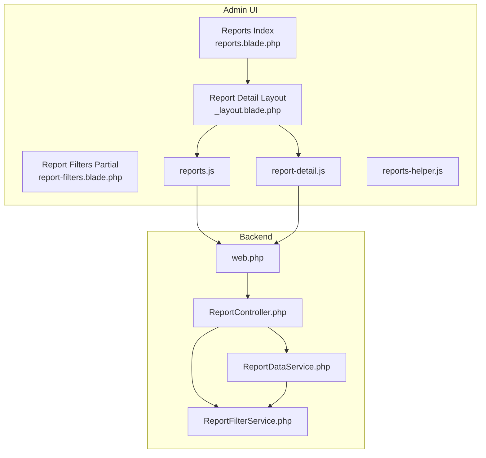
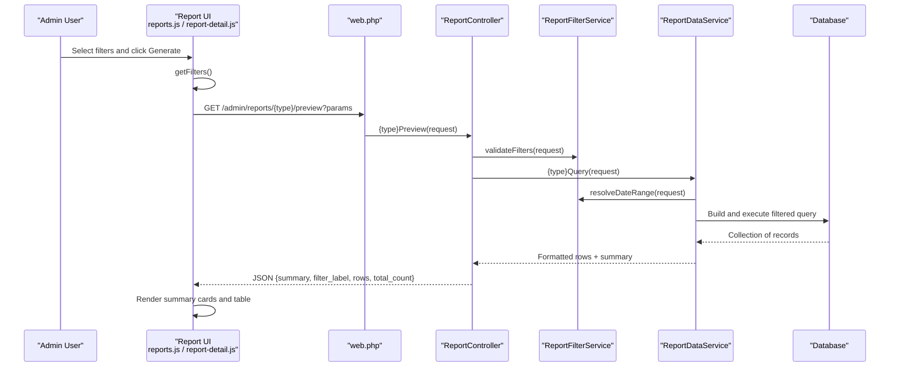
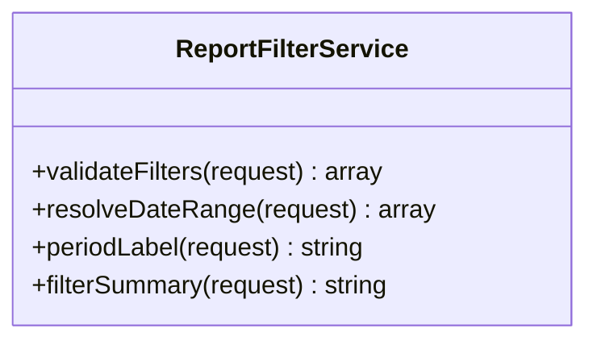
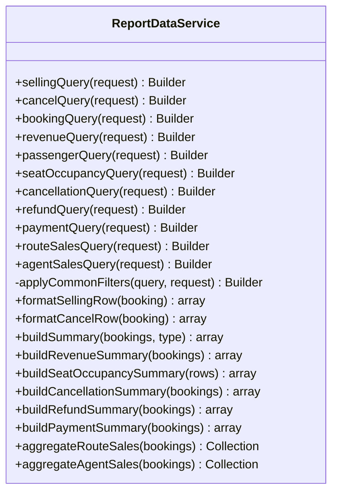
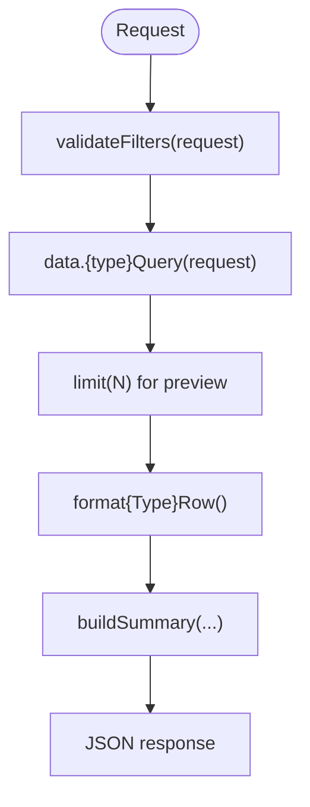
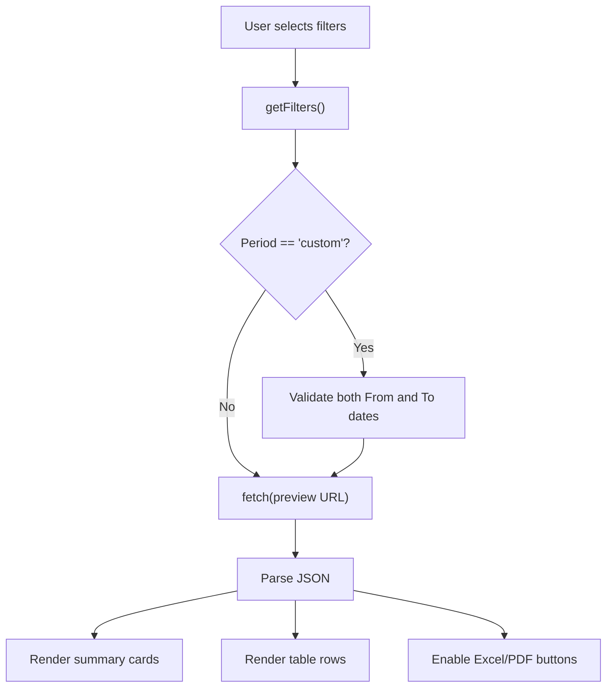
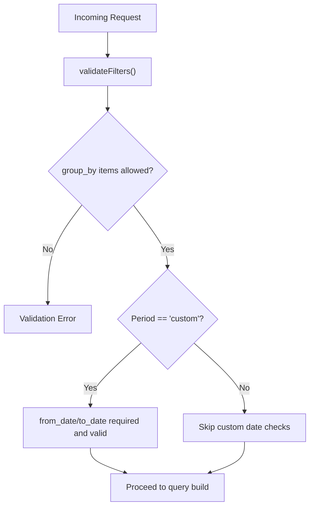
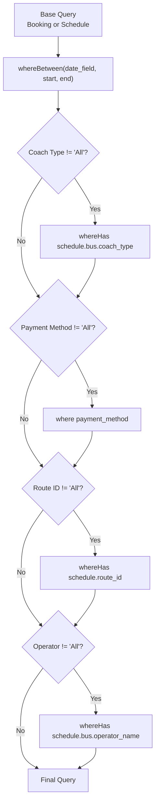
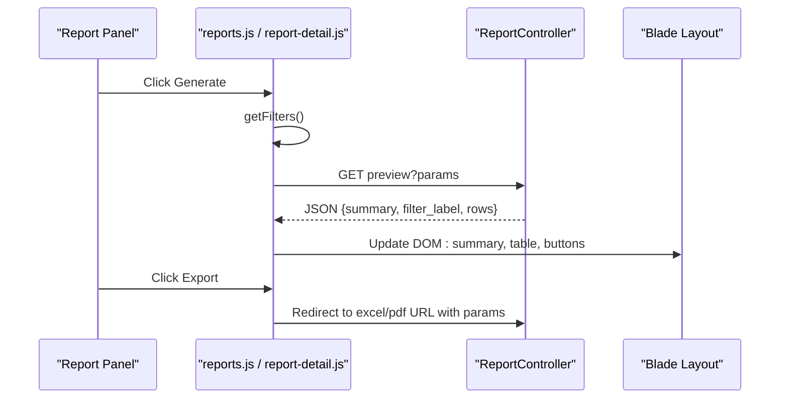

# Filtering & Search System

<cite>
**Referenced Files in This Document**
- [ReportFilterService.php](file://backend/app/Services/ReportFilterService.php)
- [ReportDataService.php](file://backend/app/Services/ReportDataService.php)
- [ReportController.php](file://backend/app/Http/Controllers/Admin/ReportController.php)
- [web.php](file://backend/routes/web.php)
- [_layout.blade.php](file://backend/resources/views/admin/reports/pages/_layout.blade.php)
- [report-filters.blade.php](file://backend/resources/views/admin/partials/report-filters.blade.php)
- [reports.blade.php](file://backend/resources/views/admin/partials/reports.blade.php)
- [reports.js](file://backend/resources/js/admin/reports.js)
- [report-detail.js](file://backend/resources/js/admin/report-detail.js)
- [reports-helper.js](file://backend/resources/js/admin/reports-helper.js)
</cite>

## Table of Contents
1. [Introduction](#introduction)
2. [Project Structure](#project-structure)
3. [Core Components](#core-components)
4. [Architecture Overview](#architecture-overview)
5. [Detailed Component Analysis](#detailed-component-analysis)
6. [Supported Filter Types](#supported-filter-types)
7. [Filter Validation and Parameter Sanitization](#filter-validation-and-parameter-sanitization)
8. [Query Construction Mechanisms](#query-construction-mechanisms)
9. [Filter UI Components and AJAX Flow](#filter-ui-components-and-ajax-flow)
10. [Complex Filter Combinations](#complex-filter-combinations)
11. [Performance Implications and Optimization](#performance-implications-and-optimization)
12. [Filter Persistence, URL Parameters, and State Management](#filter-persistence-url-parameters-and-state-management)
13. [Troubleshooting Guide](#troubleshooting-guide)
14. [Best Practices for Efficient Queries](#best-practices-for-efficient-queries)
15. [Conclusion](#conclusion)

## Introduction
This document explains the dynamic filtering system that powers all admin reports. It covers how filter inputs are validated, sanitized, transformed into date ranges, applied to database queries, and rendered as real-time results. It also documents supported filter types, AJAX-based filtering, export behavior, performance considerations, and current limitations around persistence and state management.

The system is centered around:
- A shared filter UI for report pages.
- JavaScript that reads form inputs and calls preview endpoints.
- A controller layer that validates filters and delegates query building.
- A service layer that constructs Eloquent queries and formats rows and summaries.
- Export endpoints for Excel and PDF using the same filter parameters.

## Project Structure
The filtering system spans backend services, controllers, Blade templates, and frontend JavaScript.

**Diagram sources**
- [reports.blade.php:13-103](file://backend/resources/views/admin/partials/reports.blade.php#L13-L103)
- [_layout.blade.php:114-230](file://backend/resources/views/admin/reports/pages/_layout.blade.php#L114-L230)
- [report-filters.blade.php:1-98](file://backend/resources/views/admin/partials/report-filters.blade.php#L1-L98)
- [reports.js:1-179](file://backend/resources/js/admin/reports.js#L1-L179)
- [report-detail.js:1-139](file://backend/resources/js/admin/report-detail.js#L1-L139)
- [reports-helper.js:1-250](file://backend/resources/js/admin/reports-helper.js#L1-L250)
- [web.php:159-167](file://backend/routes/web.php#L159-L167)
- [ReportController.php:11-52](file://backend/app/Http/Controllers/Admin/ReportController.php#L11-L52)
- [ReportFilterService.php:8-85](file://backend/app/Services/ReportFilterService.php#L8-L85)
- [ReportDataService.php:11-67](file://backend/app/Services/ReportDataService.php#L11-L67)

**Section sources**
- [reports.blade.php:13-103](file://backend/resources/views/admin/partials/reports.blade.php#L13-L103)
- [_layout.blade.php:114-230](file://backend/resources/views/admin/reports/pages/_layout.blade.php#L114-L230)
- [report-filters.blade.php:1-98](file://backend/resources/views/admin/partials/report-filters.blade.php#L1-L98)
- [reports.js:1-179](file://backend/resources/js/admin/reports.js#L1-L179)
- [report-detail.js:1-139](file://backend/resources/js/admin/report-detail.js#L1-L139)
- [reports-helper.js:1-250](file://backend/resources/js/admin/reports-helper.js#L1-L250)
- [web.php:159-167](file://backend/routes/web.php#L159-L167)
- [ReportController.php:11-52](file://backend/app/Http/Controllers/Admin/ReportController.php#L11-L52)
- [ReportFilterService.php:8-85](file://backend/app/Services/ReportFilterService.php#L8-L85)
- [ReportDataService.php:11-67](file://backend/app/Services/ReportDataService.php#L11-L67)

## Core Components
- **ReportFilterService**: Validates incoming filter parameters, resolves period-based or custom date ranges, builds human-readable filter labels, and summarizes active filters.
- **ReportDataService**: Builds typed report queries, applies common filters, formats rows, computes summaries, and provides headers and array converters for exports.
- **ReportController**: Exposes preview, Excel, and PDF endpoints per report type; validates filters once per endpoint and delegates data retrieval to ReportDataService.
- **Blade Templates**: Provide the report index page, shared detail layout, and reusable filter partials.
- **JavaScript Modules**: Read filter inputs, construct URLSearchParams, call preview endpoints, render summary cards and tables, and trigger file downloads for exports.

**Section sources**
- [ReportFilterService.php:8-85](file://backend/app/Services/ReportFilterService.php#L8-L85)
- [ReportDataService.php:11-774](file://backend/app/Services/ReportDataService.php#L11-L774)
- [ReportController.php:11-648](file://backend/app/Http/Controllers/Admin/ReportController.php#L11-L648)
- [_layout.blade.php:114-230](file://backend/resources/views/admin/reports/pages/_layout.blade.php#L114-L230)
- [report-filters.blade.php:1-98](file://backend/resources/views/admin/partials/report-filters.blade.php#L1-L98)
- [reports.js:1-179](file://backend/resources/js/admin/reports.js#L1-L179)
- [report-detail.js:1-139](file://backend/resources/js/admin/report-detail.js#L1-L139)
- [reports-helper.js:1-250](file://backend/resources/js/admin/reports-helper.js#L1-L250)

## Architecture Overview
The filtering architecture follows a layered request flow:

**Diagram sources**
- [reports.js:64-137](file://backend/resources/js/admin/reports.js#L64-L137)
- [report-detail.js:46-114](file://backend/resources/js/admin/report-detail.js#L46-L114)
- [web.php:159-167](file://backend/routes/web.php#L159-L167)
- [ReportController.php:54-67](file://backend/app/Http/Controllers/Admin/ReportController.php#L54-L67)
- [ReportFilterService.php:10-46](file://backend/app/Services/ReportFilterService.php#L10-L46)
- [ReportDataService.php:17-67](file://backend/app/Services/ReportDataService.php#L17-L67)

## Detailed Component Analysis

### ReportFilterService
Responsibilities:
- Validate filter parameters including grouped aggregation keys, date range constraints, coach type, payment method, route ID, and operator.
- Resolve date ranges from built-in periods or custom dates.
- Produce a readable filter label and a compact filter summary string.

Key behaviors:
- `validateFilters` enforces allowed group-by values and ensures custom date fields are present when the period is custom.
- `resolveDateRange` maps weekly, monthly, quarterly, yearly, and custom periods to start/end timestamps.
- `periodLabel` returns a formatted label for display.
- `filterSummary` composes a concise summary string based on active filters.

**Diagram sources**
- [ReportFilterService.php:8-85](file://backend/app/Services/ReportFilterService.php#L8-L85)

**Section sources**
- [ReportFilterService.php:10-83](file://backend/app/Services/ReportFilterService.php#L10-L83)

### ReportDataService
Responsibilities:
- Build typed queries for each report type.
- Apply common filters across booking-related reports.
- Format rows for UI rendering.
- Compute summaries per report type.
- Provide headers and row-to-array converters for Excel/PDF exports.

Common filter application:
- Coach type filters through schedule bus relationship.
- Payment method filters directly on bookings.
- Route ID filters through schedule relationship with numeric validation.
- Operator filters through schedule bus relationship.

**Diagram sources**
- [ReportDataService.php:11-774](file://backend/app/Services/ReportDataService.php#L11-L774)

**Section sources**
- [ReportDataService.php:17-67](file://backend/app/Services/ReportDataService.php#L17-L67)
- [ReportDataService.php:123-163](file://backend/app/Services/ReportDataService.php#L123-L163)
- [ReportDataService.php:207-220](file://backend/app/Services/ReportDataService.php#L207-L220)
- [ReportDataService.php:269-326](file://backend/app/Services/ReportDataService.php#L269-L326)
- [ReportDataService.php:344-357](file://backend/app/Services/ReportDataService.php#L344-L357)
- [ReportDataService.php:401-422](file://backend/app/Services/ReportDataService.php#L401-L422)
- [ReportDataService.php:486-499](file://backend/app/Services/ReportDataService.php#L486-L499)
- [ReportDataService.php:505-519](file://backend/app/Services/ReportDataService.php#L505-L519)
- [ReportDataService.php:577-590](file://backend/app/Services/ReportDataService.php#L577-L590)
- [ReportDataService.php:648-684](file://backend/app/Services/ReportDataService.php#L648-L684)
- [ReportDataService.php:712-750](file://backend/app/Services/ReportDataService.php#L712-L750)

### ReportController
Responsibilities:
- Define allowed report types and load lightweight dropdown data for routes and operators.
- Expose preview endpoints returning JSON with summary, filter label, rows, and total count.
- Expose Excel and PDF export endpoints using the same filter parameters.
- Delegate validation to ReportFilterService and data construction to ReportDataService.

**Diagram sources**
- [ReportController.php:24-52](file://backend/app/Http/Controllers/Admin/ReportController.php#L24-L52)
- [ReportController.php:54-67](file://backend/app/Http/Controllers/Admin/ReportController.php#L54-L67)

**Section sources**
- [ReportController.php:24-52](file://backend/app/Http/Controllers/Admin/ReportController.php#L24-L52)
- [ReportController.php:54-648](file://backend/app/Http/Controllers/Admin/ReportController.php#L54-L648)

### Blade Templates and JavaScript
- **reports.blade.php**: Defines the report card gallery and navigation to individual report pages.
- **_layout.blade.php**: Provides the shared filter panel, action buttons, summary grid, table container, and injects `window.ReportDetail` with preview/excel/pdf URLs.
- **report-filters.blade.php**: Reusable filter partial used by some report views, exposing period, custom dates, coach type, payment method, route, and operator.
- **reports.js**: Handles multiple report panels on the index page, reading filters via `getFilters`, generating reports via AJAX, rendering summary and table, and triggering exports.
- **report-detail.js**: Handles a single standalone report detail page with similar logic but uses fixed IDs instead of scoped selectors.
- **reports-helper.js**: Centralizes table headers, row builders, and summary card HTML generation.

**Diagram sources**
- [reports.js:64-137](file://backend/resources/js/admin/reports.js#L64-L137)
- [report-detail.js:46-114](file://backend/resources/js/admin/report-detail.js#L46-L114)
- [reports-helper.js:12-25](file://backend/resources/js/admin/reports-helper.js#L12-L25)
- [reports-helper.js:26-174](file://backend/resources/js/admin/reports-helper.js#L26-L174)
- [reports-helper.js:176-250](file://backend/resources/js/admin/reports-helper.js#L176-L250)

**Section sources**
- [reports.blade.php:13-103](file://backend/resources/views/admin/partials/reports.blade.php#L13-L103)
- [_layout.blade.php:114-230](file://backend/resources/views/admin/reports/pages/_layout.blade.php#L114-L230)
- [report-filters.blade.php:1-98](file://backend/resources/views/admin/partials/report-filters.blade.php#L1-L98)
- [reports.js:1-179](file://backend/resources/js/admin/reports.js#L1-L179)
- [report-detail.js:1-139](file://backend/resources/js/admin/report-detail.js#L1-L139)
- [reports-helper.js:1-250](file://backend/resources/js/admin/reports-helper.js#L1-L250)

## Supported Filter Types
The system supports these core filter dimensions:

| Filter | Description | Backend Handling | UI Element |
| --- | --- | --- | --- |
| Period | Built-in time windows: weekly, monthly, quarterly, yearly | Resolved by `ReportFilterService::resolveDateRange` | Select dropdown |
| Custom Date Range | Explicit from/to dates when period is custom | Validated and parsed into start-of-day and end-of-day ranges | Two date inputs shown conditionally |
| Coach Type | AC or Non AC | Applied via schedule bus relationship | Select dropdown |
| Payment Method | bKash, Nagad, Card, Cash, All | Direct equality filter on payment_method | Select dropdown |
| Route | Specific route ID or All | Applied via schedule relationship with numeric check | Select dropdown populated from routes |
| Operator | Bus operator name or All | Applied via schedule bus relationship | Select dropdown populated from buses |

Additional grouping/filtering capabilities exist in validation for `group_by` values such as date, operator, route, coach_type, payment_method, and status, though the primary UI currently focuses on the six core filters above.

**Section sources**
- [ReportFilterService.php:10-21](file://backend/app/Services/ReportFilterService.php#L10-L21)
- [ReportFilterService.php:24-46](file://backend/app/Services/ReportFilterService.php#L24-L46)
- [ReportDataService.php:47-67](file://backend/app/Services/ReportDataService.php#L47-L67)
- [_layout.blade.php:118-168](file://backend/resources/views/admin/reports/pages/_layout.blade.php#L118-L168)
- [report-filters.blade.php:5-66](file://backend/resources/views/admin/partials/report-filters.blade.php#L5-L66)

## Filter Validation and Parameter Sanitization
Validation rules:
- `group_by`: Optional array where each item must be one of the allowed aggregation keys.
- `from_date` and `to_date`: Required when period is custom; must be valid dates; `to_date` must be after or equal to `from_date`.
- `coach_type`, `payment_method`, `operator`: Optional strings.
- `route_id`: Optional value; numeric validation occurs at query-building time.

Sanitization and safety:
- The controller always calls `validateFilters` before querying, ensuring invalid requests fail early.
- Route ID is explicitly checked for numeric values before applying the filter to prevent non-numeric injection.
- Custom date parsing relies on Carbon, which throws on invalid dates; this should surface as a validation error upstream.

Limitations:
- There is no explicit allowlist for `payment_method` or `operator` beyond string typing; downstream queries rely on exact matches.
- No input trimming or normalization is performed before validation.

**Diagram sources**
- [ReportFilterService.php:10-21](file://backend/app/Services/ReportFilterService.php#L10-L21)
- [ReportFilterService.php:24-46](file://backend/app/Services/ReportFilterService.php#L24-L46)
- [ReportDataService.php:57-59](file://backend/app/Services/ReportDataService.php#L57-L59)

**Section sources**
- [ReportFilterService.php:10-21](file://backend/app/Services/ReportFilterService.php#L10-L21)
- [ReportFilterService.php:24-46](file://backend/app/Services/ReportFilterService.php#L24-L46)
- [ReportDataService.php:57-59](file://backend/app/Services/ReportDataService.php#L57-L59)

## Query Construction Mechanisms
Each report query starts with a base scope and then applies common filters:

- Booking-based reports use `Booking::with(...)` relationships to eager-load schedule, bus, and route station data.
- Seat occupancy uses `Schedule::with(...)` and counts booked seats per schedule.
- Aggregated reports like route-sales and agent-sales group collections in memory after fetching raw bookings.

Common filter application:
- Coach type: `whereHas('schedule.bus', fn ($q) => $q->where('coach_type', ...))`
- Payment method: `where('payment_method', ...)`
- Route ID: `whereHas('schedule', fn ($q) => $q->where('route_id', ...))` with numeric guard
- Operator: `whereHas('schedule.bus', fn ($q) => $q->where('operator_name', ...))`

Preview endpoints limit results (for example, 500 or 200 rows) while still computing totals via separate count queries.

**Diagram sources**
- [ReportDataService.php:47-67](file://backend/app/Services/ReportDataService.php#L47-L67)
- [ReportDataService.php:401-422](file://backend/app/Services/ReportDataService.php#L401-L422)

**Section sources**
- [ReportDataService.php:17-67](file://backend/app/Services/ReportDataService.php#L17-L67)
- [ReportDataService.php:401-422](file://backend/app/Services/ReportDataService.php#L401-L422)

## Filter UI Components and AJAX Flow
Two UI patterns exist:

1. **Index-based report panels**:
   - Multiple report panels share `reports.js`.
   - Each panel has scoped selectors using `data-report` attributes.
   - `getFilters(type)` reads values from the panel’s inputs.
   - `generateReport(type)` fetches the preview endpoint and renders results.

2. **Single-page report detail**:
   - `_layout.blade.php` injects `window.ReportDetail` with typed routes.
   - `report-detail.js` uses fixed IDs for a single report view.
   - Same filter model: period, coach type, payment method, route, operator, and optional custom dates.

Real-time updates:
- On successful response, the UI hides the empty hint, shows the filter label, reveals the summary grid, renders the table, and enables export buttons.
- On network or server errors, an alert displays the message.

Export behavior:
- Excel and PDF exports are triggered by changing `window.location.href` to the corresponding export URL with the same filter parameters.

**Diagram sources**
- [reports.js:64-143](file://backend/resources/js/admin/reports.js#L64-L143)
- [report-detail.js:46-114](file://backend/resources/js/admin/report-detail.js#L46-L114)
- [_layout.blade.php:219-230](file://backend/resources/views/admin/reports/pages/_layout.blade.php#L219-L230)

**Section sources**
- [reports.js:1-179](file://backend/resources/js/admin/reports.js#L1-L179)
- [report-detail.js:1-139](file://backend/resources/js/admin/report-detail.js#L1-L139)
- [_layout.blade.php:219-230](file://backend/resources/views/admin/reports/pages/_layout.blade.php#L219-L230)

## Complex Filter Combinations
Examples of meaningful combinations:

- **Monthly revenue for AC coaches on a specific route paid by Card**:
  - Period: monthly
  - Coach type: AC
  - Route: selected route ID
  - Payment method: Card

- **Weekly cancellations for a specific operator**:
  - Period: weekly
  - Operator: selected operator
  - Report type: cancellation or cancel

- **Quarterly passenger travel history filtered by coach type and payment method**:
  - Period: quarterly
  - Coach type: Non AC
  - Payment method: bKash

- **Yearly seat occupancy for a specific route and operator**:
  - Period: yearly
  - Route: selected route ID
  - Operator: selected operator
  - Report type: seat-occupancy

These combinations are applied through `applyCommonFilters` and report-specific query scopes.

**Section sources**
- [ReportDataService.php:47-67](file://backend/app/Services/ReportDataService.php#L47-L67)
- [ReportDataService.php:401-422](file://backend/app/Services/ReportDataService.php#L401-L422)

## Performance Implications and Optimization
Current characteristics:
- Preview endpoints limit result sets to reduce payload size, but still compute totals via additional count queries.
- Many queries eagerly load relationships (`schedule.bus`, `schedule.route.departureStation`, `schedule.route.arrivalStation`) to avoid N+1 issues during formatting.
- Aggregated reports like route-sales and agent-sales fetch raw bookings and group them in PHP memory.

Potential concerns:
- Large date ranges without route/operator/coach filters can return substantial datasets.
- Seat occupancy calculates booked seats per schedule by loading related bookings, which may be expensive if many schedules are returned.
- Aggregation happens in PHP rather than SQL for route-sales and agent-sales, increasing memory usage.

Recommendations:
- Add pagination for preview endpoints.
- Use SQL-level aggregation where possible for route-sales and agent-sales.
- Add indexes on frequently filtered columns such as `created_at`, `updated_at`, `payment_method`, `status`, `route_id`, and bus operator fields.
- Consider caching dropdown options for routes and operators if they change infrequently.
- For seat occupancy, consider precomputing or materializing occupancy metrics.

[No sources needed since this section provides general guidance]

## Filter Persistence, URL Parameters, and State Management
Current behavior:
- JavaScript constructs `URLSearchParams` and appends them to preview/export URLs.
- The UI does not persist filter state in the browser URL bar or session storage.
- Custom date defaults are set to month start and today when initializing scripts.
- Export endpoints receive the same parameters via query string.

Limitations:
- There is no URL synchronization for filter state across page navigation.
- Refreshing a report detail page resets filters to defaults.
- Sharing a link with filters is not supported out of the box.

Suggested improvements:
- Persist filters in `sessionStorage` or `localStorage`.
- Sync filters to the URL query string so users can bookmark or share filtered views.
- Initialize inputs from URL parameters on page load.
- Debounce filter changes to avoid excessive requests if implementing live filtering.

**Section sources**
- [reports.js:64-81](file://backend/resources/js/admin/reports.js#L64-L81)
- [reports.js:167-176](file://backend/resources/js/admin/reports.js#L167-L176)
- [report-detail.js:46-64](file://backend/resources/js/admin/report-detail.js#L46-L64)
- [report-detail.js:129-136](file://backend/resources/js/admin/report-detail.js#L129-L136)

## Troubleshooting Guide
Common issues and resolutions:

- **Custom date validation fails**:
  - Ensure both From and To dates are provided when period is custom.
  - Verify date format is `YYYY-MM-DD`.
  - Confirm `to_date` is not earlier than `from_date`.

- **Empty results**:
  - Narrow the date range.
  - Select a specific route or operator.
  - Check coach type and payment method selections.

- **Network error while loading report**:
  - Check browser console for failed requests.
  - Verify preview endpoint routes are registered.
  - Confirm server returns JSON with expected structure.

- **Export buttons disabled**:
  - Generate a report first; exports are enabled only after a successful preview response.

- **Invalid report type**:
  - Only allowed report types are served by the detail page controller.
  - Ensure the requested type matches the configured list.

**Section sources**
- [reports.js:91-137](file://backend/resources/js/admin/reports.js#L91-L137)
- [report-detail.js:67-108](file://backend/resources/js/admin/report-detail.js#L67-L108)
- [ReportController.php:24-33](file://backend/app/Http/Controllers/Admin/ReportController.php#L24-L33)

## Best Practices for Efficient Queries
- Always constrain date ranges to reasonable windows.
- Prefer selecting a specific route or operator when analyzing large datasets.
- Avoid overly broad searches across all routes and operators unless necessary.
- Use built-in periods for quick analysis; switch to custom dates only when precise ranges are required.
- Leverage the filter summary label to confirm active filters before exporting.
- For heavy aggregated reports, consider adding server-side pagination or caching strategies.

[No sources needed since this section provides general guidance]

## Conclusion
The reporting filtering system is a cohesive pipeline from UI inputs to validated parameters, resolved date ranges, Eloquent query construction, and JSON responses rendered into summary cards and tables. It supports practical filter combinations across date ranges, routes, stations indirectly through routes, bus operators, coach types, and payment methods. While it currently lacks URL-based filter persistence, its design makes it straightforward to extend with state synchronization, pagination, and more efficient aggregation strategies.

[No sources needed since this section summarizes without analyzing specific files]