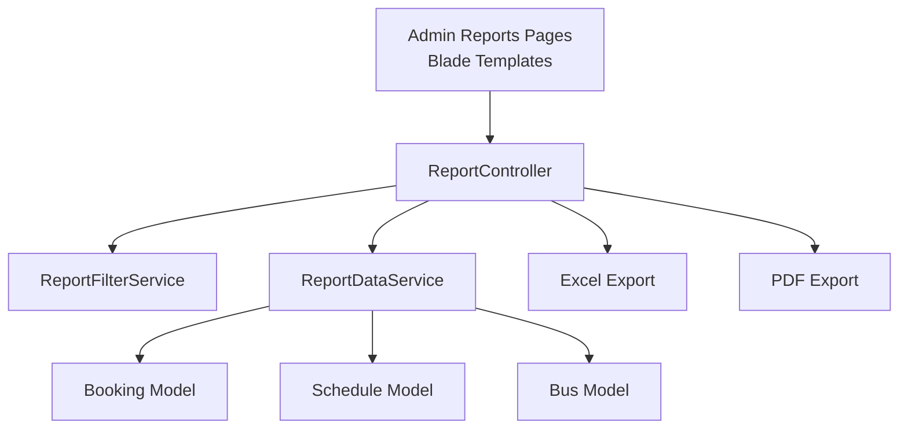
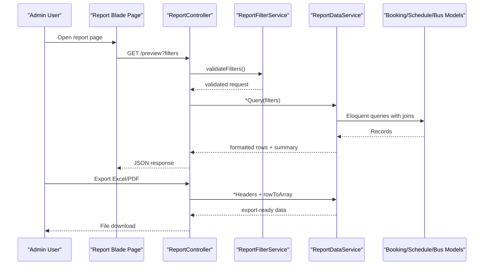
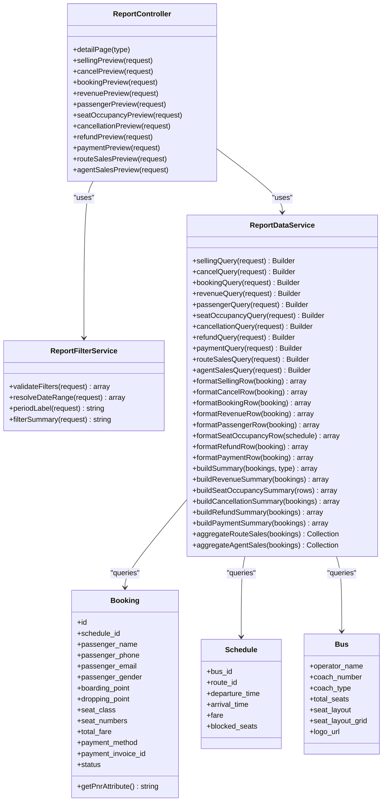

# Report Types & Metrics

<cite>
**Referenced Files in This Document**   
- [ReportController.php](file://backend/app/Http/Controllers/Admin/ReportController.php)
- [ReportDataService.php](file://backend/app/Services/ReportDataService.php)
- [ReportFilterService.php](file://backend/app/Services/ReportFilterService.php)
- [Booking.php](file://backend/app/Models/Booking.php)
- [Schedule.php](file://backend/app/Models/Schedule.php)
- [Bus.php](file://backend/app/Models/Bus.php)
- [create_bookings_table.php](file://backend/database/migrations/2026_06_01_000050_create_bookings_table.php)
- [selling.blade.php](file://backend/resources/views/admin/reports/pages/selling.blade.php)
- [booking.blade.php](file://backend/resources/views/admin/reports/pages/booking.blade.php)
- [revenue.blade.php](file://backend/resources/views/admin/reports/pages/revenue.blade.php)
- [passenger.blade.php](file://backend/resources/views/admin/reports/pages/passenger.blade.php)
- [seat-occupancy.blade.php](file://backend/resources/views/admin/reports/pages/seat-occupancy.blade.php)
- [cancellation.blade.php](file://backend/resources/views/admin/reports/pages/cancellation.blade.php)
- [cancel.blade.php](file://backend/resources/views/admin/reports/pages/cancel.blade.php)
- [refund.blade.php](file://backend/resources/views/admin/reports/pages/refund.blade.php)
- [payment.blade.php](file://backend/resources/views/admin/reports/pages/payment.blade.php)
- [route-sales.blade.php](file://backend/resources/views/admin/reports/pages/route-sales.blade.php)
- [agent-sales.blade.php](file://backend/resources/views/admin/reports/pages/agent-sales.blade.php)
</cite>

## Table of Contents
1. [Introduction](#introduction)
2. [Project Structure](#project-structure)
3. [Core Components](#core-components)
4. [Architecture Overview](#architecture-overview)
5. [Detailed Component Analysis](#detailed-component-analysis)
6. [Dependency Analysis](#dependency-analysis)
7. [Performance Considerations](#performance-considerations)
8. [Troubleshooting Guide](#troubleshooting-guide)
9. [Conclusion](#conclusion)

## Introduction
This document explains all 11 report types available in the system: selling, booking, revenue, passenger, seat occupancy, cancellation, cancel, refund, payment, route-wise sales, and agent sales. For each report, it covers purpose, data sources, metrics calculated, field definitions, calculation formulas, supported reporting periods, and business value. The reports are implemented through a controller that delegates query building, formatting, summarization, and export logic to dedicated services, with Blade views providing the admin UI for each report type.

## Project Structure
The reporting subsystem is organized around three main layers:
- Controller layer: exposes endpoints for preview, Excel export, and PDF export for each report.
- Service layer: builds queries, formats rows, computes summaries, and defines column headers.
- View layer: Blade templates render the report pages and PDFs.

**Diagram sources**
- [ReportController.php:11-18](file://backend/app/Http/Controllers/Admin/ReportController.php#L11-L18)
- [ReportDataService.php:11-15](file://backend/app/Services/ReportDataService.php#L11-L15)
- [ReportFilterService.php:8-22](file://backend/app/Services/ReportFilterService.php#L8-L22)

**Section sources**
- [ReportController.php:11-648](file://backend/app/Http/Controllers/Admin/ReportController.php#L11-L648)
- [ReportDataService.php:11-774](file://backend/app/Services/ReportDataService.php#L11-L774)
- [ReportFilterService.php:8-85](file://backend/app/Services/ReportFilterService.php#L8-L85)

## Core Components
- ReportController: Validates requests, selects allowed report types, returns page data, and provides preview/export endpoints for each report.
- ReportDataService: Implements per-report queries, row formatters, summary builders, and header arrays used by exports.
- ReportFilterService: Validates filter inputs, resolves date ranges from period or custom dates, and generates human-readable filter labels.
- Data models: Booking, Schedule, and Bus provide the relational context for routes, operators, coach types, seats, fares, and statuses.

Key responsibilities:
- Query construction uses Eloquent relationships to join schedules, buses, and routes.
- Row formatting converts raw records into display-friendly arrays.
- Summaries aggregate totals, AC vs non-AC splits, payment breakdowns, and occupancy percentages.
- Exports use shared header arrays and row-to-array converters for consistent Excel/PDF output.

**Section sources**
- [ReportController.php:20-52](file://backend/app/Http/Controllers/Admin/ReportController.php#L20-L52)
- [ReportDataService.php:17-67](file://backend/app/Services/ReportDataService.php#L17-L67)
- [ReportFilterService.php:10-46](file://backend/app/Services/ReportFilterService.php#L10-L46)
- [Booking.php:8-47](file://backend/app/Models/Booking.php#L8-L47)
- [Schedule.php:8-33](file://backend/app/Models/Schedule.php#L8-L33)
- [Bus.php:8-21](file://backend/app/Models/Bus.php#L8-L21)

## Architecture Overview
The reporting flow follows a consistent pattern across all 11 reports:
1. Admin user opens a report page (Blade template).
2. Frontend calls a preview endpoint with filters (period, coach type, payment method, route, operator).
3. ReportFilterService validates filters and resolves the date range.
4. ReportDataService builds the appropriate query and formats rows.
5. ReportController returns JSON with summary, filter label, rows, and total count.
6. Export endpoints generate Excel or PDF using the same data pipeline.

**Diagram sources**
- [ReportController.php:54-67](file://backend/app/Http/Controllers/Admin/ReportController.php#L54-L67)
- [ReportFilterService.php:10-46](file://backend/app/Services/ReportFilterService.php#L10-L46)
- [ReportDataService.php:17-67](file://backend/app/Services/ReportDataService.php#L17-L67)

## Detailed Component Analysis

### Selling Report
Purpose: Track ticket sales over time, including passenger details, route, operator, coach type, seats, fare, and payment method.

Data sources:
- Bookings with status PAID, SOLD, or BOOKED.
- Joined schedule, bus, and route entities.

Metrics calculated:
- Total tickets sold.
- Total seats sold.
- Total fare collected.
- AC vs non-AC ticket counts and fare splits.

Field definitions:
- PNR: SE followed by zero-padded booking ID.
- Sold Date: Booking creation timestamp.
- Passenger Name, Phone, Email.
- Route: Departure station to arrival station.
- Departure: Scheduled departure time.
- Operator: Bus operator name.
- Coach Number: Bus identifier.
- Coach Type: AC or non-AC.
- Seats: Comma-separated seat numbers.
- Seat Count: Number of seats parsed from seat_numbers.
- Fare: Total fare in BDT.
- Payment Method: Payment channel used.

Calculation formulas:
- Seat Count = number of non-empty values after splitting seat_numbers by comma and trimming whitespace.
- Total Fares = sum of total_fare across selected bookings.
- AC Ticket Count = bookings where associated bus coach_type equals AC.
- Non-AC Ticket Count = bookings where associated bus coach_type is not AC.

Reporting periods supported:
- Weekly, Monthly, Quarterly, Yearly, Custom (from_date/to_date).

Business value:
- Sales performance monitoring.
- Revenue attribution by coach type.
- Operational insights on popular routes and operators.

Supported outputs:
- Preview JSON.
- Excel export with summary rows.
- PDF export.

**Section sources**
- [ReportController.php:54-143](file://backend/app/Http/Controllers/Admin/ReportController.php#L54-L143)
- [ReportDataService.php:17-191](file://backend/app/Services/ReportDataService.php#L17-L191)
- [selling.blade.php](file://backend/resources/views/admin/reports/pages/selling.blade.php)

### Booking Report
Purpose: List all active bookings within a period, including full booking details and status.

Data sources:
- Bookings with status PAID, SOLD, or BOOKED.
- Joined schedule, bus, and route entities.

Metrics calculated:
- Total bookings.
- Total seats booked.
- Total fare.

Field definitions:
- PNR, Booking Date, Passenger Name, Phone, Email.
- Route, Departure, Operator, Coach Number, Coach Type.
- Seats, Seat Count, Fare, Payment Method, Status.

Calculation formulas:
- Same seat parsing and fare aggregation as selling report.

Reporting periods supported:
- Weekly, Monthly, Quarterly, Yearly, Custom.

Business value:
- Real-time visibility into active reservations.
- Auditability of booking lifecycle.

Supported outputs:
- Preview JSON.
- Excel export.
- PDF export.

**Section sources**
- [ReportController.php:166-213](file://backend/app/Http/Controllers/Admin/ReportController.php#L166-L213)
- [ReportDataService.php:207-263](file://backend/app/Services/ReportDataService.php#L207-L263)
- [booking.blade.php](file://backend/resources/views/admin/reports/pages/booking.blade.php)

### Revenue Report
Purpose: Measure financial performance by aggregating fares from paid bookings.

Data sources:
- Bookings with status PAID or SOLD.
- Joined schedule, bus, and route entities.

Metrics calculated:
- Total revenue (BDT).
- AC revenue vs non-AC revenue.
- Total tickets and seats.
- Revenue by payment method.

Field definitions:
- PNR, Sold Date, Route, Operator, Coach Type.
- Seat Count, Fare, Payment Method.

Calculation formulas:
- Total Revenue = sum(total_fare).
- AC Revenue = sum(total_fare) where coach_type is AC.
- Non-AC Revenue = Total Revenue - AC Revenue.
- By Payment Method = grouped sums of total_fare per payment_method.

Reporting periods supported:
- Weekly, Monthly, Quarterly, Yearly, Custom.

Business value:
- Financial tracking and reconciliation.
- Channel performance analysis.

Supported outputs:
- Preview JSON.
- Excel export.
- PDF export.

**Section sources**
- [ReportController.php:219-267](file://backend/app/Http/Controllers/Admin/ReportController.php#L219-L267)
- [ReportDataService.php:269-338](file://backend/app/Services/ReportDataService.php#L269-L338)
- [revenue.blade.php](file://backend/resources/views/admin/reports/pages/revenue.blade.php)

### Passenger Report
Purpose: Analyze customer travel history and demographics.

Data sources:
- Bookings with status PAID, SOLD, or BOOKED.
- Joined schedule, bus, and route entities.

Metrics calculated:
- Total passengers (rows).
- Total seats traveled.
- Total fare.

Field definitions:
- PNR, Travel Date, Passenger Name, Phone, Email, Gender.
- Route, Boarding Point, Dropping Point.
- Seats, Seat Count, Fare.

Calculation formulas:
- Seat Count derived from seat_numbers.
- Travel Date taken from schedule departure_time.

Reporting periods supported:
- Weekly, Monthly, Quarterly, Yearly, Custom.

Business value:
- Customer analytics and segmentation.
- Route popularity and boarding/dropping patterns.

Supported outputs:
- Preview JSON.
- Excel export.
- PDF export.

**Section sources**
- [ReportController.php:273-320](file://backend/app/Http/Controllers/Admin/ReportController.php#L273-L320)
- [ReportDataService.php:344-395](file://backend/app/Services/ReportDataService.php#L344-L395)
- [passenger.blade.php](file://backend/resources/views/admin/reports/pages/passenger.blade.php)

### Seat Occupancy Report
Purpose: Evaluate capacity utilization per schedule.

Data sources:
- Schedules within the selected departure_time range.
- Related bus and route information.
- Bookings linked to each schedule.

Metrics calculated:
- Total schedules.
- Total seats across schedules.
- Booked seats per schedule.
- Available seats per schedule.
- Occupancy percentage per schedule.
- Average occupancy percentage.

Field definitions:
- Schedule ID, Departure, Route, Operator, Coach Number, Coach Type.
- Total Seats, Booked Seats, Available Seats, Occupancy %.

Calculation formulas:
- Booked Seats per Schedule = sum of seat_count for bookings with status PAID, SOLD, or BOOKED.
- Available Seats = max(0, Total Seats - Booked Seats).
- Occupancy % = (Booked Seats / Total Seats) * 100 when Total Seats > 0; otherwise 0.
- Average Occupancy % = mean of occupancy_pct across rows.

Reporting periods supported:
- Weekly, Monthly, Quarterly, Yearly, Custom.

Business value:
- Capacity planning and optimization.
- Identifying underperforming schedules.

Supported outputs:
- Preview JSON.
- Excel export.
- PDF export.

**Section sources**
- [ReportController.php:326-377](file://backend/app/Http/Controllers/Admin/ReportController.php#L326-L377)
- [ReportDataService.php:401-479](file://backend/app/Services/ReportDataService.php#L401-L479)
- [seat-occupancy.blade.php](file://backend/resources/views/admin/reports/pages/seat-occupancy.blade.php)

### Cancellation Report
Purpose: Track cancellations and their financial impact.

Data sources:
- Bookings with status CANCELLED.
- Updated timestamps used for filtering.
- Joined schedule, bus, and route entities.

Metrics calculated:
- Total cancelled tickets.
- Seats released.
- Fare amount refunded (based on original fare).
- Cancellations by payment method.

Field definitions:
- PNR, Cancel Date, Booked Date, Passenger Name, Phone, Email.
- Route, Departure, Operator, Coach Type.
- Seats, Seat Count, Fare, Payment Method.

Calculation formulas:
- Same seat parsing and fare aggregation as selling/cancel rows.
- By Payment Count = groupBy(payment_method)->count().

Reporting periods supported:
- Weekly, Monthly, Quarterly, Yearly, Custom.

Business value:
- Refund exposure analysis.
- Monitoring cancellation trends by payment channel.

Supported outputs:
- Preview JSON.
- Excel export.
- PDF export.

**Section sources**
- [ReportController.php:383-430](file://backend/app/Http/Controllers/Admin/ReportController.php#L383-L430)
- [ReportDataService.php:486-499](file://backend/app/Services/ReportDataService.php#L486-L499)
- [cancellation.blade.php](file://backend/resources/views/admin/reports/pages/cancellation.blade.php)

### Cancel Report
Purpose: Provide a simpler cancellation view aligned with general cancellation behavior.

Data sources:
- Bookings with status CANCELLED.
- Updated timestamps used for filtering.
- Joined schedule, bus, and route entities.

Metrics calculated:
- Total cancelled tickets.
- Seats released.
- Fare amount.

Field definitions:
- PNR, Cancel Date, Booked Date, Passenger Name, Phone, Email.
- Route, Departure, Operator, Coach Type.
- Seats, Seat Count, Fare, Payment Method.

Calculation formulas:
- Uses the same cancel row formatter and summary builder as cancellation report.

Reporting periods supported:
- Weekly, Monthly, Quarterly, Yearly, Custom.

Business value:
- Quick operational overview of cancellations.

Supported outputs:
- Preview JSON.
- Excel export.
- PDF export.

**Section sources**
- [ReportController.php:69-160](file://backend/app/Http/Controllers/Admin/ReportController.php#L69-L160)
- [ReportDataService.php:32-201](file://backend/app/Services/ReportDataService.php#L32-L201)
- [cancel.blade.php](file://backend/resources/views/admin/reports/pages/cancel.blade.php)

### Refund Report
Purpose: Monitor financial reversals for online payments that were cancelled.

Data sources:
- Bookings with status CANCELLED and payment_method in bKash, Nagad, or Card.
- Updated timestamps used for filtering.
- Joined schedule, bus, and route entities.

Metrics calculated:
- Total refunds.
- Total refund amount (BDT).
- Total seats refunded.
- Refund amounts by payment method.

Field definitions:
- PNR, Cancel Date, Booking Date, Passenger Name, Phone.
- Route, Operator, Coach Type.
- Seats, Seat Count, Refund Amount, Payment Method, Invoice ID.

Calculation formulas:
- Refund Amount = total_fare for eligible cancellations.
- By Method = groupBy(payment_method)->sum(total_fare).

Reporting periods supported:
- Weekly, Monthly, Quarterly, Yearly, Custom.

Business value:
- Reconciliation of online payment reversals.
- Fraud and error detection support.

Supported outputs:
- Preview JSON.
- Excel export.
- PDF export.

**Section sources**
- [ReportController.php:436-483](file://backend/app/Http/Controllers/Admin/ReportController.php#L436-L483)
- [ReportDataService.php:505-571](file://backend/app/Services/ReportDataService.php#L505-L571)
- [refund.blade.php](file://backend/resources/views/admin/reports/pages/refund.blade.php)

### Payment Report
Purpose: Monitor transactions and payment method distribution.

Data sources:
- Bookings with status PAID, SOLD, or BOOKED.
- Joined schedule, bus, and route entities.

Metrics calculated:
- Total transactions.
- Total amount (BDT).
- Transaction count and amount by payment method.

Field definitions:
- PNR, Payment Date, Passenger Name, Phone.
- Route, Operator, Coach Type.
- Amount, Payment Method, Invoice ID, Status.

Calculation formulas:
- Total Amount = sum(total_fare).
- By Method = groupBy(payment_method) -> { count, sum(total_fare) }.

Reporting periods supported:
- Weekly, Monthly, Quarterly, Yearly, Custom.

Business value:
- Payment channel performance analysis.
- Transaction volume monitoring.

Supported outputs:
- Preview JSON.
- Excel export.
- PDF export.

**Section sources**
- [ReportController.php:489-536](file://backend/app/Http/Controllers/Admin/ReportController.php#L489-L536)
- [ReportDataService.php:577-642](file://backend/app/Services/ReportDataService.php#L577-L642)
- [payment.blade.php](file://backend/resources/views/admin/reports/pages/payment.blade.php)

### Route-Wise Sales Report
Purpose: Assess geographic performance by aggregating sales per route.

Data sources:
- Bookings with status PAID, SOLD, or BOOKED.
- Joined schedule, bus, and route entities.

Metrics calculated:
- Total routes.
- Total bookings per route.
- Total seats per route.
- Total revenue per route.
- AC bookings and non-AC bookings per route.

Field definitions:
- Route (Departure → Arrival), Total Bookings, Total Seats, Total Revenue (BDT), AC Bookings, Non-AC Bookings.

Calculation formulas:
- Group by route name built from departureStation.name and arrivalStation.name.
- Total Seats = sum of seat_count per route.
- Total Revenue = sum(total_fare) per route.
- AC Bookings = bookings where coach_type is AC.
- Non-AC Bookings = total bookings - AC bookings.

Reporting periods supported:
- Weekly, Monthly, Quarterly, Yearly, Custom.

Business value:
- Route profitability analysis.
- Strategic planning for high-performing corridors.

Supported outputs:
- Preview JSON.
- Excel export.
- PDF export.

**Section sources**
- [ReportController.php:542-591](file://backend/app/Http/Controllers/Admin/ReportController.php#L542-L591)
- [ReportDataService.php:648-706](file://backend/app/Services/ReportDataService.php#L648-L706)
- [route-sales.blade.php](file://backend/resources/views/admin/reports/pages/route-sales.blade.php)

### Agent Sales Report
Purpose: Evaluate channel performance by operator/agent.

Data sources:
- Bookings with status PAID, SOLD, or BOOKED.
- Joined schedule, bus, and route entities.

Metrics calculated:
- Total agents/operators.
- Total bookings per operator.
- Total seats per operator.
- Total revenue per operator.
- AC bookings and non-AC bookings per operator.
- Routes covered by each operator.

Field definitions:
- Operator/Agent, Routes Covered, Total Bookings, Total Seats, Total Revenue (BDT), AC Bookings, Non-AC Bookings.

Calculation formulas:
- Group by operator_name from bus entity.
- Routes Covered = unique route names per operator joined as a comma-separated list.
- Total Seats = sum of seat_count per operator.
- Total Revenue = sum(total_fare) per operator.
- AC Bookings = bookings where coach_type is AC.
- Non-AC Bookings = total bookings - AC bookings.

Reporting periods supported:
- Weekly, Monthly, Quarterly, Yearly, Custom.

Business value:
- Channel performance comparison.
- Incentive and commission calculations.

Supported outputs:
- Preview JSON.
- Excel export.
- PDF export.

**Section sources**
- [ReportController.php:597-646](file://backend/app/Http/Controllers/Admin/ReportController.php#L597-L646)
- [ReportDataService.php:712-772](file://backend/app/Services/ReportDataService.php#L712-L772)
- [agent-sales.blade.php](file://backend/resources/views/admin/reports/pages/agent-sales.blade.php)

## Dependency Analysis
The reporting system has clear separation of concerns:
- ReportController depends on ReportFilterService for validation and date resolution.
- ReportController depends on ReportDataService for queries, formatting, summaries, and headers.
- ReportDataService depends on Eloquent models (Booking, Schedule, Bus) and related entities (Route, Station) via eager loading.
- Views depend on controller-provided variables and shared layout.

**Diagram sources**
- [ReportController.php:11-648](file://backend/app/Http/Controllers/Admin/ReportController.php#L11-L648)
- [ReportFilterService.php:8-85](file://backend/app/Services/ReportFilterService.php#L8-L85)
- [ReportDataService.php:11-774](file://backend/app/Services/ReportDataService.php#L11-L774)
- [Booking.php:8-47](file://backend/app/Models/Booking.php#L8-L47)
- [Schedule.php:8-33](file://backend/app/Models/Schedule.php#L8-L33)
- [Bus.php:8-21](file://backend/app/Models/Bus.php#L8-L21)

**Section sources**
- [ReportController.php:11-648](file://backend/app/Http/Controllers/Admin/ReportController.php#L11-L648)
- [ReportDataService.php:11-774](file://backend/app/Services/ReportDataService.php#L11-L774)
- [ReportFilterService.php:8-85](file://backend/app/Services/ReportFilterService.php#L8-L85)
- [Booking.php:8-47](file://backend/app/Models/Booking.php#L8-L47)
- [Schedule.php:8-33](file://backend/app/Models/Schedule.php#L8-L33)
- [Bus.php:8-21](file://backend/app/Models/Bus.php#L8-L21)

## Performance Considerations
- Eager loading: Queries use with() to load schedule, bus, and route relationships, reducing N+1 issues.
- Indexes: The bookings table includes indexes on status, created_at, schedule_id, user_id, and composite indexes to optimize common filters.
- Pagination limits: Preview endpoints limit results (e.g., 500 rows) to keep responses responsive.
- Aggregation efficiency: Summations and groupBy operations are performed on collections after fetching necessary data; consider database-level aggregation for very large datasets.
- Export size: Excel and PDF exports process entire filtered sets; consider streaming or chunking for large exports.

[No sources needed since this section provides general guidance]

## Troubleshooting Guide
Common issues and resolutions:
- Invalid or missing date range: Ensure period is set correctly or provide from_date and to_date when using custom period.
- Empty results: Verify filters such as coach_type, payment_method, route_id, and operator match existing data.
- Missing relationship data: If route or bus data is null, check foreign keys and ensure schedules reference valid routes and buses.
- Export failures: Confirm storage permissions and PDF generation dependencies are installed.

Validation rules:
- group_by must be an array with values from a fixed set.
- from_date and to_date must be valid dates and to_date must be after or equal to from_date.
- coach_type, payment_method, route_id, and operator are optional but constrained when provided.

**Section sources**
- [ReportFilterService.php:10-22](file://backend/app/Services/ReportFilterService.php#L10-L22)
- [create_bookings_table.php:14-42](file://backend/database/migrations/2026_06_01_000050_create_bookings_table.php#L14-L42)

## Conclusion
The reporting system provides comprehensive coverage across sales, reservations, financial performance, customer analytics, capacity utilization, cancellations, refunds, payments, and channel/geographic insights. Each report follows a consistent architecture with clear data sources, well-defined metrics, and multiple export options. Operators can leverage these reports for strategic decision-making, financial reconciliation, and operational optimization.

[No sources needed since this section summarizes without analyzing specific files]