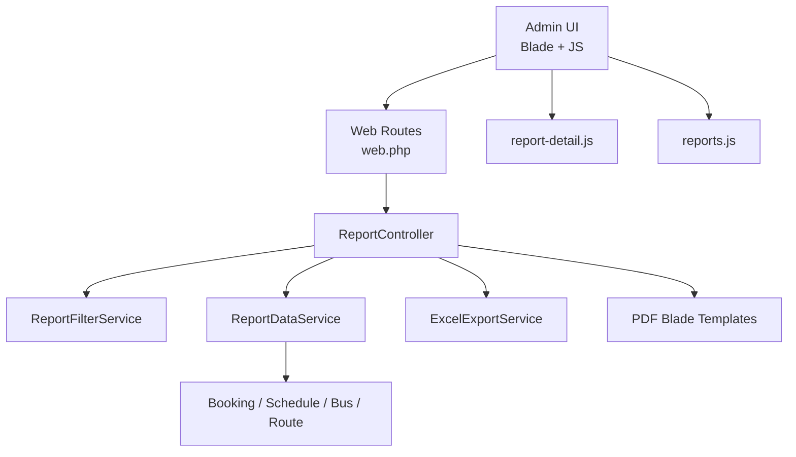
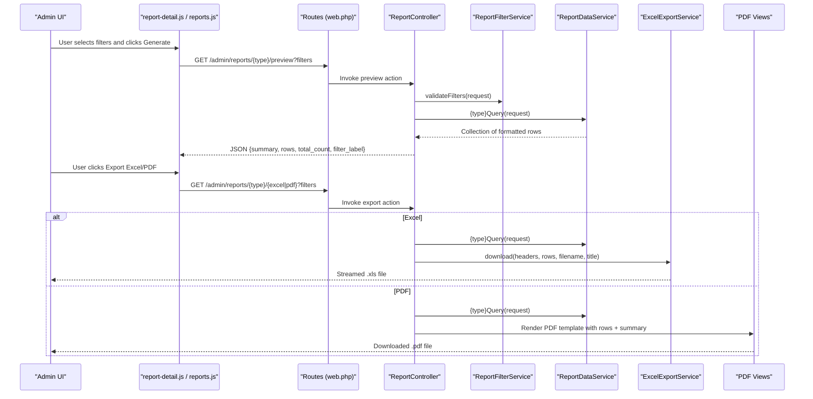
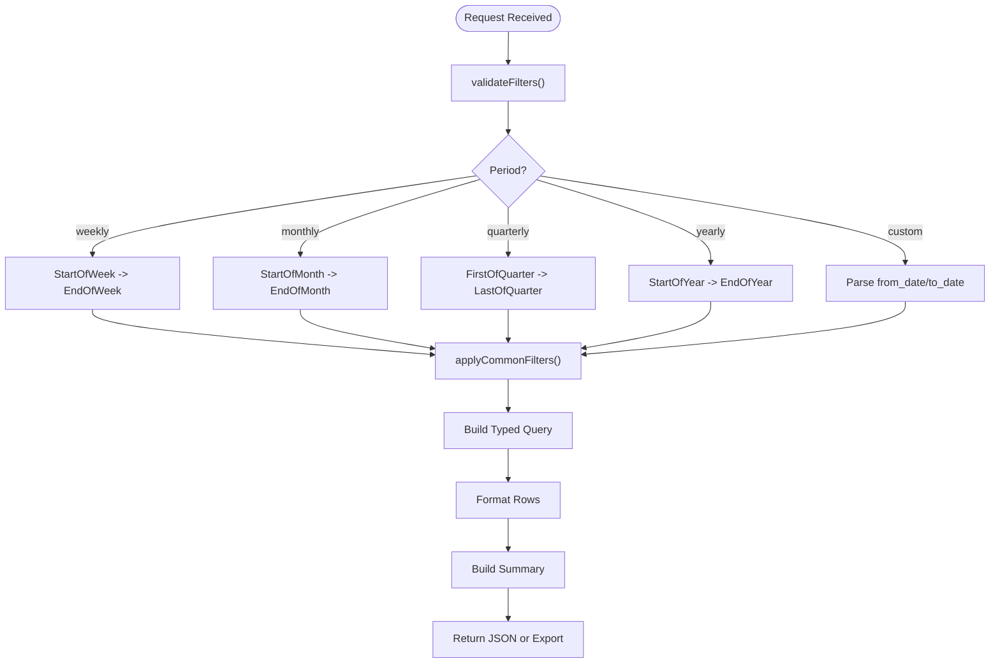
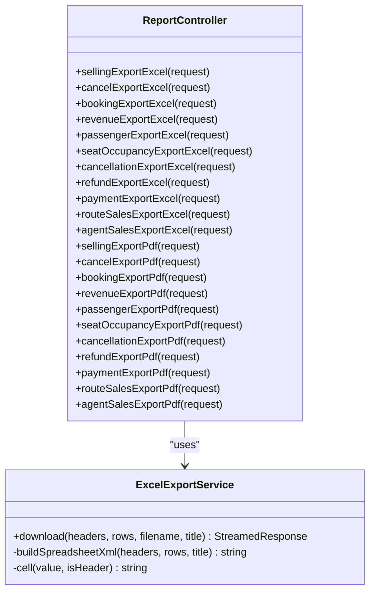
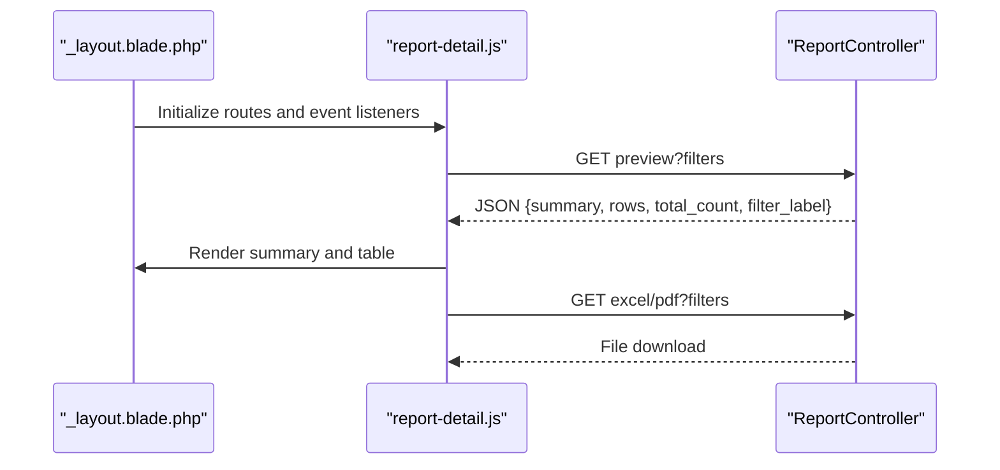
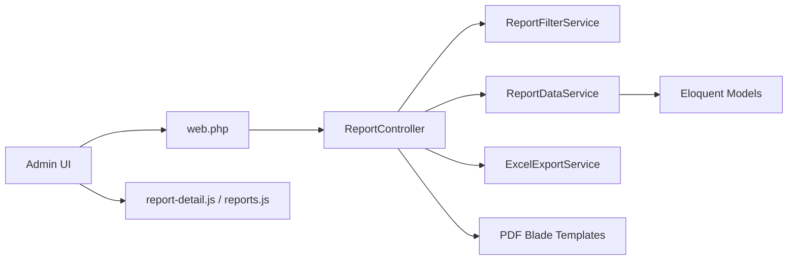

# Reporting & Analytics

<cite>
**Referenced Files in This Document**
- [ReportController.php](file://backend/app/Http/Controllers/Admin/ReportController.php)
- [ReportDataService.php](file://backend/app/Services/ReportDataService.php)
- [ReportFilterService.php](file://backend/app/Services/ReportFilterService.php)
- [ExcelExportService.php](file://backend/app/Services/ExcelExportService.php)
- [_layout.blade.php](file://backend/resources/views/admin/reports/pages/_layout.blade.php)
- [report-filters.blade.php](file://backend/resources/views/admin/partials/report-filters.blade.php)
- [revenue.blade.php](file://backend/resources/views/admin/reports/pdf/revenue.blade.php)
- [booking.blade.php](file://backend/resources/views/admin/reports/pdf/booking.blade.php)
- [passenger.blade.php](file://backend/resources/views/admin/reports/pdf/passenger.blade.php)
- [report-detail.js](file://backend/resources/js/admin/report-detail.js)
- [reports.js](file://backend/resources/js/admin/reports.js)
- [web.php](file://backend/routes/web.php)
</cite>

## Table of Contents
1. [Introduction](#introduction)
2. [Project Structure](#project-structure)
3. [Core Components](#core-components)
4. [Architecture Overview](#architecture-overview)
5. [Detailed Component Analysis](#detailed-component-analysis)
6. [Dependency Analysis](#dependency-analysis)
7. [Performance Considerations](#performance-considerations)
8. [Troubleshooting Guide](#troubleshooting-guide)
9. [Conclusion](#conclusion)

## Introduction
This document explains the comprehensive reporting and analytics system for the bus booking application. It covers 11 report types, the service layer that aggregates and processes business metrics, filtering by date ranges, routes, stations, operators, and payment methods, PDF and Excel export functionality, and performance considerations for large datasets. It also documents customization options and advanced analytical queries available through the data service.

## Project Structure
The reporting feature is implemented as a cohesive set of controllers, services, views, and client scripts:
- Controller exposes endpoints for previewing reports and exporting to PDF or Excel.
- Service layer encapsulates query building, row formatting, summary aggregation, and export mapping.
- Filter service validates inputs and resolves date ranges and filter labels.
- Views provide UI for filters, summaries, tables, and PDF templates.
- Client scripts handle AJAX previews and trigger exports.

**Diagram sources**
- [web.php](file://backend/routes/web.php)
- [ReportController.php](file://backend/app/Http/Controllers/Admin/ReportController.php)
- [ReportFilterService.php](file://backend/app/Services/ReportFilterService.php)
- [ReportDataService.php](file://backend/app/Services/ReportDataService.php)
- [ExcelExportService.php](file://backend/app/Services/ExcelExportService.php)
- [report-detail.js](file://backend/resources/js/admin/report-detail.js)
- [reports.js](file://backend/resources/js/admin/reports.js)

**Section sources**
- [ReportController.php](file://backend/app/Http/Controllers/Admin/ReportController.php)
- [ReportDataService.php](file://backend/app/Services/ReportDataService.php)
- [ReportFilterService.php](file://backend/app/Services/ReportFilterService.php)
- [ExcelExportService.php](file://backend/app/Services/ExcelExportService.php)
- [_layout.blade.php](file://backend/resources/views/admin/reports/pages/_layout.blade.php)
- [report-filters.blade.php](file://backend/resources/views/admin/partials/report-filters.blade.php)
- [report-detail.js](file://backend/resources/js/admin/report-detail.js)
- [reports.js](file://backend/resources/js/admin/reports.js)
- [web.php](file://backend/routes/web.php)

## Core Components
- ReportController: Orchestrates report requests, delegates filtering and data processing, and returns JSON previews or triggers exports.
- ReportDataService: Builds typed queries, formats rows, computes summaries, and maps rows to export arrays.
- ReportFilterService: Validates request parameters, resolves period-based date ranges, and generates human-readable filter summaries.
- ExcelExportService: Streams an XML-based spreadsheet file for download.
- Views: Shared layout and per-report PDF templates render summaries and tabular data.
- Client Scripts: Handle user interactions, fetch previews via AJAX, and initiate downloads.

Key responsibilities:
- Filtering: Period presets (weekly, monthly, quarterly, yearly), custom date range, coach type, payment method, route, operator.
- Aggregation: Per-report summaries including totals, AC vs non-AC splits, payment breakdowns, occupancy percentages, route/operator aggregations.
- Export: Excel (.xls) streaming and PDF generation with consistent headers and summaries.

**Section sources**
- [ReportController.php](file://backend/app/Http/Controllers/Admin/ReportController.php)
- [ReportDataService.php](file://backend/app/Services/ReportDataService.php)
- [ReportFilterService.php](file://backend/app/Services/ReportFilterService.php)
- [ExcelExportService.php](file://backend/app/Services/ExcelExportService.php)
- [_layout.blade.php](file://backend/resources/views/admin/reports/pages/_layout.blade.php)
- [report-filters.blade.php](file://backend/resources/views/admin/partials/report-filters.blade.php)

## Architecture Overview
The reporting architecture follows a layered approach:
- Presentation: Blade layouts and PDF templates present data; JS handles interactivity.
- Routing: Web routes map URLs to controller actions.
- Controller: Validates input, calls services, and returns responses.
- Services: Encapsulate domain logic for filtering, querying, formatting, and summarizing.
- Persistence: Eloquent models represent bookings, schedules, buses, routes, and stations.

**Diagram sources**
- [web.php](file://backend/routes/web.php)
- [ReportController.php](file://backend/app/Http/Controllers/Admin/ReportController.php)
- [ReportFilterService.php](file://backend/app/Services/ReportFilterService.php)
- [ReportDataService.php](file://backend/app/Services/ReportDataService.php)
- [ExcelExportService.php](file://backend/app/Services/ExcelExportService.php)
- [report-detail.js](file://backend/resources/js/admin/report-detail.js)
- [reports.js](file://backend/resources/js/admin/reports.js)

## Detailed Component Analysis

### Report Types and Capabilities
The system supports 11 report types:
- Selling: Ticket sales with passenger, route, operator, coach, seats, fare, and payment details.
- Booking: All active bookings (PAID, SOLD, BOOKED) with status.
- Revenue: Total revenue from paid bookings with AC/non-AC split and payment breakdown.
- Passenger: Passenger travel history including boarding/dropping points and gender.
- Seat Occupancy: Per-schedule occupancy rate based on booked seats vs total seats.
- Cancellation: Cancelled bookings with fare and seat release info.
- Cancel: Alias for cancellation with same data model.
- Refund: Eligible refunds for online payments (bKash, Nagad, Card).
- Payment: Payment method breakdown with transaction amounts and invoice IDs.
- Route Sales: Aggregated sales per route with AC/non-AC counts.
- Agent Sales: Aggregated sales per operator/agent with routes covered.

Each report provides:
- Preview endpoint returning JSON with summary, rows, and total count.
- Excel export with headers and appended summary rows.
- PDF export with styled templates and generated timestamp.

**Section sources**
- [ReportController.php](file://backend/app/Http/Controllers/Admin/ReportController.php)
- [ReportDataService.php](file://backend/app/Services/ReportDataService.php)

### Filtering System
The filter service validates and normalizes inputs:
- Supported filters: period (weekly/monthly/quarterly/yearly/custom), from_date/to_date, coach_type, payment_method, route_id, operator.
- Date resolution: Computes start/end timestamps based on period or custom dates.
- Filter summary: Produces a human-readable string combining period and selected filters.

Common filters applied across booking-based reports:
- Coach type filter joins to bus table.
- Payment method filter applies directly to bookings.
- Route filter joins to schedule and route.
- Operator filter joins to bus.

Seat occupancy uses schedule-centric filters and calculates occupancy percentage per schedule.

**Diagram sources**
- [ReportFilterService.php](file://backend/app/Services/ReportFilterService.php)
- [ReportDataService.php](file://backend/app/Services/ReportDataService.php)

**Section sources**
- [ReportFilterService.php](file://backend/app/Services/ReportFilterService.php)
- [ReportDataService.php](file://backend/app/Services/ReportDataService.php)

### Data Service Layer
ReportDataService centralizes:
- Query builders for each report type with appropriate status filters and date ranges.
- Row formatters that enrich raw records with readable fields (PNR, route names, departure times, seat counts).
- Summary builders that compute totals, AC/non-AC splits, payment method breakdowns, and occupancy metrics.
- Export mappers that convert formatted rows into flat arrays for Excel.

Examples of key behaviors:
- Building common filters via whereHas relationships for coach type, route, and operator.
- Grouping bookings by route or operator for aggregated reports.
- Computing average occupancy percentage across schedules.

**Section sources**
- [ReportDataService.php](file://backend/app/Services/ReportDataService.php)

### Export Functionality
- Excel: ExcelExportService streams an XML-based spreadsheet with typed cells and headers. Reports append summary rows after data rows.
- PDF: Each report has a dedicated Blade template rendering summary tables and data rows with consistent styling.

**Diagram sources**
- [ExcelExportService.php](file://backend/app/Services/ExcelExportService.php)
- [ReportController.php](file://backend/app/Http/Controllers/Admin/ReportController.php)

**Section sources**
- [ExcelExportService.php](file://backend/app/Services/ExcelExportService.php)
- [ReportController.php](file://backend/app/Http/Controllers/Admin/ReportController.php)
- [revenue.blade.php](file://backend/resources/views/admin/reports/pdf/revenue.blade.php)
- [booking.blade.php](file://backend/resources/views/admin/reports/pdf/booking.blade.php)
- [passenger.blade.php](file://backend/resources/views/admin/reports/pdf/passenger.blade.php)

### UI and Interaction Flow
- The shared layout renders filter controls (period, coach type, payment method, route, operator), custom date inputs, generate/export buttons, summary cards, and a data table.
- Client script wires events to generate previews and trigger exports.
- Partial filters component mirrors the same controls for embedded report pages.

**Diagram sources**
- [_layout.blade.php](file://backend/resources/views/admin/reports/pages/_layout.blade.php)
- [report-detail.js](file://backend/resources/js/admin/report-detail.js)
- [ReportController.php](file://backend/app/Http/Controllers/Admin/ReportController.php)

**Section sources**
- [_layout.blade.php](file://backend/resources/views/admin/reports/pages/_layout.blade.php)
- [report-filters.blade.php](file://backend/resources/views/admin/partials/report-filters.blade.php)
- [report-detail.js](file://backend/resources/js/admin/report-detail.js)
- [reports.js](file://backend/resources/js/admin/reports.js)

### Advanced Analytical Queries
- Route-wise sales: Groups bookings by route name and aggregates total bookings, seats, revenue, and AC/non-AC counts.
- Agent/operator sales: Groups by operator, lists unique routes covered, and aggregates metrics.
- Seat occupancy: Calculates booked seats per schedule and derives occupancy percentage.
- Payment analysis: Breaks down transactions by payment method with counts and amounts.

These aggregations are performed in-memory using collections after retrieving base datasets.

**Section sources**
- [ReportDataService.php](file://backend/app/Services/ReportDataService.php)

## Dependency Analysis
The reporting subsystem depends on:
- Controllers depending on services for validation, data processing, and export.
- Services depending on Eloquent models for database access.
- Views depending on controller-provided variables and helper functions.
- Client scripts depending on route helpers and AJAX endpoints.

**Diagram sources**
- [web.php](file://backend/routes/web.php)
- [ReportController.php](file://backend/app/Http/Controllers/Admin/ReportController.php)
- [ReportFilterService.php](file://backend/app/Services/ReportFilterService.php)
- [ReportDataService.php](file://backend/app/Services/ReportDataService.php)
- [ExcelExportService.php](file://backend/app/Services/ExcelExportService.php)
- [report-detail.js](file://backend/resources/js/admin/report-detail.js)
- [reports.js](file://backend/resources/js/admin/reports.js)

**Section sources**
- [web.php](file://backend/routes/web.php)
- [ReportController.php](file://backend/app/Http/Controllers/Admin/ReportController.php)
- [ReportDataService.php](file://backend/app/Services/ReportDataService.php)

## Performance Considerations
- Limit preview results: Preview endpoints cap dataset size (e.g., limit(500) or limit(200)) to keep UI responsive.
- Efficient relationship loading: Use eager loading for schedule, bus, route, and station associations to reduce N+1 queries.
- In-memory aggregation: Aggregations like route/operator grouping are done on collections; consider database-level grouping for very large datasets.
- Streaming Excel export: Uses streamed response to avoid loading entire files into memory.
- PDF rendering: Keep templates minimal and avoid heavy computations during rendering.

Recommendations for optimization:
- Add database indexes on frequently filtered columns (created_at, updated_at, status, payment_method, route_id, operator_name).
- Pre-aggregate periodic rollups (daily/hourly) for time-series reports if needed.
- Cache static lookup data (routes, operators) used in filter dropdowns.
- Paginate large exports or offer scheduled background jobs for heavy reports.

[No sources needed since this section provides general guidance]

## Troubleshooting Guide
Common issues and resolutions:
- Custom date validation errors: Ensure both from_date and to_date are provided when period=custom; the filter service enforces date_format and ordering.
- Empty results: Verify filters (coach_type, payment_method, route_id, operator) match existing data; check period selection.
- Slow previews: Reduce date range or refine filters; consider adding indexes on date and status columns.
- Export failures: Confirm storage permissions for temporary files and ensure PHP extensions required by PDF generation are installed.
- UI not enabling export buttons: Ensure preview succeeded; the client script enables export buttons only after successful data load.

**Section sources**
- [ReportFilterService.php](file://backend/app/Services/ReportFilterService.php)
- [report-detail.js](file://backend/resources/js/admin/report-detail.js)
- [reports.js](file://backend/resources/js/admin/reports.js)

## Conclusion
The reporting and analytics system provides a robust, extensible framework for generating 11 distinct reports with consistent filtering, rich summaries, and multiple export formats. Its layered architecture separates concerns between routing, controller orchestration, service logic, and presentation, making it maintainable and scalable. With careful indexing and optional pre-aggregation, the system can handle large datasets efficiently while offering powerful analytical capabilities for operational insights.

[No sources needed since this section summarizes without analyzing specific files]