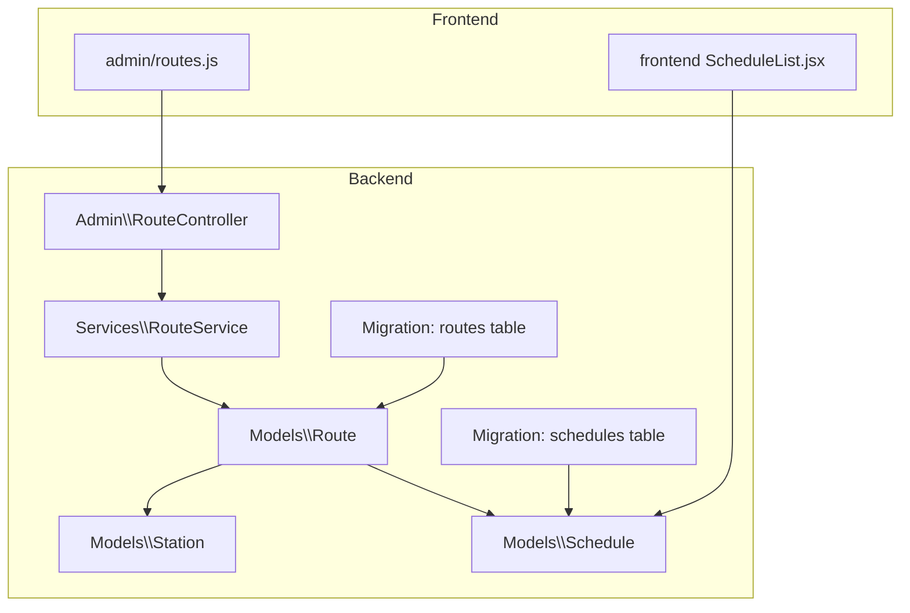
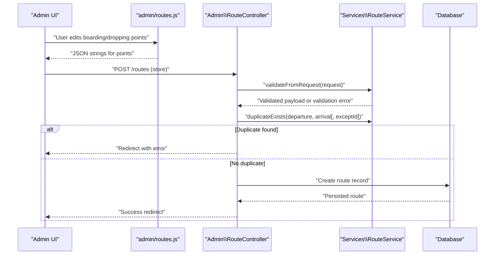
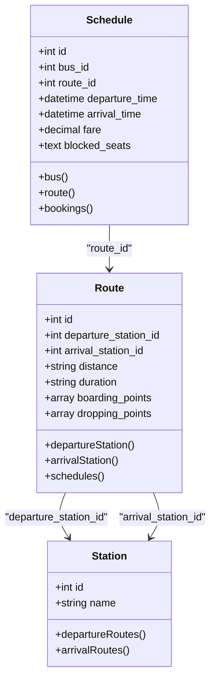
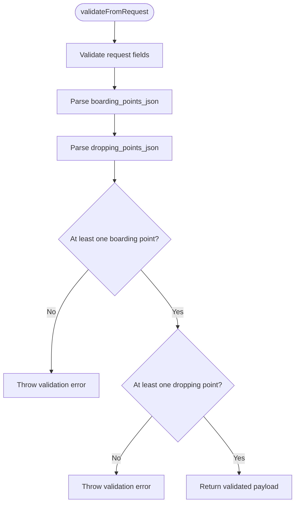
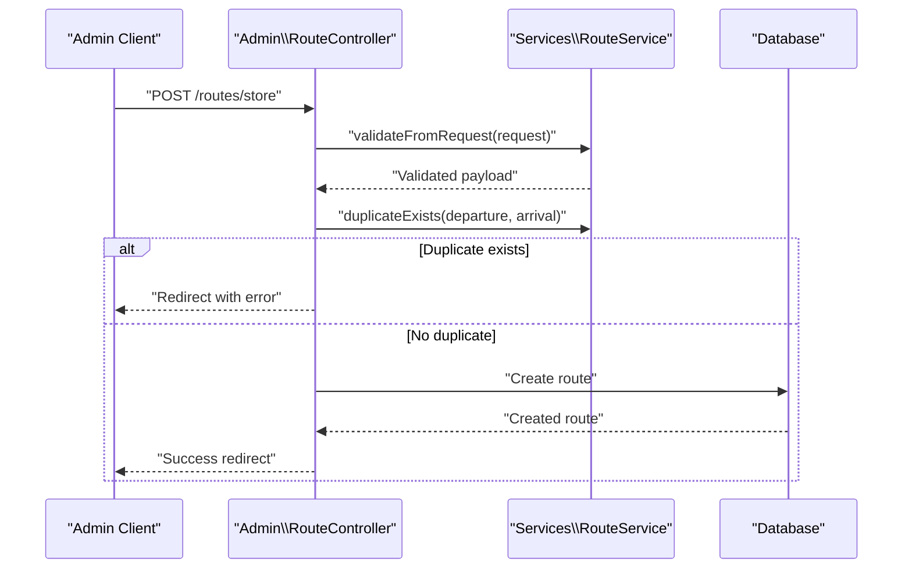
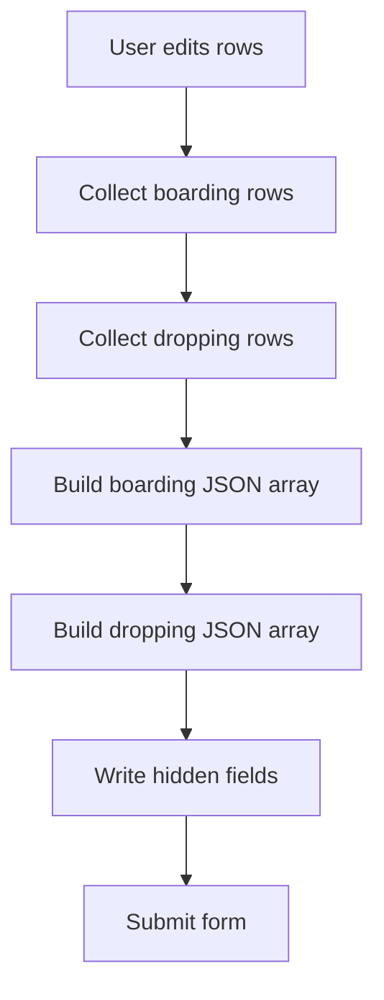
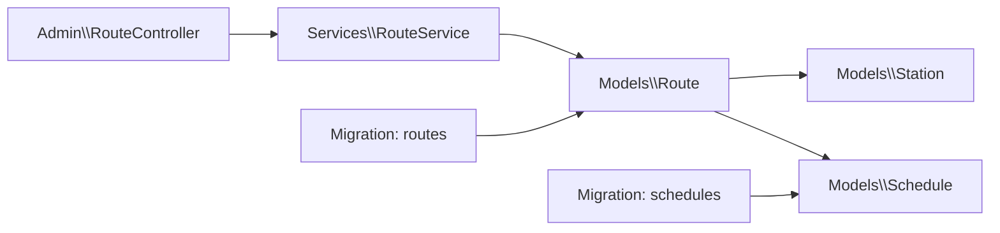

# Route Planning & Management

<cite>
**Referenced Files in This Document**
- [Route.php](file://backend/app/Models/Route.php)
- [Station.php](file://backend/app/Models/Station.php)
- [Schedule.php](file://backend/app/Models/Schedule.php)
- [RouteService.php](file://backend/app/Services/RouteService.php)
- [RouteController.php](file://backend/app/Http/Controllers/Admin/RouteController.php)
- [2026_06_01_000030_create_routes_table.php](file://backend/database/migrations/2026_06_01_000030_create_routes_table.php)
- [2026_06_01_000040_create_schedules_table.php](file://backend/database/migrations/2026_06_01_000040_create_schedules_table.php)
- [routes.js](file://backend/resources/js/admin/routes.js)
- [ScheduleList.jsx](file://frontend/src/components/ScheduleList.jsx)
</cite>

## Table of Contents
1. [Introduction](#introduction)
2. [Project Structure](#project-structure)
3. [Core Components](#core-components)
4. [Architecture Overview](#architecture-overview)
5. [Detailed Component Analysis](#detailed-component-analysis)
6. [Dependency Analysis](#dependency-analysis)
7. [Performance Considerations](#performance-considerations)
8. [Troubleshooting Guide](#troubleshooting-guide)
9. [Conclusion](#conclusion)

## Introduction
This document explains the route planning and management system for the bus application. It covers how routes are created, how station sequencing is represented through boarding and dropping points, and how distance and duration are stored and displayed. It also documents the service layer responsible for validating route data, preventing duplicate connections, and preparing structured point sequences for persistence. Finally, it clarifies the relationships between routes, stations, and schedules, and outlines current validation rules and limitations around circular routing, conflict resolution, optimization, travel time estimation, and cost calculation per segment.

## Project Structure
The route planning domain spans models, a service layer, an admin controller, database migrations, frontend serialization logic, and a customer-facing schedule list component.

**Diagram sources**
- [RouteController.php:15-51](file://backend/app/Http/Controllers/Admin/RouteController.php#L15-L51)
- [RouteService.php:14-100](file://backend/app/Services/RouteService.php#L14-L100)
- [Route.php:12-39](file://backend/app/Models/Route.php#L12-L39)
- [Station.php:12-22](file://backend/app/Models/Station.php#L12-L22)
- [Schedule.php:12-33](file://backend/app/Models/Schedule.php#L12-L33)
- [2026_06_01_000030_create_routes_table.php:14-28](file://backend/database/migrations/2026_06_01_000030_create_routes_table.php#L14-L28)
- [2026_06_01_000040_create_schedules_table.php:14-30](file://backend/database/migrations/2026_06_01_000040_create_schedules_table.php#L14-L30)
- [routes.js:104-128](file://backend/resources/js/admin/routes.js#L104-L128)
- [ScheduleList.jsx:118-144](file://frontend/src/components/ScheduleList.jsx#L118-L144)

**Section sources**
- [RouteController.php:15-51](file://backend/app/Http/Controllers/Admin/RouteController.php#L15-L51)
- [RouteService.php:14-100](file://backend/app/Services/RouteService.php#L14-L100)
- [Route.php:12-39](file://backend/app/Models/Route.php#L12-L39)
- [Station.php:12-22](file://backend/app/Models/Station.php#L12-L22)
- [Schedule.php:12-33](file://backend/app/Models/Schedule.php#L12-L33)
- [2026_06_01_000030_create_routes_table.php:14-28](file://backend/database/migrations/2026_06_01_000030_create_routes_table.php#L14-L28)
- [2026_06_01_000040_create_schedules_table.php:14-30](file://backend/database/migrations/2026_06_01_000040_create_schedules_table.php#L14-L30)
- [routes.js:104-128](file://backend/resources/js/admin/routes.js#L104-L128)
- [ScheduleList.jsx:118-144](file://frontend/src/components/ScheduleList.jsx#L118-L144)

## Core Components
- Route model: Represents a transport line between two stations with optional distance, duration, and ordered boarding/dropping points.
- Station model: Represents a location with outbound and inbound route relationships.
- Schedule model: Represents a specific run of a bus on a route with departure/arrival times, fare, and blocked seats.
- RouteService: Validates incoming route data, parses JSON-based boarding/dropping points, and checks for duplicate route connections.
- Admin RouteController: Exposes create/update/delete operations for routes, delegating validation and duplication checks to RouteService.
- Database schema: Defines routes and schedules tables with appropriate foreign keys and indexes.
- Frontend serialization: Converts user-entered boarding and dropping points into JSON for server-side processing.
- Customer display: Shows schedule details including route duration and distance.

**Section sources**
- [Route.php:12-39](file://backend/app/Models/Route.php#L12-L39)
- [Station.php:12-22](file://backend/app/Models/Station.php#L12-L22)
- [Schedule.php:12-33](file://backend/app/Models/Schedule.php#L12-L33)
- [RouteService.php:14-100](file://backend/app/Services/RouteService.php#L14-L100)
- [RouteController.php:15-51](file://backend/app/Http/Controllers/Admin/RouteController.php#L15-L51)
- [2026_06_01_000030_create_routes_table.php:14-28](file://backend/database/migrations/2026_06_01_000030_create_routes_table.php#L14-L28)
- [2026_06_01_000040_create_schedules_table.php:14-30](file://backend/database/migrations/2026_06_01_000040_create_schedules_table.php#L14-L30)
- [routes.js:104-128](file://backend/resources/js/admin/routes.js#L104-L128)
- [ScheduleList.jsx:118-144](file://frontend/src/components/ScheduleList.jsx#L118-L144)

## Architecture Overview
The route creation flow starts in the admin interface, serializes boarding and dropping points as JSON, and sends them to the backend. The controller delegates validation to the service, which enforces required fields, ensures at least one boarding and one dropping point, and prevents duplicate route connections. Validated data is persisted to the routes table. Schedules reference routes and buses, enabling customer-facing search and display of available trips.

**Diagram sources**
- [routes.js:104-128](file://backend/resources/js/admin/routes.js#L104-L128)
- [RouteController.php:15-51](file://backend/app/Http/Controllers/Admin/RouteController.php#L15-L51)
- [RouteService.php:14-100](file://backend/app/Services/RouteService.php#L14-L100)
- [2026_06_01_000030_create_routes_table.php:14-28](file://backend/database/migrations/2026_06_01_000030_create_routes_table.php#L14-L28)

## Detailed Component Analysis

### Route Model
The Route model defines the core entity for a transport line. It stores:
- Departure and arrival station references
- Distance and duration as human-readable strings
- Boarding and dropping points as arrays

It provides relationships to Station (departure and arrival) and to Schedule (one-to-many).

**Diagram sources**
- [Route.php:12-39](file://backend/app/Models/Route.php#L12-L39)
- [Station.php:12-22](file://backend/app/Models/Station.php#L12-L22)
- [Schedule.php:12-33](file://backend/app/Models/Schedule.php#L12-L33)

**Section sources**
- [Route.php:12-39](file://backend/app/Models/Route.php#L12-L39)
- [Station.php:12-22](file://backend/app/Models/Station.php#L12-L22)
- [Schedule.php:12-33](file://backend/app/Models/Schedule.php#L12-L33)

### Route Service Layer
The RouteService centralizes validation and duplication checks for routes.

Key responsibilities:
- Request validation for station IDs, distance, duration, and JSON-encoded boarding/dropping points.
- Parsing and cleaning boarding/dropping point arrays, ensuring each point has a name.
- Enforcing that at least one boarding and one dropping point exist.
- Detecting duplicate route connections between the same departure and arrival stations.

**Diagram sources**
- [RouteService.php:14-64](file://backend/app/Services/RouteService.php#L14-L64)
- [RouteService.php:78-100](file://backend/app/Services/RouteService.php#L78-L100)

**Section sources**
- [RouteService.php:14-100](file://backend/app/Services/RouteService.php#L14-L100)

### Admin Route Controller
The controller exposes CRUD endpoints for routes:
- Store: validates input, checks for duplicates, creates a new route.
- Update: validates input, checks for duplicates excluding the current route, updates the route.
- Destroy: deletes a route by ID.

**Diagram sources**
- [RouteController.php:15-51](file://backend/app/Http/Controllers/Admin/RouteController.php#L15-L51)
- [RouteService.php:66-76](file://backend/app/Services/RouteService.php#L66-L76)

**Section sources**
- [RouteController.php:15-51](file://backend/app/Http/Controllers/Admin/RouteController.php#L15-L51)

### Database Schema and Indexes
- Routes table:
  - Columns: id, departure_station_id, arrival_station_id, distance, duration, boarding_points (JSON), dropping_points (JSON), timestamps.
  - Indexes: departure_station_id, arrival_station_id, composite index on (departure_station_id, arrival_station_id).
- Schedules table:
  - Columns: id, bus_id, route_id, departure_time, arrival_time, fare, blocked_seats, timestamps.
  - Indexes: bus_id, route_id, departure_time, composite indexes on (route_id, departure_time) and (bus_id, departure_time).

These indexes support efficient lookups for route queries and schedule searches.

**Section sources**
- [2026_06_01_000030_create_routes_table.php:14-28](file://backend/database/migrations/2026_06_01_000030_create_routes_table.php#L14-L28)
- [2026_06_01_000040_create_schedules_table.php:14-30](file://backend/database/migrations/2026_06_01_000040_create_schedules_table.php#L14-L30)

### Frontend Point Serialization
The admin JavaScript serializes user-entered boarding and dropping points into JSON structures before submission. Each boarding point includes a name and optional reporting/departure times; each dropping point includes a name and optional arrival time.

**Diagram sources**
- [routes.js:104-128](file://backend/resources/js/admin/routes.js#L104-L128)

**Section sources**
- [routes.js:104-128](file://backend/resources/js/admin/routes.js#L104-L128)

### Customer Display of Route Attributes
The customer-facing schedule list displays schedule details, including route duration and distance. These values come from the associated route’s stored attributes.

**Section sources**
- [ScheduleList.jsx:118-144](file://frontend/src/components/ScheduleList.jsx#L118-L144)

## Dependency Analysis
The following diagram shows key dependencies among controllers, services, models, and database schemas.

**Diagram sources**
- [RouteController.php:15-51](file://backend/app/Http/Controllers/Admin/RouteController.php#L15-L51)
- [RouteService.php:14-100](file://backend/app/Services/RouteService.php#L14-L100)
- [Route.php:12-39](file://backend/app/Models/Route.php#L12-L39)
- [Station.php:12-22](file://backend/app/Models/Station.php#L12-L22)
- [Schedule.php:12-33](file://backend/app/Models/Schedule.php#L12-L33)
- [2026_06_01_000030_create_routes_table.php:14-28](file://backend/database/migrations/2026_06_01_000030_create_routes_table.php#L14-L28)
- [2026_06_01_000040_create_schedules_table.php:14-30](file://backend/database/migrations/2026_06_01_000040_create_schedules_table.php#L14-L30)

**Section sources**
- [RouteController.php:15-51](file://backend/app/Http/Controllers/Admin/RouteController.php#L15-L51)
- [RouteService.php:14-100](file://backend/app/Services/RouteService.php#L14-L100)
- [Route.php:12-39](file://backend/app/Models/Route.php#L12-L39)
- [Station.php:12-22](file://backend/app/Models/Station.php#L12-L22)
- [Schedule.php:12-33](file://backend/app/Models/Schedule.php#L12-L33)
- [2026_06_01_000030_create_routes_table.php:14-28](file://backend/database/migrations/2026_06_01_000030_create_routes_table.php#L14-L28)
- [2026_06_01_000040_create_schedules_table.php:14-30](file://backend/database/migrations/2026_06_01_000040_create_schedules_table.php#L14-L30)

## Performance Considerations
- Index usage: Composite indexes on routes (departure_station_id, arrival_station_id) improve duplicate checks and route lookup performance.
- Schedule queries: Indexes on route_id, bus_id, and departure_time optimize common search patterns for available trips.
- JSON fields: Boarding and dropping points are stored as JSON; keep these arrays small to avoid large payloads and parsing overhead.
- Validation efficiency: RouteService performs lightweight validation and JSON parsing; consider caching frequent station pairs if needed.

[No sources needed since this section provides general guidance]

## Troubleshooting Guide
Common issues and resolutions:
- Missing boarding or dropping points:
  - Cause: Empty or invalid JSON arrays for boarding/dropping points.
  - Resolution: Ensure at least one boarding and one dropping point with a non-empty name.
- Duplicate route connection:
  - Cause: Attempting to create a route between the same departure and arrival stations where one already exists.
  - Resolution: Modify station pair or update existing route instead of creating a duplicate.
- Invalid station IDs:
  - Cause: Non-existent station IDs in request.
  - Resolution: Use valid station IDs from the stations table.
- Display anomalies:
  - Cause: Missing or malformed route duration/distance values.
  - Resolution: Populate distance and duration fields when configuring routes.

**Section sources**
- [RouteService.php:14-64](file://backend/app/Services/RouteService.php#L14-L64)
- [RouteController.php:15-51](file://backend/app/Http/Controllers/Admin/RouteController.php#L15-L51)

## Conclusion
The route planning and management system centers on a clear separation of concerns:
- Models define entities and relationships.
- The service layer enforces validation and duplication constraints.
- The controller orchestrates requests and persists data.
- Migrations provide robust indexing for performance.
- Frontend code serializes route points for accurate sequencing.

Current implementation does not include automatic geographic distance calculations, circular route detection, advanced route optimization algorithms, or per-segment cost computation. Distance and duration are stored as human-readable strings, and scheduling uses explicit departure/arrival times with fares. Future enhancements can introduce geospatial calculations, cycle detection, and optimization routines while preserving the existing validation and persistence contracts.

[No sources needed since this section summarizes without analyzing specific files]