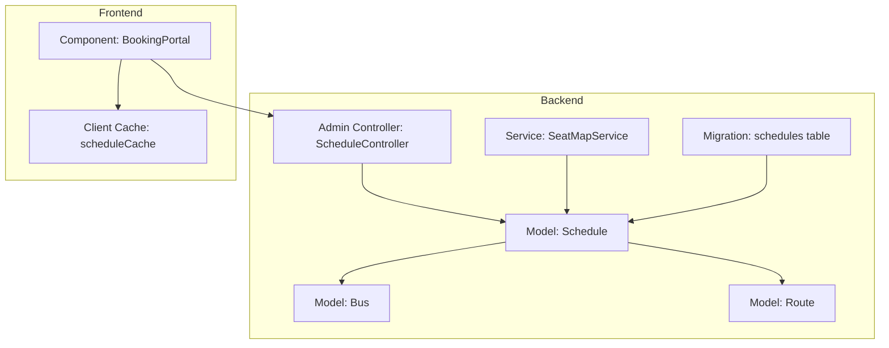
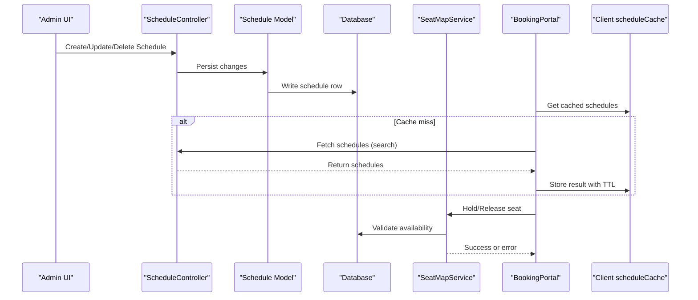
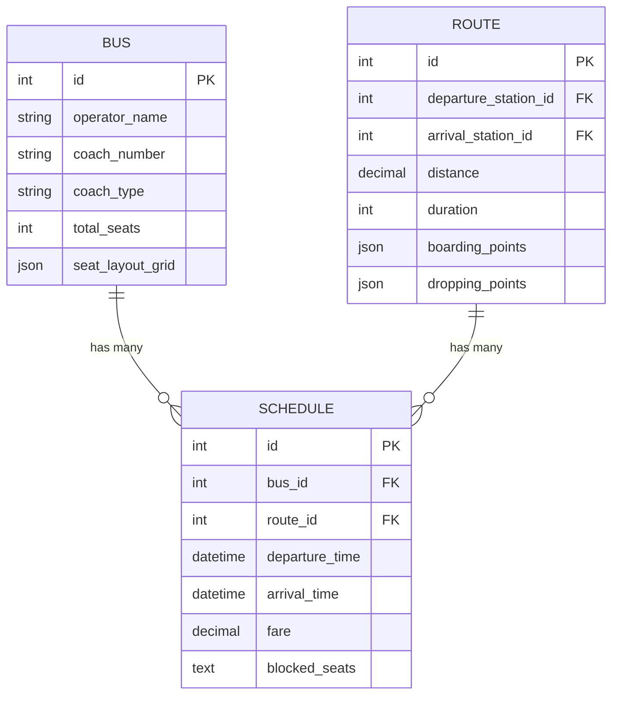
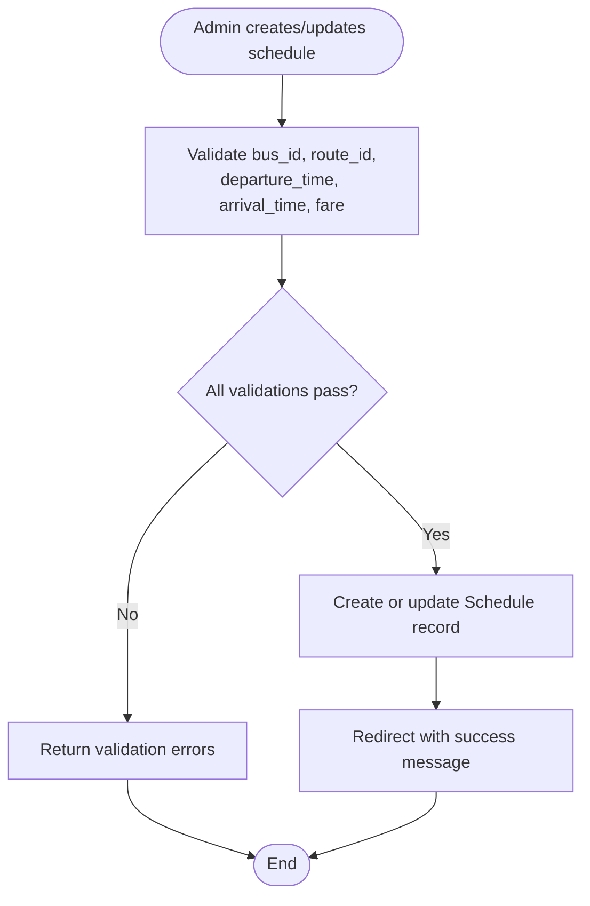
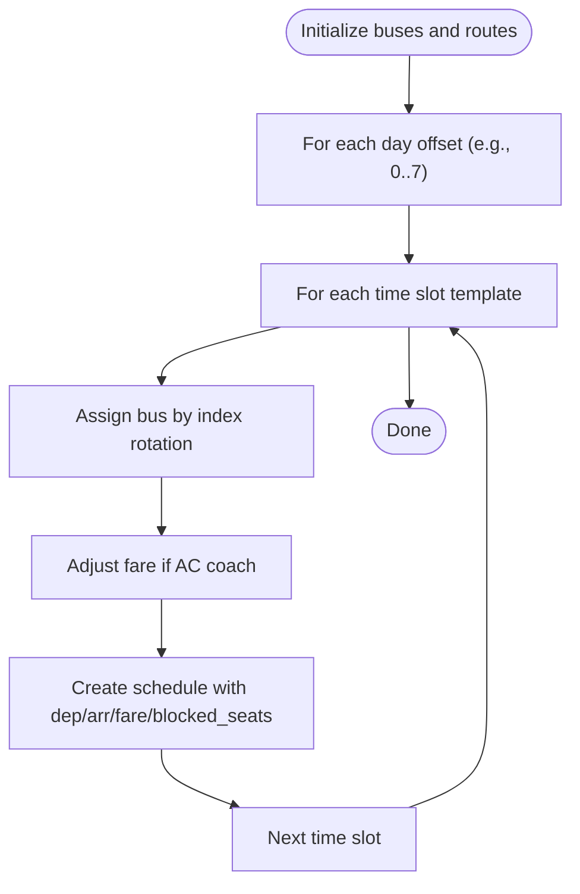
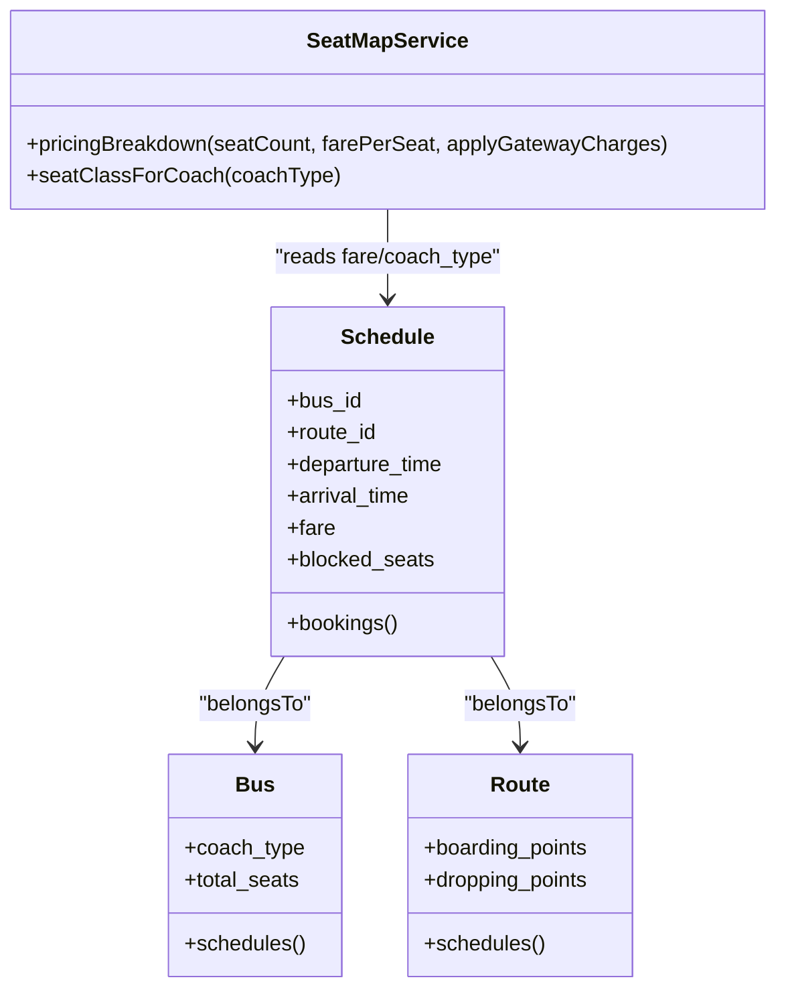
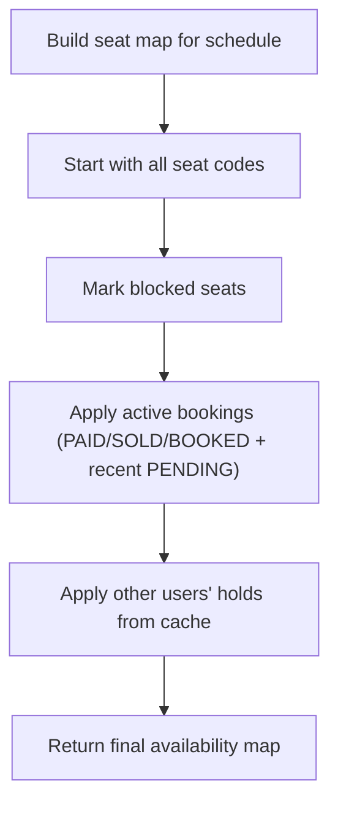
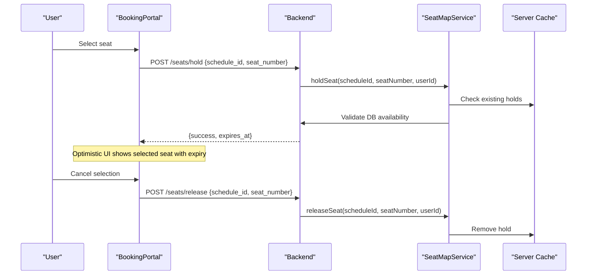
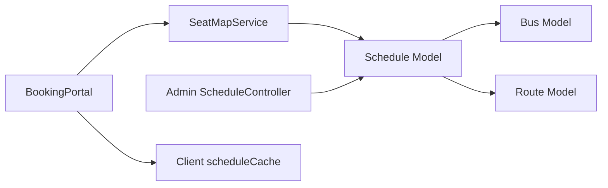

# Schedule & Timetable Management

<cite>
**Referenced Files in This Document**
- [Schedule.php](file://backend/app/Models/Schedule.php)
- [Bus.php](file://backend/app/Models/Bus.php)
- [Route.php](file://backend/app/Models/Route.php)
- [2026_06_01_000040_create_schedules_table.php](file://backend/database/migrations/2026_06_01_000040_create_schedules_table.php)
- [ScheduleController.php](file://backend/app/Http/Controllers/Admin/ScheduleController.php)
- [SeatMapService.php](file://backend/app/Services/SeatMapService.php)
- [ScheduleSeeder.php](file://backend/database/seeders/ScheduleSeeder.php)
- [BookingPortal.jsx](file://frontend/src/components/BookingPortal.jsx)
- [scheduleCache.js](file://frontend/src/scheduleCache.js)
</cite>

## Table of Contents
1. [Introduction](#introduction)
2. [Project Structure](#project-structure)
3. [Core Components](#core-components)
4. [Architecture Overview](#architecture-overview)
5. [Detailed Component Analysis](#detailed-component-analysis)
6. [Dependency Analysis](#dependency-analysis)
7. [Performance Considerations](#performance-considerations)
8. [Troubleshooting Guide](#troubleshooting-guide)
9. [Conclusion](#conclusion)

## Introduction
This document explains the schedule and timetable management system for the bus application. It covers how schedules are created, how time slots and fares are managed, and how the scheduling engine prevents conflicts and optimizes resource utilization. It also documents the relationships between schedules, buses, routes, and pricing; recurring schedule generation via seeders; seat blocking; real-time seat holds; and client-side caching for fast schedule lookups.

## Project Structure
The scheduling domain spans backend models, a migration defining the database schema, an admin controller for CRUD operations, a service that builds seat maps and enforces availability, a seeder that generates recurring schedules, and frontend components that cache search results and manage seat reservations.

**Diagram sources**
- [Schedule.php:8-33](file://backend/app/Models/Schedule.php#L8-L33)
- [Bus.php:8-21](file://backend/app/Models/Bus.php#L8-L21)
- [Route.php:8-39](file://backend/app/Models/Route.php#L8-L39)
- [ScheduleController.php:10-47](file://backend/app/Http/Controllers/Admin/ScheduleController.php#L10-L47)
- [SeatMapService.php:194-244](file://backend/app/Services/SeatMapService.php#L194-L244)
- [2026_06_01_000040_create_schedules_table.php:14-30](file://backend/database/migrations/2026_06_01_000040_create_schedules_table.php#L14-L30)
- [BookingPortal.jsx:209-269](file://frontend/src/components/BookingPortal.jsx#L209-L269)
- [scheduleCache.js:3-59](file://frontend/src/scheduleCache.js#L3-L59)

**Section sources**
- [Schedule.php:8-33](file://backend/app/Models/Schedule.php#L8-L33)
- [Bus.php:8-21](file://backend/app/Models/Bus.php#L8-L21)
- [Route.php:8-39](file://backend/app/Models/Route.php#L8-L39)
- [ScheduleController.php:10-47](file://backend/app/Http/Controllers/Admin/ScheduleController.php#L10-L47)
- [SeatMapService.php:194-244](file://backend/app/Services/SeatMapService.php#L194-L244)
- [2026_06_01_000040_create_schedules_table.php:14-30](file://backend/database/migrations/2026_06_01_000040_create_schedules_table.php#L14-L30)
- [BookingPortal.jsx:209-269](file://frontend/src/components/BookingPortal.jsx#L209-L269)
- [scheduleCache.js:3-59](file://frontend/src/scheduleCache.js#L3-L59)

## Core Components
- Schedule model: Represents a run with departure/arrival times, fare, and blocked seats. It links to a Bus and a Route and has many Bookings.
- Bus model: Describes vehicle attributes and capacity; exposes schedules relationship.
- Route model: Describes origin/destination stations and optional boarding/dropping points; exposes schedules relationship.
- Admin ScheduleController: Validates and persists schedule creation, updates, and deletions.
- SeatMapService: Builds seat availability maps, manages blocked seats, and implements seat hold/release logic using cache.
- Migration: Defines the schedules table schema and indexes.
- ScheduleSeeder: Generates recurring schedules across multiple days and routes.
- Frontend BookingPortal: Manages user seat selection, optimistic UI, and seat hold/release flows.
- Client scheduleCache: In-memory cache for search results with TTL-based expiration.

**Section sources**
- [Schedule.php:8-33](file://backend/app/Models/Schedule.php#L8-L33)
- [Bus.php:8-21](file://backend/app/Models/Bus.php#L8-L21)
- [Route.php:8-39](file://backend/app/Models/Route.php#L8-L39)
- [ScheduleController.php:10-47](file://backend/app/Http/Controllers/Admin/ScheduleController.php#L10-L47)
- [SeatMapService.php:194-244](file://backend/app/Services/SeatMapService.php#L194-L244)
- [2026_06_01_000040_create_schedules_table.php:14-30](file://backend/database/migrations/2026_06_01_000040_create_schedules_table.php#L14-L30)
- [ScheduleSeeder.php:13-63](file://backend/database/seeders/ScheduleSeeder.php#L13-L63)
- [BookingPortal.jsx:209-269](file://frontend/src/components/BookingPortal.jsx#L209-L269)
- [scheduleCache.js:3-59](file://frontend/src/scheduleCache.js#L3-L59)

## Architecture Overview
The scheduling architecture combines data persistence (models and migration), administrative controls (controller), operational logic (service), and client-side performance optimizations (cache). The booking flow integrates with seat availability and temporary holds to prevent double-booking.

**Diagram sources**
- [ScheduleController.php:10-47](file://backend/app/Http/Controllers/Admin/ScheduleController.php#L10-L47)
- [Schedule.php:8-33](file://backend/app/Models/Schedule.php#L8-L33)
- [SeatMapService.php:502-581](file://backend/app/Services/SeatMapService.php#L502-L581)
- [BookingPortal.jsx:209-269](file://frontend/src/components/BookingPortal.jsx#L209-L269)
- [scheduleCache.js:3-59](file://frontend/src/scheduleCache.js#L3-L59)

## Detailed Component Analysis

### Data Model and Schema
- Schedule fields include bus_id, route_id, departure_time, arrival_time, fare, and blocked_seats. Times are cast to datetime; fare is decimal.
- The schedules table includes foreign keys to buses and routes, plus indexes on bus_id, route_id, departure_time, and composite indexes for common queries.

**Diagram sources**
- [Schedule.php:8-33](file://backend/app/Models/Schedule.php#L8-L33)
- [Bus.php:8-21](file://backend/app/Models/Bus.php#L8-L21)
- [Route.php:8-39](file://backend/app/Models/Route.php#L8-L39)
- [2026_06_01_000040_create_schedules_table.php:14-30](file://backend/database/migrations/2026_06_01_000040_create_schedules_table.php#L14-L30)

**Section sources**
- [Schedule.php:8-33](file://backend/app/Models/Schedule.php#L8-L33)
- [2026_06_01_000040_create_schedules_table.php:14-30](file://backend/database/migrations/2026_06_01_000040_create_schedules_table.php#L14-L30)

### Schedule Creation and Time Slot Management
- Admin controller validates inputs: bus and route must exist; departure must be today or later; arrival must be after departure; fare must be non-negative.
- Creation stores only required fields; update mirrors validation and persists changes; delete removes the schedule.

**Diagram sources**
- [ScheduleController.php:10-47](file://backend/app/Http/Controllers/Admin/ScheduleController.php#L10-L47)

**Section sources**
- [ScheduleController.php:10-47](file://backend/app/Http/Controllers/Admin/ScheduleController.php#L10-L47)

### Frequency Configuration and Recurring Templates
- The seeder generates schedules for each route across multiple days, rotating buses and applying fare adjustments for AC coaches. It also sets example blocked seats for demonstration.

**Diagram sources**
- [ScheduleSeeder.php:13-63](file://backend/database/seeders/ScheduleSeeder.php#L13-L63)

**Section sources**
- [ScheduleSeeder.php:13-63](file://backend/database/seeders/ScheduleSeeder.php#L13-L63)

### Pricing and Relationship to Buses, Routes, and Bookings
- Each schedule carries a per-run fare and belongs to a specific bus and route.
- The seat map service computes pricing breakdowns based on configured charges and discounts, and returns seat class derived from coach type.

**Diagram sources**
- [Schedule.php:8-33](file://backend/app/Models/Schedule.php#L8-L33)
- [Bus.php:8-21](file://backend/app/Models/Bus.php#L8-L21)
- [Route.php:8-39](file://backend/app/Models/Route.php#L8-L39)
- [SeatMapService.php:334-365](file://backend/app/Services/SeatMapService.php#L334-L365)

**Section sources**
- [Schedule.php:8-33](file://backend/app/Models/Schedule.php#L8-L33)
- [SeatMapService.php:334-365](file://backend/app/Services/SeatMapService.php#L334-L365)

### Conflict Prevention and Resource Utilization Engine
- Seat availability is computed by combining:
  - All valid seat codes for the bus layout.
  - Blocked seats stored on the schedule.
  - Active bookings (paid/sold/booked and recent pending within a short window).
  - Temporary holds held by other users in cache.
- Holds are implemented with a short expiry to reserve seats while users complete checkout, preventing race conditions.

**Diagram sources**
- [SeatMapService.php:194-244](file://backend/app/Services/SeatMapService.php#L194-L244)

**Section sources**
- [SeatMapService.php:194-244](file://backend/app/Services/SeatMapService.php#L194-L244)

### Real-Time Updates, Delay Notifications, and Automated Generation
- Real-time seat availability:
  - Frontend uses optimistic UI when selecting seats and calls hold/release endpoints.
  - Backend validates availability against DB and cache-based holds before granting a reservation.
- Delay notifications and automated schedule generation based on demand patterns are not present in the analyzed codebase. These features would require additional services, queues, and configuration beyond current implementation.

**Diagram sources**
- [BookingPortal.jsx:209-269](file://frontend/src/components/BookingPortal.jsx#L209-L269)
- [SeatMapService.php:502-581](file://backend/app/Services/SeatMapService.php#L502-L581)

**Section sources**
- [BookingPortal.jsx:209-269](file://frontend/src/components/BookingPortal.jsx#L209-L269)
- [SeatMapService.php:502-581](file://backend/app/Services/SeatMapService.php#L502-L581)

### Seasonal Adjustments and Special Holiday Scheduling
- No dedicated seasonal or holiday scheduling entities were found in the analyzed codebase. Operators can simulate these scenarios by:
  - Creating schedules with adjusted fares and dates via the admin controller.
  - Using the seeder pattern to generate special-day runs.
  - Blocking seats for maintenance or special events through the seat blocking feature.

[No sources needed since this section provides general guidance]

## Dependency Analysis
- Models:
  - Schedule depends on Bus and Route.
  - Bus and Route expose one-to-many relationships to Schedule.
- Services:
  - SeatMapService reads Schedule and related data to compute availability and pricing.
- Controllers:
  - Admin ScheduleController performs CRUD on Schedule with validation.
- Frontend:
  - BookingPortal interacts with backend endpoints for seat holds/releases and relies on client-side scheduleCache for search results.

**Diagram sources**
- [Schedule.php:8-33](file://backend/app/Models/Schedule.php#L8-L33)
- [Bus.php:8-21](file://backend/app/Models/Bus.php#L8-L21)
- [Route.php:8-39](file://backend/app/Models/Route.php#L8-L39)
- [SeatMapService.php:194-244](file://backend/app/Services/SeatMapService.php#L194-L244)
- [ScheduleController.php:10-47](file://backend/app/Http/Controllers/Admin/ScheduleController.php#L10-L47)
- [BookingPortal.jsx:209-269](file://frontend/src/components/BookingPortal.jsx#L209-L269)
- [scheduleCache.js:3-59](file://frontend/src/scheduleCache.js#L3-L59)

**Section sources**
- [Schedule.php:8-33](file://backend/app/Models/Schedule.php#L8-L33)
- [SeatMapService.php:194-244](file://backend/app/Services/SeatMapService.php#L194-L244)
- [ScheduleController.php:10-47](file://backend/app/Http/Controllers/Admin/ScheduleController.php#L10-L47)
- [BookingPortal.jsx:209-269](file://frontend/src/components/BookingPortal.jsx#L209-L269)
- [scheduleCache.js:3-59](file://frontend/src/scheduleCache.js#L3-L59)

## Performance Considerations
- Database indexing:
  - Indexes on bus_id, route_id, departure_time, and composite indexes improve query performance for schedule searches and assignments.
- Client-side caching:
  - scheduleCache stores search results keyed by origin, destination, date, and coach type with a default TTL to reduce repeated requests.
- Seat availability computation:
  - SeatMapService minimizes N+1 queries by selecting only necessary columns for paid bookings and uses cache for temporary holds to avoid heavy locking.

**Section sources**
- [2026_06_01_000040_create_schedules_table.php:24-30](file://backend/database/migrations/2026_06_01_000040_create_schedules_table.php#L24-L30)
- [scheduleCache.js:3-59](file://frontend/src/scheduleCache.js#L3-L59)
- [SeatMapService.php:194-244](file://backend/app/Services/SeatMapService.php#L194-L244)

## Troubleshooting Guide
- Validation errors during schedule creation/update:
  - Ensure bus_id and route_id exist.
  - Ensure departure_time is today or later and arrival_time is after departure_time.
  - Ensure fare is numeric and non-negative.
- Seat not available:
  - Check if the seat is blocked on the schedule.
  - Verify no active bookings cover the seat (including recent pending within the allowed window).
  - Confirm no other user holds the seat in server cache.
- Seat hold/release issues:
  - Verify the seat code matches the bus layout.
  - Ensure the user releasing the seat is the same user who held it.
  - Check server cache for expired holds and clean up as needed.

**Section sources**
- [ScheduleController.php:10-47](file://backend/app/Http/Controllers/Admin/ScheduleController.php#L10-L47)
- [SeatMapService.php:452-500](file://backend/app/Services/SeatMapService.php#L452-L500)
- [SeatMapService.php:502-581](file://backend/app/Services/SeatMapService.php#L502-L581)

## Conclusion
The system provides robust schedule management with clear data models, validated admin operations, and a conflict-aware seat availability engine. Recurring schedules can be generated via seeders, and real-time seat holds protect against double-booking. Client-side caching improves responsiveness for schedule searches. Features such as delay notifications and automated schedule generation based on demand patterns are not implemented in the analyzed codebase and would require additional services and configuration.