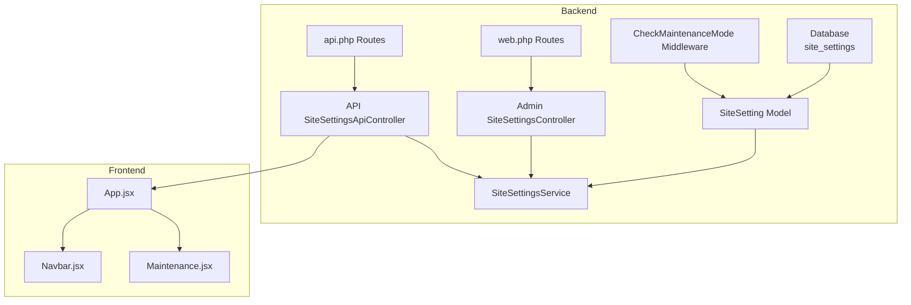
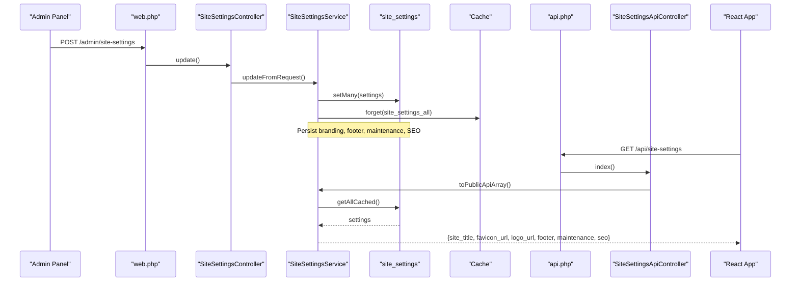
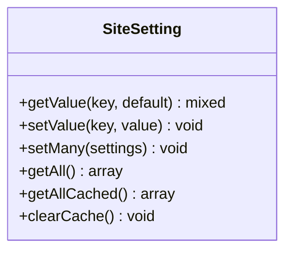
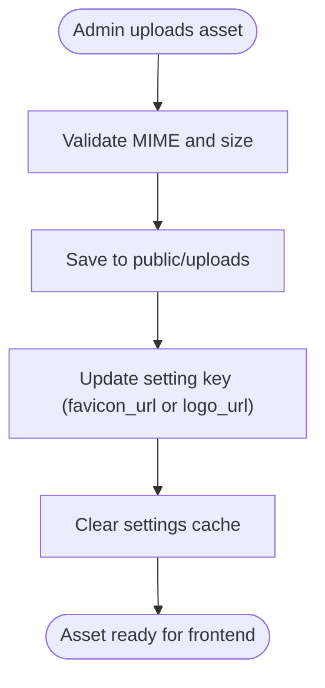
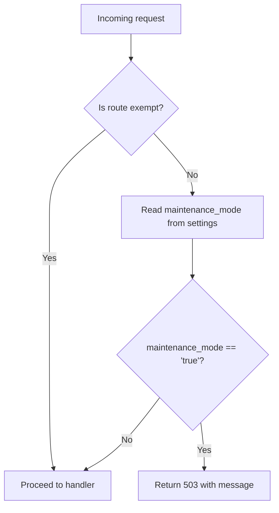
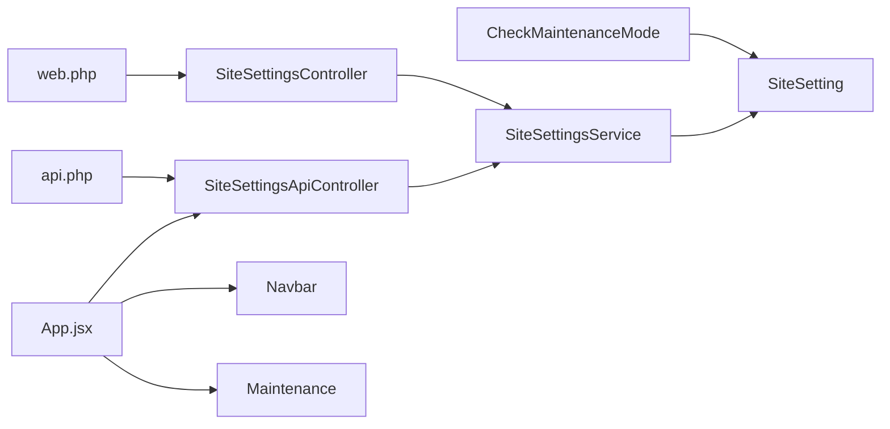

# Site Configuration & Settings

<cite>
**Referenced Files in This Document**
- [SiteSetting.php](file://backend/app/Models/SiteSetting.php)
- [SiteSettingsService.php](file://backend/app/Services/SiteSettingsService.php)
- [SiteSettingsController.php](file://backend/app/Http/Controllers/Admin/SiteSettingsController.php)
- [SiteSettingsApiController.php](file://backend/app/Http/Controllers/API/SiteSettingsApiController.php)
- [CheckMaintenanceMode.php](file://backend/app/Http/Middleware/CheckMaintenanceMode.php)
- [2026_06_11_000000_create_site_settings_table.php](file://backend/database/migrations/2026_06_11_000000_create_site_settings_table.php)
- [site-settings.blade.php](file://backend/resources/views/admin/partials/site-settings.blade.php)
- [web.php](file://backend/routes/web.php)
- [api.php](file://backend/routes/api.php)
- [App.jsx](file://frontend/src/App.jsx)
- [Navbar.jsx](file://frontend/src/components/Navbar.jsx)
- [Maintenance.jsx](file://frontend/src/components/Maintenance.jsx)
</cite>

## Table of Contents
1. [Introduction](#introduction)
2. [Project Structure](#project-structure)
3. [Core Components](#core-components)
4. [Architecture Overview](#architecture-overview)
5. [Detailed Component Analysis](#detailed-component-analysis)
6. [Dependency Analysis](#dependency-analysis)
7. [Performance Considerations](#performance-considerations)
8. [Troubleshooting Guide](#troubleshooting-guide)
9. [Conclusion](#conclusion)

## Introduction
This document explains the site configuration and settings management system that powers runtime customization without code changes. It covers dynamic settings storage, branding customization (logos, favicon, text logo), maintenance mode, SEO and social media metadata, analytics integration, and the public API used by the frontend to render a live, configurable website experience.

The system is built around a key-value settings table with caching, an admin interface for safe updates, and a public API consumed by the React frontend. Maintenance mode is enforced at the middleware layer so customer-facing routes are blocked while the settings endpoint remains available.

## Project Structure
The site configuration feature spans database schema, Eloquent model, service layer, admin controller, API controller, middleware, Blade UI, routing, and frontend consumption.

**Diagram sources**
- [SiteSetting.php:8-80](file://backend/app/Models/SiteSetting.php#L8-L80)
- [SiteSettingsService.php:11-181](file://backend/app/Services/SiteSettingsService.php#L11-L181)
- [SiteSettingsController.php:8-49](file://backend/app/Http/Controllers/Admin/SiteSettingsController.php#L8-L49)
- [SiteSettingsApiController.php:7-17](file://backend/app/Http/Controllers/API/SiteSettingsApiController.php#L7-L17)
- [CheckMaintenanceMode.php:10-48](file://backend/app/Http/Middleware/CheckMaintenanceMode.php#L10-L48)
- [web.php:269-281](file://backend/routes/web.php#L269-L281)
- [api.php:12-18](file://backend/routes/api.php#L12-L18)
- [App.jsx:293-325](file://frontend/src/App.jsx#L293-L325)
- [Navbar.jsx:13-68](file://frontend/src/components/Navbar.jsx#L13-L68)
- [Maintenance.jsx:1-25](file://frontend/src/components/Maintenance.jsx#L1-L25)

**Section sources**
- [SiteSetting.php:8-80](file://backend/app/Models/SiteSetting.php#L8-L80)
- [SiteSettingsService.php:11-181](file://backend/app/Services/SiteSettingsService.php#L11-L181)
- [SiteSettingsController.php:8-49](file://backend/app/Http/Controllers/Admin/SiteSettingsController.php#L8-L49)
- [SiteSettingsApiController.php:7-17](file://backend/app/Http/Controllers/API/SiteSettingsApiController.php#L7-L17)
- [CheckMaintenanceMode.php:10-48](file://backend/app/Http/Middleware/CheckMaintenanceMode.php#L10-L48)
- [2026_06_11_000000_create_site_settings_table.php:10-49](file://backend/database/migrations/2026_06_11_000000_create_site_settings_table.php#L10-L49)
- [site-settings.blade.php:1-305](file://backend/resources/views/admin/partials/site-settings.blade.php#L1-L305)
- [web.php:269-281](file://backend/routes/web.php#L269-L281)
- [api.php:12-18](file://backend/routes/api.php#L12-L18)
- [App.jsx:293-325](file://frontend/src/App.jsx#L293-L325)
- [Navbar.jsx:13-68](file://frontend/src/components/Navbar.jsx#L13-L68)
- [Maintenance.jsx:1-25](file://frontend/src/components/Maintenance.jsx#L1-L25)

## Core Components
- Dynamic settings store: A key-value table with caching for fast reads and cache invalidation on writes.
- Service layer: Validates, transforms, and persists settings; handles file uploads for favicon and logo; exposes a public API payload.
- Admin controller: Accepts form submissions from the admin panel and redirects with success messages.
- Public API controller: Returns a sanitized subset of settings for the frontend.
- Maintenance middleware: Blocks non-exempt routes when maintenance mode is enabled.
- Frontend consumers: Dynamically apply title, favicon, SEO tags, analytics script, logo, and maintenance page.

Key responsibilities:
- Persistence and caching: SiteSetting model.
- Validation and transformation: SiteSettingsService.
- Admin UI and persistence: SiteSettingsController + Blade partial.
- Public exposure: SiteSettingsApiController.
- Runtime enforcement: CheckMaintenanceMode.
- Frontend application: App.jsx, Navbar.jsx, Maintenance.jsx.

**Section sources**
- [SiteSetting.php:8-80](file://backend/app/Models/SiteSetting.php#L8-L80)
- [SiteSettingsService.php:11-181](file://backend/app/Services/SiteSettingsService.php#L11-L181)
- [SiteSettingsController.php:8-49](file://backend/app/Http/Controllers/Admin/SiteSettingsController.php#L8-L49)
- [SiteSettingsApiController.php:7-17](file://backend/app/Http/Controllers/API/SiteSettingsApiController.php#L7-L17)
- [CheckMaintenanceMode.php:10-48](file://backend/app/Http/Middleware/CheckMaintenanceMode.php#L10-L48)
- [site-settings.blade.php:1-305](file://backend/resources/views/admin/partials/site-settings.blade.php#L1-L305)
- [App.jsx:293-325](file://frontend/src/App.jsx#L293-L325)
- [Navbar.jsx:13-68](file://frontend/src/components/Navbar.jsx#L13-L68)
- [Maintenance.jsx:1-25](file://frontend/src/components/Maintenance.jsx#L1-L25)

## Architecture Overview
The system follows a layered architecture:
- Data layer: Key-value settings persisted in the database.
- Domain layer: Service encapsulates validation, transformation, and file handling.
- Presentation layer: Admin Blade forms and public JSON API.
- Enforcement layer: Middleware enforces maintenance mode.
- Client layer: React app consumes the public API and applies settings dynamically.

**Diagram sources**
- [web.php:269-281](file://backend/routes/web.php#L269-L281)
- [SiteSettingsController.php:14-21](file://backend/app/Http/Controllers/Admin/SiteSettingsController.php#L14-L21)
- [SiteSettingsService.php:51-84](file://backend/app/Services/SiteSettingsService.php#L51-L84)
- [SiteSetting.php:40-53](file://backend/app/Models/SiteSetting.php#L40-L53)
- [api.php:12-18](file://backend/routes/api.php#L12-L18)
- [SiteSettingsApiController.php:13-16](file://backend/app/Http/Controllers/API/SiteSettingsApiController.php#L13-L16)
- [SiteSettingsService.php:14-49](file://backend/app/Services/SiteSettingsService.php#L14-L49)
- [SiteSetting.php:58-71](file://backend/app/Models/SiteSetting.php#L58-L71)

## Detailed Component Analysis

### Dynamic Settings Framework
The framework stores arbitrary key-value pairs with automatic caching. Writes invalidate the cache to ensure subsequent reads reflect the latest values.

- Caching strategy: All settings are cached under a single key with a short TTL. Reads use the cache; writes clear it.
- Bulk operations: setMany supports efficient multi-key updates.
- Defaults: Migration seeds initial keys such as site title, favicon URL, footer content, maintenance flags, and SEO fields.

Operational notes:
- Use getValue for single lookups with defaults.
- Prefer setMany for batch updates to reduce cache churn.
- Clear cache explicitly after programmatic changes if not using setMany or setValue.

**Diagram sources**
- [SiteSetting.php:8-80](file://backend/app/Models/SiteSetting.php#L8-L80)
- [2026_06_11_000000_create_site_settings_table.php:10-49](file://backend/database/migrations/2026_06_11_000000_create_site_settings_table.php#L10-L49)

**Section sources**
- [SiteSetting.php:8-80](file://backend/app/Models/SiteSetting.php#L8-L80)
- [2026_06_11_000000_create_site_settings_table.php:10-49](file://backend/database/migrations/2026_06_11_000000_create_site_settings_table.php#L10-L49)

### Branding Customization: Logos, Favicon, Colors, and Theme Variables
Branding is managed through uploaded assets and text fallbacks:
- Favicon: Upload via admin form; stored as a path and applied to the document head by the frontend.
- Logo: Upload via admin form; displayed in navbar if present, otherwise falls back to configured text logo.
- Text logo: Configurable label shown when no image logo is uploaded.

- Security: File extension is derived from MIME type and whitelisted to prevent spoofing.
- Frontend behavior: The React app resolves absolute URLs for uploaded assets and injects favicon links into the document head.

**Diagram sources**
- [SiteSettingsService.php:86-139](file://backend/app/Services/SiteSettingsService.php#L86-L139)
- [SiteSettingsService.php:149-180](file://backend/app/Services/SiteSettingsService.php#L149-L180)
- [App.jsx:429-460](file://frontend/src/App.jsx#L429-L460)
- [Navbar.jsx:13-68](file://frontend/src/components/Navbar.jsx#L13-L68)

**Section sources**
- [SiteSettingsService.php:86-139](file://backend/app/Services/SiteSettingsService.php#L86-L139)
- [SiteSettingsService.php:149-180](file://backend/app/Services/SiteSettingsService.php#L149-L180)
- [App.jsx:429-460](file://frontend/src/App.jsx#L429-L460)
- [Navbar.jsx:13-68](file://frontend/src/components/Navbar.jsx#L13-L68)

### Footer Management and Social Media Integration
Footer content includes company name, copyright text, and a JSON array of links. Open Graph fields support social sharing previews.

- Footer links: Stored as JSON and decoded for display.
- Open Graph: Title, description, and image are exposed via the public API and applied to meta tags by the frontend.
- Analytics: Google Analytics Measurement ID can be configured; the frontend conditionally loads the GA script.

**Section sources**
- [SiteSettingsService.php:14-49](file://backend/app/Services/SiteSettingsService.php#L14-L49)
- [site-settings.blade.php:152-296](file://backend/resources/views/admin/partials/site-settings.blade.php#L152-L296)
- [App.jsx:462-499](file://frontend/src/App.jsx#L462-L499)

### Maintenance Mode Management
Maintenance mode blocks customer-facing routes while keeping the settings API accessible.

- Exemptions: The settings API endpoints are excluded so the frontend can always fetch maintenance status and message.
- Response: When enabled, returns a JSON response indicating maintenance and the configured message.

**Diagram sources**
- [CheckMaintenanceMode.php:17-47](file://backend/app/Http/Middleware/CheckMaintenanceMode.php#L17-L47)
- [api.php:12-18](file://backend/routes/api.php#L12-L18)

**Section sources**
- [CheckMaintenanceMode.php:10-48](file://backend/app/Http/Middleware/CheckMaintenanceMode.php#L10-L48)
- [api.php:12-18](file://backend/routes/api.php#L12-L18)
- [App.jsx:691-694](file://frontend/src/App.jsx#L691-L694)
- [Maintenance.jsx:1-25](file://frontend/src/components/Maintenance.jsx#L1-L25)

### SEO Settings and Public API Exposure
SEO fields are validated and persisted through the service, then exposed via the public API.

- Fields: Meta description, keywords, Open Graph title/description/image, and Google Analytics ID.
- Public API: Returns a structured object containing site identity, footer, maintenance state, and SEO data.

**Section sources**
- [SiteSettingsService.php:14-49](file://backend/app/Services/SiteSettingsService.php#L14-L49)
- [SiteSettingsService.php:51-84](file://backend/app/Services/SiteSettingsService.php#L51-L84)
- [SiteSettingsApiController.php:13-16](file://backend/app/Http/Controllers/API/SiteSettingsApiController.php#L13-L16)
- [App.jsx:462-499](file://frontend/src/App.jsx#L462-L499)

### Currency Configuration, Tax Settings, and Regional Preferences
The current site settings scope does not include currency, tax, or regional preference fields. These would need to be added to the settings table and service if required.

Recommendations:
- Extend the migration to add keys such as currency_code, tax_enabled, tax_rate, timezone, and locale.
- Add corresponding fields to the service’s validation and public API mapping.
- Integrate with existing localization and formatting utilities where applicable.

[No sources needed since this section provides general guidance]

### Backup and Restore Functionality for Site Settings
There is no dedicated backup/restore controller or command for site settings in the analyzed files. To implement this:
- Export: Query all rows from site_settings and export to JSON or CSV.
- Import: Parse the exported file and upsert rows by key, then clear the settings cache.
- Version control: Track migrations and seeders that define default settings; consider adding a versioned settings snapshot table for auditability.

[No sources needed since this section provides general guidance]

### Version Control for Configuration Changes
Configuration changes should be tracked through:
- Database migrations for schema changes.
- Seeders for default values.
- Git commits for code changes to controllers, services, and views.
- Optional: A settings history table to record who changed what and when.

[No sources needed since this section provides general guidance]

### Environment-Specific Overrides
Environment-specific overrides are typically handled via environment variables and config files rather than the runtime settings table. For example:
- Frontend base URL detection uses explicit environment variables and candidate probing.
- Backend configuration files hold environment-sensitive values.

For settings that must differ per environment, prefer environment variables or separate databases rather than relying solely on runtime settings.

**Section sources**
- [App.jsx:40-92](file://frontend/src/App.jsx#L40-L92)
- [App.jsx:329-378](file://frontend/src/App.jsx#L329-L378)

## Dependency Analysis
The following diagram shows how components depend on each other for site settings.

**Diagram sources**
- [CheckMaintenanceMode.php:10-48](file://backend/app/Http/Middleware/CheckMaintenanceMode.php#L10-L48)
- [SiteSetting.php:8-80](file://backend/app/Models/SiteSetting.php#L8-L80)
- [SiteSettingsController.php:8-49](file://backend/app/Http/Controllers/Admin/SiteSettingsController.php#L8-L49)
- [SiteSettingsService.php:11-181](file://backend/app/Services/SiteSettingsService.php#L11-L181)
- [SiteSettingsApiController.php:7-17](file://backend/app/Http/Controllers/API/SiteSettingsApiController.php#L7-L17)
- [web.php:269-281](file://backend/routes/web.php#L269-L281)
- [api.php:12-18](file://backend/routes/api.php#L12-L18)
- [App.jsx:293-325](file://frontend/src/App.jsx#L293-L325)
- [Navbar.jsx:13-68](file://frontend/src/components/Navbar.jsx#L13-L68)
- [Maintenance.jsx:1-25](file://frontend/src/components/Maintenance.jsx#L1-L25)

**Section sources**
- [SiteSetting.php:8-80](file://backend/app/Models/SiteSetting.php#L8-L80)
- [SiteSettingsService.php:11-181](file://backend/app/Services/SiteSettingsService.php#L11-L181)
- [SiteSettingsController.php:8-49](file://backend/app/Http/Controllers/Admin/SiteSettingsController.php#L8-L49)
- [SiteSettingsApiController.php:7-17](file://backend/app/Http/Controllers/API/SiteSettingsApiController.php#L7-L17)
- [CheckMaintenanceMode.php:10-48](file://backend/app/Http/Middleware/CheckMaintenanceMode.php#L10-L48)
- [web.php:269-281](file://backend/routes/web.php#L269-L281)
- [api.php:12-18](file://backend/routes/api.php#L12-L18)
- [App.jsx:293-325](file://frontend/src/App.jsx#L293-L325)
- [Navbar.jsx:13-68](file://frontend/src/components/Navbar.jsx#L13-L68)
- [Maintenance.jsx:1-25](file://frontend/src/components/Maintenance.jsx#L1-L25)

## Performance Considerations
- Caching: All settings are cached under a single key with a short TTL. Writes invalidate the cache to avoid stale reads.
- Bulk updates: Prefer setMany to minimize cache invalidations and database writes.
- File uploads: Validate MIME types and restrict extensions to mitigate security risks and reduce processing overhead.
- Frontend polling: The app polls the settings endpoint periodically to propagate branding and maintenance changes without requiring a full reload.

[No sources needed since this section provides general guidance]

## Troubleshooting Guide
Common issues and resolutions:
- Settings not updating immediately:
  - Ensure the cache is cleared after updates. The service clears the cache on setValue and setMany.
  - Verify the admin form submission succeeds and redirects correctly.
- Uploaded logo or favicon not appearing:
  - Confirm the file was saved to the uploads directory and the setting key points to the correct path.
  - Check that the frontend constructs absolute URLs correctly when the backend and frontend origins differ.
- Maintenance mode blocking expected routes:
  - Confirm the route is not exempt. The settings API is exempt; other routes will return a 503 when maintenance is enabled.
  - Verify the maintenance flag is set to true and the message is populated.

**Section sources**
- [SiteSettingsService.php:86-139](file://backend/app/Services/SiteSettingsService.php#L86-L139)
- [SiteSettingsService.php:149-180](file://backend/app/Services/SiteSettingsService.php#L149-L180)
- [CheckMaintenanceMode.php:17-47](file://backend/app/Http/Middleware/CheckMaintenanceMode.php#L17-L47)
- [App.jsx:429-460](file://frontend/src/App.jsx#L429-L460)
- [App.jsx:691-694](file://frontend/src/App.jsx#L691-L694)

## Conclusion
The site configuration system provides a robust, secure, and user-friendly way to customize branding, footer content, SEO, analytics, and maintenance mode at runtime. The layered design separates concerns between persistence, validation, presentation, and enforcement, while the frontend applies settings dynamically for a seamless user experience. Future enhancements can extend the settings schema to support currency, taxes, and regional preferences, and introduce backup/restore and versioning capabilities for stronger governance.

[No sources needed since this section summarizes without analyzing specific files]