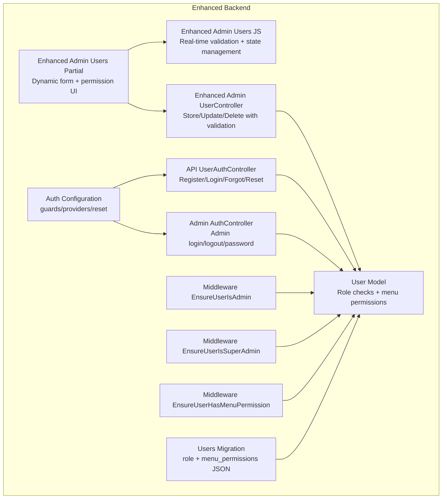
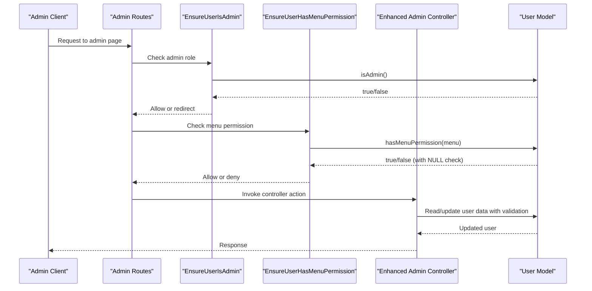
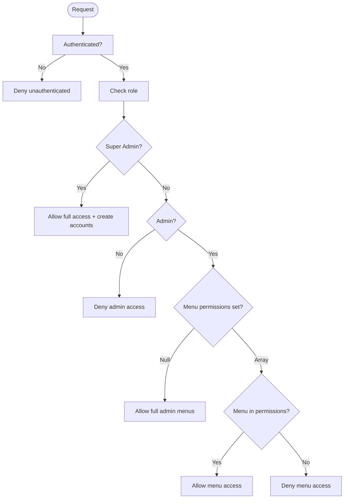
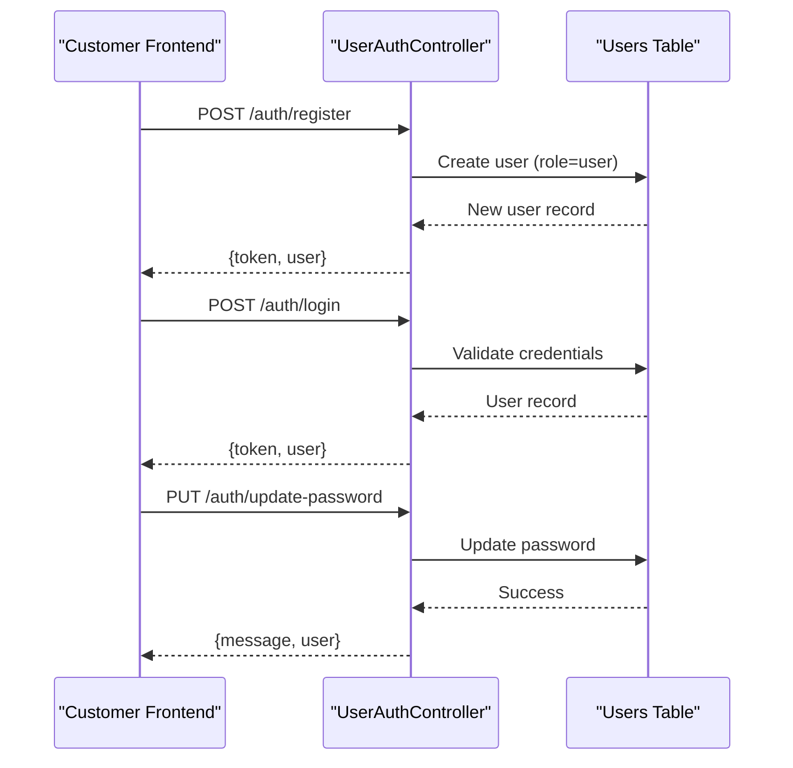
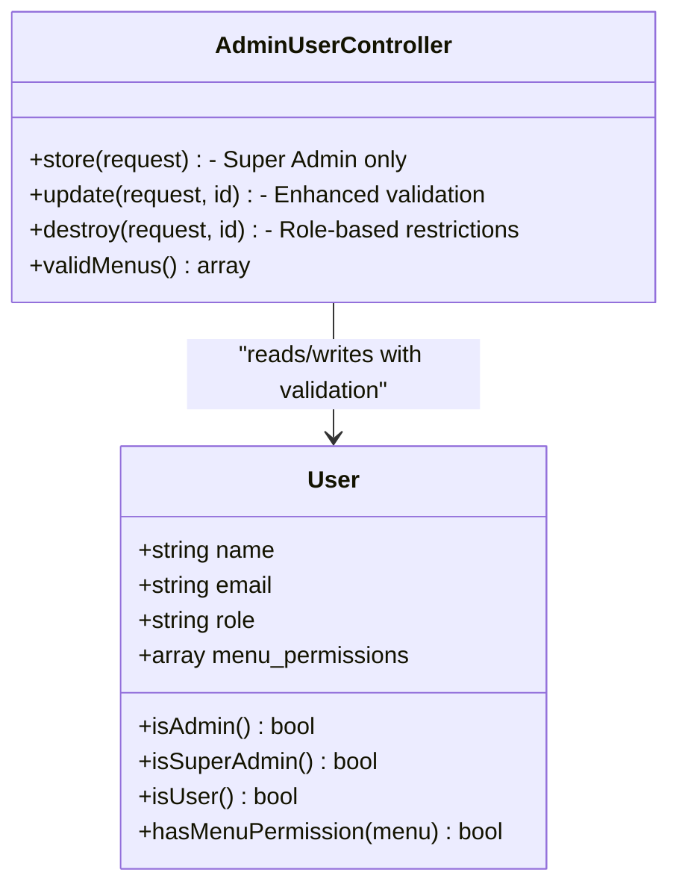
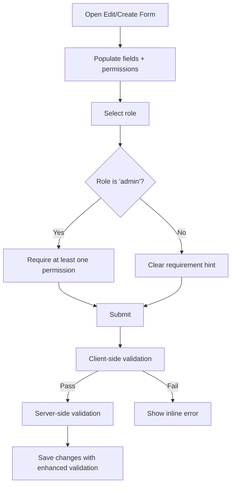
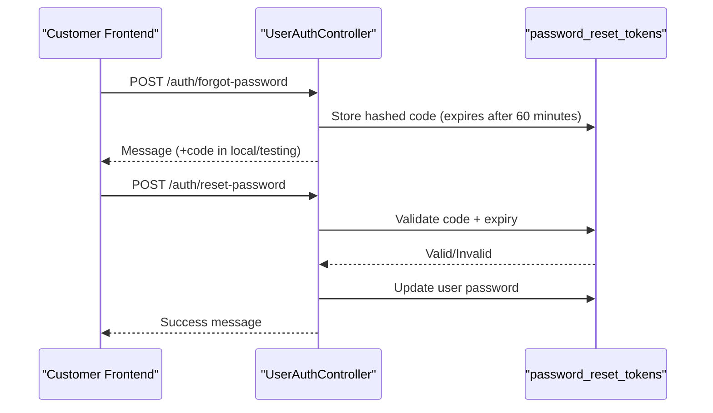
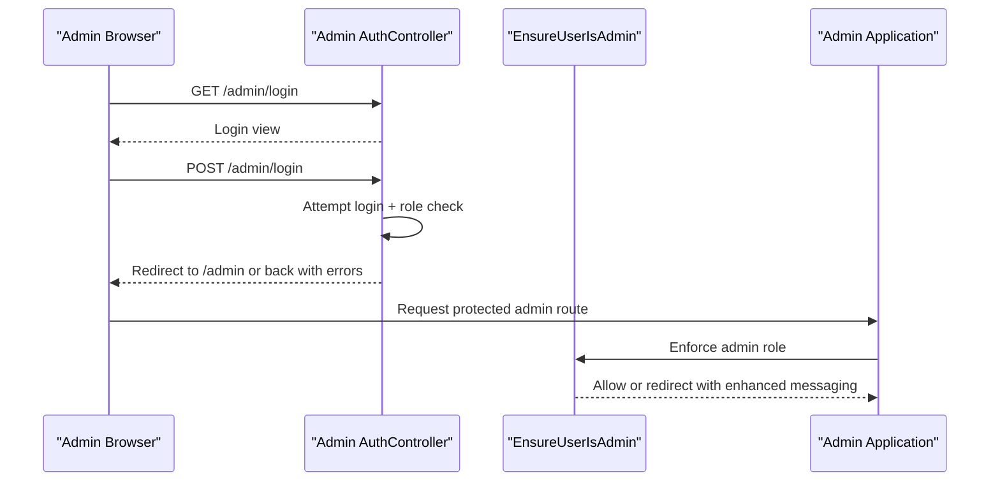
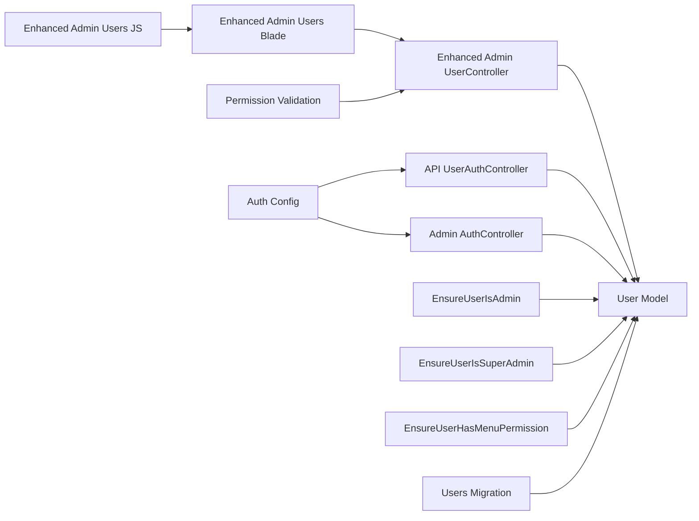

# User Management & Permissions

<cite>
**Referenced Files in This Document**
- [User.php](file://backend/app/Models/User.php)
- [UserController.php](file://backend/app/Http/Controllers/Admin/UserController.php)
- [EnsureUserHasMenuPermission.php](file://backend/app/Http/Middleware/EnsureUserHasMenuPermission.php)
- [EnsureUserIsAdmin.php](file://backend/app/Http/Middleware/EnsureUserIsAdmin.php)
- [EnsureUserIsSuperAdmin.php](file://backend/app/Http/Middleware/EnsureUserIsSuperAdmin.php)
- [0001_01_01_000000_create_users_table.php](file://backend/database/migrations/0001_01_01_000000_create_users_table.php)
- [users.blade.php](file://backend/resources/views/admin/partials/users.blade.php)
- [users.js](file://backend/resources/js/admin/users.js)
- [UserAuthController.php](file://backend/app/Http/Controllers/API/UserAuthController.php)
- [AuthController.php](file://backend/app/Http/Controllers/Admin/AuthController.php)
- [login.blade.php](file://backend/resources/views/admin/login.blade.php)
- [auth.php](file://backend/config/auth.php)
</cite>

## Update Summary
**Changes Made**
- Enhanced user creation workflow with Super Admin-only access control
- Implemented comprehensive role-based menu permission system with 14 predefined menu categories
- Added advanced validation logic in UserController for role assignments and permission management
- Updated UI components to support dynamic permission assignment and real-time validation
- Strengthened security measures for admin account modifications and deletions

## Table of Contents
1. [Introduction](#introduction)
2. [Project Structure](#project-structure)
3. [Core Components](#core-components)
4. [Architecture Overview](#architecture-overview)
5. [Detailed Component Analysis](#detailed-component-analysis)
6. [Dependency Analysis](#dependency-analysis)
7. [Performance Considerations](#performance-considerations)
8. [Troubleshooting Guide](#troubleshooting-guide)
9. [Conclusion](#conclusion)

## Introduction
This document explains the enhanced user administration and permission system for the application. The system now features Super Admin-only account creation, comprehensive role-based authorization with granular menu permissions, and robust validation mechanisms. It supports three roles: user, admin, and super_admin, with fine-grained control over administrative feature visibility through a structured permission system covering coach-services, bookings, cancel-requests, stations, buses, routes, schedules, promotions, users, reports, license, site-settings, gateways, and profile.

## Project Structure
The enhanced user management and permissions logic spans models, controllers, middleware, views, JavaScript, database migrations, and configuration files with improved security and validation layers.

**Diagram sources**
- [User.php:12-76](file://backend/app/Models/User.php#L12-L76)
- [UserController.php:9-171](file://backend/app/Http/Controllers/Admin/UserController.php#L9-L171)
- [UserAuthController.php:15-218](file://backend/app/Http/Controllers/API/UserAuthController.php#L15-L218)
- [AuthController.php:9-81](file://backend/app/Http/Controllers/Admin/AuthController.php#L9-L81)
- [EnsureUserIsAdmin.php:10-41](file://backend/app/Http/Middleware/EnsureUserIsAdmin.php#L10-L41)
- [EnsureUserIsSuperAdmin.php:10-38](file://backend/app/Http/Middleware/EnsureUserIsSuperAdmin.php#L10-L38)
- [EnsureUserHasMenuPermission.php:10-41](file://backend/app/Http/Middleware/EnsureUserHasMenuPermission.php#L10-L41)
- [0001_01_01_000000_create_users_table.php:12-24](file://backend/database/migrations/0001_01_01_000000_create_users_table.php#L12-L24)
- [users.blade.php:1-246](file://backend/resources/views/admin/partials/users.blade.php#L1-L246)
- [users.js:1-434](file://backend/resources/js/admin/users.js#L1-L434)
- [auth.php:18-101](file://backend/config/auth.php#L18-L101)

**Section sources**
- [User.php:12-76](file://backend/app/Models/User.php#L12-L76)
- [UserController.php:9-171](file://backend/app/Http/Controllers/Admin/UserController.php#L9-L171)
- [UserAuthController.php:15-218](file://backend/app/Http/Controllers/API/UserAuthController.php#L15-L218)
- [AuthController.php:9-81](file://backend/app/Http/Controllers/Admin/AuthController.php#L9-L81)
- [EnsureUserIsAdmin.php:10-41](file://backend/app/Http/Middleware/EnsureUserIsAdmin.php#L10-L41)
- [EnsureUserIsSuperAdmin.php:10-38](file://backend/app/Http/Middleware/EnsureUserIsSuperAdmin.php#L10-L38)
- [EnsureUserHasMenuPermission.php:10-41](file://backend/app/Http/Middleware/EnsureUserHasMenuPermission.php#L10-L41)
- [0001_01_01_000000_create_users_table.php:12-24](file://backend/database/migrations/0001_01_01_000000_create_users_table.php#L12-L24)
- [users.blade.php:1-246](file://backend/resources/views/admin/partials/users.blade.php#L1-L246)
- [users.js:1-434](file://backend/resources/js/admin/users.js#L1-L434)
- [auth.php:18-101](file://backend/config/auth.php#L18-L101)

## Core Components
- **Enhanced User model**: Defines roles, menu permissions, and helper methods for authorization with improved null handling for full-access scenarios.
- **Advanced Admin controller**: Manages user lifecycle with strict Super Admin-only creation, comprehensive validation, and role-based modification restrictions.
- **Robust Middleware**: Enforces admin/super-admin roles and per-menu permissions with enhanced error handling and redirect logic.
- **Comprehensive Permission System**: Supports 14 predefined menu categories with granular access control.
- **Dynamic UI Components**: Real-time validation, role-based form controls, and interactive permission assignment interface.
- **Security-focused Validation**: Prevents privilege escalation, self-deletion, and unauthorized role modifications.

**Section sources**
- [User.php:12-76](file://backend/app/Models/User.php#L12-L76)
- [UserController.php:9-171](file://backend/app/Http/Controllers/Admin/UserController.php#L9-L171)
- [EnsureUserIsAdmin.php:10-41](file://backend/app/Http/Middleware/EnsureUserIsAdmin.php#L10-L41)
- [EnsureUserIsSuperAdmin.php:10-38](file://backend/app/Http/Middleware/EnsureUserIsSuperAdmin.php#L10-L38)
- [EnsureUserHasMenuPermission.php:10-41](file://backend/app/Http/Middleware/EnsureUserHasMenuPermission.php#L10-L41)
- [UserAuthController.php:15-218](file://backend/app/Http/Controllers/API/UserAuthController.php#L15-L218)
- [AuthController.php:9-81](file://backend/app/Http/Controllers/Admin/AuthController.php#L9-L81)
- [users.blade.php:1-246](file://backend/resources/views/admin/partials/users.blade.php#L1-L246)
- [users.js:1-434](file://backend/resources/js/admin/users.js#L1-L434)
- [0001_01_01_000000_create_users_table.php:12-24](file://backend/database/migrations/0001_01_01_000000_create_users_table.php#L12-L24)
- [auth.php:18-101](file://backend/config/auth.php#L18-L101)

## Architecture Overview
The enhanced authorization architecture combines role checks at the model level with request-level enforcement via middleware, featuring Super Admin-only operations and comprehensive menu permission validation.

**Diagram sources**
- [EnsureUserIsAdmin.php:10-41](file://backend/app/Http/Middleware/EnsureUserIsAdmin.php#L10-L41)
- [EnsureUserHasMenuPermission.php:10-41](file://backend/app/Http/Middleware/EnsureUserHasMenuPermission.php#L10-L41)
- [User.php:44-76](file://backend/app/Models/User.php#L44-L76)
- [UserController.php:9-171](file://backend/app/Http/Controllers/Admin/UserController.php#L9-L171)

## Detailed Component Analysis

### Enhanced Role-Based Authorization and Menu Permissions
- **Roles**: user, admin, super_admin with hierarchical privileges.
- **Super Admins**: Bypass all menu permission checks and have exclusive account creation rights.
- **Admins**: Can have null menu_permissions (full access) or explicit list of allowed menus from 14 predefined categories.
- **Regular Users**: Cannot access admin menus regardless of any permission settings.

**Updated** Enhanced with comprehensive menu permission system covering coach-services, bookings, cancel-requests, stations, buses, routes, schedules, promotions, users, reports, license, site-settings, gateways, and profile.

**Diagram sources**
- [User.php:44-76](file://backend/app/Models/User.php#L44-L76)
- [EnsureUserHasMenuPermission.php:10-41](file://backend/app/Http/Middleware/EnsureUserHasMenuPermission.php#L10-L41)

**Section sources**
- [User.php:44-76](file://backend/app/Models/User.php#L44-L76)
- [EnsureUserHasMenuPermission.php:10-41](file://backend/app/Http/Middleware/EnsureUserHasMenuPermission.php#L10-L41)

### Super Admin-Only Account Creation and Lifecycle Management
- **Creation**: Only Super Admins can create new user accounts with enhanced validation including password requirements and role restrictions.
- **Activation**: No explicit activation flow; accounts are active upon creation.
- **Deactivation**: No soft-delete functionality; deletion permanently removes users with role-based restrictions.
- **Profile Management**: Regular users can update their own passwords; admins can modify other users' details with strict role-based controls.

**Updated** Enhanced with Super Admin-only account creation, comprehensive validation rules, and improved security measures for role assignments.

**Diagram sources**
- [UserAuthController.php:17-39](file://backend/app/Http/Controllers/API/UserAuthController.php#L17-L39)
- [UserAuthController.php:41-70](file://backend/app/Http/Controllers/API/UserAuthController.php#L41-L70)
- [UserAuthController.php:88-111](file://backend/app/Http/Controllers/API/UserAuthController.php#L88-L111)
- [0001_01_01_000000_create_users_table.php:12-24](file://backend/database/migrations/0001_01_01_000000_create_users_table.php#L12-L24)

**Section sources**
- [UserAuthController.php:17-39](file://backend/app/Http/Controllers/API/UserAuthController.php#L17-L39)
- [UserAuthController.php:41-70](file://backend/app/Http/Controllers/API/UserAuthController.php#L41-L70)
- [UserAuthController.php:88-111](file://backend/app/Http/Controllers/API/UserAuthController.php#L88-L111)
- [0001_01_01_000000_create_users_table.php:12-24](file://backend/database/migrations/0001_01_01_000000_create_users_table.php#L12-L24)

### Advanced Admin User Administration with Enhanced Validation
- **Account Creation**: Super Admin-only with comprehensive validation including email uniqueness, password strength, and role restrictions.
- **User Editing**: Strict role-based modification controls preventing privilege escalation and self-modification of critical fields.
- **Role Management**: Super Admins can reassign roles except for themselves; regular admins cannot modify admin/super_admin roles.
- **Permission Assignment**: Dynamic menu permission assignment with real-time validation and predefined category sets.
- **Deletion Security**: Self-deletion prevention and role-based deletion restrictions protecting higher privilege accounts.

**Updated** Significantly enhanced with Super Admin-only creation, comprehensive validation logic, and improved security measures for role and permission management.

**Diagram sources**
- [User.php:12-76](file://backend/app/Models/User.php#L12-L76)
- [UserController.php:9-171](file://backend/app/Http/Controllers/Admin/UserController.php#L9-L171)

**Section sources**
- [UserController.php:9-171](file://backend/app/Http/Controllers/Admin/UserController.php#L9-L171)
- [users.blade.php:1-246](file://backend/resources/views/admin/partials/users.blade.php#L1-L246)
- [users.js:1-434](file://backend/resources/js/admin/users.js#L1-L434)

### Comprehensive Menu Permission System and Dynamic UI
- **Predefined Categories**: 14 specific menu categories organized into operational and system sections.
- **Dynamic Form Controls**: Role-based visibility and editability of permission checkboxes.
- **Real-time Validation**: Client-side validation ensuring at least one permission is selected for admin roles.
- **State Management**: Sophisticated JavaScript handling form modes, role restrictions, and permission synchronization.
- **Visual Feedback**: Clear indicators for required permissions, super admin privileges, and validation errors.

**Updated** Completely redesigned with comprehensive permission categories, dynamic UI components, and sophisticated client-side validation.

**Diagram sources**
- [users.blade.php:86-246](file://backend/resources/views/admin/partials/users.blade.php#L86-L246)
- [users.js:33-434](file://backend/resources/js/admin/users.js#L33-L434)
- [UserController.php:16-23](file://backend/app/Http/Controllers/Admin/UserController.php#L16-L23)

**Section sources**
- [users.blade.php:86-246](file://backend/resources/views/admin/partials/users.blade.php#L86-L246)
- [users.js:33-434](file://backend/resources/js/admin/users.js#L33-L434)
- [UserController.php:16-23](file://backend/app/Http/Controllers/Admin/UserController.php#L16-L23)

### Password Policies and Account Security
- **Minimum Password Length**: Enhanced to 8 characters for new accounts.
- **Password Confirmation**: Required during registration and validated client-side.
- **Forgot/Reset Flow**: Time-limited codes stored securely with expiration handling.
- **Admin Portal Security**: Role-based login enforcement with session management.
- **Session Handling**: Robust guard/provider configuration with enhanced security measures.

**Updated** Enhanced password requirements and improved security validation throughout the authentication flow.

**Diagram sources**
- [UserAuthController.php:113-208](file://backend/app/Http/Controllers/API/UserAuthController.php#L113-L208)
- [0001_01_01_000000_create_users_table.php:26-30](file://backend/database/migrations/0001_01_01_000000_create_users_table.php#L26-L30)
- [auth.php:95-101](file://backend/config/auth.php#L95-L101)

**Section sources**
- [UserAuthController.php:113-208](file://backend/app/Http/Controllers/API/UserAuthController.php#L113-L208)
- [AuthController.php:63-81](file://backend/app/Http/Controllers/Admin/AuthController.php#L63-L81)
- [auth.php:95-101](file://backend/config/auth.php#L95-L101)

### Enhanced Admin Portal Access Control
- **Login Security**: Role-based login enforcement with automatic logout for non-admin users.
- **Middleware Protection**: Comprehensive route protection with enhanced error handling and redirects.
- **Super Admin Restrictions**: Sensitive operations restricted exclusively to Super Admin accounts.
- **Session Management**: Improved session handling with proper token regeneration and cleanup.

**Updated** Enhanced with improved security measures and better error handling throughout the authentication flow.

**Diagram sources**
- [AuthController.php:11-61](file://backend/app/Http/Controllers/Admin/AuthController.php#L11-L61)
- [EnsureUserIsAdmin.php:10-41](file://backend/app/Http/Middleware/EnsureUserIsAdmin.php#L10-L41)
- [login.blade.php:276-315](file://backend/resources/views/admin/login.blade.php#L276-L315)

**Section sources**
- [AuthController.php:11-61](file://backend/app/Http/Controllers/Admin/AuthController.php#L11-L61)
- [EnsureUserIsAdmin.php:10-41](file://backend/app/Http/Middleware/EnsureUserIsAdmin.php#L10-L41)
- [EnsureUserIsSuperAdmin.php:10-38](file://backend/app/Http/Middleware/EnsureUserIsSuperAdmin.php#L10-L38)
- [login.blade.php:276-315](file://backend/resources/views/admin/login.blade.php#L276-L315)

### Bulk Operations, Import/Export, and External Authentication
- **Bulk User Operations**: Not implemented in the analyzed codebase.
- **Import/Export**: No dedicated import/export endpoints for users were found.
- **External Authentication**: No external identity provider integration was detected; authentication relies on internal user records and Laravel's session/Sanctum tokens.

[No sources needed since this section summarizes capabilities not present in the analyzed files]

## Dependency Analysis
The enhanced dependency structure shows how components interact with improved security and validation layers.

**Diagram sources**
- [UserController.php:9-171](file://backend/app/Http/Controllers/Admin/UserController.php#L9-L171)
- [UserAuthController.php:15-218](file://backend/app/Http/Controllers/API/UserAuthController.php#L15-L218)
- [AuthController.php:9-81](file://backend/app/Http/Controllers/Admin/AuthController.php#L9-L81)
- [EnsureUserIsAdmin.php:10-41](file://backend/app/Http/Middleware/EnsureUserIsAdmin.php#L10-L41)
- [EnsureUserIsSuperAdmin.php:10-38](file://backend/app/Http/Middleware/EnsureUserIsSuperAdmin.php#L10-L38)
- [EnsureUserHasMenuPermission.php:10-41](file://backend/app/Http/Middleware/EnsureUserHasMenuPermission.php#L10-L41)
- [0001_01_01_000000_create_users_table.php:12-24](file://backend/database/migrations/0001_01_01_000000_create_users_table.php#L12-L24)
- [auth.php:18-101](file://backend/config/auth.php#L18-L101)
- [users.blade.php:1-246](file://backend/resources/views/admin/partials/users.blade.php#L1-L246)
- [users.js:1-434](file://backend/resources/js/admin/users.js#L1-L434)

**Section sources**
- [UserController.php:9-171](file://backend/app/Http/Controllers/Admin/UserController.php#L9-L171)
- [UserAuthController.php:15-218](file://backend/app/Http/Controllers/API/UserAuthController.php#L15-L218)
- [AuthController.php:9-81](file://backend/app/Http/Controllers/Admin/AuthController.php#L9-L81)
- [EnsureUserIsAdmin.php:10-41](file://backend/app/Http/Middleware/EnsureUserIsAdmin.php#L10-L41)
- [EnsureUserIsSuperAdmin.php:10-38](file://backend/app/Http/Middleware/EnsureUserIsSuperAdmin.php#L10-L38)
- [EnsureUserHasMenuPermission.php:10-41](file://backend/app/Http/Middleware/EnsureUserHasMenuPermission.php#L10-L41)
- [0001_01_01_000000_create_users_table.php:12-24](file://backend/database/migrations/0001_01_01_000000_create_users_table.php#L12-L24)
- [auth.php:18-101](file://backend/config/auth.php#L18-L101)
- [users.blade.php:1-246](file://backend/resources/views/admin/partials/users.blade.php#L1-L246)
- [users.js:1-434](file://backend/resources/js/admin/users.js#L1-L434)

## Performance Considerations
- **Password Hashing**: Enhanced security requires stronger hashing algorithms; consider rate limiting and monitoring for brute-force attempts.
- **Permission Checks**: Lightweight but centralized in the model to avoid duplication across the application.
- **Data Caching**: Avoid unnecessary re-fetching of user data; cache frequently accessed user attributes where appropriate.
- **Pagination**: Essential for large user lists in admin interfaces to maintain performance.
- **Validation Overhead**: Enhanced validation adds processing time but significantly improves security and data integrity.

[No sources needed since this section provides general guidance]

## Troubleshooting Guide
- **Unauthenticated Access**: Enhanced middleware returns 401 for JSON or redirects to login for web requests with improved error messaging.
- **Insufficient Permissions**: Enhanced middleware returns 403 for JSON or redirects with detailed error messages for web requests.
- **Admin-only Routes**: Non-admin users are logged out and redirected when attempting to access admin routes with enhanced session cleanup.
- **Invalid Menu Permissions**: Server rejects invalid menu items with comprehensive validation; client-side validation prevents submitting empty permissions for admin roles.
- **Password Reset Issues**: Verify email delivery and ensure reset codes are within the expiration window with improved error handling.
- **Super Admin Restrictions**: Account creation and certain modifications require Super Admin privileges with clear error feedback.

**Section sources**
- [EnsureUserHasMenuPermission.php:10-41](file://backend/app/Http/Middleware/EnsureUserHasMenuPermission.php#L10-L41)
- [EnsureUserIsAdmin.php:10-41](file://backend/app/Http/Middleware/EnsureUserIsAdmin.php#L10-L41)
- [EnsureUserIsSuperAdmin.php:10-38](file://backend/app/Http/Middleware/EnsureUserIsSuperAdmin.php#L10-L38)
- [UserController.php:28-171](file://backend/app/Http/Controllers/Admin/UserController.php#L28-L171)
- [UserAuthController.php:113-208](file://backend/app/Http/Controllers/API/UserAuthController.php#L113-L208)

## Conclusion
The enhanced system implements a robust role-based authorization model with comprehensive menu permissions for admin users and Super Admin-only account creation. Access control is enforced through enhanced middleware and improved model helpers, ensuring consistent protection across web and API surfaces. The user lifecycle management covers registration, login, logout, and password updates with significantly strengthened validation and security controls. While bulk operations and external authentication integrations remain absent from the analyzed codebase, the current enhanced design provides a solid foundation for extending these capabilities while maintaining strong security posture and user experience.