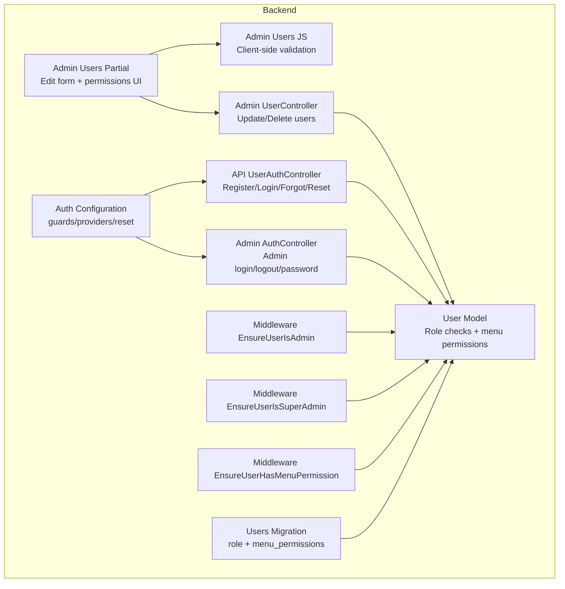
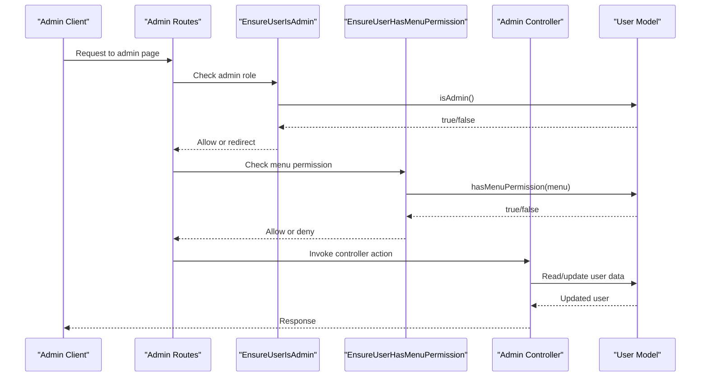
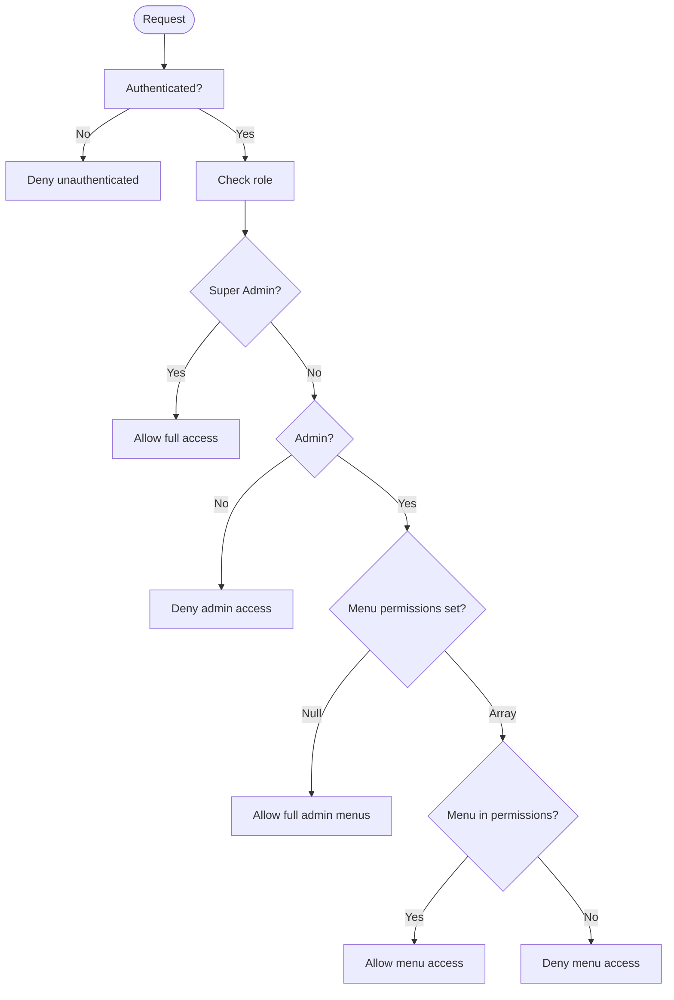
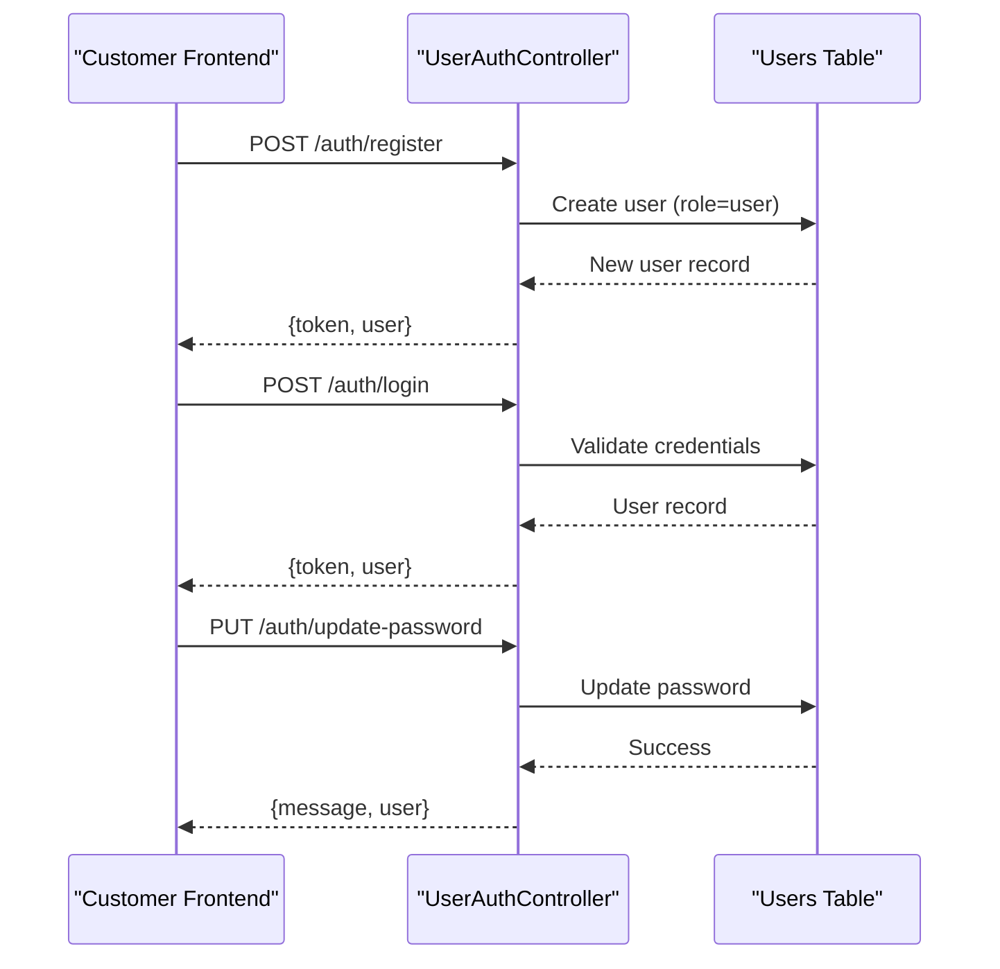
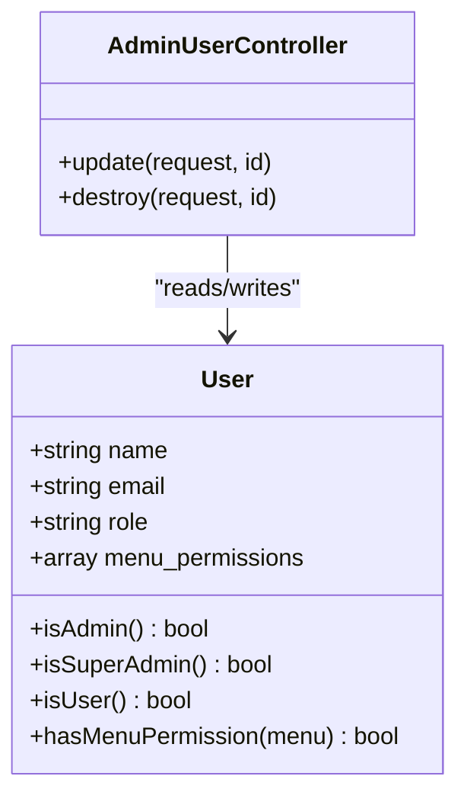
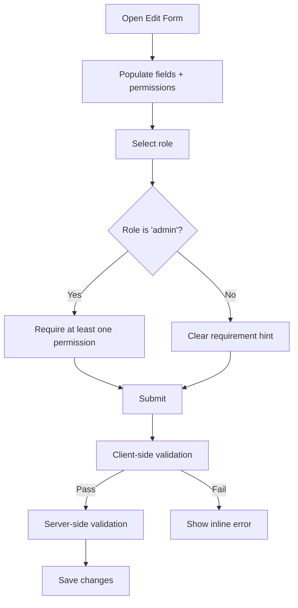
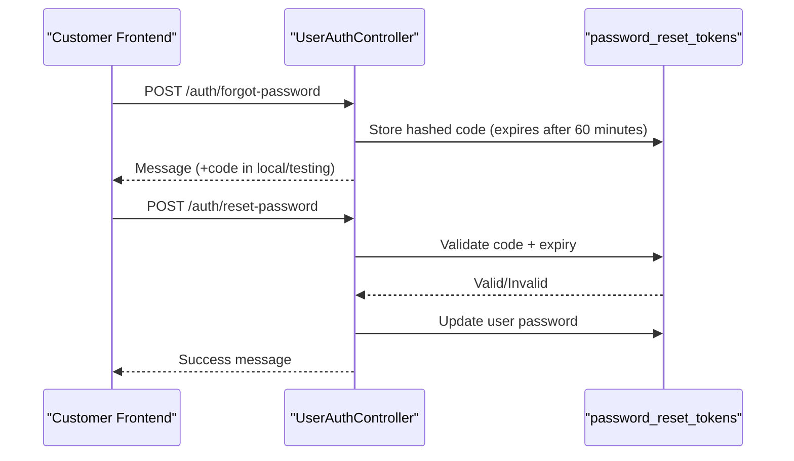
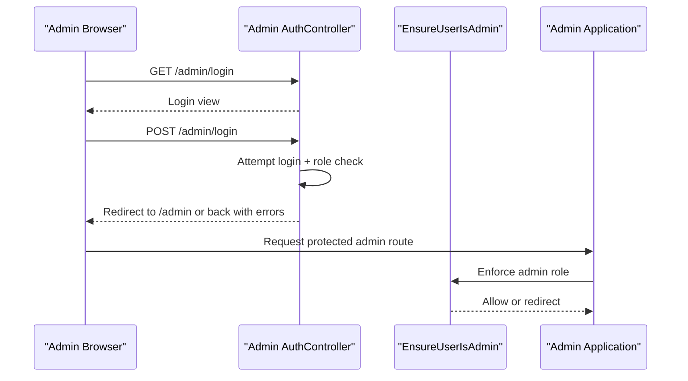
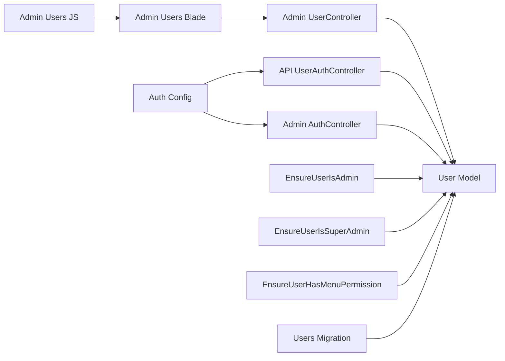

# User Management & Permissions

<cite>
**Referenced Files in This Document**
- [User.php](file://backend/app/Models/User.php)
- [UserController.php](file://backend/app/Http/Controllers/Admin/UserController.php)
- [EnsureUserHasMenuPermission.php](file://backend/app/Http/Middleware/EnsureUserHasMenuPermission.php)
- [EnsureUserIsAdmin.php](file://backend/app/Http/Middleware/EnsureUserIsAdmin.php)
- [EnsureUserIsSuperAdmin.php](file://backend/app/Http/Middleware/EnsureUserIsSuperAdmin.php)
- [0001_01_01_000000_create_users_table.php](file://backend/database/migrations/0001_01_01_000000_create_users_table.php)
- [users.blade.php](file://backend/resources/views/admin/partials/users.blade.php)
- [users.js](file://backend/resources/js/admin/users.js)
- [UserAuthController.php](file://backend/app/Http/Controllers/API/UserAuthController.php)
- [AuthController.php](file://backend/app/Http/Controllers/Admin/AuthController.php)
- [login.blade.php](file://backend/resources/views/admin/login.blade.php)
- [auth.php](file://backend/config/auth.php)
</cite>

## Table of Contents
1. [Introduction](#introduction)
2. [Project Structure](#project-structure)
3. [Core Components](#core-components)
4. [Architecture Overview](#architecture-overview)
5. [Detailed Component Analysis](#detailed-component-analysis)
6. [Dependency Analysis](#dependency-analysis)
7. [Performance Considerations](#performance-considerations)
8. [Troubleshooting Guide](#troubleshooting-guide)
9. [Conclusion](#conclusion)

## Introduction
This document explains the user administration and permission system for the application. It covers role-based authorization, menu permissions, access control, user lifecycle management, password policies, account security, and integration points between the admin portal and customer-facing API. The system supports three roles: user, admin, and super_admin. Menu permissions allow fine-grained visibility of administrative features for admin users.

## Project Structure
The user management and permissions logic spans models, controllers, middleware, views, JavaScript, database migrations, and configuration files.

**Diagram sources**
- [User.php:12-74](file://backend/app/Models/User.php#L12-L74)
- [UserController.php:9-94](file://backend/app/Http/Controllers/Admin/UserController.php#L9-L94)
- [UserAuthController.php:15-218](file://backend/app/Http/Controllers/API/UserAuthController.php#L15-L218)
- [AuthController.php:9-81](file://backend/app/Http/Controllers/Admin/AuthController.php#L9-L81)
- [EnsureUserIsAdmin.php:10-39](file://backend/app/Http/Middleware/EnsureUserIsAdmin.php#L10-L39)
- [EnsureUserIsSuperAdmin.php:10-36](file://backend/app/Http/Middleware/EnsureUserIsSuperAdmin.php#L10-L36)
- [EnsureUserHasMenuPermission.php:10-39](file://backend/app/Http/Middleware/EnsureUserHasMenuPermission.php#L10-L39)
- [0001_01_01_000000_create_users_table.php:12-24](file://backend/database/migrations/0001_01_01_000000_create_users_table.php#L12-L24)
- [users.blade.php:1-179](file://backend/resources/views/admin/partials/users.blade.php#L1-L179)
- [users.js:1-239](file://backend/resources/js/admin/users.js#L1-L239)
- [auth.php:18-101](file://backend/config/auth.php#L18-L101)

**Section sources**
- [User.php:12-74](file://backend/app/Models/User.php#L12-L74)
- [UserController.php:9-94](file://backend/app/Http/Controllers/Admin/UserController.php#L9-L94)
- [UserAuthController.php:15-218](file://backend/app/Http/Controllers/API/UserAuthController.php#L15-L218)
- [AuthController.php:9-81](file://backend/app/Http/Controllers/Admin/AuthController.php#L9-L81)
- [EnsureUserIsAdmin.php:10-39](file://backend/app/Http/Middleware/EnsureUserIsAdmin.php#L10-L39)
- [EnsureUserIsSuperAdmin.php:10-36](file://backend/app/Http/Middleware/EnsureUserIsSuperAdmin.php#L10-L36)
- [EnsureUserHasMenuPermission.php:10-39](file://backend/app/Http/Middleware/EnsureUserHasMenuPermission.php#L10-L39)
- [0001_01_01_000000_create_users_table.php:12-24](file://backend/database/migrations/0001_01_01_000000_create_users_table.php#L12-L24)
- [users.blade.php:1-179](file://backend/resources/views/admin/partials/users.blade.php#L1-L179)
- [users.js:1-239](file://backend/resources/js/admin/users.js#L1-L239)
- [auth.php:18-101](file://backend/config/auth.php#L18-L101)

## Core Components
- User model defines roles, menu permissions, and helper methods for authorization.
- Admin controller manages editing user details, roles, and menu permissions; enforces deletion constraints.
- Middleware enforces admin/super-admin roles and per-menu permissions on requests.
- API authentication controller handles registration, login, logout, profile retrieval, password update, forgot/reset flows.
- Admin authentication controller handles admin portal login/logout and password updates.
- Views and client-side scripts provide the admin UI for managing users and validating permissions.
- Database migration stores role and menu permissions.
- Authentication configuration sets guards, providers, and password reset behavior.

**Section sources**
- [User.php:12-74](file://backend/app/Models/User.php#L12-L74)
- [UserController.php:9-94](file://backend/app/Http/Controllers/Admin/UserController.php#L9-L94)
- [EnsureUserIsAdmin.php:10-39](file://backend/app/Http/Middleware/EnsureUserIsAdmin.php#L10-L39)
- [EnsureUserIsSuperAdmin.php:10-36](file://backend/app/Http/Middleware/EnsureUserIsSuperAdmin.php#L10-L36)
- [EnsureUserHasMenuPermission.php:10-39](file://backend/app/Http/Middleware/EnsureUserHasMenuPermission.php#L10-L39)
- [UserAuthController.php:15-218](file://backend/app/Http/Controllers/API/UserAuthController.php#L15-L218)
- [AuthController.php:9-81](file://backend/app/Http/Controllers/Admin/AuthController.php#L9-L81)
- [users.blade.php:1-179](file://backend/resources/views/admin/partials/users.blade.php#L1-L179)
- [users.js:1-239](file://backend/resources/js/admin/users.js#L1-L239)
- [0001_01_01_000000_create_users_table.php:12-24](file://backend/database/migrations/0001_01_01_000000_create_users_table.php#L12-L24)
- [auth.php:18-101](file://backend/config/auth.php#L18-L101)

## Architecture Overview
The authorization architecture combines role checks at the model level with request-level enforcement via middleware. Menu permissions are stored as a JSON array and validated server-side while also being enforced by middleware.

**Diagram sources**
- [EnsureUserIsAdmin.php:10-39](file://backend/app/Http/Middleware/EnsureUserIsAdmin.php#L10-L39)
- [EnsureUserHasMenuPermission.php:10-39](file://backend/app/Http/Middleware/EnsureUserHasMenuPermission.php#L10-L39)
- [User.php:44-74](file://backend/app/Models/User.php#L44-L74)
- [UserController.php:9-94](file://backend/app/Http/Controllers/Admin/UserController.php#L9-L94)

## Detailed Component Analysis

### Role-Based Authorization and Menu Permissions
- Roles: user, admin, super_admin.
- Super admins bypass all menu permission checks.
- Admins can have a null menu_permissions (full access) or an explicit list of allowed menus.
- Non-admin users cannot access admin menus.

**Diagram sources**
- [User.php:44-74](file://backend/app/Models/User.php#L44-L74)
- [EnsureUserHasMenuPermission.php:10-39](file://backend/app/Http/Middleware/EnsureUserHasMenuPermission.php#L10-L39)

**Section sources**
- [User.php:44-74](file://backend/app/Models/User.php#L44-L74)
- [EnsureUserHasMenuPermission.php:10-39](file://backend/app/Http/Middleware/EnsureUserHasMenuPermission.php#L10-L39)

### User Lifecycle Management
- Creation: Customer registration creates a user with role user and returns an API token.
- Activation: No explicit activation flow is implemented; accounts are active upon creation.
- Deactivation: No soft-delete or deactivation flag exists; deletion permanently removes the user.
- Profile management: Customers can update their own password; admins can update other users’ names, emails, roles, and menu permissions.

**Diagram sources**
- [UserAuthController.php:17-39](file://backend/app/Http/Controllers/API/UserAuthController.php#L17-L39)
- [UserAuthController.php:41-70](file://backend/app/Http/Controllers/API/UserAuthController.php#L41-L70)
- [UserAuthController.php:88-111](file://backend/app/Http/Controllers/API/UserAuthController.php#L88-L111)
- [0001_01_01_000000_create_users_table.php:12-24](file://backend/database/migrations/0001_01_01_000000_create_users_table.php#L12-L24)

**Section sources**
- [UserAuthController.php:17-39](file://backend/app/Http/Controllers/API/UserAuthController.php#L17-L39)
- [UserAuthController.php:41-70](file://backend/app/Http/Controllers/API/UserAuthController.php#L41-L70)
- [UserAuthController.php:88-111](file://backend/app/Http/Controllers/API/UserAuthController.php#L88-L111)
- [0001_01_01_000000_create_users_table.php:12-24](file://backend/database/migrations/0001_01_01_000000_create_users_table.php#L12-L24)

### Admin User Administration
- Editing users: Admins can edit name, email (except super_admin), role (super_admin only), and menu permissions (admin role).
- Deleting users: Self-deletion is blocked; non-super admins cannot delete higher/equal roles.
- Validation: Email uniqueness enforced; role values restricted; menu permissions constrained to a predefined set.

**Diagram sources**
- [User.php:12-74](file://backend/app/Models/User.php#L12-L74)
- [UserController.php:9-94](file://backend/app/Http/Controllers/Admin/UserController.php#L9-L94)

**Section sources**
- [UserController.php:9-94](file://backend/app/Http/Controllers/Admin/UserController.php#L9-L94)
- [users.blade.php:1-179](file://backend/resources/views/admin/partials/users.blade.php#L1-L179)
- [users.js:1-239](file://backend/resources/js/admin/users.js#L1-L239)

### Menu Permission UI and Validation
- The admin partial renders a table of users with edit/delete actions based on roles.
- The edit form includes role selection and checkboxes for menu permissions.
- Client-side JavaScript validates that admin-role users must select at least one menu permission before submission.

**Diagram sources**
- [users.blade.php:73-179](file://backend/resources/views/admin/partials/users.blade.php#L73-L179)
- [users.js:21-98](file://backend/resources/js/admin/users.js#L21-L98)
- [UserController.php:28-71](file://backend/app/Http/Controllers/Admin/UserController.php#L28-L71)

**Section sources**
- [users.blade.php:73-179](file://backend/resources/views/admin/partials/users.blade.php#L73-L179)
- [users.js:21-98](file://backend/resources/js/admin/users.js#L21-L98)
- [UserController.php:28-71](file://backend/app/Http/Controllers/Admin/UserController.php#L28-L71)

### Password Policies and Account Security
- Minimum password length: 6 characters.
- Password confirmation required during registration and updates.
- Forgot/reset flow uses a time-limited code stored in password_reset_tokens.
- Admin portal login requires admin role; customers must use the frontend API.
- Session handling and guard/provider configuration are defined in auth configuration.

**Diagram sources**
- [UserAuthController.php:113-208](file://backend/app/Http/Controllers/API/UserAuthController.php#L113-L208)
- [0001_01_01_000000_create_users_table.php:26-30](file://backend/database/migrations/0001_01_01_000000_create_users_table.php#L26-L30)
- [auth.php:95-101](file://backend/config/auth.php#L95-L101)

**Section sources**
- [UserAuthController.php:113-208](file://backend/app/Http/Controllers/API/UserAuthController.php#L113-L208)
- [AuthController.php:63-81](file://backend/app/Http/Controllers/Admin/AuthController.php#L63-L81)
- [auth.php:95-101](file://backend/config/auth.php#L95-L101)

### Admin Portal Access Control
- Admin login route ensures only admin roles can sign in; non-admin sessions are logged out.
- Middleware protects admin routes and enforces role requirements.
- Super-admin middleware restricts sensitive operations to super admins.

**Diagram sources**
- [AuthController.php:11-61](file://backend/app/Http/Controllers/Admin/AuthController.php#L11-L61)
- [EnsureUserIsAdmin.php:10-39](file://backend/app/Http/Middleware/EnsureUserIsAdmin.php#L10-L39)
- [login.blade.php:276-315](file://backend/resources/views/admin/login.blade.php#L276-L315)

**Section sources**
- [AuthController.php:11-61](file://backend/app/Http/Controllers/Admin/AuthController.php#L11-L61)
- [EnsureUserIsAdmin.php:10-39](file://backend/app/Http/Middleware/EnsureUserIsAdmin.php#L10-L39)
- [EnsureUserIsSuperAdmin.php:10-36](file://backend/app/Http/Middleware/EnsureUserIsSuperAdmin.php#L10-L36)
- [login.blade.php:276-315](file://backend/resources/views/admin/login.blade.php#L276-L315)

### Bulk Operations, Import/Export, and External Authentication
- Bulk user operations: Not implemented in the analyzed codebase.
- Import/export: No dedicated import/export endpoints for users were found.
- External authentication: No external identity provider integration was detected; authentication relies on internal user records and Laravel’s session/Sanctum tokens.

[No sources needed since this section summarizes capabilities not present in the analyzed files]

## Dependency Analysis
The following diagram shows how components depend on each other for user management and permissions.

**Diagram sources**
- [UserController.php:9-94](file://backend/app/Http/Controllers/Admin/UserController.php#L9-L94)
- [UserAuthController.php:15-218](file://backend/app/Http/Controllers/API/UserAuthController.php#L15-L218)
- [AuthController.php:9-81](file://backend/app/Http/Controllers/Admin/AuthController.php#L9-L81)
- [EnsureUserIsAdmin.php:10-39](file://backend/app/Http/Middleware/EnsureUserIsAdmin.php#L10-L39)
- [EnsureUserIsSuperAdmin.php:10-36](file://backend/app/Http/Middleware/EnsureUserIsSuperAdmin.php#L10-L36)
- [EnsureUserHasMenuPermission.php:10-39](file://backend/app/Http/Middleware/EnsureUserHasMenuPermission.php#L10-L39)
- [0001_01_01_000000_create_users_table.php:12-24](file://backend/database/migrations/0001_01_01_000000_create_users_table.php#L12-L24)
- [auth.php:18-101](file://backend/config/auth.php#L18-L101)
- [users.blade.php:1-179](file://backend/resources/views/admin/partials/users.blade.php#L1-L179)
- [users.js:1-239](file://backend/resources/js/admin/users.js#L1-L239)

**Section sources**
- [UserController.php:9-94](file://backend/app/Http/Controllers/Admin/UserController.php#L9-L94)
- [UserAuthController.php:15-218](file://backend/app/Http/Controllers/API/UserAuthController.php#L15-L218)
- [AuthController.php:9-81](file://backend/app/Http/Controllers/Admin/AuthController.php#L9-L81)
- [EnsureUserIsAdmin.php:10-39](file://backend/app/Http/Middleware/EnsureUserIsAdmin.php#L10-L39)
- [EnsureUserIsSuperAdmin.php:10-36](file://backend/app/Http/Middleware/EnsureUserIsSuperAdmin.php#L10-L36)
- [EnsureUserHasMenuPermission.php:10-39](file://backend/app/Http/Middleware/EnsureUserHasMenuPermission.php#L10-L39)
- [0001_01_01_000000_create_users_table.php:12-24](file://backend/database/migrations/0001_01_01_000000_create_users_table.php#L12-L24)
- [auth.php:18-101](file://backend/config/auth.php#L18-L101)
- [users.blade.php:1-179](file://backend/resources/views/admin/partials/users.blade.php#L1-L179)
- [users.js:1-239](file://backend/resources/js/admin/users.js#L1-L239)

## Performance Considerations
- Password hashing and verification are computationally intensive; consider rate limiting and monitoring for brute-force attempts.
- Menu permission checks are lightweight but should remain centralized in the model to avoid duplication.
- Avoid unnecessary re-fetching of user data; cache frequently accessed user attributes where appropriate.
- For large user lists, ensure pagination is used in admin interfaces.

[No sources needed since this section provides general guidance]

## Troubleshooting Guide
- Unauthenticated access: Middleware returns 401 for JSON or redirects to login for web requests.
- Insufficient permissions: Middleware returns 403 for JSON or redirects with an error for web requests.
- Admin-only routes: Non-admin users are logged out and redirected when attempting to access admin routes.
- Invalid menu permissions: Server rejects invalid menu items; client-side validation prevents submitting empty permissions for admin roles.
- Password reset issues: Verify email delivery and ensure reset codes are within the expiration window.

**Section sources**
- [EnsureUserHasMenuPermission.php:10-39](file://backend/app/Http/Middleware/EnsureUserHasMenuPermission.php#L10-L39)
- [EnsureUserIsAdmin.php:10-39](file://backend/app/Http/Middleware/EnsureUserIsAdmin.php#L10-L39)
- [EnsureUserIsSuperAdmin.php:10-36](file://backend/app/Http/Middleware/EnsureUserIsSuperAdmin.php#L10-L36)
- [UserController.php:28-71](file://backend/app/Http/Controllers/Admin/UserController.php#L28-L71)
- [UserAuthController.php:113-208](file://backend/app/Http/Controllers/API/UserAuthController.php#L113-L208)

## Conclusion
The system implements a clear role-based authorization model with optional menu permissions for admin users. Access control is enforced through middleware and model helpers, ensuring consistent protection across web and API surfaces. User lifecycle management covers registration, login, logout, and password updates, with robust validation and security controls. While bulk operations and external authentication integrations are not present in the analyzed codebase, the current design provides a solid foundation for extending these capabilities.