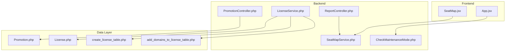
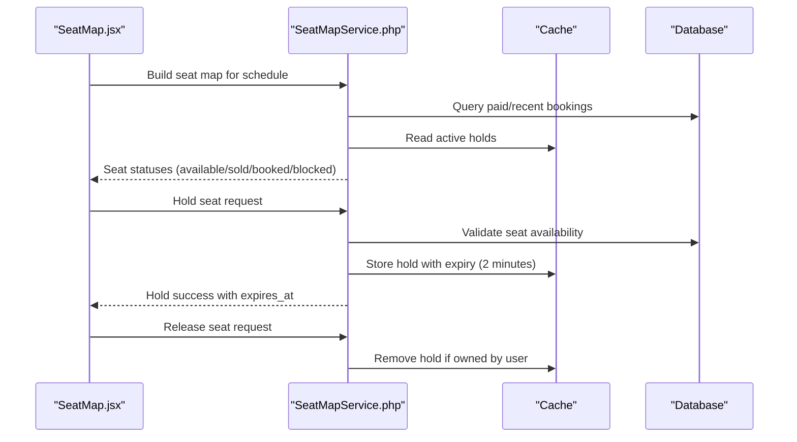
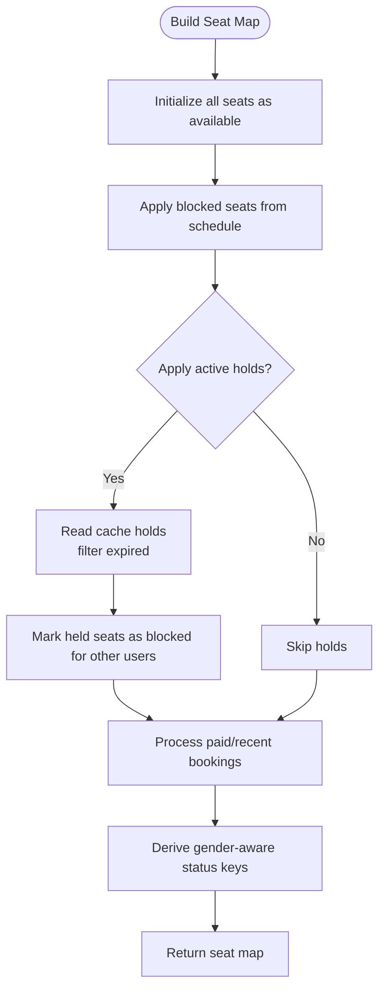
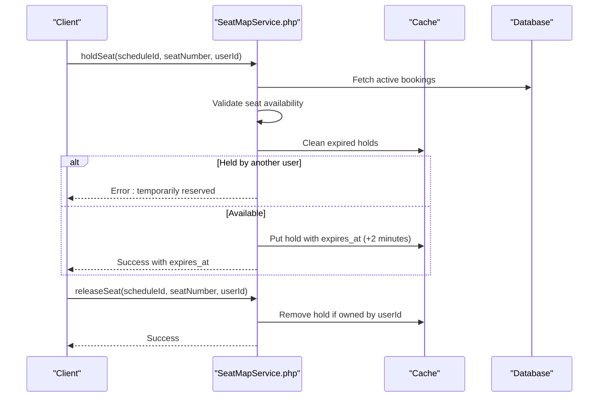
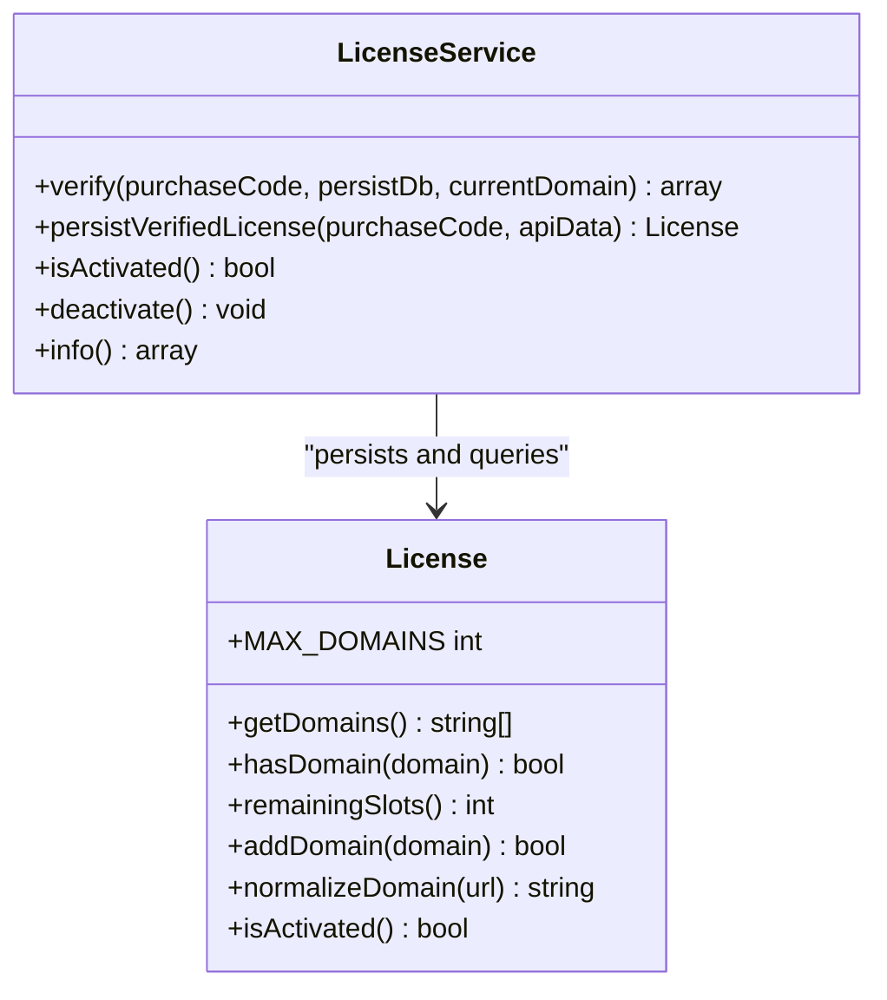
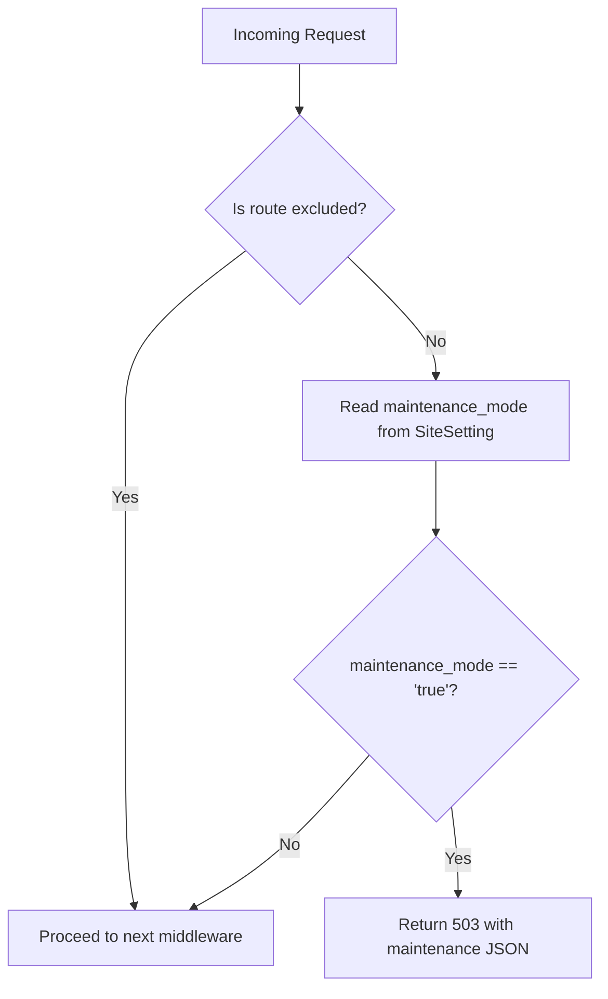
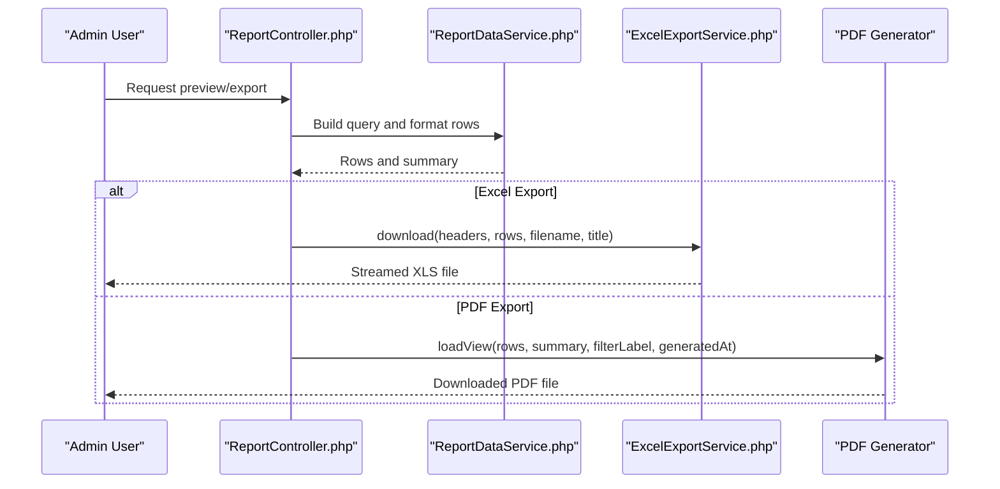
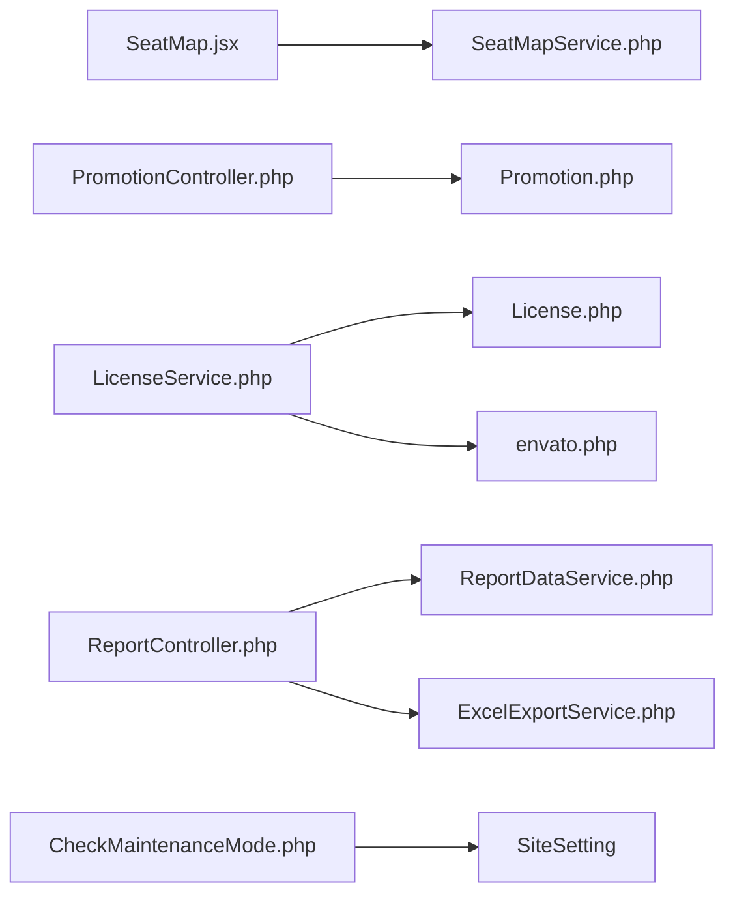

# Advanced Features

<cite>
**Referenced Files in This Document**
- [SeatMapService.php](file://backend/app/Services/SeatMapService.php)
- [SeatMap.jsx](file://frontend/src/components/SeatMap.jsx)
- [PromotionController.php](file://backend/app/Http/Controllers/API/PromotionController.php)
- [Promotion.php](file://backend/app/Models/Promotion.php)
- [LicenseService.php](file://backend/app/Services/LicenseService.php)
- [License.php](file://backend/app/Models/License.php)
- [LicenseController.php](file://backend/app/Http/Controllers/Admin/LicenseController.php)
- [envato.php](file://backend/config/envato.php)
- [2026_10_08_100000_create_license_table.php](file://backend/database/migrations/2026_10_08_100000_create_license_table.php)
- [2026_10_08_110000_add_domains_to_license_table.php](file://backend/database/migrations/2026_10_08_110000_add_domains_to_license_table.php)
- [CheckMaintenanceMode.php](file://backend/app/Http/Middleware/CheckMaintenanceMode.php)
- [App.jsx](file://frontend/src/App.jsx)
- [ReportDataService.php](file://backend/app/Services/ReportDataService.php)
- [ExcelExportService.php](file://backend/app/Services/ExcelExportService.php)
- [ReportController.php](file://backend/app/Http/Controllers/Admin/ReportController.php)
- [reports.blade.php](file://backend/resources/views/admin/partials/reports.blade.php)
</cite>

## Table of Contents
1. [Introduction](#introduction)
2. [Project Structure](#project-structure)
3. [Core Components](#core-components)
4. [Architecture Overview](#architecture-overview)
5. [Detailed Component Analysis](#detailed-component-analysis)
6. [Dependency Analysis](#dependency-analysis)
7. [Performance Considerations](#performance-considerations)
8. [Troubleshooting Guide](#troubleshooting-guide)
9. [Conclusion](#conclusion)

## Introduction
This document explains the advanced SonyaBus features focused on:
- Sophisticated seat management with gender-aware blocking, real-time availability tracking, and a 2-minute seat holding mechanism.
- Envato license verification with purchase code validation and domain locking.
- Promotion and discount code handling.
- Maintenance mode functionality.
- Dark/light theme support through site settings.
- Advanced reporting with PDF and Excel exports.

The goal is to provide both high-level understanding and detailed technical guidance for developers and administrators.

## Project Structure
Advanced features span backend services, controllers, models, middleware, frontend components, and admin views:
- Seat management: backend service and frontend component collaborate to render live seat maps and enforce holds.
- License system: service validates Envato purchase codes, enforces domain limits, and persists activation state.
- Promotions: API controller exposes promo lookup; model stores discount data.
- Maintenance mode: middleware intercepts requests and returns maintenance responses when enabled.
- Reporting: controller orchestrates queries, formatting, and export to PDF or Excel.

**Diagram sources**
- [SeatMap.jsx:1-612](file://frontend/src/components/SeatMap.jsx#L1-L612)
- [SeatMapService.php:1-593](file://backend/app/Services/SeatMapService.php#L1-L593)
- [PromotionController.php:1-39](file://backend/app/Http/Controllers/API/PromotionController.php#L1-L39)
- [Promotion.php:1-18](file://backend/app/Models/Promotion.php#L1-L18)
- [LicenseService.php:1-408](file://backend/app/Services/LicenseService.php#L1-L408)
- [License.php:1-126](file://backend/app/Models/License.php#L1-L126)
- [2026_10_08_100000_create_license_table.php:1-30](file://backend/database/migrations/2026_10_08_100000_create_license_table.php#L1-L30)
- [2026_10_08_110000_add_domains_to_license_table.php:1-24](file://backend/database/migrations/2026_10_08_110000_add_domains_to_license_table.php#L1-L24)
- [CheckMaintenanceMode.php:1-49](file://backend/app/Http/Middleware/CheckMaintenanceMode.php#L1-L49)
- [App.jsx:1-800](file://frontend/src/App.jsx#L1-L800)

**Section sources**
- [SeatMapService.php:1-593](file://backend/app/Services/SeatMapService.php#L1-L593)
- [SeatMap.jsx:1-612](file://frontend/src/components/SeatMap.jsx#L1-L612)
- [LicenseService.php:1-408](file://backend/app/Services/LicenseService.php#L1-L408)
- [License.php:1-126](file://backend/app/Models/License.php#L1-L126)
- [CheckMaintenanceMode.php:1-49](file://backend/app/Http/Middleware/CheckMaintenanceMode.php#L1-L49)
- [App.jsx:1-800](file://frontend/src/App.jsx#L1-L800)

## Core Components
- SeatMapService: Builds seat maps, applies blocked seats, active holds, and gender-aware booking states; manages 2-minute seat holds via cache.
- SeatMap (frontend): Renders bus layouts, shows live status, integrates promo discounts, and displays hold timers.
- PromotionController + Promotion: Validates promo codes and returns discount details.
- LicenseService + License: Verifies Envato purchase codes, enforces domain limits, persists activation, and supports bypass modes.
- CheckMaintenanceMode: Enforces maintenance mode globally while allowing site-settings access.
- ReportController + ReportDataService + ExcelExportService: Provides comprehensive reports with PDF and Excel export.

**Section sources**
- [SeatMapService.php:1-593](file://backend/app/Services/SeatMapService.php#L1-L593)
- [SeatMap.jsx:1-612](file://frontend/src/components/SeatMap.jsx#L1-L612)
- [PromotionController.php:1-39](file://backend/app/Http/Controllers/API/PromotionController.php#L1-L39)
- [Promotion.php:1-18](file://backend/app/Models/Promotion.php#L1-L18)
- [LicenseService.php:1-408](file://backend/app/Services/LicenseService.php#L1-L408)
- [License.php:1-126](file://backend/app/Models/License.php#L1-L126)
- [CheckMaintenanceMode.php:1-49](file://backend/app/Http/Middleware/CheckMaintenanceMode.php#L1-L49)
- [ReportController.php:1-648](file://backend/app/Http/Controllers/Admin/ReportController.php#L1-L648)
- [ReportDataService.php:1-774](file://backend/app/Services/ReportDataService.php#L1-L774)
- [ExcelExportService.php:1-67](file://backend/app/Services/ExcelExportService.php#L1-L67)

## Architecture Overview
The advanced features integrate across layers:
- Frontend SeatMap renders layout and interacts with backend SeatMapService for live availability and holds.
- Promo checks are handled by PromotionController returning discount info used by SeatMap UI.
- LicenseService coordinates Envato API calls, domain limit enforcement, and persistence via License model and migrations.
- Maintenance mode is enforced at middleware level, affecting all routes except configured exceptions.
- Reports are generated by ReportController using ReportDataService and exported via ExcelExportService or PDF templates.

**Diagram sources**
- [SeatMap.jsx:1-612](file://frontend/src/components/SeatMap.jsx#L1-L612)
- [SeatMapService.php:194-561](file://backend/app/Services/SeatMapService.php#L194-L561)

## Detailed Component Analysis

### Seat Management System
Seat management combines backend logic and frontend rendering:
- Backend builds seat maps considering:
  - Bus layout and custom grid definitions.
  - Blocked seats from schedule configuration.
  - Active holds stored in cache with expiration timestamps.
  - Gender-aware booking states derived from passenger gender and booking status.
- Frontend SeatMap:
  - Renders default or custom bus layouts.
  - Displays live status updates and hold countdown timers.
  - Integrates promo discount application into pricing breakdown.

**Diagram sources**
- [SeatMapService.php:194-244](file://backend/app/Services/SeatMapService.php#L194-L244)

Key behaviors:
- Gender-aware blocking: Booking statuses are prefixed by gender (e.g., booked_m, sold_f).
- Real-time availability: Recent pending bookings within a time window are considered active.
- 2-minute seat holding: Holds are stored in cache with an expiration timestamp; only the holder can release.

Hold lifecycle:

**Diagram sources**
- [SeatMapService.php:502-582](file://backend/app/Services/SeatMapService.php#L502-L582)

Frontend integration:
- SeatMap.jsx renders seat grids, applies status classes, and shows hold timers.
- Pricing breakdown includes promo discount applied after service/gateway charges.

**Section sources**
- [SeatMapService.php:49-189](file://backend/app/Services/SeatMapService.php#L49-L189)
- [SeatMapService.php:194-244](file://backend/app/Services/SeatMapService.php#L194-L244)
- [SeatMapService.php:502-582](file://backend/app/Services/SeatMapService.php#L502-L582)
- [SeatMap.jsx:48-190](file://frontend/src/components/SeatMap.jsx#L48-L190)
- [SeatMap.jsx:192-384](file://frontend/src/components/SeatMap.jsx#L192-L384)
- [SeatMap.jsx:386-605](file://frontend/src/components/SeatMap.jsx#L386-L605)

### Envato License Verification System
The license system validates purchase codes against Envato APIs and enforces domain limits:
- Validation rules:
  - UUID format check.
  - Local dev bypass when enabled.
  - Seller bypass code allowed without API call.
  - Envato API verification with fallback endpoint.
  - Product ID match ensures code belongs to SonyaBus.
  - Domain limit enforcement (max 5 unique domains per purchase code).
- Persistence:
  - Writes APP_LICENSED flag to .env when verified.
  - Stores license record with buyer info and activated domains.
  - Caches activation status for performance.

**Diagram sources**
- [LicenseService.php:56-158](file://backend/app/Services/LicenseService.php#L56-L158)
- [License.php:17-126](file://backend/app/Models/License.php#L17-L126)

Configuration and schema:
- envato.php provides item_id and personal_token.
- Migrations create license table and add activated_domains JSON column.

Admin interface:
- LicenseController exposes info and reVerify endpoints for super admins.

**Section sources**
- [LicenseService.php:1-408](file://backend/app/Services/LicenseService.php#L1-L408)
- [License.php:1-126](file://backend/app/Models/License.php#L1-L126)
- [LicenseController.php:1-50](file://backend/app/Http/Controllers/Admin/LicenseController.php#L1-L50)
- [envato.php:1-42](file://backend/config/envato.php#L1-L42)
- [2026_10_08_100000_create_license_table.php:1-30](file://backend/database/migrations/2026_10_08_100000_create_license_table.php#L1-L30)
- [2026_10_08_110000_add_domains_to_license_table.php:1-24](file://backend/database/migrations/2026_10_08_110000_add_domains_to_license_table.php#L1-L24)

### Promotion and Discount Code System
Promotion handling is straightforward:
- PromotionController.check validates promo code and returns discount amount and description.
- Promotion model stores code, discount_amount, and description.

Usage in frontend:
- SeatMap.jsx includes promo input field and applies discount to total payable amount.

Limitations:
- Current implementation does not enforce usage limits or expiry dates at the backend.
- Admin can manage promotions via database or seeders.

**Section sources**
- [PromotionController.php:1-39](file://backend/app/Http/Controllers/API/PromotionController.php#L1-L39)
- [Promotion.php:1-18](file://backend/app/Models/Promotion.php#L1-L18)
- [SeatMap.jsx:513-605](file://frontend/src/components/SeatMap.jsx#L513-L605)

### Maintenance Mode Functionality
Maintenance mode blocks all API requests except site-settings endpoints:
- CheckMaintenanceMode reads maintenance_mode and maintenance_message from SiteSetting.
- Returns 503 JSON response with maintenance flag and message when enabled.
- Frontend App.jsx checks siteSettings.maintenance.enabled and renders Maintenance component.

**Diagram sources**
- [CheckMaintenanceMode.php:17-47](file://backend/app/Http/Middleware/CheckMaintenanceMode.php#L17-L47)
- [App.jsx:691-694](file://frontend/src/App.jsx#L691-L694)

**Section sources**
- [CheckMaintenanceMode.php:1-49](file://backend/app/Http/Middleware/CheckMaintenanceMode.php#L1-L49)
- [App.jsx:293-325](file://frontend/src/App.jsx#L293-L325)
- [App.jsx:691-694](file://frontend/src/App.jsx#L691-L694)

### Theme Support (Dark/Light)
Theme variables are managed via CSS custom properties and site settings:
- Frontend uses theme-variables.css and dynamic styles based on site settings.
- Admin partials include theme initialization and toggle components.

Note: Specific theme toggling logic is implemented in frontend assets and admin views; this section focuses on how site settings influence theming.

**Section sources**
- [App.jsx:429-500](file://frontend/src/App.jsx#L429-L500)
- [reports.blade.php:1-127](file://backend/resources/views/admin/partials/reports.blade.php#L1-L127)

### Advanced Reporting Capabilities
Reporting system provides multiple report types with filtering, summaries, and exports:
- ReportController handles preview, Excel export, and PDF export for each report type.
- ReportDataService defines queries, row formatters, headers, and summary builders.
- ExcelExportService generates XLS files using XML spreadsheet format.

Supported reports:
- Selling, Booking, Revenue, Passenger, Seat Occupancy, Cancellation, Refund, Payment, Route-wise Sales, Agent Sales.

**Diagram sources**
- [ReportController.php:84-143](file://backend/app/Http/Controllers/Admin/ReportController.php#L84-L143)
- [ReportDataService.php:17-163](file://backend/app/Services/ReportDataService.php#L17-L163)
- [ExcelExportService.php:9-67](file://backend/app/Services/ExcelExportService.php#L9-L67)

**Section sources**
- [ReportController.php:1-648](file://backend/app/Http/Controllers/Admin/ReportController.php#L1-L648)
- [ReportDataService.php:1-774](file://backend/app/Services/ReportDataService.php#L1-L774)
- [ExcelExportService.php:1-67](file://backend/app/Services/ExcelExportService.php#L1-L67)
- [reports.blade.php:1-127](file://backend/resources/views/admin/partials/reports.blade.php#L1-L127)

## Dependency Analysis
Component relationships:
- SeatMap.jsx depends on SeatMapService for seat map data and holds.
- PromotionController depends on Promotion model.
- LicenseService depends on License model, Envato API, and environment configuration.
- ReportController depends on ReportDataService and ExcelExportService.
- CheckMaintenanceMode depends on SiteSetting values.

**Diagram sources**
- [SeatMap.jsx:1-612](file://frontend/src/components/SeatMap.jsx#L1-L612)
- [SeatMapService.php:1-593](file://backend/app/Services/SeatMapService.php#L1-L593)
- [PromotionController.php:1-39](file://backend/app/Http/Controllers/API/PromotionController.php#L1-L39)
- [Promotion.php:1-18](file://backend/app/Models/Promotion.php#L1-L18)
- [LicenseService.php:1-408](file://backend/app/Services/LicenseService.php#L1-L408)
- [License.php:1-126](file://backend/app/Models/License.php#L1-L126)
- [envato.php:1-42](file://backend/config/envato.php#L1-L42)
- [ReportController.php:1-648](file://backend/app/Http/Controllers/Admin/ReportController.php#L1-L648)
- [ReportDataService.php:1-774](file://backend/app/Services/ReportDataService.php#L1-L774)
- [ExcelExportService.php:1-67](file://backend/app/Services/ExcelExportService.php#L1-L67)
- [CheckMaintenanceMode.php:1-49](file://backend/app/Http/Middleware/CheckMaintenanceMode.php#L1-L49)

**Section sources**
- [SeatMapService.php:1-593](file://backend/app/Services/SeatMapService.php#L1-L593)
- [SeatMap.jsx:1-612](file://frontend/src/components/SeatMap.jsx#L1-L612)
- [LicenseService.php:1-408](file://backend/app/Services/LicenseService.php#L1-L408)
- [ReportController.php:1-648](file://backend/app/Http/Controllers/Admin/ReportController.php#L1-L648)

## Performance Considerations
- Seat map queries select minimal columns for paid bookings to reduce payload size.
- Cache-based holds avoid repeated DB lookups for temporary reservations.
- Report queries use eager loading and filters to optimize data retrieval.
- Excel export streams XML directly to minimize memory usage.
- License verification caches activation status for 24 hours.

[No sources needed since this section provides general guidance]

## Troubleshooting Guide
Common issues and resolutions:
- Seat not available: Ensure seat is not held by another user or already booked; verify cache holds and DB status.
- Promo code invalid: Confirm code exists in database; current implementation lacks usage limits/expiry.
- License verification fails: Check Envato token and item_id configuration; ensure purchase code matches product; verify domain limit.
- Maintenance mode blocks access: Verify site-settings endpoint remains accessible; check maintenance_mode setting.
- Report export errors: Validate date ranges and filters; ensure PDF generator is installed and configured.

**Section sources**
- [SeatMapService.php:502-582](file://backend/app/Services/SeatMapService.php#L502-L582)
- [PromotionController.php:10-31](file://backend/app/Http/Controllers/API/PromotionController.php#L10-L31)
- [LicenseService.php:56-158](file://backend/app/Services/LicenseService.php#L56-L158)
- [CheckMaintenanceMode.php:22-47](file://backend/app/Http/Middleware/CheckMaintenanceMode.php#L22-L47)
- [ReportController.php:84-143](file://backend/app/Http/Controllers/Admin/ReportController.php#L84-L143)

## Conclusion
SonyaBus advanced features provide robust seat management with real-time availability and gender-aware blocking, secure Envato license verification with domain locking, flexible promotion handling, global maintenance mode, theme support, and comprehensive reporting with PDF and Excel exports. The architecture separates concerns across services, controllers, models, and frontend components, ensuring maintainability and scalability.

[No sources needed since this section summarizes without analyzing specific files]