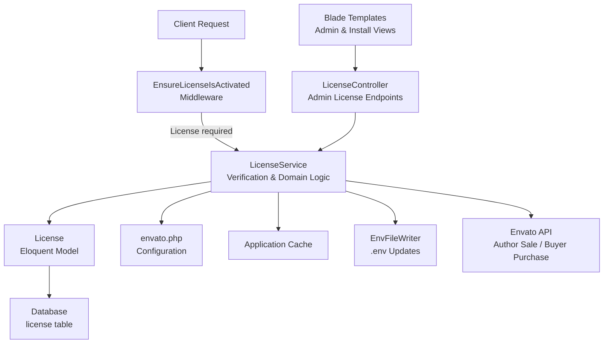
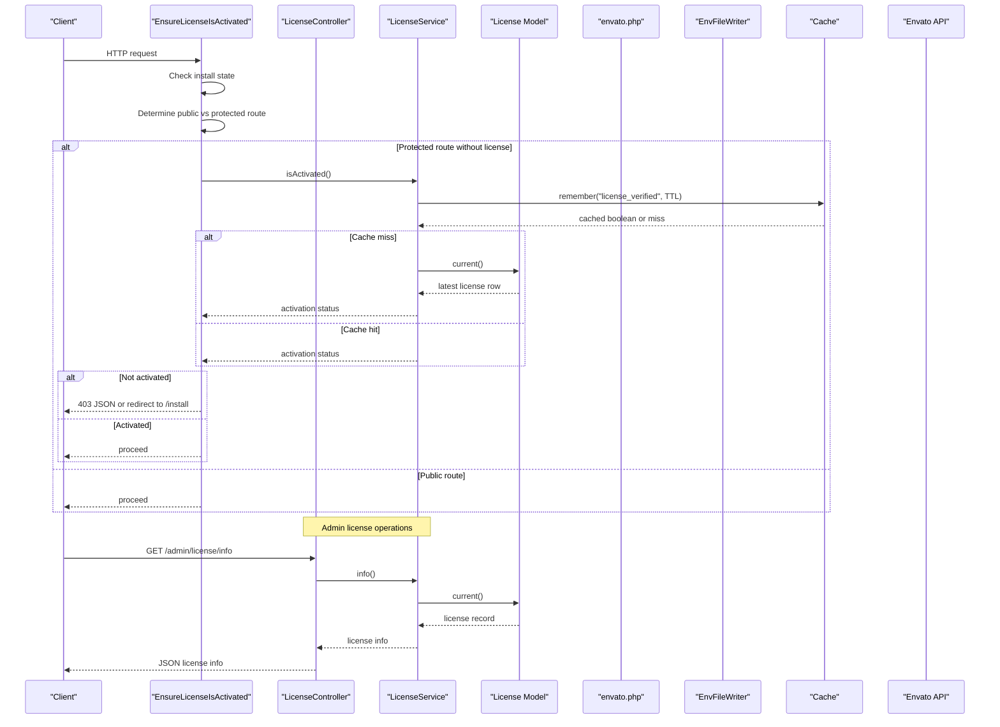
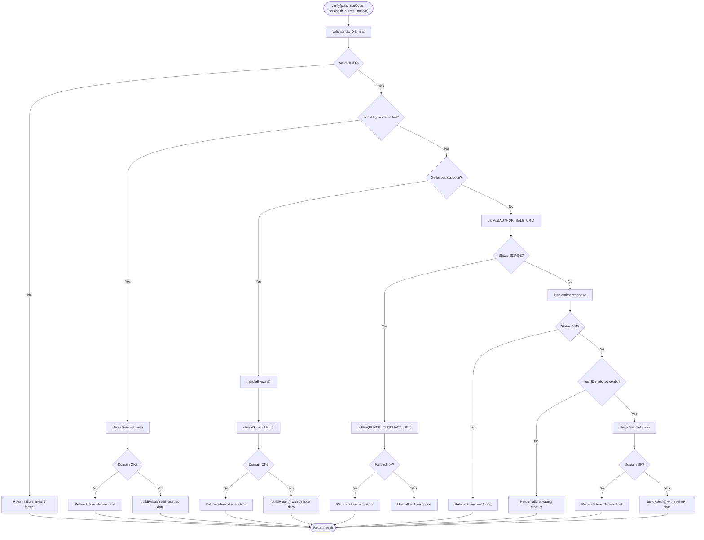
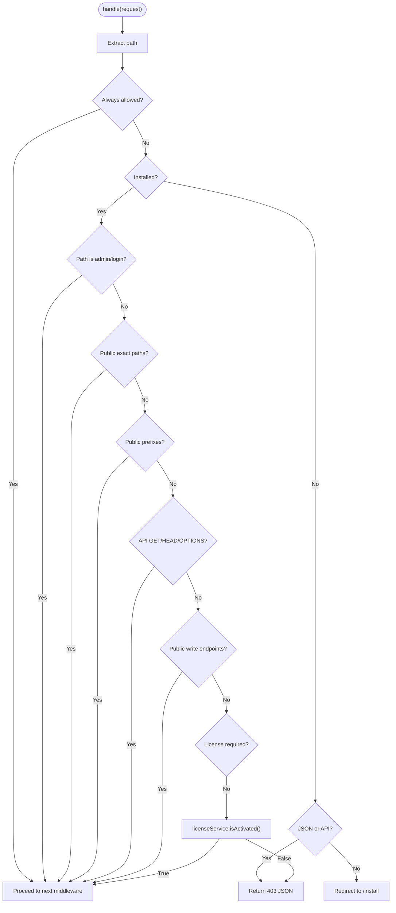
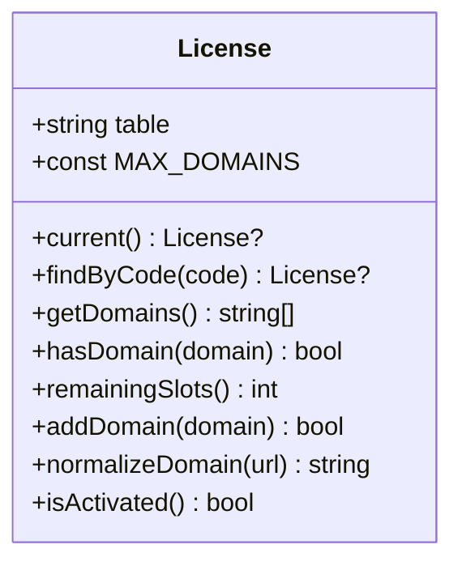
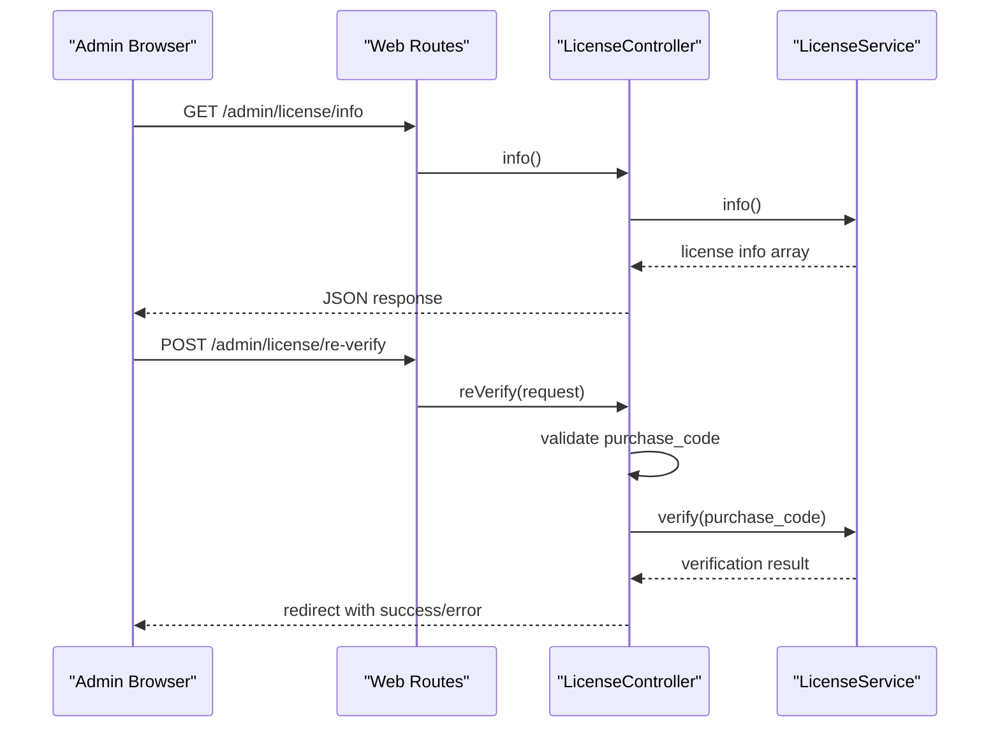
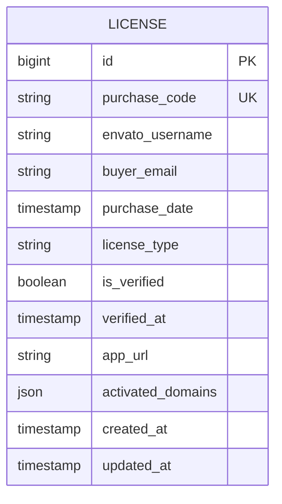
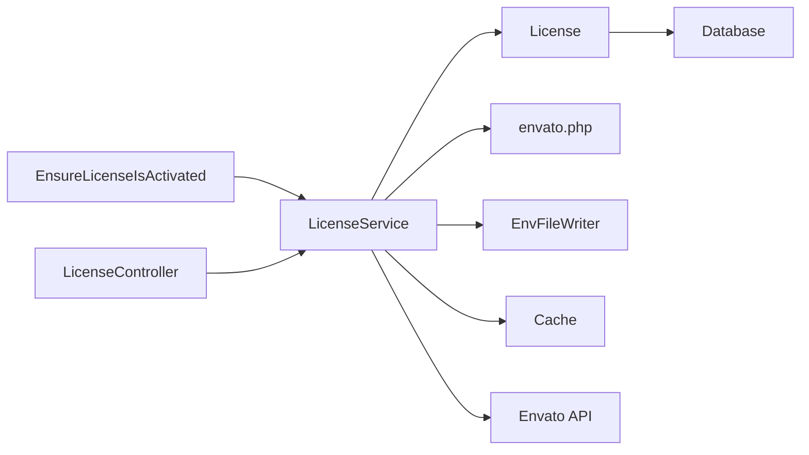

# License Verification System

<cite>
**Referenced Files in This Document**
- [LicenseService.php](file://backend/app/Services/LicenseService.php)
- [EnsureLicenseIsActivated.php](file://backend/app/Http/Middleware/EnsureLicenseIsActivated.php)
- [License.php](file://backend/app/Models/License.php)
- [LicenseController.php](file://backend/app/Http/Controllers/Admin/LicenseController.php)
- [EnvFileWriter.php](file://backend/app/Services/EnvFileWriter.php)
- [envato.php](file://backend/config/envato.php)
- [2026_10_08_100000_create_license_table.php](file://backend/database/migrations/2026_10_08_100000_create_license_table.php)
- [2026_10_08_110000_add_domains_to_license_table.php](file://backend/database/migrations/2026_10_08_110000_add_domains_to_license_table.php)
- [license.blade.php (admin)](file://backend/resources/views/admin/partials/license.blade.php)
- [license.blade.php (install)](file://backend/resources/views/install/license.blade.php)
</cite>

## Update Summary
**Changes Made**
- Updated introduction and architecture to clarify that the complete CodeCanyon distribution infrastructure has been removed while LicenseService remains active
- Added new section explaining the current state of license verification as a standalone feature rather than part of CodeCanyon distribution
- Updated troubleshooting guide to reflect that this is now a self-contained licensing system
- Removed references to CodeCanyon-specific distribution workflows while preserving core license verification functionality

## Table of Contents
1. [Introduction](#introduction)
2. [Project Structure](#project-structure)
3. [Core Components](#core-components)
4. [Architecture Overview](#architecture-overview)
5. [Detailed Component Analysis](#detailed-component-analysis)
6. [Dependency Analysis](#dependency-analysis)
7. [Performance Considerations](#performance-considerations)
8. [Current Distribution Status](#current-distribution-status)
9. [Troubleshooting Guide](#troubleshooting-guide)
10. [Conclusion](#conclusion)

## Introduction
This document explains the Envato license verification system used by SonyaBus. **Important update**: While the complete CodeCanyon distribution infrastructure has been removed from the project, the core license verification system remains fully functional. The LicenseService continues to validate purchase codes against the Envato API, enforce domain locking to prevent unauthorized multi-domain usage, and manage activation/deactivation workflows.

The system now operates as a self-contained licensing mechanism rather than being integrated into a broader CodeCanyon distribution pipeline. It covers purchase code validation, domain limit enforcement (maximum 5 domains per purchase code), middleware-based access control for admin routes, and comprehensive error handling for invalid or expired licenses.

## Project Structure
The license verification feature spans several layers within the application:
- Service layer: `LicenseService` implements verification logic, domain limits, persistence, and cache management
- Middleware: `EnsureLicenseIsActivated` gates access to non-public routes based on installation and license state
- Model layer: `License` represents stored license records and manages activated domains
- Admin controller: `LicenseController` exposes admin endpoints for license information and re-verification
- Configuration: `config/envato.php` defines Envato credentials and product identification
- Database migrations: create and extend the `license` table with domain support
- Environment writer: `EnvFileWriter` safely updates `.env` values during activation
- UI components: Blade templates for both installation wizard and admin license management

**Diagram sources**
- [EnsureLicenseIsActivated.php:86-167](file://backend/app/Http/Middleware/EnsureLicenseIsActivated.php#L86-L167)
- [LicenseController.php:20-48](file://backend/app/Http/Controllers/Admin/LicenseController.php#L20-L48)
- [LicenseService.php:56-158](file://backend/app/Services/LicenseService.php#L56-L158)
- [License.php:42-124](file://backend/app/Models/License.php#L42-L124)
- [envato.php:1-42](file://backend/config/envato.php#L1-L42)
- [EnvFileWriter.php:10-44](file://backend/app/Services/EnvFileWriter.php#L10-L44)

**Section sources**
- [LicenseService.php:10-42](file://backend/app/Services/LicenseService.php#L10-L42)
- [EnsureLicenseIsActivated.php:10-24](file://backend/app/Http/Middleware/EnsureLicenseIsActivated.php#L10-L24)
- [License.php:7-18](file://backend/app/Models/License.php#L7-L18)
- [envato.php:5-41](file://backend/config/envato.php#L5-L41)

## Core Components
- **LicenseService**: Central orchestrator for purchase code validation, domain limit enforcement, API calls, caching, and persistence
- **EnsureLicenseIsActivated**: Two-stage gate enforcing installation completion and license activation for protected routes
- **License model**: Stores license metadata and tracks activated domains per purchase code
- **LicenseController**: Admin-facing endpoints for license info and re-verification
- **EnvFileWriter**: Secure utility for updating `.env` keys like `APP_LICENSED`
- **envato.php**: Configuration for Envato item ID and personal token
- **Migrations**: Define the `license` table and add a JSON column for activated domains

Key responsibilities:
- Validate UUID format before calling external APIs
- Support local development bypass and seller bypass code
- Enforce maximum five unique domains per purchase code
- Cache activation status for 24 hours
- Provide graceful fallbacks when Envato API returns authentication errors

**Section sources**
- [LicenseService.php:56-158](file://backend/app/Services/LicenseService.php#L56-L158)
- [LicenseService.php:164-226](file://backend/app/Services/LicenseService.php#L164-L226)
- [EnsureLicenseIsActivated.php:86-167](file://backend/app/Http/Middleware/EnsureLicenseIsActivated.php#L86-L167)
- [License.php:60-115](file://backend/app/Models/License.php#L60-L115)
- [LicenseController.php:20-48](file://backend/app/Http/Controllers/Admin/LicenseController.php#L20-L48)
- [EnvFileWriter.php:10-44](file://backend/app/Services/EnvFileWriter.php#L10-L44)
- [envato.php:18-39](file://backend/config/envato.php#L18-L39)

## Architecture Overview
The license verification flow integrates middleware gating, service orchestration, model persistence, environment updates, and external API calls.

**Diagram sources**
- [EnsureLicenseIsActivated.php:86-167](file://backend/app/Http/Middleware/EnsureLicenseIsActivated.php#L86-L167)
- [LicenseService.php:176-194](file://backend/app/Services/LicenseService.php#L176-L194)
- [LicenseService.php:203-226](file://backend/app/Services/LicenseService.php#L203-L226)
- [LicenseController.php:20-23](file://backend/app/Http/Controllers/Admin/LicenseController.php#L20-L23)
- [License.php:42-45](file://backend/app/Models/License.php#L42-L45)

## Detailed Component Analysis

### LicenseService
LicenseService implements the complete verification workflow:
- Input validation: Ensures purchase code is a valid UUID
- Local bypass: When running locally and configured via `ENVATO_SKIP_VERIFY`, accepts any valid UUID without calling Envato
- Seller bypass: A hardcoded bypass code allows testing without an API call while still enforcing domain limits
- Envato API calls: Uses author sale endpoint; falls back to buyer purchase endpoint on 401/403
- Product matching: Rejects codes belonging to other products by comparing returned item ID with configured item ID
- Domain limit: Allows up to five unique domains per purchase code; same domain re-verification always succeeds
- Persistence: Writes `APP_LICENSED=true` and stores license data in the database; caches activation status for 24 hours
- Deactivation: Clears license records, cache, and sets `APP_LICENSED=false`
- Info retrieval: Returns masked purchase code and domain slot usage

**Diagram sources**
- [LicenseService.php:56-158](file://backend/app/Services/LicenseService.php#L56-L158)
- [LicenseService.php:237-254](file://backend/app/Services/LicenseService.php#L237-L254)
- [LicenseService.php:263-297](file://backend/app/Services/LicenseService.php#L263-L297)
- [LicenseService.php:303-328](file://backend/app/Services/LicenseService.php#L303-L328)
- [LicenseService.php:363-380](file://backend/app/Services/LicenseService.php#L363-L380)

Key behaviors:
- Caching: Activation status is cached under key `license_verified` for 1440 minutes (24 hours)
- Fallback mechanism: On 401/403 from author sale endpoint, tries buyer purchase endpoint
- Error messages: Distinguishes invalid format, not found, wrong product, domain limit exceeded, and network/auth failures
- Safe persistence: During wizard step 1 (`persistDb=false`), no `.env` or DB writes occur

**Section sources**
- [LicenseService.php:56-158](file://backend/app/Services/LicenseService.php#L56-L158)
- [LicenseService.php:164-226](file://backend/app/Services/LicenseService.php#L164-L226)
- [LicenseService.php:237-328](file://backend/app/Services/LicenseService.php#L237-L328)
- [LicenseService.php:363-406](file://backend/app/Services/LicenseService.php#L363-L406)

### EnsureLicenseIsActivated Middleware
The middleware enforces two stages:
- Stage 1 — Install lock: Until `APP_INSTALLED=true`, only install-related routes are allowed. Requests get redirected to `/install` or receive a 403 JSON response
- Stage 2 — License gate: After installation, public customer API routes are allowed without a license. All other routes require an active license

Public routes include exact paths and prefixes for site settings, stations, search, promotions, auth, and public bookings. Non-public API write endpoints are explicitly allowed. Everything else requires activation.

**Diagram sources**
- [EnsureLicenseIsActivated.php:30-54](file://backend/app/Http/Middleware/EnsureLicenseIsActivated.php#L30-L54)
- [EnsureLicenseIsActivated.php:68-84](file://backend/app/Http/Middleware/EnsureLicenseIsActivated.php#L68-L84)
- [EnsureLicenseIsActivated.php:86-167](file://backend/app/Http/Middleware/EnsureLicenseIsActivated.php#L86-L167)

Behavioral notes:
- Installation check uses `config('app.installed')` and falls back to a lock file at `storage/framework/installed`
- License check delegates to `LicenseService::isActivated()` which reads cache and DB
- Responses differ for JSON/API requests versus browser redirects

**Section sources**
- [EnsureLicenseIsActivated.php:10-24](file://backend/app/Http/Middleware/EnsureLicenseIsActivated.php#L10-L24)
- [EnsureLicenseIsActivated.php:30-84](file://backend/app/Http/Middleware/EnsureLicenseIsActivated.php#L30-L84)
- [EnsureLicenseIsActivated.php:86-167](file://backend/app/Http/Middleware/EnsureLicenseIsActivated.php#L86-L167)

### License Model
The License model stores one row per purchase code and tracks activated domains:
- Fields: purchase code, Envato username, buyer email, purchase date, license type, verification flag, verified timestamp, app URL, and activated domains JSON array
- Domain methods: getDomains, hasDomain, remainingSlots, addDomain, normalizeDomain
- Status helpers: current, findByCode, isActivated

**Diagram sources**
- [License.php:13-37](file://backend/app/Models/License.php#L13-L37)
- [License.php:42-124](file://backend/app/Models/License.php#L42-L124)

Complexity considerations:
- Domain operations use array filtering and counting; typical operations are O(n) where n is number of registered domains (max 5)
- Normalization ensures consistent comparison across schemes and trailing slashes

**Section sources**
- [License.php:7-37](file://backend/app/Models/License.php#L7-L37)
- [License.php:42-124](file://backend/app/Models/License.php#L42-L124)

### LicenseController
Admin endpoints:
- info(): Returns license information as JSON for dashboard AJAX calls
- reVerify(Request): Validates and re-verifies an existing purchase code using server-side Envato token

**Diagram sources**
- [LicenseController.php:20-48](file://backend/app/Http/Controllers/Admin/LicenseController.php#L20-L48)
- [LicenseService.php:203-226](file://backend/app/Services/LicenseService.php#L203-L226)
- [LicenseService.php:56-158](file://backend/app/Services/LicenseService.php#L56-L158)

**Section sources**
- [LicenseController.php:8-15](file://backend/app/Http/Controllers/Admin/LicenseController.php#L8-L15)
- [LicenseController.php:20-48](file://backend/app/Http/Controllers/Admin/LicenseController.php#L20-L48)

### EnvFileWriter
Securely updates `.env`:
- Validates base path and prevents path traversal
- Only allows safe environment variable names
- Formats values with quotes when necessary

Security properties:
- Realpath checks ensure `.env` resides within the application root
- Regex validation restricts keys to alphanumeric and underscore patterns

**Section sources**
- [EnvFileWriter.php:5-55](file://backend/app/Services/EnvFileWriter.php#L5-L55)

### Configuration: envato.php
Defines:
- `item_id`: Numeric CodeCanyon product ID used to match purchase codes
- `personal_token`: Author personal token for calling Envato API

Where to obtain values:
- Item ID from CodeCanyon product URL
- Personal token from Envato build portal with appropriate permissions

**Section sources**
- [envato.php:5-41](file://backend/config/envato.php#L5-L41)

### Database Schema: license table
Migrations define:
- Base table with fields for purchase code, Envato username, buyer email, purchase date, license type, verification flag, verified timestamp, and app URL
- Additional JSON column `activated_domains` to store up to five unique domains per purchase code

**Diagram sources**
- [2026_10_08_100000_create_license_table.php:11-22](file://backend/database/migrations/2026_10_08_100000_create_license_table.php#L11-L22)
- [2026_10_08_110000_add_domains_to_license_table.php:11-14](file://backend/database/migrations/2026_10_08_110000_add_domains_to_license_table.php#L11-L14)

**Section sources**
- [2026_10_08_100000_create_license_table.php:9-22](file://backend/database/migrations/2026_10_08_100000_create_license_table.php#L9-L22)
- [2026_10_08_110000_add_domains_to_license_table.php:9-14](file://backend/database/migrations/2026_10_08_110000_add_domains_to_license_table.php#L9-L14)

## Dependency Analysis
The license verification system exhibits clear separation of concerns:
- Middleware depends on LicenseService for activation checks
- LicenseService depends on License model, envato configuration, cache, EnvFileWriter, and Envato API
- LicenseController depends on LicenseService for admin operations
- EnvFileWriter is isolated and used only for safe `.env` updates

**Diagram sources**
- [EnsureLicenseIsActivated.php:86-167](file://backend/app/Http/Middleware/EnsureLicenseIsActivated.php#L86-L167)
- [LicenseController.php:20-48](file://backend/app/Http/Controllers/Admin/LicenseController.php#L20-L48)
- [LicenseService.php:56-158](file://backend/app/Services/LicenseService.php#L56-L158)
- [License.php:42-124](file://backend/app/Models/License.php#L42-L124)
- [envato.php:18-39](file://backend/config/envato.php#L18-L39)
- [EnvFileWriter.php:10-44](file://backend/app/Services/EnvFileWriter.php#L10-L44)

Coupling and cohesion:
- High cohesion within LicenseService for all license-related logic
- Low coupling between middleware and service through a single interface method
- Clear boundaries between persistence (model), configuration (envato.php), and environment manipulation (EnvFileWriter)

Potential circular dependencies:
- None observed; dependencies are unidirectional

External integration points:
- Envato API endpoints for author sale and buyer purchase
- Application cache for activation status
- Database for license records

**Section sources**
- [LicenseService.php:56-158](file://backend/app/Services/LicenseService.php#L56-L158)
- [EnsureLicenseIsActivated.php:86-167](file://backend/app/Http/Middleware/EnsureLicenseIsActivated.php#L86-L167)
- [LicenseController.php:20-48](file://backend/app/Http/Controllers/Admin/LicenseController.php#L20-L48)

## Performance Considerations
- Caching: Activation status is cached for 24 hours to reduce database queries
- API retries: The service retries Envato API calls twice with a short delay
- Timeout: External API calls have a 20-second timeout to avoid hanging requests
- Domain checks: Limited to a small fixed set (max 5), keeping array operations efficient

Recommendations:
- Ensure cache backend is reliable and persistent across deployments
- Monitor Envato API availability and consider alerting on repeated failures
- Avoid frequent re-verification in tight loops; rely on cache TTL

## Current Distribution Status
**Updated**: The complete CodeCanyon distribution infrastructure has been removed from the project. However, the core license verification system remains fully functional as a standalone feature.

### What Remains
- **LicenseService**: Complete purchase code validation against Envato API
- **Domain Locking**: Enforcement of maximum 5 domains per purchase code
- **Middleware Protection**: Access control for admin routes requiring active license
- **Admin Interface**: License management panel for viewing and re-verifying licenses
- **Installation Integration**: License verification during the installation wizard process

### What Has Been Removed
- CodeCanyon-specific packaging scripts and distribution automation
- Marketplace submission workflows and automated release processes
- CodeCanyon marketplace integration tools and utilities
- Automated documentation generation for CodeCanyon requirements

### Current State
The license verification system now operates independently within the SonyaBus application. It provides robust protection against unauthorized usage through purchase code validation, domain locking, and middleware-enforced access control. The system supports local development and seller bypass modes, caches activation status for performance, and includes fallback mechanisms for API reliability.

Administrators can manage licenses via dedicated endpoints, and the system maintains clear separation of concerns across service, model, middleware, and configuration layers. Proper configuration of Envato credentials and careful handling of domain activations ensure secure and scalable licensing behavior.

## Troubleshooting Guide
Common issues and resolutions:
- **Invalid purchase code format**:
  - Cause: Code is not a valid UUID
  - Resolution: Verify the code from Envato Market downloads page
- **Wrong product**:
  - Cause: Purchase code belongs to another CodeCanyon product
  - Resolution: Use the purchase code from the correct SonyaBus download
- **Not found**:
  - Cause: Envato API returns 404 for the code
  - Resolution: Confirm the code exists and is associated with your account
- **Authentication error**:
  - Cause: Missing or invalid Envato personal token or item ID
  - Resolution: Configure `ENVATO_PERSONAL_TOKEN` and `ENVATO_ITEM_ID` correctly
- **Domain limit reached**:
  - Cause: More than five unique domains activated for the same purchase code
  - Resolution: Purchase additional licenses or reuse an existing domain
- **Local development bypass**:
  - Behavior: When `ENVATO_SKIP_VERIFY=true` and environment is local, any valid UUID passes without API calls
  - Use case: Development and testing without Envato connectivity
- **Server not licensed**:
  - Symptom: Middleware returns 403 JSON or redirects to `/install`
  - Resolution: Complete installation and activate a valid license

Operational steps:
- Re-verify license via admin panel to refresh activation after domain changes
- Deactivate license to reset state if necessary
- Check logs for exceptions thrown during verification

**Section sources**
- [LicenseService.php:64-158](file://backend/app/Services/LicenseService.php#L64-L158)
- [LicenseService.php:263-297](file://backend/app/Services/LicenseService.php#L263-L297)
- [EnsureLicenseIsActivated.php:98-167](file://backend/app/Http/Middleware/EnsureLicenseIsActivated.php#L98-L167)
- [LicenseController.php:29-48](file://backend/app/Http/Controllers/Admin/LicenseController.php#L29-L48)

## Conclusion
The license verification system provides robust protection against unauthorized usage through purchase code validation, domain locking, and middleware-enforced access control. While the complete CodeCanyon distribution infrastructure has been removed, the core licensing functionality remains intact and operational.

The system supports local development and seller bypass modes, caches activation status for performance, and includes fallback mechanisms for API reliability. Administrators can manage licenses via dedicated endpoints, and the system maintains clear separation of concerns across service, model, middleware, and configuration layers.

As a self-contained licensing solution, it continues to provide secure and scalable licensing behavior for SonyaBus installations, ensuring that only legitimate purchasers can deploy and operate the application across multiple domains within the specified limits.