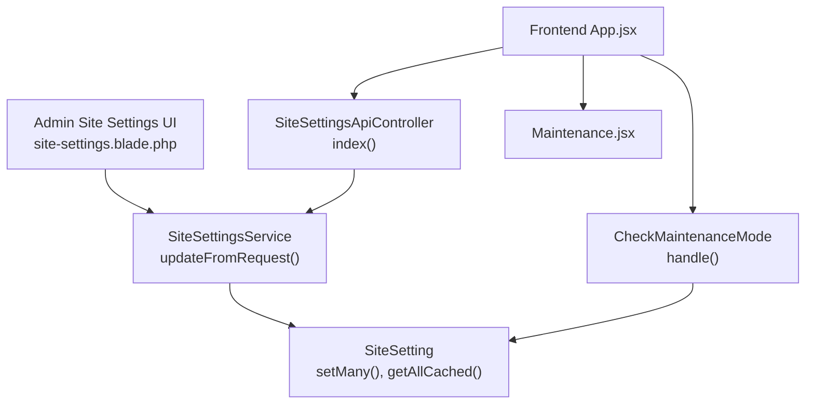
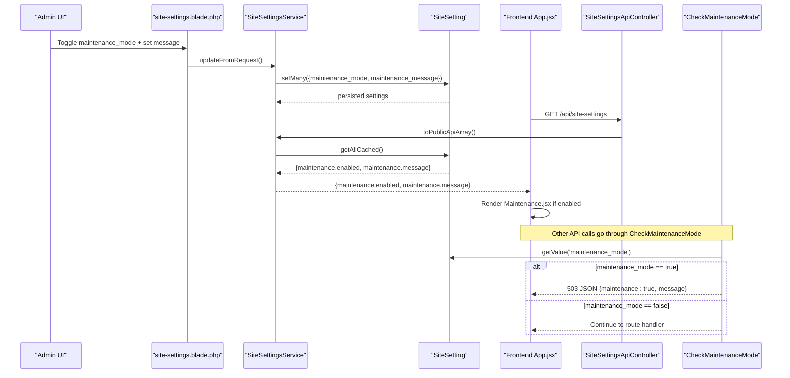
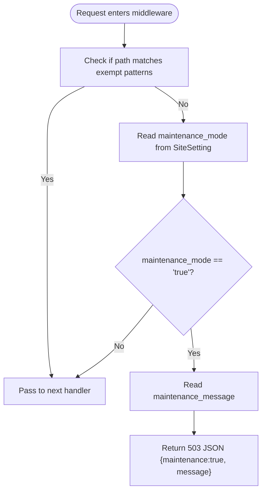
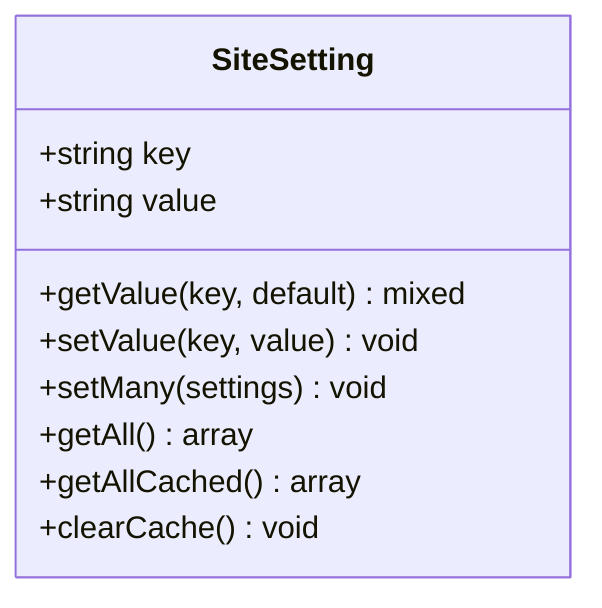
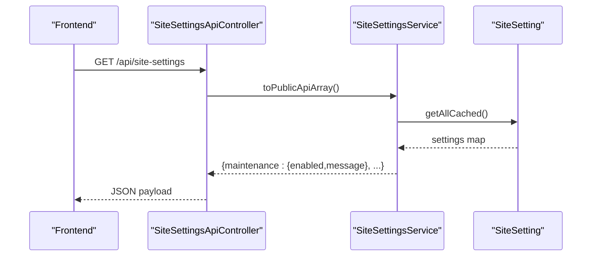
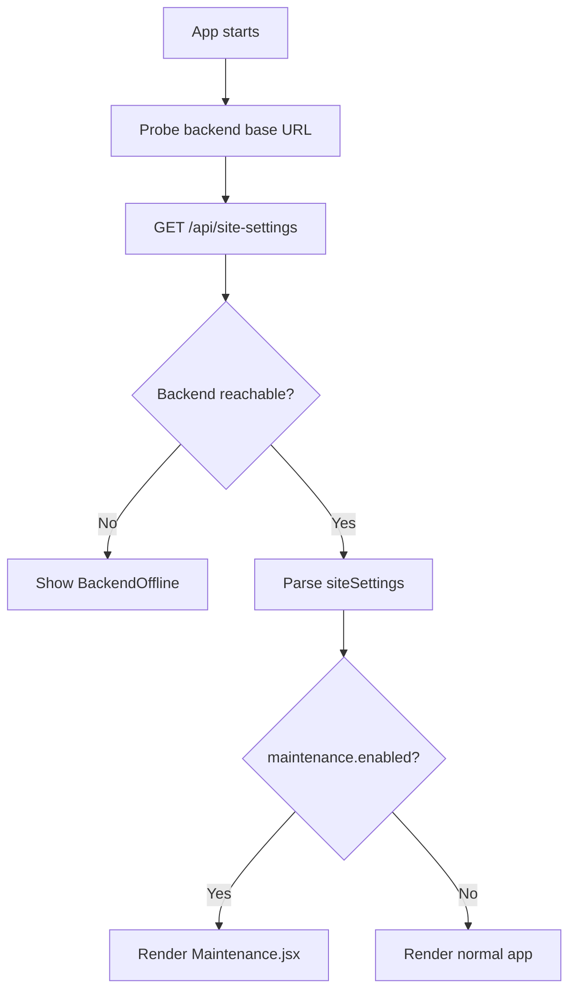
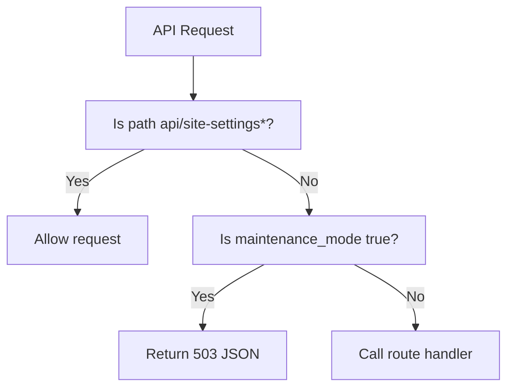
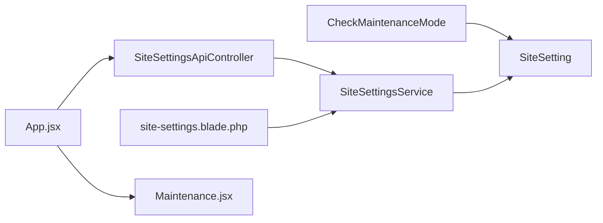

# Maintenance Mode System

<cite>
**Referenced Files in This Document**
- [CheckMaintenanceMode.php](file://backend/app/Http/Middleware/CheckMaintenanceMode.php)
- [SiteSetting.php](file://backend/app/Models/SiteSetting.php)
- [SiteSettingsService.php](file://backend/app/Services/SiteSettingsService.php)
- [SiteSettingsApiController.php](file://backend/app/Http/Controllers/API/SiteSettingsApiController.php)
- [site-settings.blade.php](file://backend/resources/views/admin/partials/site-settings.blade.php)
- [Maintenance.jsx](file://frontend/src/components/Maintenance.jsx)
- [App.jsx](file://frontend/src/App.jsx)
- [MaintenanceModeTest.php](file://backend/tests/Feature/MaintenanceModeTest.php)
</cite>

## Table of Contents
1. [Introduction](#introduction)
2. [Project Structure](#project-structure)
3. [Core Components](#core-components)
4. [Architecture Overview](#architecture-overview)
5. [Detailed Component Analysis](#detailed-component-analysis)
6. [Dependency Analysis](#dependency-analysis)
7. [Performance Considerations](#performance-considerations)
8. [Troubleshooting Guide](#troubleshooting-guide)
9. [Conclusion](#conclusion)

## Introduction
This document explains the maintenance mode system for the bus booking application. It covers how site-wide maintenance mode is stored and toggled through the admin site settings, how backend middleware intercepts API requests during maintenance, how the frontend displays a maintenance page, and how the system keeps the site-settings endpoint available so clients can still read maintenance status.

The maintenance mode feature is designed to:
- Block normal API operations when maintenance is enabled.
- Allow the frontend to continue fetching site settings so it can show a user-friendly maintenance screen.
- Provide an admin interface for toggling maintenance mode and editing the maintenance message.
- Keep authentication routes unaffected by the maintenance gate, as verified by tests.

## Project Structure
The maintenance mode functionality spans backend middleware, models, services, controllers, admin views, and frontend components:

**Diagram sources**
- [site-settings.blade.php:185-219](file://backend/resources/views/admin/partials/site-settings.blade.php#L185-L219)
- [SiteSettingsService.php:51-84](file://backend/app/Services/SiteSettingsService.php#L51-L84)
- [SiteSetting.php:21-70](file://backend/app/Models/SiteSetting.php#L21-L70)
- [SiteSettingsApiController.php:13-16](file://backend/app/Http/Controllers/API/SiteSettingsApiController.php#L13-L16)
- [CheckMaintenanceMode.php:22-47](file://backend/app/Http/Middleware/CheckMaintenanceMode.php#L22-L47)
- [App.jsx:691-694](file://frontend/src/App.jsx#L691-L694)
- [Maintenance.jsx:1-26](file://frontend/src/components/Maintenance.jsx#L1-L26)

**Section sources**
- [site-settings.blade.php:185-219](file://backend/resources/views/admin/partials/site-settings.blade.php#L185-L219)
- [SiteSettingsService.php:51-84](file://backend/app/Services/SiteSettingsService.php#L51-L84)
- [SiteSetting.php:21-70](file://backend/app/Models/SiteSetting.php#L21-L70)
- [SiteSettingsApiController.php:13-16](file://backend/app/Http/Controllers/API/SiteSettingsApiController.php#L13-L16)
- [CheckMaintenanceMode.php:22-47](file://backend/app/Http/Middleware/CheckMaintenanceMode.php#L22-L47)
- [App.jsx:691-694](file://frontend/src/App.jsx#L691-L694)
- [Maintenance.jsx:1-26](file://frontend/src/components/Maintenance.jsx#L1-L26)

## Core Components
- **Middleware CheckMaintenanceMode**: Intercepts API requests, checks the `maintenance_mode` setting, and returns a 503 JSON response with a maintenance message unless the request matches an excluded pattern.
- **Model SiteSetting**: Provides cached access to site-wide settings, including `maintenance_mode` and `maintenance_message`.
- **Service SiteSettingsService**: Converts raw settings into a public API payload and persists admin updates, including maintenance toggle and message.
- **Controller SiteSettingsApiController**: Exposes the public site settings endpoint used by the frontend.
- **Admin View site-settings.blade.php**: Renders the maintenance mode toggle and maintenance message editor.
- **Frontend App.jsx**: Probes the backend, fetches site settings, and renders the maintenance component when maintenance is enabled.
- **Frontend Component Maintenance.jsx**: Displays the maintenance page using the message from site settings.

**Section sources**
- [CheckMaintenanceMode.php:10-47](file://backend/app/Http/Middleware/CheckMaintenanceMode.php#L10-L47)
- [SiteSetting.php:8-80](file://backend/app/Models/SiteSetting.php#L8-L80)
- [SiteSettingsService.php:11-84](file://backend/app/Services/SiteSettingsService.php#L11-L84)
- [SiteSettingsApiController.php:7-16](file://backend/app/Http/Controllers/API/SiteSettingsApiController.php#L7-L16)
- [site-settings.blade.php:185-219](file://backend/resources/views/admin/partials/site-settings.blade.php#L185-L219)
- [App.jsx:293-325](file://frontend/src/App.jsx#L293-L325)
- [Maintenance.jsx:1-26](file://frontend/src/components/Maintenance.jsx#L1-L26)

## Architecture Overview
The maintenance mode flow connects admin configuration, backend persistence, API interception, and frontend display:

**Diagram sources**
- [site-settings.blade.php:185-219](file://backend/resources/views/admin/partials/site-settings.blade.php#L185-L219)
- [SiteSettingsService.php:51-84](file://backend/app/Services/SiteSettingsService.php#L51-L84)
- [SiteSetting.php:43-70](file://backend/app/Models/SiteSetting.php#L43-L70)
- [SiteSettingsApiController.php:13-16](file://backend/app/Http/Controllers/API/SiteSettingsApiController.php#L13-L16)
- [App.jsx:293-325](file://frontend/src/App.jsx#L293-L325)
- [CheckMaintenanceMode.php:22-47](file://backend/app/Http/Middleware/CheckMaintenanceMode.php#L22-L47)

## Detailed Component Analysis

### Backend Middleware: CheckMaintenanceMode
The middleware enforces maintenance mode at the API layer:
- It excludes the site-settings endpoints so the frontend can always read maintenance status.
- When maintenance mode is enabled, it returns a 503 JSON response containing a maintenance flag and message.
- Otherwise, it allows the request to proceed.

**Diagram sources**
- [CheckMaintenanceMode.php:17-47](file://backend/app/Http/Middleware/CheckMaintenanceMode.php#L17-L47)
- [SiteSetting.php:21-25](file://backend/app/Models/SiteSetting.php#L21-L25)

**Section sources**
- [CheckMaintenanceMode.php:10-47](file://backend/app/Http/Middleware/CheckMaintenanceMode.php#L10-L47)

### Settings Storage and Caching: SiteSetting
The model provides:
- A single-value getter with default fallback.
- Single and bulk setters that persist values and clear the cache.
- A cached bulk getter used by both the public API and middleware.

**Diagram sources**
- [SiteSetting.php:8-80](file://backend/app/Models/SiteSetting.php#L8-L80)

**Section sources**
- [SiteSetting.php:8-80](file://backend/app/Models/SiteSetting.php#L8-L80)

### Public Settings API: SiteSettingsService and SiteSettingsApiController
The service transforms raw settings into a structured public payload:
- Includes `maintenance.enabled` derived from `maintenance_mode`.
- Includes `maintenance.message` from `maintenance_message`.
- The controller returns this payload via the public API endpoint.

**Diagram sources**
- [SiteSettingsApiController.php:13-16](file://backend/app/Http/Controllers/API/SiteSettingsApiController.php#L13-L16)
- [SiteSettingsService.php:14-49](file://backend/app/Services/SiteSettingsService.php#L14-L49)
- [SiteSetting.php:66-70](file://backend/app/Models/SiteSetting.php#L66-L70)

**Section sources**
- [SiteSettingsService.php:14-49](file://backend/app/Services/SiteSettingsService.php#L14-L49)
- [SiteSettingsApiController.php:7-16](file://backend/app/Http/Controllers/API/SiteSettingsApiController.php#L7-L16)

### Admin Configuration: Site Settings View
The admin partial includes:
- A maintenance mode toggle field named `maintenance_mode`.
- A maintenance message textarea named `maintenance_message`.
- A submit form that posts to the site settings update route.

When saved, the service validates and persists these fields, converting the checkbox presence into a string boolean for `maintenance_mode`.

**Section sources**
- [site-settings.blade.php:185-219](file://backend/resources/views/admin/partials/site-settings.blade.php#L185-L219)
- [SiteSettingsService.php:51-84](file://backend/app/Services/SiteSettingsService.php#L51-L84)

### Frontend Display: App.jsx and Maintenance.jsx
The frontend:
- Probes the backend base URL.
- Fetches `/api/site-settings`.
- If `siteSettings.maintenance.enabled` is true, renders the `Maintenance` component.
- The `Maintenance` component shows the configured message and branding.

**Diagram sources**
- [App.jsx:69-92](file://frontend/src/App.jsx#L69-L92)
- [App.jsx:293-325](file://frontend/src/App.jsx#L293-L325)
- [App.jsx:691-694](file://frontend/src/App.jsx#L691-L694)
- [Maintenance.jsx:1-26](file://frontend/src/components/Maintenance.jsx#L1-L26)

**Section sources**
- [App.jsx:691-694](file://frontend/src/App.jsx#L691-L694)
- [Maintenance.jsx:1-26](file://frontend/src/components/Maintenance.jsx#L1-L26)

### Bypass Mechanisms and Route Behavior
- **Exempt API routes**: The middleware explicitly exempts `api/site-settings` and its subpaths. This ensures the frontend can always retrieve maintenance status even when maintenance is active.
- **Authentication routes**: Tests verify that authentication endpoints are not blocked by the maintenance middleware; they return validation or auth errors instead of 503.
- **Normal API routes**: Endpoints such as search, stations, promotions, and authenticated booking routes return 503 during maintenance.

**Diagram sources**
- [CheckMaintenanceMode.php:17-47](file://backend/app/Http/Middleware/CheckMaintenanceMode.php#L17-L47)
- [MaintenanceModeTest.php:51-61](file://backend/tests/Feature/MaintenanceModeTest.php#L51-L61)
- [MaintenanceModeTest.php:112-126](file://backend/tests/Feature/MaintenanceModeTest.php#L112-L126)

**Section sources**
- [CheckMaintenanceMode.php:17-47](file://backend/app/Http/Middleware/CheckMaintenanceMode.php#L17-L47)
- [MaintenanceModeTest.php:37-126](file://backend/tests/Feature/MaintenanceModeTest.php#L37-L126)

### Impact on API Endpoints vs Web Routes
- **API endpoints**: The middleware applies to API routes and blocks most endpoints during maintenance, returning a standardized 503 JSON response.
- **Web routes**: The provided files do not show web route handling for maintenance mode. The documented behavior focuses on API interception and frontend rendering based on site settings.

[No sources needed since this section summarizes observed behavior without analyzing specific web route files]

### Programmatic Enable/Disable Examples
You can enable or disable maintenance mode programmatically using the `SiteSetting` model:

- Enable maintenance mode:
  - Set `maintenance_mode` to `'true'`.
  - Optionally set `maintenance_message` to a custom message.
  - Clear the settings cache so changes take effect immediately.

- Disable maintenance mode:
  - Set `maintenance_mode` to `'false'`.
  - Clear the settings cache.

These operations mirror what the tests do to control maintenance state during test runs.

**Section sources**
- [SiteSetting.php:30-53](file://backend/app/Models/SiteSetting.php#L30-L53)
- [SiteSetting.php:76-79](file://backend/app/Models/SiteSetting.php#L76-L79)
- [MaintenanceModeTest.php:37-49](file://backend/tests/Feature/MaintenanceModeTest.php#L37-L49)
- [MaintenanceModeTest.php:92-100](file://backend/tests/Feature/MaintenanceModeTest.php#L92-L100)

### Handling Maintenance Notifications to Users
- **Backend notification**: During maintenance, blocked API responses include a JSON payload with a maintenance flag and message.
- **Frontend notification**: The frontend reads `siteSettings.maintenance.message` and displays it in the `Maintenance` component.
- **Admin customization**: Administrators configure the message through the site settings UI.

**Section sources**
- [CheckMaintenanceMode.php:34-43](file://backend/app/Http/Middleware/CheckMaintenanceMode.php#L34-L43)
- [SiteSettingsService.php:36-39](file://backend/app/Services/SiteSettingsService.php#L36-L39)
- [Maintenance.jsx:10-12](file://frontend/src/components/Maintenance.jsx#L10-L12)
- [site-settings.blade.php:212-218](file://backend/resources/views/admin/partials/site-settings.blade.php#L212-L218)

## Dependency Analysis
The maintenance mode feature has clear dependencies:

**Diagram sources**
- [CheckMaintenanceMode.php:31-43](file://backend/app/Http/Middleware/CheckMaintenanceMode.php#L31-L43)
- [SiteSettingsService.php:14-49](file://backend/app/Services/SiteSettingsService.php#L14-L49)
- [SiteSettingsApiController.php:13-16](file://backend/app/Http/Controllers/API/SiteSettingsApiController.php#L13-L16)
- [site-settings.blade.php:185-219](file://backend/resources/views/admin/partials/site-settings.blade.php#L185-L219)
- [App.jsx:293-325](file://frontend/src/App.jsx#L293-L325)
- [Maintenance.jsx:1-26](file://frontend/src/components/Maintenance.jsx#L1-L26)

**Section sources**
- [CheckMaintenanceMode.php:31-43](file://backend/app/Http/Middleware/CheckMaintenanceMode.php#L31-L43)
- [SiteSettingsService.php:14-49](file://backend/app/Services/SiteSettingsService.php#L14-L49)
- [SiteSettingsApiController.php:13-16](file://backend/app/Http/Controllers/API/SiteSettingsApiController.php#L13-L16)
- [site-settings.blade.php:185-219](file://backend/resources/views/admin/partials/site-settings.blade.php#L185-L219)
- [App.jsx:293-325](file://frontend/src/App.jsx#L293-L325)
- [Maintenance.jsx:1-26](file://frontend/src/components/Maintenance.jsx#L1-L26)

## Performance Considerations
- **Caching**: Site settings are cached for a short TTL to reduce database reads during frequent API calls.
- **Cache invalidation**: Updates to settings clear the cache to ensure immediate consistency.
- **Frontend polling**: The frontend polls site settings periodically to reflect changes like logo updates and maintenance toggles.

Recommendations:
- Keep the cache TTL appropriate for your deployment frequency.
- Avoid excessive frontend polling intervals; the current implementation uses a reasonable interval.
- Monitor cache hit rates and database load under high traffic during maintenance events.

**Section sources**
- [SiteSetting.php:15-16](file://backend/app/Models/SiteSetting.php#L15-L16)
- [SiteSetting.php:37-53](file://backend/app/Models/SiteSetting.php#L37-L53)
- [SiteSetting.php:66-70](file://backend/app/Models/SiteSetting.php#L66-L70)
- [App.jsx:382-412](file://frontend/src/App.jsx#L382-L412)

## Troubleshooting Guide
Common issues and resolutions:

- **Frontend does not show maintenance page**:
  - Verify that `/api/site-settings` returns `maintenance.enabled: true`.
  - Ensure the frontend successfully probes the backend and fetches site settings.
  - Confirm that the maintenance message is set in site settings.

- **API endpoints still work during maintenance**:
  - Check whether the endpoint is exempt (e.g., `/api/site-settings`).
  - Verify that the middleware is applied to the route group.
  - Review tests to understand expected behavior for auth routes.

- **Changes to maintenance mode do not take effect immediately**:
  - Ensure the settings cache is cleared after updating settings.
  - Confirm that the admin form submits `maintenance_mode` and `maintenance_message`.

- **Authentication endpoints return unexpected 503**:
  - According to tests, auth routes are not blocked by the maintenance middleware.
  - Investigate other middleware or route-level gates if 503 appears.

**Section sources**
- [CheckMaintenanceMode.php:17-47](file://backend/app/Http/Middleware/CheckMaintenanceMode.php#L17-L47)
- [SiteSettingsService.php:51-84](file://backend/app/Services/SiteSettingsService.php#L51-L84)
- [SiteSetting.php:37-53](file://backend/app/Models/SiteSetting.php#L37-L53)
- [MaintenanceModeTest.php:51-61](file://backend/tests/Feature/MaintenanceModeTest.php#L51-L61)
- [MaintenanceModeTest.php:112-126](file://backend/tests/Feature/MaintenanceModeTest.php#L112-L126)

## Conclusion
The maintenance mode system provides a simple, reliable way to temporarily block normal API operations while keeping the site-settings endpoint available for client-side maintenance messaging. Administrators can toggle maintenance mode and customize the message through the admin site settings UI. The frontend responds by displaying a dedicated maintenance page using the configured message. Tests validate that most API endpoints are blocked during maintenance, the site-settings endpoint remains accessible, and authentication routes are not affected by the maintenance gate.