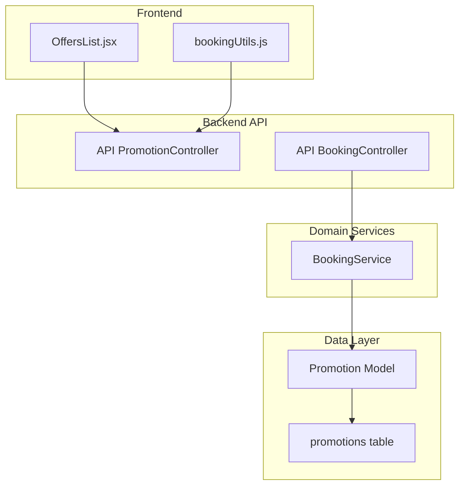
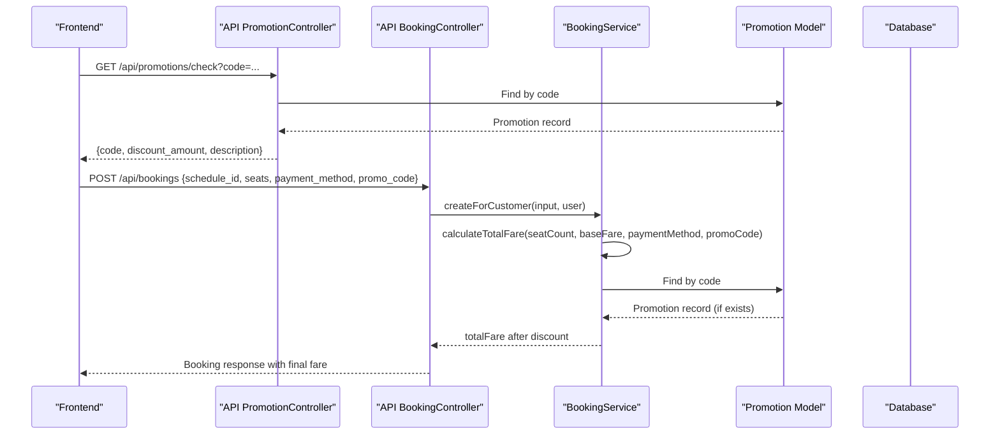
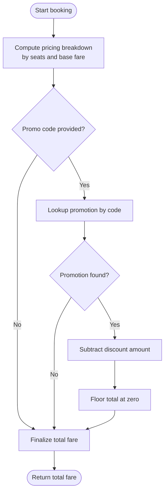
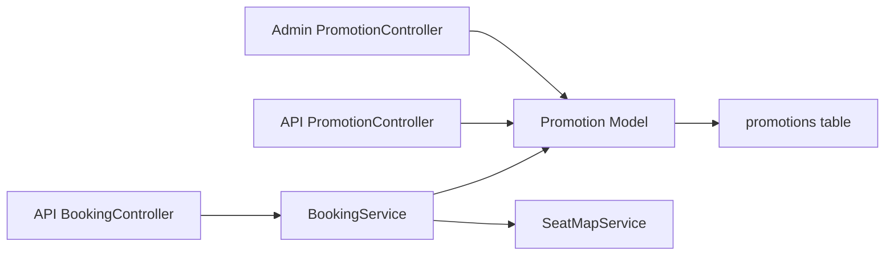

# Promotion & Discount System

<cite>
**Referenced Files in This Document**
- [Promotion.php](file://backend/app/Models/Promotion.php)
- [2026_06_01_000060_create_promotions_table.php](file://backend/database/migrations/2026_06_01_000060_create_promotions_table.php)
- [PromotionController.php](file://backend/app/Http/Controllers/API/PromotionController.php)
- [PromotionController.php](file://backend/app/Http/Controllers/Admin/PromotionController.php)
- [BookingService.php](file://backend/app/Services/BookingService.php)
- [BookingController.php](file://backend/app/Http/Controllers/API/BookingController.php)
- [PromotionSeeder.php](file://backend/database/seeders/PromotionSeeder.php)
- [bookingUtils.js](file://frontend/src/bookingUtils.js)
- [OffersList.jsx](file://frontend/src/components/OffersList.jsx)
- [BookingFlowTest.php](file://backend/tests/Feature/BookingFlowTest.php)
</cite>

## Table of Contents
1. [Introduction](#introduction)
2. [Project Structure](#project-structure)
3. [Core Components](#core-components)
4. [Architecture Overview](#architecture-overview)
5. [Detailed Component Analysis](#detailed-component-analysis)
6. [Dependency Analysis](#dependency-analysis)
7. [Performance Considerations](#performance-considerations)
8. [Troubleshooting Guide](#troubleshooting-guide)
9. [Conclusion](#conclusion)
10. [Appendices](#appendices)

## Introduction
This document explains the promotion and discount system for the bus booking application. It covers how promotions are created, validated during checkout, applied to fares, and integrated with payment processing. It also documents current limitations around discount types, usage limits, expiry handling, minimum booking value, code generation strategies, usage tracking, analytics, and administrative controls.

The system currently supports fixed-amount discounts only. There is no built-in support for percentage-based discounts, free seats, per-promotion or per-user usage limits, expiry date validation, or minimum booking value requirements. These gaps are highlighted so you can plan enhancements safely.

## Project Structure
Promotion-related functionality spans models, controllers, services, migrations, seeders, tests, and frontend components:

- Data model and schema: `Promotion` model and promotions table migration.
- Admin API: CRUD for promotions via admin controller.
- Customer API: Public check endpoint for promo codes.
- Booking flow: Fare calculation applies a fixed discount when a valid code is provided.
- Frontend: Offers list and optional promo code entry during booking.
- Tests: Verify that a valid promo reduces total fare and an invalid one does not.

**Diagram sources**
- [PromotionController.php:10-36](file://backend/app/Http/Controllers/API/PromotionController.php#L10-L36)
- [BookingController.php:19-39](file://backend/app/Http/Controllers/API/BookingController.php#L19-L39)
- [BookingService.php:78-83](file://backend/app/Services/BookingService.php#L78-L83)
- [Promotion.php:8-16](file://backend/app/Models/Promotion.php#L8-L16)
- [2026_06_01_000060_create_promotions_table.php:14-20](file://backend/database/migrations/2026_06_01_000060_create_promotions_table.php#L14-L20)

**Section sources**
- [Promotion.php:8-16](file://backend/app/Models/Promotion.php#L8-L16)
- [2026_06_01_000060_create_promotions_table.php:14-20](file://backend/database/migrations/2026_06_01_000060_create_promotions_table.php#L14-L20)
- [PromotionController.php:10-36](file://backend/app/Http/Controllers/API/PromotionController.php#L10-L36)
- [PromotionController.php:10-50](file://backend/app/Http/Controllers/Admin/PromotionController.php#L10-L50)
- [BookingService.php:78-83](file://backend/app/Services/BookingService.php#L78-L83)
- [BookingController.php:19-39](file://backend/app/Http/Controllers/API/BookingController.php#L19-L39)

## Core Components
- Promotion model: Stores code, discount amount, and description. The discount amount is cast as a decimal.
- Promotions table: Holds unique code, decimal discount amount, and description. No fields for expiry, limits, or type.
- Admin PromotionController: Creates, updates, and deletes promotions; normalizes code to uppercase.
- API PromotionController: Validates and returns promotion details by code; lists all promotions.
- BookingService: Calculates total fare using seat pricing and applies a fixed discount if a promo code exists.
- API BookingController: Accepts `promo_code` in booking requests and delegates to BookingService.
- PromotionSeeder: Seeds sample fixed-discount codes for testing.

Key behaviors:
- Discounts are fixed amounts subtracted from the calculated total fare.
- Fares cannot go below zero due to a floor operation.
- No active/expired status checks are performed at booking time.
- No per-user or per-promotion usage counters exist.
- No minimum booking value enforcement is implemented.

**Section sources**
- [Promotion.php:8-16](file://backend/app/Models/Promotion.php#L8-L16)
- [2026_06_01_000060_create_promotions_table.php:14-20](file://backend/database/migrations/2026_06_01_000060_create_promotions_table.php#L14-L20)
- [PromotionController.php:10-50](file://backend/app/Http/Controllers/Admin/PromotionController.php#L10-L50)
- [PromotionController.php:10-36](file://backend/app/Http/Controllers/API/PromotionController.php#L10-L36)
- [BookingService.php:304-318](file://backend/app/Services/BookingService.php#L304-L318)
- [BookingController.php:19-39](file://backend/app/Http/Controllers/API/BookingController.php#L19-L39)
- [PromotionSeeder.php:10-27](file://backend/database/seeders/PromotionSeeder.php#L10-L27)

## Architecture Overview
The promotion system integrates into the booking flow through a simple discount lookup and subtraction.

**Diagram sources**
- [PromotionController.php:10-36](file://backend/app/Http/Controllers/API/PromotionController.php#L10-L36)
- [BookingController.php:19-39](file://backend/app/Http/Controllers/API/BookingController.php#L19-L39)
- [BookingService.php:78-83](file://backend/app/Services/BookingService.php#L78-L83)
- [BookingService.php:304-318](file://backend/app/Services/BookingService.php#L304-L318)
- [Promotion.php:8-16](file://backend/app/Models/Promotion.php#L8-L16)

## Detailed Component Analysis

### Promotion Model and Schema
- Fields:
  - code: unique string identifier for the promotion.
  - discount_amount: decimal value representing a fixed discount.
  - description: human-readable text about the promotion.
- Casting: discount_amount is cast to a decimal for precision.

Limitations:
- No fields for discount_type, expiry dates, min_booking_value, max_uses, uses_per_user, or is_active.
- No indexes beyond uniqueness on code.

Recommendations:
- Add columns for discount_type, expires_at, min_booking_value, max_uses, uses_per_user, is_active.
- Add indexes on frequently filtered fields such as expires_at and is_active.

**Section sources**
- [Promotion.php:8-16](file://backend/app/Models/Promotion.php#L8-L16)
- [2026_06_01_000060_create_promotions_table.php:14-20](file://backend/database/migrations/2026_06_01_000060_create_promotions_table.php#L14-L20)

### Admin Promotion Controller
Responsibilities:
- Create promotions with validation for code uniqueness, numeric non-negative discount, and description length.
- Update promotions with similar validations.
- Delete promotions by ID.
- Normalize code to uppercase before saving.

Operational notes:
- Redirects back to admin tabs with success messages.
- No business rules for expiry, limits, or activation toggles.

**Section sources**
- [PromotionController.php:10-50](file://backend/app/Http/Controllers/Admin/PromotionController.php#L10-L50)

### API Promotion Controller
Responsibilities:
- Validate incoming code parameter.
- Look up promotion by exact code match.
- Return promotion details including discount amount and description.
- Provide a listing endpoint for all promotions.

Current behavior:
- Does not enforce activation or expiry.
- Returns 404 when code is not found.

**Section sources**
- [PromotionController.php:10-36](file://backend/app/Http/Controllers/API/PromotionController.php#L10-L36)

### Booking Service and Fare Calculation
Fare calculation steps:
1. Compute pricing breakdown based on seat count, base fare, and whether a gateway fee applies.
2. If a promo code is present, look up the promotion by code.
3. Subtract the promotion’s discount amount from the total fare.
4. Ensure the final fare does not drop below zero.

Integration points:
- BookingController accepts `promo_code` in the request payload.
- BookingService receives it and applies the discount during booking creation.
- Payment integration (ZiniPay) occurs after fare calculation; the invoice reflects the discounted total.

Validation gaps:
- No check for promotion activation or expiry.
- No minimum booking value requirement.
- No per-user or per-promotion usage limit enforcement.

**Diagram sources**
- [BookingService.php:304-318](file://backend/app/Services/BookingService.php#L304-L318)

**Section sources**
- [BookingController.php:19-39](file://backend/app/Http/Controllers/API/BookingController.php#L19-L39)
- [BookingService.php:78-83](file://backend/app/Services/BookingService.php#L78-L83)
- [BookingService.php:304-318](file://backend/app/Services/BookingService.php#L304-L318)

### Frontend Integration
- OffersList component displays available offers/promotions.
- bookingUtils.js contains utilities used across booking flows.
- Users can enter a promo code during checkout; the backend applies the fixed discount if the code exists.

Note: The frontend does not implement server-side validation of promo codes; the authoritative logic resides in the backend service.

**Section sources**
- [OffersList.jsx](file://frontend/src/components/OffersList.jsx)
- [bookingUtils.js](file://frontend/src/bookingUtils.js)

### Seed Data
Sample promotions are seeded with fixed discount amounts and descriptions for testing purposes.

**Section sources**
- [PromotionSeeder.php:10-27](file://backend/database/seeders/PromotionSeeder.php#L10-L27)

## Dependency Analysis
Promotion dependencies form a straightforward chain:

- Admin PromotionController depends on Promotion model for CRUD operations.
- API PromotionController depends on Promotion model for lookup and listing.
- BookingController depends on BookingService for booking creation.
- BookingService depends on Promotion model for discount lookup and SeatMapService for pricing.
- Database layer stores promotion records.

**Diagram sources**
- [PromotionController.php:10-50](file://backend/app/Http/Controllers/Admin/PromotionController.php#L10-L50)
- [PromotionController.php:10-36](file://backend/app/Http/Controllers/API/PromotionController.php#L10-L36)
- [BookingController.php:19-39](file://backend/app/Http/Controllers/API/BookingController.php#L19-L39)
- [BookingService.php:304-318](file://backend/app/Services/BookingService.php#L304-L318)
- [2026_06_01_000060_create_promotions_table.php:14-20](file://backend/database/migrations/2026_06_01_000060_create_promotions_table.php#L14-L20)

**Section sources**
- [PromotionController.php:10-50](file://backend/app/Http/Controllers/Admin/PromotionController.php#L10-L50)
- [PromotionController.php:10-36](file://backend/app/Http/Controllers/API/PromotionController.php#L10-L36)
- [BookingController.php:19-39](file://backend/app/Http/Controllers/API/BookingController.php#L19-L39)
- [BookingService.php:304-318](file://backend/app/Services/BookingService.php#L304-L318)

## Performance Considerations
- Promotion lookup is a single row query by unique code; performance impact is minimal.
- Listing all promotions via the API endpoint may become costly with large datasets; consider pagination or filtering.
- Avoid heavy computations in the booking path; keep promo validation lightweight.
- For high traffic, cache promotion metadata where appropriate, but ensure consistency with admin updates.

[No sources needed since this section provides general guidance]

## Troubleshooting Guide
Common issues and resolutions:
- Invalid promo code:
  - Backend returns a 404 from the check endpoint when the code does not exist.
  - During booking, if the code does not exist, no discount is applied.
- Unexpected discount application:
  - Since there is no activation or expiry check, any existing code will apply.
  - Ensure codes are removed or updated if they should not be active.
- Discount exceeds fare:
  - Total fare is floored at zero; verify expected business rules for negative adjustments.
- Testing discrepancies:
  - Use the feature test to confirm that a valid promo reduces fare and an invalid one does not.

Relevant references:
- API check endpoint behavior and error responses.
- BookingService discount application logic.
- Feature tests validating promo behavior.

**Section sources**
- [PromotionController.php:10-36](file://backend/app/Http/Controllers/API/PromotionController.php#L10-L36)
- [BookingService.php:304-318](file://backend/app/Services/BookingService.php#L304-L318)
- [BookingFlowTest.php:192-215](file://backend/tests/Feature/BookingFlowTest.php#L192-L215)

## Conclusion
The current promotion system provides a simple fixed-amount discount mechanism integrated into the booking flow. It lacks advanced features such as percentage discounts, free seats, usage limits, expiry handling, and minimum booking value checks. To evolve the system, extend the data model, add validation rules in both admin and booking paths, and introduce usage tracking and analytics. Until then, rely on the existing fixed-amount discount behavior and use tests to validate changes.

[No sources needed since this section summarizes without analyzing specific files]

## Appendices

### Current Field Set and Behavior Summary
- Promotion fields: code, discount_amount, description.
- Discount type: fixed amount only.
- Usage limits: none.
- Expiry handling: none.
- Minimum booking value: none.
- Code generation: manual input in admin UI; no auto-generation strategy.
- Analytics: none dedicated to promotions.

**Section sources**
- [Promotion.php:8-16](file://backend/app/Models/Promotion.php#L8-L16)
- [2026_06_01_000060_create_promotions_table.php:14-20](file://backend/database/migrations/2026_06_01_000060_create_promotions_table.php#L14-L20)
- [PromotionController.php:10-50](file://backend/app/Http/Controllers/Admin/PromotionController.php#L10-L50)
- [PromotionSeeder.php:10-27](file://backend/database/seeders/PromotionSeeder.php#L10-L27)