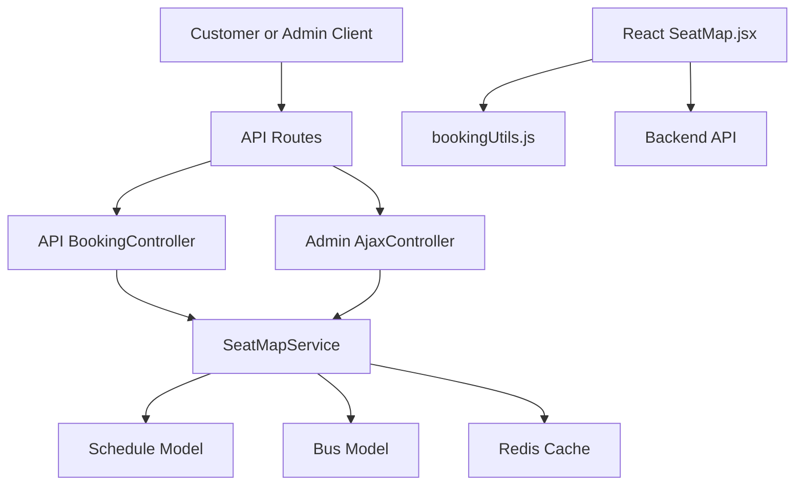
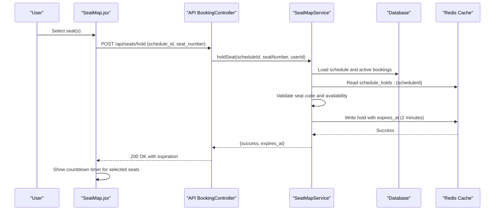
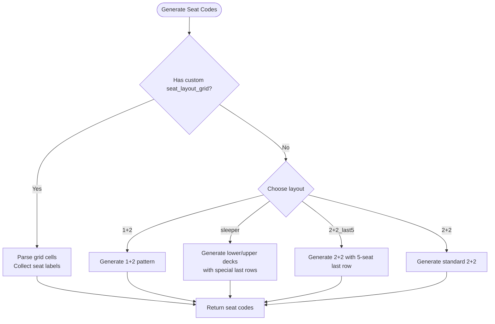
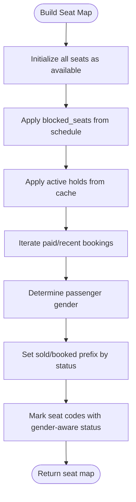
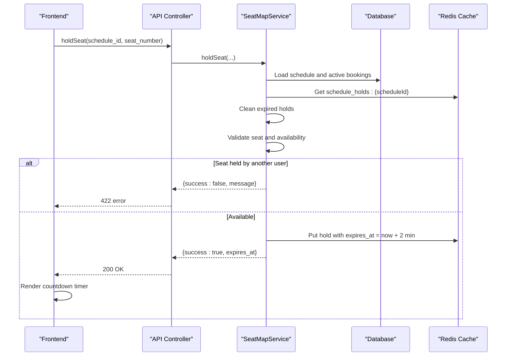
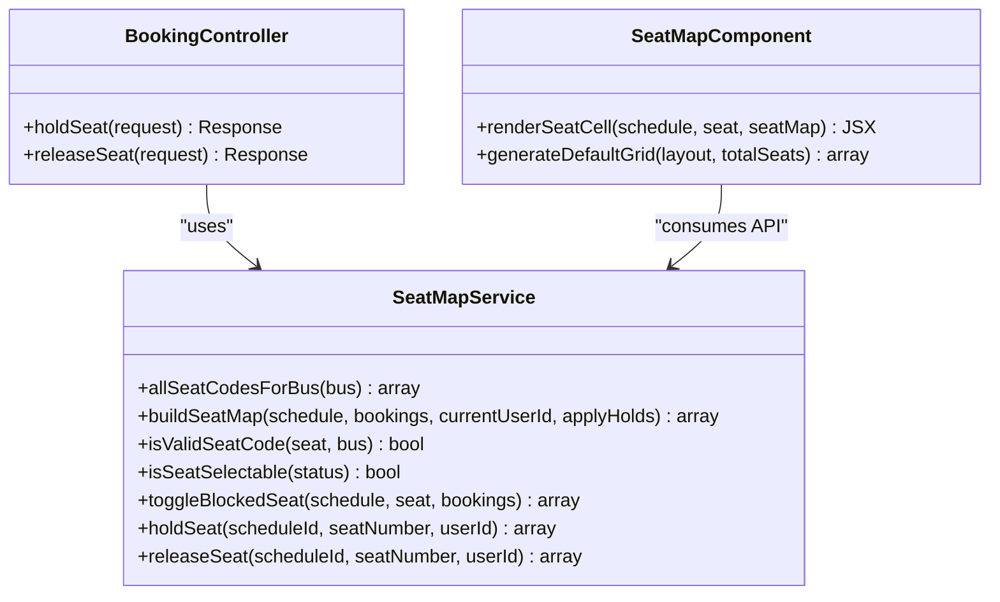
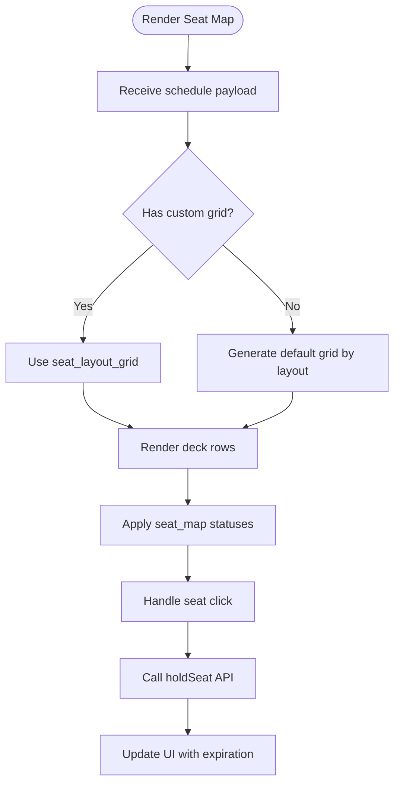
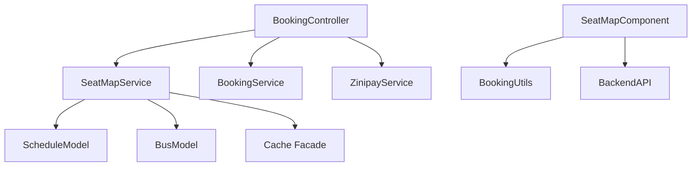

# Seat Management System

<cite>
**Referenced Files in This Document**
- [SeatMapService.php](file://backend/app/Services/SeatMapService.php)
- [BookingController.php](file://backend/app/Http/Controllers/API/BookingController.php)
- [SeatMap.jsx](file://frontend/src/components/SeatMap.jsx)
- [bookingUtils.js](file://frontend/src/bookingUtils.js)
- [booking.php](file://backend/config/booking.php)
- [Bookings table migration](file://backend/database/migrations/2026_06_01_000050_create_bookings_table.php)
- [Bus model](file://backend/app/Models/Bus.php)
- [Schedule model](file://backend/app/Models/Schedule.php)
- [Admin BookingController](file://backend/app/Http/Controllers/Admin/BookingController.php)
- [Admin AjaxController](file://backend/app/Http/Controllers/Admin/AjaxController.php)
- [API routes](file://backend/routes/api.php)
- [Web routes](file://backend/routes/web.php)
</cite>

## Table of Contents
1. [Introduction](#introduction)
2. [Project Structure](#project-structure)
3. [Core Components](#core-components)
4. [Architecture Overview](#architecture-overview)
5. [Detailed Component Analysis](#detailed-component-analysis)
6. [Dependency Analysis](#dependency-analysis)
7. [Performance Considerations](#performance-considerations)
8. [Troubleshooting Guide](#troubleshooting-guide)
9. [Conclusion](#conclusion)

## Introduction
This document explains the SonyaBus seat management system with a focus on:
- Sophisticated seat allocation algorithms for multiple bus layouts: `2+2`, `1+2`, `sleeper`, and `2+2_last5`.
- Custom grid configurations through a structured seat layout grid.
- Gender-aware seat status mapping using booking passenger gender.
- Real-time availability tracking with a 2-minute seat hold mechanism backed by Redis cache.
- Seat status values: `available`, `sold_male`, `sold_female`, `booked_male`, `booked_female`, and `blocked`.
- Seat validation logic, interactive seat map generation, and integration with the booking flow.

The system is implemented as a Laravel backend service plus a React frontend component that renders the seat map and coordinates user interactions.

## Project Structure
The seat management feature spans backend services, controllers, configuration, database schema, and frontend components:

**Diagram sources**
- [API routes:73-73](file://backend/routes/api.php#L73-L73)
- [Web routes:99-99](file://backend/routes/web.php#L99-L99)
- [BookingController.php:82-116](file://backend/app/Http/Controllers/API/BookingController.php#L82-L116)
- [Admin AjaxController:112-112](file://backend/app/Http/Controllers/Admin/AjaxController.php#L112-L112)
- [SeatMapService.php:502-582](file://backend/app/Services/SeatMapService.php#L502-L582)
- [SeatMap.jsx:48-190](file://frontend/src/components/SeatMap.jsx#L48-L190)
- [bookingUtils.js:52-172](file://frontend/src/bookingUtils.js#L52-L172)

**Section sources**
- [API routes:73-73](file://backend/routes/api.php#L73-L73)
- [Web routes:99-99](file://backend/routes/web.php#L99-L99)
- [SeatMapService.php:1-593](file://backend/app/Services/SeatMapService.php#L1-L593)
- [SeatMap.jsx:1-612](file://frontend/src/components/SeatMap.jsx#L1-L612)
- [bookingUtils.js:1-173](file://frontend/src/bookingUtils.js#L1-L173)

## Core Components
- **SeatMapService**: Central backend service responsible for generating seat codes per bus layout, building the seat map, applying holds, blocking seats, and validating seat codes.
- **API BookingController**: Exposes REST endpoints for holding and releasing seats, and for creating bookings.
- **Frontend SeatMap.jsx**: Renders the interactive seat map, supports multiple layouts, shows real-time status, and integrates with pricing and booking UI.
- **bookingUtils.js**: Provides client-side utilities for seat map generation fallback, status labels, selection rules, and pricing calculations.
- **Configuration and Schema**: `booking.php` defines default seat rows and pricing-related settings; the bookings migration defines passenger gender and seat numbers storage.

**Section sources**
- [SeatMapService.php:49-189](file://backend/app/Services/SeatMapService.php#L49-L189)
- [SeatMapService.php:194-244](file://backend/app/Services/SeatMapService.php#L194-L244)
- [SeatMapService.php:502-582](file://backend/app/Services/SeatMapService.php#L502-L582)
- [BookingController.php:82-116](file://backend/app/Http/Controllers/API/BookingController.php#L82-L116)
- [SeatMap.jsx:48-190](file://frontend/src/components/SeatMap.jsx#L48-L190)
- [bookingUtils.js:1-173](file://frontend/src/bookingUtils.js#L1-L173)
- [booking.php:1-11](file://backend/config/booking.php#L1-L11)
- [Bookings table migration:14-42](file://backend/database/migrations/2026_06_01_000050_create_bookings_table.php#L14-L42)

## Architecture Overview
The seat management architecture combines server-side state (database + Redis cache) with client-side rendering:

**Diagram sources**
- [API routes:73-73](file://backend/routes/api.php#L73-L73)
- [BookingController.php:82-100](file://backend/app/Http/Controllers/API/BookingController.php#L82-L100)
- [SeatMapService.php:502-560](file://backend/app/Services/SeatMapService.php#L502-L560)
- [SeatMap.jsx:39-46](file://frontend/src/components/SeatMap.jsx#L39-L46)

## Detailed Component Analysis

### Seat Layout Algorithms and Custom Grid Support
The system supports four built-in layouts and fully custom grids:

- **Built-in layouts**:
  - `2+2`: Standard economy coach with two columns on each side of an aisle.
  - `1+2`: AC executive layout with one column on the left and two on the right.
  - `sleeper`: Double-deck sleeper with lower and upper decks, including special last rows with more seats.
  - `2+2_last5`: Standard 2+2 except the final row has five seats.

- **Custom grid**:
  - A structured JSON grid can be stored on the bus model under `seat_layout_grid`.
  - The grid may define a single deck or nested `lower` and `upper` decks.
  - Each cell can be a seat with a label, an aisle, an empty placeholder, or engine/driver markers.

Seat code generation prioritizes the custom grid when present; otherwise, it falls back to algorithmic generation based on `seat_layout` and `total_seats`.

**Diagram sources**
- [SeatMapService.php:61-189](file://backend/app/Services/SeatMapService.php#L61-L189)
- [bookingUtils.js:52-172](file://frontend/src/bookingUtils.js#L52-L172)
- [SeatMap.jsx:48-190](file://frontend/src/components/SeatMap.jsx#L48-L190)

**Section sources**
- [SeatMapService.php:61-189](file://backend/app/Services/SeatMapService.php#L61-L189)
- [bookingUtils.js:52-172](file://frontend/src/bookingUtils.js#L52-L172)
- [SeatMap.jsx:48-190](file://frontend/src/components/SeatMap.jsx#L48-L190)
- [Bus model:12-16](file://backend/app/Models/Bus.php#L12-L16)

### Gender-Aware Seat Status Mapping
Seat statuses are derived from booking records and include gender awareness:

- **Status derivation**:
  - Paid/sold/booked bookings produce `sold_male`, `sold_female`, `booked_male`, or `booked_female`.
  - Recent pending bookings within a short window are treated as active to prevent double-booking.
  - Passenger gender is normalized to uppercase and mapped to male/female prefixes.

- **Blocked seats**:
  - Administrators can block specific seats via `blocked_seats` on the schedule.
  - Blocked seats override other statuses and appear as `blocked`.

- **Gender conflict prevention**:
  - The current implementation marks seats with gender-specific statuses but does not enforce a rule preventing opposite-gender adjacency at selection time.
  - Blocking is manual and explicit; there is no automatic opposite-gender blocking logic in the service.

**Diagram sources**
- [SeatMapService.php:194-244](file://backend/app/Services/SeatMapService.php#L194-L244)
- [Bookings table migration:21-29](file://backend/database/migrations/2026_06_01_000050_create_bookings_table.php#L21-L29)

**Section sources**
- [SeatMapService.php:194-244](file://backend/app/Services/SeatMapService.php#L194-L244)
- [SeatMapService.php:452-500](file://backend/app/Services/SeatMapService.php#L452-L500)
- [Bookings table migration:21-29](file://backend/database/migrations/2026_06_01_000050_create_bookings_table.php#L21-L29)

### Real-Time Availability Tracking and 2-Minute Hold Mechanism
The system uses Redis-backed cache to temporarily reserve seats during the booking flow:

- **Hold creation**:
  - Validates schedule existence and seat code validity.
  - Checks database availability excluding cache-based holds.
  - Reads existing holds and cleans expired entries.
  - Prevents another user from holding the same seat.
  - Stores a hold with an expiration timestamp set to 2 minutes from now.
  - Persists the holds collection with a longer TTL to avoid premature eviction.

- **Hold release**:
  - Removes the caller’s hold for the specified seat if present.
  - Cleans expired holds before persisting updated holds.

- **Frontend countdown**:
  - Displays remaining time for held seats using the returned expiration timestamp.
  - Updates every second to reflect countdown progress.

**Diagram sources**
- [BookingController.php:82-100](file://backend/app/Http/Controllers/API/BookingController.php#L82-L100)
- [SeatMapService.php:502-560](file://backend/app/Services/SeatMapService.php#L502-L560)
- [SeatMap.jsx:39-46](file://frontend/src/components/SeatMap.jsx#L39-L46)

**Section sources**
- [SeatMapService.php:502-582](file://backend/app/Services/SeatMapService.php#L502-L582)
- [BookingController.php:82-116](file://backend/app/Http/Controllers/API/BookingController.php#L82-L116)
- [SeatMap.jsx:39-46](file://frontend/src/components/SeatMap.jsx#L39-L46)

### Seat Status Management and Validation
- **Status values**:
  - `available`: Open for selection.
  - `blocked`: Manually blocked by admin.
  - `sold_male`, `sold_female`: Sold seats with gender prefix.
  - `booked_male`, `booked_female`: Booked seats with gender prefix.
  - `selected`: Selected by the current user in the frontend.

- **Selection rules**:
  - Only `available` seats are selectable.
  - The frontend applies visual classes based on status and selection state.

- **Validation**:
  - Backend validates seat codes against generated codes for the bus.
  - Invalid seat codes return errors during hold operations.

**Diagram sources**
- [SeatMapService.php:433-582](file://backend/app/Services/SeatMapService.php#L433-L582)
- [BookingController.php:82-116](file://backend/app/Http/Controllers/API/BookingController.php#L82-L116)
- [SeatMap.jsx:192-208](file://frontend/src/components/SeatMap.jsx#L192-L208)

**Section sources**
- [SeatMapService.php:433-582](file://backend/app/Services/SeatMapService.php#L433-L582)
- [SeatMap.jsx:192-208](file://frontend/src/components/SeatMap.jsx#L192-L208)
- [bookingUtils.js:18-24](file://frontend/src/bookingUtils.js#L18-L24)

### Interactive Seat Map Generation
The frontend generates the seat map interactively:

- **Layout detection**:
  - Uses the schedule’s bus layout and total seats.
  - Supports custom grid strings parsed into JSON structures.
  - Handles sleeper decks with separate lower and upper sections.

- **Rendering**:
  - Draws engine, driver, aisle, and seat cells.
  - Applies CSS classes for status visualization.
  - Shows legends for all supported statuses.

- **Integration**:
  - Calls backend APIs to hold/release seats.
  - Displays pricing breakdown and selected seat information.
  - Integrates boarding/dropping point selection and passenger details.

**Diagram sources**
- [SeatMap.jsx:48-190](file://frontend/src/components/SeatMap.jsx#L48-L190)
- [SeatMap.jsx:210-384](file://frontend/src/components/SeatMap.jsx#L210-L384)
- [bookingUtils.js:52-172](file://frontend/src/bookingUtils.js#L52-L172)

**Section sources**
- [SeatMap.jsx:48-190](file://frontend/src/components/SeatMap.jsx#L48-L190)
- [SeatMap.jsx:210-384](file://frontend/src/components/SeatMap.jsx#L210-L384)
- [bookingUtils.js:52-172](file://frontend/src/bookingUtils.js#L52-L172)

### Examples of Seat Code Generation, Hold/Release Operations, and Booking Flow Integration

- **Seat code generation examples**:
  - For `2+2` with 36 seats: rows A–I generate codes like `A1`, `A2`, `A3`, `A4`, ..., `I4`.
  - For `1+2` with 30 seats: rows generate codes like `A1`, `B2`, `C3`, etc., stopping at the configured total.
  - For `sleeper` with 40 seats: lower deck includes L-prefixed codes and upper deck U-prefixed codes, with special last rows containing extra seats.
  - For `2+2_last5` with 40 seats: normal rows follow 2+2 until the final row contains five seats.

- **Hold operation example**:
  - Request: `POST /api/seats/hold` with `{schedule_id: 123, seat_number: "A1"}`.
  - Response on success: `{success: true, expires_at: "2026-06-01T12:02:00Z"}`.
  - Response on failure: `{message: "Seat is temporarily reserved by another user."}` with HTTP 422.

- **Release operation example**:
  - Request: `POST /api/seats/release` with `{schedule_id: 123, seat_number: "A1"}`.
  - Response: `{success: true}`.

- **Booking flow integration**:
  - After selecting seats and filling passenger details, the frontend submits a booking request.
  - The backend creates a PENDING booking and optionally initiates payment via ZiniPay.
  - Successful payment transitions the booking to PAID/SOLD/BOOKED, updating the seat map accordingly.

**Section sources**
- [SeatMapService.php:61-189](file://backend/app/Services/SeatMapService.php#L61-L189)
- [BookingController.php:19-40](file://backend/app/Http/Controllers/API/BookingController.php#L19-L40)
- [BookingController.php:118-148](file://backend/app/Http/Controllers/API/BookingController.php#L118-L148)
- [SeatMap.jsx:535-542](file://frontend/src/components/SeatMap.jsx#L535-L542)

## Dependency Analysis
Key dependencies and relationships:

- **SeatMapService depends on**:
  - `Schedule` model for route points, blocked seats, and bus association.
  - `Bus` model for layout and grid configuration.
  - `Cache` facade for hold persistence.
  - `Booking` model indirectly via queries for active bookings.

- **API BookingController depends on**:
  - `SeatMapService` for hold/release logic.
  - `BookingService` for booking creation and cancellation.
  - `ZinipayService` for payment initiation.

- **Frontend SeatMap.jsx depends on**:
  - `bookingUtils.js` for status labels, selection rules, and fallback seat map generation.
  - Backend APIs for hold/release and booking submission.

**Diagram sources**
- [SeatMapService.php:5-7](file://backend/app/Services/SeatMapService.php#L5-L7)
- [SeatMapService.php:502-560](file://backend/app/Services/SeatMapService.php#L502-L560)
- [BookingController.php:12-17](file://backend/app/Http/Controllers/API/BookingController.php#L12-L17)
- [SeatMap.jsx:1-8](file://frontend/src/components/SeatMap.jsx#L1-L8)

**Section sources**
- [SeatMapService.php:5-7](file://backend/app/Services/SeatMapService.php#L5-L7)
- [SeatMapService.php:502-560](file://backend/app/Services/SeatMapService.php#L502-L560)
- [BookingController.php:12-17](file://backend/app/Http/Controllers/API/BookingController.php#L12-L17)
- [SeatMap.jsx:1-8](file://frontend/src/components/SeatMap.jsx#L1-L8)

## Performance Considerations
- **Database query optimization**:
  - The service selects only necessary columns for paid bookings to reduce payload size.
  - Indexes on `schedule_id`, `status`, and composite indexes improve lookup performance.

- **Cache usage**:
  - Holds are stored in Redis with appropriate TTLs to minimize memory pressure.
  - Expired holds are cleaned up during hold/release operations.

- **Frontend rendering**:
  - The seat map re-renders efficiently by leveraging React state and selective updates.
  - Countdown timers update once per second without full page reloads.

[No sources needed since this section provides general guidance]

## Troubleshooting Guide
Common issues and resolutions:

- **Seat not available**:
  - Cause: Seat is already booked or recently pending.
  - Resolution: Wait for the hold to expire or choose another seat.

- **Seat reserved by another user**:
  - Cause: Another user holds the seat in Redis cache.
  - Resolution: Retry after the hold expires or select a different seat.

- **Invalid seat code**:
  - Cause: Seat code does not match the bus layout or custom grid.
  - Resolution: Verify the bus configuration and use valid seat codes.

- **Blocked seat cannot be selected**:
  - Cause: Admin has manually blocked the seat.
  - Resolution: Contact admin to unblock or choose another seat.

**Section sources**
- [SeatMapService.php:502-560](file://backend/app/Services/SeatMapService.php#L502-L560)
- [SeatMapService.php:460-500](file://backend/app/Services/SeatMapService.php#L460-L500)

## Conclusion
The SonyaBus seat management system provides robust support for multiple bus layouts, gender-aware seat status mapping, and real-time availability tracking through a 2-minute hold mechanism. The backend service ensures data integrity and performance, while the frontend delivers an interactive and responsive user experience. Administrators can manage blocked seats, and the system integrates seamlessly with the broader booking and payment flows.

[No sources needed since this section summarizes without analyzing specific files]