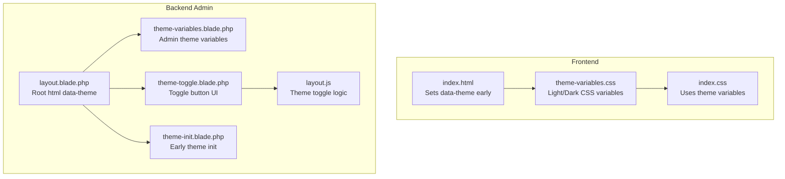
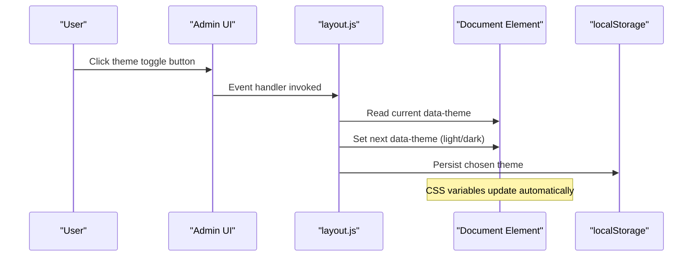
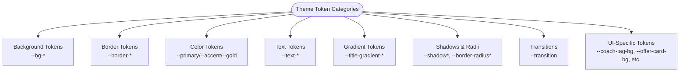
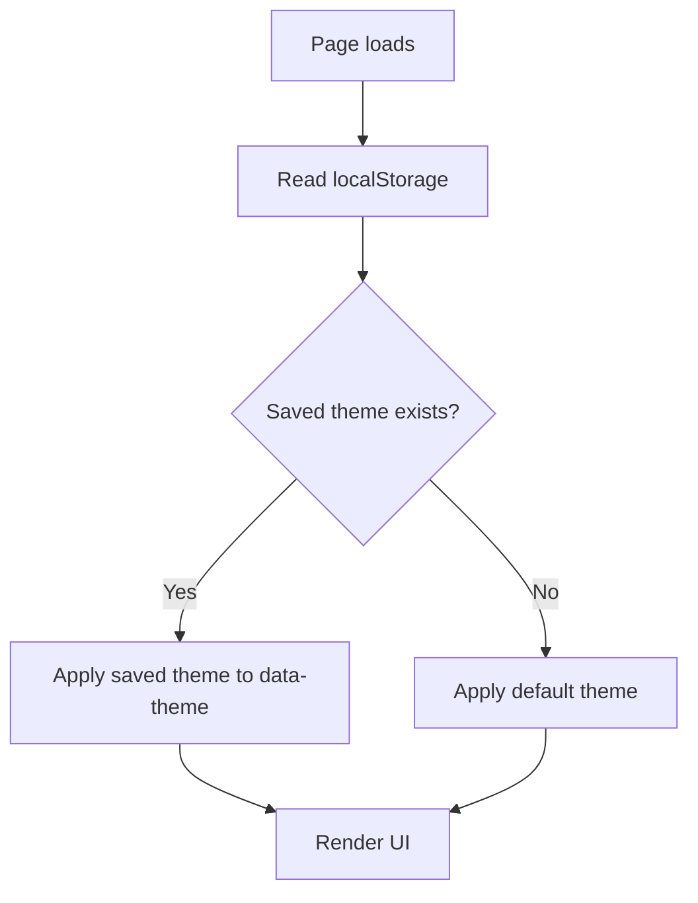
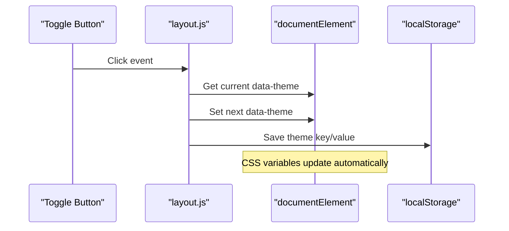
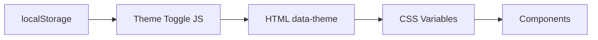

# Theme Customization System

<cite>
**Referenced Files in This Document**
- [theme-variables.css](file://frontend/src/theme-variables.css)
- [index.html](file://frontend/index.html)
- [index.css](file://frontend/src/index.css)
- [layout.blade.php](file://backend/resources/views/admin/layout.blade.php)
- [theme-variables.blade.php](file://backend/resources/views/admin/partials/theme-variables.blade.php)
- [theme-toggle.blade.php](file://backend/resources/views/admin/partials/theme-toggle.blade.php)
- [theme-init.blade.php](file://backend/resources/views/admin/partials/theme-init.blade.php)
- [layout.js](file://backend/resources/js/admin/layout.js)
</cite>

## Table of Contents
1. [Introduction](#introduction)
2. [Project Structure](#project-structure)
3. [Core Components](#core-components)
4. [Architecture Overview](#architecture-overview)
5. [Detailed Component Analysis](#detailed-component-analysis)
6. [Dependency Analysis](#dependency-analysis)
7. [Performance Considerations](#performance-considerations)
8. [Troubleshooting Guide](#troubleshooting-guide)
9. [Conclusion](#conclusion)
10. [Appendices](#appendices)

## Introduction
This document explains the theme customization system that supports dark and light modes across both the customer-facing frontend and the admin backend. It covers:
- The CSS custom properties architecture used for theming
- How themes are applied to components
- The theme toggle functionality in the admin interface
- Dynamic theme switching mechanisms
- The structure of theme variables and color scheme definitions
- Guidance for creating custom themes, extending existing variables, and maintaining design consistency

The system uses a simple but robust pattern:
- A `data-theme` attribute on the root HTML element selects the active theme
- CSS custom properties define colors, spacing, shadows, and typography tokens per theme
- JavaScript toggles the attribute and persists the user’s preference in local storage

## Project Structure
Theme-related files are split between the frontend (customer app) and the backend (admin dashboard):

- Frontend
  - Theme variables: [theme-variables.css](file://frontend/src/theme-variables.css)
  - Initial theme application before React mounts: [index.html](file://frontend/index.html)
  - Global styles using theme variables: [index.css](file://frontend/src/index.css)

- Backend (Admin)
  - Root layout with initial theme attribute: [layout.blade.php](file://backend/resources/views/admin/layout.blade.php)
  - Admin theme variables partial: [theme-variables.blade.php](file://backend/resources/views/admin/partials/theme-variables.blade.php)
  - Theme toggle button markup: [theme-toggle.blade.php](file://backend/resources/views/admin/partials/theme-toggle.blade.php)
  - Early theme initialization script: [theme-init.blade.php](file://backend/resources/views/admin/partials/theme-init.blade.php)
  - Admin layout logic including theme toggle behavior: [layout.js](file://backend/resources/js/admin/layout.js)

**Diagram sources**
- [index.html:4-10](file://frontend/index.html#L4-L10)
- [theme-variables.css:1-153](file://frontend/src/theme-variables.css#L1-L153)
- [index.css:9-16](file://frontend/src/index.css#L9-L16)
- [layout.blade.php:2-13](file://backend/resources/views/admin/layout.blade.php#L2-L13)
- [theme-variables.blade.php:1-133](file://backend/resources/views/admin/partials/theme-variables.blade.php#L1-L133)
- [theme-toggle.blade.php:1-10](file://backend/resources/views/admin/partials/theme-toggle.blade.php#L1-L10)
- [theme-init.blade.php:1-31](file://backend/resources/views/admin/partials/theme-init.blade.php#L1-L31)
- [layout.js:301-315](file://backend/resources/js/admin/layout.js#L301-L315)

**Section sources**
- [theme-variables.css:1-153](file://frontend/src/theme-variables.css#L1-L153)
- [index.html:4-10](file://frontend/index.html#L4-L10)
- [index.css:9-16](file://frontend/src/index.css#L9-L16)
- [layout.blade.php:2-13](file://backend/resources/views/admin/layout.blade.php#L2-L13)
- [theme-variables.blade.php:1-133](file://backend/resources/views/admin/partials/theme-variables.blade.php#L1-L133)
- [theme-toggle.blade.php:1-10](file://backend/resources/views/admin/partials/theme-toggle.blade.php#L1-L10)
- [theme-init.blade.php:1-31](file://backend/resources/views/admin/partials/theme-init.blade.php#L1-L31)
- [layout.js:301-315](file://backend/resources/js/admin/layout.js#L301-L315)

## Core Components
- CSS custom properties (CSS variables) define all visual tokens such as background colors, text colors, borders, primary/accent/gold colors, shadows, radii, and transitions.
- Two theme scopes exist:
  - Light theme via `[data-theme="light"]` or `:root`
  - Dark theme via `[data-theme="dark"]`
- The active theme is selected by setting `data-theme` on the root `<html>` element.
- The frontend initializes the theme before React renders; the admin does the same via an inline script and a Blade partial.
- The admin includes a toggle button and JavaScript to switch themes and persist the choice.

Key responsibilities:
- Define theme tokens: [theme-variables.css](file://frontend/src/theme-variables.css), [theme-variables.blade.php](file://backend/resources/views/admin/partials/theme-variables.blade.php)
- Apply theme at page load: [index.html](file://frontend/index.html), [theme-init.blade.php](file://backend/resources/views/admin/partials/theme-init.blade.php)
- Use theme tokens in UI: [index.css](file://frontend/src/index.css), [layout.blade.php](file://backend/resources/views/admin/layout.blade.php)
- Toggle theme in admin: [theme-toggle.blade.php](file://backend/resources/views/admin/partials/theme-toggle.blade.php), [layout.js](file://backend/resources/js/admin/layout.js)

**Section sources**
- [theme-variables.css:1-153](file://frontend/src/theme-variables.css#L1-L153)
- [theme-variables.blade.php:1-133](file://backend/resources/views/admin/partials/theme-variables.blade.php#L1-L133)
- [index.html:4-10](file://frontend/index.html#L4-L10)
- [theme-init.blade.php:1-31](file://backend/resources/views/admin/partials/theme-init.blade.php#L1-L31)
- [index.css:9-16](file://frontend/src/index.css#L9-L16)
- [layout.blade.php:2-13](file://backend/resources/views/admin/layout.blade.php#L2-L13)
- [theme-toggle.blade.php:1-10](file://backend/resources/views/admin/partials/theme-toggle.blade.php#L1-L10)
- [layout.js:301-315](file://backend/resources/js/admin/layout.js#L301-L315)

## Architecture Overview
The theme system follows a clear separation of concerns:
- Data layer: CSS custom properties define semantic tokens
- Presentation layer: Components consume tokens via CSS
- Control layer: JavaScript toggles the active theme and persists preferences

**Diagram sources**
- [theme-toggle.blade.php:1-10](file://backend/resources/views/admin/partials/theme-toggle.blade.php#L1-L10)
- [layout.js:301-315](file://backend/resources/js/admin/layout.js#L301-L315)

## Detailed Component Analysis

### CSS Custom Properties Architecture
- Variables are grouped into logical categories:
  - Backgrounds: `--bg-main`, `--bg-card`, `--bg-header`, `--bg-input`, etc.
  - Borders: `--border-color`, `--border-active`, `--border-seat`, `--border-hover`
  - Colors: `--primary`, `--accent`, `--gold`, `--success`, `--danger`, `--warning`
  - Text: `--text-primary`, `--text-secondary`, `--text-muted`, `--text-inverse`
  - Gradients: `--title-gradient-start`, `--title-gradient-end`, `--maintenance-title-gradient`
  - Shadows and radii: `--shadow-sm/md/lg/neon`, `--border-radius/sm/lg`
  - Transitions: `--transition`
  - UI-specific tokens: `--coach-tag-bg`, `--offer-card-bg`, `--ticket-field-bg`, `--table-row-hover`, etc.
- Two complete sets of variables are provided for light and dark themes.
- Components reference these tokens instead of hard-coded colors, ensuring consistent appearance across themes.

**Diagram sources**
- [theme-variables.css:1-153](file://frontend/src/theme-variables.css#L1-L153)
- [theme-variables.blade.php:1-133](file://backend/resources/views/admin/partials/theme-variables.blade.php#L1-L133)

**Section sources**
- [theme-variables.css:1-153](file://frontend/src/theme-variables.css#L1-L153)
- [theme-variables.blade.php:1-133](file://backend/resources/views/admin/partials/theme-variables.blade.php#L1-L133)

### Theme Application Across Components
- The global body and common UI elements use theme variables for backgrounds, text, borders, and shadows.
- Buttons, inputs, cards, headers, and panels all reference tokens like `--bg-card`, `--text-primary`, `--border-color`, `--primary`, and `--shadow-lg`.
- This ensures that when `data-theme` changes, all components update instantly without additional JavaScript.

Examples of usage patterns:
- Body styling: background and text colors from variables
- Header/navbar: background and border colors from variables
- Cards/panels: background, border, and shadow tokens
- Inputs/selects: background, border, focus states using variables

**Section sources**
- [index.css:9-16](file://frontend/src/index.css#L9-L16)
- [index.css:53-98](file://frontend/src/index.css#L53-L98)
- [index.css:122-164](file://frontend/src/index.css#L122-L164)
- [index.css:193-267](file://frontend/src/index.css#L193-L267)
- [layout.blade.php:21-28](file://backend/resources/views/admin/layout.blade.php#L21-L28)
- [layout.blade.php:196-241](file://backend/resources/views/admin/layout.blade.php#L196-L241)
- [layout.blade.php:336-406](file://backend/resources/views/admin/layout.blade.php#L336-L406)

### Theme Initialization and Persistence
- Frontend
  - An inline script in [index.html](file://frontend/index.html) reads a stored preference and applies `data-theme` before React starts.
- Admin
  - [theme-init.blade.php](file://backend/resources/views/admin/partials/theme-init.blade.php) applies the saved theme immediately during server rendering.
  - The root layout sets a default `data-theme="light"` on the `<html>` tag.

Persistence keys:
- Frontend: `sonyabus_theme`
- Admin: `sonyabus_admin_theme`

**Diagram sources**
- [index.html:4-10](file://frontend/index.html#L4-L10)
- [theme-init.blade.php:1-31](file://backend/resources/views/admin/partials/theme-init.blade.php#L1-L31)
- [layout.blade.php:2-2](file://backend/resources/views/admin/layout.blade.php#L2-L2)

**Section sources**
- [index.html:4-10](file://frontend/index.html#L4-L10)
- [theme-init.blade.php:1-31](file://backend/resources/views/admin/partials/theme-init.blade.php#L1-L31)
- [layout.blade.php:2-2](file://backend/resources/views/admin/layout.blade.php#L2-L2)

### Admin Theme Toggle Functionality
- The toggle button is defined in [theme-toggle.blade.php](file://backend/resources/views/admin/partials/theme-toggle.blade.php).
- The click handler in [layout.js](file://backend/resources/js/admin/layout.js) toggles `data-theme` and persists the selection.
- The admin layout also includes icon visibility rules so the correct sun/moon icon shows based on the active theme.

**Diagram sources**
- [theme-toggle.blade.php:1-10](file://backend/resources/views/admin/partials/theme-toggle.blade.php#L1-L10)
- [layout.js:301-315](file://backend/resources/js/admin/layout.js#L301-L315)
- [layout.blade.php:296-302](file://backend/resources/views/admin/layout.blade.php#L296-L302)

**Section sources**
- [theme-toggle.blade.php:1-10](file://backend/resources/views/admin/partials/theme-toggle.blade.php#L1-L10)
- [layout.js:301-315](file://backend/resources/js/admin/layout.js#L301-L315)
- [layout.blade.php:296-302](file://backend/resources/views/admin/layout.blade.php#L296-L302)

### Color Scheme Definitions and Variable Structure
- Both frontend and backend define parallel variable sets for light and dark themes.
- Common token groups include:
  - Backgrounds: `--bg-main`, `--bg-card`, `--bg-header`, `--bg-input`, `--bg-btn-secondary`, `--bg-footer`, `--bg-overlay`, `--bg-seat-panel`, `--bg-seat-map`, `--bg-toast`
  - Borders: `--border-color`, `--border-active`, `--border-seat`, `--border-hover`
  - Colors: `--primary`, `--primary-hover`, `--primary-glow`, `--primary-soft`, `--primary-soft-border`, `--primary-text-soft`, `--accent`, `--accent-glow`, `--gold`, `--gold-glow`
  - Text: `--text-primary`, `--text-secondary`, `--text-muted`, `--text-inverse`
  - Gradients: `--title-gradient-start`, `--title-gradient-end`, `--maintenance-title-gradient`
  - Status colors: `--success`, `--danger`, `--warning`
  - UI tokens: `--nav-link-hover-bg`, `--scrollbar-thumb`, `--hero-glow-1/2`, `--coach-tag-bg/ac-bg/ac-color`, `--offer-card-bg/header-bg/coupon-bg`, `--ticket-field-bg`, `--table-row-hover`, `--divider-dashed`, `--spinner-track`
  - Spacing/shapes/transitions: `--transition`, `--border-radius/sm/lg`, `--shadow-sm/md/lg/neon`

Admin-specific tokens include terminal and designer canvas variables for specialized admin features.

**Section sources**
- [theme-variables.css:1-153](file://frontend/src/theme-variables.css#L1-L153)
- [theme-variables.blade.php:1-133](file://backend/resources/views/admin/partials/theme-variables.blade.php#L1-L133)

### Creating Custom Themes
To create a custom theme:
- Add a new scope selector for your theme (for example, `[data-theme="custom-dark"]`) alongside the existing light/dark selectors.
- Override the relevant CSS custom properties within that scope. You can:
  - Replace entire blocks (backgrounds, borders, colors, text, gradients, status colors, UI tokens, shadows/radii/transitions)
  - Or selectively override only the tokens you need to change
- Ensure you provide values for all tokens consumed by components to avoid inconsistent visuals.
- If you want users to select your theme, add a toggle option that sets `data-theme` to your new value and persists it in local storage.

Guidelines:
- Keep token names unchanged; only change their values
- Maintain contrast ratios for accessibility
- Test all major components (cards, inputs, buttons, tables, seat map, header/footer) under the new theme
- For admin-only themes, modify [theme-variables.blade.php](file://backend/resources/views/admin/partials/theme-variables.blade.php); for customer-facing themes, modify [theme-variables.css](file://frontend/src/theme-variables.css)

**Section sources**
- [theme-variables.css:1-153](file://frontend/src/theme-variables.css#L1-L153)
- [theme-variables.blade.php:1-133](file://backend/resources/views/admin/partials/theme-variables.blade.php#L1-L133)

### Extending Existing Theme Variables
When adding new UI elements:
- Introduce new tokens in the appropriate category (for example, `--card-accent-bg`, `--badge-surface`)
- Define values for both light and dark themes
- Reference the new tokens in component styles
- Update any dynamic color consumers if needed (for example, charts reading theme colors)

Best practices:
- Group related tokens together
- Avoid ad-hoc colors; prefer tokens
- Keep naming consistent with existing conventions (`--bg-*`, `--text-*`, `--primary-*`, etc.)

**Section sources**
- [theme-variables.css:1-153](file://frontend/src/theme-variables.css#L1-L153)
- [theme-variables.blade.php:1-133](file://backend/resources/views/admin/partials/theme-variables.blade.php#L1-L133)

### Maintaining Design Consistency
- Centralize all colors and visual tokens in theme variables
- Use tokens consistently across components
- Limit direct color usage in CSS to brand accents where necessary
- Validate contrast and readability in both themes
- Reuse transition and radius tokens for cohesive motion and shape language

**Section sources**
- [index.css:9-16](file://frontend/src/index.css#L9-L16)
- [index.css:53-98](file://frontend/src/index.css#L53-L98)
- [index.css:122-164](file://frontend/src/index.css#L122-L164)
- [layout.blade.php:21-28](file://backend/resources/views/admin/layout.blade.php#L21-L28)
- [layout.blade.php:196-241](file://backend/resources/views/admin/layout.blade.php#L196-L241)

## Dependency Analysis
The theme system has minimal coupling:
- Views set `data-theme` and include theme variables
- CSS consumes variables; no JavaScript required for basic switching
- JavaScript only toggles attributes and persists preferences
- Components depend on tokens, not on implementation details

**Diagram sources**
- [index.html:4-10](file://frontend/index.html#L4-L10)
- [theme-variables.css:1-153](file://frontend/src/theme-variables.css#L1-L153)
- [layout.blade.php:2-13](file://backend/resources/views/admin/layout.blade.php#L2-L13)
- [theme-variables.blade.php:1-133](file://backend/resources/views/admin/partials/theme-variables.blade.php#L1-L133)
- [layout.js:301-315](file://backend/resources/js/admin/layout.js#L301-L315)

**Section sources**
- [index.html:4-10](file://frontend/index.html#L4-L10)
- [theme-variables.css:1-153](file://frontend/src/theme-variables.css#L1-L153)
- [layout.blade.php:2-13](file://backend/resources/views/admin/layout.blade.php#L2-L13)
- [theme-variables.blade.php:1-133](file://backend/resources/views/admin/partials/theme-variables.blade.php#L1-L133)
- [layout.js:301-315](file://backend/resources/js/admin/layout.js#L301-L315)

## Performance Considerations
- Using CSS variables avoids runtime color calculations and keeps repaint costs low
- Theme switching updates only the root attribute; browsers recompute styles efficiently
- Persisting preferences in localStorage prevents flicker on reload
- Avoid heavy computations in theme handlers; keep toggle logic minimal

[No sources needed since this section provides general guidance]

## Troubleshooting Guide
Common issues and resolutions:
- Theme not applying on first load
  - Verify the early script runs before React mounts and sets `data-theme`
  - Confirm the storage key matches the expected value
- Admin toggle not working
  - Ensure the toggle button ID exists and the click handler is attached
  - Check that the script runs after the DOM is ready
- Inconsistent colors after theme change
  - Confirm all components use theme tokens rather than hard-coded colors
  - Verify both light and dark scopes define the same set of variables
- Icons not switching correctly
  - Check the CSS rules that hide/show icons based on `data-theme`

**Section sources**
- [index.html:4-10](file://frontend/index.html#L4-L10)
- [theme-init.blade.php:1-31](file://backend/resources/views/admin/partials/theme-init.blade.php#L1-L31)
- [layout.js:301-315](file://backend/resources/js/admin/layout.js#L301-L315)
- [layout.blade.php:296-302](file://backend/resources/views/admin/layout.blade.php#L296-L302)

## Conclusion
The theme customization system is built on a clean separation of concerns:
- CSS custom properties define a comprehensive token set for light and dark themes
- The root `data-theme` attribute controls which theme is active
- JavaScript toggles the theme and persists the user’s choice
- Components consume tokens, ensuring consistent visuals across the application

This approach makes it straightforward to extend, customize, and maintain themes while keeping the codebase predictable and performant.

[No sources needed since this section summarizes without analyzing specific files]

## Appendices

### Quick Reference: Theme Keys and Scopes
- Frontend storage key: `sonyabus_theme`
- Admin storage key: `sonyabus_admin_theme`
- Theme scopes:
  - Light: `:root` and `[data-theme="light"]`
  - Dark: `[data-theme="dark"]`

**Section sources**
- [index.html:4-10](file://frontend/index.html#L4-L10)
- [theme-variables.css:1-153](file://frontend/src/theme-variables.css#L1-L153)
- [theme-variables.blade.php:1-133](file://backend/resources/views/admin/partials/theme-variables.blade.php#L1-L133)