# Admin API

<cite>
**Referenced Files in This Document**   
- [api.php](file://backend/routes/api.php)
- [BaseAdminApiController.php](file://backend/app/Http/Controllers/API/Admin/BaseAdminApiController.php)
- [AdminAuthController.php](file://backend/app/Http/Controllers/API/Admin/AdminAuthController.php)
- [DashboardApiController.php](file://backend/app/Http/Controllers/API/Admin/DashboardApiController.php)
- [StationApiController.php](file://backend/app/Http/Controllers/API/Admin/StationApiController.php)
- [BusApiController.php](file://backend/app/Http/Controllers/API/Admin/BusApiController.php)
- [RouteApiController.php](file://backend/app/Http/Controllers/API/Admin/RouteApiController.php)
- [ScheduleApiController.php](file://backend/app/Http/Controllers/API/Admin/ScheduleApiController.php)
- [PromotionApiController.php](file://backend/app/Http/Controllers/API/Admin/PromotionApiController.php)
- [BookingApiController.php](file://backend/app/Http/Controllers/API/Admin/BookingApiController.php)
- [CancelRequestApiController.php](file://backend/app/Http/Controllers/API/Admin/CancelRequestApiController.php)
- [CoachServiceApiController.php](file://backend/app/Http/Controllers/API/Admin/CoachServiceApiController.php)
- [SiteSettingsApiController.php](file://backend/app/Http/Controllers/API/Admin/SiteSettingsApiController.php)
- [ReportApiController.php](file://backend/app/Http/Controllers/API/Admin/ReportApiController.php)
- [EnsureApiUserIsAdmin.php](file://backend/app/Http/Middleware/EnsureApiUserIsAdmin.php)
- [EnsureApiUserHasMenuPermission.php](file://backend/app/Http/Middleware/EnsureApiUserHasMenuPermission.php)
- [AdminSessionService.php](file://backend/app/Services/AdminSessionService.php)
- [User.php](file://backend/app/Models/User.php)
</cite>

## Table of Contents
1. [Introduction](#introduction)
2. [Project Structure](#project-structure)
3. [Core Components](#core-components)
4. [Architecture Overview](#architecture-overview)
5. [Detailed Component Analysis](#detailed-component-analysis)
6. [Dependency Analysis](#dependency-analysis)
7. [Performance Considerations](#performance-considerations)
8. [Troubleshooting Guide](#troubleshooting-guide)
9. [Conclusion](#conclusion)

## Introduction
This document describes the Admin API for the bus application. The Admin API is a Sanctum token-authenticated REST interface that mirrors the Blade admin dashboard. It provides endpoints for authentication, dashboard metrics, stations, buses, routes, schedules, promotions, bookings, cancellation requests, coach services, site settings, and report previews. Access is enforced by role and menu permissions, and session/token lifetimes are controlled through site settings.

## Project Structure
The Admin API is defined under the `/api/admin` route group. Authentication uses Laravel Sanctum bearer tokens, while authorization uses two middleware layers:
- `auth:sanctum` ensures a valid token.
- `api_admin` maps to `EnsureApiUserIsAdmin`, which rejects non-admin users.
- Per-resource groups use `api_menu:<key>` mapped to `EnsureApiUserHasMenuPermission`.

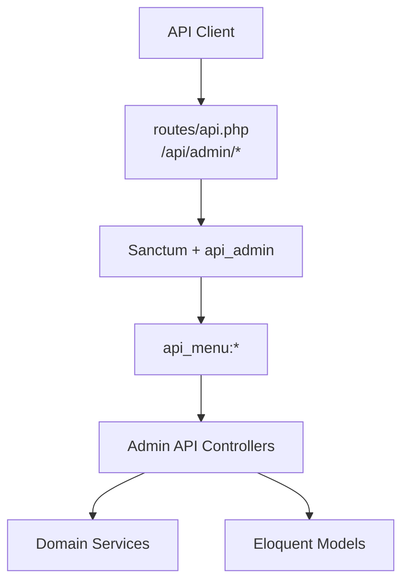

**Diagram sources**
- [api.php:99-264](file://backend/routes/api.php#L99-L264)
- [EnsureApiUserIsAdmin.php:16-35](file://backend/app/Http/Middleware/EnsureApiUserIsAdmin.php#L16-L35)
- [EnsureApiUserHasMenuPermission.php:14-33](file://backend/app/Http/Middleware/EnsureApiUserHasMenuPermission.php#L14-L33)

**Section sources**
- [api.php:90-264](file://backend/routes/api.php#L90-L264)
- [EnsureApiUserIsAdmin.php:1-37](file://backend/app/Http/Middleware/EnsureApiUserIsAdmin.php#L1-L37)
- [EnsureApiUserHasMenuPermission.php:1-35](file://backend/app/Http/Middleware/EnsureApiUserHasMenuPermission.php#L1-L35)

## Core Components
- Base controller: shared pagination, search term escaping, and JSON response helpers.
- Authentication controller: login/logout/me/password change, token lifetime from site settings, and menu list.
- Resource controllers: stations, buses, routes, schedules, promotions, bookings, cancel requests, coach services, site settings, reports.
- Authorization middleware: admin role check and per-menu permission checks.
- Session service: resolves admin idle timeout and customer token lifetime with safe defaults and clamping.
- User model: roles, menu keys, and permission helper.

Key responsibilities:
- Validate inputs consistently across resources.
- Return paginated lists compatible with the dashboard UI.
- Delegate business logic to domain services where applicable.
- Enforce security at both route and controller levels.

**Section sources**
- [BaseAdminApiController.php:9-72](file://backend/app/Http/Controllers/API/Admin/BaseAdminApiController.php#L9-L72)
- [AdminAuthController.php:13-149](file://backend/app/Http/Controllers/API/Admin/AdminAuthController.php#L13-L149)
- [AdminSessionService.php:8-121](file://backend/app/Services/AdminSessionService.php#L8-L121)
- [User.php:17-85](file://backend/app/Models/User.php#L17-L85)

## Architecture Overview
The Admin API follows a layered structure:
- Routing defines resource groups protected by Sanctum and authorization middleware.
- Controllers validate input, call services or models, and return consistent JSON payloads.
- Services encapsulate complex operations (dashboard data, booking flows, seat management, report queries).
- Models represent entities and relationships.

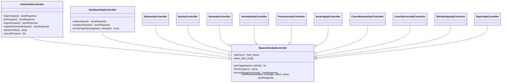

**Diagram sources**
- [BaseAdminApiController.php:9-72](file://backend/app/Http/Controllers/API/Admin/BaseAdminApiController.php#L9-L72)
- [AdminAuthController.php:20-149](file://backend/app/Http/Controllers/API/Admin/AdminAuthController.php#L20-L149)
- [DashboardApiController.php:18-85](file://backend/app/Http/Controllers/API/Admin/DashboardApiController.php#L18-L85)
- [StationApiController.php:13-85](file://backend/app/Http/Controllers/API/Admin/StationApiController.php#L13-L85)
- [BusApiController.php:13-158](file://backend/app/Http/Controllers/API/Admin/BusApiController.php#L13-L158)
- [RouteApiController.php:17-140](file://backend/app/Http/Controllers/API/Admin/RouteApiController.php#L17-L140)
- [ScheduleApiController.php:13-105](file://backend/app/Http/Controllers/API/Admin/ScheduleApiController.php#L13-L105)
- [PromotionApiController.php:13-99](file://backend/app/Http/Controllers/API/Admin/PromotionApiController.php#L13-L99)
- [BookingApiController.php:18-162](file://backend/app/Http/Controllers/API/Admin/BookingApiController.php#L18-L162)
- [CancelRequestApiController.php:14-49](file://backend/app/Http/Controllers/API/Admin/CancelRequestApiController.php#L14-L49)
- [CoachServiceApiController.php:13-103](file://backend/app/Http/Controllers/API/Admin/CoachServiceApiController.php#L13-L103)
- [SiteSettingsApiController.php:16-163](file://backend/app/Http/Controllers/API/Admin/SiteSettingsApiController.php#L16-L163)
- [ReportApiController.php:22-245](file://backend/app/Http/Controllers/API/Admin/ReportApiController.php#L22-L245)

## Detailed Component Analysis

### Authentication Flow
Admin clients authenticate via POST `/api/admin/login` with email, password, and optional device name. On success, a Sanctum token is issued with an expiration derived from the configured admin idle timeout. Subsequent requests must include the bearer token. The profile endpoint returns user details, menus, session policy, and token metadata. Logout deletes the current token. Password changes invalidate other devices’ tokens.

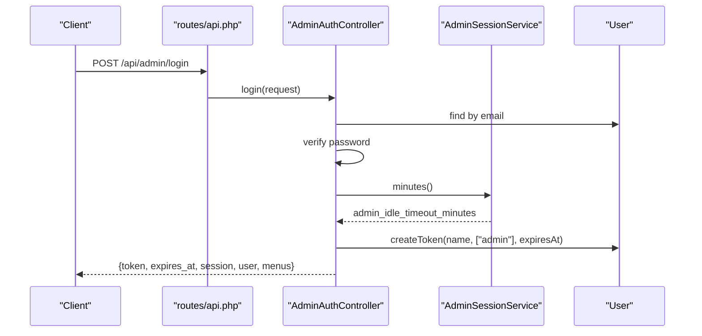

**Diagram sources**
- [api.php:99-104](file://backend/routes/api.php#L99-L104)
- [AdminAuthController.php:28-67](file://backend/app/Http/Controllers/API/Admin/AdminAuthController.php#L28-L67)
- [AdminSessionService.php:41-57](file://backend/app/Services/AdminSessionService.php#L41-L57)
- [User.php:55-63](file://backend/app/Models/User.php#L55-L63)

**Section sources**
- [AdminAuthController.php:28-149](file://backend/app/Http/Controllers/API/Admin/AdminAuthController.php#L28-L149)
- [AdminSessionService.php:8-121](file://backend/app/Services/AdminSessionService.php#L8-L121)
- [User.php:55-85](file://backend/app/Models/User.php#L55-L85)

### Dashboard and Analytics
The dashboard endpoint aggregates KPIs, analytics charts, and first pages of major lists. It accepts dashboard-specific search parameters and returns session policy alongside formatted paginator objects. The analytics endpoint supports period filters.

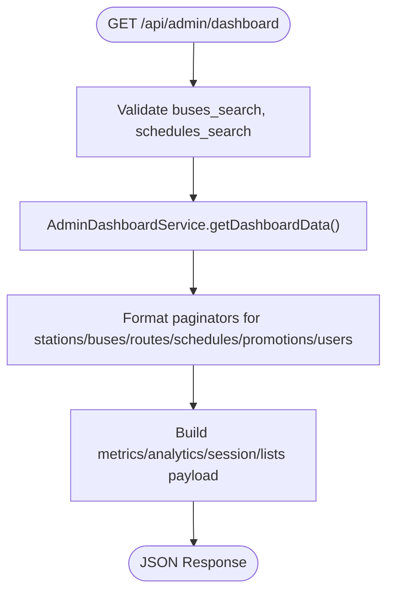

**Diagram sources**
- [DashboardApiController.php:29-55](file://backend/app/Http/Controllers/API/Admin/DashboardApiController.php#L29-L55)
- [BaseAdminApiController.php:22-34](file://backend/app/Http/Controllers/API/Admin/BaseAdminApiController.php#L22-L34)

**Section sources**
- [DashboardApiController.php:18-85](file://backend/app/Http/Controllers/API/Admin/DashboardApiController.php#L18-L85)

### Stations Management
CRUD endpoints for station terminals with search and pagination. Deletion is blocked when the station is referenced by routes.

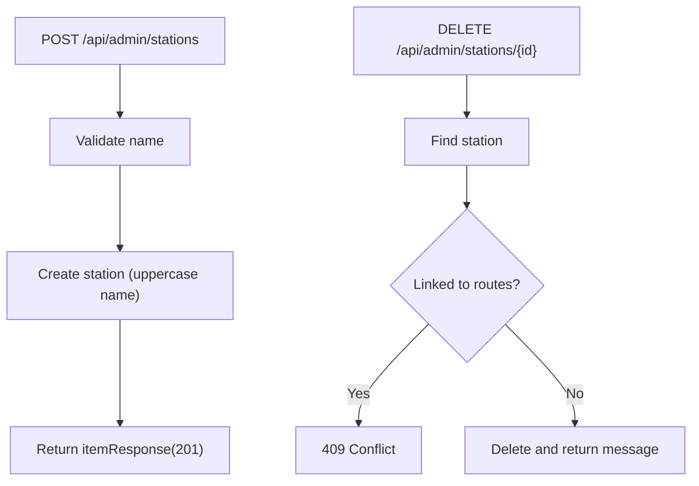

**Diagram sources**
- [StationApiController.php:40-84](file://backend/app/Http/Controllers/API/Admin/StationApiController.php#L40-L84)

**Section sources**
- [StationApiController.php:17-85](file://backend/app/Http/Controllers/API/Admin/StationApiController.php#L17-L85)

### Buses Management
Fleet management with search, filtering by coach type, and support for seat layout grids and logo uploads. Update logic allows explicit grid replacement and optional logo removal.

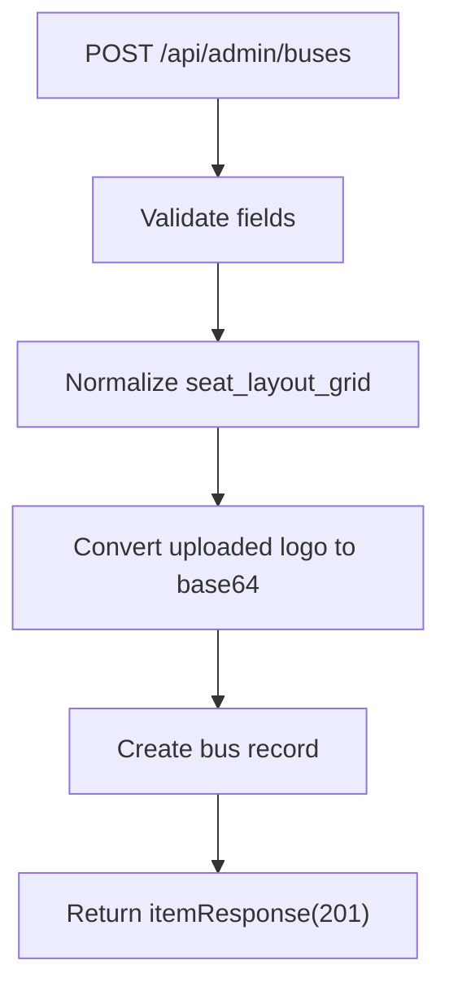

**Diagram sources**
- [BusApiController.php:48-67](file://backend/app/Http/Controllers/API/Admin/BusApiController.php#L48-L67)
- [BusApiController.php:120-157](file://backend/app/Http/Controllers/API/Admin/BusApiController.php#L120-L157)

**Section sources**
- [BusApiController.php:17-158](file://backend/app/Http/Controllers/API/Admin/BusApiController.php#L17-L158)

### Routes Management
Transport line routes between stations with validation delegated to `RouteService`. Duplicate route prevention is enforced. Point lists accept arrays or JSON strings and are normalized before persistence.

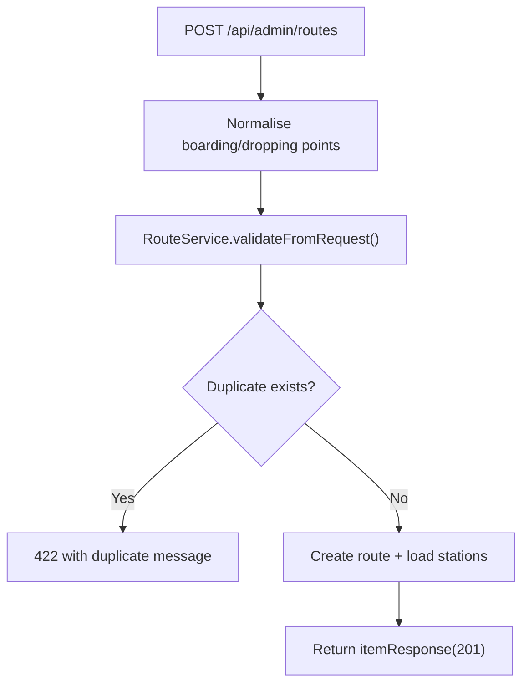

**Diagram sources**
- [RouteApiController.php:62-84](file://backend/app/Http/Controllers/API/Admin/RouteApiController.php#L62-L84)
- [RouteApiController.php:118-139](file://backend/app/Http/Controllers/API/Admin/RouteApiController.php#L118-L139)

**Section sources**
- [RouteApiController.php:25-140](file://backend/app/Http/Controllers/API/Admin/RouteApiController.php#L25-L140)

### Schedules Management
Departure runs linked to buses and routes with date-based filtering and operator/coach search. Creation enforces future departure times; updates allow editing already started departures.

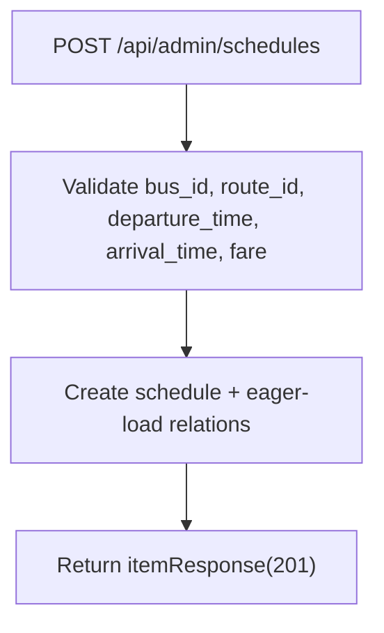

**Diagram sources**
- [ScheduleApiController.php:60-77](file://backend/app/Http/Controllers/API/Admin/ScheduleApiController.php#L60-L77)

**Section sources**
- [ScheduleApiController.php:17-105](file://backend/app/Http/Controllers/API/Admin/ScheduleApiController.php#L17-L105)

### Promotions Management
Coupon codes with code normalization and description storage. Validation ensures unique codes and numeric discounts.

**Section sources**
- [PromotionApiController.php:17-99](file://backend/app/Http/Controllers/API/Admin/PromotionApiController.php#L17-L99)

### Bookings Management
Full CRUD plus administrative actions: immediate cancel, request cancellation, and ZiniPay invoice creation. Listing supports dashboard-compatible filters and formats bookings using the shared service.

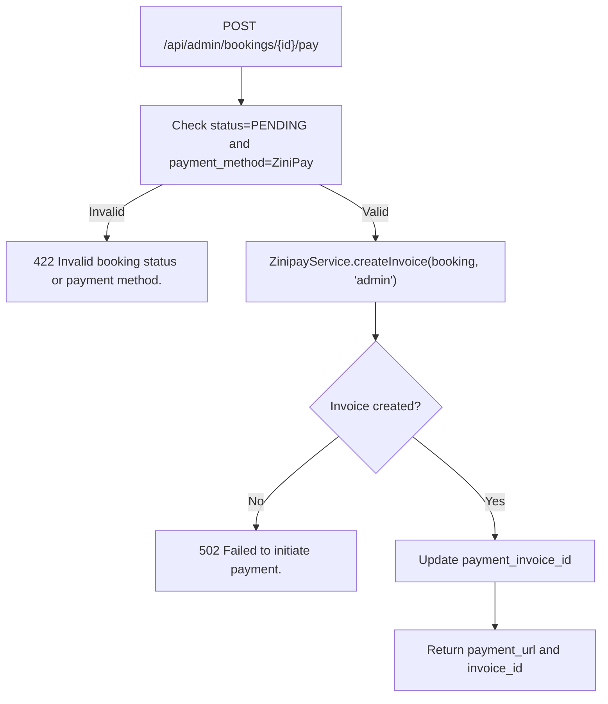

**Diagram sources**
- [BookingApiController.php:123-145](file://backend/app/Http/Controllers/API/Admin/BookingApiController.php#L123-L145)

**Section sources**
- [BookingApiController.php:27-162](file://backend/app/Http/Controllers/API/Admin/BookingApiController.php#L27-L162)

### Cancellation Requests
List pending cancellation requests with dashboard filters and approve them to mark bookings as cancelled.

**Section sources**
- [CancelRequestApiController.php:22-48](file://backend/app/Http/Controllers/API/Admin/CancelRequestApiController.php#L22-L48)

### Coach Services
Search departures with optional seat bookings and manage seat blocking, holding, and releasing seats for administrative workflows.

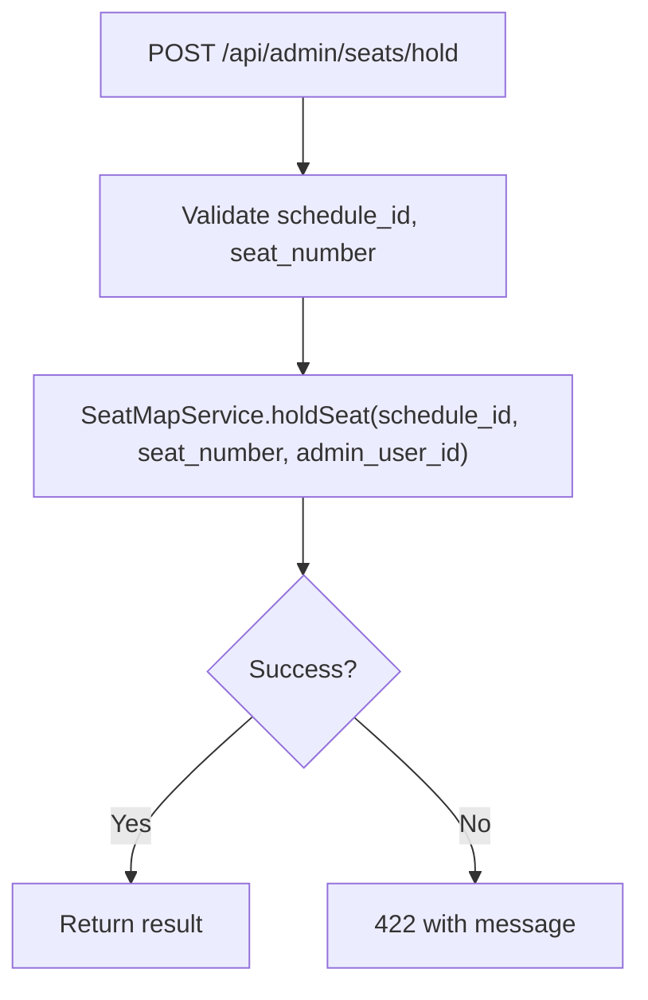

**Diagram sources**
- [CoachServiceApiController.php:65-82](file://backend/app/Http/Controllers/API/Admin/CoachServiceApiController.php#L65-L82)

**Section sources**
- [CoachServiceApiController.php:24-103](file://backend/app/Http/Controllers/API/Admin/CoachServiceApiController.php#L24-L103)

### Site Settings
Read and update site-wide configuration including branding, maintenance mode, SEO fields, and session security. Partial updates are supported by merging current values and normalizing booleans and arrays.

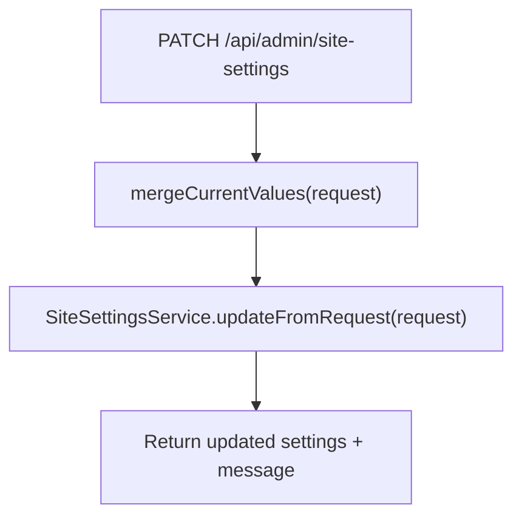

**Diagram sources**
- [SiteSettingsApiController.php:29-39](file://backend/app/Http/Controllers/API/Admin/SiteSettingsApiController.php#L29-L39)
- [SiteSettingsApiController.php:116-148](file://backend/app/Http/Controllers/API/Admin/SiteSettingsApiController.php#L116-L148)

**Section sources**
- [SiteSettingsApiController.php:24-163](file://backend/app/Http/Controllers/API/Admin/SiteSettingsApiController.php#L24-L163)

### Reports
Preview report data for multiple types with filter dropdowns and row limits. Export functionality remains on web routes.

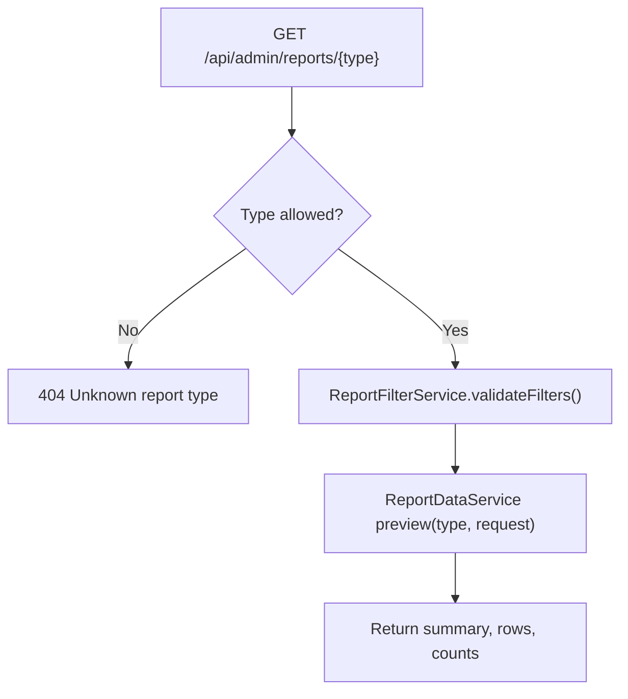

**Diagram sources**
- [ReportApiController.php:106-127](file://backend/app/Http/Controllers/API/Admin/ReportApiController.php#L106-L127)
- [ReportApiController.php:133-189](file://backend/app/Http/Controllers/API/Admin/ReportApiController.php#L133-L189)

**Section sources**
- [ReportApiController.php:24-245](file://backend/app/Http/Controllers/API/Admin/ReportApiController.php#L24-L245)

## Dependency Analysis
- Routing depends on controllers and middleware.
- Controllers depend on services and models.
- Authorization relies on the User model’s role and menu permission methods.
- Session policies are centralized in `AdminSessionService`.

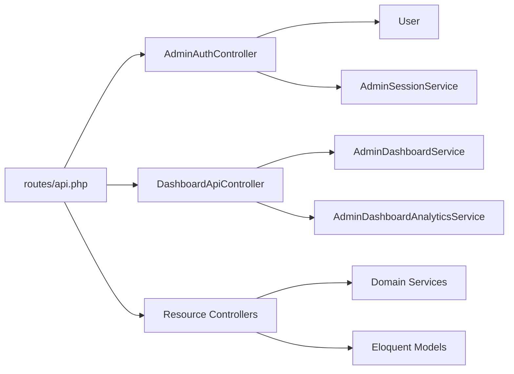

**Diagram sources**
- [api.php:99-264](file://backend/routes/api.php#L99-L264)
- [AdminAuthController.php:24-67](file://backend/app/Http/Controllers/API/Admin/AdminAuthController.php#L24-L67)
- [DashboardApiController.php:22-55](file://backend/app/Http/Controllers/API/Admin/DashboardApiController.php#L22-L55)

**Section sources**
- [api.php:99-264](file://backend/routes/api.php#L99-L264)
- [AdminAuthController.php:24-67](file://backend/app/Http/Controllers/API/Admin/AdminAuthController.php#L24-L67)
- [DashboardApiController.php:22-55](file://backend/app/Http/Controllers/API/Admin/DashboardApiController.php#L22-L55)

## Performance Considerations
- Pagination: All list endpoints paginate results. Use `per_page` within allowed bounds to avoid large payloads.
- Search terms: Wildcards are escaped to prevent unintended SQL patterns.
- Eager loading: Relationships like stations, routes, and schedules are eagerly loaded where needed to reduce N+1 queries.
- Report previews: Row limits cap preview datasets to protect performance.
- Seat operations: Hold/release endpoints require explicit schedule and seat identifiers to minimize contention.

[No sources needed since this section provides general guidance]

## Troubleshooting Guide
Common issues and resolutions:
- Unauthenticated responses: Ensure the Authorization header includes a valid bearer token obtained from `/api/admin/login`.
- Forbidden access: Non-admin accounts cannot access admin endpoints. Only admin or super admin roles are permitted.
- Menu permission denied: If a user lacks the required menu permission, requests to that resource will be forbidden. Verify the user’s `menu_permissions`.
- Token expiration: Tokens expire according to the configured admin idle timeout. Re-login if expired.
- Validation errors: Most endpoints return structured validation messages. Check request payloads against documented parameters.
- Delete conflicts: Deleting stations may fail if they are linked to routes. Remove dependencies first.

**Section sources**
- [EnsureApiUserIsAdmin.php:18-35](file://backend/app/Http/Middleware/EnsureApiUserIsAdmin.php#L18-L35)
- [EnsureApiUserHasMenuPermission.php:16-33](file://backend/app/Http/Middleware/EnsureApiUserHasMenuPermission.php#L16-L33)
- [StationApiController.php:71-84](file://backend/app/Http/Controllers/API/Admin/StationApiController.php#L71-L84)
- [AdminAuthController.php:28-67](file://backend/app/Http/Controllers/API/Admin/AdminAuthController.php#L28-L67)

## Conclusion
The Admin API provides a secure, consistent, and feature-complete interface mirroring the admin dashboard. It leverages Sanctum for token authentication, role and menu-based authorization, and centralized session policy. Controllers validate inputs, delegate business logic to services, and return standardized JSON responses suitable for both programmatic clients and the dashboard frontend.

[No sources needed since this section summarizes without analyzing specific files]