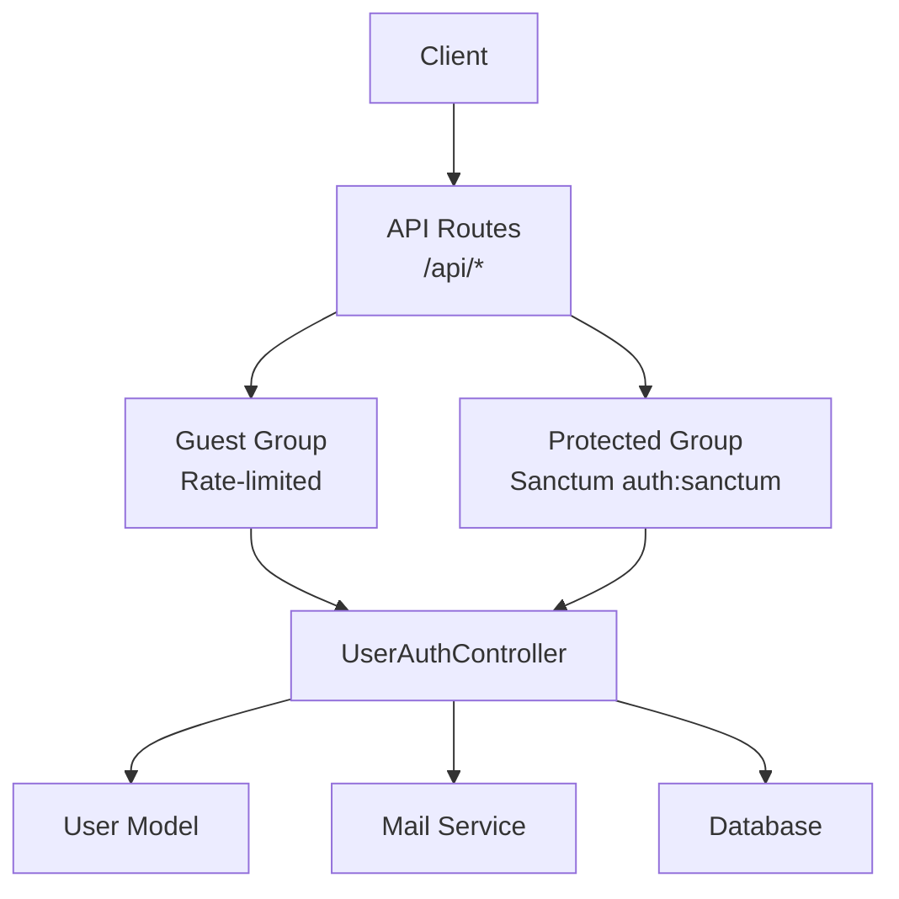
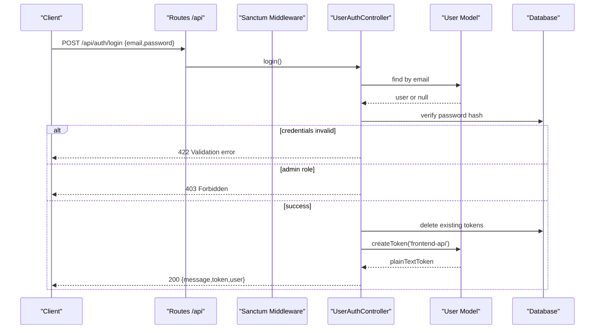
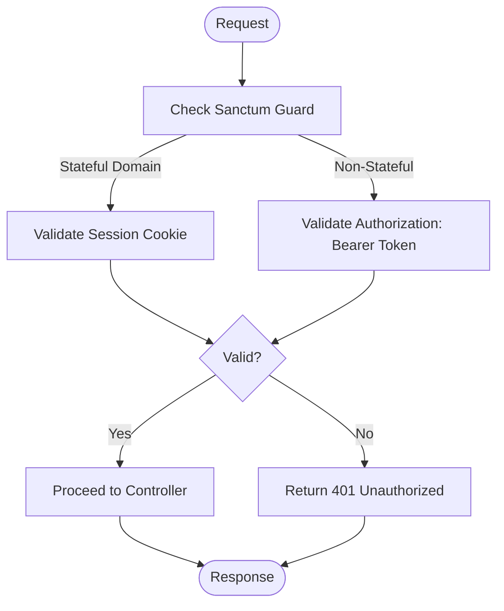
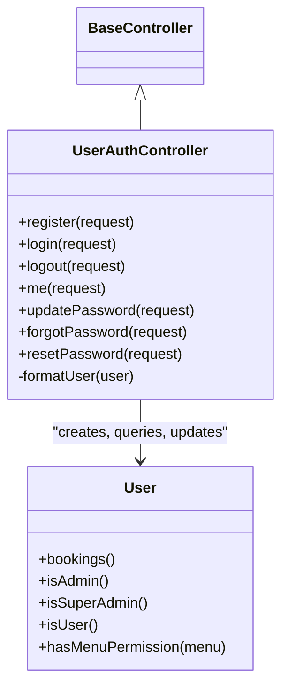

# Authentication API

<cite>
**Referenced Files in This Document**
- [UserAuthController.php](file://backend/app/Http/Controllers/API/UserAuthController.php)
- [api.php](file://backend/routes/api.php)
- [sanctum.php](file://backend/config/sanctum.php)
- [cors.php](file://backend/config/cors.php)
- [session.php](file://backend/config/session.php)
- [auth.php](file://backend/config/auth.php)
- [User.php](file://backend/app/Models/User.php)
- [BaseController.php](file://backend/app/Http/Controllers/API/BaseController.php)
</cite>

## Table of Contents
1. [Introduction](#introduction)
2. [Project Structure](#project-structure)
3. [Core Components](#core-components)
4. [Architecture Overview](#architecture-overview)
5. [Detailed Component Analysis](#detailed-component-analysis)
6. [Dependency Analysis](#dependency-analysis)
7. [Performance Considerations](#performance-considerations)
8. [Troubleshooting Guide](#troubleshooting-guide)
9. [Conclusion](#conclusion)

## Introduction
This document provides detailed API documentation for the customer authentication endpoints implemented with Laravel Sanctum. It covers:
- User registration, login, logout, profile retrieval, and password management
- Password reset via email code
- Sanctum-based token issuance and bearer-token authentication
- Rate limiting, CSRF protection, CORS configuration, and session behavior
- Error responses for validation failures, unauthorized access, and account restrictions

The API is designed for a first-party SPA frontend using either:
- Bearer tokens (recommended for mobile or non-browser clients)
- Stateful cookies (for same-origin SPAs configured as Sanctum stateful domains)

## Project Structure
Authentication routes are defined under the public `/api` namespace. Guest-only authentication routes are grouped with rate limiting, while protected routes require a valid Sanctum bearer token.

**Diagram sources**
- [api.php:41-46](file://backend/routes/api.php#L41-L46)
- [api.php:63-75](file://backend/routes/api.php#L63-L75)
- [UserAuthController.php:17-208](file://backend/app/Http/Controllers/API/UserAuthController.php#L17-L208)

**Section sources**
- [api.php:1-77](file://backend/routes/api.php#L1-L77)

## Core Components
- UserAuthController: Implements all authentication and password-related endpoints.
- User model: Provides Eloquent access to users and integrates Sanctum’s `HasApiTokens`.
- Sanctum configuration: Controls stateful domains, guards, expiration, and middleware.
- CORS and Session configuration: Control cross-origin behavior and cookie security.
- Route definitions: Separate guest and authenticated endpoints; apply rate limiting.

Key responsibilities:
- Validate inputs and enforce business rules
- Issue and revoke Sanctum personal access tokens
- Manage password reset codes and emails
- Return consistent JSON responses

**Section sources**
- [UserAuthController.php:15-218](file://backend/app/Http/Controllers/API/UserAuthController.php#L15-L218)
- [User.php:12-75](file://backend/app/Models/User.php#L12-L75)
- [sanctum.php:8-87](file://backend/config/sanctum.php#L8-L87)
- [cors.php:1-35](file://backend/config/cors.php#L1-L35)
- [session.php:1-218](file://backend/config/session.php#L1-L218)
- [api.php:41-75](file://backend/routes/api.php#L41-L75)

## Architecture Overview
The authentication flow uses Laravel Sanctum:
- For browser SPAs on allowed stateful domains, Sanctum can use session cookies.
- For other clients, Sanctum authenticates requests using the Authorization header with a Bearer token.
- Tokens are created per user and stored in the personal access tokens table.

**Diagram sources**
- [api.php:41-46](file://backend/routes/api.php#L41-L46)
- [UserAuthController.php:41-69](file://backend/app/Http/Controllers/API/UserAuthController.php#L41-L69)
- [User.php:12-15](file://backend/app/Models/User.php#L12-L15)

## Detailed Component Analysis

### Endpoints

#### Register
- Method: POST
- URL: /api/auth/register
- Authentication: None
- Rate limit: 10 attempts per minute per IP
- Request body:
  - name: string, required, max 100
  - email: string, required, valid email, unique in users
  - password: string, required, min 6, confirmed
- Success response: 201 Created
  - message: string
  - token: string (Sanctum personal access token)
  - user: object with id, name, email, role
- Errors:
  - 422 Unprocessable Entity: validation errors
  - 429 Too Many Requests: rate limit exceeded

Notes:
- The controller assigns role 'user' during registration.
- A new Sanctum token is issued immediately after successful registration.

**Section sources**
- [api.php:41-46](file://backend/routes/api.php#L41-L46)
- [UserAuthController.php:17-39](file://backend/app/Http/Controllers/API/UserAuthController.php#L17-L39)
- [User.php:17-23](file://backend/app/Models/User.php#L17-L23)

#### Login
- Method: POST
- URL: /api/auth/login
- Authentication: None
- Rate limit: 10 attempts per minute per IP
- Request body:
  - email: string, required, valid email
  - password: string, required
- Success response: 200 OK
  - message: string
  - token: string (Sanctum personal access token)
  - user: object with id, name, email, role
- Errors:
  - 422 Unprocessable Entity: invalid credentials
  - 403 Forbidden: admin accounts must use admin portal
  - 429 Too Many Requests: rate limit exceeded

Behavior:
- Existing tokens are deleted before issuing a new one.
- Admin roles are blocked from this endpoint.

**Section sources**
- [api.php:41-46](file://backend/routes/api.php#L41-L46)
- [UserAuthController.php:41-69](file://backend/app/Http/Controllers/API/UserAuthController.php#L41-L69)
- [User.php:44-57](file://backend/app/Models/User.php#L44-L57)

#### Logout
- Method: POST
- URL: /api/auth/logout
- Authentication: Required (Bearer token)
- Success response: 200 OK
  - message: string
- Errors:
  - 401 Unauthorized: missing or invalid token

Behavior:
- Deletes the current access token associated with the request.

**Section sources**
- [api.php:63-75](file://backend/routes/api.php#L63-L75)
- [UserAuthController.php:72-79](file://backend/app/Http/Controllers/API/UserAuthController.php#L72-L79)

#### Get Current User
- Method: GET
- URL: /api/auth/me
- Authentication: Required (Bearer token)
- Success response: 200 OK
  - user: object with id, name, email, role
- Errors:
  - 401 Unauthorized: missing or invalid token

**Section sources**
- [api.php:63-75](file://backend/routes/api.php#L63-L75)
- [UserAuthController.php:81-86](file://backend/app/Http/Controllers/API/UserAuthController.php#L81-L86)

#### Update Password
- Method: POST
- URL: /api/auth/password
- Authentication: Required (Bearer token)
- Request body:
  - current_password: string, required
  - password: string, required, min 6, confirmed
- Success response: 200 OK
  - message: string
  - user: updated user object
- Errors:
  - 422 Unprocessable Entity: incorrect current password or validation failure
  - 401 Unauthorized: missing or invalid token

**Section sources**
- [api.php:63-75](file://backend/routes/api.php#L63-L75)
- [UserAuthController.php:88-111](file://backend/app/Http/Controllers/API/UserAuthController.php#L88-L111)

#### Forgot Password
- Method: POST
- URL: /api/auth/forgot-password
- Authentication: None
- Rate limit: 10 attempts per minute per IP
- Request body:
  - email: string, required, valid email, max 100
- Success response: 200 OK
  - message: string indicating reset code was sent
  - code: string (only in local/testing environments)
- Errors:
  - 422 Unprocessable Entity: email not registered as customer or mail sending failure
  - 429 Too Many Requests: rate limit exceeded

Behavior:
- Generates a 6-digit random code, hashes it, and stores it in the password reset tokens table.
- Sends an email containing the code.
- In local/testing environments, returns the code in the response for convenience.

**Section sources**
- [api.php:41-46](file://backend/routes/api.php#L41-L46)
- [UserAuthController.php:113-164](file://backend/app/Http/Controllers/API/UserAuthController.php#L113-L164)
- [auth.php:95-101](file://backend/config/auth.php#L95-L101)

#### Reset Password
- Method: POST
- URL: /api/auth/reset-password
- Authentication: None
- Rate limit: 10 attempts per minute per IP
- Request body:
  - email: string, required, valid email, max 100
  - code: string, required
  - password: string, required, min 6, confirmed
- Success response: 200 OK
  - message: string confirming reset
- Errors:
  - 422 Unprocessable Entity: invalid or expired reset code, user not found
  - 429 Too Many Requests: rate limit exceeded

Behavior:
- Validates the hashed reset code against the stored value.
- Enforces a 60-minute expiry window.
- Updates the user’s password and deletes the reset token record.

**Section sources**
- [api.php:41-46](file://backend/routes/api.php#L41-L46)
- [UserAuthController.php:166-208](file://backend/app/Http/Controllers/API/UserAuthController.php#L166-L208)

### Sanctum-Based Authentication Flow

**Diagram sources**
- [sanctum.php:21-40](file://backend/config/sanctum.php#L21-L40)
- [api.php:63-75](file://backend/routes/api.php#L63-L75)

### JWT Token Handling
- Implementation detail: The application uses Laravel Sanctum personal access tokens, not traditional JWTs.
- Token lifecycle:
  - Issued upon successful registration or login.
  - Revoked on logout or when a new token is issued during login.
- Client usage:
  - Include Authorization header: Authorization: Bearer <token>
  - For SPAs on stateful domains, cookies are used automatically; ensure credentials are included in requests.

Security notes:
- Do not store tokens in localStorage if using Sanctum cookies.
- Always send tokens over HTTPS.
- Rotate tokens by deleting old ones on login.

**Section sources**
- [UserAuthController.php:32-33](file://backend/app/Http/Controllers/API/UserAuthController.php#L32-L33)
- [UserAuthController.php:62-63](file://backend/app/Http/Controllers/API/UserAuthController.php#L62-L63)
- [UserAuthController.php:72-79](file://backend/app/Http/Controllers/API/UserAuthController.php#L72-L79)
- [sanctum.php:47-68](file://backend/config/sanctum.php#L47-L68)

### Session Management
- Sanctum guard uses the web guard, which relies on sessions.
- Stateful domains allow Sanctum to authenticate via cookies for SPAs.
- Session driver defaults to database; lifetime and cookie attributes are configurable.

Configuration highlights:
- SANCTUM_STATEFUL_DOMAINS controls which origins receive stateful cookies.
- SESSION_DRIVER, SESSION_LIFETIME, SESSION_SECURE_COOKIE, SESSION_HTTP_ONLY, SESSION_SAME_SITE control session behavior.

Best practices:
- Set SESSION_SECURE_COOKIE to true in production.
- Use SESSION_HTTP_ONLY = true.
- Configure SESSION_SAME_SITE appropriately (lax or strict).
- Ensure CORS supports_credentials is enabled only when necessary.

**Section sources**
- [sanctum.php:21-40](file://backend/config/sanctum.php#L21-L40)
- [session.php:21-35](file://backend/config/session.php#L21-L35)
- [session.php:172-202](file://backend/config/session.php#L172-L202)
- [cors.php:18-32](file://backend/config/cors.php#L18-L32)

### Security Headers and CSRF Protection
- CSRF protection is available through Sanctum’s middleware stack.
- For SPAs, obtain and include the CSRF cookie when making stateful requests.
- CORS settings currently allow all origins and headers; restrict them in production.

Recommendations:
- Restrict allowed_origins to known frontends.
- Enable supports_credentials only when using cookies.
- Ensure CSP and HSTS headers are set at the web server level.

**Section sources**
- [sanctum.php:81-85](file://backend/config/sanctum.php#L81-L85)
- [cors.php:18-32](file://backend/config/cors.php#L18-L32)

### Input Validation and Error Responses
Validation rules are enforced in the controller methods. Typical error responses:
- 422 Unprocessable Entity: validation failures or business rule violations
- 401 Unauthorized: missing or invalid token
- 403 Forbidden: admin accounts attempting to use customer endpoints
- 429 Too Many Requests: rate limit exceeded

Error payload examples:
- Validation errors return field-specific messages.
- Account restriction returns a message indicating admin sign-in path.

**Section sources**
- [UserAuthController.php:19-23](file://backend/app/Http/Controllers/API/UserAuthController.php#L19-L23)
- [UserAuthController.php:43-53](file://backend/app/Http/Controllers/API/UserAuthController.php#L43-L53)
- [UserAuthController.php:90-100](file://backend/app/Http/Controllers/API/UserAuthController.php#L90-L100)
- [UserAuthController.php:115-125](file://backend/app/Http/Controllers/API/UserAuthController.php#L115-L125)
- [UserAuthController.php:168-181](file://backend/app/Http/Controllers/API/UserAuthController.php#L168-L181)

### Rate Limiting
- Guest authentication endpoints are limited to 10 requests per minute per IP.
- Applies to register, login, forgot-password, and reset-password.

Operational guidance:
- Monitor 429 responses and adjust limits based on traffic patterns.
- Consider separate throttling policies for sensitive operations like password reset.

**Section sources**
- [api.php:41-46](file://backend/routes/api.php#L41-L46)

## Dependency Analysis

**Diagram sources**
- [BaseController.php:5-7](file://backend/app/Http/Controllers/API/BaseController.php#L5-L7)
- [UserAuthController.php:15-218](file://backend/app/Http/Controllers/API/UserAuthController.php#L15-L218)
- [User.php:12-75](file://backend/app/Models/User.php#L12-L75)

**Section sources**
- [BaseController.php:1-8](file://backend/app/Http/Controllers/API/BaseController.php#L1-L8)
- [UserAuthController.php:15-218](file://backend/app/Http/Controllers/API/UserAuthController.php#L15-L218)
- [User.php:12-75](file://backend/app/Models/User.php#L12-L75)

## Performance Considerations
- Password hashing: bcrypt is computationally expensive; consider hardware tuning and avoiding unnecessary rehashes.
- Token deletion on login reduces token sprawl but adds a write operation.
- Email sending is asynchronous in nature; handle failures gracefully and avoid exposing internal errors.
- Database-backed sessions scale better than file-based sessions in multi-node deployments.

[No sources needed since this section provides general guidance]

## Troubleshooting Guide

Common issues and resolutions:
- 401 Unauthorized on protected endpoints:
  - Ensure Authorization header includes a valid Bearer token.
  - Verify token has not been revoked or expired.
- 403 Forbidden on login:
  - Admin accounts cannot use the customer login endpoint.
- 422 Unprocessable Entity:
  - Check input validation rules and provide correct fields.
- 429 Too Many Requests:
  - Reduce request frequency or adjust throttle policy.
- Password reset code invalid/expired:
  - Codes expire after 60 minutes; request a new code.
- CORS or cookie issues:
  - Confirm SANCTUM_STATEFUL_DOMAINS includes your frontend domain.
  - Ensure CORS allows credentials when using cookies.

**Section sources**
- [UserAuthController.php:41-69](file://backend/app/Http/Controllers/API/UserAuthController.php#L41-L69)
- [UserAuthController.php:113-208](file://backend/app/Http/Controllers/API/UserAuthController.php#L113-L208)
- [sanctum.php:21-40](file://backend/config/sanctum.php#L21-L40)
- [cors.php:18-32](file://backend/config/cors.php#L18-L32)

## Conclusion
The authentication API provides secure, Sanctum-based endpoints for customer accounts with clear separation between guest and protected routes. It enforces input validation, rate limiting, and role-based restrictions. For production, tighten CORS, enable secure session cookies, and monitor rate limits and error responses to maintain robust security and performance.

[No sources needed since this section summarizes without analyzing specific files]