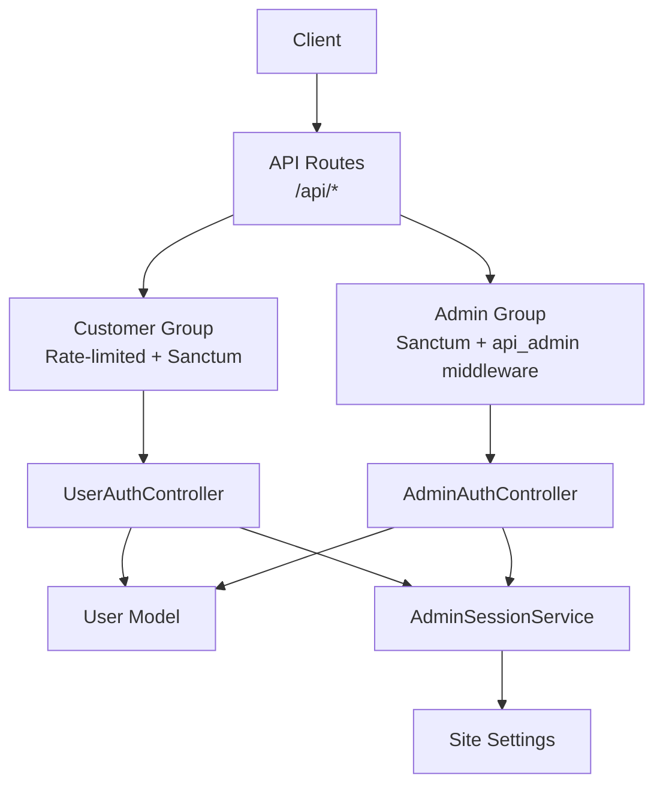
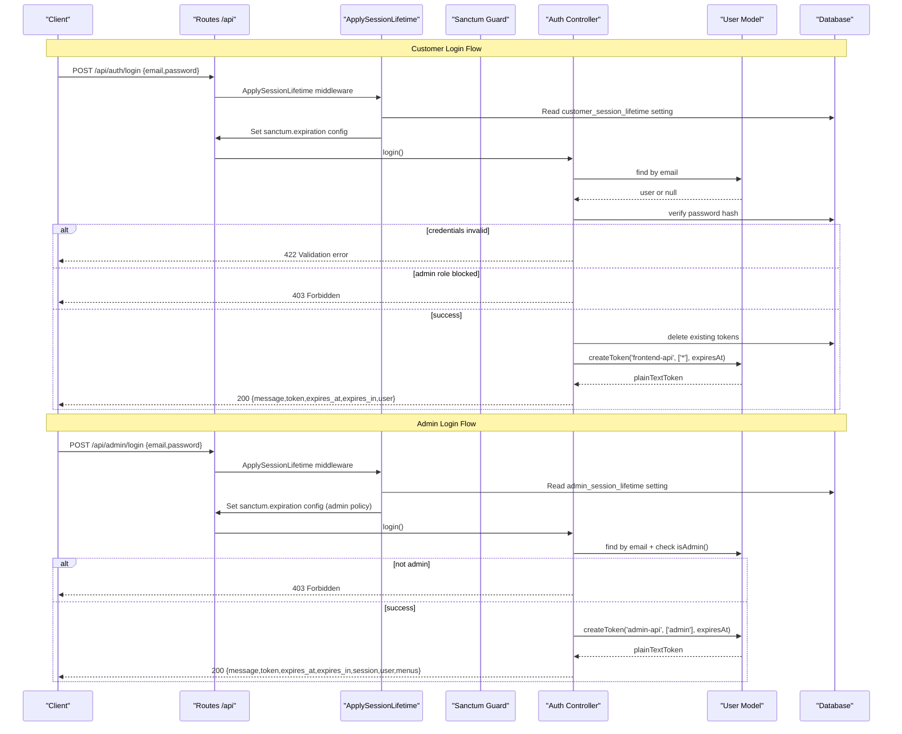
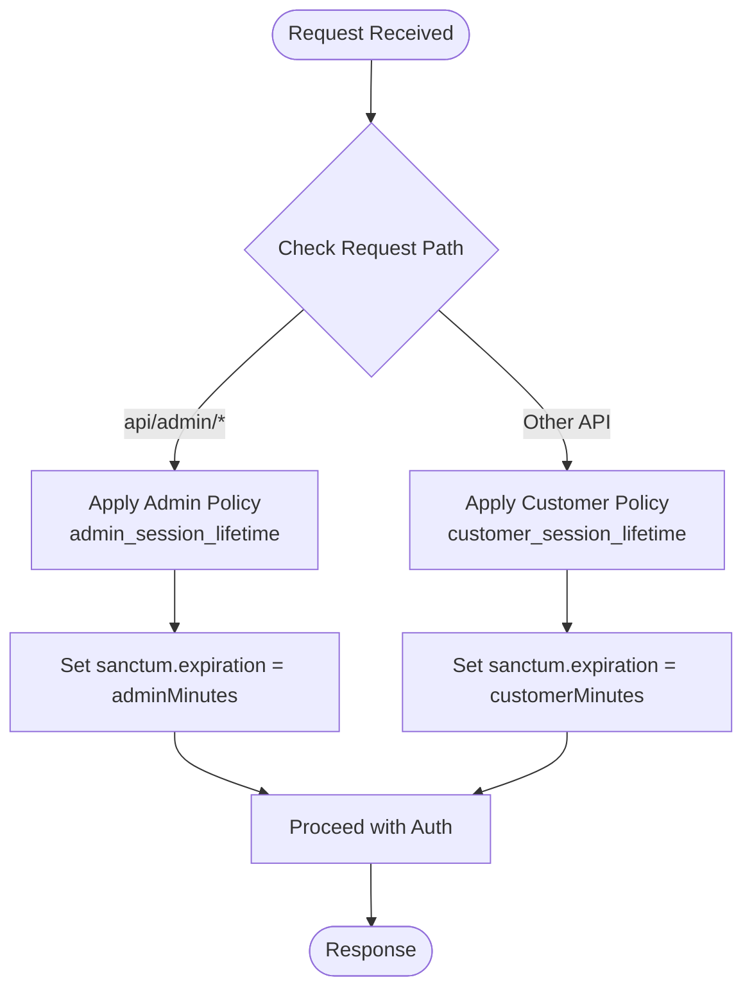
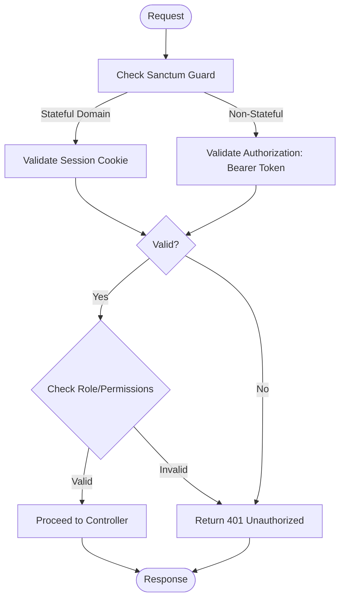
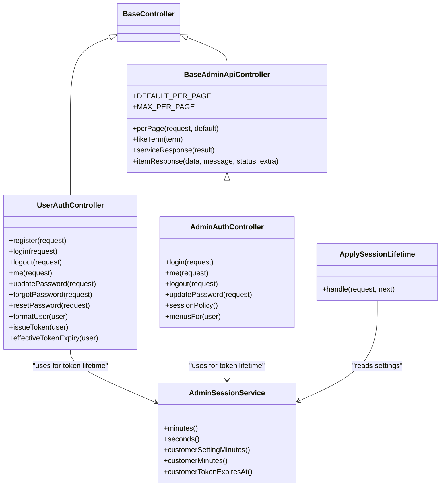

# Authentication API

<cite>
**Referenced Files in This Document**
- [UserAuthController.php](file://backend/app/Http/Controllers/API/UserAuthController.php)
- [AdminAuthController.php](file://backend/app/Http/Controllers/API/Admin/AdminAuthController.php)
- [api.php](file://backend/routes/api.php)
- [sanctum.php](file://backend/config/sanctum.php)
- [cors.php](file://backend/config/cors.php)
- [session.php](file://backend/config/session.php)
- [auth.php](file://backend/config/auth.php)
- [User.php](file://backend/app/Models/User.php)
- [BaseController.php](file://backend/app/Http/Controllers/API/BaseController.php)
- [BaseAdminApiController.php](file://backend/app/Http/Controllers/API/Admin/BaseAdminApiController.php)
- [AdminSessionService.php](file://backend/app/Services/AdminSessionService.php)
- [ApplySessionLifetime.php](file://backend/app/Http/Middleware/ApplySessionLifetime.php)
</cite>

## Update Summary
**Changes Made**
- Added comprehensive documentation for the new Admin API authentication system
- Updated customer authentication endpoints to support configurable token lifetimes
- Documented separate token lifetime policies for admin vs customer APIs
- Added new AdminAuthController endpoints and authentication flow
- Enhanced session management with dynamic token expiration based on site settings

## Table of Contents
1. [Introduction](#introduction)
2. [Project Structure](#project-structure)
3. [Core Components](#core-components)
4. [Architecture Overview](#architecture-overview)
5. [Detailed Component Analysis](#detailed-component-analysis)
6. [Dependency Analysis](#dependency-analysis)
7. [Performance Considerations](#performance-considerations)
8. [Troubleshooting Guide](#troubleshooting-guide)
9. [Conclusion](#conclusion)

## Introduction
This document provides detailed API documentation for the enhanced authentication system supporting both customer-facing APIs and a new Admin API with separate token lifetimes. The system implements Laravel Sanctum for secure token-based authentication with configurable expiration policies.

The authentication system now supports:
- **Customer API**: User registration, login, logout, profile management, and password operations with configurable token lifetimes
- **Admin API**: Separate authentication flow for administrative operations with distinct token policies
- **Dynamic Token Management**: Configurable token lifetimes through site settings that affect both existing and newly issued tokens
- **Enhanced Security**: Role-based access control, rate limiting, and comprehensive validation

The API is designed for first-party SPAs using either:
- Bearer tokens (recommended for mobile or non-browser clients)
- Stateful cookies (for same-origin SPAs configured as Sanctum stateful domains)

## Project Structure
Authentication routes are organized into two main groups under the `/api` namespace:
- **Customer API**: Public-facing authentication endpoints with rate limiting
- **Admin API**: Administrative endpoints requiring admin role and separate token policy

**Diagram sources**
- [api.php:54-88](file://backend/routes/api.php#L54-L88)
- [api.php:99-264](file://backend/routes/api.php#L99-L264)
- [UserAuthController.php:16-273](file://backend/app/Http/Controllers/API/UserAuthController.php#L16-L273)
- [AdminAuthController.php:20-149](file://backend/app/Http/Controllers/API/Admin/AdminAuthController.php#L20-L149)

**Section sources**
- [api.php:1-267](file://backend/routes/api.php#L1-L267)

## Core Components
- **UserAuthController**: Implements customer authentication endpoints with dynamic token lifetime management
- **AdminAuthController**: Handles admin authentication with separate token policies and menu permissions
- **AdminSessionService**: Centralized service for managing configurable session lifetimes from site settings
- **ApplySessionLifetime Middleware**: Dynamically applies different token lifetimes based on request context
- **Base Controllers**: Shared functionality for consistent API responses and data formatting

Key responsibilities:
- Validate inputs and enforce business rules
- Issue and revoke Sanctum personal access tokens with configurable lifetimes
- Manage password reset codes and emails
- Return consistent JSON responses with proper error handling
- Apply role-based access control and permission checks

**Section sources**
- [UserAuthController.php:16-273](file://backend/app/Http/Controllers/API/UserAuthController.php#L16-L273)
- [AdminAuthController.php:20-149](file://backend/app/Http/Controllers/API/Admin/AdminAuthController.php#L20-L149)
- [AdminSessionService.php:16-121](file://backend/app/Services/AdminSessionService.php#L16-L121)
- [ApplySessionLifetime.php:21-49](file://backend/app/Http/Middleware/ApplySessionLifetime.php#L21-L49)

## Architecture Overview
The enhanced authentication system uses Laravel Sanctum with dynamic token lifetime management:

### Dual Authentication Flow
- **Customer API**: Uses configurable token lifetimes (default 24 hours, can be set to never expire)
- **Admin API**: Uses admin panel idle timeout policy (default 2 hours)
- **Dynamic Policy Application**: Token lifetimes can be changed at runtime via site settings

**Diagram sources**
- [api.php:54-88](file://backend/routes/api.php#L54-L88)
- [api.php:99-114](file://backend/routes/api.php#L99-L114)
- [UserAuthController.php:48-79](file://backend/app/Http/Controllers/API/UserAuthController.php#L48-L79)
- [AdminAuthController.php:28-68](file://backend/app/Http/Controllers/API/Admin/AdminAuthController.php#L28-L68)
- [ApplySessionLifetime.php:27-46](file://backend/app/Http/Middleware/ApplySessionLifetime.php#L27-L46)

## Detailed Component Analysis

### Customer Authentication Endpoints

#### Register
- Method: POST
- URL: /api/auth/register
- Authentication: None
- Rate limit: 10 attempts per minute per IP
- Request body:
  - name: string, required, max 100
  - email: string, required, valid email, unique in users
  - password: string, required, min 6, confirmed
- Success response: 201 Created
  - message: string
  - token: string (Sanctum personal access token)
  - expires_at: string (ISO 8601 timestamp or null for never-expiring)
  - expires_in: integer (seconds until expiry or null)
  - user: object with id, name, email, role
- Errors:
  - 422 Unprocessable Entity: validation errors
  - 429 Too Many Requests: rate limit exceeded

**Updated** Now supports configurable token lifetimes based on site settings.

**Section sources**
- [api.php:54-59](file://backend/routes/api.php#L54-L59)
- [UserAuthController.php:22-46](file://backend/app/Http/Controllers/API/UserAuthController.php#L22-L46)

#### Login
- Method: POST
- URL: /api/auth/login
- Authentication: None
- Rate limit: 10 attempts per minute per IP
- Request body:
  - email: string, required, valid email
  - password: string, required
- Success response: 200 OK
  - message: string
  - token: string (Sanctum personal access token)
  - expires_at: string (ISO 8601 timestamp or null for never-expiring)
  - expires_in: integer (seconds until expiry or null)
  - user: object with id, name, email, role
- Errors:
  - 422 Unprocessable Entity: invalid credentials
  - 403 Forbidden: admin accounts must use admin portal
  - 429 Too Many Requests: rate limit exceeded

**Updated** Returns additional token metadata including expiration information.

**Section sources**
- [api.php:54-59](file://backend/routes/api.php#L54-L59)
- [UserAuthController.php:48-79](file://backend/app/Http/Controllers/API/UserAuthController.php#L48-L79)

#### Logout
- Method: POST
- URL: /api/auth/logout
- Authentication: Required (Bearer token)
- Success response: 200 OK
  - message: string
- Errors:
  - 401 Unauthorized: missing or invalid token

**Section sources**
- [api.php:76-88](file://backend/routes/api.php#L76-L88)
- [UserAuthController.php:81-88](file://backend/app/Http/Controllers/API/UserAuthController.php#L81-L88)

#### Get Current User
- Method: GET
- URL: /api/auth/me
- Authentication: Required (Bearer token)
- Success response: 200 OK
  - user: object with id, name, email, role
  - expires_at: string (effective token expiry timestamp or null)
- Errors:
  - 401 Unauthorized: missing or invalid token

**Updated** Now includes effective token expiration information.

**Section sources**
- [api.php:76-88](file://backend/routes/api.php#L76-L88)
- [UserAuthController.php:90-96](file://backend/app/Http/Controllers/API/UserAuthController.php#L90-L96)

#### Update Password
- Method: POST
- URL: /api/auth/password
- Authentication: Required (Bearer token)
- Request body:
  - current_password: string, required
  - password: string, required, min 6, confirmed
- Success response: 200 OK
  - message: string
  - user: updated user object
- Errors:
  - 422 Unprocessable Entity: incorrect current password or validation failure
  - 401 Unauthorized: missing or invalid token

**Section sources**
- [api.php:76-88](file://backend/routes/api.php#L76-L88)
- [UserAuthController.php:98-121](file://backend/app/Http/Controllers/API/UserAuthController.php#L98-L121)

#### Forgot Password & Reset Password
- Methods: POST
- URLs: /api/auth/forgot-password, /api/auth/reset-password
- Authentication: None
- Rate limit: 10 attempts per minute per IP
- Request bodies and responses remain unchanged from previous implementation

**Section sources**
- [api.php:54-59](file://backend/routes/api.php#L54-L59)
- [UserAuthController.php:123-218](file://backend/app/Http/Controllers/API/UserAuthController.php#L123-L218)

### Admin Authentication Endpoints

#### Admin Login
- Method: POST
- URL: /api/admin/login
- Authentication: None
- Rate limit: 10 attempts per minute per IP
- Request body:
  - email: string, required, valid email
  - password: string, required
  - device_name: string, optional, max 60 characters
- Success response: 200 OK
  - message: string
  - token: string (Sanctum personal access token with admin scope)
  - expires_at: string (ISO 8601 timestamp based on admin session policy)
  - expires_in: integer (seconds until expiry)
  - session: object containing admin_idle_timeout_minutes and customer_token_lifetime_minutes
  - user: object with admin user details
  - menus: array of menu keys the user has permission to access
- Errors:
  - 422 Unprocessable Entity: invalid credentials
  - 403 Forbidden: non-admin accounts cannot access admin API
  - 429 Too Many Requests: rate limit exceeded

**New Endpoint** Provides admin-specific authentication with enhanced security and menu permissions.

**Section sources**
- [api.php:99-102](file://backend/routes/api.php#L99-L102)
- [AdminAuthController.php:28-68](file://backend/app/Http/Controllers/API/Admin/AdminAuthController.php#L28-L68)

#### Admin Get Current User
- Method: GET
- URL: /api/admin/me
- Authentication: Required (Bearer token with admin scope)
- Success response: 200 OK
  - user: object with admin user details
  - menus: array of menu keys the user has permission to access
  - session: object containing session policy information
  - token: object with token name and expiration details
- Errors:
  - 401 Unauthorized: missing or invalid token
  - 403 Forbidden: non-admin accounts cannot access admin API

**New Endpoint** Returns comprehensive admin user information including menu permissions.

**Section sources**
- [api.php:110](file://backend/routes/api.php#L110)
- [AdminAuthController.php:70-84](file://backend/app/Http/Controllers/API/Admin/AdminAuthController.php#L70-L84)

#### Admin Logout
- Method: POST
- URL: /api/admin/logout
- Authentication: Required (Bearer token with admin scope)
- Success response: 200 OK
  - message: string
- Errors:
  - 401 Unauthorized: missing or invalid token
  - 403 Forbidden: non-admin accounts cannot access admin API

**New Endpoint** Securely terminates admin sessions.

**Section sources**
- [api.php:111](file://backend/routes/api.php#L111)
- [AdminAuthController.php:86-93](file://backend/app/Http/Controllers/API/Admin/AdminAuthController.php#L86-L93)

#### Admin Update Password
- Method: POST
- URL: /api/admin/password
- Authentication: Required (Bearer token with admin scope)
- Request body:
  - current_password: string, required
  - password: string, required, min 8, confirmed
- Success response: 200 OK
  - message: string
  - user: updated admin user object
- Errors:
  - 422 Unprocessable Entity: incorrect current password or validation failure
  - 401 Unauthorized: missing or invalid token
  - 403 Forbidden: non-admin accounts cannot access admin API

**New Endpoint** Includes automatic revocation of other devices' tokens when password changes.

**Section sources**
- [api.php:112-114](file://backend/routes/api.php#L112-L114)
- [AdminAuthController.php:98-123](file://backend/app/Http/Controllers/API/Admin/AdminAuthController.php#L98-L123)

### Dynamic Token Lifetime Management

The system now supports dynamic configuration of token lifetimes through site settings:

#### Customer Token Lifetimes
- **Configurable**: Set via Site Settings → Session Security → Customer Login Lifetime
- **Default**: 1440 minutes (24 hours)
- **Range**: 0 (never expire) to 43200 minutes (30 days)
- **Behavior**: Affects both new and existing tokens through effective expiration calculation

#### Admin Token Lifetimes  
- **Configurable**: Set via Site Settings → Session Security → Admin Session Lifetime
- **Default**: 120 minutes (2 hours)
- **Range**: 1 to 10080 minutes (7 days)
- **Behavior**: Applies to admin API tokens and Blade dashboard sessions

**Diagram sources**
- [ApplySessionLifetime.php:27-46](file://backend/app/Http/Middleware/ApplySessionLifetime.php#L27-L46)
- [AdminSessionService.php:41-92](file://backend/app/Services/AdminSessionService.php#L41-L92)

### Sanctum-Based Authentication Flow

**Diagram sources**
- [sanctum.php:40-53](file://backend/config/sanctum.php#L40-L53)
- [api.php:76-88](file://backend/routes/api.php#L76-L88)
- [api.php:104-264](file://backend/routes/api.php#L104-L264)

### JWT Token Handling
- **Implementation**: Laravel Sanctum personal access tokens (not traditional JWTs)
- **Token Lifecycle**:
  - Issued upon successful registration or login
  - Revoked on logout or when a new token is issued during login
  - Subject to dynamic expiration policies based on request context
- **Client Usage**:
  - Include Authorization header: `Authorization: Bearer <token>`
  - For SPAs on stateful domains, cookies are used automatically
- **Security Features**:
  - Role-based scopes (e.g., 'admin' for admin API)
  - Configurable expiration times
  - Automatic token cleanup on password changes

**Updated** Enhanced with dynamic expiration policies and role-based scoping.

**Section sources**
- [UserAuthController.php:236-247](file://backend/app/Http/Controllers/API/UserAuthController.php#L236-L247)
- [AdminAuthController.php:53-57](file://backend/app/Http/Controllers/API/Admin/AdminAuthController.php#L53-L57)
- [AdminSessionService.php:87-92](file://backend/app/Services/AdminSessionService.php#L87-L92)

### Session Management
- **Dual Policy System**: Separate policies for admin and customer sessions
- **Dynamic Configuration**: Policies applied via global middleware before authentication
- **Stateful Domains**: Sanctum can use session cookies for SPAs on allowed domains
- **Configuration Highlights**:
  - SANCTUM_STATEFUL_DOMAINS controls which origins receive stateful cookies
  - SESSION_DRIVER, SESSION_LIFETIME, SESSION_SECURE_COOKIE, SESSION_HTTP_ONLY, SESSION_SAME_SITE control session behavior
  - ApplySessionLifetime middleware dynamically sets sanctum.expiration based on request path

**Updated** Enhanced with dual policy system and dynamic configuration.

**Section sources**
- [ApplySessionLifetime.php:27-46](file://backend/app/Http/Middleware/ApplySessionLifetime.php#L27-L46)
- [AdminSessionService.php:41-92](file://backend/app/Services/AdminSessionService.php#L41-L92)
- [sanctum.php:40-53](file://backend/config/sanctum.php#L40-L53)

### Security Headers and CSRF Protection
- **CSRF Protection**: Available through Sanctum's middleware stack
- **CORS Configuration**: Currently allows all origins; should be restricted in production
- **Security Recommendations**:
  - Restrict allowed_origins to known frontends
  - Enable supports_credentials only when using cookies
  - Ensure CSP and HSTS headers are set at web server level

**Section sources**
- [sanctum.php:81-85](file://backend/config/sanctum.php#L81-L85)
- [cors.php:18-32](file://backend/config/cors.php#L18-L32)

### Input Validation and Error Responses
Validation rules are enforced in controller methods with comprehensive error handling:

**Common Error Responses**:
- 422 Unprocessable Entity: validation failures or business rule violations
- 401 Unauthorized: missing or invalid token
- 403 Forbidden: unauthorized role access or admin/customer endpoint mismatch
- 429 Too Many Requests: rate limit exceeded

**Updated** Enhanced error handling for new admin endpoints and improved validation messages.

**Section sources**
- [UserAuthController.php:24-28](file://backend/app/Http/Controllers/API/UserAuthController.php#L24-L28)
- [AdminAuthController.php:30-34](file://backend/app/Http/Controllers/API/Admin/AdminAuthController.php#L30-L34)

### Rate Limiting
- **Guest Endpoints**: Limited to 10 requests per minute per IP
- **Applies To**: register, login, forgot-password, reset-password, admin login
- **Operational Guidance**: Monitor 429 responses and adjust limits based on traffic patterns

**Section sources**
- [api.php:54-59](file://backend/routes/api.php#L54-L59)
- [api.php:100-102](file://backend/routes/api.php#L100-L102)

## Dependency Analysis

**Diagram sources**
- [BaseController.php:5-7](file://backend/app/Http/Controllers/API/BaseController.php#L5-L7)
- [BaseAdminApiController.php:15-73](file://backend/app/Http/Controllers/API/Admin/BaseAdminApiController.php#L15-L73)
- [UserAuthController.php:16-273](file://backend/app/Http/Controllers/API/UserAuthController.php#L16-L273)
- [AdminAuthController.php:20-149](file://backend/app/Http/Controllers/API/Admin/AdminAuthController.php#L20-L149)
- [AdminSessionService.php:16-121](file://backend/app/Services/AdminSessionService.php#L16-L121)
- [ApplySessionLifetime.php:21-49](file://backend/app/Http/Middleware/ApplySessionLifetime.php#L21-L49)

**Section sources**
- [BaseController.php:1-8](file://backend/app/Http/Controllers/API/BaseController.php#L1-L8)
- [BaseAdminApiController.php:1-73](file://backend/app/Http/Controllers/API/Admin/BaseAdminApiController.php#L1-L73)
- [UserAuthController.php:16-273](file://backend/app/Http/Controllers/API/UserAuthController.php#L16-L273)
- [AdminAuthController.php:20-149](file://backend/app/Http/Controllers/API/Admin/AdminAuthController.php#L20-L149)
- [AdminSessionService.php:16-121](file://backend/app/Services/AdminSessionService.php#L16-L121)
- [ApplySessionLifetime.php:21-49](file://backend/app/Http/Middleware/ApplySessionLifetime.php#L21-L49)

## Performance Considerations
- **Password Hashing**: bcrypt is computationally expensive; consider hardware tuning and avoiding unnecessary rehashes
- **Token Management**: 
  - Token deletion on login reduces token sprawl but adds write operations
  - Dynamic expiration calculation adds minimal overhead
  - Database-backed sessions scale better than file-based sessions in multi-node deployments
- **Configuration Caching**: AdminSessionService reads from database; consider caching frequently accessed settings
- **Email Operations**: Asynchronous email sending; handle failures gracefully and avoid exposing internal errors

**Updated** Added considerations for dynamic token lifetime management and configuration caching.

## Troubleshooting Guide

**Common Issues and Resolutions**:

- **401 Unauthorized on protected endpoints**:
  - Ensure Authorization header includes a valid Bearer token
  - Verify token has not been revoked or expired
  - Check if token scope matches endpoint requirements (admin vs customer)

- **403 Forbidden on login**:
  - Admin accounts cannot use the customer login endpoint
  - Non-admin accounts cannot access admin API endpoints
  - Check user role and endpoint permissions

- **422 Unprocessable Entity**:
  - Check input validation rules and provide correct fields
  - Verify password confirmation matches
  - Ensure email addresses are properly formatted

- **429 Too Many Requests**:
  - Reduce request frequency or adjust throttle policy
  - Check rate limiting configuration for specific endpoints

- **Token Expiration Issues**:
  - Check site settings for customer_session_lifetime and admin_session_lifetime
  - Verify ApplySessionLifetime middleware is running correctly
  - Confirm effective token expiration calculation

- **CORS or Cookie Issues**:
  - Confirm SANCTUM_STATEFUL_DOMAINS includes your frontend domain
  - Ensure CORS allows credentials when using cookies
  - Check browser console for CORS-related errors

**Updated** Added troubleshooting for new admin endpoints and dynamic token lifetime issues.

**Section sources**
- [UserAuthController.php:48-79](file://backend/app/Http/Controllers/API/UserAuthController.php#L48-L79)
- [AdminAuthController.php:28-68](file://backend/app/Http/Controllers/API/Admin/AdminAuthController.php#L28-L68)
- [ApplySessionLifetime.php:27-46](file://backend/app/Http/Middleware/ApplySessionLifetime.php#L27-L46)

## Conclusion
The enhanced authentication API provides secure, Sanctum-based endpoints for both customer and administrative accounts with sophisticated token lifetime management. The system enforces input validation, rate limiting, role-based restrictions, and dynamic policy application. 

Key improvements include:
- **Separate Authentication Flows**: Distinct endpoints and policies for customer and admin users
- **Dynamic Token Management**: Configurable token lifetimes that can be adjusted at runtime
- **Enhanced Security**: Role-based access control with proper scope enforcement
- **Comprehensive Monitoring**: Detailed error responses and logging capabilities

For production deployment, ensure proper CORS configuration, enable secure session cookies, monitor rate limits and error responses, and regularly review token lifetime policies to maintain robust security and performance.