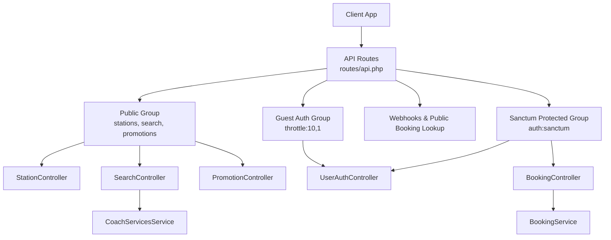
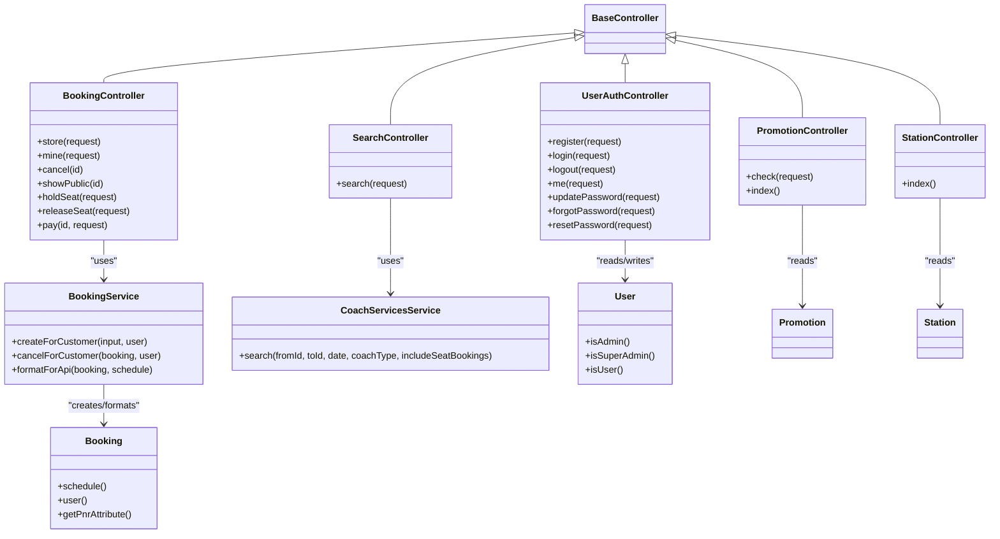
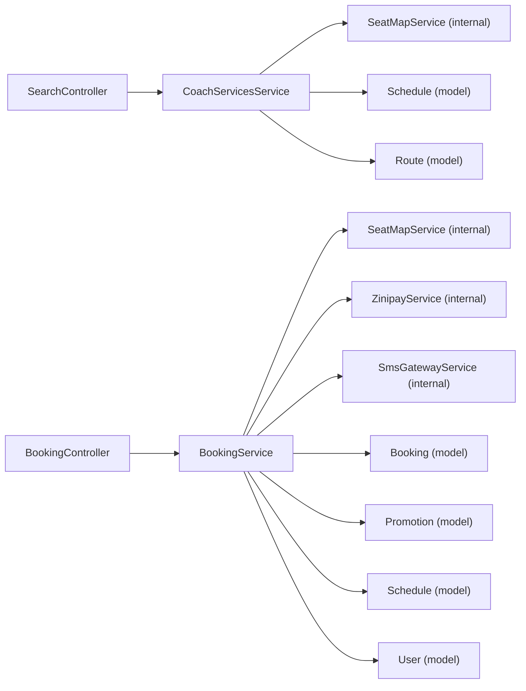

# Backend API

<cite>
**Referenced Files in This Document**
- [api.php](file://backend/routes/api.php)
- [UserAuthController.php](file://backend/app/Http/Controllers/API/UserAuthController.php)
- [SearchController.php](file://backend/app/Http/Controllers/API/SearchController.php)
- [BookingController.php](file://backend/app/Http/Controllers/API/BookingController.php)
- [StationController.php](file://backend/app/Http/Controllers/API/StationController.php)
- [PromotionController.php](file://backend/app/Http/Controllers/API/PromotionController.php)
- [BaseController.php](file://backend/app/Http/Controllers/API/BaseController.php)
- [BookingService.php](file://backend/app/Services/BookingService.php)
- [CoachServicesService.php](file://backend/app/Services/CoachServicesService.php)
- [Booking.php](file://backend/app/Models/Booking.php)
- [User.php](file://backend/app/Models/User.php)
- [Promotion.php](file://backend/app/Models/Promotion.php)
- [Station.php](file://backend/app/Models/Station.php)
- [sanctum.php](file://backend/config/sanctum.php)
- [cors.php](file://backend/config/cors.php)
- [auth.php](file://backend/config/auth.php)
</cite>

## Table of Contents
1. [Introduction](#introduction)
2. [Project Structure](#project-structure)
3. [Core Components](#core-components)
4. [Architecture Overview](#architecture-overview)
5. [Detailed Component Analysis](#detailed-component-analysis)
6. [Dependency Analysis](#dependency-analysis)
7. [Performance Considerations](#performance-considerations)
8. [Troubleshooting Guide](#troubleshooting-guide)
9. [Conclusion](#conclusion)

## Introduction
This document provides comprehensive API documentation for the Laravel backend RESTful endpoints exposed to customers. It covers authentication, search, booking, station management, and promotion handling. For each endpoint, you will find HTTP methods, URL patterns, request/response schemas, authentication requirements, error responses, practical examples, rate limiting, security measures, and integration guidance.

The API uses:
- Sanctum token-based authentication for protected routes
- Throttling on sensitive authentication endpoints
- CORS configuration for cross-origin requests
- Maintenance mode middleware that protects most public endpoints

## Project Structure
The customer-facing API is defined under a single route file and grouped by access level:
- Public endpoints (stations, search, promotions)
- Guest authentication endpoints (register, login, forgot/reset password)
- Protected endpoints (bookings, seat hold/release, profile)
- External webhooks and public booking lookup

**Diagram sources**
- [api.php:18-75](file://backend/routes/api.php#L18-L75)
- [StationController.php:10-14](file://backend/app/Http/Controllers/API/StationController.php#L10-L14)
- [SearchController.php:14-30](file://backend/app/Http/Controllers/API/SearchController.php#L14-L30)
- [PromotionController.php:10-36](file://backend/app/Http/Controllers/API/PromotionController.php#L10-L36)
- [UserAuthController.php:17-110](file://backend/app/Http/Controllers/API/UserAuthController.php#L17-L110)
- [BookingController.php:19-148](file://backend/app/Http/Controllers/API/BookingController.php#L19-L148)
- [CoachServicesService.php:19-124](file://backend/app/Services/CoachServicesService.php#L19-L124)
- [BookingService.php:28-131](file://backend/app/Services/BookingService.php#L28-L131)

**Section sources**
- [api.php:18-75](file://backend/routes/api.php#L18-L75)

## Core Components
- Authentication: Register, login, logout, get current user, update password, forgot/reset password
- Search: Find schedules with seat availability and pricing
- Bookings: Create, list mine, cancel, pay via ZiniPay, hold/release seats
- Stations: List all stations
- Promotions: List promotions and validate promo codes

Key behaviors:
- Sanctum bearer tokens protect sensitive endpoints
- Rate limiting applies to guest auth endpoints
- Maintenance mode blocks most public endpoints except site settings
- Seat selection uses server-side validation and locking to prevent race conditions

**Section sources**
- [api.php:26-75](file://backend/routes/api.php#L26-L75)
- [sanctum.php:21-40](file://backend/config/sanctum.php#L21-L40)
- [cors.php:18-32](file://backend/config/cors.php#L18-L32)

## Architecture Overview
The API follows a layered approach:
- Controllers handle HTTP concerns (validation, response shaping)
- Services encapsulate business logic (booking creation, search aggregation)
- Models represent domain entities (User, Booking, Promotion, Station)
- Configuration defines authentication, CORS, and guards

**Diagram sources**
- [BaseController.php:5-7](file://backend/app/Http/Controllers/API/BaseController.php#L5-L7)
- [UserAuthController.php:15-218](file://backend/app/Http/Controllers/API/UserAuthController.php#L15-L218)
- [SearchController.php:8-32](file://backend/app/Http/Controllers/API/SearchController.php#L8-L32)
- [BookingController.php:10-149](file://backend/app/Http/Controllers/API/BookingController.php#L10-L149)
- [StationController.php:8-15](file://backend/app/Http/Controllers/API/StationController.php#L8-L15)
- [PromotionController.php:8-38](file://backend/app/Http/Controllers/API/PromotionController.php#L8-L38)
- [BookingService.php:14-335](file://backend/app/Services/BookingService.php#L14-L335)
- [CoachServicesService.php:10-190](file://backend/app/Services/CoachServicesService.php#L10-L190)
- [User.php:12-76](file://backend/app/Models/User.php#L12-L76)
- [Booking.php:8-49](file://backend/app/Models/Booking.php#L8-L49)
- [Promotion.php:8-18](file://backend/app/Models/Promotion.php#L8-L18)
- [Station.php:8-24](file://backend/app/Models/Station.php#L8-L24)

## Detailed Component Analysis

### Authentication Endpoints
All authentication endpoints are under /api/auth.

- Register
  - Method: POST
  - URL: /api/auth/register
  - Auth: None
  - Request body: name (string), email (email), password (string), password_confirmation (string)
  - Success response: message, token, user object
  - Errors: Validation errors (422), duplicate email (422)

- Login
  - Method: POST
  - URL: /api/auth/login
  - Auth: None
  - Request body: email (email), password (string)
  - Success response: message, token, user object
  - Errors: Invalid credentials (422), admin accounts blocked (403)

- Logout
  - Method: POST
  - URL: /api/auth/logout
  - Auth: Sanctum bearer token required
  - Response: message

- Get Current User
  - Method: GET
  - URL: /api/auth/me
  - Auth: Sanctum bearer token required
  - Response: user object

- Update Password
  - Method: POST
  - URL: /api/auth/password
  - Auth: Sanctum bearer token required
  - Request body: current_password (string), password (string), password_confirmation (string)
  - Success response: message, updated user object
  - Errors: Incorrect current password (422)

- Forgot Password
  - Method: POST
  - URL: /api/auth/forgot-password
  - Auth: None
  - Request body: email (email)
  - Success response: message; in local/testing environments, code may be included
  - Errors: Email not registered as customer (422), mail send failure (422 or logged)

- Reset Password
  - Method: POST
  - URL: /api/auth/reset-password
  - Auth: None
  - Request body: email (email), code (string), password (string), password_confirmation (string)
  - Success response: message
  - Errors: Invalid/expired code (422), user not found (422)

Rate Limiting:
- All guest auth endpoints are throttled at 10 attempts per minute per IP.

Security Notes:
- Admin accounts cannot use these endpoints; they must sign in through the admin portal.
- Password reset tokens expire after 60 minutes.

Example Call:
- POST /api/auth/login
  - Body: { "email": "customer@example.com", "password": "secret" }
  - Response: { "message": "...", "token": "...", "user": { "id": 1, "name": "...", "email": "...", "role": "user" } }

**Section sources**
- [api.php:41-46](file://backend/routes/api.php#L41-L46)
- [UserAuthController.php:17-218](file://backend/app/Http/Controllers/API/UserAuthController.php#L17-L218)
- [auth.php:95-101](file://backend/config/auth.php#L95-L101)

### Search Endpoint
- Search Schedules
  - Method: GET
  - URL: /api/search
  - Auth: None
  - Query parameters:
    - from (integer, required): station id
    - to (integer, required): station id
    - date (string, required): YYYY-MM-DD
    - coach_type (string, optional): filter by bus coach type
  - Success response: array of schedule objects including bus, route, seat map, pricing, and available seats count
  - Errors: Validation errors (422)

Response Fields (selected):
- id, departure_time, arrival_time, fare
- bus: id, operator_name, coach_number, coach_type, total_seats, seat_layout, seat_layout_grid, logo_url
- route: id, distance, duration, from, to
- booked_seats, seat_map, boarding_points, dropping_points, seat_class, pricing, available_seats_count

Example Call:
- GET /api/search?from=1&to=2&date=2026-06-01&coach_type=AC
- Response: [ { ... }, ... ]

**Section sources**
- [api.php:26-32](file://backend/routes/api.php#L26-L32)
- [SearchController.php:14-30](file://backend/app/Http/Controllers/API/SearchController.php#L14-L30)
- [CoachServicesService.php:19-124](file://backend/app/Services/CoachServicesService.php#L19-L124)

### Booking Endpoints
All booking endpoints require Sanctum authentication.

- Create Booking
  - Method: POST
  - URL: /api/bookings
  - Auth: Sanctum bearer token required
  - Request body:
    - schedule_id (integer, required)
    - passenger_name (string, required)
    - passenger_phone (string, required)
    - passenger_email (email, required)
    - seat_numbers (string, required, comma-separated)
    - payment_method (string, required)
    - total_fare (number, optional)
    - passenger_gender (M/F, optional)
    - boarding_point (string, optional)
    - dropping_point (string, optional)
    - promo_code (string, optional)
    - status (enum, sometimes)
  - Success response: message, booking object, sms result (may vary)
  - Errors: Validation errors (422), unauthorized manual booking (403), seat unavailable (422), payment invoice failure (500)

- My Bookings
  - Method: GET
  - URL: /api/bookings/mine
  - Auth: Sanctum bearer token required
  - Query parameters: page (integer, optional), per_page (integer, optional, max 50)
  - Success response: paginated bookings with schedule details

- Cancel Booking
  - Method: POST
  - URL: /api/bookings/{id}/cancel
  - Auth: Sanctum bearer token required
  - Success response: message, booking_id, status
  - Errors: Not found (404), unauthorized (403), already cancelled (400), cancellation requested (400)

- Pay Booking
  - Method: POST
  - URL: /api/bookings/{id}/pay
  - Auth: Sanctum bearer token required
  - Success response: message, payment_url, invoice_id, booking
  - Errors: Not found (404), unauthorized (403), invalid status/payment method (422), payment initiation failure (500)

- Hold Seat
  - Method: POST
  - URL: /api/seats/hold
  - Auth: Sanctum bearer token required
  - Request body: schedule_id (integer), seat_number (string)
  - Success response: success flag, message
  - Errors: Unavailable seat (422)

- Release Seat
  - Method: POST
  - URL: /api/seats/release
  - Auth: Sanctum bearer token required
  - Request body: schedule_id (integer), seat_number (string)
  - Success response: success flag, message

Example Calls:
- POST /api/bookings
  - Body: { "schedule_id": 10, "passenger_name": "Jane Doe", "passenger_phone": "+1234567890", "passenger_email": "jane@example.com", "seat_numbers": "A1,A2", "payment_method": "zinipay", "promo_code": "SAVE10" }
  - Response: { "message": "...", "booking": { ... }, "sms": { ... } }

- POST /api/bookings/123/pay
  - Response: { "message": "...", "payment_url": "https://...", "invoice_id": "...", "booking": { ... } }

**Section sources**
- [api.php:63-75](file://backend/routes/api.php#L63-L75)
- [BookingController.php:19-148](file://backend/app/Http/Controllers/API/BookingController.php#L19-L148)
- [BookingService.php:28-131](file://backend/app/Services/BookingService.php#L28-L131)
- [BookingService.php:200-240](file://backend/app/Services/BookingService.php#L200-L240)
- [BookingService.php:242-281](file://backend/app/Services/BookingService.php#L242-L281)

### Station Management Endpoint
- List Stations
  - Method: GET
  - URL: /api/stations
  - Auth: None
  - Success response: array of station objects (id, name, etc.)
  - Errors: None expected

Example Call:
- GET /api/stations
- Response: [ { "id": 1, "name": "Central Station" }, ... ]

**Section sources**
- [api.php:26-32](file://backend/routes/api.php#L26-L32)
- [StationController.php:10-14](file://backend/app/Http/Controllers/API/StationController.php#L10-L14)
- [Station.php:8-24](file://backend/app/Models/Station.php#L8-L24)

### Promotion Handling Endpoints
- Check Promotion Code
  - Method: GET
  - URL: /api/promotions/check
  - Auth: None
  - Query parameter: code (string, required)
  - Success response: code, discount_amount, description
  - Errors: Invalid promo code (404)

- List Promotions
  - Method: GET
  - URL: /api/promotions
  - Auth: None
  - Success response: array of promotion objects

Example Call:
- GET /api/promotions/check?code=SAVE10
- Response: { "code": "SAVE10", "discount_amount": 10.00, "description": "..." }

**Section sources**
- [api.php:26-32](file://backend/routes/api.php#L26-L32)
- [PromotionController.php:10-36](file://backend/app/Http/Controllers/API/PromotionController.php#L10-L36)
- [Promotion.php:8-18](file://backend/app/Models/Promotion.php#L8-L18)

### Public Booking Lookup
- Show Public Booking
  - Method: GET
  - URL: /api/bookings/public/{id}
  - Auth: None
  - Success response: booking object formatted for API
  - Errors: Not found (404)

Example Call:
- GET /api/bookings/public/123
- Response: { "id": 123, "pnr": "SE00123", "passenger_name": "...", ... }

**Section sources**
- [api.php:54-55](file://backend/routes/api.php#L54-L55)
- [BookingController.php:75-80](file://backend/app/Http/Controllers/API/BookingController.php#L75-L80)
- [BookingService.php:242-281](file://backend/app/Services/BookingService.php#L242-L281)

### Payment Webhook
- Payment Webhook
  - Method: POST
  - URL: /api/payment/webhook
  - Auth: None (external callback)
  - Purpose: Receive payment provider callbacks
  - Errors: Depends on provider payload and processing

**Section sources**
- [api.php:54-55](file://backend/routes/api.php#L54-L55)

## Dependency Analysis
The following diagram shows how controllers depend on services and models during key flows.

**Diagram sources**
- [SearchController.php:14-30](file://backend/app/Http/Controllers/API/SearchController.php#L14-L30)
- [CoachServicesService.php:19-124](file://backend/app/Services/CoachServicesService.php#L19-L124)
- [BookingController.php:19-148](file://backend/app/Http/Controllers/API/BookingController.php#L19-L148)
- [BookingService.php:28-131](file://backend/app/Services/BookingService.php#L28-L131)
- [Booking.php:8-49](file://backend/app/Models/Booking.php#L8-L49)
- [Promotion.php:8-18](file://backend/app/Models/Promotion.php#L8-L18)
- [User.php:12-76](file://backend/app/Models/User.php#L12-L76)

**Section sources**
- [SearchController.php:14-30](file://backend/app/Http/Controllers/API/SearchController.php#L14-L30)
- [BookingController.php:19-148](file://backend/app/Http/Controllers/API/BookingController.php#L19-L148)
- [BookingService.php:28-131](file://backend/app/Services/BookingService.php#L28-L131)
- [CoachServicesService.php:19-124](file://backend/app/Services/CoachServicesService.php#L19-L124)

## Performance Considerations
- Search queries load related data efficiently using eager loading and filter by route IDs before querying schedules.
- Seat availability calculations leverage service methods to compute seat maps and pricing breakdowns.
- Booking creation uses database transactions and row-level locking to prevent double-booking.
- Pagination is applied when listing my bookings to limit payload size.

Recommendations:
- Cache frequently accessed data such as stations and promotions if traffic increases.
- Use query indexes on schedule departure_time and route foreign keys to optimize search performance.
- Monitor external service calls (SMS, payment gateway) and implement retries/backoff where appropriate.

[No sources needed since this section provides general guidance]

## Troubleshooting Guide
Common issues and resolutions:

- Authentication failures
  - Ensure the Authorization header includes a valid Bearer token obtained from login/register.
  - Verify Sanctum stateful domains are configured correctly for SPA clients.
  - Confirm CORS allows your frontend origin.

- Validation errors
  - Check field types and constraints (e.g., email format, required fields).
  - For booking creation, ensure seat_numbers are valid and within limits.

- Seat conflicts
  - If a seat becomes unavailable between hold and booking, re-fetch the seat map and retry.
  - The system enforces maximum 4 seats per booking and validates seat availability server-side.

- Payment initiation failures
  - Verify booking status is PENDING and payment method is zinipay.
  - Inspect logs for payment gateway errors and retry with backoff.

- Maintenance mode
  - Most public endpoints are blocked during maintenance; only site settings remain accessible.

Debugging tips:
- Log validation exceptions and external service errors.
- Use the public booking lookup endpoint to verify booking state without authentication.
- Test rate limiting by sending multiple auth requests to confirm throttling behavior.

**Section sources**
- [sanctum.php:21-40](file://backend/config/sanctum.php#L21-L40)
- [cors.php:18-32](file://backend/config/cors.php#L18-L32)
- [api.php:26-32](file://backend/routes/api.php#L26-L32)
- [UserAuthController.php:41-70](file://backend/app/Http/Controllers/API/UserAuthController.php#L41-L70)
- [BookingController.php:118-148](file://backend/app/Http/Controllers/API/BookingController.php#L118-L148)

## Conclusion
The backend exposes a well-structured set of customer-facing APIs for authentication, search, booking, station management, and promotions. Security is enforced via Sanctum tokens, throttling, and role checks. Business logic is centralized in services to ensure consistency and maintainability. Integrate by obtaining a bearer token, adhering to request schemas, handling standard error responses, and respecting rate limits. For production deployments, configure CORS and Sanctum stateful domains appropriately and monitor external integrations.

[No sources needed since this section summarizes without analyzing specific files]