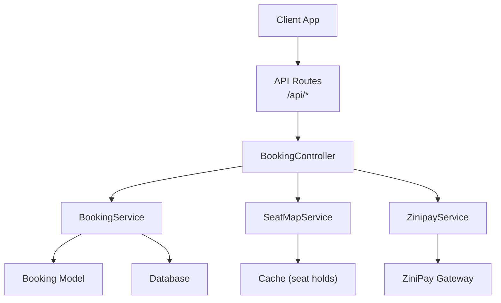
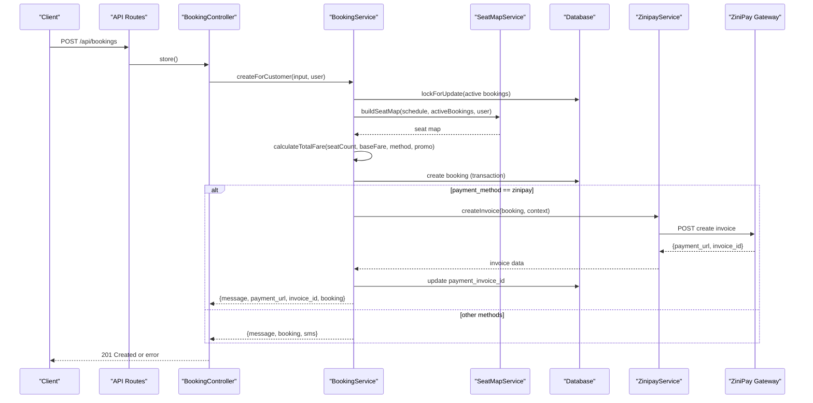
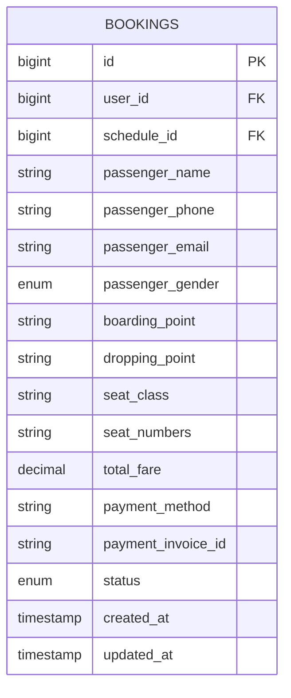
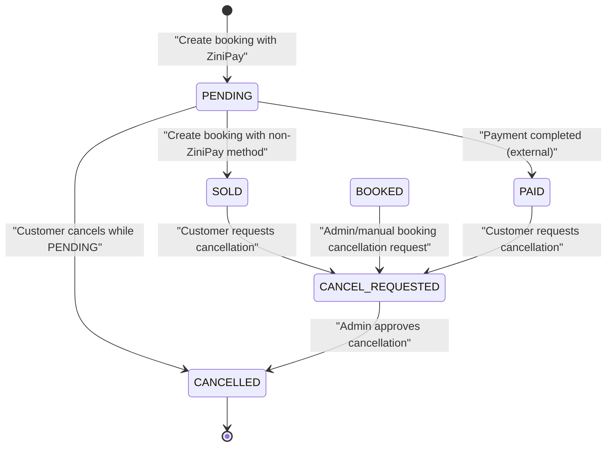
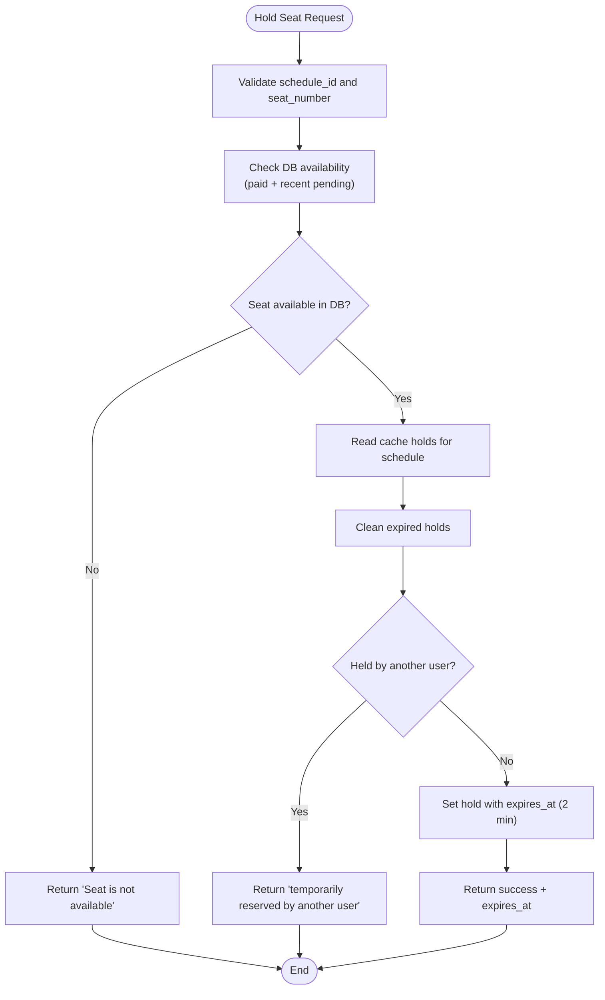
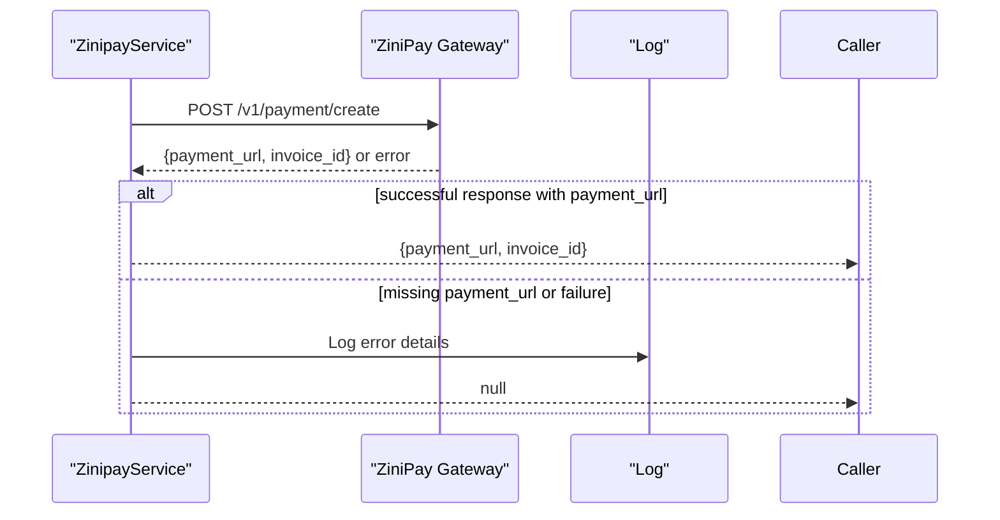
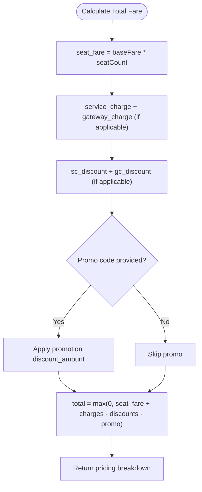
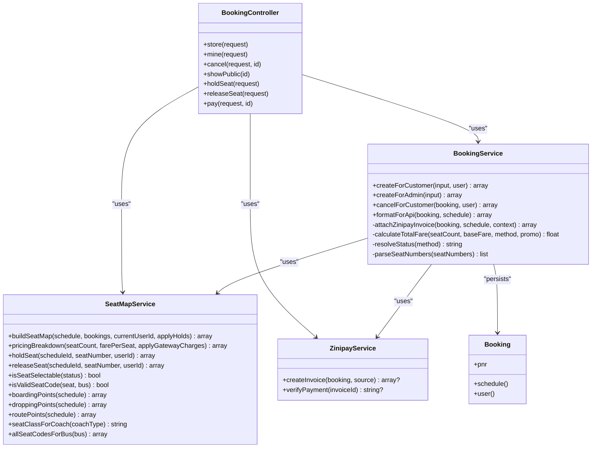

# Booking API

<cite>
**Referenced Files in This Document**   
- [BookingController.php](file://backend/app/Http/Controllers/API/BookingController.php)
- [BookingService.php](file://backend/app/Services/BookingService.php)
- [SeatMapService.php](file://backend/app/Services/SeatMapService.php)
- [ZinipayService.php](file://backend/app/Services/ZinipayService.php)
- [Booking.php](file://backend/app/Models/Booking.php)
- [api.php](file://backend/routes/api.php)
- [booking.php](file://backend/config/booking.php)
- [2026_06_01_000050_create_bookings_table.php](file://backend/database/migrations/2026_06_01_000050_create_bookings_table.php)
- [BookingFlowTest.php](file://backend/tests/Feature/BookingFlowTest.php)
</cite>

## Table of Contents
1. [Introduction](#introduction)
2. [Project Structure](#project-structure)
3. [Core Components](#core-components)
4. [Architecture Overview](#architecture-overview)
5. [Detailed Component Analysis](#detailed-component-analysis)
6. [Dependency Analysis](#dependency-analysis)
7. [Performance Considerations](#performance-considerations)
8. [Troubleshooting Guide](#troubleshooting-guide)
9. [Conclusion](#conclusion)

## Introduction
This document describes the booking management API for a bus reservation system. It covers:
- Creating, modifying, and cancelling bookings
- Tracking booking status and PNR generation
- Passenger details, seat selection, payment initiation, and confirmation flows
- Seat holding, concurrency control, and conflict resolution
- Integration with ZiniPay payment processing

The API is implemented in Laravel under the `/api` namespace. Customer-facing endpoints are protected by Sanctum authentication and optional maintenance-mode middleware.

## Project Structure
The booking feature spans controllers, services, models, routes, configuration, database schema, and tests:
- Routes define public and authenticated booking endpoints.
- `BookingController` handles HTTP requests for booking creation, listing, cancellation, payment initiation, and seat hold/release.
- `BookingService` implements core business logic for customer and admin booking creation, cancellation, fare calculation, and response formatting.
- `SeatMapService` manages seat availability, holds, pricing breakdown, boarding/dropping points, and seat layout rules.
- `ZinipayService` integrates with the external ZiniPay gateway for invoice creation and verification.
- `Booking` model defines persistence fields, relationships, and PNR generation.
- Migration defines the `bookings` table structure and indexes.
- Configuration controls service charges, gateway charges, discounts, default seat class, and seat rows.
- Feature tests validate end-to-end booking behavior, including concurrency-related scenarios.

**Diagram sources**
- [api.php:26-75](file://backend/routes/api.php#L26-L75)
- [BookingController.php:19-148](file://backend/app/Http/Controllers/API/BookingController.php#L19-L148)
- [BookingService.php:28-333](file://backend/app/Services/BookingService.php#L28-L333)
- [SeatMapService.php:194-591](file://backend/app/Services/SeatMapService.php#L194-L591)
- [ZinipayService.php:27-139](file://backend/app/Services/ZinipayService.php#L27-L139)
- [Booking.php:12-47](file://backend/app/Models/Booking.php#L12-L47)

**Section sources**
- [api.php:26-75](file://backend/routes/api.php#L26-L75)
- [BookingController.php:19-148](file://backend/app/Http/Controllers/API/BookingController.php#L19-L148)
- [BookingService.php:28-333](file://backend/app/Services/BookingService.php#L28-L333)
- [SeatMapService.php:194-591](file://backend/app/Services/SeatMapService.php#L194-L591)
- [ZinipayService.php:27-139](file://backend/app/Services/ZinipayService.php#L27-L139)
- [Booking.php:12-47](file://backend/app/Models/Booking.php#L12-L47)

## Core Components
- **Routes**: Public endpoints for site settings, stations, search, promotions; authenticated endpoints for booking lifecycle and seat operations; payment webhook.
- **BookingController**: Validates input, delegates to services, returns JSON responses, enforces authorization for pay/cancel.
- **BookingService**: Encapsulates booking creation, cancellation, fare calculation, SMS notifications, and API response formatting.
- **SeatMapService**: Builds seat maps, calculates pricing, manages temporary seat holds via cache, and exposes boarding/dropping point helpers.
- **ZinipayService**: Creates invoices, verifies payments, logs errors, and adapts URLs for local/testing environments.
- **Booking Model**: Defines fillable fields, casts, relationships, and PNR attribute.
- **Migration**: Defines the `bookings` table schema and performance indexes.
- **Configuration**: Controls service/gateway charges, discounts, default seat class, and seat row definitions.

**Section sources**
- [api.php:26-75](file://backend/routes/api.php#L26-L75)
- [BookingController.php:19-148](file://backend/app/Http/Controllers/API/BookingController.php#L19-L148)
- [BookingService.php:28-333](file://backend/app/Services/BookingService.php#L28-L333)
- [SeatMapService.php:194-591](file://backend/app/Services/SeatMapService.php#L194-L591)
- [ZinipayService.php:27-139](file://backend/app/Services/ZinipayService.php#L27-L139)
- [Booking.php:12-47](file://backend/app/Models/Booking.php#L12-L47)
- [2026_06_01_000050_create_bookings_table.php:14-42](file://backend/database/migrations/2026_06_01_000050_create_bookings_table.php#L14-L42)
- [booking.php:3-10](file://backend/config/booking.php#L3-L10)

## Architecture Overview
The booking flow involves multiple layers:
- Client sends authenticated requests to `/api/bookings`, `/api/seats/hold`, `/api/seats/release`, and `/api/bookings/{id}/pay`.
- Controller validates inputs and delegates to services.
- BookingService coordinates seat validation, fare calculation, transactional persistence, and optional payment integration.
- SeatMapService computes seat availability using database state and cache-based holds.
- ZinipayService creates an invoice when ZiniPay is selected, returning a payment URL and invoice ID.
- Webhook endpoint processes payment confirmations asynchronously.

**Diagram sources**
- [BookingController.php:19-40](file://backend/app/Http/Controllers/API/BookingController.php#L19-L40)
- [BookingService.php:28-131](file://backend/app/Services/BookingService.php#L28-L131)
- [SeatMapService.php:194-244](file://backend/app/Services/SeatMapService.php#L194-L244)
- [ZinipayService.php:27-97](file://backend/app/Services/ZinipayService.php#L27-L97)
- [api.php:63-75](file://backend/routes/api.php#L63-L75)

## Detailed Component Analysis

### API Endpoints

#### Create Booking
- Method: `POST /api/bookings`
- Authentication: Required (Sanctum)
- Request body:
  - `schedule_id`: integer, required, must exist in schedules
  - `passenger_name`: string, required, max 100
  - `passenger_phone`: string, required, max 20
  - `passenger_email`: string, required, valid email, max 100
  - `seat_numbers`: string, required, comma-separated seat codes, max 255
  - `payment_method`: string, required, max 50
  - `total_fare`: number, optional, non-negative
  - `passenger_gender`: enum M/F, optional
  - `boarding_point`: string, optional, max 150
  - `dropping_point`: string, optional, max 150
  - `promo_code`: string, optional
  - `status`: enum PENDING/PAID/SOLD/BOOKED/CANCEL_REQUESTED/CANCELLED, optional (admin-only override)
- Success response (201):
  - For ZiniPay: `{ message, payment_url, invoice_id, booking }`
  - For other methods: `{ message, booking, sms }`
- Failure responses:
  - 403: Non-admin attempting cash/manual booking
  - 422: Validation errors, unavailable seats, too many seats
  - 500: Internal server error

**Section sources**
- [BookingController.php:19-40](file://backend/app/Http/Controllers/API/BookingController.php#L19-L40)
- [BookingService.php:28-131](file://backend/app/Services/BookingService.php#L28-L131)
- [BookingFlowTest.php:70-152](file://backend/tests/Feature/BookingFlowTest.php#L70-L152)

#### List My Bookings
- Method: `GET /api/bookings/mine`
- Authentication: Required (Sanctum)
- Query parameters:
  - `page`: integer, optional, min 1
  - `per_page`: integer, optional, min 1, max 50
- Response: Paginated list of bookings with schedule, bus, route, and formatted fields.

**Section sources**
- [BookingController.php:42-60](file://backend/app/Http/Controllers/API/BookingController.php#L42-L60)
- [BookingService.php:242-281](file://backend/app/Services/BookingService.php#L242-L281)

#### Cancel Booking
- Method: `POST /api/bookings/{id}/cancel`
- Authentication: Required (Sanctum)
- Authorization: User must own the booking
- Behavior:
  - If status is PENDING: set CANCELLED immediately
  - If already CANCELLED: return 400
  - If already CANCEL_REQUESTED: return 400
  - Otherwise: set CANCEL_REQUESTED
- Responses:
  - 200: `{ message, booking_id, status }`
  - 400: Already cancelled or request exists
  - 403: Unauthorized

**Section sources**
- [BookingController.php:62-73](file://backend/app/Http/Controllers/API/BookingController.php#L62-L73)
- [BookingService.php:200-240](file://backend/app/Services/BookingService.php#L200-L240)
- [BookingFlowTest.php:320-413](file://backend/tests/Feature/BookingFlowTest.php#L320-L413)

#### Get Public Booking Details
- Method: `GET /api/bookings/public/{id}`
- Authentication: Not required
- Response: Formatted booking object with schedule, bus, and route details.

**Section sources**
- [BookingController.php:75-80](file://backend/app/Http/Controllers/API/BookingController.php#L75-L80)
- [api.php:54-55](file://backend/routes/api.php#L54-L55)

#### Hold Seat
- Method: `POST /api/seats/hold`
- Authentication: Required (Sanctum)
- Request body:
  - `schedule_id`: integer, required, must exist
  - `seat_number`: string, required
- Behavior:
  - Validates seat code against bus layout
  - Checks DB availability (paid + recent pending)
  - Checks cache-based holds from other users
  - Sets a 2-minute hold in cache
- Responses:
  - 200: `{ success: true, expires_at }`
  - 422: `{ message }` if invalid or not available

**Section sources**
- [BookingController.php:82-100](file://backend/app/Http/Controllers/API/BookingController.php#L82-L100)
- [SeatMapService.php:502-561](file://backend/app/Services/SeatMapService.php#L502-L561)
- [BookingFlowTest.php:419-483](file://backend/tests/Feature/BookingFlowTest.php#L419-L483)

#### Release Seat
- Method: `POST /api/seats/release`
- Authentication: Required (Sanctum)
- Request body:
  - `schedule_id`: integer, required, must exist
  - `seat_number`: string, required
- Behavior: Removes the caller’s hold for the specified seat if present.
- Response: `{ success: true }`

**Section sources**
- [BookingController.php:102-116](file://backend/app/Http/Controllers/API/BookingController.php#L102-L116)
- [SeatMapService.php:563-582](file://backend/app/Services/SeatMapService.php#L563-L582)
- [BookingFlowTest.php:485-516](file://backend/tests/Feature/BookingFlowTest.php#L485-L516)

#### Initiate Payment
- Method: `POST /api/bookings/{id}/pay`
- Authentication: Required (Sanctum)
- Authorization: User must own the booking
- Preconditions:
  - Booking status must be PENDING
  - Payment method must be ZiniPay
- Behavior:
  - Calls ZiniPay to create invoice
  - Stores `payment_invoice_id` on booking
  - Returns payment URL and invoice ID
- Responses:
  - 200: `{ message, payment_url, invoice_id, booking }`
  - 404: Booking not found
  - 403: Unauthorized
  - 422: Invalid status or payment method
  - 500: Failed to initiate payment

**Section sources**
- [BookingController.php:118-148](file://backend/app/Http/Controllers/API/BookingController.php#L118-L148)
- [ZinipayService.php:27-97](file://backend/app/Services/ZinipayService.php#L27-L97)

### Data Models and Schemas

#### Booking Entity
- Fields:
  - `id`: primary key
  - `user_id`: nullable foreign key to users
  - `schedule_id`: foreign key to schedules
  - `passenger_name`: string
  - `passenger_phone`: string
  - `passenger_email`: string
  - `passenger_gender`: enum M/F
  - `boarding_point`: nullable string
  - `dropping_point`: nullable string
  - `seat_class`: string, default E-Class
  - `seat_numbers`: comma-separated seat codes
  - `total_fare`: decimal(10,2)
  - `payment_method`: string, default bKash
  - `payment_invoice_id`: nullable string
  - `status`: enum PENDING/PAID/SOLD/BOOKED/CANCEL_REQUESTED/CANCELLED
- Indexes: user_id, schedule_id, status, passenger_email, passenger_phone, composite indexes for performance.

**Diagram sources**
- [2026_06_01_000050_create_bookings_table.php:14-42](file://backend/database/migrations/2026_06_01_000050_create_bookings_table.php#L14-L42)

**Section sources**
- [Booking.php:12-47](file://backend/app/Models/Booking.php#L12-L47)
- [2026_06_01_000050_create_bookings_table.php:14-42](file://backend/database/migrations/2026_06_01_000050_create_bookings_table.php#L14-L42)

### Booking Lifecycle and State Transitions

- Status resolution:
  - ZiniPay: PENDING until payment completes
  - Other methods: SOLD upon successful creation
- Admin overrides:
  - Cash/manual bookings can be set to BOOKED by admins
- Cancellation rules:
  - PENDING: immediate CANCELLED
  - Paid/Booked: CANCEL_REQUESTED awaiting admin approval
  - Already CANCELLED or CANCEL_REQUESTED: error

**Diagram sources**
- [BookingService.php:320-327](file://backend/app/Services/BookingService.php#L320-L327)
- [BookingService.php:200-240](file://backend/app/Services/BookingService.php#L200-L240)
- [2026_06_01_000050_create_bookings_table.php:29](file://backend/database/migrations/2026_06_01_000050_create_bookings_table.php#L29)

**Section sources**
- [BookingService.php:28-131](file://backend/app/Services/BookingService.php#L28-L131)
- [BookingService.php:200-240](file://backend/app/Services/BookingService.php#L200-L240)
- [BookingService.php:320-327](file://backend/app/Services/BookingService.php#L320-L327)
- [2026_06_01_000050_create_bookings_table.php:29](file://backend/database/migrations/2026_06_01_000050_create_bookings_table.php#L29)

### Concurrency Handling and Seat Holding

- Database-level locking:
  - Active bookings for a schedule are locked during creation to prevent race conditions.
- Recent pending bookings:
  - Bookings with status PENDING created within the last 10 minutes are treated as active to avoid double-booking.
- Cache-based seat holds:
  - Temporary holds are stored per schedule with expiration timestamps.
  - Holds are visible to other users but not the holder.
  - Hold duration is 2 minutes; cache entry TTL is 10 minutes.
- Conflict resolution:
  - If a seat is held by another user, hold request fails with a clear message.
  - If a seat is booked (paid or recent pending), it is considered unavailable.

**Diagram sources**
- [SeatMapService.php:502-561](file://backend/app/Services/SeatMapService.php#L502-L561)
- [SeatMapService.php:194-244](file://backend/app/Services/SeatMapService.php#L194-L244)

**Section sources**
- [SeatMapService.php:194-244](file://backend/app/Services/SeatMapService.php#L194-L244)
- [SeatMapService.php:502-561](file://backend/app/Services/SeatMapService.php#L502-L561)
- [SeatMapService.php:563-582](file://backend/app/Services/SeatMapService.php#L563-L582)
- [BookingFlowTest.php:419-483](file://backend/tests/Feature/BookingFlowTest.php#L419-L483)

### Payment Integration with ZiniPay

- Invoice creation:
  - Requires configured API key and base URL.
  - Sends passenger name, email, amount, metadata (booking_id, source), redirect/cancel/webhook URLs.
  - In local/testing environments, URLs are rewritten to localhost for sandbox compatibility.
- Response handling:
  - On success, returns payment_url and invoice_id.
  - Logs errors for missing fields or failed requests.
- Verification:
  - Provides a verify endpoint to check invoice status.

**Diagram sources**
- [ZinipayService.php:27-97](file://backend/app/Services/ZinipayService.php#L27-L97)

**Section sources**
- [ZinipayService.php:27-97](file://backend/app/Services/ZinipayService.php#L27-L97)
- [ZinipayService.php:105-139](file://backend/app/Services/ZinipayService.php#L105-L139)

### Pricing and Fare Calculation

- Base fare multiplied by seat count.
- Service charge and gateway charge applied per seat.
- Discounts applied for service and gateway charges.
- Optional promotion discount reduces total fare (non-negative).
- Gateway charges are skipped for cash bookings.

**Diagram sources**
- [SeatMapService.php:343-365](file://backend/app/Services/SeatMapService.php#L343-L365)
- [BookingService.php:304-318](file://backend/app/Services/BookingService.php#L304-L318)
- [booking.php:3-10](file://backend/config/booking.php#L3-L10)

**Section sources**
- [SeatMapService.php:343-365](file://backend/app/Services/SeatMapService.php#L343-L365)
- [BookingService.php:304-318](file://backend/app/Services/BookingService.php#L304-L318)
- [booking.php:3-10](file://backend/config/booking.php#L3-L10)

### PNR Generation

- PNR format: SE followed by zero-padded booking ID (5 digits).
- Example: booking ID 1 becomes SE00001.
- Returned in all formatted booking responses.

**Section sources**
- [Booking.php:43-47](file://backend/app/Models/Booking.php#L43-L47)
- [BookingFlowTest.php:579-596](file://backend/tests/Feature/BookingFlowTest.php#L579-L596)

## Dependency Analysis

**Diagram sources**
- [BookingController.php:10-148](file://backend/app/Http/Controllers/API/BookingController.php#L10-L148)
- [BookingService.php:14-333](file://backend/app/Services/BookingService.php#L14-L333)
- [SeatMapService.php:9-591](file://backend/app/Services/SeatMapService.php#L9-L591)
- [ZinipayService.php:9-139](file://backend/app/Services/ZinipayService.php#L9-L139)
- [Booking.php:8-47](file://backend/app/Models/Booking.php#L8-L47)

**Section sources**
- [BookingController.php:10-148](file://backend/app/Http/Controllers/API/BookingController.php#L10-L148)
- [BookingService.php:14-333](file://backend/app/Services/BookingService.php#L14-L333)
- [SeatMapService.php:9-591](file://backend/app/Services/SeatMapService.php#L9-L591)
- [ZinipayService.php:9-139](file://backend/app/Services/ZinipayService.php#L9-L139)
- [Booking.php:8-47](file://backend/app/Models/Booking.php#L8-L47)

## Performance Considerations
- Database indexing:
  - Composite indexes on status, created_at, user_id, schedule_id improve query performance for seat availability and listing.
- Locking strategy:
  - `lockForUpdate` prevents concurrent modifications during booking creation.
- Cache usage:
  - Seat holds are stored in cache with short TTLs to reduce contention and improve responsiveness.
- Selective column loading:
  - `paidBookingColumns()` avoids loading full booking rows when building seat maps.
- External calls:
  - ZiniPay requests use timeouts and structured logging to mitigate slow failures.

[No sources needed since this section provides general guidance]

## Troubleshooting Guide
Common issues and resolutions:
- Validation errors:
  - Ensure required fields are present and conform to constraints (email format, length limits).
- Unavailable seats:
  - Verify seat codes match bus layout; check blocked seats and active bookings.
- Seat hold conflicts:
  - Another user may have a hold; wait or release the hold before retrying.
- Payment initiation failures:
  - Confirm ZiniPay API key and base URL are configured; check logs for network errors.
- Cancellation restrictions:
  - Cannot cancel already cancelled or already requested cancellations; follow admin approval process.

**Section sources**
- [BookingController.php:19-148](file://backend/app/Http/Controllers/API/BookingController.php#L19-L148)
- [BookingService.php:28-131](file://backend/app/Services/BookingService.php#L28-L131)
- [SeatMapService.php:502-561](file://backend/app/Services/SeatMapService.php#L502-L561)
- [ZinipayService.php:27-97](file://backend/app/Services/ZinipayService.php#L27-L97)

## Conclusion
The Booking API provides a robust, secure, and scalable solution for managing bus seat reservations. It enforces strict validation, concurrency controls, and clear state transitions while integrating seamlessly with ZiniPay for payment processing. The architecture separates concerns across controllers, services, and models, ensuring maintainability and testability. Clients should handle all documented error cases, respect seat hold lifetimes, and implement proper payment redirection and confirmation flows.

[No sources needed since this section summarizes without analyzing specific files]