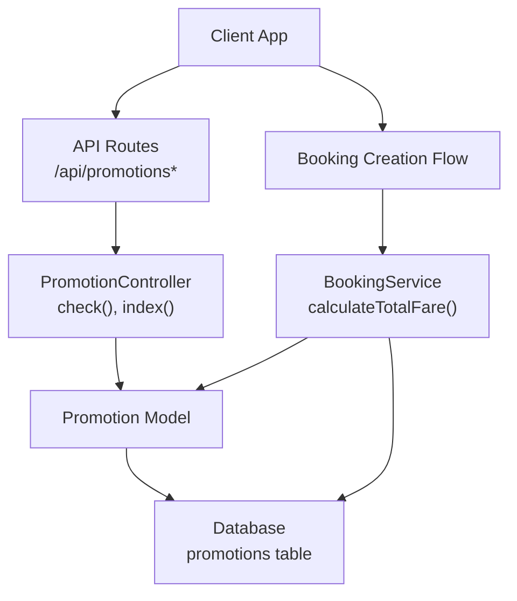
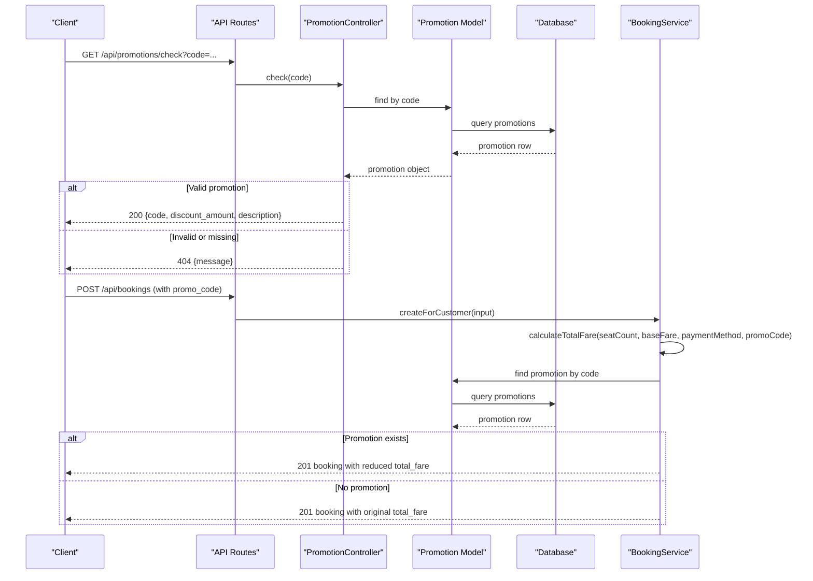
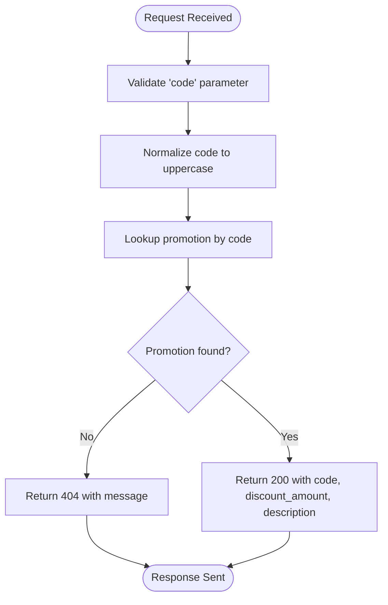
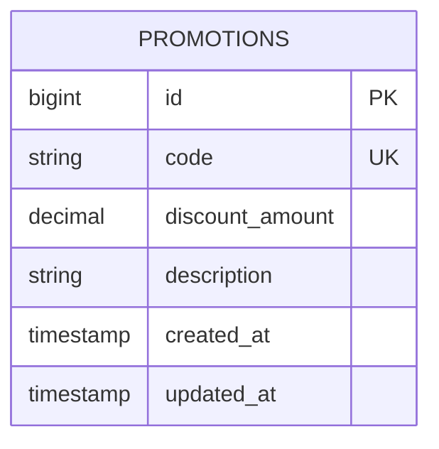
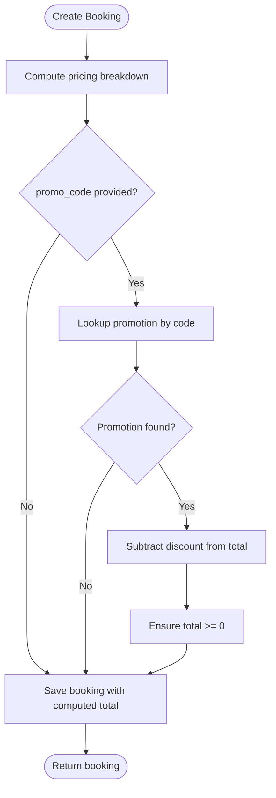
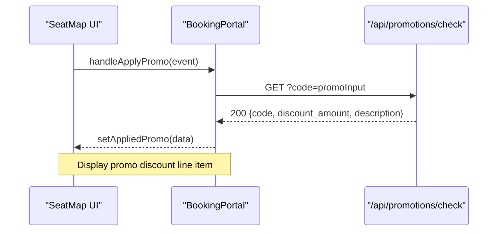
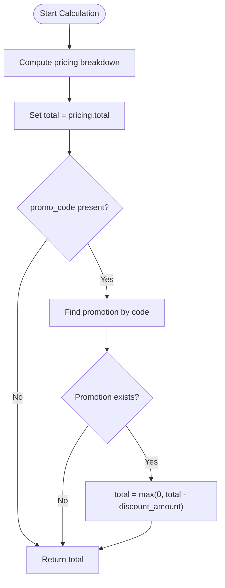
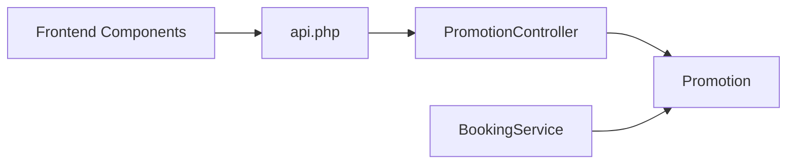

# Promotion API

<cite>
**Referenced Files in This Document**
- [PromotionController.php](file://backend/app/Http/Controllers/API/PromotionController.php)
- [api.php](file://backend/routes/api.php)
- [Promotion.php](file://backend/app/Models/Promotion.php)
- [2026_06_01_000060_create_promotions_table.php](file://backend/database/migrations/2026_06_01_000060_create_promotions_table.php)
- [BookingService.php](file://backend/app/Services/BookingService.php)
- [SeatMap.jsx](file://frontend/src/components/SeatMap.jsx)
- [BookingPortal.jsx](file://frontend/src/components/BookingPortal.jsx)
- [BookingFlowTest.php](file://backend/tests/Feature/BookingFlowTest.php)
</cite>

## Table of Contents
1. [Introduction](#introduction)
2. [Project Structure](#project-structure)
3. [Core Components](#core-components)
4. [Architecture Overview](#architecture-overview)
5. [Detailed Component Analysis](#detailed-component-analysis)
6. [Dependency Analysis](#dependency-analysis)
7. [Performance Considerations](#performance-considerations)
8. [Troubleshooting Guide](#troubleshooting-guide)
9. [Conclusion](#conclusion)

## Introduction
This document describes the promotion and discount code endpoints for the bus booking system. It covers:
- How to validate a promotion code
- How promotions are applied during booking creation
- Discount calculation behavior
- Request and response schemas
- Error handling for invalid or unsupported codes
- The current promotion lifecycle and expiration handling
- Integration with booking pricing

The promotion feature is exposed through public customer API routes, validated by a controller, persisted via an Eloquent model, and integrated into the booking flow through a service that computes final fares.

## Project Structure
Promotion-related functionality spans several layers:
- Public API routes define endpoints for listing and checking promotions
- A controller validates requests and returns promotion details
- An Eloquent model represents the promotion entity
- A database migration defines the schema
- A service integrates promotion discounts into booking fare calculations
- Frontend components call the validation endpoint and display results

**Diagram sources**
- [api.php:26-32](file://backend/routes/api.php#L26-L32)
- [PromotionController.php:10-37](file://backend/app/Http/Controllers/API/PromotionController.php#L10-L37)
- [Promotion.php:8-16](file://backend/app/Models/Promotion.php#L8-L16)
- [2026_06_01_000060_create_promotions_table.php:14-20](file://backend/database/migrations/2026_06_01_000060_create_promotions_table.php#L14-L20)
- [BookingService.php:78-83](file://backend/app/Services/BookingService.php#L78-L83)
- [BookingService.php:304-318](file://backend/app/Services/BookingService.php#L304-L318)

**Section sources**
- [api.php:26-32](file://backend/routes/api.php#L26-L32)
- [PromotionController.php:10-37](file://backend/app/Http/Controllers/API/PromotionController.php#L10-L37)
- [Promotion.php:8-16](file://backend/app/Models/Promotion.php#L8-L16)
- [2026_06_01_000060_create_promotions_table.php:14-20](file://backend/database/migrations/2026_06_01_000060_create_promotions_table.php#L14-L20)
- [BookingService.php:78-83](file://backend/app/Services/BookingService.php#L78-L83)
- [BookingService.php:304-318](file://backend/app/Services/BookingService.php#L304-L318)

## Core Components
- Promotion API controller exposes two public endpoints:
  - List all promotions
  - Validate a promotion code
- Promotion model stores code, discount amount, and description
- Database schema defines the promotions table structure
- Booking service applies promotion discounts when creating bookings

Key responsibilities:
- Route registration and middleware grouping
- Input validation for promo code
- Promotion lookup and response formatting
- Fare calculation including optional promo discount
- Frontend integration for applying and displaying promo discounts

**Section sources**
- [api.php:26-32](file://backend/routes/api.php#L26-L32)
- [PromotionController.php:10-37](file://backend/app/Http/Controllers/API/PromotionController.php#L10-L37)
- [Promotion.php:8-16](file://backend/app/Models/Promotion.php#L8-L16)
- [2026_06_01_000060_create_promotions_table.php:14-20](file://backend/database/migrations/2026_06_01_000060_create_promotions_table.php#L14-L20)
- [BookingService.php:78-83](file://backend/app/Services/BookingService.php#L78-L83)
- [BookingService.php:304-318](file://backend/app/Services/BookingService.php#L304-L318)

## Architecture Overview
The promotion workflow involves:
- Client calling the check endpoint with a promo code
- Server validating the code and returning promotion details if valid
- Client optionally using the promotion data to adjust displayed totals
- During booking creation, the server recalculates total fare and applies the promotion discount if present

**Diagram sources**
- [api.php:26-32](file://backend/routes/api.php#L26-L32)
- [PromotionController.php:10-31](file://backend/app/Http/Controllers/API/PromotionController.php#L10-L31)
- [Promotion.php:8-16](file://backend/app/Models/Promotion.php#L8-L16)
- [BookingService.php:78-83](file://backend/app/Services/BookingService.php#L78-L83)
- [BookingService.php:304-318](file://backend/app/Services/BookingService.php#L304-L318)

## Detailed Component Analysis

### Promotion Validation Endpoint
Endpoint: GET /api/promotions/check
- Purpose: Validate a promotion code and return its details if valid
- Authentication: None (public route under maintenance-mode group)
- Query parameters:
  - code: string, required
- Success response (200):
  - code: string
  - discount_amount: number
  - description: string
- Error response (404):
  - message: string indicating invalid promo code

Validation rules:
- Code is required and must be a string
- Code is normalized to uppercase before lookup

Behavior notes:
- If no matching promotion is found, returns 404 with a message
- If found, returns promotion details without additional checks such as expiration or usage limits

**Diagram sources**
- [PromotionController.php:10-31](file://backend/app/Http/Controllers/API/PromotionController.php#L10-L31)

**Section sources**
- [api.php:30-31](file://backend/routes/api.php#L30-L31)
- [PromotionController.php:10-31](file://backend/app/Http/Controllers/API/PromotionController.php#L10-L31)

### List Promotions Endpoint
Endpoint: GET /api/promotions
- Purpose: Retrieve all promotions
- Authentication: None (public route under maintenance-mode group)
- Response (200): Array of promotion objects

Note: This endpoint returns all promotions without filtering or pagination.

**Section sources**
- [api.php:30](file://backend/routes/api.php#L30)
- [PromotionController.php:33-37](file://backend/app/Http/Controllers/API/PromotionController.php#L33-L37)

### Promotion Data Model and Schema
Promotion model fields:
- code: unique string identifier
- discount_amount: decimal value representing fixed discount
- description: text describing the promotion

Schema highlights:
- Unique constraint on code
- Decimal precision for discount amounts
- Timestamps for created_at and updated_at

**Diagram sources**
- [2026_06_01_000060_create_promotions_table.php:14-20](file://backend/database/migrations/2026_06_01_000060_create_promotions_table.php#L14-L20)
- [Promotion.php:8-16](file://backend/app/Models/Promotion.php#L8-L16)

**Section sources**
- [Promotion.php:8-16](file://backend/app/Models/Promotion.php#L8-L16)
- [2026_06_01_000060_create_promotions_table.php:14-20](file://backend/database/migrations/2026_06_01_000060_create_promotions_table.php#L14-L20)

### Promotion Application to Bookings
Promotions are applied during booking creation:
- The client sends a promo_code field with the booking request
- The booking service calculates the total fare based on seat count, base fare, and payment method
- If a promotion code is provided and matches a record, the discount amount is subtracted from the total fare
- The final total cannot go below zero

**Diagram sources**
- [BookingService.php:78-83](file://backend/app/Services/BookingService.php#L78-L83)
- [BookingService.php:304-318](file://backend/app/Services/BookingService.php#L304-L318)

**Section sources**
- [BookingService.php:78-83](file://backend/app/Services/BookingService.php#L78-L83)
- [BookingService.php:304-318](file://backend/app/Services/BookingService.php#L304-L318)

### Frontend Integration
The frontend calls the promotion validation endpoint and displays results:
- User enters a promo code and clicks Apply
- The app calls GET /api/promotions/check?code=...
- On success, it shows the applied promo and discount amount
- On failure, it shows an error message and clears any previously applied promo

**Diagram sources**
- [BookingPortal.jsx:446-467](file://frontend/src/components/BookingPortal.jsx#L446-L467)
- [SeatMap.jsx:513-534](file://frontend/src/components/SeatMap.jsx#L513-L534)

**Section sources**
- [BookingPortal.jsx:446-467](file://frontend/src/components/BookingPortal.jsx#L446-L467)
- [SeatMap.jsx:513-534](file://frontend/src/components/SeatMap.jsx#L513-L534)

### Request Schemas

#### Check Promotion Code
- Method: GET
- Path: /api/promotions/check
- Query parameters:
  - code: string, required
- Success response (200):
  - code: string
  - discount_amount: number
  - description: string
- Error response (404):
  - message: string

#### Create Booking with Promotion
- Method: POST
- Path: /api/bookings
- Body fields (relevant to promotions):
  - promo_code: string, optional
- Behavior:
  - If promo_code matches a promotion, discount_amount is subtracted from total fare
  - If not found, booking proceeds without discount
  - Total fare is clamped at zero minimum

**Section sources**
- [PromotionController.php:10-31](file://backend/app/Http/Controllers/API/PromotionController.php#L10-L31)
- [BookingService.php:78-83](file://backend/app/Services/BookingService.php#L78-L83)
- [BookingService.php:304-318](file://backend/app/Services/BookingService.php#L304-L318)

### Response Formats

#### Valid Promotion
- Status: 200
- Body:
  - code: string
  - discount_amount: number
  - description: string

#### Invalid Promotion Code
- Status: 404
- Body:
  - message: string

#### Booking with Applied Promotion
- Status: 201
- Body includes:
  - booking.total_fare: number reflecting discount application
  - Other booking fields as defined by the booking formatter

**Section sources**
- [PromotionController.php:10-31](file://backend/app/Http/Controllers/API/PromotionController.php#L10-L31)
- [BookingService.php:119-126](file://backend/app/Services/BookingService.php#L119-L126)
- [BookingService.php:242-281](file://backend/app/Services/BookingService.php#L242-L281)

### Promotion Lifecycle and Expiration Handling
Current implementation characteristics:
- Promotions are stored with code, discount_amount, and description
- There is no explicit expiration date or validity period in the schema
- There is no usage limit tracking per code or per user
- Validation does not check active status or time windows
- Discounts are applied only if a matching promotion exists

Implications:
- Promotions remain valid indefinitely unless manually deleted or updated
- Clients should treat promotions as static discount entries
- For advanced lifecycle features (expiration, usage caps), extend the schema and validation logic

**Section sources**
- [2026_06_01_000060_create_promotions_table.php:14-20](file://backend/database/migrations/2026_06_01_000060_create_promotions_table.php#L14-L20)
- [PromotionController.php:10-31](file://backend/app/Http/Controllers/API/PromotionController.php#L10-L31)
- [BookingService.php:304-318](file://backend/app/Services/BookingService.php#L304-L318)

### Discount Calculation Details
- Base pricing is computed from seat count and schedule fare
- Payment method determines whether gateway charges apply
- If a promotion code is provided and found, discount_amount is subtracted from the total
- Final total is clamped at zero to prevent negative fares

**Diagram sources**
- [BookingService.php:304-318](file://backend/app/Services/BookingService.php#L304-L318)

**Section sources**
- [BookingService.php:304-318](file://backend/app/Services/BookingService.php#L304-L318)

## Dependency Analysis
Promotion-related dependencies:
- Routes depend on PromotionController
- PromotionController depends on Promotion model
- BookingService depends on Promotion model for discount application
- Frontend components depend on the promotion check endpoint

**Diagram sources**
- [api.php:26-32](file://backend/routes/api.php#L26-L32)
- [PromotionController.php:5-37](file://backend/app/Http/Controllers/API/PromotionController.php#L5-L37)
- [Promotion.php:8-16](file://backend/app/Models/Promotion.php#L8-L16)
- [BookingService.php:304-318](file://backend/app/Services/BookingService.php#L304-L318)

**Section sources**
- [api.php:26-32](file://backend/routes/api.php#L26-L32)
- [PromotionController.php:5-37](file://backend/app/Http/Controllers/API/PromotionController.php#L5-L37)
- [Promotion.php:8-16](file://backend/app/Models/Promotion.php#L8-L16)
- [BookingService.php:304-318](file://backend/app/Services/BookingService.php#L304-L318)

## Performance Considerations
- Promotion lookup uses a direct query by code; ensure the code column remains indexed (unique constraint implies indexing)
- Listing all promotions returns the entire dataset; consider pagination or filtering if the catalog grows
- Avoid repeated validation calls in rapid succession; cache promotion lookups at the application level if needed
- Booking creation performs promotion lookup within a transaction; keep promo validation lightweight

[No sources needed since this section provides general guidance]

## Troubleshooting Guide
Common issues and resolutions:
- Invalid promo code returns 404:
  - Verify the code exists in the promotions table
  - Ensure the code is sent exactly as stored (case-insensitive due to normalization)
- Promotion not applied to booking:
  - Confirm promo_code is included in the booking payload
  - Check that the code matches a promotion record
  - Verify total fare is not already zero (discount clamping)
- Frontend shows error after applying promo:
  - Inspect network response from /api/promotions/check
  - Handle non-200 responses and clear applied promo state

Relevant test coverage:
- Invalid promo code does not change fare:
  - Confirms that an unknown promo_code leaves total_fare unchanged

**Section sources**
- [PromotionController.php:10-31](file://backend/app/Http/Controllers/API/PromotionController.php#L10-L31)
- [BookingService.php:304-318](file://backend/app/Services/BookingService.php#L304-L318)
- [BookingFlowTest.php:217-237](file://backend/tests/Feature/BookingFlowTest.php#L217-L237)

## Conclusion
The promotion API provides a simple mechanism to validate fixed discount codes and apply them during booking creation. Current capabilities include:
- Public validation endpoint returning promotion details
- Fixed discount subtraction from booking total
- Basic persistence with code, discount amount, and description

Limitations include:
- No expiration or validity window enforcement
- No usage limits or per-user restrictions
- No active/inactive status flag

For richer promotion campaigns, extend the schema and validation logic to support dates, usage caps, and conditional applicability while preserving backward compatibility with existing clients.