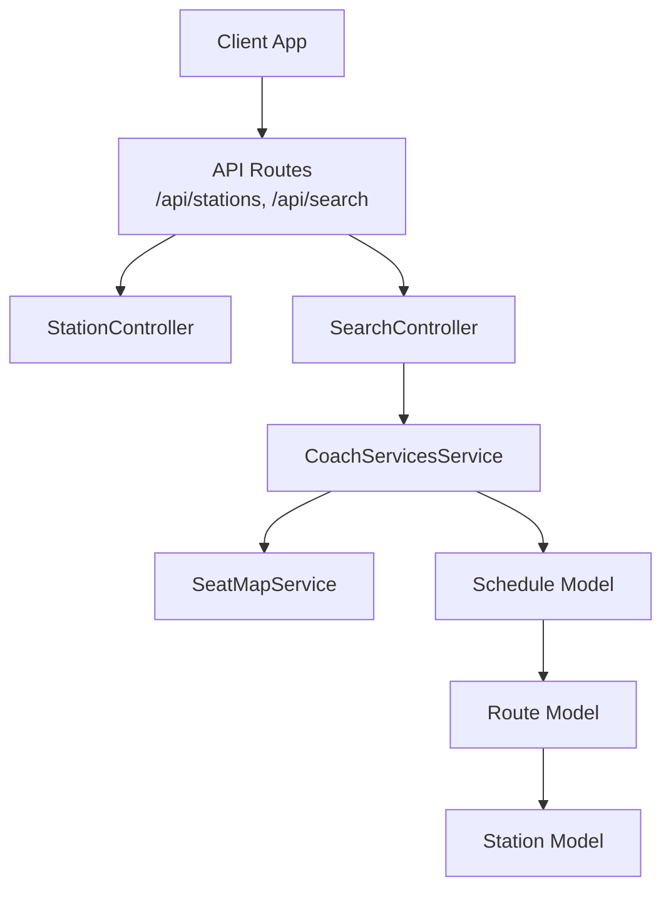
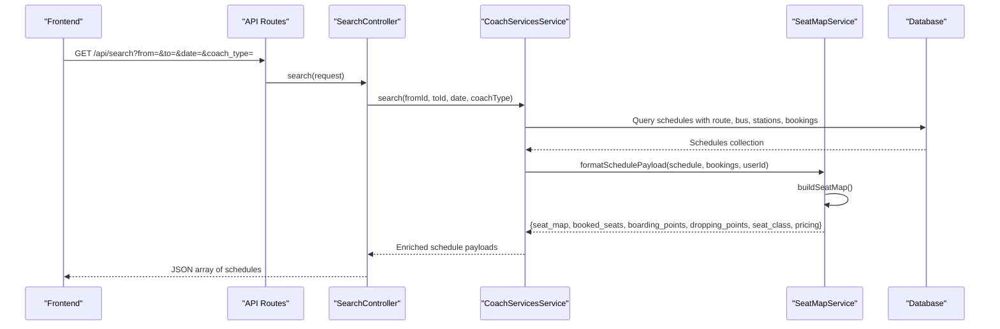
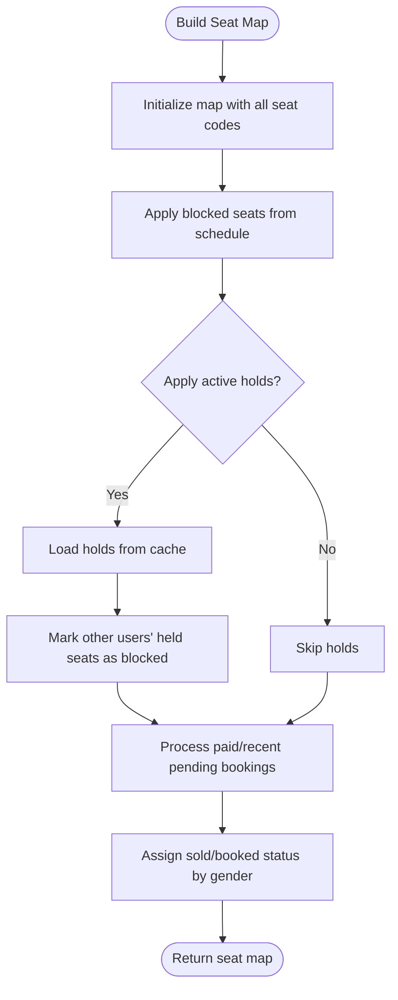
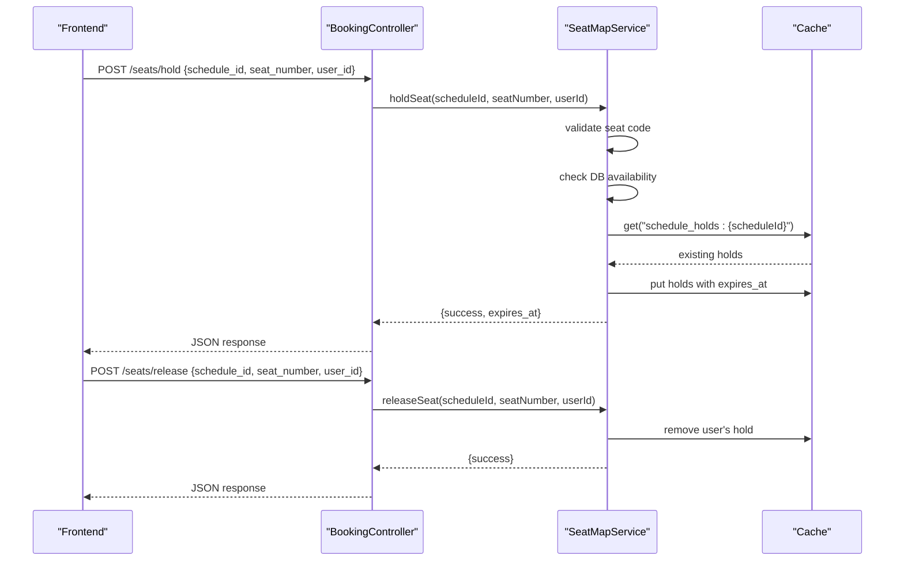
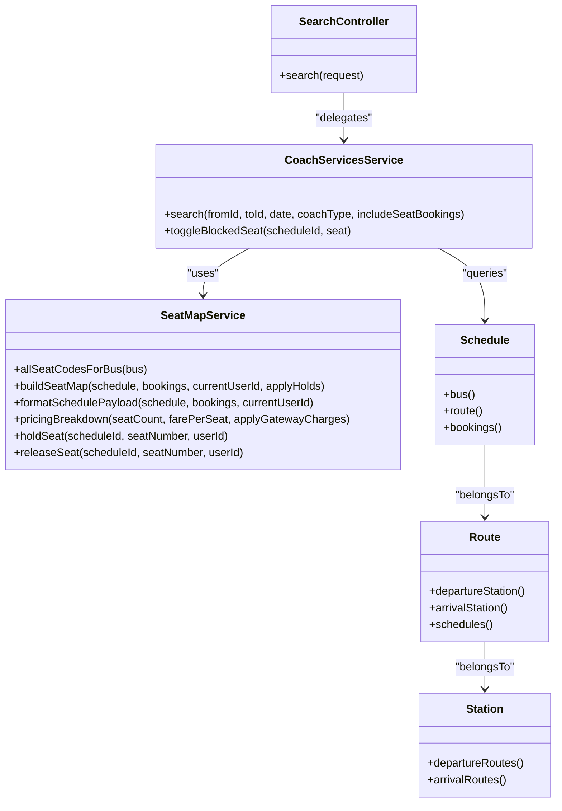

# Search API

<cite>
**Referenced Files in This Document**   
- [api.php](file://backend/routes/api.php)
- [SearchController.php](file://backend/app/Http/Controllers/API/SearchController.php)
- [CoachServicesService.php](file://backend/app/Services/CoachServicesService.php)
- [SeatMapService.php](file://backend/app/Services/SeatMapService.php)
- [StationController.php](file://backend/app/Http/Controllers/API/StationController.php)
- [Schedule.php](file://backend/app/Models/Schedule.php)
- [Route.php](file://backend/app/Models/Route.php)
- [Station.php](file://backend/app/Models/Station.php)
- [booking.php](file://backend/config/booking.php)
- [SearchForm.jsx](file://frontend/src/components/SearchForm.jsx)
- [ScheduleList.jsx](file://frontend/src/components/ScheduleList.jsx)
- [SeatMap.jsx](file://frontend/src/components/SeatMap.jsx)
</cite>

## Table of Contents
1. [Introduction](#introduction)
2. [Project Structure](#project-structure)
3. [Core Components](#core-components)
4. [Architecture Overview](#architecture-overview)
5. [Detailed Component Analysis](#detailed-component-analysis)
6. [Dependency Analysis](#dependency-analysis)
7. [Performance Considerations](#performance-considerations)
8. [Troubleshooting Guide](#troubleshooting-guide)
9. [Conclusion](#conclusion)

## Introduction
This document describes the search and schedule discovery endpoints for the bus booking application. It covers:
- Route and station search functionality
- Schedule filtering by date, origin, destination, and coach type
- Seat availability checking and seat map generation
- Pricing calculation logic
- Request parameters and response schemas
- Caching strategies, performance characteristics, and pagination behavior

The implementation is a Laravel backend with a React frontend that consumes public customer API routes under the `/api` prefix.

## Project Structure
The search feature spans controllers, services, models, configuration, and frontend components:
- Public API routes define `/api/stations` and `/api/search`.
- `SearchController` validates input and delegates to `CoachServicesService`.
- `CoachServicesService` queries schedules, applies filters, and builds enriched payloads using `SeatMapService`.
- `SeatMapService` generates seat maps, pricing breakdowns, boarding/dropping points, and seat hold/release logic.
- Models represent schedules, routes, and stations.
- Frontend components render the search form, results list, and interactive seat map.

**Diagram sources**
- [api.php:26-32](file://backend/routes/api.php#L26-L32)
- [SearchController.php:14-30](file://backend/app/Http/Controllers/API/SearchController.php#L14-L30)
- [CoachServicesService.php:19-124](file://backend/app/Services/CoachServicesService.php#L19-L124)
- [SeatMapService.php:367-382](file://backend/app/Services/SeatMapService.php#L367-L382)
- [Schedule.php:20-33](file://backend/app/Models/Schedule.php#L20-L33)
- [Route.php:26-39](file://backend/app/Models/Route.php#L26-L39)
- [Station.php:14-22](file://backend/app/Models/Station.php#L14-L22)

**Section sources**
- [api.php:26-32](file://backend/routes/api.php#L26-L32)
- [SearchController.php:14-30](file://backend/app/Http/Controllers/API/SearchController.php#L14-L30)
- [CoachServicesService.php:19-124](file://backend/app/Services/CoachServicesService.php#L19-L124)
- [SeatMapService.php:367-382](file://backend/app/Services/SeatMapService.php#L367-L382)
- [Schedule.php:20-33](file://backend/app/Models/Schedule.php#L20-L33)
- [Route.php:26-39](file://backend/app/Models/Route.php#L26-L39)
- [Station.php:14-22](file://backend/app/Models/Station.php#L14-L22)

## Core Components
- **Public API routes**: Define `/api/stations` and `/api/search`, both protected by maintenance mode middleware.
- **StationController**: Returns all stations sorted by name.
- **SearchController**: Validates request parameters and returns search results from `CoachServicesService`.
- **CoachServicesService**: Builds schedule queries, filters by route/date/coach type, enriches each schedule with seat map and pricing, and returns an array of schedule payloads.
- **SeatMapService**: Generates seat codes, seat maps, boarding/dropping points, pricing breakdowns, seat holds/releases, and blocked seat management.
- **Models**: `Schedule`, `Route`, and `Station` provide relationships used during search enrichment.
- **Frontend**: `SearchForm.jsx` collects search inputs; `ScheduleList.jsx` renders results; `SeatMap.jsx` renders the interactive seat grid and pricing summary.

**Section sources**
- [api.php:26-32](file://backend/routes/api.php#L26-L32)
- [StationController.php:10-14](file://backend/app/Http/Controllers/API/StationController.php#L10-L14)
- [SearchController.php:14-30](file://backend/app/Http/Controllers/API/SearchController.php#L14-L30)
- [CoachServicesService.php:19-124](file://backend/app/Services/CoachServicesService.php#L19-L124)
- [SeatMapService.php:49-189](file://backend/app/Services/SeatMapService.php#L49-L189)
- [SeatMapService.php:343-365](file://backend/app/Services/SeatMapService.php#L343-L365)
- [SearchForm.jsx:20-91](file://frontend/src/components/SearchForm.jsx#L20-L91)
- [ScheduleList.jsx:103-186](file://frontend/src/components/ScheduleList.jsx#L103-L186)
- [SeatMap.jsx:48-190](file://frontend/src/components/SeatMap.jsx#L48-L190)

## Architecture Overview
The search flow starts at the public API, validates inputs, queries schedules, and enriches them with seat availability and pricing. The frontend displays results and allows seat selection.

**Diagram sources**
- [api.php:26-32](file://backend/routes/api.php#L26-L32)
- [SearchController.php:14-30](file://backend/app/Http/Controllers/API/SearchController.php#L14-L30)
- [CoachServicesService.php:19-124](file://backend/app/Services/CoachServicesService.php#L19-L124)
- [SeatMapService.php:367-382](file://backend/app/Services/SeatMapService.php#L367-L382)

## Detailed Component Analysis

### Route and Station Search Endpoints

#### GET /api/stations
- Purpose: Return all stations for dropdowns in the search form.
- Authentication: None (public).
- Response: Array of station objects with at least `id` and `name`.

**Section sources**
- [api.php:26-32](file://backend/routes/api.php#L26-L32)
- [StationController.php:10-14](file://backend/app/Http/Controllers/API/StationController.php#L10-L14)
- [Station.php:8-22](file://backend/app/Models/Station.php#L8-L22)

#### GET /api/search
- Purpose: Discover available schedules based on origin, destination, date, and optional coach type.
- Authentication: None (public).
- Validation rules:
  - `from`: required integer, must exist in `stations.id`.
  - `to`: required integer, must exist in `stations.id`.
  - `date`: required string in `Y-m-d` format.
  - `coach_type`: optional string; client-side uses values like `All`, `AC`, `Non AC`.
- Behavior:
  - If both `from` and `to` are provided, only matching routes are considered.
  - If only one side is provided, schedules on routes departing from or arriving at that station are returned.
  - Date filter restricts departure time to the requested day; if no future schedules exist and no specific date was requested, the latest schedules are returned (up to 50).
  - Optional coach type filter matches against bus `coach_type`.
  - Each result includes seat map, booked seats, boarding/dropping points, seat class, pricing, and available seat count.

Request parameters:
- `from`: integer station id (required)
- `to`: integer station id (required)
- `date`: string date in `YYYY-MM-DD` (required)
- `coach_type`: string (optional)

Response schema (array of schedule objects):
- `id`: integer schedule id
- `departure_time`: ISO 8601 datetime string
- `arrival_time`: ISO 8601 datetime string
- `fare`: float fare per seat
- `bus`: object
  - `id`: integer
  - `operator_name`: string
  - `coach_number`: string
  - `coach_type`: string
  - `total_seats`: integer
  - `seat_layout`: string (e.g., `2+2`, `1+2`, `sleeper`, `2+2_last5`)
  - `seat_layout_grid`: array or null custom grid definition
  - `logo_url`: string or null
- `route`: object
  - `id`: integer
  - `distance`: string or numeric representation
  - `duration`: string or numeric representation
  - `from`: string station name
  - `to`: string station name
- `booked_seats`: array of seat codes
- `seat_map`: object mapping seat code to status (`available`, `blocked`, `sold_m`, `sold_f`, `booked_m`, `booked_f`)
- `boarding_points`: array of point objects with fields such as `id`, `name`, `value`, `label`, `reporting_time`, `departure_time`
- `dropping_points`: array of point objects with fields such as `id`, `name`, `value`, `label`, `arrival_time`
- `seat_class`: string (e.g., `E-Class`)
- `pricing`: object
  - `seat_fare`: float
  - `service_charge`: float
  - `gateway_charge`: float
  - `sc_discount`: float
  - `gc_discount`: float
  - `total`: float
- `available_seats_count`: integer

Optional payload extension:
- `seat_bookings`: array of detailed booking entries per seat (only when explicitly included by internal flags).

**Section sources**
- [api.php:26-32](file://backend/routes/api.php#L26-L32)
- [SearchController.php:14-30](file://backend/app/Http/Controllers/API/SearchController.php#L14-L30)
- [CoachServicesService.php:19-124](file://backend/app/Services/CoachServicesService.php#L19-L124)
- [SeatMapService.php:367-382](file://backend/app/Services/SeatMapService.php#L367-L382)

### Seat Availability and Seat Map Generation
- Seat codes are generated based on bus layout and total seats, supporting layouts:
  - `2+2` default
  - `1+2`
  - `sleeper` with lower and upper decks
  - `2+2_last5`
- Custom seat grids can be defined via `seat_layout_grid`; the service parses nested structures for sleeper layouts.
- Seat statuses:
  - `available`: selectable
  - `blocked`: reserved by admin or temporarily held
  - `sold_m` / `sold_f`: sold seats by gender
  - `booked_m` / `booked_f`: booked seats by gender
- Active holds are read from cache keyed by schedule id; expired holds are cleaned up automatically.
- Boarding and dropping points are derived from route data or fallback to main station names and times.

**Diagram sources**
- [SeatMapService.php:194-244](file://backend/app/Services/SeatMapService.php#L194-L244)
- [SeatMapService.php:502-561](file://backend/app/Services/SeatMapService.php#L502-L561)

**Section sources**
- [SeatMapService.php:49-189](file://backend/app/Services/SeatMapService.php#L49-L189)
- [SeatMapService.php:194-244](file://backend/app/Services/SeatMapService.php#L194-L244)
- [SeatMapService.php:246-332](file://backend/app/Services/SeatMapService.php#L246-L332)
- [SeatMapService.php:502-561](file://backend/app/Services/SeatMapService.php#L502-L561)

### Pricing Calculation
Pricing is computed per seat and then multiplied by the number of selected seats:
- Inputs:
  - `seatCount`: number of seats
  - `farePerSeat`: schedule fare
  - `applyGatewayCharges`: boolean flag controlling gateway-related charges
- Calculations:
  - `seat_fare = farePerSeat * seatCount`
  - `service_charge = config.booking.service_charge * seatCount`
  - `gateway_charge = config.booking.gateway_charge * seatCount` (if enabled)
  - `sc_discount = config.booking.service_charge_discount * seatCount`
  - `gc_discount = config.booking.gateway_charge_discount * seatCount` (if enabled)
  - `total = max(0, seat_fare + service_charge + gateway_charge - sc_discount - gc_discount)`
- Configuration keys:
  - `booking.service_charge`
  - `booking.gateway_charge`
  - `booking.service_charge_discount`
  - `booking.gateway_charge_discount`
  - `booking.default_seat_class`
  - `booking.seat_rows`

Frontend displays these line items and subtracts any promo discount before showing the final payable amount.

**Section sources**
- [SeatMapService.php:343-365](file://backend/app/Services/SeatMapService.php#L343-L365)
- [booking.php:3-10](file://backend/config/booking.php#L3-L10)
- [SeatMap.jsx:574-605](file://frontend/src/components/SeatMap.jsx#L574-L605)

### Seat Hold and Release Flow
- Hold a seat:
  - Validates seat code against bus layout.
  - Checks database availability (paid/recent pending bookings).
  - Checks cache-based holds to prevent double-booking across users.
  - Stores a temporary hold in cache with expiration timestamp.
- Release a seat:
  - Removes the user’s hold from cache if present.

**Diagram sources**
- [SeatMapService.php:502-561](file://backend/app/Services/SeatMapService.php#L502-L561)
- [SeatMapService.php:563-582](file://backend/app/Services/SeatMapService.php#L563-L582)
- [api.php:73-75](file://backend/routes/api.php#L73-L75)

**Section sources**
- [SeatMapService.php:502-561](file://backend/app/Services/SeatMapService.php#L502-L561)
- [SeatMapService.php:563-582](file://backend/app/Services/SeatMapService.php#L563-L582)
- [api.php:73-75](file://backend/routes/api.php#L73-L75)

### Frontend Integration
- **SearchForm.jsx**: Collects `from`, `to`, `date`, and `coachType` and triggers search submission.
- **ScheduleList.jsx**: Displays results, counts, and expands seat maps; shows live vs cached status and refresh controls.
- **SeatMap.jsx**: Renders bus seat grid based on layout/grid, highlights selected seats, and computes pricing including service/gateway charges and discounts.

**Section sources**
- [SearchForm.jsx:20-91](file://frontend/src/components/SearchForm.jsx#L20-L91)
- [ScheduleList.jsx:103-186](file://frontend/src/components/ScheduleList.jsx#L103-L186)
- [SeatMap.jsx:48-190](file://frontend/src/components/SeatMap.jsx#L48-L190)
- [SeatMap.jsx:386-405](file://frontend/src/components/SeatMap.jsx#L386-L405)

## Dependency Analysis
The search pipeline depends on models and services as follows:

**Diagram sources**
- [SearchController.php:14-30](file://backend/app/Http/Controllers/API/SearchController.php#L14-L30)
- [CoachServicesService.php:19-124](file://backend/app/Services/CoachServicesService.php#L19-L124)
- [SeatMapService.php:49-189](file://backend/app/Services/SeatMapService.php#L49-L189)
- [SeatMapService.php:343-365](file://backend/app/Services/SeatMapService.php#L343-L365)
- [Schedule.php:20-33](file://backend/app/Models/Schedule.php#L20-L33)
- [Route.php:26-39](file://backend/app/Models/Route.php#L26-L39)
- [Station.php:14-22](file://backend/app/Models/Station.php#L14-L22)

**Section sources**
- [SearchController.php:14-30](file://backend/app/Http/Controllers/API/SearchController.php#L14-L30)
- [CoachServicesService.php:19-124](file://backend/app/Services/CoachServicesService.php#L19-L124)
- [SeatMapService.php:49-189](file://backend/app/Services/SeatMapService.php#L49-L189)
- [Schedule.php:20-33](file://backend/app/Models/Schedule.php#L20-L33)
- [Route.php:26-39](file://backend/app/Models/Route.php#L26-L39)
- [Station.php:14-22](file://backend/app/Models/Station.php#L14-L22)

## Performance Considerations
- Query optimization:
  - Eager loading of related entities (`bus`, `route.departureStation`, `route.arrivalStation`) reduces N+1 queries.
  - Bookings are filtered to paid or recent pending records and limited to necessary columns to minimize payload size.
- Fallback behavior:
  - If no future schedules exist and no specific date is requested, the service returns the latest schedules (up to 50), preventing empty responses.
- Seat map efficiency:
  - Seat codes are generated algorithmically based on bus layout and total seats.
  - Active holds are cached per schedule to avoid repeated computations and to support real-time availability.
- Pricing computation:
  - Simple arithmetic operations with configurable charges and discounts; performed per schedule and scaled by seat count.
- Pagination:
  - The search endpoint does not implement server-side pagination. For large result sets, clients should consider limiting displayed results or implementing client-side pagination.
- Caching strategy:
  - Seat holds are stored in cache with expiration timestamps.
  - No explicit caching of search results is implemented in the controller/service; clients may implement local caching (as seen in frontend UI indicators for cached vs live data).

[No sources needed since this section provides general guidance]

## Troubleshooting Guide
Common issues and resolutions:
- Invalid station IDs:
  - Ensure `from` and `to` correspond to existing station ids; validation enforces existence in the `stations` table.
- Date format errors:
  - Provide dates in `YYYY-MM-DD` format; otherwise validation will fail.
- Empty results:
  - If no schedules match the criteria, try adjusting the date or removing constraints.
  - When no future schedules exist and no specific date is requested, the system returns the latest schedules (up to 50).
- Seat availability conflicts:
  - Seats may be temporarily held by other users; wait for hold expiration or choose another seat.
  - Blocked seats cannot be selected; contact admin if necessary.
- Pricing discrepancies:
  - Verify configuration values for service and gateway charges/discounts.
  - Confirm whether gateway charges are applied based on business rules.

**Section sources**
- [SearchController.php:14-30](file://backend/app/Http/Controllers/API/SearchController.php#L14-L30)
- [CoachServicesService.php:50-78](file://backend/app/Services/CoachServicesService.php#L50-L78)
- [SeatMapService.php:502-561](file://backend/app/Services/SeatMapService.php#L502-L561)
- [booking.php:3-10](file://backend/config/booking.php#L3-L10)

## Conclusion
The Search API provides a robust mechanism for discovering bus schedules, evaluating seat availability, and computing pricing. It integrates tightly with the seat map and hold/release mechanisms to ensure accurate, real-time availability. While server-side pagination is not implemented, the design supports efficient query construction and minimal payload sizes. Clients should handle large result sets appropriately and leverage frontend caching where suitable.

[No sources needed since this section summarizes without analyzing specific files]