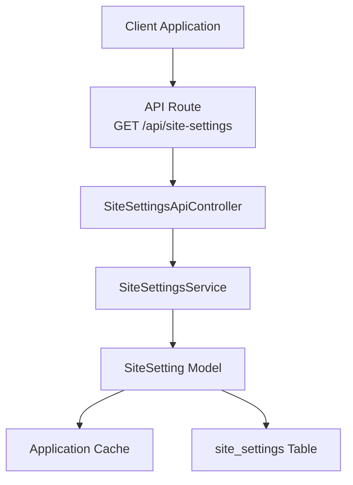
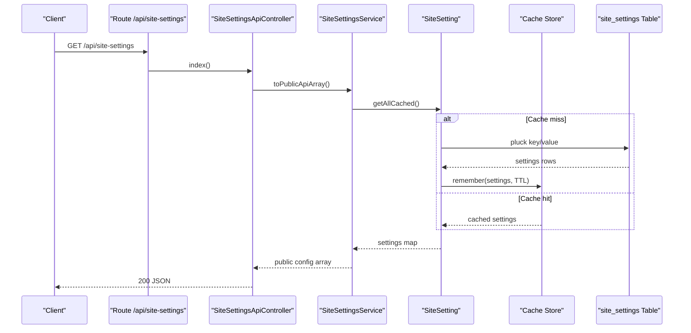
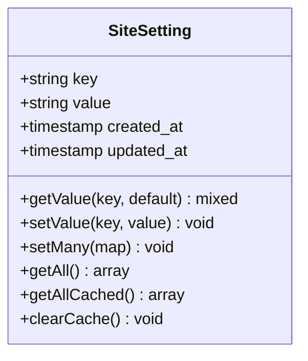
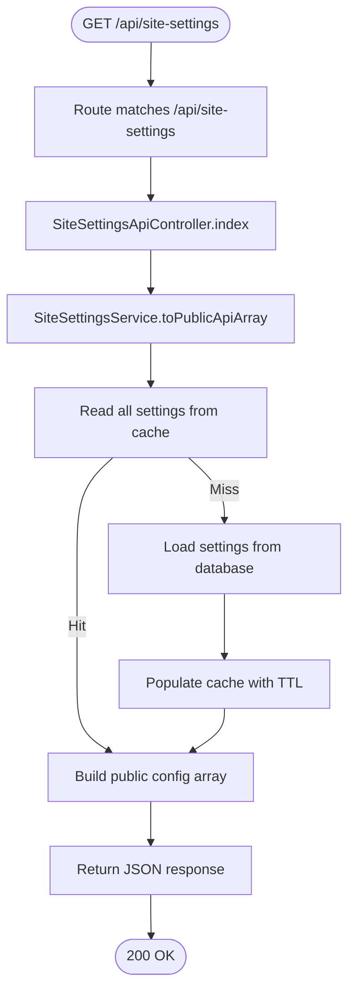
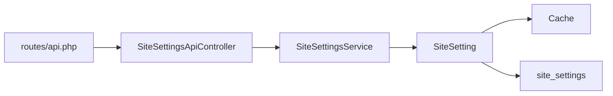

# Site Settings API

<cite>
**Referenced Files in This Document**
- [SiteSettingsApiController.php](file://backend/app/Http/Controllers/API/SiteSettingsApiController.php)
- [SiteSettingsService.php](file://backend/app/Services/SiteSettingsService.php)
- [SiteSetting.php](file://backend/app/Models/SiteSetting.php)
- [api.php](file://backend/routes/api.php)
- [2026_06_11_000000_create_site_settings_table.php](file://backend/database/migrations/2026_06_11_000000_create_site_settings_table.php)
- [MaintenanceModeTest.php](file://backend/tests/Feature/MaintenanceModeTest.php)
</cite>

## Table of Contents
1. [Introduction](#introduction)
2. [Project Structure](#project-structure)
3. [Core Components](#core-components)
4. [Architecture Overview](#architecture-overview)
5. [Detailed Component Analysis](#detailed-component-analysis)
6. [Dependency Analysis](#dependency-analysis)
7. [Performance Considerations](#performance-considerations)
8. [Troubleshooting Guide](#troubleshooting-guide)
9. [Conclusion](#conclusion)

## Introduction
This document describes the Site Settings API used to retrieve system-wide site configuration and runtime settings. The endpoint exposes branding, footer navigation, SEO metadata, maintenance mode state, and related public-facing configuration. It is designed for dynamic site customization and runtime behavior control without requiring a server restart.

The primary goal is to provide clients with a stable, read-only view of site configuration that can drive frontend branding, feature visibility, and maintenance page rendering.

## Project Structure
The Site Settings API is implemented as a small, focused stack:
- A public API route under `/api/site-settings`.
- An API controller that delegates to a service.
- A service that builds a public-safe configuration array from cached settings.
- A model that persists key-value settings and caches them.
- A database migration that creates the settings table and seeds defaults.



**Diagram sources**
- [api.php:18-18](file://backend/routes/api.php#L18-L18)
- [SiteSettingsApiController.php:7-16](file://backend/app/Http/Controllers/API/SiteSettingsApiController.php#L7-L16)
- [SiteSettingsService.php:13-49](file://backend/app/Services/SiteSettingsService.php#L13-L49)
- [SiteSetting.php:8-80](file://backend/app/Models/SiteSetting.php#L8-L80)
- [2026_06_11_000000_create_site_settings_table.php:12-17](file://backend/database/migrations/2026_06_11_000000_create_site_settings_table.php#L12-L17)

**Section sources**
- [api.php:12-18](file://backend/routes/api.php#L12-L18)
- [SiteSettingsApiController.php:1-17](file://backend/app/Http/Controllers/API/SiteSettingsApiController.php#L1-L17)
- [SiteSettingsService.php:1-49](file://backend/app/Services/SiteSettingsService.php#L1-L49)
- [SiteSetting.php:1-80](file://backend/app/Models/SiteSetting.php#L1-L80)
- [2026_06_11_000000_create_site_settings_table.php:1-57](file://backend/database/migrations/2026_06_11_000000_create_site_settings_table.php#L1-L57)

## Core Components
- Public endpoint: `GET /api/site-settings` returns a JSON object containing site branding, footer links, SEO fields, and maintenance mode status.
- Controller: `SiteSettingsApiController::index` returns the public configuration array produced by the service.
- Service: `SiteSettingsService::toPublicApiArray` reads all settings from cache and maps them into a structured response shape.
- Model: `SiteSetting` provides caching helpers (`getAllCached`, `getValue`, `setMany`, `setValue`, `clearCache`) and persistence via the `site_settings` table.
- Migration: Creates the `site_settings` table and seeds default values such as site title, footer links, maintenance flags, and SEO metadata.

Key responsibilities:
- Expose only safe, public-facing configuration.
- Keep sensitive or internal-only data out of the public API.
- Provide fast reads through caching.
- Allow administrators to update settings through other admin endpoints (not part of this API).

**Section sources**
- [SiteSettingsApiController.php:7-16](file://backend/app/Http/Controllers/API/SiteSettingsApiController.php#L7-L16)
- [SiteSettingsService.php:13-49](file://backend/app/Services/SiteSettingsService.php#L13-L49)
- [SiteSetting.php:8-80](file://backend/app/Models/SiteSetting.php#L8-L80)
- [2026_06_11_000000_create_site_settings_table.php:19-49](file://backend/database/migrations/2026_06_11_000000_create_site_settings_table.php#L19-L49)

## Architecture Overview
The request flow for retrieving site settings is intentionally simple and optimized for read performance.



**Diagram sources**
- [api.php:18-18](file://backend/routes/api.php#L18-L18)
- [SiteSettingsApiController.php:13-16](file://backend/app/Http/Controllers/API/SiteSettingsApiController.php#L13-L16)
- [SiteSettingsService.php:14-49](file://backend/app/Services/SiteSettingsService.php#L14-L49)
- [SiteSetting.php:58-70](file://backend/app/Models/SiteSetting.php#L58-L70)

## Detailed Component Analysis

### Endpoint Definition
- Method: `GET`
- Path: `/api/site-settings`
- Authentication: Not required; the route is defined outside authenticated middleware groups.
- Maintenance behavior: The endpoint is explicitly exempted from maintenance blocking so clients can still fetch maintenance state and message.

Request parameters:
- None.

Response schema:
- `site_title`: string
- `favicon_url`: string
- `logo_url`: string or null
- `logo_text`: string or null
- `footer.company_name`: string
- `footer.copyright`: string
- `footer.links`: array of link objects
- `maintenance.enabled`: boolean
- `maintenance.message`: string
- `seo.meta_description`: string
- `seo.meta_keywords`: string
- `seo.og_title`: string
- `seo.og_description`: string
- `seo.og_image`: string
- `seo.google_analytics_id`: string

Example response structure:
```json
{
  "site_title": "SonyaBus | Premium Bus Ticket Reservation",
  "favicon_url": "/favicon.svg",
  "logo_url": null,
  "logo_text": null,
  "footer": {
    "company_name": "SonyaBus Enterprise",
    "copyright": "© 2026 SonyaBus Enterprise Ltd.",
    "links": [
      {"label": "Search Buses", "tab": "home"},
      {"label": "My Tickets", "tab": "cancel"},
      {"label": "Special Promotions", "tab": "offers"},
      {"label": "My Profile", "tab": "profile"}
    ]
  },
  "maintenance": {
    "enabled": false,
    "message": ""
  },
  "seo": {
    "meta_description": "",
    "meta_keywords": "",
    "og_title": "",
    "og_description": "",
    "og_image": "",
    "google_analytics_id": ""
  }
}
```

Status codes:
- `200 OK`: Successful retrieval of site settings.

Notes:
- The endpoint does not accept query parameters for filtering categories. All public settings are returned together.
- If a setting is missing, the service applies sensible defaults.

**Section sources**
- [api.php:12-18](file://backend/routes/api.php#L12-L18)
- [SiteSettingsService.php:14-49](file://backend/app/Services/SiteSettingsService.php#L14-L49)
- [2026_06_11_000000_create_site_settings_table.php:19-49](file://backend/database/migrations/2026_06_11_000000_create_site_settings_table.php#L19-L49)

### Controller Layer
The controller is thin and delegates logic to the service. It returns a JSON response built by the service.

Responsibilities:
- Dependency injection of `SiteSettingsService`.
- Returning the public configuration array.

Error handling:
- No explicit validation or error handling in the controller; errors would originate from downstream services or framework-level exceptions.

**Section sources**
- [SiteSettingsApiController.php:7-16](file://backend/app/Http/Controllers/API/SiteSettingsApiController.php#L7-L16)

### Service Layer
The service transforms raw settings into a client-friendly structure.

Key behaviors:
- Reads all settings using cached access.
- Decodes `footer_links` from JSON when present.
- Normalizes `maintenance_mode` into a boolean `enabled` field.
- Provides defaults for missing keys.

Complexity considerations:
- Reading settings is O(1) after cache population because it uses an associative array lookup.
- JSON decoding of footer links is linear in the number of links.

Security considerations:
- Only public-safe fields are exposed. Sensitive configuration should not be added to the public mapping.

**Section sources**
- [SiteSettingsService.php:13-49](file://backend/app/Services/SiteSettingsService.php#L13-L49)

### Model and Caching Layer
The model manages persistence and caching of site settings.

Caching strategy:
- All settings are cached under a single cache key.
- Default TTL is five minutes.
- Writes invalidate the cache to ensure subsequent reads get fresh data.

Operations:
- `getValue(key, default)`: Read a single setting.
- `setValue(key, value)`: Upsert a single setting and clear cache.
- `setMany(map)`: Bulk upsert multiple settings and clear cache.
- `getAll()`: Read all settings from the database.
- `getAllCached()`: Read all settings from cache or populate cache.
- `clearCache()`: Explicitly clear the settings cache.

Data model:
- Table: `site_settings`
- Columns: `id`, `key`, `value`, `created_at`, `updated_at`
- Constraint: `key` is unique.

Default seed:
- The migration seeds common defaults including site title, favicon URL, footer company name and copyright, footer links, maintenance flags, and SEO metadata.



**Diagram sources**
- [SiteSetting.php:8-80](file://backend/app/Models/SiteSetting.php#L8-L80)
- [2026_06_11_000000_create_site_settings_table.php:12-17](file://backend/database/migrations/2026_06_11_000000_create_site_settings_table.php#L12-L17)

**Section sources**
- [SiteSetting.php:8-80](file://backend/app/Models/SiteSetting.php#L8-L80)
- [2026_06_11_000000_create_site_settings_table.php:1-57](file://backend/database/migrations/2026_06_11_000000_create_site_settings_table.php#L1-L57)

### Request Flow Diagram


**Diagram sources**
- [api.php:18-18](file://backend/routes/api.php#L18-L18)
- [SiteSettingsApiController.php:13-16](file://backend/app/Http/Controllers/API/SiteSettingsApiController.php#L13-L16)
- [SiteSettingsService.php:14-49](file://backend/app/Services/SiteSettingsService.php#L14-L49)
- [SiteSetting.php:58-70](file://backend/app/Models/SiteSetting.php#L58-L70)

## Dependency Analysis
The Site Settings API has minimal coupling:
- Route depends on the controller.
- Controller depends on the service.
- Service depends on the model.
- Model depends on the cache store and database.



**Diagram sources**
- [api.php:18-18](file://backend/routes/api.php#L18-L18)
- [SiteSettingsApiController.php:7-16](file://backend/app/Http/Controllers/API/SiteSettingsApiController.php#L7-L16)
- [SiteSettingsService.php:13-49](file://backend/app/Services/SiteSettingsService.php#L13-L49)
- [SiteSetting.php:8-80](file://backend/app/Models/SiteSetting.php#L8-L80)

**Section sources**
- [api.php:12-18](file://backend/routes/api.php#L12-L18)
- [SiteSettingsApiController.php:7-16](file://backend/app/Http/Controllers/API/SiteSettingsApiController.php#L7-L16)
- [SiteSettingsService.php:13-49](file://backend/app/Services/SiteSettingsService.php#L13-L49)
- [SiteSetting.php:8-80](file://backend/app/Models/SiteSetting.php#L8-L80)

## Performance Considerations
- Cached reads: All settings are loaded through a cache layer with a five-minute TTL. This reduces database load for frequent reads.
- Single cache key: Using one cache key simplifies invalidation but means any setting change invalidates the entire settings cache.
- Footer links decoding: The service decodes footer links from JSON per request. Keep the number of footer links reasonable to avoid unnecessary parsing overhead.
- Maintenance checks: Clients can rely on the `maintenance.enabled` flag to decide whether to show maintenance UI. The endpoint remains available even during maintenance.

Recommendations:
- For high-read environments, consider increasing the cache TTL if settings rarely change.
- Avoid adding large payloads to the public settings response.
- Monitor cache hit rates and database queries to validate effectiveness.

[No sources needed since this section provides general guidance]

## Troubleshooting Guide

Common issues and resolutions:
- Stale settings after updates:
  - Cause: Cache not invalidated after writing settings.
  - Resolution: Ensure writes call cache invalidation methods. The model clears the cache on `setValue` and `setMany`.
- Missing footer links:
  - Cause: `footer_links` is empty or malformed JSON.
  - Resolution: Validate and set valid JSON for `footer_links`. The service decodes it into an array.
- Maintenance page not showing:
  - Cause: `maintenance_mode` not set to true or cache not refreshed.
  - Resolution: Set `maintenance_mode` to true and clear the cache. The endpoint remains accessible during maintenance.
- Unexpected 503 responses on other routes:
  - Cause: Maintenance mode blocks public and authenticated routes except `/api/site-settings`.
  - Resolution: Check maintenance settings and disable maintenance if appropriate.

Relevant tests:
- The test suite verifies that `/api/site-settings` returns 200 during maintenance while other endpoints return 503.

**Section sources**
- [SiteSetting.php:30-53](file://backend/app/Models/SiteSetting.php#L30-L53)
- [SiteSetting.php:66-79](file://backend/app/Models/SiteSetting.php#L66-L79)
- [SiteSettingsService.php:18-49](file://backend/app/Services/SiteSettingsService.php#L18-L49)
- [MaintenanceModeTest.php:51-61](file://backend/tests/Feature/MaintenanceModeTest.php#L51-L61)

## Conclusion
The Site Settings API provides a simple, cached, and secure way to retrieve public site configuration. It supports dynamic branding, footer navigation, SEO metadata, and maintenance mode signaling. The design emphasizes readability, low coupling, and predictable behavior, making it suitable for frontends that need to adapt at runtime based on server-side configuration.

[No sources needed since this section summarizes without analyzing specific files]