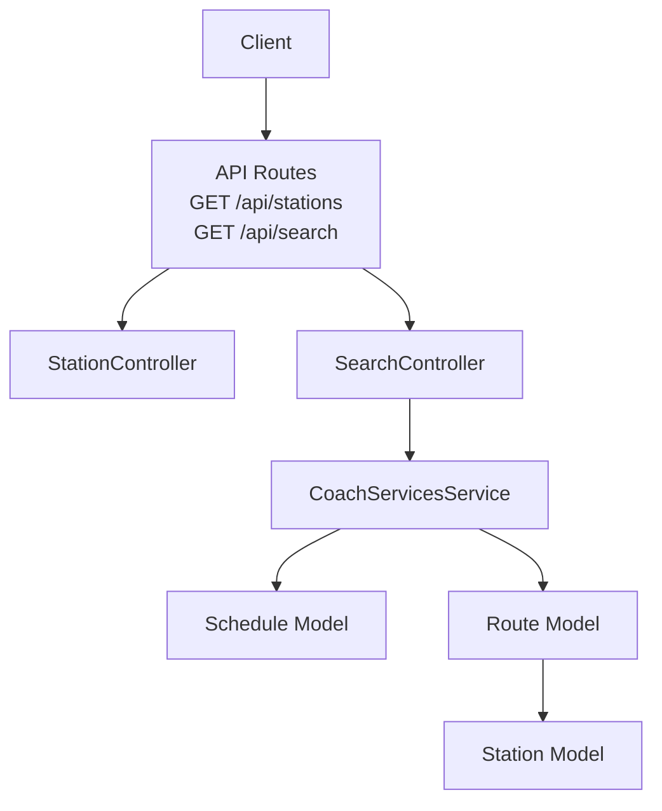
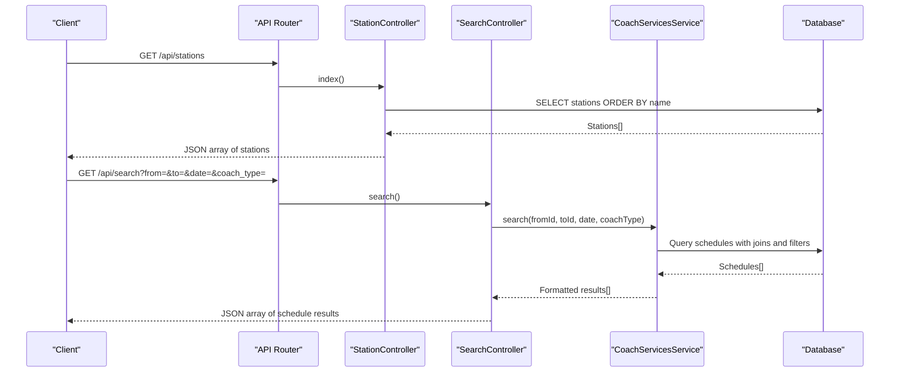
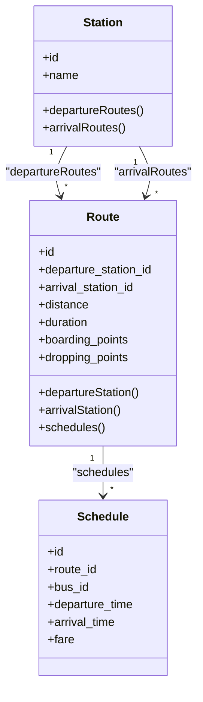
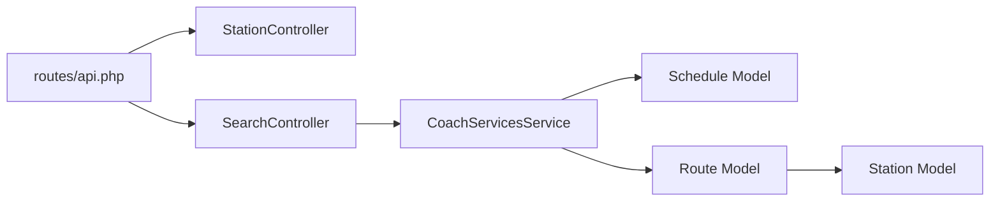

# Station Management API

<cite>
**Referenced Files in This Document**
- [StationController.php](file://backend/app/Http/Controllers/API/StationController.php)
- [SearchController.php](file://backend/app/Http/Controllers/API/SearchController.php)
- [CoachServicesService.php](file://backend/app/Services/CoachServicesService.php)
- [Station.php](file://backend/app/Models/Station.php)
- [Route.php](file://backend/app/Models/Route.php)
- [api.php](file://backend/routes/api.php)
- [2026_06_01_000010_create_stations_table.php](file://backend/database/migrations/2026_06_01_000010_create_stations_table.php)
- [2026_06_01_000030_create_routes_table.php](file://backend/database/migrations/2026_06_01_000030_create_routes_table.php)
- [cache.php](file://backend/config/cache.php)
- [customer-api.js](file://k6/lib/customer-api.js)
</cite>

## Table of Contents
1. [Introduction](#introduction)
2. [Project Structure](#project-structure)
3. [Core Components](#core-components)
4. [Architecture Overview](#architecture-overview)
5. [Detailed Component Analysis](#detailed-component-analysis)
6. [Dependency Analysis](#dependency-analysis)
7. [Performance Considerations](#performance-considerations)
8. [Troubleshooting Guide](#troubleshooting-guide)
9. [Conclusion](#conclusion)

## Introduction
This document describes the station management endpoints exposed by the public customer API. It covers:
- Listing stations
- Searching available coach services between stations
- Request parameters for filtering and date-based queries
- Response schemas for station data, coordinates, and related route information
- Caching strategies and performance optimization recommendations for location-based queries

The current implementation provides a simple station listing endpoint and a search endpoint that returns schedules filtered by departure and arrival stations. Geographic or coordinate-based station queries are not implemented in the current codebase; guidance is provided to extend the system safely.

## Project Structure
The station-related functionality lives under the public API layer:
- Routes define the public endpoints
- Controllers handle request validation and delegate business logic
- Services perform database queries and assemble response payloads
- Models represent entities such as stations and routes
- Database migrations define the schema and indexes

**Diagram sources**
- [api.php:26-32](file://backend/routes/api.php#L26-L32)
- [StationController.php:8-14](file://backend/app/Http/Controllers/API/StationController.php#L8-L14)
- [SearchController.php:8-30](file://backend/app/Http/Controllers/API/SearchController.php#L8-L30)
- [CoachServicesService.php:19-124](file://backend/app/Services/CoachServicesService.php#L19-L124)
- [Route.php:8-40](file://backend/app/Models/Route.php#L8-L40)
- [Station.php:8-22](file://backend/app/Models/Station.php#L8-L22)

**Section sources**
- [api.php:26-32](file://backend/routes/api.php#L26-L32)
- [StationController.php:8-14](file://backend/app/Http/Controllers/API/StationController.php#L8-L14)
- [SearchController.php:8-30](file://backend/app/Http/Controllers/API/SearchController.php#L8-L30)

## Core Components
- Station listing endpoint: returns all stations sorted by name.
- Search endpoint: validates inputs and delegates to a service that queries schedules, buses, routes, and related booking data.
- Service layer: builds efficient queries with eager loading and filters by station pairs and dates.
- Data models: Station and Route define relationships used by the service.

Key responsibilities:
- Validation and routing at the controller layer
- Query composition and payload formatting in the service layer
- Relationship definitions in models

**Section sources**
- [StationController.php:8-14](file://backend/app/Http/Controllers/API/StationController.php#L8-L14)
- [SearchController.php:14-30](file://backend/app/Http/Controllers/API/SearchController.php#L14-L30)
- [CoachServicesService.php:19-124](file://backend/app/Services/CoachServicesService.php#L19-L124)
- [Station.php:8-22](file://backend/app/Models/Station.php#L8-L22)
- [Route.php:8-40](file://backend/app/Models/Route.php#L8-L40)

## Architecture Overview
The public API exposes two primary endpoints relevant to station management:
- GET /api/stations: list all stations
- GET /api/search: search available schedules by origin, destination, date, and optional coach type

**Diagram sources**
- [api.php:26-32](file://backend/routes/api.php#L26-L32)
- [StationController.php:10-14](file://backend/app/Http/Controllers/API/StationController.php#L10-L14)
- [SearchController.php:14-30](file://backend/app/Http/Controllers/API/SearchController.php#L14-L30)
- [CoachServicesService.php:19-124](file://backend/app/Services/CoachServicesService.php#L19-L124)

## Detailed Component Analysis

### Endpoint: List Stations
- Method: GET
- Path: /api/stations
- Authentication: None (public)
- Maintenance mode: The route is inside the maintenance-mode middleware group, so it may be disabled during maintenance.

Request parameters:
- None

Response:
- Array of station objects with at least id and name fields.

Notes:
- Results are ordered alphabetically by station name.
- No pagination or filtering is currently supported.

Example response shape:
- Array of objects containing:
  - id: integer
  - name: string

**Section sources**
- [api.php:26-32](file://backend/routes/api.php#L26-L32)
- [StationController.php:10-14](file://backend/app/Http/Controllers/API/StationController.php#L10-L14)
- [2026_06_01_000010_create_stations_table.php:11-15](file://backend/database/migrations/2026_06_01_000010_create_stations_table.php#L11-L15)

### Endpoint: Search Available Schedules
- Method: GET
- Path: /api/search
- Authentication: None (public)
- Maintenance mode: The route is inside the maintenance-mode middleware group.

Request parameters:
- from: required, integer, must exist in stations table
- to: required, integer, must exist in stations table
- date: required, string, format YYYY-MM-DD
- coach_type: optional, string, filters by bus coach type

Validation:
- Controller enforces presence and types via Laravel validation rules.

Business logic:
- Delegates to CoachServicesService.search which:
  - Filters schedules by route station pair(s)
  - Applies date range filter based on departure_time
  - Optionally filters by coach_type
  - Eager loads bus, route, stations, and paid bookings
  - Formats seat map and pricing details

Response:
- Array of schedule result objects including:
  - id: schedule identifier
  - departure_time: ISO 8601 timestamp
  - arrival_time: ISO 8601 timestamp
  - fare: numeric value
  - bus: object with operator_name, coach_number, coach_type, total_seats, seat_layout, seat_layout_grid, logo_url
  - route: object with distance, duration, from (station name), to (station name)
  - booked_seats: array of booked seat identifiers
  - seat_map: structured seat availability map
  - boarding_points: array of boarding point objects
  - dropping_points: array of dropping point objects
  - seat_class: seat class metadata
  - pricing: pricing metadata
  - available_seats_count: number of available seats

Notes:
- If no future schedules match and no specific date is requested, the service returns recent schedules up to a limit.
- The search endpoint does not support geographic or coordinate-based queries in the current implementation.

**Section sources**
- [api.php:26-32](file://backend/routes/api.php#L26-L32)
- [SearchController.php:14-30](file://backend/app/Http/Controllers/API/SearchController.php#L14-L30)
- [CoachServicesService.php:19-124](file://backend/app/Services/CoachServicesService.php#L19-L124)

### Data Models and Relationships
Stations and Routes are central to station management:
- Station has many departureRoutes and arrivalRoutes
- Route belongs to departureStation and arrivalStation
- Route has many schedules

**Diagram sources**
- [Station.php:14-22](file://backend/app/Models/Station.php#L14-L22)
- [Route.php:12-39](file://backend/app/Models/Route.php#L12-L39)

**Section sources**
- [Station.php:8-22](file://backend/app/Models/Station.php#L8-L22)
- [Route.php:8-40](file://backend/app/Models/Route.php#L8-L40)

### Database Schema and Indexes
- Stations table:
  - Columns: id, name (unique), timestamps
- Routes table:
  - Columns: id, departure_station_id (FK), arrival_station_id (FK), distance, duration, boarding_points (JSON), dropping_points (JSON), timestamps
  - Indexes:
    - departure_station_id
    - arrival_station_id
    - composite (departure_station_id, arrival_station_id)

These indexes optimize queries that filter schedules by station pairs.

**Section sources**
- [2026_06_01_000010_create_stations_table.php:11-15](file://backend/database/migrations/2026_06_01_000010_create_stations_table.php#L11-L15)
- [2026_06_01_000030_create_routes_table.php:14-28](file://backend/database/migrations/2026_06_01_000030_create_routes_table.php#L14-L28)

### Autocomplete and Location-Based Queries
Current capabilities:
- Autocomplete: Not implemented. The station listing endpoint returns all stations without filtering or autocomplete behavior.
- Location-based queries: Not implemented. There are no latitude/longitude columns in the stations table, and no geospatial queries are present in the controllers or services.

Recommended extension approach:
- Add geolocation fields to the stations table (e.g., latitude, longitude).
- Implement an autocomplete endpoint that accepts a text query and returns matching station names.
- Implement a location-based endpoint that accepts user coordinates and radius, returning nearby stations using spatial indexes and queries.
- Cache autocomplete and nearby-station results to reduce database load.

[No sources needed since this section proposes extensions not present in the code]

## Dependency Analysis
The following diagram shows how components depend on each other for station and search operations:

**Diagram sources**
- [api.php:26-32](file://backend/routes/api.php#L26-L32)
- [StationController.php:8-14](file://backend/app/Http/Controllers/API/StationController.php#L8-L14)
- [SearchController.php:8-30](file://backend/app/Http/Controllers/API/SearchController.php#L8-L30)
- [CoachServicesService.php:19-124](file://backend/app/Services/CoachServicesService.php#L19-L124)
- [Route.php:8-40](file://backend/app/Models/Route.php#L8-L40)
- [Station.php:8-22](file://backend/app/Models/Station.php#L8-L22)

**Section sources**
- [api.php:26-32](file://backend/routes/api.php#L26-L32)
- [CoachServicesService.php:19-124](file://backend/app/Services/CoachServicesService.php#L19-L124)

## Performance Considerations
Caching strategy:
- The application uses Laravel’s cache configuration with multiple stores (database, file, memcached, redis, dynamodb, octane, failover).
- The default store is configured via environment variables.
- A key prefix is applied to avoid collisions across applications.

Recommendations for station data caching:
- Cache the full station list under a stable key (e.g., stations:index) with a reasonable TTL.
- Invalidate or refresh the cache when stations are created, updated, or deleted.
- For search results, consider caching per station pair and date if read-heavy and write-light.
- Use Redis or Memcached for faster access in high-throughput environments.

Optimization tips:
- Leverage existing indexes on routes.station_id columns for fast station-pair lookups.
- Keep eager loading of bus, route, and stations to minimize N+1 queries.
- Limit returned fields where possible to reduce payload size.
- Consider pagination for large station lists if the dataset grows significantly.

**Section sources**
- [cache.php:18-115](file://backend/config/cache.php#L18-L115)
- [2026_06_01_000030_create_routes_table.php:24-28](file://backend/database/migrations/2026_06_01_000030_create_routes_table.php#L24-L28)
- [CoachServicesService.php:21-26](file://backend/app/Services/CoachServicesService.php#L21-L26)

## Troubleshooting Guide
Common issues and resolutions:
- Missing or invalid station IDs in search requests:
  - Ensure from and to refer to valid station ids. The controller validates existence against the stations table.
- Date format errors:
  - Provide date in YYYY-MM-DD format as validated by the controller.
- Empty results:
  - Verify that routes exist between the specified stations and that schedules exist for the requested date.
- Maintenance mode:
  - Public endpoints may be disabled during maintenance; check server status or disable maintenance mode temporarily.

Operational checks:
- Confirm routes are registered under the public API group.
- Validate database connectivity and indexes.
- Inspect cache configuration and ensure the selected store is available.

**Section sources**
- [SearchController.php:14-30](file://backend/app/Http/Controllers/API/SearchController.php#L14-L30)
- [api.php:26-32](file://backend/routes/api.php#L26-L32)

## Conclusion
The current station management API provides:
- A simple station listing endpoint
- A robust search endpoint for schedules filtered by station pairs and date

Geographic and autocomplete features are not implemented but can be added by extending the schema and introducing new endpoints. Caching and indexing strategies are available to improve performance for station and search operations.