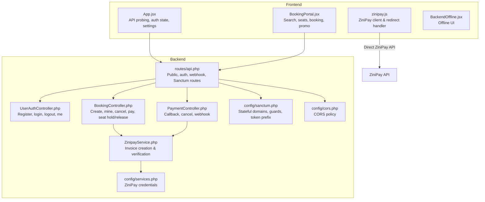
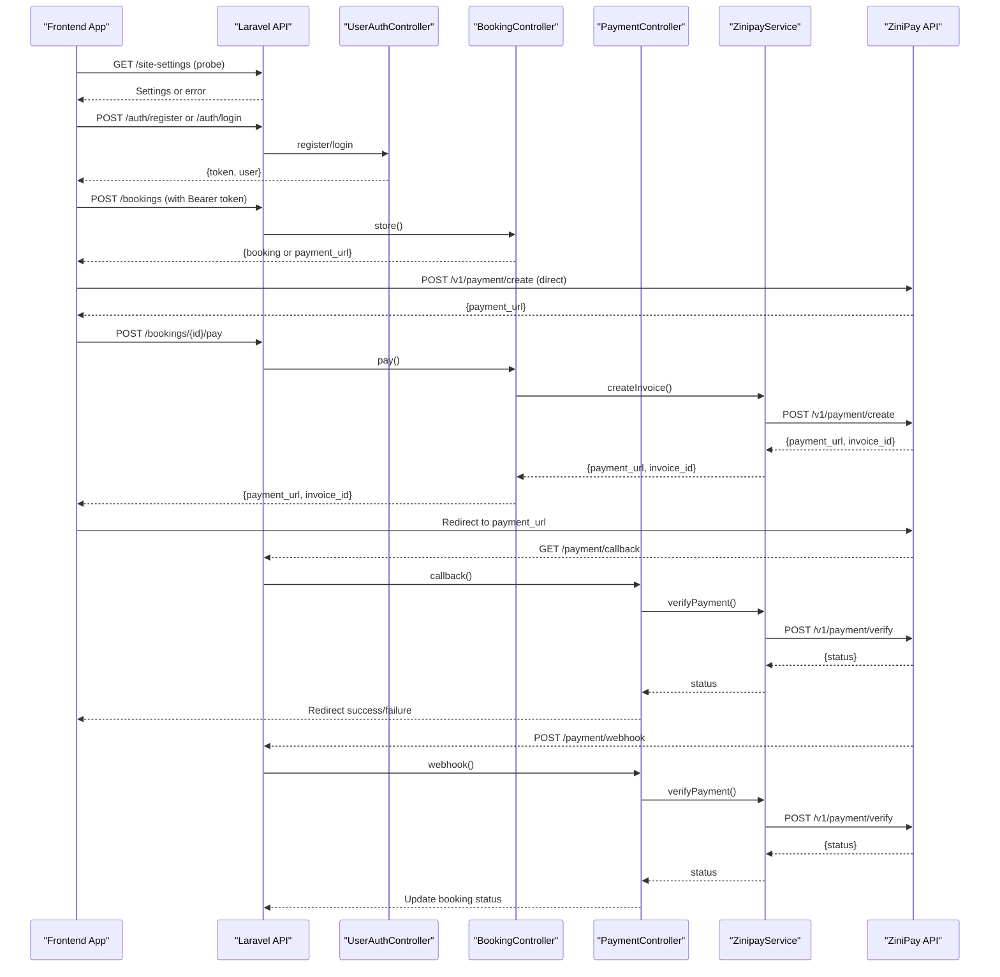
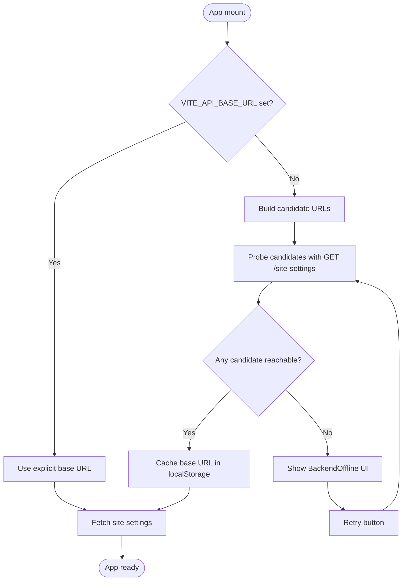
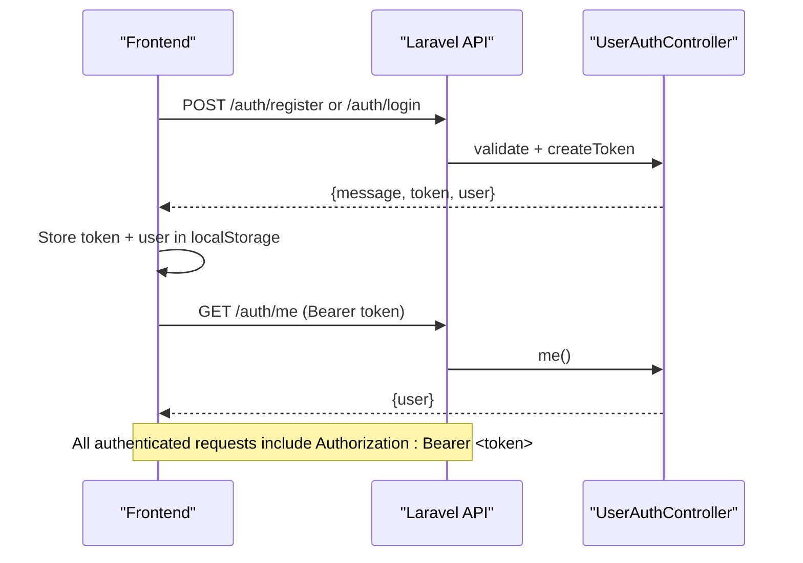
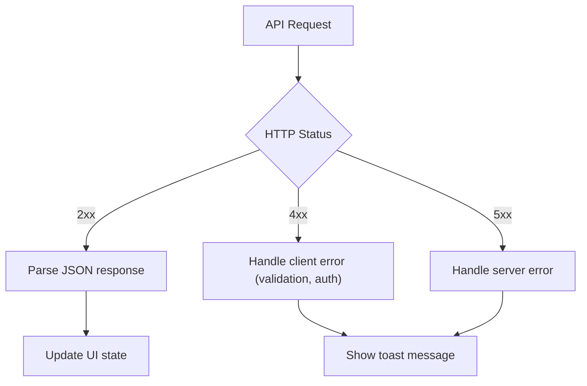
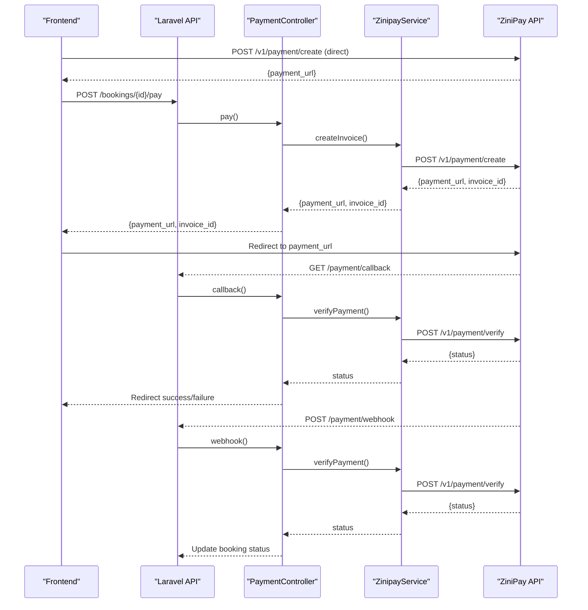
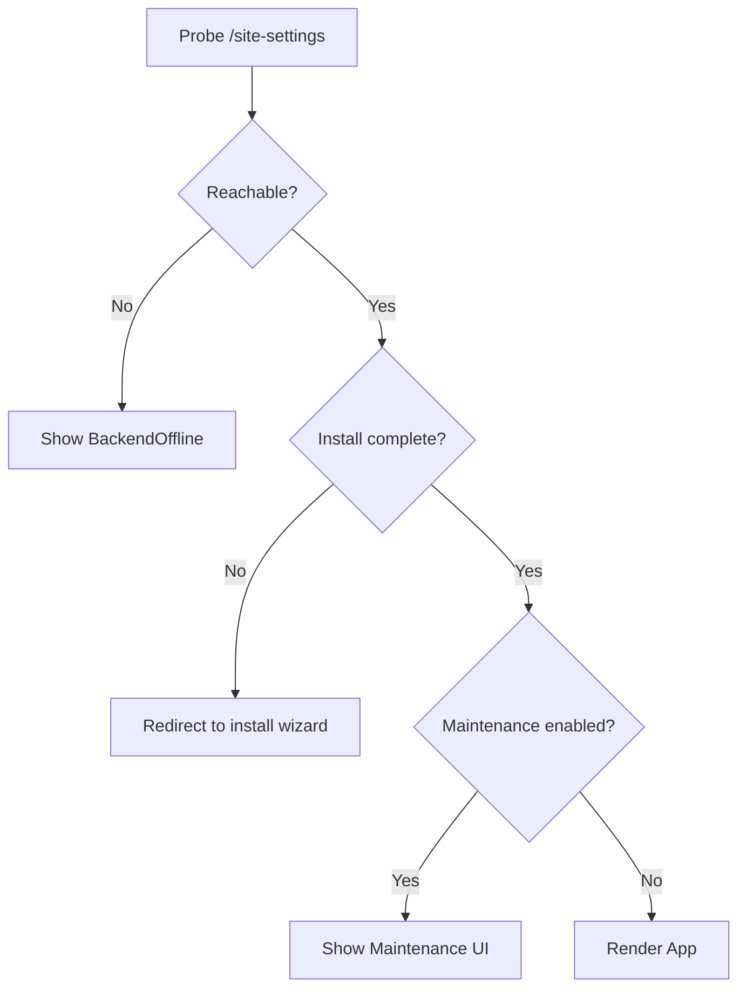
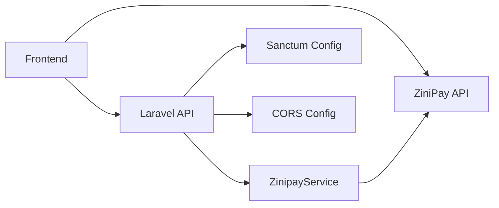

# API Integration

<cite>
**Referenced Files in This Document**
- [api.php](file://backend/routes/api.php)
- [UserAuthController.php](file://backend/app/Http/Controllers/API/UserAuthController.php)
- [BookingController.php](file://backend/app/Http/Controllers/API/BookingController.php)
- [PaymentController.php](file://backend/app/Http/Controllers/PaymentController.php)
- [ZinipayService.php](file://backend/app/Services/ZinipayService.php)
- [sanctum.php](file://backend/config/sanctum.php)
- [services.php](file://backend/config/services.php)
- [cors.php](file://backend/config/cors.php)
- [App.jsx](file://frontend/src/App.jsx)
- [zinipay.js](file://frontend/src/zinipay.js)
- [BookingPortal.jsx](file://frontend/src/components/BookingPortal.jsx)
- [BackendOffline.jsx](file://frontend/src/components/BackendOffline.jsx)
- [vite.config.js](file://frontend/vite.config.js)
</cite>

## Table of Contents
1. [Introduction](#introduction)
2. [Project Structure](#project-structure)
3. [Core Components](#core-components)
4. [Architecture Overview](#architecture-overview)
5. [Detailed Component Analysis](#detailed-component-analysis)
6. [Dependency Analysis](#dependency-analysis)
7. [Performance Considerations](#performance-considerations)
8. [Troubleshooting Guide](#troubleshooting-guide)
9. [Conclusion](#conclusion)

## Introduction
This document explains how the customer-facing application integrates with the Laravel backend API. It covers automatic backend detection, authenticated requests using Bearer tokens, error handling and response processing, ZiniPay payment integration (redirects, webhooks, and verification), request/response schemas for customer endpoints, rate limiting, and offline handling strategies. The goal is to help developers understand both the frontend and backend flows so they can integrate, debug, and extend the system safely.

## Project Structure
The project has two main parts:
- Backend: Laravel API under `backend/`, including routes, controllers, services, Sanctum configuration, CORS, and third-party service configuration.
- Frontend: React application under `frontend/`, including app initialization, authentication state, API probing, ZiniPay redirect handling, and booking flow components.

**Diagram sources**
- [App.jsx:40-92](file://frontend/src/App.jsx#L40-L92)
- [App.jsx:153-173](file://frontend/src/App.jsx#L153-L173)
- [App.jsx:293-325](file://frontend/src/App.jsx#L293-L325)
- [App.jsx:327-378](file://frontend/src/App.jsx#L327-L378)
- [zinipay.js:1-34](file://frontend/src/zinipay.js#L1-L34)
- [zinipay.js:36-62](file://frontend/src/zinipay.js#L36-L62)
- [zinipay.js:64-177](file://frontend/src/zinipay.js#L64-L177)
- [BookingPortal.jsx:67-74](file://frontend/src/components/BookingPortal.jsx#L67-L74)
- [BookingPortal.jsx:470-575](file://frontend/src/components/BookingPortal.jsx#L470-L575)
- [api.php:18-75](file://backend/routes/api.php#L18-L75)
- [UserAuthController.php:17-86](file://backend/app/Http/Controllers/API/UserAuthController.php#L17-L86)
- [BookingController.php:19-148](file://backend/app/Http/Controllers/API/BookingController.php#L19-L148)
- [PaymentController.php:21-160](file://backend/app/Http/Controllers/PaymentController.php#L21-L160)
- [ZinipayService.php:27-97](file://backend/app/Services/ZinipayService.php#L27-L97)
- [ZinipayService.php:105-139](file://backend/app/Services/ZinipayService.php#L105-L139)
- [sanctum.php:21-40](file://backend/config/sanctum.php#L21-L40)
- [cors.php:18-32](file://backend/config/cors.php#L18-L32)
- [services.php:38-41](file://backend/config/services.php#L38-L41)

**Section sources**
- [api.php:18-75](file://backend/routes/api.php#L18-L75)
- [App.jsx:40-92](file://frontend/src/App.jsx#L40-L92)
- [vite.config.js:33-70](file://frontend/vite.config.js#L33-L70)

## Core Components
- Automatic backend detection: The frontend probes candidate base URLs until one responds, then caches it. If no candidate works, it shows an offline screen with retry guidance.
- Authentication: Register/login return a Bearer token stored in localStorage; subsequent requests include an Authorization header. Sanctum protects authenticated routes.
- Customer API: Public endpoints for stations, search, promotions; protected endpoints for bookings, seat holds/releases, and user profile operations.
- Payment: ZiniPay invoice creation via backend service; frontend redirects to payment URL; callback and webhook update booking status.

**Section sources**
- [App.jsx:40-92](file://frontend/src/App.jsx#L40-L92)
- [App.jsx:153-173](file://frontend/src/App.jsx#L153-L173)
- [api.php:26-75](file://backend/routes/api.php#L26-L75)
- [UserAuthController.php:17-86](file://backend/app/Http/Controllers/API/UserAuthController.php#L17-L86)
- [BookingController.php:19-148](file://backend/app/Http/Controllers/API/BookingController.php#L19-L148)
- [PaymentController.php:21-160](file://backend/app/Http/Controllers/PaymentController.php#L21-L160)
- [ZinipayService.php:27-97](file://backend/app/Services/ZinipayService.php#L27-L97)

## Architecture Overview
The customer application uses a hybrid approach:
- Direct calls to the Laravel API for data and authentication.
- Direct calls to ZiniPay’s external API from the frontend for payment creation and verification.
- Backend-only calls to ZiniPay for secure invoice creation and verification during callbacks/webhooks.

**Diagram sources**
- [App.jsx:293-325](file://frontend/src/App.jsx#L293-L325)
- [App.jsx:250-276](file://frontend/src/App.jsx#L250-L276)
- [BookingPortal.jsx:470-575](file://frontend/src/components/BookingPortal.jsx#L470-L575)
- [zinipay.js:1-34](file://frontend/src/zinipay.js#L1-L34)
- [zinipay.js:64-177](file://frontend/src/zinipay.js#L64-L177)
- [api.php:54-75](file://backend/routes/api.php#L54-L75)
- [UserAuthController.php:17-86](file://backend/app/Http/Controllers/API/UserAuthController.php#L17-L86)
- [BookingController.php:19-148](file://backend/app/Http/Controllers/API/BookingController.php#L19-L148)
- [PaymentController.php:21-160](file://backend/app/Http/Controllers/PaymentController.php#L21-L160)
- [ZinipayService.php:27-97](file://backend/app/Services/ZinipayService.php#L27-L97)
- [ZinipayService.php:105-139](file://backend/app/Services/ZinipayService.php#L105-L139)

## Detailed Component Analysis

### Automatic Backend Detection
The frontend builds a prioritized list of candidate base URLs:
- Explicit environment variable if set.
- Same-origin `/api`.
- Common local development URLs.
- Laragon-style subdirectory paths.

It probes each candidate by fetching `/site-settings` with a short timeout. The first successful candidate is cached in localStorage and used for all subsequent API calls. If none respond, the app displays an offline screen with retry instructions and candidate URLs.

**Diagram sources**
- [App.jsx:40-92](file://frontend/src/App.jsx#L40-L92)
- [App.jsx:327-378](file://frontend/src/App.jsx#L327-L378)
- [App.jsx:502-524](file://frontend/src/App.jsx#L502-L524)
- [BackendOffline.jsx:1-36](file://frontend/src/components/BackendOffline.jsx#L1-L36)

**Section sources**
- [App.jsx:40-92](file://frontend/src/App.jsx#L40-L92)
- [App.jsx:327-378](file://frontend/src/App.jsx#L327-L378)
- [App.jsx:502-524](file://frontend/src/App.jsx#L502-L524)
- [BackendOffline.jsx:1-36](file://frontend/src/components/BackendOffline.jsx#L1-L36)

### Authentication Flow and Bearer Tokens
Authentication endpoints are public and rate-limited. Registration and login return a Bearer token and user object. The frontend stores the token and user in localStorage and attaches an Authorization header to subsequent requests. Sanctum protects authenticated routes using the `auth:sanctum` middleware.

**Diagram sources**
- [api.php:41-46](file://backend/routes/api.php#L41-L46)
- [api.php:63-75](file://backend/routes/api.php#L63-L75)
- [UserAuthController.php:17-86](file://backend/app/Http/Controllers/API/UserAuthController.php#L17-L86)
- [App.jsx:153-173](file://frontend/src/App.jsx#L153-L173)
- [App.jsx:250-276](file://frontend/src/App.jsx#L250-L276)
- [sanctum.php:21-40](file://backend/config/sanctum.php#L21-L40)

**Section sources**
- [api.php:41-46](file://backend/routes/api.php#L41-L46)
- [api.php:63-75](file://backend/routes/api.php#L63-L75)
- [UserAuthController.php:17-86](file://backend/app/Http/Controllers/API/UserAuthController.php#L17-L86)
- [App.jsx:153-173](file://frontend/src/App.jsx#L153-L173)
- [sanctum.php:21-40](file://backend/config/sanctum.php#L21-L40)

### Error Handling Strategies
- Network errors: Frontend catches fetch exceptions and shows toast messages. For auth failures (401), it clears local auth state and prompts login.
- Validation errors: Backend returns validation errors; frontend surfaces messages.
- Payment errors: ZiniPay direct calls throw on non-OK responses; frontend handles and shows errors. Webhook and callback flows log and handle unknown or failed statuses.

**Diagram sources**
- [App.jsx:250-276](file://frontend/src/App.jsx#L250-L276)
- [App.jsx:278-291](file://frontend/src/App.jsx#L278-L291)
- [BookingPortal.jsx:518-575](file://frontend/src/components/BookingPortal.jsx#L518-L575)
- [zinipay.js:24-33](file://frontend/src/zinipay.js#L24-L33)
- [zinipay.js:52-61](file://frontend/src/zinipay.js#L52-L61)
- [PaymentController.php:90-136](file://backend/app/Http/Controllers/PaymentController.php#L90-L136)

**Section sources**
- [App.jsx:250-276](file://frontend/src/App.jsx#L250-L276)
- [BookingPortal.jsx:518-575](file://frontend/src/components/BookingPortal.jsx#L518-L575)
- [zinipay.js:24-33](file://frontend/src/zinipay.js#L24-L33)
- [PaymentController.php:90-136](file://backend/app/Http/Controllers/PaymentController.php#L90-L136)

### ZiniPay Payment Integration
- Invoice creation: Frontend can call ZiniPay directly to create an invoice and get a payment URL. Backend also creates invoices securely via ZinipayService when initiating payment through `/bookings/{id}/pay`.
- Redirect handling: After payment, ZiniPay redirects to backend callback; backend verifies status and updates booking. Frontend also processes URL parameters to verify and display results.
- Webhook processing: Backend receives asynchronous webhook notifications, verifies status with ZiniPay, and updates booking accordingly.

**Diagram sources**
- [zinipay.js:1-34](file://frontend/src/zinipay.js#L1-L34)
- [BookingPortal.jsx:525-529](file://frontend/src/components/BookingPortal.jsx#L525-L529)
- [BookingController.php:118-148](file://backend/app/Http/Controllers/API/BookingController.php#L118-L148)
- [PaymentController.php:21-160](file://backend/app/Http/Controllers/PaymentController.php#L21-L160)
- [ZinipayService.php:27-97](file://backend/app/Services/ZinipayService.php#L27-L97)
- [ZinipayService.php:105-139](file://backend/app/Services/ZinipayService.php#L105-L139)

**Section sources**
- [zinipay.js:1-34](file://frontend/src/zinipay.js#L1-L34)
- [zinipay.js:64-177](file://frontend/src/zinipay.js#L64-L177)
- [BookingController.php:118-148](file://backend/app/Http/Controllers/API/BookingController.php#L118-L148)
- [PaymentController.php:21-160](file://backend/app/Http/Controllers/PaymentController.php#L21-L160)
- [ZinipayService.php:27-97](file://backend/app/Services/ZinipayService.php#L27-L97)

### Request/Response Schemas for Customer-Facing Endpoints
Below are the primary customer-facing endpoints and their expected payloads/responses based on controller logic and frontend usage.

- Public endpoints
  - GET `/api/stations`
    - Response: Array of station objects.
  - GET `/api/search?from=&to=&date=&coach_type=`
    - Request params: from, to, date, coach_type.
    - Response: Array of schedule objects.
  - GET `/api/promotions`
    - Response: Array of promotion objects.
  - GET `/api/promotions/check?code=`
    - Request param: code.
    - Response: Promotion details or error message.

- Authentication endpoints (rate-limited)
  - POST `/api/auth/register`
    - Request body: name, email, password, password_confirmation.
    - Response: { message, token, user }.
  - POST `/api/auth/login`
    - Request body: email, password.
    - Response: { message, token, user }.
  - POST `/api/auth/logout` (authenticated)
    - Response: { message }.
  - GET `/api/auth/me` (authenticated)
    - Response: { user }.
  - POST `/api/auth/password` (authenticated)
    - Request body: current_password, password, password_confirmation.
    - Response: { message, user }.

- Booking endpoints (authenticated)
  - POST `/api/bookings`
    - Request body: schedule_id, passenger_name, passenger_phone, passenger_email, seat_numbers, payment_method, total_fare (optional), passenger_gender (optional), boarding_point (optional), dropping_point (optional), promo_code (optional).
    - Response: Booking object or payment_url if ZiniPay initiated.
  - GET `/api/bookings/mine?page=&per_page=`
    - Request params: page, per_page.
    - Response: Paginated bookings array.
  - POST `/api/bookings/{id}/cancel`
    - Response: Booking update result or error.
  - POST `/api/bookings/{id}/pay`
    - Response: { message, payment_url, invoice_id, booking } or error.

- Seat management (authenticated)
  - POST `/api/seats/hold`
    - Request body: schedule_id, seat_number.
    - Response: { success, expires_at } or error.
  - POST `/api/seats/release`
    - Request body: schedule_id, seat_number.
    - Response: { success } or error.

- Public booking receipt
  - GET `/api/bookings/public/{id}`
    - Response: Booking object formatted for API.

- Payment webhooks and callbacks
  - POST `/api/payment/webhook`
    - Request body: invoice_id, status.
    - Response: { message, booking } or status message.
  - GET `/payment/callback` (web route)
    - Query params: booking_id, source, invoice_id.
    - Behavior: Verifies payment and redirects to frontend success/failure.

**Section sources**
- [api.php:18-75](file://backend/routes/api.php#L18-L75)
- [UserAuthController.php:17-218](file://backend/app/Http/Controllers/API/UserAuthController.php#L17-L218)
- [BookingController.php:19-148](file://backend/app/Http/Controllers/API/BookingController.php#L19-L148)
- [PaymentController.php:21-160](file://backend/app/Http/Controllers/PaymentController.php#L21-L160)
- [BookingPortal.jsx:470-575](file://frontend/src/components/BookingPortal.jsx#L470-L575)

### Rate Limiting Considerations
- Authentication endpoints are grouped under a throttle middleware allowing 10 attempts per minute per IP.
- Additional throttling recommendations exist in security documentation for specific endpoints like password updates.

Operational notes:
- Keep rate limits reasonable to avoid blocking legitimate users while preventing brute-force attacks.
- Monitor logs for repeated 429 responses and adjust thresholds as needed.

**Section sources**
- [api.php:41-46](file://backend/routes/api.php#L41-L46)

### Offline Handling Strategies
- Backend unreachable: Frontend shows BackendOffline component with candidate URLs and retry button.
- Maintenance mode: Backend may return maintenance-related responses; frontend renders Maintenance component when enabled.
- Install wizard not complete: Frontend detects install-not-complete responses and directs users to the install wizard.

**Diagram sources**
- [App.jsx:293-325](file://frontend/src/App.jsx#L293-L325)
- [App.jsx:565-689](file://frontend/src/App.jsx#L565-L689)
- [BackendOffline.jsx:1-36](file://frontend/src/components/BackendOffline.jsx#L1-L36)

**Section sources**
- [App.jsx:293-325](file://frontend/src/App.jsx#L293-L325)
- [App.jsx:565-689](file://frontend/src/App.jsx#L565-L689)
- [BackendOffline.jsx:1-36](file://frontend/src/components/BackendOffline.jsx#L1-L36)

## Dependency Analysis
Key dependencies and relationships:
- Frontend depends on Laravel API for data and authentication.
- Frontend directly calls ZiniPay API for payment creation and verification.
- Backend depends on ZinipayService for secure interactions with ZiniPay.
- Sanctum config controls stateful domains and token behavior.
- CORS config allows cross-origin requests to API routes.

**Diagram sources**
- [App.jsx:40-92](file://frontend/src/App.jsx#L40-L92)
- [zinipay.js:1-34](file://frontend/src/zinipay.js#L1-L34)
- [ZinipayService.php:27-97](file://backend/app/Services/ZinipayService.php#L27-L97)
- [sanctum.php:21-40](file://backend/config/sanctum.php#L21-L40)
- [cors.php:18-32](file://backend/config/cors.php#L18-L32)

**Section sources**
- [App.jsx:40-92](file://frontend/src/App.jsx#L40-L92)
- [zinipay.js:1-34](file://frontend/src/zinipay.js#L1-L34)
- [ZinipayService.php:27-97](file://backend/app/Services/ZinipayService.php#L27-L97)
- [sanctum.php:21-40](file://backend/config/sanctum.php#L21-L40)
- [cors.php:18-32](file://backend/config/cors.php#L18-L32)

## Performance Considerations
- Probing timeouts: Backend detection uses short timeouts to avoid long waits during startup.
- Caching: Schedule search results are cached locally to reduce API calls.
- Polling: Seat map refreshes occur at intervals; ensure polling frequency balances freshness and load.
- External API timeouts: ZiniPay service sets HTTP timeouts to prevent hanging requests.

Recommendations:
- Tune probe timeouts and polling intervals based on network conditions.
- Implement exponential backoff for retries on transient failures.
- Monitor ZiniPay API latency and consider caching invoice IDs where appropriate.

[No sources needed since this section provides general guidance]

## Troubleshooting Guide
Common network-related issues and resolutions:
- Cannot connect to server:
  - Verify backend is running (e.g., php artisan serve).
  - Check VITE_API_BASE_URL or rely on auto-detection.
  - Use the retry button to re-probe candidates.
- CORS errors:
  - Ensure allowed origins and headers are configured in CORS settings.
  - Confirm Sanctum stateful domains include your frontend origin.
- Authentication failures:
  - Clear stale tokens in localStorage if needed.
  - Re-login to obtain a fresh Bearer token.
- Payment issues:
  - Verify ZINIPAY_API_KEY is set in backend services config.
  - Check callback and webhook URLs are accessible and correctly routed.
  - Inspect logs for ZiniPay API errors and status codes.

**Section sources**
- [App.jsx:502-524](file://frontend/src/App.jsx#L502-L524)
- [cors.php:18-32](file://backend/config/cors.php#L18-L32)
- [sanctum.php:21-40](file://backend/config/sanctum.php#L21-L40)
- [services.php:38-41](file://backend/config/services.php#L38-L41)
- [PaymentController.php:90-136](file://backend/app/Http/Controllers/PaymentController.php#L90-L136)

## Conclusion
The customer application integrates with the Laravel backend through robust automatic backend detection, Bearer token authentication, and comprehensive error handling. ZiniPay payments are supported via direct frontend calls and secure backend verification, with callback and webhook flows ensuring consistent booking status. By following the documented schemas, rate limiting, and offline strategies, developers can reliably extend and maintain the integration.

[No sources needed since this section summarizes without analyzing specific files]