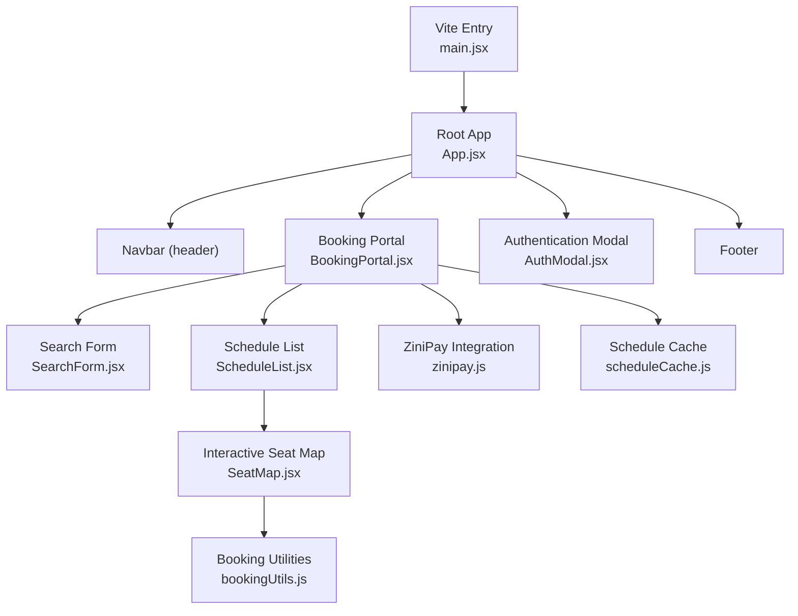
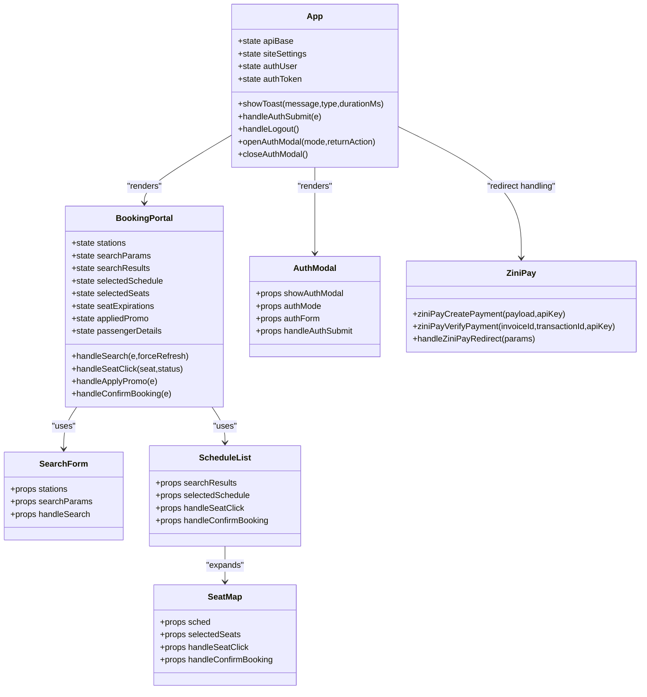
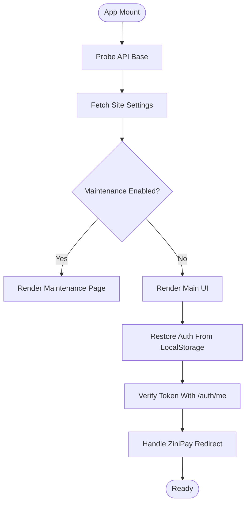
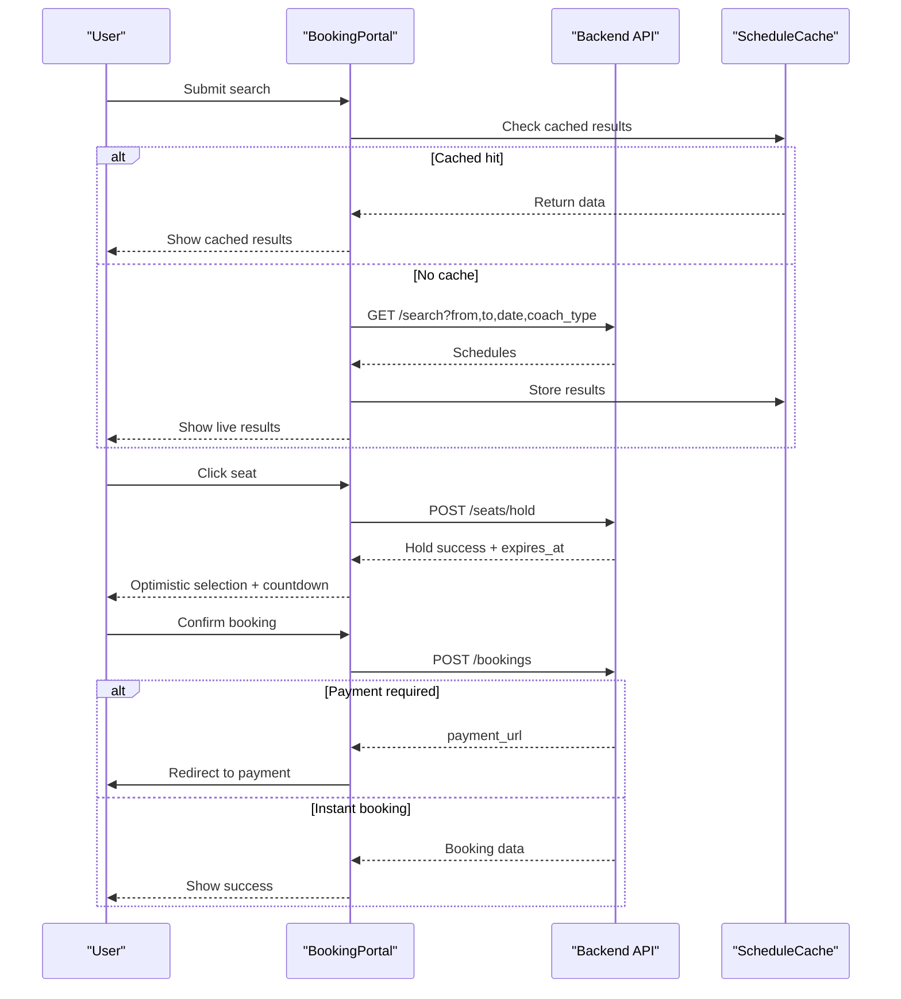
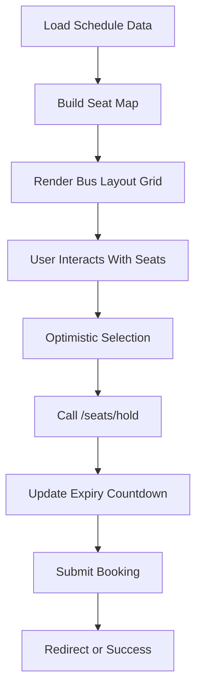
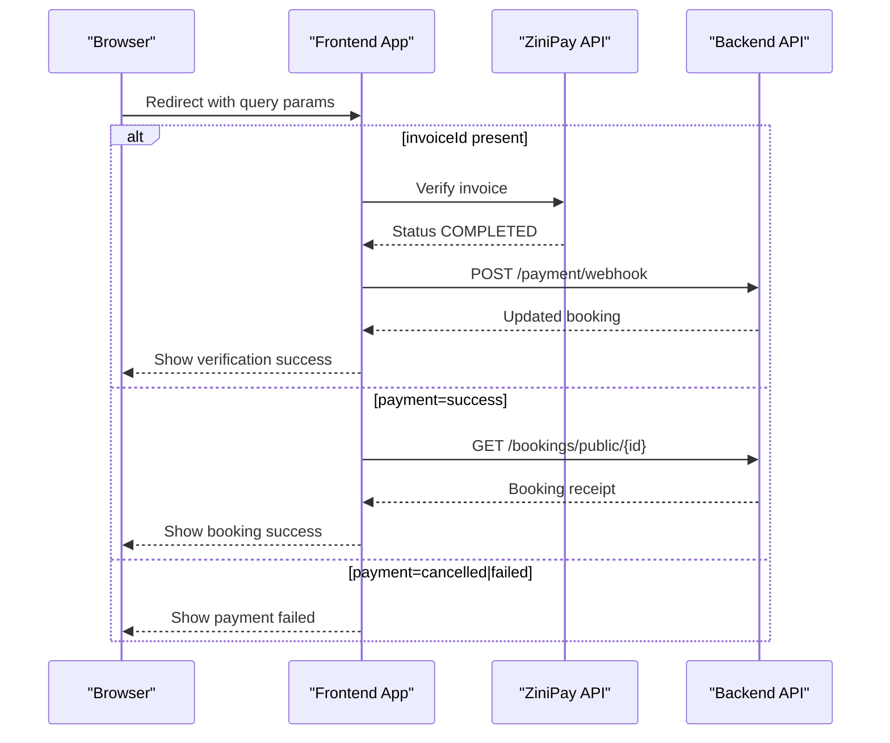
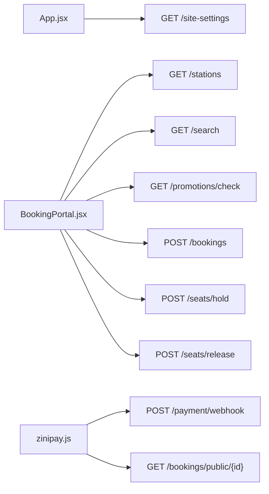

# Customer Application

<cite>
**Referenced Files in This Document**
- [main.jsx](file://frontend/src/main.jsx)
- [App.jsx](file://frontend/src/App.jsx)
- [BookingPortal.jsx](file://frontend/src/components/BookingPortal.jsx)
- [SearchForm.jsx](file://frontend/src/components/SearchForm.jsx)
- [ScheduleList.jsx](file://frontend/src/components/ScheduleList.jsx)
- [SeatMap.jsx](file://frontend/src/components/SeatMap.jsx)
- [AuthModal.jsx](file://frontend/src/components/AuthModal.jsx)
- [zinipay.js](file://frontend/src/zinipay.js)
- [bookingUtils.js](file://frontend/src/bookingUtils.js)
- [scheduleCache.js](file://frontend/src/scheduleCache.js)
</cite>

## Table of Contents
1. [Introduction](#introduction)
2. [Project Structure](#project-structure)
3. [Core Components](#core-components)
4. [Architecture Overview](#architecture-overview)
5. [Detailed Component Analysis](#detailed-component-analysis)
6. [Dependency Analysis](#dependency-analysis)
7. [Performance Considerations](#performance-considerations)
8. [Troubleshooting Guide](#troubleshooting-guide)
9. [Conclusion](#conclusion)

## Introduction
This document explains the customer-facing React application used to search bus schedules, select seats interactively, authenticate users, and complete bookings through a payment integration. It covers the component hierarchy, state management approach, API communication patterns, user workflows from registration to booking completion, seat selection algorithms, real-time availability updates, responsive design considerations, accessibility features, and performance optimization strategies.

The application is a single-page React app mounted by Vite. State is managed with React hooks and local module utilities rather than a global Zustand store. Authentication uses bearer tokens persisted in `localStorage`, while site settings, backend connectivity probing, and SEO metadata are handled at the root application level.

## Project Structure
The customer application lives under `frontend/src`. The entry point mounts the root `App` component, which owns authentication, site settings, backend connection probing, toast notifications, and routing between main views such as booking, tickets, offers, and profile.

**Diagram sources**
- [main.jsx:1-12](file://frontend/src/main.jsx#L1-L12)
- [App.jsx:1-800](file://frontend/src/App.jsx#L1-L800)
- [BookingPortal.jsx:1-654](file://frontend/src/components/BookingPortal.jsx#L1-L654)
- [SearchForm.jsx:1-109](file://frontend/src/components/SearchForm.jsx#L1-L109)
- [ScheduleList.jsx:1-225](file://frontend/src/components/ScheduleList.jsx#L1-L225)
- [SeatMap.jsx:1-612](file://frontend/src/components/SeatMap.jsx#L1-L612)
- [AuthModal.jsx:1-165](file://frontend/src/components/AuthModal.jsx#L1-L165)
- [zinipay.js:1-179](file://frontend/src/zinipay.js#L1-L179)
- [bookingUtils.js:1-173](file://frontend/src/bookingUtils.js#L1-L173)
- [scheduleCache.js:1-65](file://frontend/src/scheduleCache.js#L1-L65)

**Section sources**
- [main.jsx:1-12](file://frontend/src/main.jsx#L1-L12)
- [App.jsx:1-800](file://frontend/src/App.jsx#L1-L800)

## Core Components
- Root application (`App.jsx`)
  - Resolves the backend API base URL using environment variables, cached values, or candidate probing.
  - Manages authentication state, token persistence, and logout behavior.
  - Fetches site settings, maintenance mode, install wizard status, and dynamic SEO metadata.
  - Handles ZiniPay redirect parameters and shows verification or success states.
  - Renders shared UI: toast notifications, navbar, content tabs, auth modal, and footer.

- Booking portal (`BookingPortal.jsx`)
  - Owns search form state, station list, schedule results, selected schedule, selected seats, promo code, passenger details, boarding/dropping points, and booking submission.
  - Implements optimistic seat selection with server-backed hold/release semantics.
  - Polls for real-time schedule refresh when a schedule is expanded.
  - Validates inputs before booking and redirects to external payment if required.

- Search form (`SearchForm.jsx`)
  - Provides departure, destination, date, and coach type filters.
  - Submits search queries to the backend and displays loading state.

- Schedule list (`ScheduleList.jsx`)
  - Displays available coaches, times, duration, distance, available seats, fare, and action buttons.
  - Expands a selected schedule to show the interactive seat map.
  - Shows cache/live status and allows manual refresh.

- Interactive seat map (`SeatMap.jsx`)
  - Renders bus layouts including standard, `1+2`, `2+2_last5`, and sleeper decks.
  - Uses utility functions to compute seat maps, pricing, and selectable statuses.
  - Shows boarding/dropping points, passenger fields, promo application, fare breakdown, and submit button.

- Authentication modal (`AuthModal.jsx`)
  - Supports login, register, forgot password, and reset password flows.
  - Delegates actual API calls to the root application’s handlers.

- Payment integration (`zinipay.js`)
  - Creates payments via ZiniPay, verifies invoice status, and handles redirect query parameters.
  - Updates verification state, fetches public booking receipts, and surfaces success or failure messages.

- Booking utilities (`bookingUtils.js`)
  - Defines seat status labels, selection rules, BDT formatting, pricing calculation, and seat map generation.

- Schedule cache (`scheduleCache.js`)
  - In-memory cache for search results with TTL-based expiration.
  - Exposes methods to get, set, invalidate, and clear cached entries.

**Section sources**
- [App.jsx:1-800](file://frontend/src/App.jsx#L1-L800)
- [BookingPortal.jsx:1-654](file://frontend/src/components/BookingPortal.jsx#L1-L654)
- [SearchForm.jsx:1-109](file://frontend/src/components/SearchForm.jsx#L1-L109)
- [ScheduleList.jsx:1-225](file://frontend/src/components/ScheduleList.jsx#L1-L225)
- [SeatMap.jsx:1-612](file://frontend/src/components/SeatMap.jsx#L1-L612)
- [AuthModal.jsx:1-165](file://frontend/src/components/AuthModal.jsx#L1-L165)
- [zinipay.js:1-179](file://frontend/src/zinipay.js#L1-L179)
- [bookingUtils.js:1-173](file://frontend/src/bookingUtils.js#L1-L173)
- [scheduleCache.js:1-65](file://frontend/src/scheduleCache.js#L1-L65)

## Architecture Overview
The application follows a top-down component hierarchy with props-driven data flow. There is no global Zustand store; instead, state is localized within components and lifted where necessary.

**Diagram sources**
- [App.jsx:1-800](file://frontend/src/App.jsx#L1-L800)
- [BookingPortal.jsx:1-654](file://frontend/src/components/BookingPortal.jsx#L1-L654)
- [SearchForm.jsx:1-109](file://frontend/src/components/SearchForm.jsx#L1-L109)
- [ScheduleList.jsx:1-225](file://frontend/src/components/ScheduleList.jsx#L1-L225)
- [SeatMap.jsx:1-612](file://frontend/src/components/SeatMap.jsx#L1-L612)
- [AuthModal.jsx:1-165](file://frontend/src/components/AuthModal.jsx#L1-L165)
- [zinipay.js:1-179](file://frontend/src/zinipay.js#L1-L179)

## Detailed Component Analysis

### Root Application (`App.jsx`)
Responsibilities:
- Backend discovery: tries explicit environment variable, then probes common URLs, caches successful base URL, and shows offline/install-wizard screens when needed.
- Site settings: fetches `/site-settings`, polls periodically, and applies maintenance mode, branding, favicon, and SEO tags.
- Authentication: persists user and token in `localStorage`, validates token via `/auth/me`, supports login/register/forgot/reset/logout.
- Payment redirection: processes ZiniPay redirect parameters, verifies invoices, and sets verification or success states.
- UI orchestration: renders toast, navbar, content tabs, auth modal, and footer.

Key behaviors:
- Probing logic avoids repeated network failures by caching the working API base.
- Install-not-complete and backend-offline states provide clear user feedback.
- Dynamic title, favicon, and meta tags improve SEO based on backend configuration.

**Diagram sources**
- [App.jsx:69-92](file://frontend/src/App.jsx#L69-L92)
- [App.jsx:295-325](file://frontend/src/App.jsx#L295-L325)
- [App.jsx:329-378](file://frontend/src/App.jsx#L329-L378)
- [App.jsx:382-412](file://frontend/src/App.jsx#L382-L412)
- [App.jsx:415-427](file://frontend/src/App.jsx#L415-L427)
- [App.jsx:429-500](file://frontend/src/App.jsx#L429-L500)

**Section sources**
- [App.jsx:1-800](file://frontend/src/App.jsx#L1-L800)

### Booking Portal (`BookingPortal.jsx`)
Responsibilities:
- Manage search lifecycle: validate inputs, check cache, call `/search`, update results, and display loading/cached status.
- Manage seat selection: enforce maximum seats, optimistic UI updates, server-backed holds/releases, and expiry checks.
- Manage booking workflow: validate passenger details, apply promo codes, create booking, and redirect to payment or show success.
- Real-time availability: poll `/search` every five seconds when a schedule is expanded to keep seat map current.

Seat selection algorithm highlights:
- Deselecting a seat removes it from local state and calls release endpoint; rollback occurs on failure.
- Selecting a seat adds it optimistically with a placeholder expiry, then confirms with hold endpoint; rollback on failure.
- Expired holds are removed from UI and released on the backend.

**Diagram sources**
- [BookingPortal.jsx:292-380](file://frontend/src/components/BookingPortal.jsx#L292-L380)
- [BookingPortal.jsx:209-289](file://frontend/src/components/BookingPortal.jsx#L209-L289)
- [BookingPortal.jsx:469-575](file://frontend/src/components/BookingPortal.jsx#L469-L575)
- [scheduleCache.js:1-65](file://frontend/src/scheduleCache.js#L1-L65)

**Section sources**
- [BookingPortal.jsx:1-654](file://frontend/src/components/BookingPortal.jsx#L1-L654)

### Search Form (`SearchForm.jsx`)
Responsibilities:
- Provide accessible form controls for departure, destination, journey date, and coach type.
- Trigger search submission and disable submit during loading.

Accessibility notes:
- Inputs use proper labels and semantic HTML elements.
- Disabled state prevents redundant submissions.

**Section sources**
- [SearchForm.jsx:1-109](file://frontend/src/components/SearchForm.jsx#L1-L109)

### Schedule List (`ScheduleList.jsx`)
Responsibilities:
- Display search results with operator, coach number, coach type, departure/arrival times, duration, distance, available seats, and fare.
- Expand/collapse seat map per schedule.
- Enforce login requirement before expanding seat selection.
- Show cache/live badge and allow manual refresh.

Real-time indicators:
- Live badge indicates fresh data; cached badge shows time since last fetch.

**Section sources**
- [ScheduleList.jsx:1-225](file://frontend/src/components/ScheduleList.jsx#L1-L225)

### Interactive Seat Map (`SeatMap.jsx`)
Responsibilities:
- Render bus layout grids for multiple configurations: standard, `1+2`, `2+2_last5`, and sleeper decks.
- Compute seat map from backend data or generate defaults.
- Show seat statuses: available, selected, booked, blocked, sold.
- Provide boarding/dropping point selectors, passenger details, gender, payment method toggle, promo code input, and fare breakdown.
- Integrate with seat hold/release and expiry countdown.

Seat map generation:
- Uses `getSeatMap` to build a mapping of seat identifiers to statuses.
- Falls back to default grid generation when custom layout is missing or invalid.

Pricing:
- Uses `calcPricing` to compute seat fare, service charge, gateway charge, discounts, and total payable amount.

**Diagram sources**
- [SeatMap.jsx:48-190](file://frontend/src/components/SeatMap.jsx#L48-L190)
- [SeatMap.jsx:192-384](file://frontend/src/components/SeatMap.jsx#L192-L384)
- [SeatMap.jsx:386-611](file://frontend/src/components/SeatMap.jsx#L386-L611)
- [bookingUtils.js:52-172](file://frontend/src/bookingUtils.js#L52-L172)
- [bookingUtils.js:30-50](file://frontend/src/bookingUtils.js#L30-L50)

**Section sources**
- [SeatMap.jsx:1-612](file://frontend/src/components/SeatMap.jsx#L1-L612)
- [bookingUtils.js:1-173](file://frontend/src/bookingUtils.js#L1-L173)

### Authentication Modal (`AuthModal.jsx`)
Responsibilities:
- Present login, register, forgot password, and reset password forms.
- Switch modes dynamically and manage form fields.
- Delegate API calls to root application handlers.

Modes:
- Login: sign-in with email/password.
- Register: create account with name, email, password, confirmation.
- Forgot: request reset code via email.
- Reset: apply reset code and new password.

**Section sources**
- [AuthModal.jsx:1-165](file://frontend/src/components/AuthModal.jsx#L1-L165)
- [App.jsx:190-276](file://frontend/src/App.jsx#L190-L276)

### Payment Integration (`zinipay.js`)
Responsibilities:
- Create payment requests to ZiniPay.
- Verify invoice status with ZiniPay.
- Handle redirect parameters:
  - If `invoiceId` present, verify payment and post webhook to backend.
  - If `payment=success` and `booking_id` present, load public booking receipt.
  - If `payment=cancelled` or `payment=failed`, set failure state.

Security note:
- Requires `VITE_ZINIPAY_API_KEY` environment variable for direct ZiniPay calls.
- Backend webhook updates booking status securely.

**Diagram sources**
- [zinipay.js:64-179](file://frontend/src/zinipay.js#L64-L179)

**Section sources**
- [zinipay.js:1-179](file://frontend/src/zinipay.js#L1-L179)

### Booking Utilities (`bookingUtils.js`)
Responsibilities:
- Define seat status labels and selection rules.
- Format currency in BDT.
- Calculate pricing including service/gateway charges and discounts.
- Generate seat maps from backend data or default layouts.

Complexity:
- Seat map generation iterates over rows/columns based on layout; complexity is linear in the number of generated seats.

**Section sources**
- [bookingUtils.js:1-173](file://frontend/src/bookingUtils.js#L1-L173)

### Schedule Cache (`scheduleCache.js`)
Responsibilities:
- Maintain an in-memory cache keyed by search parameters.
- Enforce TTL expiration.
- Support get/set/invalidate/clear operations.

Performance impact:
- Reduces unnecessary network requests for repeated searches within TTL window.

**Section sources**
- [scheduleCache.js:1-65](file://frontend/src/scheduleCache.js#L1-L65)

## Dependency Analysis
The frontend communicates directly with the backend REST API using `fetch`. Key endpoints include:
- Public: `/site-settings`, `/stations`, `/search`, `/promotions/check`, `/bookings/public/{id}`.
- Authenticated: `/auth/register`, `/auth/login`, `/auth/forgot-password`, `/auth/reset-password`, `/auth/logout`, `/auth/me`, `/bookings`, `/bookings/mine`, `/bookings/{id}/cancel`, `/seats/hold`, `/seats/release`, `/payment/webhook`.

**Diagram sources**
- [App.jsx:295-325](file://frontend/src/App.jsx#L295-L325)
- [BookingPortal.jsx:84-95](file://frontend/src/components/BookingPortal.jsx#L84-L95)
- [BookingPortal.jsx:342-380](file://frontend/src/components/BookingPortal.jsx#L342-L380)
- [BookingPortal.jsx:445-467](file://frontend/src/components/BookingPortal.jsx#L445-L467)
- [BookingPortal.jsx:500-575](file://frontend/src/components/BookingPortal.jsx#L500-L575)
- [zinipay.js:96-179](file://frontend/src/zinipay.js#L96-L179)

**Section sources**
- [App.jsx:295-325](file://frontend/src/App.jsx#L295-L325)
- [BookingPortal.jsx:84-95](file://frontend/src/components/BookingPortal.jsx#L84-L95)
- [BookingPortal.jsx:342-380](file://frontend/src/components/BookingPortal.jsx#L342-L380)
- [BookingPortal.jsx:445-467](file://frontend/src/components/BookingPortal.jsx#L445-L467)
- [BookingPortal.jsx:500-575](file://frontend/src/components/BookingPortal.jsx#L500-L575)
- [zinipay.js:96-179](file://frontend/src/zinipay.js#L96-L179)

## Performance Considerations
- Backend probing and caching:
  - The root app probes backend candidates once and caches the working base URL to avoid repeated discovery.
- Schedule caching:
  - In-memory cache reduces network load for repeated searches within TTL.
- Optimistic UI updates:
  - Seat selection updates immediately and reconciles with server responses; rollbacks occur on failure.
- Real-time polling:
  - Five-second polling keeps seat availability current only while a schedule is expanded.
- Expiry management:
  - Seat holds expire locally and are released on the backend to free inventory.
- Conditional rendering:
  - Features and partners sections render only when not searching, reducing unnecessary DOM work.

Recommendations:
- Debounce rapid seat clicks to minimize hold/release churn.
- Consider adding retry/backoff for failed hold/release calls.
- Monitor polling frequency and consider WebSocket or SSE for true real-time updates.
- Use browser caching headers for static assets and consider CDN for images and fonts.

[No sources needed since this section provides general guidance]

## Troubleshooting Guide
Common issues and resolutions:
- Backend unreachable:
  - The app shows an offline screen and allows retrying backend connection.
  - Check `VITE_API_BASE_URL` or deployment configuration.
- Install wizard not completed:
  - The app displays an installation-required screen with a link to `/install`.
- Authentication failures:
  - Ensure token is valid; the app verifies `/auth/me` and clears invalid sessions.
  - Check CORS and credentials configuration if switching to cookie-based auth.
- Payment verification errors:
  - Verify `VITE_ZINIPAY_API_KEY` is configured.
  - Confirm backend webhook endpoint responds successfully.
- Seat selection inconsistencies:
  - Check hold/release endpoints and expiry logic.
  - Validate that expired seats are released and removed from UI.

**Section sources**
- [App.jsx:502-524](file://frontend/src/App.jsx#L502-L524)
- [App.jsx:568-678](file://frontend/src/App.jsx#L568-L678)
- [App.jsx:681-689](file://frontend/src/App.jsx#L681-L689)
- [zinipay.js:87-92](file://frontend/src/zinipay.js#L87-L92)
- [zinipay.js:143-154](file://frontend/src/zinipay.js#L143-L154)

## Conclusion
The customer application provides a cohesive booking experience built around React components, local state, and direct API communication. It emphasizes usability through optimistic interactions, real-time availability updates, and clear error handling. While there is no Zustand store, the architecture remains modular and maintainable. Future enhancements could introduce a global state manager, improved error boundaries, enhanced accessibility testing, and advanced performance optimizations such as background prefetching and streaming updates.

[No sources needed since this section summarizes without analyzing specific files]