# State Management

<cite>
**Referenced Files in This Document**
- [App.jsx](file://frontend/src/App.jsx)
- [main.jsx](file://frontend/src/main.jsx)
- [scheduleCache.js](file://frontend/src/scheduleCache.js)
- [Toast.jsx](file://frontend/src/components/Toast.jsx)
- [AuthModal.jsx](file://frontend/src/components/AuthModal.jsx)
- [BookingPortal.jsx](file://frontend/src/components/BookingPortal.jsx)
- [ScheduleList.jsx](file://frontend/src/components/ScheduleList.jsx)
</cite>

## Table of Contents
1. [Introduction](#introduction)
2. [Project Structure](#project-structure)
3. [Core Components](#core-components)
4. [Architecture Overview](#architecture-overview)
5. [Detailed Component Analysis](#detailed-component-analysis)
6. [Dependency Analysis](#dependency-analysis)
7. [Performance Considerations](#performance-considerations)
8. [Troubleshooting Guide](#troubleshooting-guide)
9. [Conclusion](#conclusion)

## Introduction
This document explains the state management architecture of the customer-facing frontend application. The application avoids external global state libraries and instead uses:
- Local component state through React `useState` hooks.
- Global coordination through props drilling from the root `App` component to child components.
- A small in-memory schedule cache for search results.
- `localStorage` for authentication persistence and API base URL caching.
- Site settings fetched from the backend, with polling and dynamic browser metadata updates.
- A toast notification system driven by a single toast state object at the root level.

The goal is to make complex booking flows predictable while keeping dependencies minimal and performance reasonable.

## Project Structure
The customer frontend lives under `frontend/src`. The entry point renders the root `App` component inside React Strict Mode. Most application state lives in `App.jsx`, and feature-specific state lives in components such as `BookingPortal.jsx`, `ScheduleList.jsx`, and `AuthModal.jsx`.

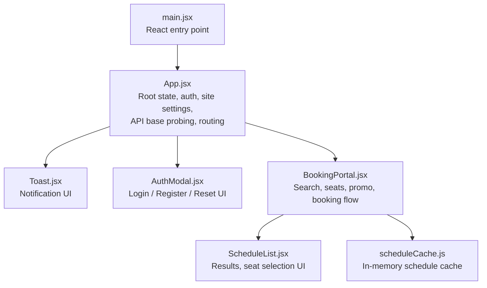

**Diagram sources**
- [main.jsx:1-12](file://frontend/src/main.jsx#L1-L12)
- [App.jsx:1-20](file://frontend/src/App.jsx#L1-L20)
- [Toast.jsx:1-24](file://frontend/src/components/Toast.jsx#L1-L24)
- [AuthModal.jsx:1-15](file://frontend/src/components/AuthModal.jsx#L1-L15)
- [BookingPortal.jsx:1-20](file://frontend/src/components/BookingPortal.jsx#L1-L20)
- [ScheduleList.jsx:1-37](file://frontend/src/components/ScheduleList.jsx#L1-L37)
- [scheduleCache.js:1-12](file://frontend/src/scheduleCache.js#L1-L12)

**Section sources**
- [main.jsx:1-12](file://frontend/src/main.jsx#L1-L12)
- [App.jsx:1-20](file://frontend/src/App.jsx#L1-L20)

## Core Components
The following components are central to the state management strategy:

| Component | Primary Responsibilities | State Pattern |
|---|---|---|
| `App.jsx` | Root navigation, toast notifications, authentication state, site settings, API base detection, install/maintenance/offline states, and prop distribution. | Centralized local state plus `localStorage` persistence. |
| `BookingPortal.jsx` | Search form state, station list, schedule results, selected schedule, selected seats, seat expiration tracking, promo code handling, passenger details, and booking submission. | Local component state with props-driven callbacks and shared API base. |
| `ScheduleList.jsx` | Displaying search results, expanding/collapsing schedules, showing cache status, delegating seat selection and booking actions upward. | Local UI state plus props for data and handlers. |
| `AuthModal.jsx` | Login, register, forgot password, and reset password UI; controlled by parent-provided mode and form state. | Controlled inputs driven by props. |
| `Toast.jsx` | Rendering success or error messages based on a toast object. | Pure presentation component receiving a toast prop. |
| `scheduleCache.js` | In-memory cache for schedule search results with TTL-based expiration. | Singleton class with `Map` storage. |

**Section sources**
- [App.jsx:94-134](file://frontend/src/App.jsx#L94-L134)
- [BookingPortal.jsx:21-55](file://frontend/src/components/BookingPortal.jsx#L21-L55)
- [ScheduleList.jsx:4-37](file://frontend/src/components/ScheduleList.jsx#L4-L37)
- [AuthModal.jsx:3-13](file://frontend/src/components/AuthModal.jsx#L3-L13)
- [Toast.jsx:1-24](file://frontend/src/components/Toast.jsx#L1-L24)
- [scheduleCache.js:3-59](file://frontend/src/scheduleCache.js#L3-L59)

## Architecture Overview
At runtime, the application follows this pattern:
1. `main.jsx` mounts React and renders `App`.
2. `App` initializes local state for navigation, toast, auth, site settings, and API connectivity.
3. On mount, `App` probes for a working API base URL using environment variables, cached values, and candidate URLs.
4. Once the API base is resolved, `App` fetches site settings and restores authentication from `localStorage`.
5. `App` passes shared state and handlers down via props to `Navbar`, `BookingPortal`, `MyTickets`, `OffersList`, `UserProfile`, `AuthModal`, and `Footer`.
6. Feature components manage their own local state and call back into parent-provided handlers when needed.
7. Schedule search results are cached in memory through `scheduleCache.js`.

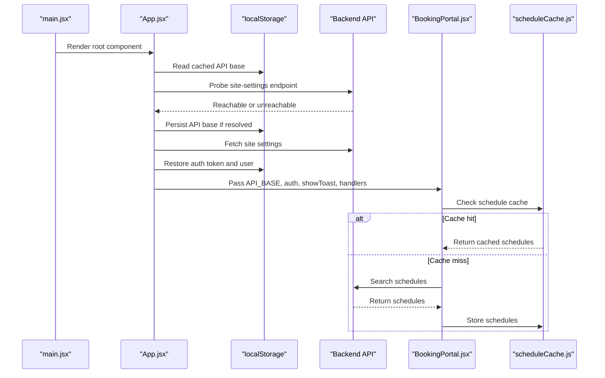

**Diagram sources**
- [main.jsx:7-11](file://frontend/src/main.jsx#L7-L11)
- [App.jsx:39-92](file://frontend/src/App.jsx#L39-L92)
- [App.jsx:329-378](file://frontend/src/App.jsx#L329-L378)
- [App.jsx:382-412](file://frontend/src/App.jsx#L382-L412)
- [BookingPortal.jsx:319-365](file://frontend/src/components/BookingPortal.jsx#L319-L365)
- [scheduleCache.js:14-45](file://frontend/src/scheduleCache.js#L14-L45)

## Detailed Component Analysis

### Root Application State in `App.jsx`
`App.jsx` is the single source of truth for cross-cutting application state. It manages:
- Active tab navigation.
- Toast notification state.
- Authentication user, token, modal visibility, login mode, and form fields.
- Site settings, backend offline state, installation completion state, and install redirect URL.
- Resolved API base URL, probing state, and tried candidates.
- Dynamic document title, favicon, SEO meta tags, and Google Analytics script injection.

Key behaviors:
- **Toast helper**: Creates a timed toast, clears previous timeouts, and resets after display duration.
- **Authentication helpers**: Persist user and token to both React state and `localStorage`; clear them on logout or invalidation.
- **API base probing**: Builds candidate URLs, probes `/site-settings`, caches successful base URL, and handles explicit environment configuration.
- **Site settings polling**: Fetches site settings once the API base is available and polls every 30 seconds.
- **Auth restoration**: Restores token and user from `localStorage`, then validates the token by calling `/auth/me`.
- **Routing and layout**: Renders `Toast`, `Navbar`, verification status, content tabs, `AuthModal`, and `Footer`.

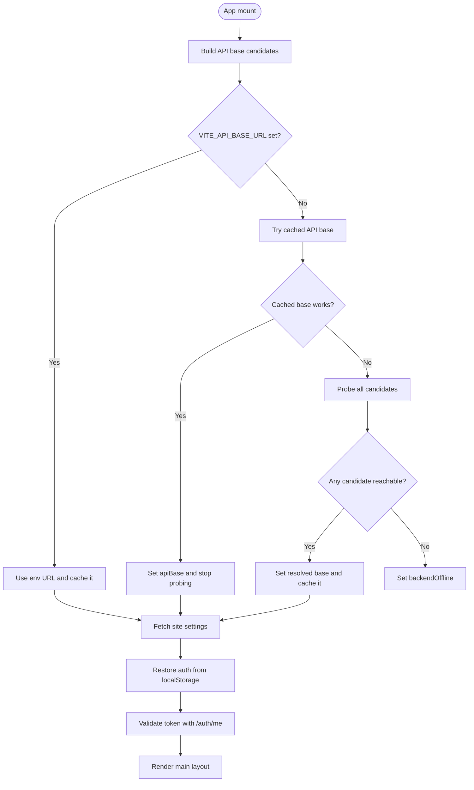

**Diagram sources**
- [App.jsx:39-92](file://frontend/src/App.jsx#L39-L92)
- [App.jsx:161-173](file://frontend/src/App.jsx#L161-L173)
- [App.jsx:329-378](file://frontend/src/App.jsx#L329-L378)
- [App.jsx:382-427](file://frontend/src/App.jsx#L382-L427)

**Section sources**
- [App.jsx:94-173](file://frontend/src/App.jsx#L94-L173)
- [App.jsx:188-291](file://frontend/src/App.jsx#L188-L291)
- [App.jsx:293-325](file://frontend/src/App.jsx#L293-L325)
- [App.jsx:327-427](file://frontend/src/App.jsx#L327-L427)
- [App.jsx:429-500](file://frontend/src/App.jsx#L429-L500)
- [App.jsx:502-524](file://frontend/src/App.jsx#L502-L524)
- [App.jsx:696-800](file://frontend/src/App.jsx#L696-L800)

### Authentication State Persistence
Authentication state is coordinated at the root level:
- Login, register, forgot password, and reset password flows use `handleAuthSubmit`.
- Successful authentication calls `persistAuth`, which updates React state and writes to `localStorage`.
- Logout calls the backend logout endpoint when possible, then calls `clearAuth`.
- After mount, restored credentials are validated against `/auth/me`; invalid tokens trigger cleanup.

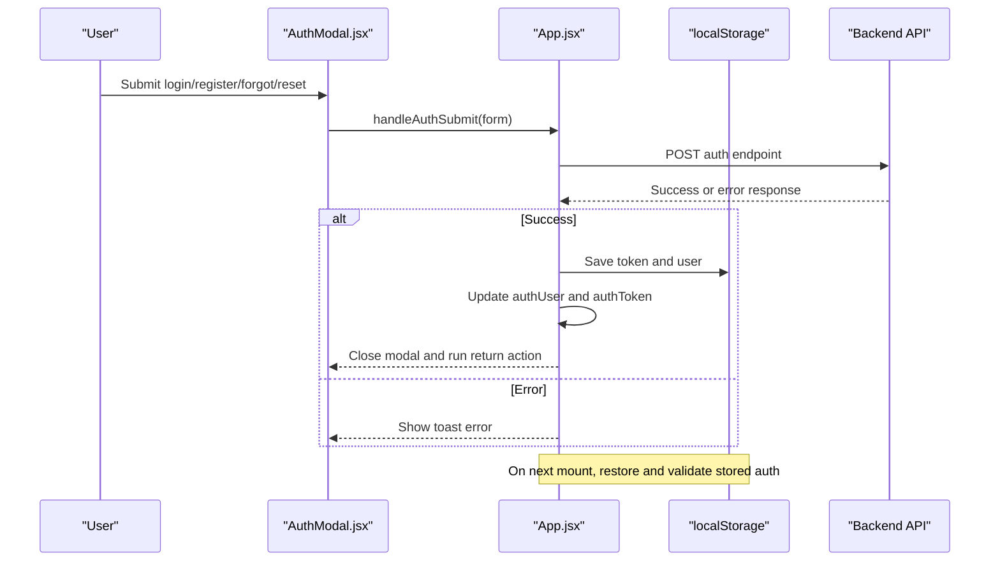

**Diagram sources**
- [AuthModal.jsx:54-148](file://frontend/src/components/AuthModal.jsx#L54-L148)
- [App.jsx:188-276](file://frontend/src/App.jsx#L188-L276)
- [App.jsx:161-173](file://frontend/src/App.jsx#L161-L173)
- [App.jsx:391-427](file://frontend/src/App.jsx#L391-L427)

**Section sources**
- [App.jsx:153-173](file://frontend/src/App.jsx#L153-L173)
- [App.jsx:188-291](file://frontend/src/App.jsx#L188-L291)
- [App.jsx:391-427](file://frontend/src/App.jsx#L391-L427)
- [AuthModal.jsx:3-148](file://frontend/src/components/AuthModal.jsx#L3-L148)

### Props Drilling for Global Coordination
Because there is no global state library, shared state is passed downward:
- `App.jsx` holds `authUser`, `authToken`, `showToast`, `openAuthModal`, `setActiveTab`, `setBookingSuccess`, `setPaymentFailed`, `siteSettings`, and `apiBase`.
- These values are passed to `Navbar`, `BookingPortal`, `MyTickets`, `OffersList`, `UserProfile`, and `Footer`.
- `BookingPortal.jsx` further drills state and handlers into `ScheduleList.jsx` and `SeatMap.jsx`.

Examples of drilled props include:
- `API_BASE` for API calls.
- `authUser` and `authToken` for protected actions.
- `showToast` for user feedback.
- `openAuthModal` for gated workflows.
- `setActiveTab` for navigation.
- `setBookingSuccess` and `setPaymentFailed` for post-payment UX.

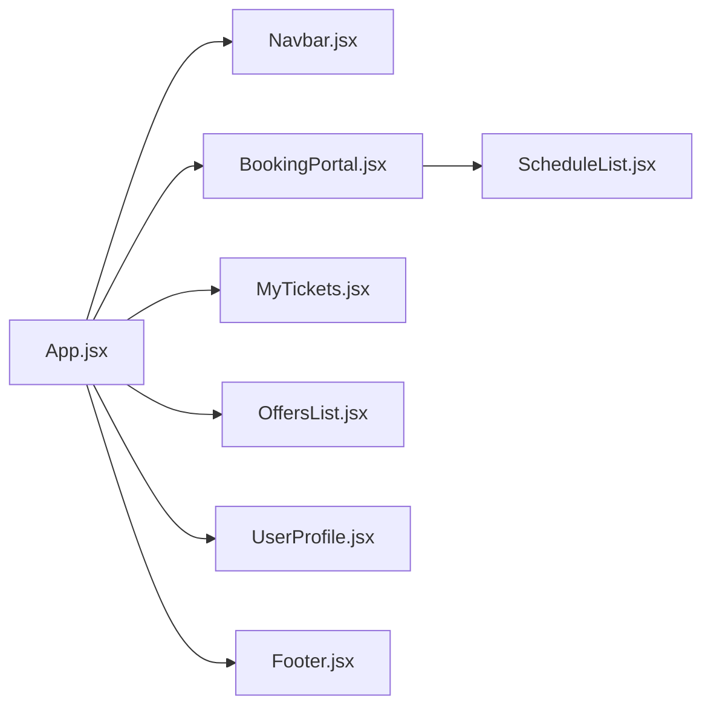

**Diagram sources**
- [App.jsx:702-776](file://frontend/src/App.jsx#L702-L776)
- [BookingPortal.jsx:9-20](file://frontend/src/components/BookingPortal.jsx#L9-L20)
- [ScheduleList.jsx:4-37](file://frontend/src/components/ScheduleList.jsx#L4-L37)

**Section sources**
- [App.jsx:696-800](file://frontend/src/App.jsx#L696-L800)
- [BookingPortal.jsx:9-20](file://frontend/src/components/BookingPortal.jsx#L9-L20)
- [ScheduleList.jsx:4-37](file://frontend/src/components/ScheduleList.jsx#L4-L37)

### Caching Strategies for Schedules and API Responses
Schedules are cached in memory using `scheduleCache.js`:
- Cache keys combine departure station, destination station, date, and coach type.
- Each cache entry stores data and a timestamp.
- Reads check TTL; expired entries are removed.
- Writes store fresh search results.
- Invalidation supports clearing specific queries or the entire cache.
- In development, the cache instance is exposed on `window` for debugging.

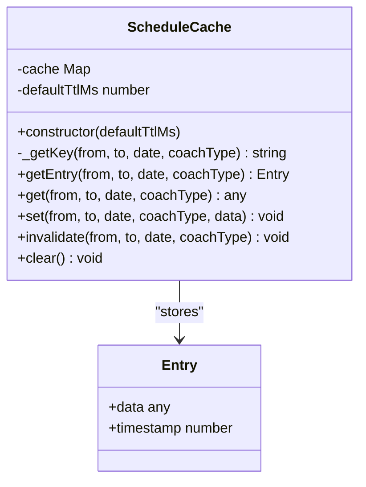

**Diagram sources**
- [scheduleCache.js:3-59](file://frontend/src/scheduleCache.js#L3-L59)

Usage in `BookingPortal.jsx`:
- Before searching, the portal checks the cache.
- On cache hit, it displays cached results and shows a cached indicator.
- On cache miss, it fetches from the backend, updates React state, refreshes the cache, and shows live indicators.

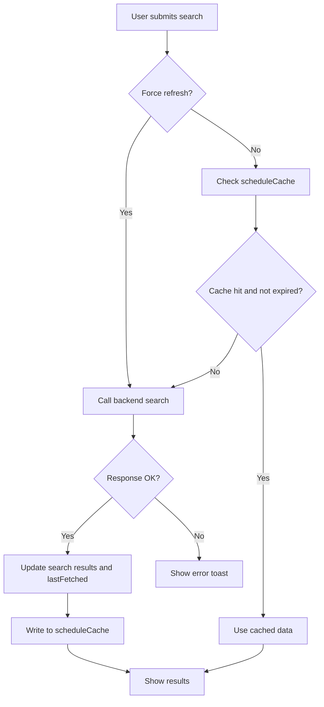

**Diagram sources**
- [BookingPortal.jsx:319-380](file://frontend/src/components/BookingPortal.jsx#L319-L380)
- [scheduleCache.js:14-45](file://frontend/src/scheduleCache.js#L14-L45)

**Section sources**
- [scheduleCache.js:1-65](file://frontend/src/scheduleCache.js#L1-L65)
- [BookingPortal.jsx:319-380](file://frontend/src/components/BookingPortal.jsx#L319-L380)

### Site Settings Management
Site settings are fetched from `/site-settings` after the API base is resolved:
- Successful responses update `siteSettings` and mark the backend online.
- A `403` response may indicate that installation is incomplete; the app sets `installNotComplete` and an optional redirect URL.
- Other failures set `backendOffline`.
- Settings are polled every 30 seconds so branding and maintenance changes propagate without reload.
- When settings are available, `App.jsx` updates the document title, favicon, SEO meta tags, and optionally injects Google Analytics.

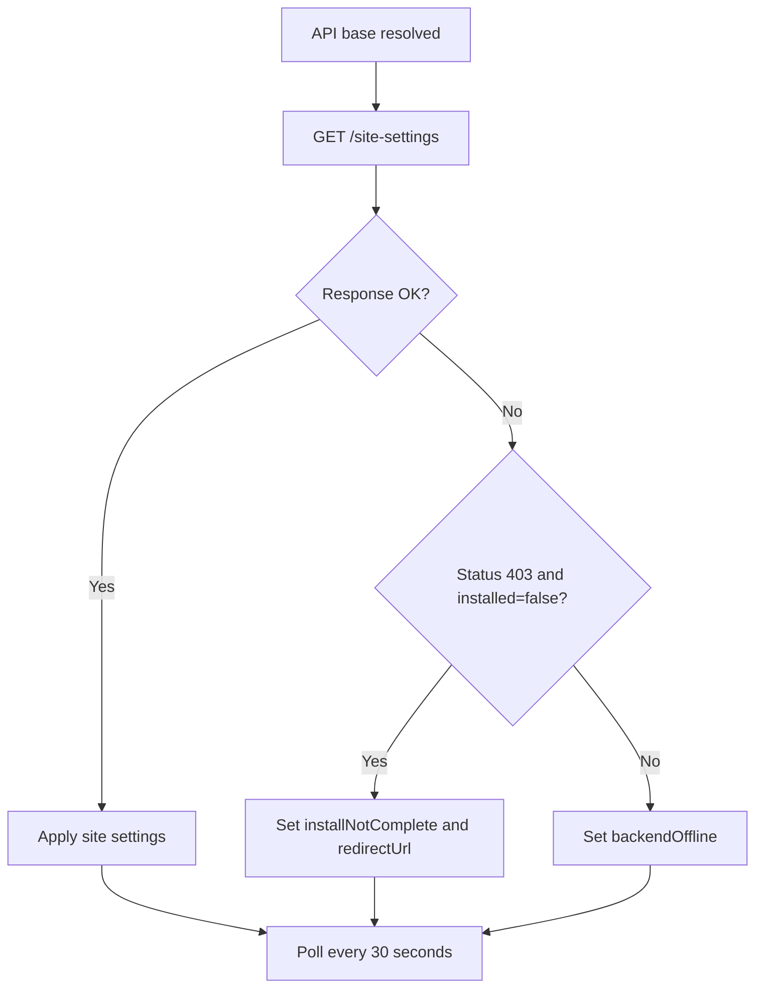

**Diagram sources**
- [App.jsx:293-325](file://frontend/src/App.jsx#L293-L325)
- [App.jsx:382-412](file://frontend/src/App.jsx#L382-L412)
- [App.jsx:429-500](file://frontend/src/App.jsx#L429-L500)

**Section sources**
- [App.jsx:293-325](file://frontend/src/App.jsx#L293-L325)
- [App.jsx:382-412](file://frontend/src/App.jsx#L382-L412)
- [App.jsx:429-500](file://frontend/src/App.jsx#L429-L500)

### Toast Notification System
The toast system is centralized in `App.jsx` and rendered by `Toast.jsx`:
- `showToast(message, type, durationMs)` creates a toast, clears previous timers, and hides it after the configured duration.
- `Toast.jsx` is a pure presentational component that renders either a success or error icon and message.
- Booking success uses a shorter duration than general success messages.

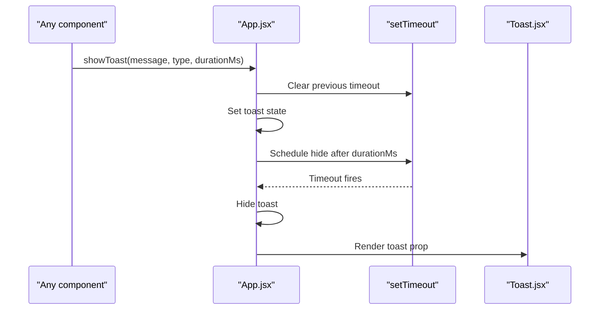

**Diagram sources**
- [App.jsx:135-151](file://frontend/src/App.jsx#L135-L151)
- [Toast.jsx:1-24](file://frontend/src/components/Toast.jsx#L1-L24)

**Section sources**
- [App.jsx:135-151](file://frontend/src/App.jsx#L135-L151)
- [Toast.jsx:1-24](file://frontend/src/components/Toast.jsx#L1-L24)

### Seat Selection and Booking State Flow
`BookingPortal.jsx` coordinates the most complex local state interactions:
- Station list loading.
- Search parameters and results.
- Selected schedule and selected seats.
- Seat hold expiration tracking.
- Promo code validation.
- Passenger details and boarding/dropping points.
- Booking confirmation and payment redirection.

Important synchronization patterns:
- Optimistic seat selection updates UI immediately, then confirms with the backend; failures roll back the selection.
- Expired seat holds are detected by interval and released on the backend.
- When a schedule changes, previously held seats are released.
- Seat map data is refreshed periodically while a schedule is selected.

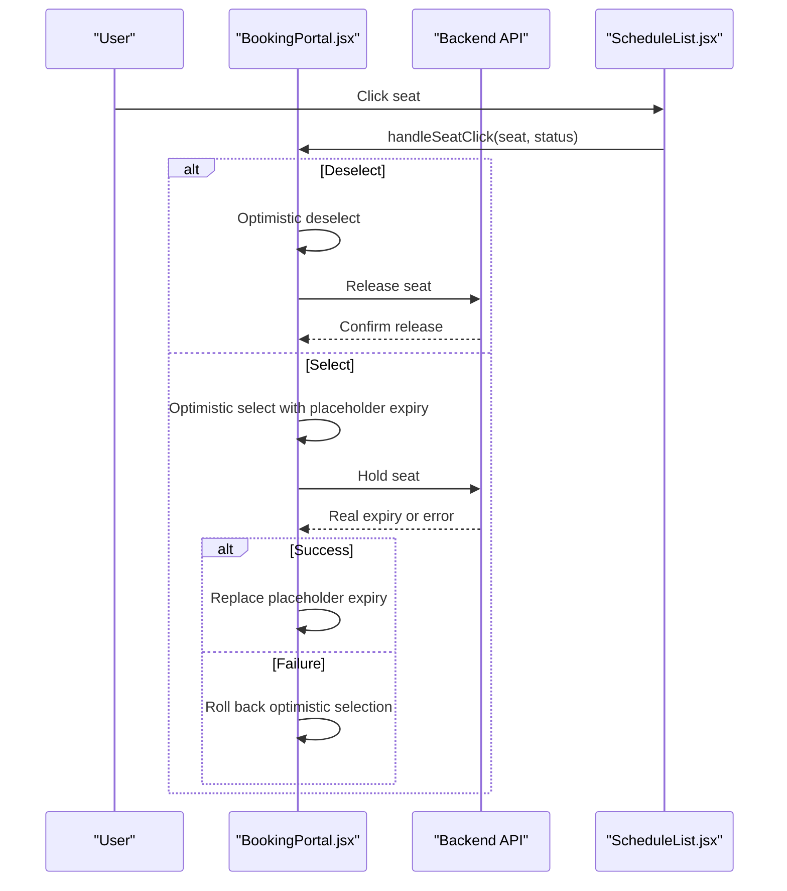

**Diagram sources**
- [BookingPortal.jsx:209-289](file://frontend/src/components/BookingPortal.jsx#L209-L289)
- [ScheduleList.jsx:167-185](file://frontend/src/components/ScheduleList.jsx#L167-L185)

**Section sources**
- [BookingPortal.jsx:84-99](file://frontend/src/components/BookingPortal.jsx#L84-L99)
- [BookingPortal.jsx:101-161](file://frontend/src/components/BookingPortal.jsx#L101-L161)
- [BookingPortal.jsx:163-207](file://frontend/src/components/BookingPortal.jsx#L163-L207)
- [BookingPortal.jsx:209-289](file://frontend/src/components/BookingPortal.jsx#L209-L289)
- [BookingPortal.jsx:445-575](file://frontend/src/components/BookingPortal.jsx#L445-L575)
- [ScheduleList.jsx:167-185](file://frontend/src/components/ScheduleList.jsx#L167-L185)

## Dependency Analysis
The dependency relationships show how state ownership flows from the root component downward:

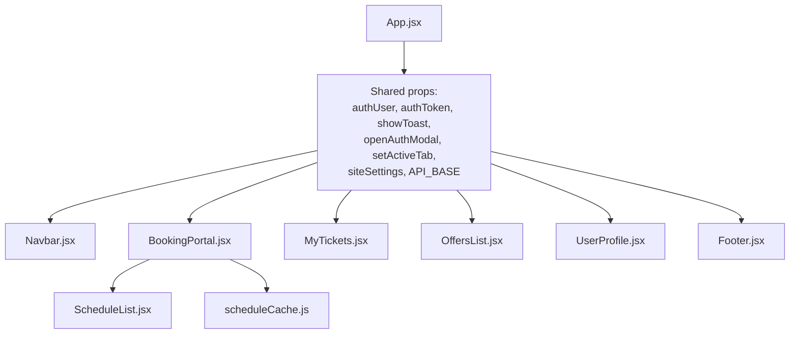

**Diagram sources**
- [App.jsx:702-800](file://frontend/src/App.jsx#L702-L800)
- [BookingPortal.jsx:9-20](file://frontend/src/components/BookingPortal.jsx#L9-L20)
- [ScheduleList.jsx:4-37](file://frontend/src/components/ScheduleList.jsx#L4-L37)
- [scheduleCache.js:59-65](file://frontend/src/scheduleCache.js#L59-L65)

**Section sources**
- [App.jsx:702-800](file://frontend/src/App.jsx#L702-L800)
- [BookingPortal.jsx:9-20](file://frontend/src/components/BookingPortal.jsx#L9-L20)
- [ScheduleList.jsx:4-37](file://frontend/src/components/ScheduleList.jsx#L4-L37)
- [scheduleCache.js:59-65](file://frontend/src/scheduleCache.js#L59-L65)

## Performance Considerations
The current implementation balances simplicity and performance through several techniques:

- **Local state minimizes unnecessary re-renders**: Only components that need specific state manage it locally.
- **Props drilling keeps coupling explicit**: Data flow is visible and traceable without hidden global stores.
- **In-memory schedule cache reduces API calls**: Repeated searches for the same route and date avoid network requests until TTL expires.
- **Optimistic UI updates improve perceived responsiveness**: Seat selection updates immediately and rolls back on failure.
- **Controlled intervals are cleaned up**: Seat expiration checks, settings polling, and result freshness timers are cleared in effect cleanup functions.
- **AbortController prevents stale probe requests**: API base probing uses timeouts and abort signals.
- **Conditional rendering reduces work**: Offline, install-not-complete, and maintenance screens short-circuit normal rendering.

Recommendations for future optimization:
- Extract frequently used handler pairs into small memoized utilities where appropriate.
- Consider splitting large state objects into smaller slices if component trees grow deeper.
- Add debouncing for rapid repeated searches if users can submit multiple times quickly.
- Monitor `localStorage` size if more persistent data is added.
- Keep cache TTL configurable per environment to balance freshness and load.

[No sources needed since this section provides general guidance]

## Troubleshooting Guide
Common state-related issues and their likely causes:

| Symptom | Likely Cause | Resolution |
|---|---|---|
| Backend always shows offline | API base probing failed or no candidate URL is reachable | Verify `VITE_API_BASE_URL`, backend server, CORS, and deployment paths. Use retry connection. |
| Installation screen appears | Backend returned `installed=false` | Complete the install wizard before using customer or admin routes. |
| Auth token exists but user is null | Stored token is invalid or expired | The app clears auth on `/auth/me` failure; log in again. |
| Seat selection rolls back | Backend rejected hold or network error occurred | Check authentication, seat availability, and network connectivity. |
| Seat holds remain after page close | `beforeunload` request failed silently | The app attempts synchronous XHR; ensure backend accepts the release request. |
| Schedule results are stale | Cache TTL has not expired yet | Use the refresh button to force a new search. |
| Toast does not disappear | Previous timeout was not cleared or duration is too long | Inspect `showToast` usage and default durations. |

**Section sources**
- [App.jsx:329-378](file://frontend/src/App.jsx#L329-L378)
- [App.jsx:502-524](file://frontend/src/App.jsx#L502-L524)
- [App.jsx:391-427](file://frontend/src/App.jsx#L391-L427)
- [BookingPortal.jsx:137-161](file://frontend/src/components/BookingPortal.jsx#L137-L161)
- [BookingPortal.jsx:163-207](file://frontend/src/components/BookingPortal.jsx#L163-L207)
- [BookingPortal.jsx:209-289](file://frontend/src/components/BookingPortal.jsx#L209-L289)
- [BookingPortal.jsx:319-380](file://frontend/src/components/BookingPortal.jsx#L319-L380)

## Conclusion
The customer application implements a lightweight, library-free state management strategy:
- `App.jsx` owns global coordination state and persists authentication and API base configuration.
- Child components manage local UI and workflow state.
- Props drilling provides explicit data flow between components.
- `scheduleCache.js` provides fast in-memory caching for schedule searches.
- `localStorage` ensures authentication continuity across sessions.
- Site settings drive branding, SEO, and operational modes like maintenance and installation gating.
- The toast system offers consistent user feedback.

This approach is simple, transparent, and suitable for applications that do not require complex cross-component state sharing beyond what props can provide. As the application grows, consider introducing a context provider or lightweight state utility only when props drilling becomes difficult to maintain.

[No sources needed since this section summarizes without analyzing specific files]