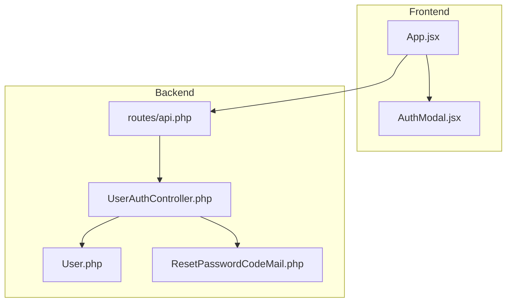
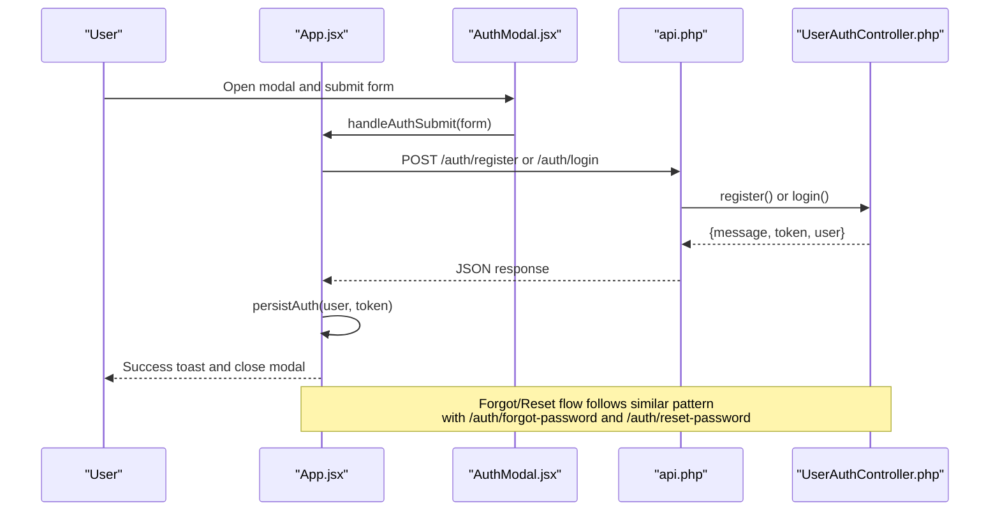
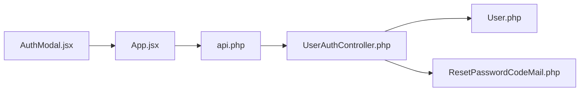

# Auth Modal Component

<cite>
**Referenced Files in This Document**
- [AuthModal.jsx](file://frontend/src/components/AuthModal.jsx)
- [App.jsx](file://frontend/src/App.jsx)
- [UserAuthController.php](file://backend/app/Http/Controllers/API/UserAuthController.php)
- [api.php](file://backend/routes/api.php)
- [User.php](file://backend/app/Models/User.php)
- [ResetPasswordCodeMail.php](file://backend/app/Mail/ResetPasswordCodeMail.php)
</cite>

## Table of Contents
1. [Introduction](#introduction)
2. [Project Structure](#project-structure)
3. [Core Components](#core-components)
4. [Architecture Overview](#architecture-overview)
5. [Detailed Component Analysis](#detailed-component-analysis)
6. [Dependency Analysis](#dependency-analysis)
7. [Performance Considerations](#performance-considerations)
8. [Troubleshooting Guide](#troubleshooting-guide)
9. [Conclusion](#conclusion)
10. [Appendices](#appendices)

## Introduction
This document explains the Auth Modal component and its end-to-end authentication flow. It covers the modal interface, login and registration forms, password reset workflow, user session management, props, validation rules, error handling, backend API integration, token handling, security considerations, customization examples, social login guidance, and secure data handling practices.

The Auth Modal is a React component that renders login, registration, forgot password, and reset password flows. The parent application manages modal visibility, form state, API calls, and session persistence. The backend provides Laravel Sanctum-based APIs for registration, login, logout, profile retrieval, password update, and password reset with email verification codes.

## Project Structure
The authentication feature spans frontend components, the root application state, and backend controllers and routes:

**Diagram sources**
- [AuthModal.jsx:1-165](file://frontend/src/components/AuthModal.jsx#L1-L165)
- [App.jsx:107-276](file://frontend/src/App.jsx#L107-L276)
- [api.php:41-75](file://backend/routes/api.php#L41-L75)
- [UserAuthController.php:17-218](file://backend/app/Http/Controllers/API/UserAuthController.php#L17-L218)
- [User.php:12-75](file://backend/app/Models/User.php#L12-L75)
- [ResetPasswordCodeMail.php:11-53](file://backend/app/Mail/ResetPasswordCodeMail.php#L11-L53)

**Section sources**
- [AuthModal.jsx:1-165](file://frontend/src/components/AuthModal.jsx#L1-L165)
- [App.jsx:107-276](file://frontend/src/App.jsx#L107-L276)
- [api.php:41-75](file://backend/routes/api.php#L41-L75)
- [UserAuthController.php:17-218](file://backend/app/Http/Controllers/API/UserAuthController.php#L17-L218)
- [User.php:12-75](file://backend/app/Models/User.php#L12-L75)
- [ResetPasswordCodeMail.php:11-53](file://backend/app/Mail/ResetPasswordCodeMail.php#L11-L53)

## Core Components
- AuthModal (React): Renders the modal UI and delegates all logic to the parent via props.
- App.jsx (React): Owns auth state, handles API calls, persists tokens, and controls modal behavior.
- UserAuthController (Laravel): Implements register, login, logout, me, updatePassword, forgotPassword, resetPassword.
- api.php (Laravel): Exposes public and authenticated endpoints; applies rate limiting and Sanctum middleware.
- User (Laravel Eloquent): Defines fillable fields, casts, role helpers, and API token support.
- ResetPasswordCodeMail (Laravel Mailable): Sends password reset emails with a generated code.

Key responsibilities:
- UI rendering and mode switching are handled by AuthModal.
- Data fetching, error display, and session persistence are handled by App.jsx.
- Validation, business logic, and token issuance are handled by UserAuthController.
- Routing and protection are handled by api.php.

**Section sources**
- [AuthModal.jsx:3-13](file://frontend/src/components/AuthModal.jsx#L3-L13)
- [App.jsx:107-186](file://frontend/src/App.jsx#L107-L186)
- [UserAuthController.php:17-218](file://backend/app/Http/Controllers/API/UserAuthController.php#L17-L218)
- [api.php:41-75](file://backend/routes/api.php#L41-L75)
- [User.php:17-37](file://backend/app/Models/User.php#L17-L37)
- [ResetPasswordCodeMail.php:11-53](file://backend/app/Mail/ResetPasswordCodeMail.php#L11-L53)

## Architecture Overview
The authentication flow uses a modal-driven UI backed by REST APIs protected by Laravel Sanctum. Tokens are issued on successful login or registration and used as Bearer tokens in subsequent requests. Password reset uses an email-delivered code validated server-side with expiration.

**Diagram sources**
- [App.jsx:190-276](file://frontend/src/App.jsx#L190-L276)
- [api.php:41-46](file://backend/routes/api.php#L41-L46)
- [UserAuthController.php:17-70](file://backend/app/Http/Controllers/API/UserAuthController.php#L17-L70)

## Detailed Component Analysis

### AuthModal Component
AuthModal is a presentational component. It receives props for visibility, mode, form state, submission handler, loading state, and development-only reset code display. It renders:
- Login and Register tabs when applicable.
- Email, password, and optional name fields.
- Forgot Password and Reset Password flows with a 6-digit code input.
- Back navigation between flows.

Props:
- showAuthModal: boolean controlling modal visibility.
- closeAuthModal: function to close the modal and reset state.
- authMode: string indicating current flow ('login', 'register', 'forgot', 'reset').
- setAuthMode: function to switch flows.
- authForm: object containing form values.
- setAuthForm: function to update form values.
- handleAuthSubmit: function to perform API calls.
- isAuthLoading: boolean to disable the submit button during requests.
- devResetCode: optional string to display the reset code in local/testing environments.

Validation rules enforced in the UI:
- Email is required and must be valid.
- Password is required and has a minimum length.
- Registration requires full name.
- Reset flow requires a 6-character code.

Error handling:
- Errors are surfaced through the parent’s toast system after API responses.

Customization points:
- Add additional fields by extending authForm and updating the render conditions.
- Integrate social login buttons by adding handlers in the parent and invoking them from the modal.

**Section sources**
- [AuthModal.jsx:3-13](file://frontend/src/components/AuthModal.jsx#L3-L13)
- [AuthModal.jsx:16-165](file://frontend/src/components/AuthModal.jsx#L16-L165)

### Parent Application Integration (App.jsx)
App.jsx owns the authentication lifecycle:
- State: authUser, authToken, showAuthModal, authMode, authForm, isAuthLoading, devResetCode.
- Modal control: openAuthModal(mode, returnAction), closeAuthModal().
- API wrappers: handleAuthSubmit() for register/login/forgot/reset; handleLogout().
- Session persistence: persistAuth() stores user and token; clearAuth() removes them.
- Token refresh: verifies restored token by calling /auth/me and updates stored user.

API endpoints used:
- POST /auth/register
- POST /auth/login
- POST /auth/forgot-password
- POST /auth/reset-password
- POST /auth/logout
- GET /auth/me

Headers:
- Authorization: Bearer <token> when authenticated.

Security notes:
- Tokens are stored in localStorage and sent via Authorization header.
- Network errors are caught and displayed via toast notifications.

**Section sources**
- [App.jsx:107-186](file://frontend/src/App.jsx#L107-L186)
- [App.jsx:190-276](file://frontend/src/App.jsx#L190-L276)
- [App.jsx:278-291](file://frontend/src/App.jsx#L278-L291)
- [App.jsx:414-427](file://frontend/src/App.jsx#L414-L427)

### Backend Authentication Controller (UserAuthController)
Endpoints implemented:
- register: Validates name, email, password; creates user; issues token; returns user and token.
- login: Validates credentials; ensures user role is customer; deletes previous tokens; issues new token; returns user and token.
- logout: Deletes current access token.
- me: Returns current user profile.
- updatePassword: Requires current password; validates new password confirmation; updates user.
- forgotPassword: Validates email; generates 6-digit code; hashes and stores it; sends email; optionally returns code in local/testing.
- resetPassword: Validates email, code, password; checks code hash and expiration; updates password; clears reset token.

Response shaping:
- formatUser returns id, name, email, role.

Rate limiting:
- Public auth routes are rate-limited to 10 attempts per minute per IP.

**Section sources**
- [UserAuthController.php:17-39](file://backend/app/Http/Controllers/API/UserAuthController.php#L17-L39)
- [UserAuthController.php:41-70](file://backend/app/Http/Controllers/API/UserAuthController.php#L41-L70)
- [UserAuthController.php:72-86](file://backend/app/Http/Controllers/API/UserAuthController.php#L72-L86)
- [UserAuthController.php:88-111](file://backend/app/Http/Controllers/API/UserAuthController.php#L88-L111)
- [UserAuthController.php:113-164](file://backend/app/Http/Controllers/API/UserAuthController.php#L113-L164)
- [UserAuthController.php:166-208](file://backend/app/Http/Controllers/API/UserAuthController.php#L166-L208)
- [UserAuthController.php:210-218](file://backend/app/Http/Controllers/API/UserAuthController.php#L210-L218)
- [api.php:41-46](file://backend/routes/api.php#L41-L46)

### Routes and Protection (api.php)
Public guest routes:
- POST /auth/register
- POST /auth/login
- POST /auth/forgot-password
- POST /auth/reset-password

Authenticated routes (Sanctum):
- POST /auth/logout
- GET /auth/me
- POST /auth/password

These routes are grouped under appropriate middleware for maintenance mode and Sanctum authentication where needed.

**Section sources**
- [api.php:41-75](file://backend/routes/api.php#L41-L75)

### User Model (User.php)
Highlights:
- Fillable fields include name, email, password, role, menu_permissions.
- Hidden fields exclude password and remember_token.
- Casts ensure proper types for datetime, hashed password, and array fields.
- Role helpers: isAdmin, isSuperAdmin, isUser.
- API tokens enabled via HasApiTokens trait.

**Section sources**
- [User.php:12-37](file://backend/app/Models/User.php#L12-L37)
- [User.php:44-75](file://backend/app/Models/User.php#L44-L75)

### Password Reset Email (ResetPasswordCodeMail.php)
Purpose:
- Sends a password reset email with a subject and content view.
- Contains a code property injected at construction time.

Usage:
- Triggered by forgotPassword controller method.

**Section sources**
- [ResetPasswordCodeMail.php:11-53](file://backend/app/Mail/ResetPasswordCodeMail.php#L11-L53)

## Dependency Analysis
The following diagram maps how the frontend modal depends on the parent app, which in turn calls backend routes and controllers.

**Diagram sources**
- [AuthModal.jsx:1-165](file://frontend/src/components/AuthModal.jsx#L1-L165)
- [App.jsx:107-276](file://frontend/src/App.jsx#L107-L276)
- [api.php:41-75](file://backend/routes/api.php#L41-L75)
- [UserAuthController.php:17-218](file://backend/app/Http/Controllers/API/UserAuthController.php#L17-L218)
- [User.php:12-75](file://backend/app/Models/User.php#L12-L75)
- [ResetPasswordCodeMail.php:11-53](file://backend/app/Mail/ResetPasswordCodeMail.php#L11-L53)

**Section sources**
- [AuthModal.jsx:1-165](file://frontend/src/components/AuthModal.jsx#L1-L165)
- [App.jsx:107-276](file://frontend/src/App.jsx#L107-L276)
- [api.php:41-75](file://backend/routes/api.php#L41-L75)
- [UserAuthController.php:17-218](file://backend/app/Http/Controllers/API/UserAuthController.php#L17-L218)
- [User.php:12-75](file://backend/app/Models/User.php#L12-L75)
- [ResetPasswordCodeMail.php:11-53](file://backend/app/Mail/ResetPasswordCodeMail.php#L11-L53)

## Performance Considerations
- Rate limiting: Public auth endpoints are limited to 10 attempts per minute per IP to mitigate brute-force attacks.
- Token rotation: Login deletes existing tokens before issuing a new one, reducing stale token risk.
- Minimal payload: Responses return only necessary user fields via formatUser.
- Frontend loading states: Submit buttons are disabled while requests are in flight to prevent duplicate submissions.

[No sources needed since this section provides general guidance]

## Troubleshooting Guide

Common issues and resolutions:
- Invalid credentials:
  - Cause: Wrong email or password.
  - Resolution: Verify credentials; use forgot password if needed.
- Admin account attempted via customer portal:
  - Cause: Admin users cannot log in through the customer API.
  - Resolution: Use the admin portal for admin accounts.
- Reset code invalid or expired:
  - Cause: Incorrect code or code older than 60 minutes.
  - Resolution: Request a new code; ensure timely use.
- Email delivery failures:
  - Cause: Mail configuration issues.
  - Resolution: Check mail settings; in non-local environments, the controller throws a validation error; in local/testing, the code is returned for convenience.
- Network errors:
  - Cause: Backend unreachable or CORS/network issues.
  - Resolution: Verify API base URL and network connectivity; check backend status.

**Section sources**
- [UserAuthController.php:41-70](file://backend/app/Http/Controllers/API/UserAuthController.php#L41-L70)
- [UserAuthController.php:113-164](file://backend/app/Http/Controllers/API/UserAuthController.php#L113-L164)
- [UserAuthController.php:166-208](file://backend/app/Http/Controllers/API/UserAuthController.php#L166-L208)
- [App.jsx:190-276](file://frontend/src/App.jsx#L190-L276)

## Conclusion
The Auth Modal component provides a focused UI for customer authentication flows, delegating state and API interactions to the parent application. The backend enforces validation, role checks, token management, and secure password reset workflows. Together, they deliver a robust, rate-limited, and user-friendly authentication experience suitable for booking applications.

[No sources needed since this section summarizes without analyzing specific files]

## Appendices

### Props Reference for AuthModal
- showAuthModal: boolean
- closeAuthModal: function
- authMode: string ('login' | 'register' | 'forgot' | 'reset')
- setAuthMode: function
- authForm: object { name?, email, password, password_confirmation?, code? }
- setAuthForm: function
- handleAuthSubmit: function
- isAuthLoading: boolean
- devResetCode: string?

**Section sources**
- [AuthModal.jsx:3-13](file://frontend/src/components/AuthModal.jsx#L3-L13)

### API Endpoints Summary
- POST /auth/register
- POST /auth/login
- POST /auth/forgot-password
- POST /auth/reset-password
- POST /auth/logout
- GET /auth/me
- POST /auth/password

Protection:
- Guest routes are rate-limited.
- Authenticated routes require Sanctum.

**Section sources**
- [api.php:41-75](file://backend/routes/api.php#L41-L75)

### Security Considerations
- Passwords are hashed server-side.
- Reset codes are hashed and stored securely with expiration.
- Tokens are issued per request and rotated on login.
- Rate limiting protects against brute-force attempts.
- Sensitive logs avoid exposing reset codes.

Recommendations:
- Prefer cookie-based sessions with CSRF protection for enhanced security.
- Enforce HTTPS everywhere.
- Implement account lockout policies after repeated failures.
- Validate and sanitize all inputs on both client and server.

**Section sources**
- [UserAuthController.php:113-164](file://backend/app/Http/Controllers/API/UserAuthController.php#L113-L164)
- [UserAuthController.php:166-208](file://backend/app/Http/Controllers/API/UserAuthController.php#L166-L208)
- [api.php:41-46](file://backend/routes/api.php#L41-L46)

### Customizing Authentication Flows
- Add custom fields:
  - Extend authForm in App.jsx.
  - Update AuthModal to render the field conditionally.
  - Adjust backend validation in UserAuthController.register.
- Add social login providers:
  - Create backend endpoints for OAuth callbacks.
  - Issue tokens upon successful provider authentication.
  - Add UI buttons in AuthModal and call parent handlers.
- Customize error messages:
  - Map backend validation errors to user-friendly messages in App.jsx.
- Improve UX:
  - Add inline validation feedback in AuthModal.
  - Show progress indicators during long-running operations.

[No sources needed since this section provides general guidance]

### Secure User Data Handling
- Avoid logging sensitive data such as passwords, tokens, or reset codes.
- Minimize exposed user fields in API responses.
- Clear tokens on logout and on session expiry.
- Validate and cast database fields appropriately.

**Section sources**
- [UserAuthController.php:210-218](file://backend/app/Http/Controllers/API/UserAuthController.php#L210-L218)
- [User.php:17-37](file://backend/app/Models/User.php#L17-L37)