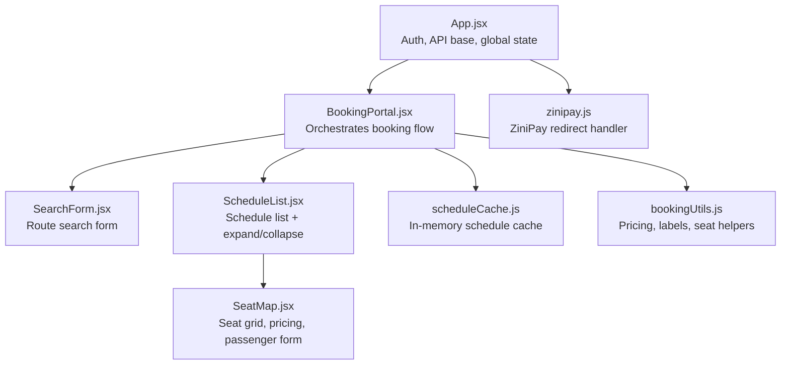
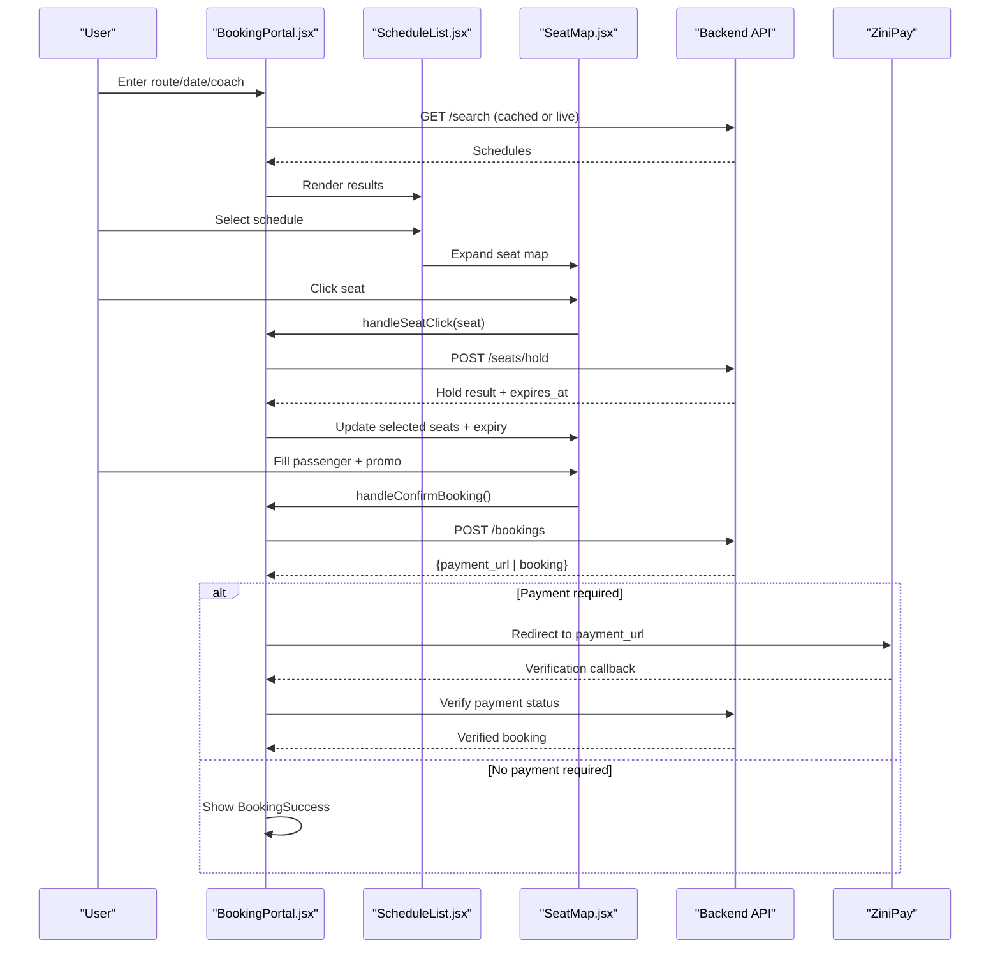
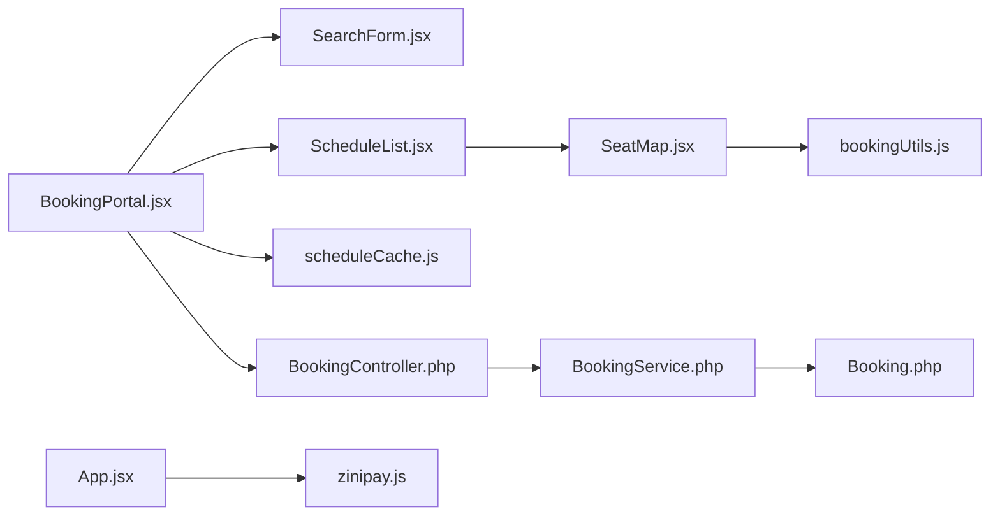

# Booking Portal Component

<cite>
**Referenced Files in This Document**
- [BookingPortal.jsx](file://frontend/src/components/BookingPortal.jsx)
- [ScheduleList.jsx](file://frontend/src/components/ScheduleList.jsx)
- [SeatMap.jsx](file://frontend/src/components/SeatMap.jsx)
- [SearchForm.jsx](file://frontend/src/components/SearchForm.jsx)
- [App.jsx](file://frontend/src/App.jsx)
- [bookingUtils.js](file://frontend/src/bookingUtils.js)
- [scheduleCache.js](file://frontend/src/scheduleCache.js)
- [zinipay.js](file://frontend/src/zinipay.js)
- [BookingController.php](file://backend/app/Http/Controllers/API/BookingController.php)
- [BookingService.php](file://backend/app/Services/BookingService.php)
- [Booking.php](file://backend/app/Models/Booking.php)
</cite>

## Table of Contents
1. [Introduction](#introduction)
2. [Project Structure](#project-structure)
3. [Core Components](#core-components)
4. [Architecture Overview](#architecture-overview)
5. [Detailed Component Analysis](#detailed-component-analysis)
6. [Dependency Analysis](#dependency-analysis)
7. [Performance Considerations](#performance-considerations)
8. [Troubleshooting Guide](#troubleshooting-guide)
9. [Conclusion](#conclusion)

## Introduction
The Booking Portal is the customer-facing booking workflow for the bus application. It guides users from route search through seat selection, passenger details, promo validation, payment initiation, and ticket confirmation. The component orchestrates frontend state, integrates with backend APIs for schedules, seat holds, promotions, and bookings, and coordinates with ZiniPay for payment redirection and verification.

This document explains:
- How the multi-step booking flow is orchestrated.
- How state is managed across search, seat selection, passenger data, and payment.
- How payment integration works end-to-end.
- What props are expected by the Booking Portal and related components.
- How to customize the flow, handle edge cases, implement progress indicators, and manage errors.

## Project Structure
The Booking Portal lives in the React frontend and delegates responsibilities to smaller UI components while coordinating API calls and shared state.

**Diagram sources**
- [App.jsx:94-145](file://frontend/src/App.jsx#L94-L145)
- [BookingPortal.jsx:9-20](file://frontend/src/components/BookingPortal.jsx#L9-L20)
- [ScheduleList.jsx:4-37](file://frontend/src/components/ScheduleList.jsx#L4-L37)
- [SeatMap.jsx:10-30](file://frontend/src/components/SeatMap.jsx#L10-L30)
- [SearchForm.jsx:3-10](file://frontend/src/components/SearchForm.jsx#L3-L10)
- [zinipay.js](file://frontend/src/zinipay.js)

**Section sources**
- [App.jsx:94-145](file://frontend/src/App.jsx#L94-L145)
- [BookingPortal.jsx:9-20](file://frontend/src/components/BookingPortal.jsx#L9-L20)

## Core Components
- BookingPortal: Central orchestrator for search, seat hold/release, promo validation, booking submission, and success handling.
- SearchForm: User input for departure, destination, date, and coach type.
- ScheduleList: Displays available schedules, expands selected schedule into a seat map view, and manages expanded state.
- SeatMap: Renders bus seat layout, handles seat selection UI, boarding/dropping points, passenger info, promo code application, and booking submission trigger.
- App: Provides authentication, API base URL resolution, toast notifications, and ZiniPay redirect processing.

Key responsibilities:
- Search orchestration with caching and live refresh.
- Optimistic seat selection with server-backed holds and expiration handling.
- Passenger data collection and validation.
- Promo code validation and discount application.
- Booking creation and payment redirection.
- Success/failure feedback via toast and dedicated screens.

**Section sources**
- [BookingPortal.jsx:24-54](file://frontend/src/components/BookingPortal.jsx#L24-L54)
- [SearchForm.jsx:11-108](file://frontend/src/components/SearchForm.jsx#L11-L108)
- [ScheduleList.jsx:57-218](file://frontend/src/components/ScheduleList.jsx#L57-L218)
- [SeatMap.jsx:393-610](file://frontend/src/components/SeatMap.jsx#L393-L610)
- [App.jsx:94-145](file://frontend/src/App.jsx#L94-L145)

## Architecture Overview
The booking flow spans multiple layers:

**Diagram sources**
- [BookingPortal.jsx:291-380](file://frontend/src/components/BookingPortal.jsx#L291-L380)
- [BookingPortal.jsx:209-289](file://frontend/src/components/BookingPortal.jsx#L209-L289)
- [BookingPortal.jsx:469-575](file://frontend/src/components/BookingPortal.jsx#L469-L575)
- [BookingController.php:82-116](file://backend/app/Http/Controllers/API/BookingController.php#L82-L116)
- [BookingController.php:19-40](file://backend/app/Http/Controllers/API/BookingController.php#L19-L40)
- [BookingService.php:28-131](file://backend/app/Services/BookingService.php#L28-L131)

## Detailed Component Analysis

### BookingPortal Orchestration
BookingPortal manages:
- Search parameters and results.
- Selected schedule and selected seats.
- Seat hold expirations.
- Passenger details and gender.
- Boarding/dropping point defaults and updates.
- Promo code input and applied promo.
- Booking submission and success state.

State highlights:
- `searchParams`, `searchResults`, `isLoading`, `isFromCache`, `lastFetched` control search UX and caching.
- `selectedSchedule`, `selectedSeats`, `seatExpirations` drive seat selection and hold lifecycle.
- `passengerDetails`, `boardingPoint`, `droppingPoint`, `passengerGender` collect booking payload.
- `appliedPromo`, `promoInput` enable promo validation and discount display.
- `isBooking` prevents duplicate submissions.

Key behaviors:
- Station list fetch on mount.
- Auth gating for seat interactions and booking submission.
- Optimistic seat selection with rollback on failure.
- Background polling of schedule data every 5 seconds when a schedule is selected.
- Release of held seats when schedule changes or page unloads.
- Expiration checks removing expired seats and releasing backend holds.
- Promo validation against backend.
- Booking submission with auth headers and error handling.
- Redirect to payment URL if provided; otherwise show success screen.

Props used:
- `bookingSuccess`, `setBookingSuccess`: Control success screen rendering.
- `verificationStatus`, `setVerificationStatus`: Integration with payment verification.
- `authUser`, `authToken`, `clearAuth`, `openAuthModal`: Authentication context.
- `showToast`: Global notification system.
- `API_BASE`: Resolved backend base URL.

Error handling:
- Network failures during station fetch, search, seat hold/release, promo check, and booking submission are caught and surfaced via toast messages.
- 401 responses clear auth and prompt login.
- Validation errors from backend are displayed to the user.

Progress indicators:
- `isLoading` disables search button and indicates search in progress.
- `isBooking` disables submit button and shows “Processing...”.
- Live badge and last-fetched timestamp indicate cache vs live data.

Customization hooks:
- Replace `API_BASE` to target different environments.
- Extend `handleApplyPromo` to support additional promo logic.
- Customize passenger fields by extending `passengerDetails`.
- Adjust seat limits and validation rules in `handleSeatClick` and `handleConfirmBooking`.

**Section sources**
- [BookingPortal.jsx:9-20](file://frontend/src/components/BookingPortal.jsx#L9-L20)
- [BookingPortal.jsx:24-54](file://frontend/src/components/BookingPortal.jsx#L24-L54)
- [BookingPortal.jsx:84-99](file://frontend/src/components/BookingPortal.jsx#L84-L99)
- [BookingPortal.jsx:104-161](file://frontend/src/components/BookingPortal.jsx#L104-L161)
- [BookingPortal.jsx:163-207](file://frontend/src/components/BookingPortal.jsx#L163-L207)
- [BookingPortal.jsx:209-289](file://frontend/src/components/BookingPortal.jsx#L209-L289)
- [BookingPortal.jsx:291-380](file://frontend/src/components/BookingPortal.jsx#L291-L380)
- [BookingPortal.jsx:400-443](file://frontend/src/components/BookingPortal.jsx#L400-L443)
- [BookingPortal.jsx:445-467](file://frontend/src/components/BookingPortal.jsx#L445-L467)
- [BookingPortal.jsx:469-575](file://frontend/src/components/BookingPortal.jsx#L469-L575)
- [BookingPortal.jsx:590-653](file://frontend/src/components/BookingPortal.jsx#L590-L653)

### SearchForm
Responsibilities:
- Provide inputs for departure station, arrival station, journey date, and coach type.
- Trigger search via `handleSearch`.
- Disable submit while searching.

Props:
- `stations`: List of stations fetched from backend.
- `searchParams`: Current search values.
- `setSearchParams`: Updater for search values.
- `minDateStr`: Minimum allowed date string.
- `handleSearch`: Function to execute search.
- `isLoading`: Boolean indicating search in progress.

UX notes:
- Uses styled input groups with icons.
- Enforces minimum date constraint.
- Shows loading state on submit.

**Section sources**
- [SearchForm.jsx:3-10](file://frontend/src/components/SearchForm.jsx#L3-L10)
- [SearchForm.jsx:11-108](file://frontend/src/components/SearchForm.jsx#L11-L108)

### ScheduleList
Responsibilities:
- Display search results with operator, times, duration, available seats, fare, and action buttons.
- Expand/collapse seat map per schedule.
- Require authentication before expanding seat map.
- Reset promo and selected seats when switching schedules.
- Show cache status and refresh button.

Props:
- `searchDone`, `searchResults`, `selectedSchedule`, `setSelectedSchedule`.
- `selectedSeats`, `setSelectedSeats`, `handleSeatClick`, `seatExpirations`.
- `setAppliedPromo`, `setPromoInput`, `authUser`, `openAuthModal`, `showToast`.
- `stations`, `searchParams`, `boardingPoint`, `setBoardingPoint`, `droppingPoint`, `setDroppingPoint`.
- `passengerDetails`, `setPassengerDetails`, `passengerGender`, `setPassengerGender`.
- `promoInput`, `appliedPromo`, `handleApplyPromo`, `handleConfirmBooking`, `isBooking`.
- `seatMapLastSync`, `isFromCache`, `lastFetched`, `onRefresh`.

UX notes:
- Cache badge shows cached vs live connection and elapsed time since last fetch.
- Refresh button triggers force refresh of schedule data.
- Empty state message when no schedules match.

**Section sources**
- [ScheduleList.jsx:4-37](file://frontend/src/components/ScheduleList.jsx#L4-L37)
- [ScheduleList.jsx:57-218](file://frontend/src/components/ScheduleList.jsx#L57-L218)

### SeatMap
Responsibilities:
- Render bus seat layout based on schedule bus configuration.
- Handle seat selection UI and constraints.
- Collect boarding/dropping points, passenger details, gender, and payment method.
- Validate and apply promo codes.
- Compute pricing breakdown and total payable amount.
- Trigger booking submission via `handleConfirmBooking`.

Props:
- `sched`: Selected schedule object.
- `selectedSeats`, `handleSeatClick`, `seatExpirations`.
- `seatMapLastSync`.
- `boardingPoint`, `setBoardingPoint`, `droppingPoint`, `setDroppingPoint`.
- `passengerDetails`, `setPassengerDetails`, `passengerGender`, `setPassengerGender`.
- `promoInput`, `setPromoInput`, `appliedPromo`, `handleApplyPromo`, `handleConfirmBooking`, `isBooking`.

Logic highlights:
- Generates default seat grids for layouts like 2+2, 1+2, sleeper, and custom grids.
- Renders driver/engine placeholders and aisle cells.
- Computes pricing using `calcPricing` from `bookingUtils`.
- Applies promo discount to grand total.
- Shows remaining hold time per selected seat.
- Disables inputs until seats are selected.

**Section sources**
- [SeatMap.jsx:10-30](file://frontend/src/components/SeatMap.jsx#L10-L30)
- [SeatMap.jsx:48-190](file://frontend/src/components/SeatMap.jsx#L48-L190)
- [SeatMap.jsx:192-384](file://frontend/src/components/SeatMap.jsx#L192-L384)
- [SeatMap.jsx:386-610](file://frontend/src/components/SeatMap.jsx#L386-L610)

### App Integration
Responsibilities:
- Resolve API base URL with environment variable fallbacks and probing.
- Manage authentication state and modal.
- Fetch site settings and handle maintenance/installation states.
- Process ZiniPay redirects and set verification/payment failure states.
- Render BookingPortal with necessary props.

Integration points:
- Passes `apiBase` as `API_BASE` to BookingPortal.
- Passes `authUser`, `authToken`, `clearAuth`, `openAuthModal`, `showToast`.
- Handles ZiniPay redirect via `handleZiniPayRedirect`.

**Section sources**
- [App.jsx:40-92](file://frontend/src/App.jsx#L40-L92)
- [App.jsx:94-145](file://frontend/src/App.jsx#L94-L145)
- [App.jsx:329-412](file://frontend/src/App.jsx#L329-L412)
- [App.jsx:696-743](file://frontend/src/App.jsx#L696-L743)

## Dependency Analysis
Frontend dependencies:
- BookingPortal depends on SearchForm, ScheduleList, Features, Partners, BookingSuccess, and scheduleCache.
- ScheduleList depends on SeatMap.
- SeatMap depends on bookingUtils for pricing, labels, and seat helpers.
- App depends on zinipay for payment redirect handling.

Backend dependencies:
- BookingController exposes endpoints for booking creation, mine, cancel, public show, seat hold/release, and payment initiation.
- BookingService encapsulates business logic for creating bookings, calculating fares, applying promos, resolving statuses, and integrating with ZiniPay and SMS services.
- Booking model defines fillable fields, casts, relationships, and PNR generation.

**Diagram sources**
- [BookingPortal.jsx:1-7](file://frontend/src/components/BookingPortal.jsx#L1-L7)
- [ScheduleList.jsx:1-2](file://frontend/src/components/ScheduleList.jsx#L1-L2)
- [SeatMap.jsx:1-8](file://frontend/src/components/SeatMap.jsx#L1-L8)
- [App.jsx:1-17](file://frontend/src/App.jsx#L1-L17)
- [BookingController.php:1-17](file://backend/app/Http/Controllers/API/BookingController.php#L1-L17)
- [BookingService.php:1-21](file://backend/app/Services/BookingService.php#L1-L21)
- [Booking.php:1-10](file://backend/app/Models/Booking.php#L1-L10)

**Section sources**
- [BookingPortal.jsx:1-7](file://frontend/src/components/BookingPortal.jsx#L1-L7)
- [ScheduleList.jsx:1-2](file://frontend/src/components/ScheduleList.jsx#L1-L2)
- [SeatMap.jsx:1-8](file://frontend/src/components/SeatMap.jsx#L1-L8)
- [App.jsx:1-17](file://frontend/src/App.jsx#L1-L17)
- [BookingController.php:1-17](file://backend/app/Http/Controllers/API/BookingController.php#L1-L17)
- [BookingService.php:1-21](file://backend/app/Services/BookingService.php#L1-L21)
- [Booking.php:1-10](file://backend/app/Models/Booking.php#L1-L10)

## Performance Considerations
- In-memory schedule cache reduces repeated network requests and improves perceived performance.
- Polling schedule data every 5 seconds ensures seat availability remains accurate during active selection.
- Optimistic UI updates for seat selection improve responsiveness; rollbacks occur on server rejection.
- Background refresh after successful booking keeps schedule lists consistent without blocking user experience.
- Toast notifications provide immediate feedback without interrupting core flows.

Recommendations:
- Consider debouncing rapid seat clicks to reduce unnecessary hold/release calls.
- Add retry logic with exponential backoff for failed network requests.
- Implement skeleton loaders for search results and seat maps to enhance perceived performance.
- Use request deduplication for concurrent identical API calls.

[No sources needed since this section provides general guidance]

## Troubleshooting Guide
Common issues and resolutions:
- Backend offline: App probes multiple candidate URLs and displays an offline state with retry options. Ensure CORS and routing are configured correctly.
- Installation not complete: Frontend detects install wizard not run and directs to installation flow. Complete backend installation steps.
- Maintenance mode: Frontend renders maintenance page when enabled by backend settings.
- Authentication failures: 401 responses clear local auth and prompt login. Verify token persistence and refresh behavior.
- Seat hold failures: Rollback occurs on network errors or server rejection. Check seat availability and user permissions.
- Promo validation errors: Invalid codes show error toasts. Verify promo codes exist and are applicable.
- Booking submission errors: Validation errors from backend are shown via toast. Ensure all required fields are filled and valid.

Debugging tips:
- Inspect toast messages for specific error descriptions.
- Check browser network tab for API request/response payloads.
- Verify `API_BASE` resolves to the correct backend endpoint.
- Confirm ZiniPay redirect parameters are processed by `handleZiniPayRedirect`.

**Section sources**
- [App.jsx:329-412](file://frontend/src/App.jsx#L329-L412)
- [App.jsx:502-524](file://frontend/src/App.jsx#L502-L524)
- [App.jsx:680-688](file://frontend/src/App.jsx#L680-L688)
- [BookingPortal.jsx:92-94](file://frontend/src/components/BookingPortal.jsx#L92-L94)
- [BookingPortal.jsx:231-240](file://frontend/src/components/BookingPortal.jsx#L231-L240)
- [BookingPortal.jsx:268-287](file://frontend/src/components/BookingPortal.jsx#L268-L287)
- [BookingPortal.jsx:453-466](file://frontend/src/components/BookingPortal.jsx#L453-L466)
- [BookingPortal.jsx:518-574](file://frontend/src/components/BookingPortal.jsx#L518-L574)

## Conclusion
The Booking Portal component provides a robust, user-friendly booking workflow that integrates search, seat selection, passenger data collection, promo validation, and payment redirection. It leverages optimistic UI updates, background polling, and comprehensive error handling to deliver a smooth experience. By understanding its props, state management, and integration points, developers can customize the flow, extend functionality, and ensure reliable operation across environments.

[No sources needed since this section summarizes without analyzing specific files]