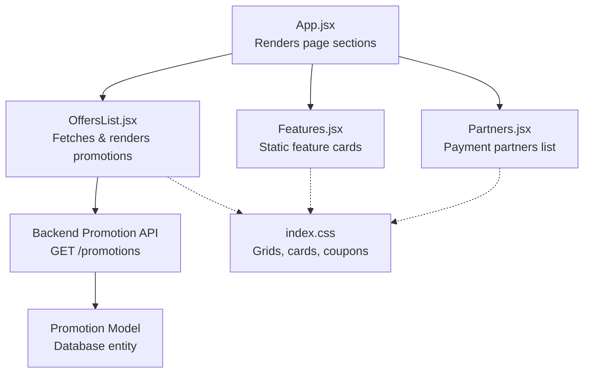
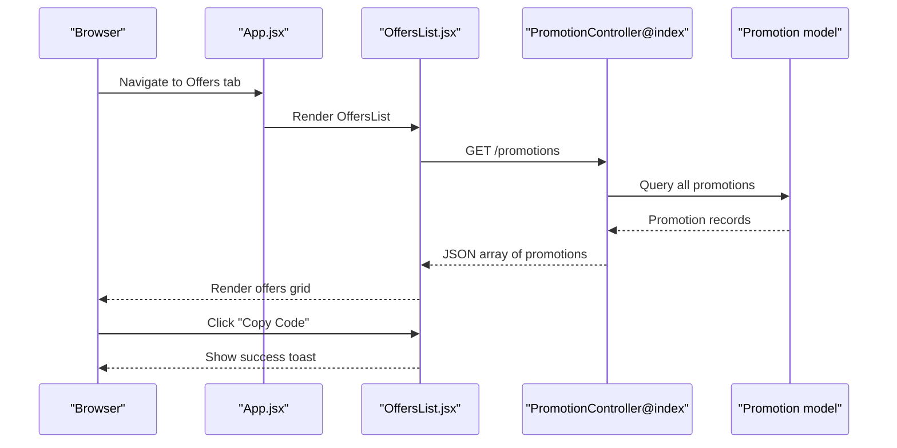
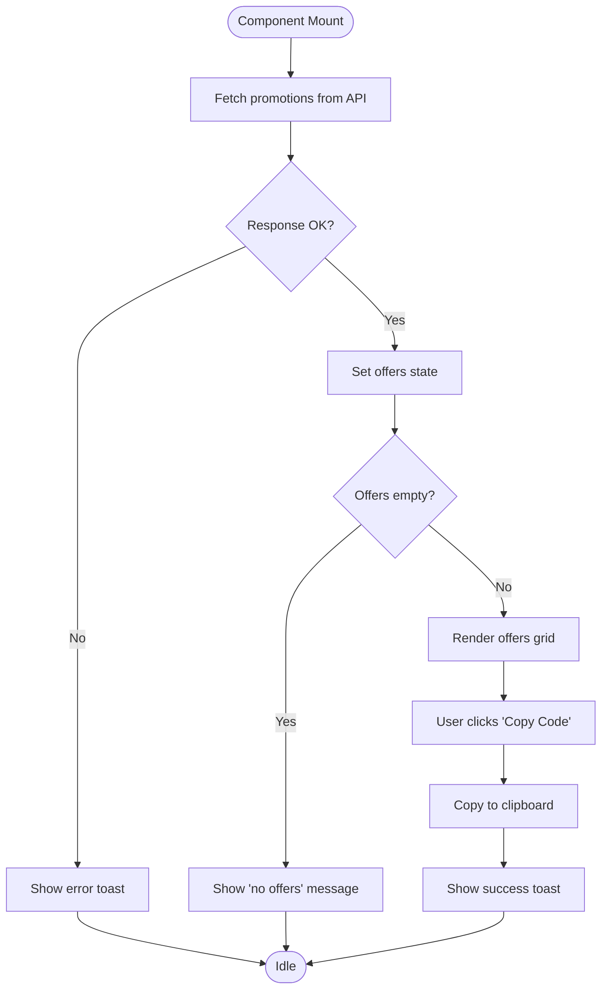
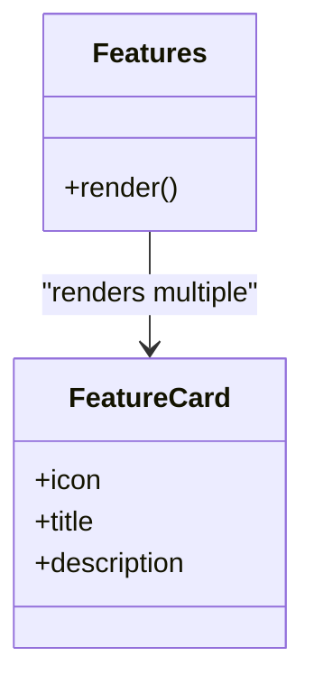
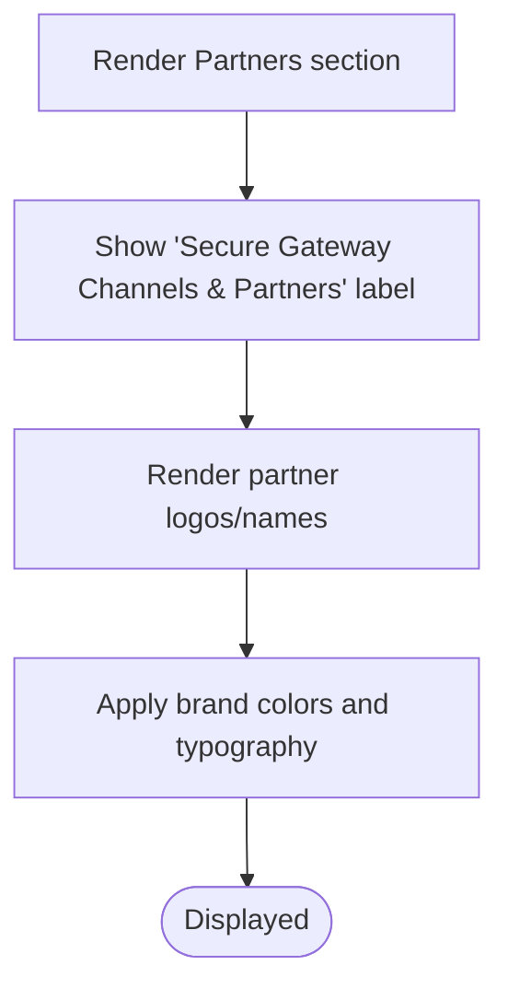
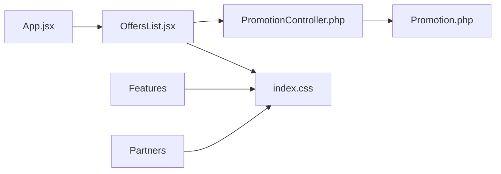

# Content Display Components

<cite>
**Referenced Files in This Document**
- [OffersList.jsx](file://frontend/src/components/OffersList.jsx)
- [Features.jsx](file://frontend/src/components/Features.jsx)
- [Partners.jsx](file://frontend/src/components/Partners.jsx)
- [index.css](file://frontend/src/index.css)
- [App.jsx](file://frontend/src/App.jsx)
- [PromotionController.php](file://backend/app/Http/Controllers/API/PromotionController.php)
- [Promotion.php](file://backend/app/Models/Promotion.php)
</cite>

## Table of Contents
1. [Introduction](#introduction)
2. [Project Structure](#project-structure)
3. [Core Components](#core-components)
4. [Architecture Overview](#architecture-overview)
5. [Detailed Component Analysis](#detailed-component-analysis)
6. [Dependency Analysis](#dependency-analysis)
7. [Performance Considerations](#performance-considerations)
8. [Troubleshooting Guide](#troubleshooting-guide)
9. [Conclusion](#conclusion)

## Introduction
This document explains the content display components that present promotional offers, application features, and partner payment channels to end users. It focuses on:
- OffersList: dynamic fetching and rendering of promotions with coupon code copy-to-clipboard behavior.
- Features: static showcase of core application capabilities with iconography and descriptions.
- Partners: presentation of supported payment partners and channels.

The goal is to help developers understand how these components work, how they integrate with backend APIs, and how to customize them for responsive layouts and visual branding.

## Project Structure
These components live in the frontend React application and are rendered conditionally by the main application shell. The OffersList component consumes a public API endpoint to fetch promotions. Styling is centralized in the global stylesheet.

**Diagram sources**
- [App.jsx:757-762](file://frontend/src/App.jsx#L757-L762)
- [OffersList.jsx:7-20](file://frontend/src/components/OffersList.jsx#L7-L20)
- [PromotionController.php:33-37](file://backend/app/Http/Controllers/API/PromotionController.php#L33-L37)
- [Promotion.php:12-16](file://backend/app/Models/Promotion.php#L12-L16)
- [index.css:1207-1276](file://frontend/src/index.css#L1207-L1276)

**Section sources**
- [App.jsx:757-762](file://frontend/src/App.jsx#L757-L762)
- [OffersList.jsx:1-71](file://frontend/src/components/OffersList.jsx#L1-L71)
- [Features.jsx:1-35](file://frontend/src/components/Features.jsx#L1-L35)
- [Partners.jsx:1-47](file://frontend/src/components/Partners.jsx#L1-L47)
- [index.css:1207-1276](file://frontend/src/index.css#L1207-L1276)

## Core Components
- OffersList: Fetches promotions from the backend, displays discount details, and provides a “Copy Code” action.
- Features: Renders three feature cards describing the booking flow.
- Partners: Displays supported payment partners using styled text logos.

Key responsibilities:
- Dynamic data loading (OffersList).
- Static content presentation (Features, Partners).
- Responsive grid layout via CSS classes.
- User feedback through toast notifications (OffersList).

**Section sources**
- [OffersList.jsx:1-71](file://frontend/src/components/OffersList.jsx#L1-L71)
- [Features.jsx:1-35](file://frontend/src/components/Features.jsx#L1-L35)
- [Partners.jsx:1-47](file://frontend/src/components/Partners.jsx#L1-L47)

## Architecture Overview
The OffersList component integrates with the backend promotion system:
- Frontend calls GET /promotions to retrieve all active promotions.
- Backend controller returns an array of promotion objects.
- Each promotion includes fields such as code, discount_amount, and description.
- The UI renders a responsive grid of offer cards with a coupon pill and copy action.

**Diagram sources**
- [App.jsx:757-762](file://frontend/src/App.jsx#L757-L762)
- [OffersList.jsx:7-20](file://frontend/src/components/OffersList.jsx#L7-L20)
- [PromotionController.php:33-37](file://backend/app/Http/Controllers/API/PromotionController.php#L33-L37)
- [Promotion.php:12-16](file://backend/app/Models/Promotion.php#L12-L16)

## Detailed Component Analysis

### OffersList Component
Purpose:
- Dynamically load promotional offers from the backend.
- Display discount amount, description, and promo code.
- Provide a user-friendly way to copy promo codes to the clipboard.
- Handle loading state and error feedback via toast.

Data contract:
- Input prop: API_BASE (string), showToast (function).
- Data shape returned by GET /promotions:
  - id: number or string
  - code: string
  - discount_amount: decimal
  - description: string

Behavior highlights:
- On mount, fetches promotions and sets state.
- Shows a spinner while loading.
- If no promotions exist, shows a friendly message.
- Copying a code triggers a success toast.

Responsive design:
- Uses .offers-grid for a responsive grid layout.
- Cards use .offer-card with header/body structure.
- Coupon pill uses .coupon-pill styling.

Error handling:
- Network errors show an error toast.
- Empty results handled gracefully.

Customization points:
- Replace toast messages or add additional actions.
- Extend card layout by adding more fields from the promotion object.
- Adjust grid spacing and colors via CSS variables.

**Diagram sources**
- [OffersList.jsx:7-29](file://frontend/src/components/OffersList.jsx#L7-L29)
- [OffersList.jsx:31-68](file://frontend/src/components/OffersList.jsx#L31-L68)

**Section sources**
- [OffersList.jsx:1-71](file://frontend/src/components/OffersList.jsx#L1-L71)
- [index.css:1207-1276](file://frontend/src/index.css#L1207-L1276)

### Features Component
Purpose:
- Showcase core application capabilities with concise descriptions and icons.

Structure:
- Section wrapper with title and subtitle.
- Three feature cards, each containing:
  - Icon wrapper with emoji icon.
  - Title and short description.

Styling:
- Uses .features-section, .features-grid, .feature-card, and .feature-icon-wrapper.
- Responsive grid adapts to screen width.

Extensibility:
- Add new feature cards by duplicating the card block.
- Replace emojis with SVG icons or images if needed.
- Localize titles and descriptions by passing props or using i18n.

**Diagram sources**
- [Features.jsx:1-35](file://frontend/src/components/Features.jsx#L1-L35)
- [index.css:304-350](file://frontend/src/index.css#L304-L350)

**Section sources**
- [Features.jsx:1-35](file://frontend/src/components/Features.jsx#L1-L35)
- [index.css:304-350](file://frontend/src/index.css#L304-L350)

### Partners Component
Purpose:
- Present accepted payment partners and channels.

Structure:
- Section wrapper with a small uppercase label.
- List of partner names styled as logos using color and typography.

Styling:
- Uses .payment-section and .payment-list.
- Partner items use .payment-logo with inline styles for brand colors.

Extensibility:
- Add new partners by appending another .payment-logo element.
- Replace text with partner logos/images for stronger branding.
- Integrate with site settings to make partner lists configurable.

**Diagram sources**
- [Partners.jsx:1-47](file://frontend/src/components/Partners.jsx#L1-L47)
- [index.css:352-360](file://frontend/src/index.css#L352-L360)

**Section sources**
- [Partners.jsx:1-47](file://frontend/src/components/Partners.jsx#L1-L47)
- [index.css:352-360](file://frontend/src/index.css#L352-L360)

## Dependency Analysis
Frontend dependencies:
- App.jsx conditionally renders OffersList when the offers tab is active.
- OffersList depends on the backend API base URL and a toast utility.
- All three components rely on shared CSS classes for consistent layout and appearance.

Backend dependencies:
- PromotionController exposes endpoints to list promotions and validate promo codes.
- Promotion model defines fillable fields and casts discount_amount to decimal.

**Diagram sources**
- [App.jsx:757-762](file://frontend/src/App.jsx#L757-L762)
- [OffersList.jsx:7-20](file://frontend/src/components/OffersList.jsx#L7-L20)
- [PromotionController.php:33-37](file://backend/app/Http/Controllers/API/PromotionController.php#L33-L37)
- [Promotion.php:12-16](file://backend/app/Models/Promotion.php#L12-L16)
- [index.css:1207-1276](file://frontend/src/index.css#L1207-L1276)

**Section sources**
- [App.jsx:757-762](file://frontend/src/App.jsx#L757-L762)
- [PromotionController.php:10-37](file://backend/app/Http/Controllers/API/PromotionController.php#L10-L37)
- [Promotion.php:12-16](file://backend/app/Models/Promotion.php#L12-L16)

## Performance Considerations
- OffersList performs a single network request on mount; consider caching responses if the same data is reused across routes.
- Avoid unnecessary re-renders by keeping state minimal and avoiding heavy computations inside render.
- Use CSS Grid for responsive layouts to minimize layout recalculations.
- Prefer lightweight icons or SVGs instead of large images for better performance.

[No sources needed since this section provides general guidance]

## Troubleshooting Guide
Common issues and resolutions:
- Promotions not loading:
  - Verify API_BASE is correct and reachable.
  - Check network requests to GET /promotions.
  - Ensure backend PromotionController@index returns a valid JSON array.
- Copy code toast not showing:
  - Confirm showToast function is passed correctly to OffersList.
  - Ensure browser supports navigator.clipboard.
- Layout misalignment:
  - Inspect CSS classes .offers-grid, .offer-card, .coupon-pill.
  - Validate CSS variables used for colors and spacing.

Operational checks:
- Backend validation:
  - PromotionController validates promo codes and returns appropriate status codes.
- Data integrity:
  - Promotion model casts discount_amount to decimal to ensure numeric precision.

**Section sources**
- [OffersList.jsx:7-29](file://frontend/src/components/OffersList.jsx#L7-L29)
- [PromotionController.php:10-37](file://backend/app/Http/Controllers/API/PromotionController.php#L10-L37)
- [Promotion.php:12-16](file://backend/app/Models/Promotion.php#L12-L16)
- [index.css:1207-1276](file://frontend/src/index.css#L1207-L1276)

## Conclusion
The OffersList, Features, and Partners components provide clear, responsive, and customizable content displays for promotions, application capabilities, and payment partners. OffersList integrates seamlessly with the backend promotion API, while Features and Partners deliver static yet visually consistent information. Developers can extend these components by adding new data fields, enhancing styling, and integrating with content management systems to make content dynamic and manageable.

[No sources needed since this section summarizes without analyzing specific files]