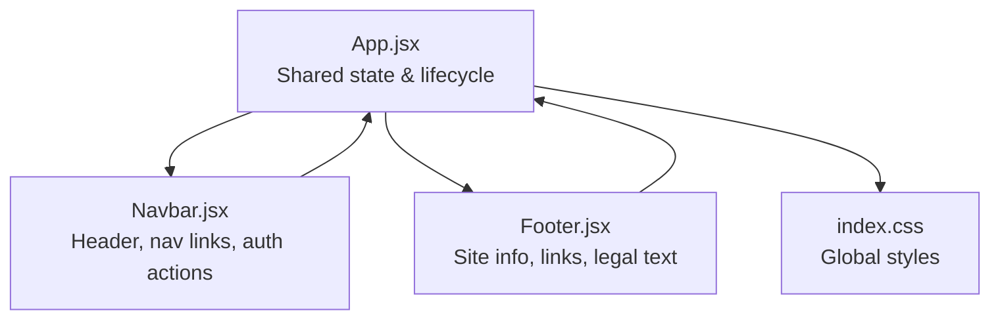
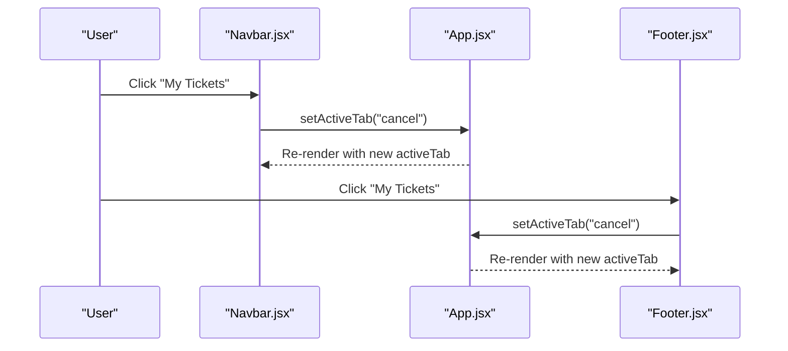
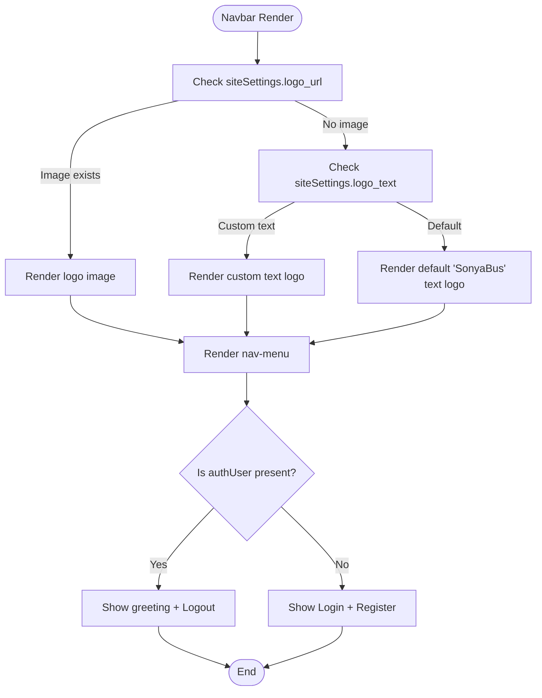
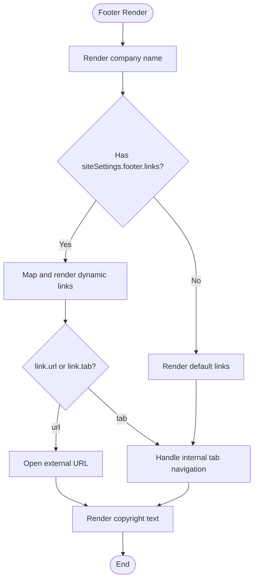
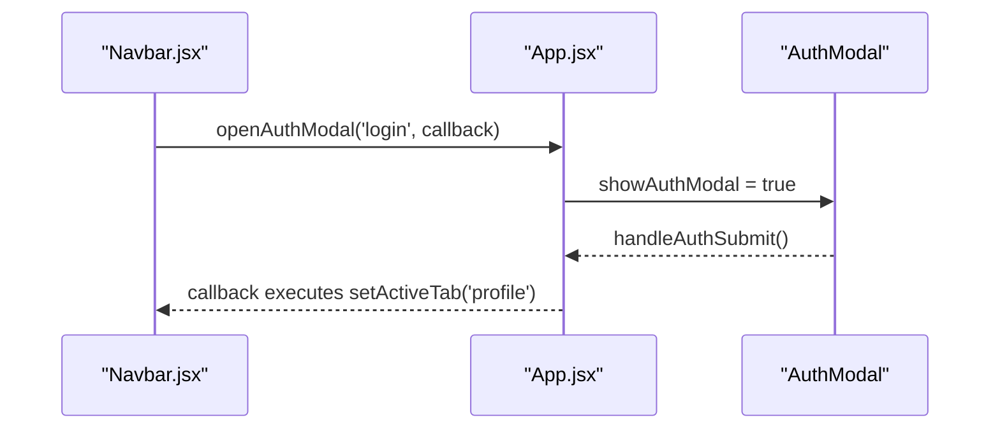
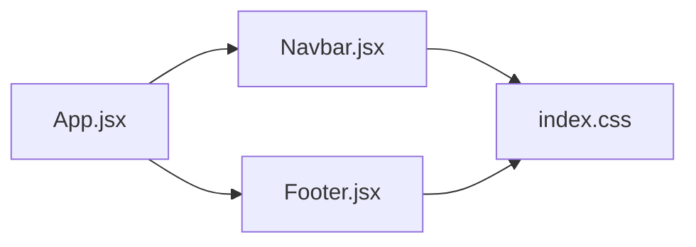

# Navigation Components

<cite>
**Referenced Files in This Document**
- [Navbar.jsx](file://frontend/src/components/Navbar.jsx)
- [Footer.jsx](file://frontend/src/components/Footer.jsx)
- [App.jsx](file://frontend/src/App.jsx)
- [index.css](file://frontend/src/index.css)
</cite>

## Table of Contents
1. [Introduction](#introduction)
2. [Project Structure](#project-structure)
3. [Core Components](#core-components)
4. [Architecture Overview](#architecture-overview)
5. [Detailed Component Analysis](#detailed-component-analysis)
6. [Dependency Analysis](#dependency-analysis)
7. [Performance Considerations](#performance-considerations)
8. [Troubleshooting Guide](#troubleshooting-guide)
9. [Conclusion](#conclusion)
10. [Appendices](#appendices)

## Introduction
This document explains the navigation components used by the customer-facing frontend: Navbar and Footer. It covers how the Navbar renders a responsive navigation menu, displays authentication state, handles route switching through tab-based navigation, and integrates with the authentication modal. It also documents the Footer’s site information display, dynamic links, and legal text. Finally, it provides guidance for extending navigation items, integrating user profile links, implementing breadcrumb-style navigation, and maintaining consistent branding across navigation elements.

## Project Structure
The navigation UI is implemented as two React components mounted by the application root:
- Navbar renders the top header with logo, navigation links, and authentication controls.
- Footer renders the bottom area with company name, dynamic or default links, and copyright text.
- App.jsx owns shared state (activeTab, authUser, siteSettings, openAuthModal, handleLogout) and passes them to both components.
- index.css defines global styles for header, navigation menu, buttons, and footer layout.

**Diagram sources**
- [App.jsx:702-711](file://frontend/src/App.jsx#L702-L711)
- [App.jsx:793-799](file://frontend/src/App.jsx#L793-L799)
- [Navbar.jsx:1-151](file://frontend/src/components/Navbar.jsx#L1-L151)
- [Footer.jsx:1-78](file://frontend/src/components/Footer.jsx#L1-L78)
- [index.css:53-120](file://frontend/src/index.css#L53-L120)
- [index.css:1458-1486](file://frontend/src/index.css#L1458-L1486)

**Section sources**
- [App.jsx:94-133](file://frontend/src/App.jsx#L94-L133)
- [Navbar.jsx:1-151](file://frontend/src/components/Navbar.jsx#L1-L151)
- [Footer.jsx:1-78](file://frontend/src/components/Footer.jsx#L1-L78)
- [index.css:53-120](file://frontend/src/index.css#L53-L120)
- [index.css:1458-1486](file://frontend/src/index.css#L1458-L1486)

## Core Components
- Navbar
  - Renders a sticky header with a clickable logo that resets the active view.
  - Displays primary navigation items: Ticket Booking, My Tickets, Promotions & Offers, My Profile.
  - Shows user greeting and Logout when authenticated; Login and Register when not authenticated.
  - Integrates with an authentication modal via props.
  - Uses site settings for logo image or text branding.
- Footer
  - Displays company name from site settings or a default value.
  - Renders dynamic links from site settings if provided; otherwise falls back to default links.
  - Supports internal tab navigation and external link opening.
  - Shows copyright text from site settings or a default string.

Key responsibilities:
- Route navigation is handled by updating a shared activeTab state in App.jsx.
- Authentication state is passed down to Navbar and Footer to conditionally render user-specific actions.
- Branding is driven by siteSettings, including logo URL/text and footer content.

**Section sources**
- [Navbar.jsx:13-30](file://frontend/src/components/Navbar.jsx#L13-L30)
- [Navbar.jsx:70-112](file://frontend/src/components/Navbar.jsx#L70-L112)
- [Navbar.jsx:114-146](file://frontend/src/components/Navbar.jsx#L114-L146)
- [Footer.jsx:10-74](file://frontend/src/components/Footer.jsx#L10-L74)
- [App.jsx:702-711](file://frontend/src/App.jsx#L702-L711)
- [App.jsx:793-799](file://frontend/src/App.jsx#L793-L799)

## Architecture Overview
The navigation system follows a unidirectional data flow:
- App.jsx holds the source of truth for navigation (activeTab), authentication (authUser, authToken), and site configuration (siteSettings).
- Navbar and Footer are presentational components that receive props and call handlers to update parent state.
- Global CSS provides consistent styling for headers, menus, buttons, and footers.

**Diagram sources**
- [Navbar.jsx:81-89](file://frontend/src/components/Navbar.jsx#L81-L89)
- [Footer.jsx:53-55](file://frontend/src/components/Footer.jsx#L53-L55)
- [App.jsx:702-711](file://frontend/src/App.jsx#L702-L711)
- [App.jsx:793-799](file://frontend/src/App.jsx#L793-L799)

## Detailed Component Analysis

### Navbar Component
Responsibilities:
- Logo rendering: supports uploaded logo image or text fallback derived from siteSettings.
- Navigation menu: renders four primary tabs and highlights the active one.
- Authentication integration: shows greeting and logout when logged in; login/register buttons when not.
- Profile access: opens authentication modal if needed before navigating to profile.

Props:
- activeTab: current active view identifier.
- setActiveTab: function to switch views.
- setBookingSuccess: clears booking success state on navigation.
- setPaymentFailed: clears payment failure state on navigation.
- authUser: current authenticated user object or null.
- handleLogout: logs out the user and clears local auth state.
- openAuthModal: opens the authentication modal with optional return action.
- siteSettings: branding and configuration data from backend.

Responsive behavior:
- The header uses a sticky layout with flexbox.
- The navigation menu is a horizontal list styled via CSS variables.
- There is no built-in mobile hamburger toggle in this component; responsiveness is primarily achieved through CSS layout and spacing.

Styling customization:
- Header background, border, and transitions are controlled by CSS variables.
- Nav links use hover and active states defined in global CSS.
- Buttons use shared button classes with theme variables.

Extensibility examples:
- Add a custom navigation item:
  - Add a new <li> inside the nav-menu with an onClick that calls setActiveTab with a new tab key.
  - Ensure the corresponding view is rendered in App.jsx based on the new tab key.
- Integrate user profile links:
  - Use the existing profile link which either navigates directly or prompts login via openAuthModal.
- Implement breadcrumb-like navigation:
  - Extend Navbar to accept a breadcrumbs prop and render a small breadcrumb trail above the menu.
  - Update App.jsx to pass breadcrumb data based on activeTab and nested routes.

**Diagram sources**
- [Navbar.jsx:13-30](file://frontend/src/components/Navbar.jsx#L13-L30)
- [Navbar.jsx:70-112](file://frontend/src/components/Navbar.jsx#L70-L112)
- [Navbar.jsx:114-146](file://frontend/src/components/Navbar.jsx#L114-L146)

**Section sources**
- [Navbar.jsx:13-30](file://frontend/src/components/Navbar.jsx#L13-L30)
- [Navbar.jsx:70-112](file://frontend/src/components/Navbar.jsx#L70-L112)
- [Navbar.jsx:114-146](file://frontend/src/components/Navbar.jsx#L114-L146)
- [index.css:53-120](file://frontend/src/index.css#L53-L120)

### Footer Component
Responsibilities:
- Company name: displays siteSettings.footer.company_name or a default enterprise name.
- Links: renders dynamic links from siteSettings.footer.links if available; otherwise defaults to Search Buses, My Tickets, Special Promotions, and My Profile.
- Link behavior: supports external URLs and internal tab navigation; requires authentication for profile-related navigation.
- Legal text: displays siteSettings.footer.copyright or a default copyright notice.

Props:
- siteSettings: branding and footer configuration.
- setActiveTab: function to switch views.
- setBookingSuccess: clears booking success state when navigating to home.
- authUser: current authenticated user object or null.
- openAuthModal: opens the authentication modal with optional return action.

Responsive behavior:
- Footer links are centered using flexbox.
- No specific mobile toggles; layout adapts naturally via CSS.

Styling customization:
- Footer container, logo, and links are styled via CSS variables and utility classes.
- Hover effects are applied to links.

Extensibility examples:
- Add social media links:
  - Extend siteSettings.footer.links to include entries with url pointing to social profiles.
  - Footer will automatically render these links and open them in a new tab.
- Maintain consistent branding:
  - Configure siteSettings.footer.company_name and footer.copyright centrally.
  - Ensure navbar logo and footer company name reflect the same brand identity.

**Diagram sources**
- [Footer.jsx:10-74](file://frontend/src/components/Footer.jsx#L10-L74)

**Section sources**
- [Footer.jsx:10-74](file://frontend/src/components/Footer.jsx#L10-L74)
- [index.css:1458-1486](file://frontend/src/index.css#L1458-L1486)

### App.jsx Integration
App.jsx orchestrates navigation and authentication:
- Holds activeTab and related view states.
- Provides openAuthModal and handleLogout to child components.
- Passes siteSettings to Navbar and Footer for branding and content.
- Conditionally renders views based on activeTab.

Authentication flow:
- When accessing protected areas like profile, components can prompt login via openAuthModal.
- After successful authentication, return actions can navigate to the intended tab.

**Diagram sources**
- [App.jsx:175-186](file://frontend/src/App.jsx#L175-L186)
- [App.jsx:190-276](file://frontend/src/App.jsx#L190-L276)
- [Navbar.jsx:100-111](file://frontend/src/components/Navbar.jsx#L100-L111)

**Section sources**
- [App.jsx:94-133](file://frontend/src/App.jsx#L94-L133)
- [App.jsx:175-186](file://frontend/src/App.jsx#L175-L186)
- [App.jsx:190-276](file://frontend/src/App.jsx#L190-L276)
- [App.jsx:702-711](file://frontend/src/App.jsx#L702-L711)
- [App.jsx:793-799](file://frontend/src/App.jsx#L793-L799)

## Dependency Analysis
- Navbar depends on:
  - App.jsx for activeTab, setActiveTab, authUser, openAuthModal, handleLogout, siteSettings.
  - index.css for header, nav-menu, and button styles.
- Footer depends on:
  - App.jsx for setActiveTab, setBookingSuccess, authUser, openAuthModal, siteSettings.
  - index.css for footer layout and link styles.
- App.jsx depends on:
  - Both components for presentation.
  - Global CSS for consistent visual design.

**Diagram sources**
- [App.jsx:702-711](file://frontend/src/App.jsx#L702-L711)
- [App.jsx:793-799](file://frontend/src/App.jsx#L793-L799)
- [index.css:53-120](file://frontend/src/index.css#L53-L120)
- [index.css:1458-1486](file://frontend/src/index.css#L1458-L1486)

**Section sources**
- [Navbar.jsx:1-151](file://frontend/src/components/Navbar.jsx#L1-L151)
- [Footer.jsx:1-78](file://frontend/src/components/Footer.jsx#L1-L78)
- [App.jsx:702-711](file://frontend/src/App.jsx#L702-L711)
- [App.jsx:793-799](file://frontend/src/App.jsx#L793-L799)
- [index.css:53-120](file://frontend/src/index.css#L53-L120)
- [index.css:1458-1486](file://frontend/src/index.css#L1458-L1486)

## Performance Considerations
- Minimal re-renders: Navbar and Footer are lightweight presentational components; updates occur only when props change.
- Avoid heavy computations in click handlers; keep navigation logic simple and delegate to App.jsx.
- Use CSS variables for theme consistency to reduce style recalculation overhead.
- Defer non-critical operations (e.g., analytics) outside of critical rendering paths.

[No sources needed since this section provides general guidance]

## Troubleshooting Guide
Common issues and resolutions:
- Navigation does not switch views:
  - Verify setActiveTab is called with the correct tab key.
  - Ensure App.jsx renders the corresponding view for the tab.
- Profile navigation prompts login unexpectedly:
  - Confirm authUser is set after successful authentication.
  - Check openAuthModal callback is executed post-login.
- Footer links do not open:
  - For external links, ensure link.url is valid.
  - For internal links, verify link.tab matches a supported tab key.
- Branding not reflecting changes:
  - Confirm siteSettings.logo_url or logo_text is updated in the backend.
  - Ensure app fetches siteSettings and propagates it to Navbar and Footer.

**Section sources**
- [Navbar.jsx:100-111](file://frontend/src/components/Navbar.jsx#L100-L111)
- [Footer.jsx:17-41](file://frontend/src/components/Footer.jsx#L17-L41)
- [App.jsx:295-325](file://frontend/src/App.jsx#L295-L325)

## Conclusion
The Navbar and Footer components provide a cohesive navigation experience driven by shared state in App.jsx and styled consistently via global CSS. They support dynamic branding, authentication-aware interactions, and flexible link handling. Extending navigation is straightforward by adding new tabs in Navbar and corresponding views in App.jsx, while Footer can be extended with additional links and branding fields from siteSettings.

[No sources needed since this section summarizes without analyzing specific files]

## Appendices

### Props Reference

- Navbar props
  - activeTab: string
  - setActiveTab: function
  - setBookingSuccess: function
  - setPaymentFailed: function
  - authUser: object | null
  - handleLogout: function
  - openAuthModal: function
  - siteSettings: object

- Footer props
  - siteSettings: object
  - setActiveTab: function
  - setBookingSuccess: function
  - authUser: object | null
  - openAuthModal: function

**Section sources**
- [Navbar.jsx:3-12](file://frontend/src/components/Navbar.jsx#L3-L12)
- [Footer.jsx:3-9](file://frontend/src/components/Footer.jsx#L3-L9)

### Styling Customization Notes
- Header and navigation:
  - Background, border, and transition are controlled by CSS variables under .app-header and .nav-menu.
  - Active and hover states for nav-link are defined in global CSS.
- Footer:
  - Container, logo, and links are styled under .app-footer and .footer-links.
  - Hover effects apply to footer links.

**Section sources**
- [index.css:53-120](file://frontend/src/index.css#L53-L120)
- [index.css:1458-1486](file://frontend/src/index.css#L1458-L1486)