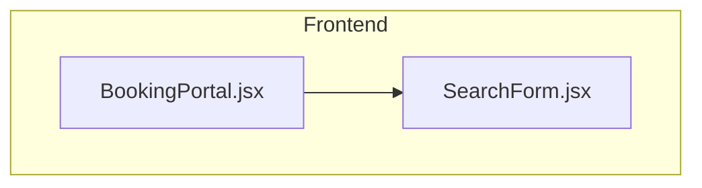
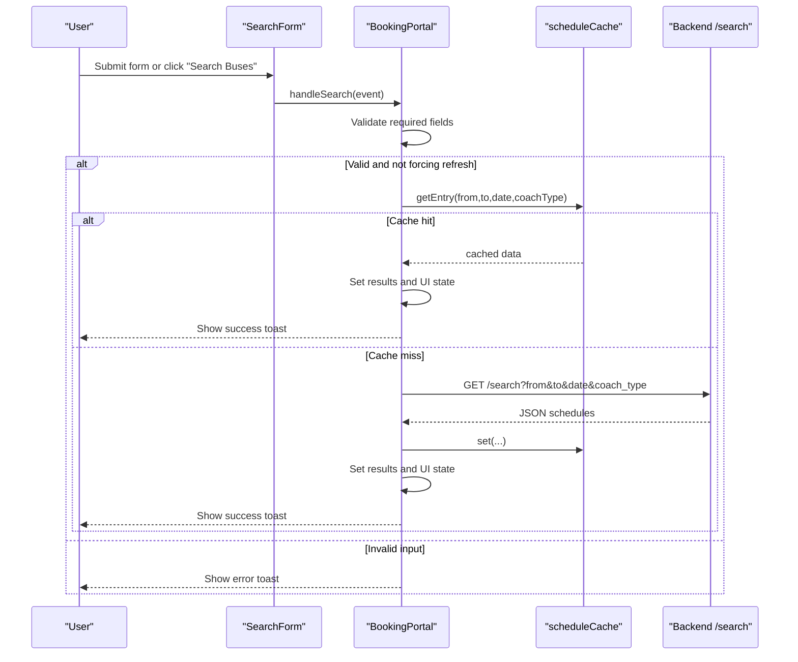
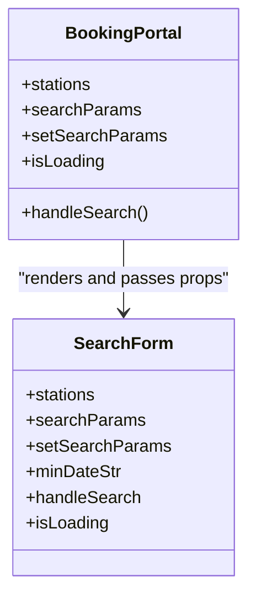
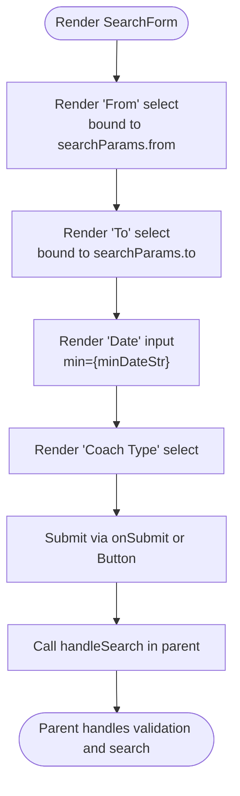
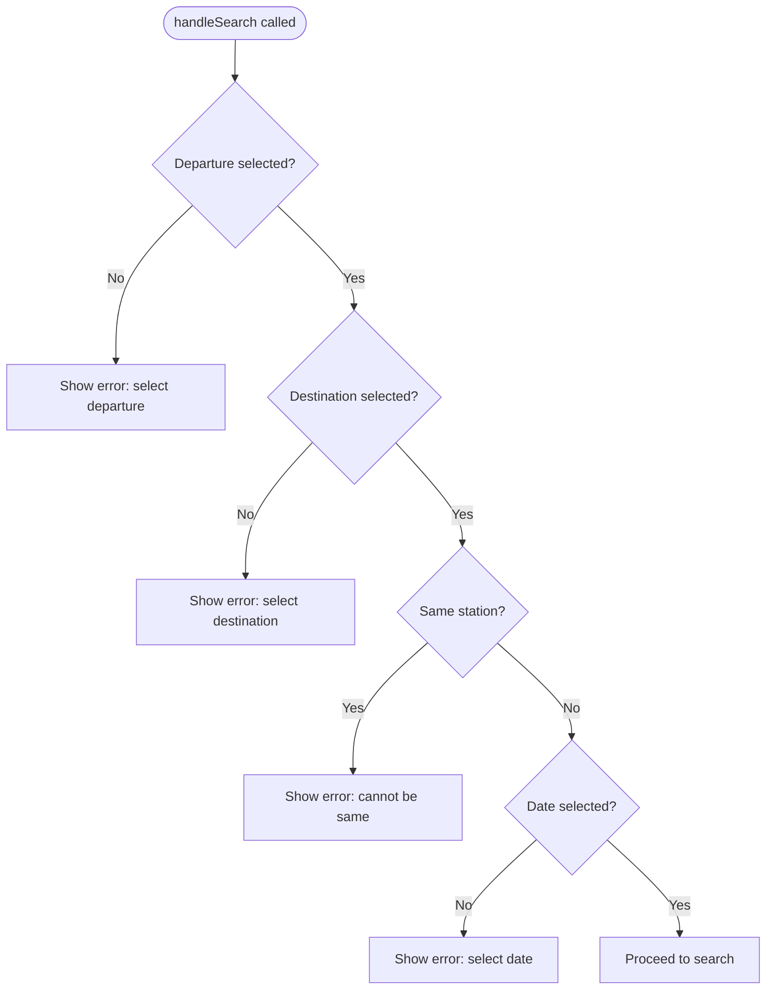
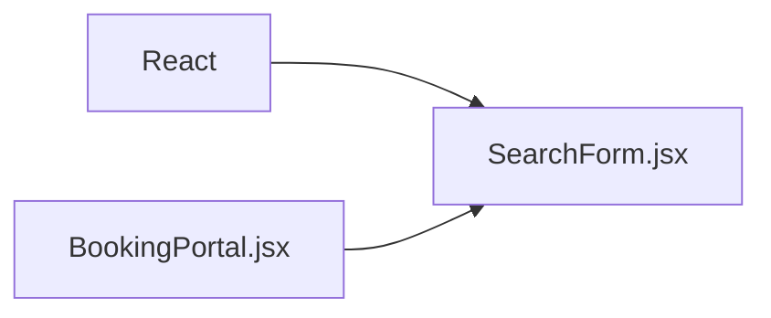

# Search Form Component

<cite>
**Referenced Files in This Document**
- [SearchForm.jsx](file://frontend/src/components/SearchForm.jsx)
- [BookingPortal.jsx](file://frontend/src/components/BookingPortal.jsx)
</cite>

## Table of Contents
1. [Introduction](#introduction)
2. [Project Structure](#project-structure)
3. [Core Components](#core-components)
4. [Architecture Overview](#architecture-overview)
5. [Detailed Component Analysis](#detailed-component-analysis)
6. [Dependency Analysis](#dependency-analysis)
7. [Performance Considerations](#performance-considerations)
8. [Troubleshooting Guide](#troubleshooting-guide)
9. [Conclusion](#conclusion)

## Introduction
The SearchForm component is the primary entry point for users to search available bus schedules within the booking workflow. It collects departure and arrival stations, journey date, and coach type filters, then triggers a search handled by its parent component. The component is designed to be simple, accessible, and easy to style via CSS classes.

## Project Structure
The SearchForm component lives under the frontend components directory and is consumed by the BookingPortal component, which manages application state and orchestrates the search flow.

**Diagram sources**
- [BookingPortal.jsx:590-654](file://frontend/src/components/BookingPortal.jsx#L590-L654)
- [SearchForm.jsx:1-109](file://frontend/src/components/SearchForm.jsx#L1-L109)

**Section sources**
- [SearchForm.jsx:1-109](file://frontend/src/components/SearchForm.jsx#L1-L109)
- [BookingPortal.jsx:590-654](file://frontend/src/components/BookingPortal.jsx#L590-L654)

## Core Components
This section documents the SearchForm component’s props, fields, behavior, and integration points.

### Props Interface
- stations: Array of station objects used to populate the “From” and “To” dropdowns. Each item should include at least an id and a name.
- searchParams: Object containing current form values:
  - from: Departure station id
  - to: Arrival station id
  - date: Journey date string (YYYY-MM-DD)
  - coachType: Filter value (“All”, “AC”, or “Non AC”)
- setSearchParams: Function to update searchParams immutably.
- minDateStr: Minimum allowed date string for the date picker (typically today).
- handleSearch: Callback invoked on form submission or button click; receives the event and optional forceRefresh flag.
- isLoading: Boolean indicating whether a search is in progress; disables the submit button while true.

**Section sources**
- [SearchForm.jsx:3-10](file://frontend/src/components/SearchForm.jsx#L3-L10)
- [BookingPortal.jsx:24-36](file://frontend/src/components/BookingPortal.jsx#L24-L36)
- [BookingPortal.jsx:590-654](file://frontend/src/components/BookingPortal.jsx#L590-L654)

### Form Fields
- Departure Station Selection
  - Control: Select element with id “from-station”.
  - Behavior: Updates searchParams.from when changed.
  - Accessibility: Label “From” associated via htmlFor/id.
- Arrival Station Selection
  - Control: Select element with id “to-station”.
  - Behavior: Updates searchParams.to when changed.
  - Accessibility: Label “To” associated via htmlFor/id.
- Journey Date Picker
  - Control: Input type date with id “journey-date”.
  - Validation: Enforces minimum date using min={minDateStr}.
  - Behavior: Updates searchParams.date when changed.
  - Accessibility: Label “Date of Journey” associated via htmlFor/id.
- Coach Type Filtering
  - Control: Select element with id “coach-type”.
  - Options: All Coach Types, AC (Air Conditioned), Non AC.
  - Behavior: Updates searchParams.coachType when changed.
  - Accessibility: Label “Coach Type” associated via htmlFor/id.

**Section sources**
- [SearchForm.jsx:21-91](file://frontend/src/components/SearchForm.jsx#L21-L91)

### Search Submission Handling
- The form has an onSubmit handler bound to handleSearch.
- A visible “Search Buses” button also calls handleSearch and is disabled while isLoading is true.
- When submitted, handleSearch performs validation and triggers the search flow in the parent.

**Diagram sources**
- [SearchForm.jsx:20-103](file://frontend/src/components/SearchForm.jsx#L20-L103)
- [BookingPortal.jsx:290-384](file://frontend/src/components/BookingPortal.jsx#L290-L384)

**Section sources**
- [SearchForm.jsx:20-103](file://frontend/src/components/SearchForm.jsx#L20-L103)
- [BookingPortal.jsx:290-384](file://frontend/src/components/BookingPortal.jsx#L290-L384)

## Architecture Overview
At runtime, BookingPortal owns the search state and passes it down to SearchForm. SearchForm is a presentational component that renders the form and delegates all side effects to handleSearch in BookingPortal.

**Diagram sources**
- [BookingPortal.jsx:24-36](file://frontend/src/components/BookingPortal.jsx#L24-L36)
- [BookingPortal.jsx:590-654](file://frontend/src/components/BookingPortal.jsx#L590-L654)
- [SearchForm.jsx:3-10](file://frontend/src/components/SearchForm.jsx#L3-L10)

## Detailed Component Analysis

### SearchForm Component
- Purpose: Provide a clean, accessible form for searching bus schedules.
- Rendering: Uses semantic HTML elements (form, label, select, input) and standard CSS classes for layout and styling.
- State Management: Controlled inputs driven by searchParams and updated via setSearchParams.
- Validation: Relies on HTML5 constraints (e.g., min date) and parent-level validation during submission.
- Loading State: Disables the submit button while isLoading is true and updates button text accordingly.

**Diagram sources**
- [SearchForm.jsx:11-103](file://frontend/src/components/SearchForm.jsx#L11-L103)

**Section sources**
- [SearchForm.jsx:11-103](file://frontend/src/components/SearchForm.jsx#L11-L103)

### Integration Example
To integrate SearchForm into your app:
- Import SearchForm in your page or container component.
- Maintain stations, searchParams, setSearchParams, minDateStr, handleSearch, and isLoading in the parent.
- Render SearchForm with these props.

Example structure (conceptual):
- Parent component defines:
  - stations: fetched list of stations
  - searchParams: { from, to, date, coachType }
  - setSearchParams: updater function
  - minDateStr: today’s date string
  - handleSearch: validates inputs, calls API, updates results
  - isLoading: boolean toggled around async operations
- Render <SearchForm ... /> with the above props.

[No sources needed since this section provides conceptual guidance]

### Form Validation
- Client-side validation occurs in the parent’s handleSearch:
  - Ensures departure and arrival stations are selected.
  - Prevents same origin and destination.
  - Requires a journey date.
- If invalid, user-facing errors are shown via toast notifications.

**Diagram sources**
- [BookingPortal.jsx:292-311](file://frontend/src/components/BookingPortal.jsx#L292-L311)

**Section sources**
- [BookingPortal.jsx:292-311](file://frontend/src/components/BookingPortal.jsx#L292-L311)

### Managing Loading States
- While a search is in progress:
  - isLoading is set to true.
  - The submit button becomes disabled and shows “Searching...”.
- After completion (success or failure), isLoading is reset to false.

**Section sources**
- [SearchForm.jsx:94-103](file://frontend/src/components/SearchForm.jsx#L94-L103)
- [BookingPortal.jsx:313-379](file://frontend/src/components/BookingPortal.jsx#L313-L379)

### Customizing Styling
- The component uses CSS classes such as:
  - search-banner, search-card, search-form
  - input-group, input-with-icon, input-control
  - btn, btn-primary, search-submit-btn
- Override these classes in your stylesheet to match your design system.
- You can adjust spacing, colors, typography, and icon placement without modifying component logic.

[No sources needed since this section provides general guidance]

### Accessibility Features
- Proper labeling:
  - Each control has a corresponding label with matching htmlFor/id pairs:
    - “From” → “from-station”
    - “To” → “to-station”
    - “Date of Journey” → “journey-date”
    - “Coach Type” → “coach-type”
- Keyboard navigation:
  - Standard form controls support Tab navigation and Enter submission.
- Screen reader support:
  - Semantic labels and native input types ensure correct announcements.
- Visual feedback:
  - Disabled state on submit button indicates loading.

**Section sources**
- [SearchForm.jsx:21-91](file://frontend/src/components/SearchForm.jsx#L21-L91)
- [SearchForm.jsx:94-103](file://frontend/src/components/SearchForm.jsx#L94-L103)

## Dependency Analysis
SearchForm depends on:
- React (for JSX and functional component pattern).
- Parent-provided props for data binding and behavior.

It does not directly call APIs or manage global state; those responsibilities belong to BookingPortal.

**Diagram sources**
- [SearchForm.jsx:1-109](file://frontend/src/components/SearchForm.jsx#L1-L109)
- [BookingPortal.jsx:590-654](file://frontend/src/components/BookingPortal.jsx#L590-L654)

**Section sources**
- [SearchForm.jsx:1-109](file://frontend/src/components/SearchForm.jsx#L1-L109)
- [BookingPortal.jsx:590-654](file://frontend/src/components/BookingPortal.jsx#L590-L654)

## Performance Considerations
- Controlled inputs: Using controlled selects and inputs ensures predictable state but may cause re-renders on every keystroke/change. For large station lists, consider memoization in the parent if needed.
- Caching: The parent uses a schedule cache to avoid redundant network requests for identical queries.
- Debouncing: Not implemented in SearchForm; if you add live search suggestions, debounce input handlers to reduce unnecessary updates.

[No sources needed since this section provides general guidance]

## Troubleshooting Guide
Common issues and resolutions:
- No results returned:
  - Ensure both departure and arrival stations are different and valid.
  - Verify the journey date is selected and not earlier than today.
  - Confirm backend availability and correct API_BASE configuration.
- Submit button remains disabled:
  - Check that isLoading is properly reset after search completes or fails.
- Dropdowns show no options:
  - Ensure stations prop is populated before rendering SearchForm.
- Accessibility warnings:
  - Verify that each input has a matching label via htmlFor/id.
  - Test keyboard navigation and screen reader announcements.

**Section sources**
- [BookingPortal.jsx:292-311](file://frontend/src/components/BookingPortal.jsx#L292-L311)
- [SearchForm.jsx:21-91](file://frontend/src/components/SearchForm.jsx#L21-L91)

## Conclusion
SearchForm is a focused, accessible form component that integrates seamlessly into the booking workflow. It relies on parent-managed state and validation, providing a clean interface for selecting stations, dates, and coach types. By following the integration guidelines and accessibility recommendations, developers can deliver a robust and user-friendly search experience.