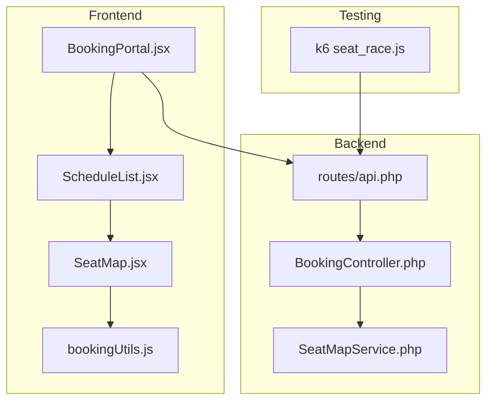
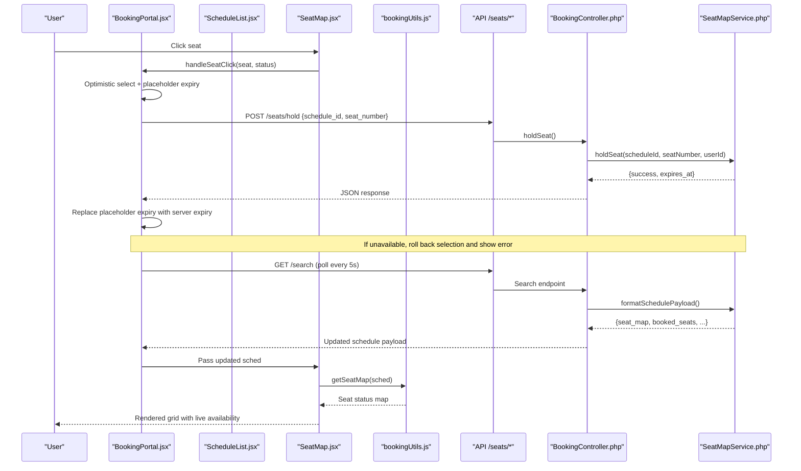
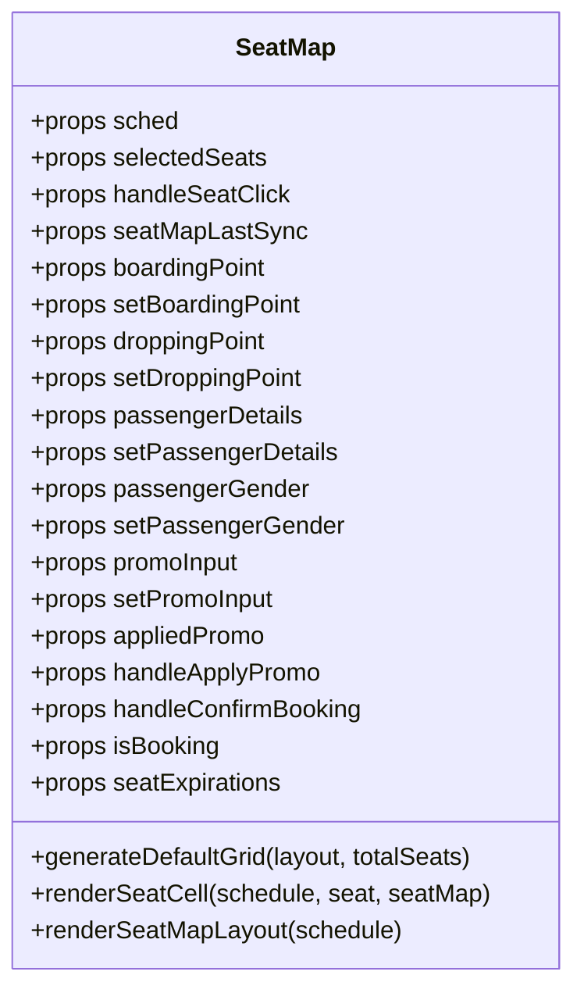
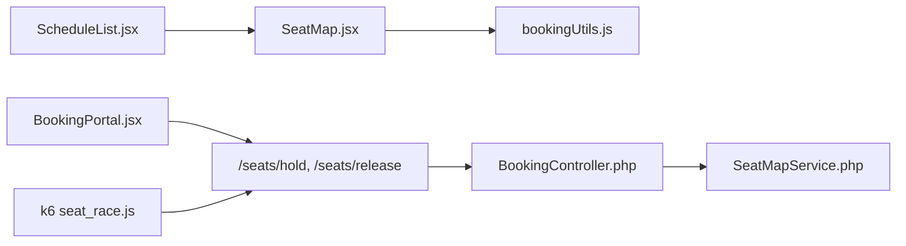

# Seat Map Component

<cite>
**Referenced Files in This Document**
- [SeatMap.jsx](file://frontend/src/components/SeatMap.jsx)
- [bookingUtils.js](file://frontend/src/bookingUtils.js)
- [BookingPortal.jsx](file://frontend/src/components/BookingPortal.jsx)
- [ScheduleList.jsx](file://frontend/src/components/ScheduleList.jsx)
- [SeatMapService.php](file://backend/app/Services/SeatMapService.php)
- [BookingController.php](file://backend/app/Http/Controllers/API/BookingController.php)
- [api.php](file://backend/routes/api.php)
- [seat_race.js](file://k6/scenarios/seat_race.js)
</cite>

## Table of Contents
1. [Introduction](#introduction)
2. [Project Structure](#project-structure)
3. [Core Components](#core-components)
4. [Architecture Overview](#architecture-overview)
5. [Detailed Component Analysis](#detailed-component-analysis)
6. [Dependency Analysis](#dependency-analysis)
7. [Performance Considerations](#performance-considerations)
8. [Troubleshooting Guide](#troubleshooting-guide)
9. [Conclusion](#conclusion)
10. [Appendices](#appendices)

## Introduction
The Seat Map component is the interactive seat selection interface used during bus ticket booking. It renders a visual seat grid, shows real-time availability, supports gender-aware seat status mapping, and integrates with backend seat holding and conflict resolution logic. The component works together with a parent booking portal that manages state, polling for live updates, and user interaction flows such as selecting seats, applying promotions, and confirming bookings.

This document explains:
- How the seat grid is generated and rendered
- How availability and gender-aware statuses are computed
- How seat selection interacts with the backend hold mechanism
- How conflicts are resolved when multiple users select the same seat
- How to customize appearance, handle events, manage conflicts, and implement responsive layouts

## Project Structure
The Seat Map feature spans frontend React components, shared utilities, and backend services and controllers:

**Diagram sources**
- [SeatMap.jsx:1-612](file://frontend/src/components/SeatMap.jsx#L1-L612)
- [bookingUtils.js:1-173](file://frontend/src/bookingUtils.js#L1-L173)
- [BookingPortal.jsx:1-654](file://frontend/src/components/BookingPortal.jsx#L1-L654)
- [ScheduleList.jsx:1-200](file://frontend/src/components/ScheduleList.jsx#L1-L200)
- [SeatMapService.php:1-593](file://backend/app/Services/SeatMapService.php#L1-L593)
- [BookingController.php:1-150](file://backend/app/Http/Controllers/API/BookingController.php#L1-L150)
- [api.php:70-80](file://backend/routes/api.php#L70-L80)
- [seat_race.js:1-15](file://k6/scenarios/seat_race.js#L1-L15)

**Section sources**
- [SeatMap.jsx:1-612](file://frontend/src/components/SeatMap.jsx#L1-L612)
- [bookingUtils.js:1-173](file://frontend/src/bookingUtils.js#L1-L173)
- [BookingPortal.jsx:1-654](file://frontend/src/components/BookingPortal.jsx#L1-L654)
- [SeatMapService.php:1-593](file://backend/app/Services/SeatMapService.php#L1-L593)
- [BookingController.php:1-150](file://backend/app/Http/Controllers/API/BookingController.php#L1-L150)
- [api.php:70-80](file://backend/routes/api.php#L70-L80)
- [seat_race.js:1-15](file://k6/scenarios/seat_race.js#L1-L15)

## Core Components
- SeatMap.jsx: Renders the seat grid, handles local UI interactions, displays pricing and boarding/dropping point forms, and shows seat expiration timers.
- bookingUtils.js: Provides seat status labels, selection helpers, pricing calculation, and seat map generation from schedule data.
- BookingPortal.jsx: Manages authentication, seat selection state, seat hold/release API calls, polling for live seat map updates, promo handling, and final booking submission.
- SeatMapService.php: Computes seat availability, builds seat maps, applies holds, validates seat codes, and exposes blocking and pricing utilities.
- BookingController.php: Exposes REST endpoints for seat hold and release.
- api.php: Registers public API routes for seat operations.

Key responsibilities:
- Visual rendering of seat grids for different bus layouts (2+2, 1+2, sleeper, 2+2_last5).
- Real-time availability updates via periodic polling.
- Gender-aware seat status mapping (booked_m/booked_f/sold_m/sold_f).
- Two-minute seat holding mechanism with expiration tracking.
- Conflict resolution through optimistic UI updates and server-side validation.

**Section sources**
- [SeatMap.jsx:10-30](file://frontend/src/components/SeatMap.jsx#L10-L30)
- [bookingUtils.js:3-20](file://frontend/src/bookingUtils.js#L3-L20)
- [BookingPortal.jsx:38-55](file://frontend/src/components/BookingPortal.jsx#L38-L55)
- [SeatMapService.php:191-244](file://backend/app/Services/SeatMapService.php#L191-L244)
- [BookingController.php:82-115](file://backend/app/Http/Controllers/API/BookingController.php#L82-L115)
- [api.php:73-74](file://backend/routes/api.php#L73-L74)

## Architecture Overview
The seat selection flow involves both client-side interactivity and server-side coordination:

**Diagram sources**
- [BookingPortal.jsx:209-289](file://frontend/src/components/BookingPortal.jsx#L209-L289)
- [BookingPortal.jsx:405-443](file://frontend/src/components/BookingPortal.jsx#L405-L443)
- [SeatMap.jsx:192-208](file://frontend/src/components/SeatMap.jsx#L192-L208)
- [SeatMap.jsx:210-225](file://frontend/src/components/SeatMap.jsx#L210-L225)
- [bookingUtils.js:52-172](file://frontend/src/bookingUtils.js#L52-L172)
- [BookingController.php:82-115](file://backend/app/Http/Controllers/API/BookingController.php#L82-L115)
- [SeatMapService.php:502-561](file://backend/app/Services/SeatMapService.php#L502-L561)
- [SeatMapService.php:367-382](file://backend/app/Services/SeatMapService.php#L367-L382)

## Detailed Component Analysis

### SeatMap.jsx: Interactive Grid Rendering and Local State
SeatMap.jsx is responsible for:
- Generating default seat grids based on bus layout and total seats.
- Rendering individual seat cells with status classes and tooltips.
- Supporting sleeper buses with lower and upper decks.
- Displaying boarding/dropping points, passenger details, payment method, promo application, and fare breakdown.
- Showing seat expiration timers for selected seats.

Key behaviors:
- Default grid generation supports layouts: 2+2, 1+2, sleeper, and 2+2_last5.
- Custom seat_layout_grid can be provided; if invalid or missing, defaults are used.
- Seat cell rendering uses status mapping and selection state to apply CSS classes.
- A legend shows available, selected, blocked, and gender-specific booked/sold statuses.
- Pricing is calculated using shared utilities and displayed alongside service/gateway charges and discounts.

Props:
- sched: Schedule object containing bus info, fare, seat class, and route points.
- selectedSeats: Array of currently selected seat codes.
- handleSeatClick: Callback invoked when a seat is clicked.
- seatMapLastSync: Timestamp indicating last live update time.
- boardingPoint, setBoardingPoint: Boarding point selection.
- droppingPoint, setDroppingPoint: Dropping point selection.
- passengerDetails, setPassengerDetails: Passenger form state.
- passengerGender, setPassengerGender: Gender selection for seat blocking rules.
- promoInput, setPromoInput: Promo code input.
- appliedPromo: Applied promotion discount.
- handleApplyPromo: Function to validate and apply promo.
- handleConfirmBooking: Function to submit booking.
- isBooking: Loading state for booking submission.
- seatExpirations: Map of seat code to ISO expiry timestamp.

Customization hooks:
- CSS classes like `status-available`, `status-blocked`, `status-booked_m`, `status-sold_f`, and `selected` control appearance.
- Legend items can be extended by adding new status keys and labels in shared utilities.

**Section sources**
- [SeatMap.jsx:48-190](file://frontend/src/components/SeatMap.jsx#L48-L190)
- [SeatMap.jsx:192-208](file://frontend/src/components/SeatMap.jsx#L192-L208)
- [SeatMap.jsx:210-384](file://frontend/src/components/SeatMap.jsx#L210-L384)
- [SeatMap.jsx:386-612](file://frontend/src/components/SeatMap.jsx#L386-L612)

#### Class-like Structure of SeatMap.jsx

**Diagram sources**
- [SeatMap.jsx:10-30](file://frontend/src/components/SeatMap.jsx#L10-L30)
- [SeatMap.jsx:48-190](file://frontend/src/components/SeatMap.jsx#L48-L190)
- [SeatMap.jsx:192-208](file://frontend/src/components/SeatMap.jsx#L192-L208)
- [SeatMap.jsx:210-384](file://frontend/src/components/SeatMap.jsx#L210-L384)

### bookingUtils.js: Utilities for Status, Selection, and Mapping
Shared utilities provide:
- SEAT_STATUS_LABELS: Human-readable labels for each seat status.
- isSeatSelectable: Determines whether a seat can be selected based on its status.
- calcPricing: Calculates fare, service charge, gateway charge, and discounts.
- getSeatMap: Builds a seat code to status map from schedule data, supporting custom grids and standard layouts.

Complexity:
- getSeatMap iterates through rows and columns to generate seat codes; complexity is O(N) where N is the number of cells in the grid.
- calcPricing performs constant-time arithmetic per seat count.

Usage:
- SeatMap.jsx imports these utilities to render status labels and compute pricing.
- Parent components use them to interpret seat availability and display consistent UI.

**Section sources**
- [bookingUtils.js:1-28](file://frontend/src/bookingUtils.js#L1-L28)
- [bookingUtils.js:30-50](file://frontend/src/bookingUtils.js#L30-L50)
- [bookingUtils.js:52-172](file://frontend/src/bookingUtils.js#L52-L172)

### BookingPortal.jsx: Seat Holding, Polling, and Conflict Resolution
BookingPortal.jsx orchestrates:
- Authentication checks before seat selection.
- Optimistic seat selection with placeholder expiry.
- Backend hold requests and rollback on failure.
- Periodic refresh of schedule data to reflect live seat availability.
- Release of held seats when navigating away or expiring.
- Final booking submission with validation and success handling.

Hold mechanism:
- On seat click, an optimistic selection is made immediately.
- A hold request is sent to `/seats/hold`.
- If successful, the placeholder expiry is replaced with the server-provided expiry.
- If failed, the selection is rolled back and an error message is shown.

Polling:
- Every 5 seconds, the portal re-fetches search results and updates the selected schedule’s seat map.
- The last sync timestamp is passed to SeatMap.jsx to indicate live updates.

Conflict resolution:
- Server-side validation ensures only available seats can be held.
- If another user holds a seat, the request fails with a clear message.
- Expired holds are cleaned up and removed from the UI.

**Section sources**
- [BookingPortal.jsx:108-161](file://frontend/src/components/BookingPortal.jsx#L108-L161)
- [BookingPortal.jsx:163-207](file://frontend/src/components/BookingPortal.jsx#L163-L207)
- [BookingPortal.jsx:209-289](file://frontend/src/components/BookingPortal.jsx#L209-L289)
- [BookingPortal.jsx:405-443](file://frontend/src/components/BookingPortal.jsx#L405-L443)
- [BookingPortal.jsx:469-575](file://frontend/src/components/BookingPortal.jsx#L469-L575)

### SeatMapService.php: Backend Availability, Holds, and Blocking
SeatMapService.php provides:
- Building seat maps from schedules and bookings.
- Applying active holds from cache to mark seats as blocked for other users.
- Gender-aware status mapping for booked and sold seats.
- Validating seat codes against bus layouts.
- Managing blocked seats via admin operations.
- Implementing the two-minute hold mechanism with expiration timestamps.

Seat allocation algorithm:
- Initializes all seats as available.
- Applies blocked seats first.
- Applies active holds from cache (excluding current user).
- Iterates through paid/recent pending bookings to mark seats as gender-specific statuses.

Two-minute hold:
- Validates seat availability against DB and cache.
- Sets a hold with an expiration timestamp 2 minutes in the future.
- Stores holds in cache keyed by schedule ID.

Conflict resolution:
- If a seat is already held by another user, the hold request fails with a specific message.
- If a seat is booked or sold, the hold request fails.

**Section sources**
- [SeatMapService.php:49-189](file://backend/app/Services/SeatMapService.php#L49-L189)
- [SeatMapService.php:191-244](file://backend/app/Services/SeatMapService.php#L191-L244)
- [SeatMapService.php:433-447](file://backend/app/Services/SeatMapService.php#L433-L447)
- [SeatMapService.php:502-561](file://backend/app/Services/SeatMapService.php#L502-L561)
- [SeatMapService.php:563-582](file://backend/app/Services/SeatMapService.php#L563-L582)

### API Endpoints and Routes
Public API endpoints:
- POST `/seats/hold`: Reserve a seat for 2 minutes.
- POST `/seats/release`: Release a held seat.

Routes are registered in the API routes file and handled by the BookingController, which delegates to SeatMapService.

**Section sources**
- [api.php:73-74](file://backend/routes/api.php#L73-L74)
- [BookingController.php:82-115](file://backend/app/Http/Controllers/API/BookingController.php#L82-L115)

### Integration with ScheduleList.jsx
ScheduleList.jsx consumes SeatMap.jsx and passes down props including selected seats, seat click handler, and seat expiration map. It also receives live sync timestamps and forwards them to SeatMap.jsx for display.

**Section sources**
- [ScheduleList.jsx:1-200](file://frontend/src/components/ScheduleList.jsx#L1-L200)

## Dependency Analysis
The Seat Map feature has clear layering:
- Frontend components depend on shared utilities for status and pricing.
- Parent components manage state and API communication.
- Backend services encapsulate business logic for seat availability and holds.
- Controllers expose endpoints and delegate to services.
- Tests simulate concurrent seat selection to validate locking behavior.

**Diagram sources**
- [SeatMap.jsx:1-8](file://frontend/src/components/SeatMap.jsx#L1-L8)
- [BookingPortal.jsx:209-289](file://frontend/src/components/BookingPortal.jsx#L209-L289)
- [api.php:73-74](file://backend/routes/api.php#L73-L74)
- [BookingController.php:82-115](file://backend/app/Http/Controllers/API/BookingController.php#L82-L115)
- [SeatMapService.php:502-561](file://backend/app/Services/SeatMapService.php#L502-L561)
- [seat_race.js:1-15](file://k6/scenarios/seat_race.js#L1-L15)

**Section sources**
- [SeatMap.jsx:1-8](file://frontend/src/components/SeatMap.jsx#L1-L8)
- [BookingPortal.jsx:209-289](file://frontend/src/components/BookingPortal.jsx#L209-L289)
- [api.php:73-74](file://backend/routes/api.php#L73-L74)
- [BookingController.php:82-115](file://backend/app/Http/Controllers/API/BookingController.php#L82-L115)
- [SeatMapService.php:502-561](file://backend/app/Services/SeatMapService.php#L502-L561)
- [seat_race.js:1-15](file://k6/scenarios/seat_race.js#L1-L15)

## Performance Considerations
- Seat grid generation is linear in the number of cells; large sleeper layouts may benefit from memoization if grids are recomputed frequently.
- Polling every 5 seconds balances freshness with network load; consider debouncing or reducing frequency on low-power devices.
- Optimistic UI reduces perceived latency but requires robust rollback paths on network errors or server rejection.
- Cache-based holds avoid database contention for short-lived reservations; ensure cache TTL is appropriate.

[No sources needed since this section provides general guidance]

## Troubleshooting Guide
Common issues and resolutions:
- Seat not selectable: Ensure status is 'available'; blocked or gender-mismatched seats will be non-selectable.
- Hold fails with "temporarily reserved": Another user holds the seat; wait or choose another seat.
- Hold fails with "not available": Seat is booked/sold or recently pending; check live seat map.
- Expiration timer shows 00:00: Hold expired; seat was released automatically; reselect if still available.
- Live updates not reflecting: Verify polling is active and network requests succeed; check last sync timestamp.

Operational tips:
- Use the legend to understand status colors and labels.
- Validate phone numbers and required fields before submitting bookings.
- Monitor k6 race scenarios to detect concurrency bugs under load.

**Section sources**
- [BookingPortal.jsx:209-289](file://frontend/src/components/BookingPortal.jsx#L209-L289)
- [SeatMapService.php:502-561](file://backend/app/Services/SeatMapService.php#L502-L561)
- [seat_race.js:1-15](file://k6/scenarios/seat_race.js#L1-L15)

## Conclusion
The Seat Map component delivers a responsive, visually rich seat selection experience backed by robust backend logic. It supports multiple bus layouts, gender-aware availability, real-time updates, and safe concurrent seat holding. By combining optimistic UI with server-side validation, it provides a smooth user experience while preventing double bookings and resolving conflicts effectively.

[No sources needed since this section summarizes without analyzing specific files]

## Appendices

### Props Reference for SeatMap.jsx
- sched: Schedule object with bus configuration, fare, seat class, and route points.
- selectedSeats: Array of selected seat codes.
- handleSeatClick: Callback for seat selection/deselection.
- seatMapLastSync: Last live update timestamp.
- boardingPoint, setBoardingPoint: Boarding point selection.
- droppingPoint, setDroppingPoint: Dropping point selection.
- passengerDetails, setPassengerDetails: Passenger form state.
- passengerGender, setPassengerGender: Gender selection.
- promoInput, setPromoInput: Promo code input.
- appliedPromo: Applied promotion discount.
- handleApplyPromo: Function to validate and apply promo.
- handleConfirmBooking: Function to submit booking.
- isBooking: Loading state for booking submission.
- seatExpirations: Map of seat code to ISO expiry timestamp.

**Section sources**
- [SeatMap.jsx:10-30](file://frontend/src/components/SeatMap.jsx#L10-L30)

### Seat Data Structure and Status Mapping
- Seat codes are generated from bus layout or custom grid.
- Status values include available, selected, blocked, booked_m, booked_f, sold_m, sold_f.
- Gender-aware mapping distinguishes male and female passengers for booked/sold seats.

**Section sources**
- [bookingUtils.js:3-10](file://frontend/src/bookingUtils.js#L3-L10)
- [SeatMapService.php:223-241](file://backend/app/Services/SeatMapService.php#L223-L241)

### Example Workflows

#### Customizing Seat Appearance
- Override CSS classes for status classes (`status-available`, `status-blocked`, `status-booked_m`, etc.).
- Extend the legend by adding new status keys and labels in shared utilities.

**Section sources**
- [SeatMap.jsx:359-381](file://frontend/src/components/SeatMap.jsx#L359-L381)
- [bookingUtils.js:3-10](file://frontend/src/bookingUtils.js#L3-L10)

#### Handling Seat Selection Events
- Implement `handleSeatClick` to toggle selection and call backend hold/release APIs.
- Manage optimistic UI updates and rollback on failure.

**Section sources**
- [BookingPortal.jsx:209-289](file://frontend/src/components/BookingPortal.jsx#L209-L289)

#### Managing Booking Conflicts
- Rely on server-side validation to reject conflicting holds.
- Show user-friendly messages and allow reselection.

**Section sources**
- [SeatMapService.php:502-561](file://backend/app/Services/SeatMapService.php#L502-L561)
- [BookingPortal.jsx:264-287](file://frontend/src/components/BookingPortal.jsx#L264-L287)

#### Implementing Responsive Layouts
- Use CSS media queries to adjust grid sizing and sidebar layout.
- Consider collapsing the booking form into a modal on small screens.

[No sources needed since this section provides general guidance]