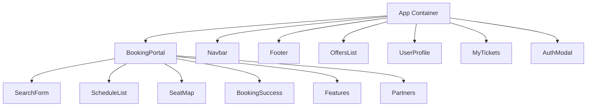
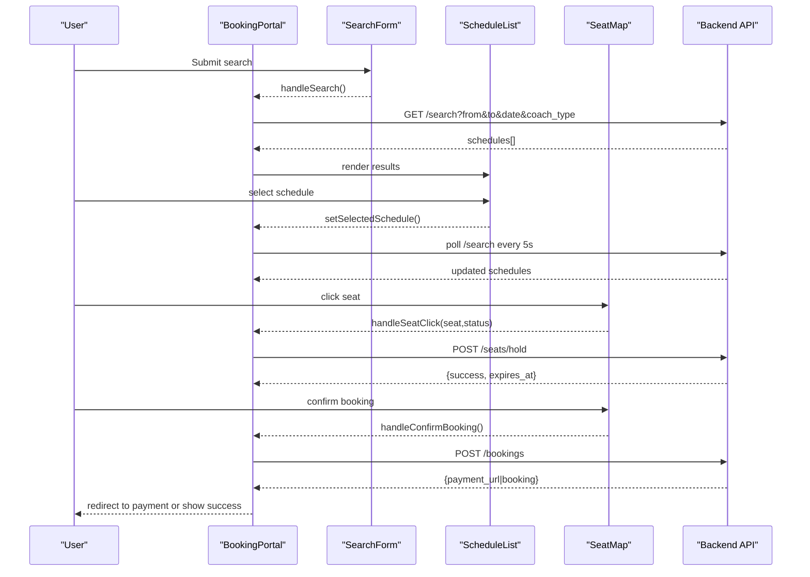
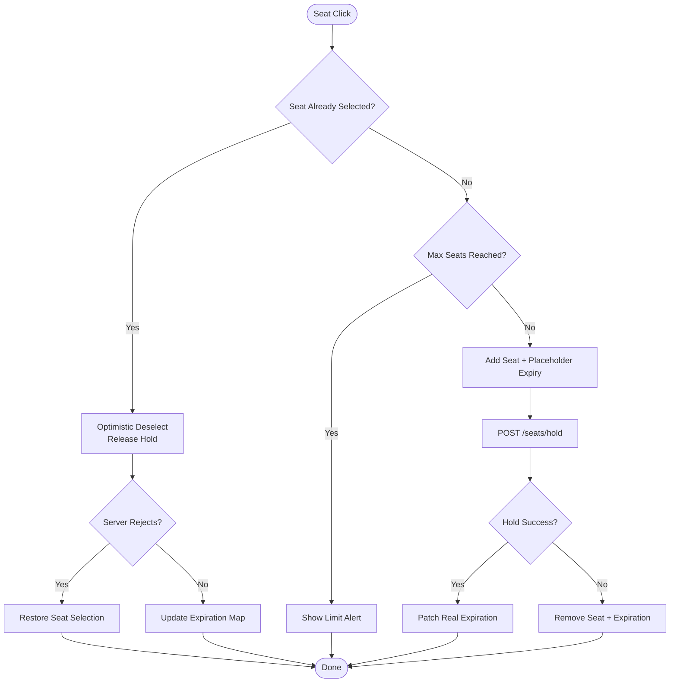
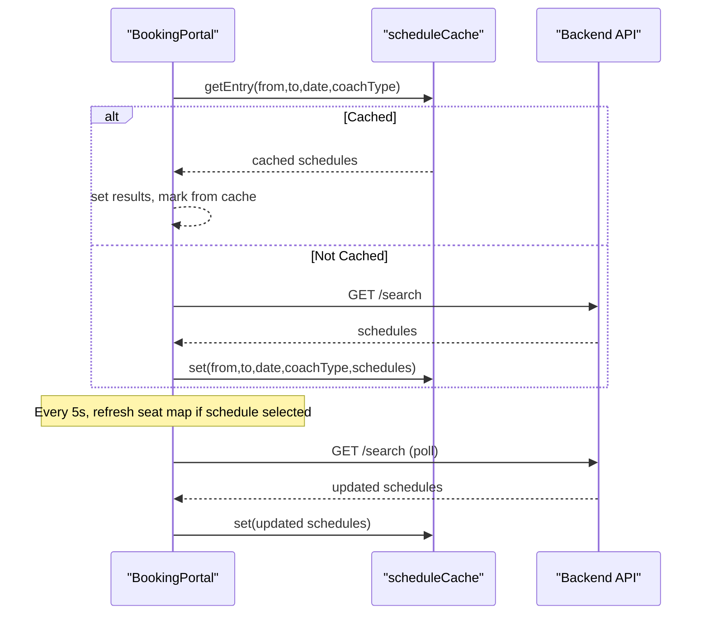
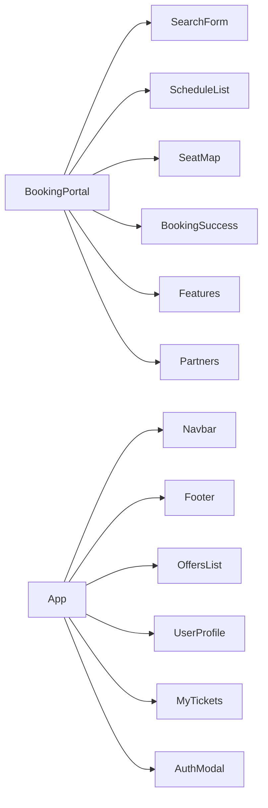

# UI Components

<cite>
**Referenced Files in This Document**   
- [SearchForm.jsx](file://frontend/src/components/SearchForm.jsx)
- [SeatMap.jsx](file://frontend/src/components/SeatMap.jsx)
- [BookingPortal.jsx](file://frontend/src/components/BookingPortal.jsx)
- [AuthModal.jsx](file://frontend/src/components/AuthModal.jsx)
- [Navbar.jsx](file://frontend/src/components/Navbar.jsx)
- [Footer.jsx](file://frontend/src/components/Footer.jsx)
- [OffersList.jsx](file://frontend/src/components/OffersList.jsx)
- [UserProfile.jsx](file://frontend/src/components/UserProfile.jsx)
- [MyTickets.jsx](file://frontend/src/components/MyTickets.jsx)
</cite>

## Table of Contents
1. [Introduction](#introduction)
2. [Project Structure](#project-structure)
3. [Core Components](#core-components)
4. [Architecture Overview](#architecture-overview)
5. [Detailed Component Analysis](#detailed-component-analysis)
6. [Dependency Analysis](#dependency-analysis)
7. [Performance Considerations](#performance-considerations)
8. [Troubleshooting Guide](#troubleshooting-guide)
9. [Conclusion](#conclusion)

## Introduction
This document explains the customer-facing React UI components used for bus ticket booking. It covers SearchForm, SeatMap, BookingPortal, AuthModal, Navbar, Footer, OffersList, UserProfile, and MyTickets. For each component, you will find props, state management, event handling, integration patterns, visual examples, responsive design notes, accessibility considerations, and customization options.

The application is a React frontend that communicates with a Laravel backend through REST endpoints. The BookingPortal orchestrates search, seat selection, promotions, and booking submission. Supporting components provide authentication, navigation, promotional content, account management, and ticket viewing.

## Project Structure
The relevant React components live under `frontend/src/components`. Each file exports a single functional component and is composed by higher-level pages or containers.

**Diagram sources**
- [BookingPortal.jsx:1-654](file://frontend/src/components/BookingPortal.jsx#L1-L654)
- [SearchForm.jsx:1-109](file://frontend/src/components/SearchForm.jsx#L1-L109)
- [SeatMap.jsx:1-612](file://frontend/src/components/SeatMap.jsx#L1-L612)
- [AuthModal.jsx:1-165](file://frontend/src/components/AuthModal.jsx#L1-L165)
- [Navbar.jsx:1-151](file://frontend/src/components/Navbar.jsx#L1-L151)
- [Footer.jsx:1-78](file://frontend/src/components/Footer.jsx#L1-L78)
- [OffersList.jsx:1-71](file://frontend/src/components/OffersList.jsx#L1-L71)
- [UserProfile.jsx:1-150](file://frontend/src/components/UserProfile.jsx#L1-L150)
- [MyTickets.jsx:1-435](file://frontend/src/components/MyTickets.jsx#L1-L435)

**Section sources**
- [BookingPortal.jsx:1-654](file://frontend/src/components/BookingPortal.jsx#L1-L654)

## Core Components
This section summarizes the purpose and responsibilities of each major component.

- SearchForm: Route and schedule search form with station selectors, date picker, coach type filter, and submit button.
- SeatMap: Interactive seat grid with real-time availability, boarding/dropping point selection, passenger details, promo code application, pricing breakdown, and booking confirmation.
- BookingPortal: Orchestrates search, caching, seat hold/release, polling for live seat updates, promo validation, and final booking submission.
- AuthModal: Modal dialog supporting login, register, forgot password, and reset password flows.
- Navbar: Top navigation with logo, tabs, user greeting, logout, and auth entry points.
- Footer: Site footer with configurable links and branding from site settings.
- OffersList: Promotional coupon list with copy-to-clipboard support.
- UserProfile: Password update page with authentication checks and API integration.
- MyTickets: Ticket listing, cancellation requests, PDF download, and pagination.

**Section sources**
- [SearchForm.jsx:1-109](file://frontend/src/components/SearchForm.jsx#L1-L109)
- [SeatMap.jsx:1-612](file://frontend/src/components/SeatMap.jsx#L1-L612)
- [BookingPortal.jsx:1-654](file://frontend/src/components/BookingPortal.jsx#L1-L654)
- [AuthModal.jsx:1-165](file://frontend/src/components/AuthModal.jsx#L1-L165)
- [Navbar.jsx:1-151](file://frontend/src/components/Navbar.jsx#L1-L151)
- [Footer.jsx:1-78](file://frontend/src/components/Footer.jsx#L1-L78)
- [OffersList.jsx:1-71](file://frontend/src/components/OffersList.jsx#L1-L71)
- [UserProfile.jsx:1-150](file://frontend/src/components/UserProfile.jsx#L1-L150)
- [MyTickets.jsx:1-435](file://frontend/src/components/MyTickets.jsx#L1-L435)

## Architecture Overview
The BookingPortal is the central container for the booking workflow. It manages search state, selected schedule, seat selections, expirations, passenger details, and promo state. It composes SearchForm, ScheduleList, SeatMap, and success screens.

**Diagram sources**
- [BookingPortal.jsx:291-380](file://frontend/src/components/BookingPortal.jsx#L291-L380)
- [BookingPortal.jsx:400-443](file://frontend/src/components/BookingPortal.jsx#L400-L443)
- [BookingPortal.jsx:209-289](file://frontend/src/components/BookingPortal.jsx#L209-L289)
- [BookingPortal.jsx:469-575](file://frontend/src/components/BookingPortal.jsx#L469-L575)
- [SeatMap.jsx:192-208](file://frontend/src/components/SeatMap.jsx#L192-L208)
- [SeatMap.jsx:535-542](file://frontend/src/components/SeatMap.jsx#L535-L542)

## Detailed Component Analysis

### SearchForm
Purpose:
- Collects departure station, arrival station, journey date, and coach type.
- Submits search via parent-provided handler.

Props:
- stations: array of station objects for dropdowns.
- searchParams: current search values.
- setSearchParams: updater function for search parameters.
- minDateStr: minimum allowed date string.
- handleSearch: callback invoked on submit.
- isLoading: boolean disabling submit during network calls.

State Management:
- Controlled inputs bound to searchParams.
- No local state; all behavior delegated to parent.

Event Handling:
- onChange handlers update searchParams immutably.
- onSubmit triggers handleSearch.

Integration Patterns:
- Used inside BookingPortal to initiate searches.
- Disabled submit while loading.

Responsive Design:
- Uses semantic sections and input groups; styling handled by CSS classes.

Accessibility:
- Labels associated with inputs via htmlFor/id.
- Select elements include placeholder options.

Customization Options:
- Station lists are injected via props.
- Coach types can be extended by modifying options.

**Section sources**
- [SearchForm.jsx:1-109](file://frontend/src/components/SearchForm.jsx#L1-L109)

### SeatMap
Purpose:
- Renders an interactive bus seat layout based on schedule data.
- Manages boarding/dropping points, passenger details, promo code application, and booking confirmation.

Props:
- sched: selected schedule object including bus layout and fare.
- selectedSeats: array of currently selected seats.
- handleSeatClick: callback for seat selection/deselection.
- seatMapLastSync: timestamp of last live sync.
- boardingPoint, setBoardingPoint: selected boarding point.
- droppingPoint, setDroppingPoint: selected dropping point.
- passengerDetails, setPassengerDetails: passenger info and payment method.
- passengerGender, setPassengerGender: gender selection.
- promoInput, setPromoInput: promo code input.
- appliedPromo: applied promotion object.
- handleApplyPromo: callback to validate promo.
- handleConfirmBooking: callback to submit booking.
- isBooking: boolean indicating ongoing booking process.
- seatExpirations: map of seat to expiration time.

State Management:
- Local tick state drives a timer for countdown display.
- Layout generation logic constructs default grids when none provided.
- Pricing computed from schedule, seat count, and payment method.

Event Handling:
- Clicking a seat toggles selection and calls handleSeatClick.
- Boarding/dropping selects update parent state.
- Promo form submits via handleApplyPromo.
- Confirm booking invokes handleConfirmBooking.

Integration Patterns:
- Uses utility functions for seat mapping, pricing, formatting, and status labels.
- Displays live status indicator and countdown timers per seat.

Responsive Design:
- Two-column layout with seat grid and booking sidebar.
- Legend shows seat statuses.

Accessibility:
- Seats have title attributes describing status.
- Inputs use labels and placeholders.

Customization Options:
- Supports multiple layouts: 2+2, 2+2_last5, 1+2, sleeper.
- Custom seat_layout_grid can override defaults.

**Diagram sources**
- [SeatMap.jsx:192-208](file://frontend/src/components/SeatMap.jsx#L192-L208)
- [SeatMap.jsx:386-390](file://frontend/src/components/SeatMap.jsx#L386-L390)
- [SeatMap.jsx:535-542](file://frontend/src/components/SeatMap.jsx#L535-L542)

**Section sources**
- [SeatMap.jsx:1-612](file://frontend/src/components/SeatMap.jsx#L1-L612)

### BookingPortal
Purpose:
- Central orchestrator for searching schedules, selecting seats, applying promos, and submitting bookings.
- Manages caching, live seat updates, hold release, and error handling.

Props:
- bookingSuccess, setBookingSuccess: success screen control.
- verificationStatus, setVerificationStatus: verification flow control.
- authUser, authToken: current user and token.
- clearAuth: clears authentication state.
- openAuthModal: opens authentication modal.
- showToast: displays notifications.
- API_BASE: base URL for backend API.

State Management:
- Stations, search params, search results, loading flags, cache indicators.
- Selected schedule, selected seats, seat expirations, promo state.
- Passenger details, boarding/dropping points, gender, sync timestamps.
- Booking processing flag.

Event Handling:
- handleSearch validates inputs, checks cache, fetches schedules, updates cache, and shows feedback.
- handleSeatClick enforces max seats, performs optimistic selection, holds/releases seats, and rolls back on errors.
- handleApplyPromo validates promo codes and applies discounts.
- handleConfirmBooking validates passenger data, submits booking, handles payment redirects, and refreshes results.

Integration Patterns:
- Composes SearchForm, ScheduleList, SeatMap, and success screens.
- Polls search endpoint every 5 seconds to refresh seat availability.
- Releases holds on schedule change, page unload, and expiration.

Responsive Design:
- Delegates layout to child components; uses container classes.

Accessibility:
- Uses toast notifications for feedback.
- Requires authentication before sensitive actions.

Customization Options:
- Caching strategy via scheduleCache module.
- Configurable polling interval and seat limits.

**Diagram sources**
- [BookingPortal.jsx:319-380](file://frontend/src/components/BookingPortal.jsx#L319-L380)
- [BookingPortal.jsx:400-443](file://frontend/src/components/BookingPortal.jsx#L400-L443)

**Section sources**
- [BookingPortal.jsx:1-654](file://frontend/src/components/BookingPortal.jsx#L1-L654)

### AuthModal
Purpose:
- Modal dialog for login, registration, forgot password, and password reset.

Props:
- showAuthModal: visibility flag.
- closeAuthModal: closes the modal.
- authMode: current mode (login, register, forgot, reset).
- setAuthMode: updates mode.
- authForm: form fields (name, email, code, password, password_confirmation).
- setAuthForm: updates form fields.
- handleAuthSubmit: submits the form.
- isAuthLoading: loading state for submission.
- devResetCode: optional development-only reset code display.

State Management:
- Controlled by parent; no internal state beyond rendering.

Event Handling:
- Tab switching toggles between login/register.
- Form submission delegates to handleAuthSubmit.
- Close button dismisses modal.

Integration Patterns:
- Triggered by Navbar and other protected routes.
- Supports conditional fields based on authMode.

Responsive Design:
- Overlay and centered modal card.

Accessibility:
- Close button with explicit action.
- Labels and required attributes on inputs.

Customization Options:
- Mode-specific fields and messages.
- Dev mode reset code hint.

**Section sources**
- [AuthModal.jsx:1-165](file://frontend/src/components/AuthModal.jsx#L1-L165)

### Navbar
Purpose:
- Top navigation bar with logo, tabs, user greeting, logout, and auth buttons.

Props:
- activeTab: current active tab.
- setActiveTab: updates active tab.
- setBookingSuccess: resets booking success state.
- setPaymentFailed: resets payment failure state.
- authUser: current user object.
- handleLogout: logs out the user.
- openAuthModal: opens authentication modal.
- siteSettings: site configuration including logo and text.

State Management:
- No local state; controlled by props.

Event Handling:
- Logo click navigates home and resets states.
- Nav links switch tabs and guard profile access with auth check.
- Login/Register buttons open AuthModal.
- Logout triggers handleLogout.

Integration Patterns:
- Reads logo URL from site settings and resolves absolute paths.
- Displays user greeting and controls.

Responsive Design:
- Flexbox layout with logo, menu, and user controls.

Accessibility:
- Semantic header and list elements.
- Buttons with descriptive labels.

Customization Options:
- Logo image or text fallback.
- Dynamic tab labels and routing via setActiveTab.

**Section sources**
- [Navbar.jsx:1-151](file://frontend/src/components/Navbar.jsx#L1-L151)

### Footer
Purpose:
- Site footer with configurable links and copyright.

Props:
- siteSettings: includes footer company name, links, and copyright.
- setActiveTab: switches tabs.
- setBookingSuccess: resets booking success state.
- authUser: current user.
- openAuthModal: opens authentication modal.

State Management:
- No local state; controlled by props.

Event Handling:
- Links either open external URLs or switch tabs.
- Profile link requires authentication.

Integration Patterns:
- Uses siteSettings for dynamic content.

Responsive Design:
- Simple stacked layout.

Accessibility:
- Semantic footer and list elements.

Customization Options:
- Configurable links array and copyright text.

**Section sources**
- [Footer.jsx:1-78](file://frontend/src/components/Footer.jsx#L1-L78)

### OffersList
Purpose:
- Displays promotional coupons fetched from the backend.

Props:
- API_BASE: base URL for backend API.
- showToast: displays notifications.

State Management:
- offers: array of promotions.
- isLoadingOffers: loading flag.

Event Handling:
- Fetches promotions on mount.
- Copy code copies to clipboard and shows success toast.

Integration Patterns:
- Calls GET /promotions.

Responsive Design:
- Grid layout for offer cards.

Accessibility:
- Clear headings and descriptions.

Customization Options:
- Offer cards display discount amount, description, and code.

**Section sources**
- [OffersList.jsx:1-71](file://frontend/src/components/OffersList.jsx#L1-L71)

### UserProfile
Purpose:
- Password update page with authentication checks and API integration.

Props:
- authUser, authToken: current user and token.
- clearAuth: clears authentication state.
- openAuthModal: opens authentication modal.
- setActiveTab: switches tabs.
- showToast: displays notifications.
- API_BASE: base URL for backend API.
- setAuthUser: updates user state.
- AUTH_USER_KEY: localStorage key for user data.

State Management:
- profileForm: current/new/confirm password fields.
- isUpdatingProfile: loading flag.

Event Handling:
- Validates password match.
- Submits password update to backend.
- Handles 401 by clearing auth and reopening modal.
- Updates local user state and localStorage on success.

Integration Patterns:
- Protected route requiring authentication.
- Uses Bearer token headers.

Responsive Design:
- Centered card layout.

Accessibility:
- Labels and autocomplete attributes.

Customization Options:
- Field validation and error messaging.

**Section sources**
- [UserProfile.jsx:1-150](file://frontend/src/components/UserProfile.jsx#L1-L150)

### MyTickets
Purpose:
- Lists user tickets, supports cancellation requests, PDF download, and pagination.

Props:
- authUser, authToken: current user and token.
- clearAuth: clears authentication state.
- openAuthModal: opens authentication modal.
- setActiveTab: switches tabs.
- showToast: displays notifications.
- API_BASE: base URL for backend API.

State Management:
- cancelBookings: array of bookings.
- isSearchingCancel: loading flag.
- pagination: current page, last page, total.

Event Handling:
- Loads bookings on mount when authenticated.
- Pagination controls navigate pages.
- Cancellation request submits to backend and updates local status.
- PDF download dynamically loads jsPDF and generates invoice.

Integration Patterns:
- Calls GET /bookings/mine and POST /bookings/{id}/cancel.
- Uses Bearer token headers.

Responsive Design:
- Card-based layout with grid details.

Accessibility:
- Status badges and descriptive text.

Customization Options:
- Per-page limit and pagination UI.
- Optional coach logo in PDF.

**Section sources**
- [MyTickets.jsx:1-435](file://frontend/src/components/MyTickets.jsx#L1-L435)

## Dependency Analysis
Component relationships and data flow:

**Diagram sources**
- [BookingPortal.jsx:1-654](file://frontend/src/components/BookingPortal.jsx#L1-L654)
- [Navbar.jsx:1-151](file://frontend/src/components/Navbar.jsx#L1-L151)
- [Footer.jsx:1-78](file://frontend/src/components/Footer.jsx#L1-L78)
- [OffersList.jsx:1-71](file://frontend/src/components/OffersList.jsx#L1-L71)
- [UserProfile.jsx:1-150](file://frontend/src/components/UserProfile.jsx#L1-L150)
- [MyTickets.jsx:1-435](file://frontend/src/components/MyTickets.jsx#L1-L435)
- [AuthModal.jsx:1-165](file://frontend/src/components/AuthModal.jsx#L1-L165)

Key dependencies:
- BookingPortal depends on SearchForm, ScheduleList, SeatMap, and success screens.
- SeatMap depends on utility functions for seat mapping, pricing, and formatting.
- All authenticated components depend on authUser/authToken and openAuthModal.
- OffersList and UserProfile call backend APIs directly.

Coupling and cohesion:
- BookingPortal has high responsibility but maintains cohesion around booking workflow.
- SeatMap encapsulates complex seat interaction logic.
- Navbar and Footer are presentation-focused with minimal coupling.

External integrations:
- Backend REST endpoints for stations, search, seats, promotions, bookings, and profile.
- External PDF library loaded dynamically for ticket downloads.

Potential circular dependencies:
- None observed among these components; communication is primarily prop-driven.

**Section sources**
- [BookingPortal.jsx:1-654](file://frontend/src/components/BookingPortal.jsx#L1-L654)
- [SeatMap.jsx:1-612](file://frontend/src/components/SeatMap.jsx#L1-L612)
- [MyTickets.jsx:1-435](file://frontend/src/components/MyTickets.jsx#L1-L435)

## Performance Considerations
- Search caching: BookingPortal caches search results to reduce backend load and improve responsiveness.
- Live seat updates: Polling every 5 seconds keeps seat availability fresh without excessive overhead.
- Optimistic UI: Seat selection updates immediately, then reconciles with server responses.
- Conditional rendering: Components like AuthModal only render when visible.
- Lazy loading: PDF library is loaded on demand to avoid blocking initial render.

Recommendations:
- Debounce rapid seat clicks to prevent redundant hold requests.
- Implement request deduplication for repeated polls.
- Use IntersectionObserver to pause polling when SeatMap is off-screen.
- Memoize expensive computations like seat grid generation.

[No sources needed since this section provides general guidance]

## Troubleshooting Guide
Common issues and resolutions:

- Backend connectivity:
  - Symptom: Toast indicates cannot connect to Laravel backend.
  - Resolution: Verify backend is running and reachable at API_BASE.

- Authentication failures:
  - Symptom: 401 responses trigger session expiry and modal prompts.
  - Resolution: Re-authenticate via AuthModal; ensure Authorization header is present.

- Seat hold conflicts:
  - Symptom: Seat selection rollback due to server rejection.
  - Resolution: Retry after a short delay; ensure seat limit not exceeded.

- Promo code validation:
  - Symptom: Invalid promo code toast.
  - Resolution: Check code validity and expiration; clear applied promo.

- Ticket PDF download:
  - Symptom: PDF library load failure.
  - Resolution: Ensure CDN is accessible; retry download.

- Pagination errors:
  - Symptom: Failed to load tickets.
  - Resolution: Check network and auth token; verify API response structure.

**Section sources**
- [BookingPortal.jsx:84-99](file://frontend/src/components/BookingPortal.jsx#L84-L99)
- [BookingPortal.jsx:209-289](file://frontend/src/components/BookingPortal.jsx#L209-L289)
- [BookingPortal.jsx:445-467](file://frontend/src/components/BookingPortal.jsx#L445-L467)
- [MyTickets.jsx:31-58](file://frontend/src/components/MyTickets.jsx#L31-L58)
- [MyTickets.jsx:114-146](file://frontend/src/components/MyTickets.jsx#L114-L146)

## Conclusion
The customer-facing UI components provide a cohesive booking experience. BookingPortal coordinates search, seat selection, promotions, and booking submission. SeatMap delivers interactive seat selection with real-time availability. AuthModal, Navbar, and Footer support authentication and navigation. OffersList showcases promotions, UserProfile manages account security, and MyTickets enables ticket viewing and cancellation workflows. Together, they form a responsive, accessible, and customizable interface integrated with the backend API.

[No sources needed since this section summarizes without analyzing specific files]