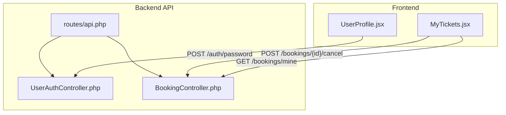
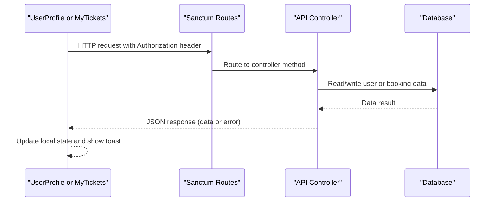
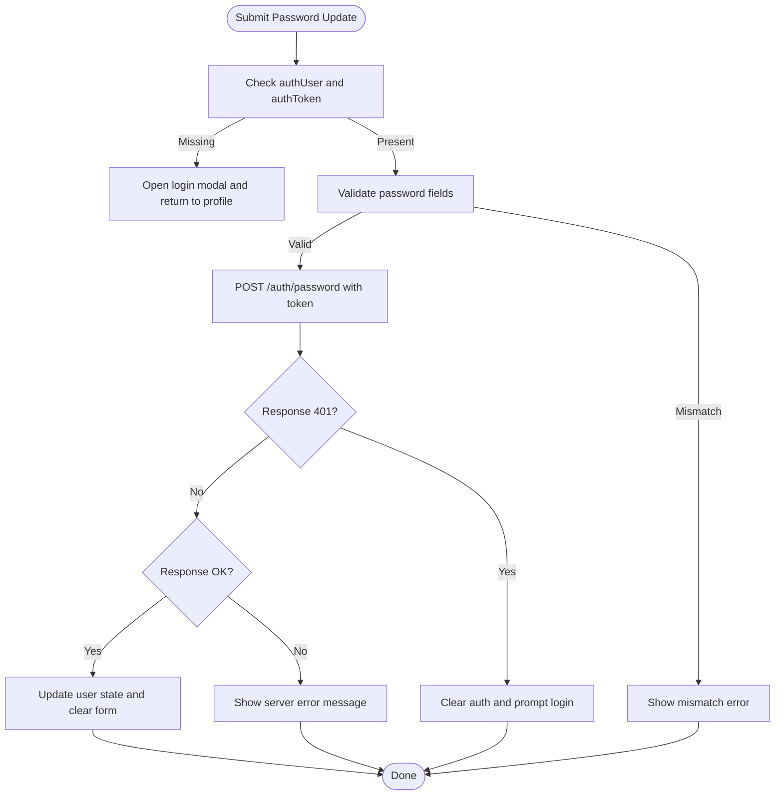
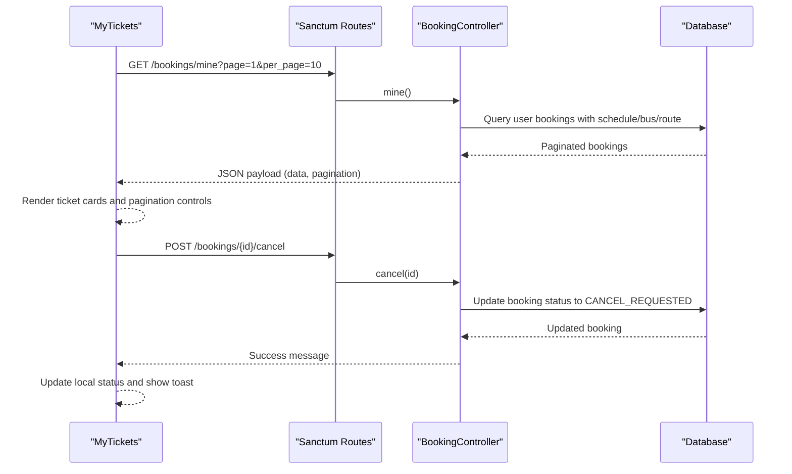
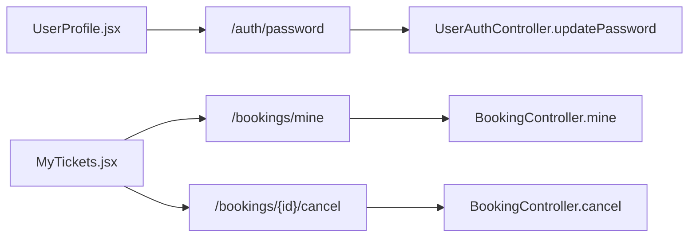

# User Management Components

<cite>
**Referenced Files in This Document**
- [UserProfile.jsx](file://frontend/src/components/UserProfile.jsx)
- [MyTickets.jsx](file://frontend/src/components/MyTickets.jsx)
- [UserAuthController.php](file://backend/app/Http/Controllers/API/UserAuthController.php)
- [BookingController.php](file://backend/app/Http/Controllers/API/BookingController.php)
- [api.php](file://backend/routes/api.php)
</cite>

## Table of Contents
1. [Introduction](#introduction)
2. [Project Structure](#project-structure)
3. [Core Components](#core-components)
4. [Architecture Overview](#architecture-overview)
5. [Detailed Component Analysis](#detailed-component-analysis)
6. [Dependency Analysis](#dependency-analysis)
7. [Performance Considerations](#performance-considerations)
8. [Troubleshooting Guide](#troubleshooting-guide)
9. [Conclusion](#conclusion)
10. [Appendices](#appendices)

## Introduction
This document explains the user management components for the bus booking application: UserProfile and MyTickets. It covers how these React components display account information, manage password updates, list booked tickets, track ticket status, handle cancellation requests, and generate downloadable ticket PDFs. It also documents props, data binding, API integration, permission handling, and practical implementation examples such as profile photo uploads, user preferences, ticket status updates, and export functionality.

## Project Structure
The user management features are implemented in the frontend React components and backed by Laravel Sanctum-protected API endpoints.

**Diagram sources**
- [UserProfile.jsx:29-76](file://frontend/src/components/UserProfile.jsx#L29-L76)
- [MyTickets.jsx:114-187](file://frontend/src/components/MyTickets.jsx#L114-L187)
- [api.php:63-75](file://backend/routes/api.php#L63-L75)
- [UserAuthController.php:88-111](file://backend/app/Http/Controllers/API/UserAuthController.php#L88-L111)
- [BookingController.php:42-73](file://backend/app/Http/Controllers/API/BookingController.php#L42-L73)

**Section sources**
- [UserProfile.jsx:1-150](file://frontend/src/components/UserProfile.jsx#L1-L150)
- [MyTickets.jsx:1-435](file://frontend/src/components/MyTickets.jsx#L1-L435)
- [api.php:63-75](file://backend/routes/api.php#L63-L75)

## Core Components
- UserProfile: Displays the signed-in user’s email and provides a secure password update form. It enforces authentication before allowing changes, validates input locally, calls the backend password update endpoint, handles session expiration, and refreshes local user state on success.
- MyTickets: Lists the authenticated user’s bookings with pagination, shows ticket details, supports cancellation requests, tracks status transitions, and generates client-side PDF invoices using jsPDF.

Key responsibilities:
- Authentication gating via authUser and authToken props.
- API communication through fetch with Bearer token headers.
- Error handling and user feedback via showToast.
- Local UI state for forms, loading indicators, pagination, and ticket lists.

**Section sources**
- [UserProfile.jsx:3-76](file://frontend/src/components/UserProfile.jsx#L3-L76)
- [MyTickets.jsx:3-193](file://frontend/src/components/MyTickets.jsx#L3-L193)

## Architecture Overview
The components integrate with Sanctum-protected routes. The frontend sends Authorization headers; the backend validates tokens and authorizes actions based on the current user.

**Diagram sources**
- [api.php:63-75](file://backend/routes/api.php#L63-L75)
- [UserAuthController.php:88-111](file://backend/app/Http/Controllers/API/UserAuthController.php#L88-L111)
- [BookingController.php:42-73](file://backend/app/Http/Controllers/API/BookingController.php#L42-L73)

## Detailed Component Analysis

### UserProfile Component
Purpose:
- Display the currently signed-in user’s email.
- Allow password updates after verifying the current password.
- Handle authentication checks, validation, network errors, and session expiry.

Props:
- authUser: Current user object used to determine if the user is logged in.
- authToken: Bearer token sent in Authorization headers.
- clearAuth: Function to clear local authentication state when sessions expire.
- openAuthModal: Function to prompt login and optionally return to the profile tab.
- setActiveTab: Function to switch UI tabs (e.g., back to profile after login).
- showToast: Function to display success or error messages.
- API_BASE: Base URL for API calls.
- setAuthUser: Function to update the current user object after successful password change.
- AUTH_USER_KEY: Local storage key for persisting user data.

Data flow:
- On submit, the component validates that new passwords match.
- It constructs headers including Accept and optional Authorization.
- It POSTs to the password update endpoint and handles 401 by clearing auth and prompting login.
- On success, it updates local user state and clears the form.

Error handling:
- Mismatched passwords show an immediate error.
- Network errors and server errors are surfaced via showToast.
- Session expiration triggers logout and re-authentication flow.

**Diagram sources**
- [UserProfile.jsx:21-76](file://frontend/src/components/UserProfile.jsx#L21-L76)

Implementation notes:
- The component uses a simple form state object for current_password, password, and password_confirmation.
- It disables the submit button while updating to prevent duplicate submissions.
- It persists updated user data to local storage using the provided AUTH_USER_KEY.

**Section sources**
- [UserProfile.jsx:1-150](file://frontend/src/components/UserProfile.jsx#L1-L150)
- [UserAuthController.php:88-111](file://backend/app/Http/Controllers/API/UserAuthController.php#L88-L111)
- [api.php:63-75](file://backend/routes/api.php#L63-L75)

### MyTickets Component
Purpose:
- List the authenticated user’s booked tickets with pagination.
- Display ticket details including route, operator, seats, fare, and status.
- Support cancellation requests and status tracking.
- Generate downloadable ticket PDFs using jsPDF.

Props:
- authUser: Current user object.
- authToken: Bearer token for API authorization.
- clearAuth: Function to clear authentication state on session expiry.
- openAuthModal: Function to prompt login.
- setActiveTab: Function to navigate to the cancel/tickets tab after login.
- showToast: Function to show success/error notifications.
- API_BASE: Base URL for API calls.

Data fetching:
- On mount or when authToken changes, it fetches the user’s bookings from /bookings/mine with pagination parameters.
- It normalizes paginated responses to support both array and object payloads.
- It maintains pagination state including current_page, last_page, and total.

Cancellation workflow:
- Requires authentication and confirmation.
- Sends a POST request to /bookings/{id}/cancel.
- Handles 401 and 403 responses appropriately.
- Updates local ticket status to CANCEL_REQUESTED upon success.

Ticket download:
- Dynamically loads jsPDF from CDN if not present.
- Builds a text-based invoice with booking details.
- Optionally embeds the coach logo if provided as a base64 image.
- Saves the generated PDF file.

**Diagram sources**
- [MyTickets.jsx:114-187](file://frontend/src/components/MyTickets.jsx#L114-L187)
- [BookingController.php:42-73](file://backend/app/Http/Controllers/API/BookingController.php#L42-L73)
- [api.php:63-75](file://backend/routes/api.php#L63-L75)

Status handling:
- Active statuses like PAID, SOLD, BOOKED allow cancellation requests and PDF download.
- CANCEL_REQUESTED indicates pending admin approval.
- Cancelled tickets show refund notice and still allow PDF download.

**Section sources**
- [MyTickets.jsx:1-435](file://frontend/src/components/MyTickets.jsx#L1-L435)
- [BookingController.php:42-73](file://backend/app/Http/Controllers/API/BookingController.php#L42-L73)
- [api.php:63-75](file://backend/routes/api.php#L63-L75)

## Dependency Analysis
Component-to-API relationships:
- UserProfile depends on the password update endpoint under Sanctum middleware.
- MyTickets depends on the bookings listing and cancellation endpoints under Sanctum middleware.
- Both components rely on shared props for authentication and UI control.

**Diagram sources**
- [UserProfile.jsx:48-52](file://frontend/src/components/UserProfile.jsx#L48-L52)
- [MyTickets.jsx:119-121](file://frontend/src/components/MyTickets.jsx#L119-L121)
- [MyTickets.jsx:163-166](file://frontend/src/components/MyTickets.jsx#L163-L166)
- [api.php:63-75](file://backend/routes/api.php#L63-L75)
- [UserAuthController.php:88-111](file://backend/app/Http/Controllers/API/UserAuthController.php#L88-L111)
- [BookingController.php:42-73](file://backend/app/Http/Controllers/API/BookingController.php#L42-L73)

**Section sources**
- [UserProfile.jsx:1-150](file://frontend/src/components/UserProfile.jsx#L1-L150)
- [MyTickets.jsx:1-435](file://frontend/src/components/MyTickets.jsx#L1-L435)
- [api.php:63-75](file://backend/routes/api.php#L63-L75)

## Performance Considerations
- Pagination: MyTickets uses per_page to limit data transfer and rendering cost. Ensure reasonable defaults (e.g., 10–20 items per page).
- Conditional PDF generation: jsPDF is loaded lazily only when needed, reducing initial bundle size.
- Debounce refresh: Consider debouncing the refresh button to avoid rapid repeated requests.
- Image optimization: Coach logos embedded in PDFs should be small base64 images to avoid large payloads.
- Token caching: Avoid unnecessary re-fetching when authToken does not change; guard fetch calls accordingly.

[No sources needed since this section provides general guidance]

## Troubleshooting Guide
Common issues and resolutions:
- Session expired during password update:
  - Symptom: 401 response and automatic logout prompt.
  - Resolution: Clear auth state and redirect to login; ensure AUTH_USER_KEY is correctly handled.
- Mismatched password fields:
  - Symptom: Immediate error toast.
  - Resolution: Enforce matching passwords in the form and provide clear validation messages.
- Failed to load tickets:
  - Symptom: Error toast indicating failure to load tickets.
  - Resolution: Verify authToken presence and API_BASE configuration; check network connectivity.
- Cancellation request denied:
  - Symptom: 403 response with message.
  - Resolution: Ensure the booking belongs to the current user and is eligible for cancellation.
- PDF download fails:
  - Symptom: Toast indicating inability to download PDF.
  - Resolution: Confirm jsPDF CDN availability and browser script loading; verify base64 image format if embedding logos.

**Section sources**
- [UserProfile.jsx:54-75](file://frontend/src/components/UserProfile.jsx#L54-L75)
- [MyTickets.jsx:122-145](file://frontend/src/components/MyTickets.jsx#L122-L145)
- [MyTickets.jsx:168-186](file://frontend/src/components/MyTickets.jsx#L168-L186)
- [MyTickets.jsx:101-103](file://frontend/src/components/MyTickets.jsx#L101-L103)

## Conclusion
UserProfile and MyTickets provide essential user-facing capabilities for managing account security and viewing/managing booked tickets. They integrate cleanly with Sanctum-protected APIs, enforce authentication, handle errors gracefully, and offer useful features like pagination and PDF downloads. Extending them with profile photo uploads, user preferences, and advanced export options can further enhance the user experience.

[No sources needed since this section summarizes without analyzing specific files]

## Appendices

### Props Reference
- UserProfile props:
  - authUser: Current user object.
  - authToken: Bearer token for API authorization.
  - clearAuth: Clears local authentication state.
  - openAuthModal: Opens login modal with optional callback.
  - setActiveTab: Switches active tab in parent UI.
  - showToast: Shows success/error notifications.
  - API_BASE: Base URL for API calls.
  - setAuthUser: Updates current user object.
  - AUTH_USER_KEY: Local storage key for user persistence.

- MyTickets props:
  - authUser: Current user object.
  - authToken: Bearer token for API authorization.
  - clearAuth: Clears local authentication state.
  - openAuthModal: Opens login modal.
  - setActiveTab: Switches active tab to tickets/cancel view.
  - showToast: Shows success/error notifications.
  - API_BASE: Base URL for API calls.

**Section sources**
- [UserProfile.jsx:3-13](file://frontend/src/components/UserProfile.jsx#L3-L13)
- [MyTickets.jsx:3-11](file://frontend/src/components/MyTickets.jsx#L3-L11)

### Example Implementations

#### Profile Photo Uploads
- Add a file input for avatar selection and preview using FileReader to create a data URL.
- Submit the file via multipart/form-data to a dedicated endpoint (e.g., /profile/avatar).
- On success, update the user object and persist the avatar URL in local storage.
- Handle errors and show appropriate toasts.

[No sources needed since this section provides general guidance]

#### Managing User Preferences
- Introduce a preferences form for settings such as language, currency, or notification toggles.
- Store preferences in local storage and sync with a backend endpoint (e.g., /user/preferences).
- Load preferences on app start and apply them across the UI.

[No sources needed since this section provides general guidance]

#### Handling Ticket Status Updates
- Poll or use WebSocket events to reflect real-time status changes (e.g., from CANCEL_REQUESTED to CANCELLED).
- Update local ticket state and UI badges accordingly.
- Provide a refresh action to manually reload ticket data.

[No sources needed since this section provides general guidance]

#### Ticket Export Functionality
- Extend MyTickets’ PDF generation to include additional fields such as QR codes, payment receipts, or detailed itineraries.
- Offer CSV/Excel export by constructing rows from the bookings array and triggering a download.
- Consider server-side export for large datasets to reduce client overhead.

[No sources needed since this section provides general guidance]