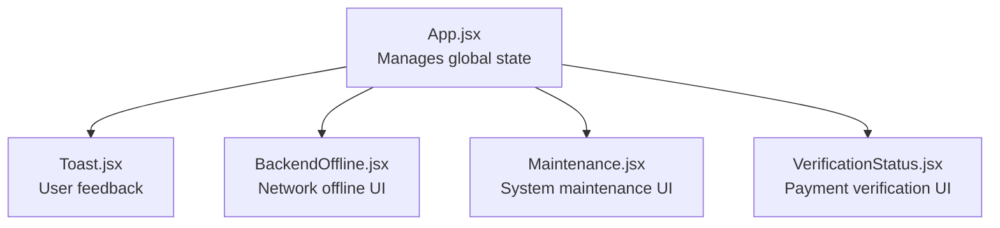
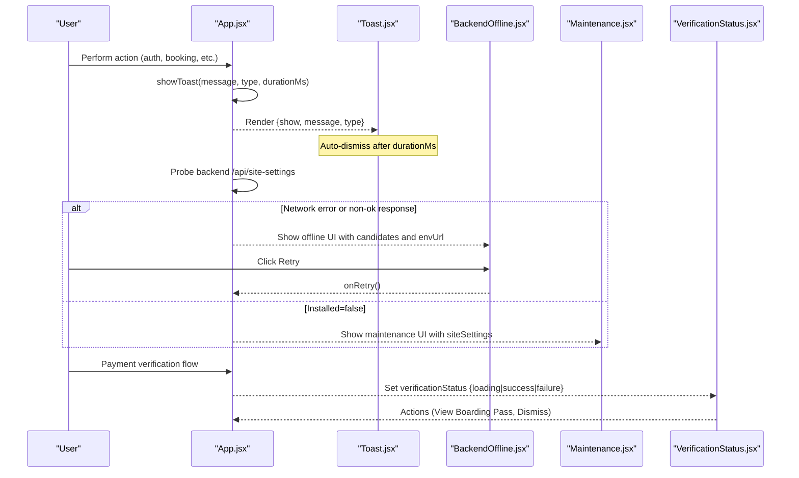
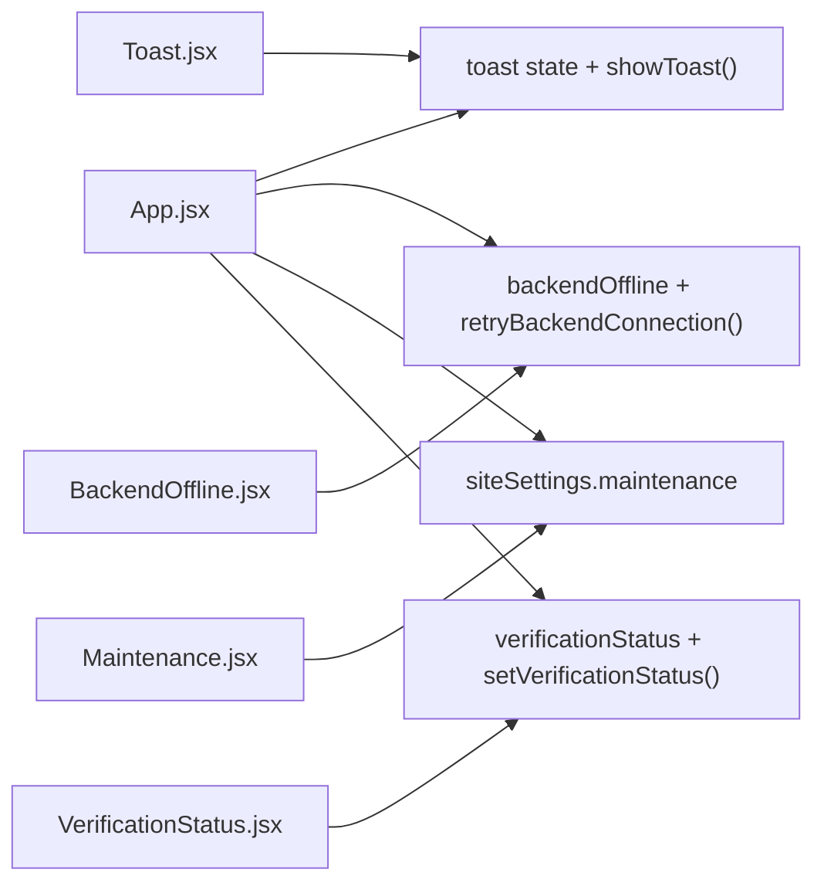

# Utility Components

<cite>
**Referenced Files in This Document**
- [Toast.jsx](file://frontend/src/components/Toast.jsx)
- [BackendOffline.jsx](file://frontend/src/components/BackendOffline.jsx)
- [Maintenance.jsx](file://frontend/src/components/Maintenance.jsx)
- [VerificationStatus.jsx](file://frontend/src/components/VerificationStatus.jsx)
- [App.jsx](file://frontend/src/App.jsx)
</cite>

## Table of Contents
1. [Introduction](#introduction)
2. [Project Structure](#project-structure)
3. [Core Components](#core-components)
4. [Architecture Overview](#architecture-overview)
5. [Detailed Component Analysis](#detailed-component-analysis)
6. [Dependency Analysis](#dependency-analysis)
7. [Performance Considerations](#performance-considerations)
8. [Troubleshooting Guide](#troubleshooting-guide)
9. [Conclusion](#conclusion)

## Introduction
This document explains the frontend utility components that provide user feedback and system state awareness:
- Toast notifications for success and error messages
- BackendOffline detection for network connectivity issues
- Maintenance mode display for scheduled downtime
- VerificationStatus indicators for payment verification outcomes

These components are lightweight, presentational React components used across the application to improve user experience during common workflows such as authentication, booking, payment verification, and system maintenance.

## Project Structure
The utility components live under the frontend source tree and are consumed by higher-level pages and flows:
- Toast is rendered by a parent component that manages toast state and auto-dismissal
- BackendOffline is shown when the backend cannot be reached or probed
- Maintenance displays a branded maintenance page using site settings
- VerificationStatus shows loading, success, or failure states for payment verification

**Diagram sources**
- [App.jsx:90-151](file://frontend/src/App.jsx#L90-L151)
- [Toast.jsx:1-24](file://frontend/src/components/Toast.jsx#L1-L24)
- [BackendOffline.jsx:1-172](file://frontend/src/components/BackendOffline.jsx#L1-L172)
- [Maintenance.jsx:1-26](file://frontend/src/components/Maintenance.jsx#L1-L26)
- [VerificationStatus.jsx:1-78](file://frontend/src/components/VerificationStatus.jsx#L1-L78)

**Section sources**
- [App.jsx:90-151](file://frontend/src/App.jsx#L90-L151)
- [Toast.jsx:1-24](file://frontend/src/components/Toast.jsx#L1-L24)
- [BackendOffline.jsx:1-172](file://frontend/src/components/BackendOffline.jsx#L1-L172)
- [Maintenance.jsx:1-26](file://frontend/src/components/Maintenance.jsx#L1-L26)
- [VerificationStatus.jsx:1-78](file://frontend/src/components/VerificationStatus.jsx#L1-L78)

## Core Components
- Toast: Renders a simple notification with an icon and message. Supports success and error types. Auto-dismissal is handled by the parent via a timeout.
- BackendOffline: Displays a detailed offline screen with candidate URLs tried, environment configuration hints, setup instructions, and a retry button.
- Maintenance: Shows a maintenance page with a customizable message and branding from site settings.
- VerificationStatus: Presents loading, success, and failure states for payment verification, including actions to view boarding pass or dismiss the status.

**Section sources**
- [Toast.jsx:1-24](file://frontend/src/components/Toast.jsx#L1-L24)
- [BackendOffline.jsx:1-172](file://frontend/src/components/BackendOffline.jsx#L1-L172)
- [Maintenance.jsx:1-26](file://frontend/src/components/Maintenance.jsx#L1-L26)
- [VerificationStatus.jsx:1-78](file://frontend/src/components/VerificationStatus.jsx#L1-L78)

## Architecture Overview
The following diagram maps how these components interact with the application’s state and data flow:

**Diagram sources**
- [App.jsx:136-151](file://frontend/src/App.jsx#L136-L151)
- [App.jsx:293-325](file://frontend/src/App.jsx#L293-L325)
- [App.jsx:502-524](file://frontend/src/App.jsx#L502-L524)
- [Toast.jsx:1-24](file://frontend/src/components/Toast.jsx#L1-L24)
- [BackendOffline.jsx:1-172](file://frontend/src/components/BackendOffline.jsx#L1-L172)
- [Maintenance.jsx:1-26](file://frontend/src/components/Maintenance.jsx#L1-L26)
- [VerificationStatus.jsx:1-78](file://frontend/src/components/VerificationStatus.jsx#L1-L78)

## Detailed Component Analysis

### Toast Component
Purpose:
- Display short-lived user feedback messages for success and error events.

Props:
- toast: Object containing:
  - show: boolean controlling visibility
  - message: string displayed in the notification
  - type: string indicating visual style; supports 'error' and default 'success'

Behavior:
- If toast.show is false, the component renders nothing.
- For type 'error', it renders an error icon; otherwise, it renders a success icon.
- The message is displayed next to the icon.

Auto-dismissal:
- Managed by the parent component via a timeout function that sets toast.show to false after a configurable duration.

Customization examples:
- Custom styles: Add CSS classes or override existing class names to change colors, spacing, and layout.
- Custom notification types: Extend the conditional rendering to support additional types (for example, 'warning') and add corresponding icons and styles.
- Positioning: Wrap the component in a positioned container (for example, fixed top-right) to control where notifications appear.

Usage patterns:
- Call the parent’s showToast helper with a message and type to trigger a toast.
- Use shorter durations for transient confirmations and longer durations for informational messages.

**Section sources**
- [Toast.jsx:1-24](file://frontend/src/components/Toast.jsx#L1-L24)
- [App.jsx:136-151](file://frontend/src/App.jsx#L136-L151)

### BackendOffline Component
Purpose:
- Provide a clear, actionable offline screen when the backend is unreachable.

Props:
- onRetry: Function invoked when the user clicks the retry button.
- candidates: Array of candidate backend URLs that were attempted.
- envUrl: String representing the configured VITE_API_BASE_URL value.

Behavior:
- Displays a card with an icon, title, and description explaining the connection issue.
- Lists all candidate URLs tried, each prefixed with a failure indicator.
- Shows the environment variable value if provided.
- Provides two setup paths:
  - Development server command with its expected URL
  - Shared hosting/local Apache path with a derived URL based on the current origin
- Offers a prominent retry button to reattempt connection probing.

Connection state handling:
- The parent component probes the backend using a list of candidate base URLs and sets backendOffline accordingly.
- When retry is clicked, the parent re-runs the probe logic and updates state.

Implementation guidance:
- Ensure candidates reflect the actual URLs attempted during probing.
- Pass the effective envUrl so users can verify their environment configuration.
- Wire onRetry to the parent’s retryBackendConnection function.

**Section sources**
- [BackendOffline.jsx:1-172](file://frontend/src/components/BackendOffline.jsx#L1-L172)
- [App.jsx:502-524](file://frontend/src/App.jsx#L502-L524)

### Maintenance Component
Purpose:
- Present a branded maintenance page when the system is under maintenance.

Props:
- siteSettings: Object containing site-wide settings, including:
  - maintenance.message: Optional custom maintenance message
  - footer.company_name: Brand name displayed in the footer
  - footer.copyright: Copyright text

Behavior:
- Renders a centered maintenance card with an animated icon.
- Displays the custom maintenance message if provided; otherwise, a default message.
- Shows the company name and copyright from site settings.

Integration:
- The parent should render this component when the backend indicates maintenance mode or when installNotComplete is true.
- Site settings should include maintenance flags and messages from the backend.

Customization examples:
- Replace the default icon with a custom SVG or image.
- Style the maintenance card to match brand guidelines.
- Dynamically update the message and branding through site settings.

**Section sources**
- [Maintenance.jsx:1-26](file://frontend/src/components/Maintenance.jsx#L1-L26)

### VerificationStatus Component
Purpose:
- Communicate the outcome of payment verification to the user.

Props:
- verificationStatus: Object with fields:
  - loading: boolean indicating ongoing verification
  - success: boolean indicating successful verification
  - invoiceId: string identifier for the invoice
  - transactionId: string identifier for the transaction (on success)
  - message: string describing the result or error
  - bookingId: string identifier for the booking (on success)
- setVerificationStatus: Function to update the verification state
- setBookingSuccess: Function to set the booking success payload
- API_BASE: Base URL for fetching booking details

Behavior:
- If verificationStatus is null, the component renders nothing.
- While loading, it shows a spinner and a message referencing the invoice ID.
- On success, it shows a confirmation message, invoice and transaction IDs, and a button to fetch and display the boarding pass.
- On failure, it shows an error message and a dismiss button.

Data flow:
- On success, clicking “View Boarding Pass” calls the parent-provided API base to retrieve booking details and sets the booking success state.
- On failure, dismissing clears the verification status.

Customization examples:
- Enhance success/failure visuals with icons and colors.
- Add retry functionality for failed verifications.
- Include additional metadata such as timestamps or gateway names.

**Section sources**
- [VerificationStatus.jsx:1-78](file://frontend/src/components/VerificationStatus.jsx#L1-L78)

## Dependency Analysis
Relationships between components and the application state:

**Diagram sources**
- [App.jsx:90-151](file://frontend/src/App.jsx#L90-L151)
- [App.jsx:293-325](file://frontend/src/App.jsx#L293-L325)
- [App.jsx:502-524](file://frontend/src/App.jsx#L502-L524)
- [Toast.jsx:1-24](file://frontend/src/components/Toast.jsx#L1-L24)
- [BackendOffline.jsx:1-172](file://frontend/src/components/BackendOffline.jsx#L1-L172)
- [Maintenance.jsx:1-26](file://frontend/src/components/Maintenance.jsx#L1-L26)
- [VerificationStatus.jsx:1-78](file://frontend/src/components/VerificationStatus.jsx#L1-L78)

**Section sources**
- [App.jsx:90-151](file://frontend/src/App.jsx#L90-L151)
- [App.jsx:293-325](file://frontend/src/App.jsx#L293-L325)
- [App.jsx:502-524](file://frontend/src/App.jsx#L502-L524)

## Performance Considerations
- Toast auto-dismissal uses a single timeout reference to avoid overlapping timers. Ensure cleanup occurs on unmount to prevent memory leaks.
- BackendOffline avoids heavy computations; it relies on the parent’s probing logic. Keep candidate lists minimal to reduce unnecessary retries.
- Maintenance and VerificationStatus are presentational; they do not perform network requests themselves except VerificationStatus’s success action which delegates to the parent’s API base.

[No sources needed since this section provides general guidance]

## Troubleshooting Guide
Common issues and resolutions:

- Toast not appearing:
  - Verify the parent’s showToast function is called with show set to true.
  - Check that the toast timeout is not cleared prematurely.

- Incorrect toast styling:
  - Inspect the CSS classes applied based on toast.type.
  - Add or override styles for additional types if needed.

- BackendOffline persists:
  - Confirm the backend is reachable at one of the candidate URLs.
  - Validate the VITE_API_BASE_URL environment variable.
  - Use the retry button to reprobe the backend.

- Maintenance page not updating:
  - Ensure siteSettings includes the maintenance flag and message.
  - Refresh the page or re-fetch site settings from the backend.

- VerificationStatus not showing boarding pass:
  - Confirm API_BASE is correctly set.
  - Verify the backend endpoint for retrieving booking details is accessible.

**Section sources**
- [App.jsx:136-151](file://frontend/src/App.jsx#L136-L151)
- [App.jsx:293-325](file://frontend/src/App.jsx#L293-L325)
- [App.jsx:502-524](file://frontend/src/App.jsx#L502-L524)
- [BackendOffline.jsx:1-172](file://frontend/src/components/BackendOffline.jsx#L1-L172)
- [VerificationStatus.jsx:1-78](file://frontend/src/components/VerificationStatus.jsx#L1-L78)

## Conclusion
These utility components provide essential user feedback and system state awareness:
- Toast offers concise, auto-dismissed notifications for success and error events.
- BackendOffline guides users through diagnosing and resolving connectivity issues.
- Maintenance presents a clear, branded downtime message.
- VerificationStatus communicates payment verification outcomes and enables next steps.

By integrating these components thoughtfully and customizing them to your brand and workflow, you can deliver a robust and user-friendly experience across the application.