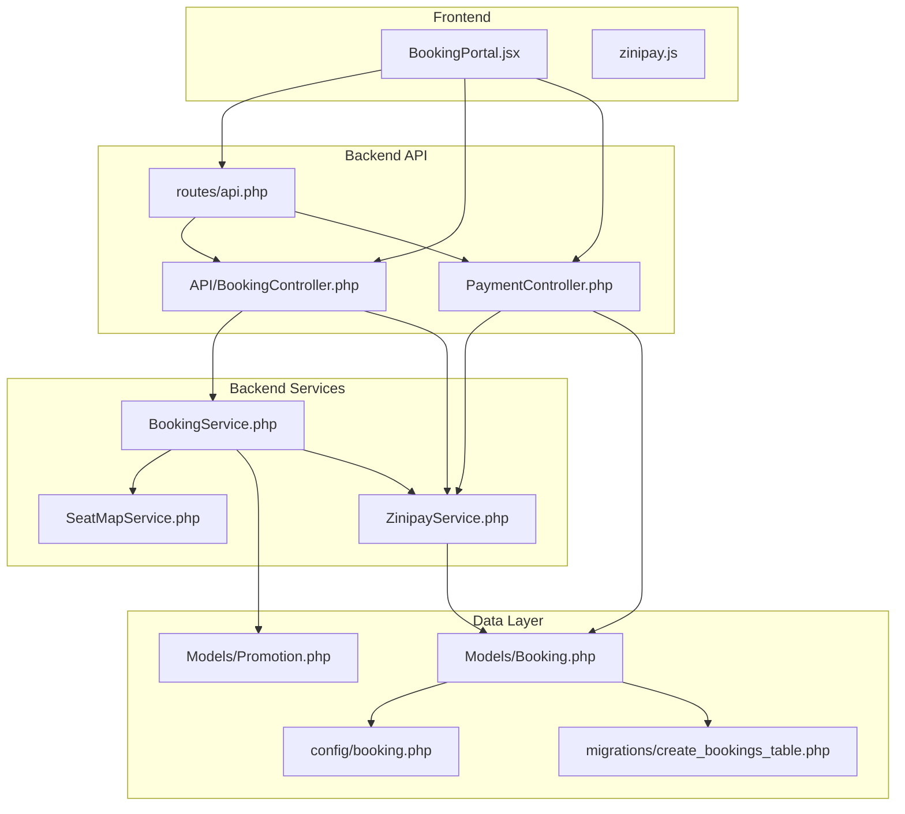
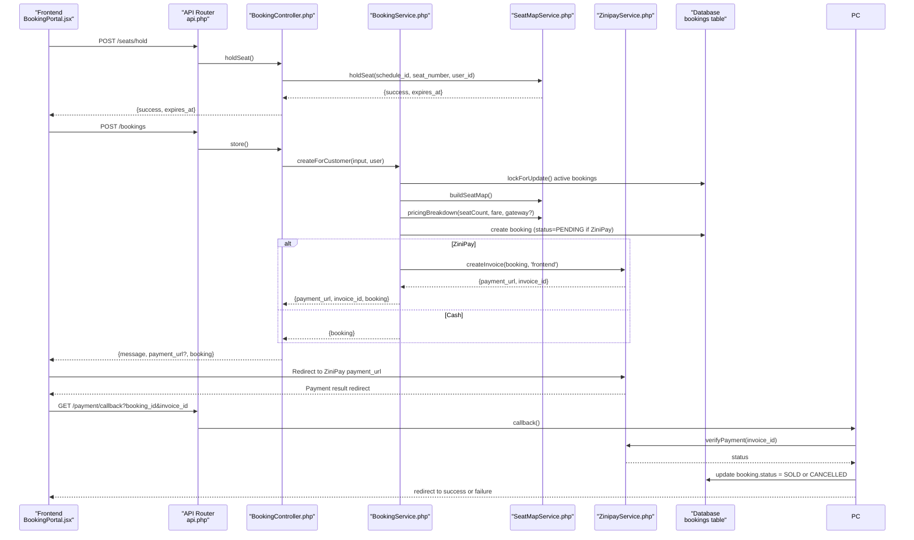
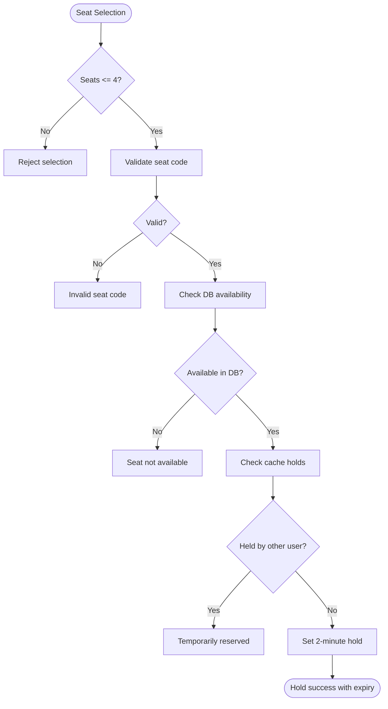
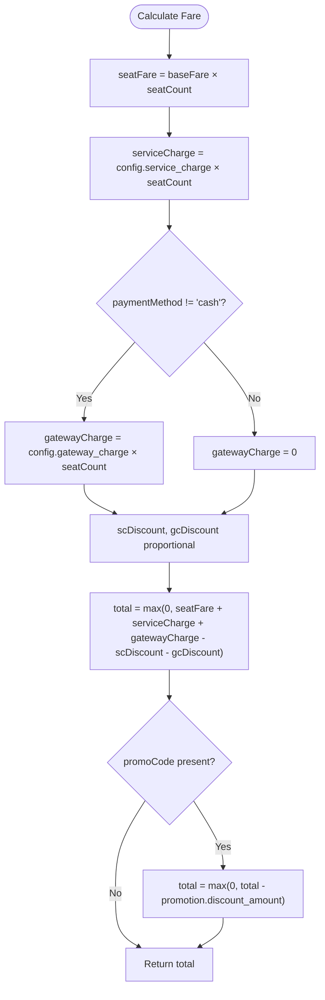
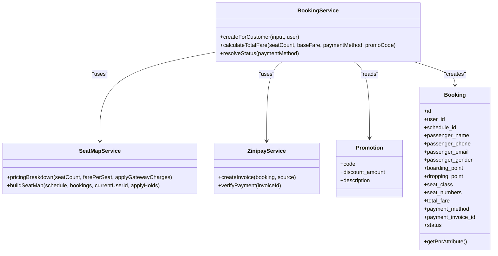
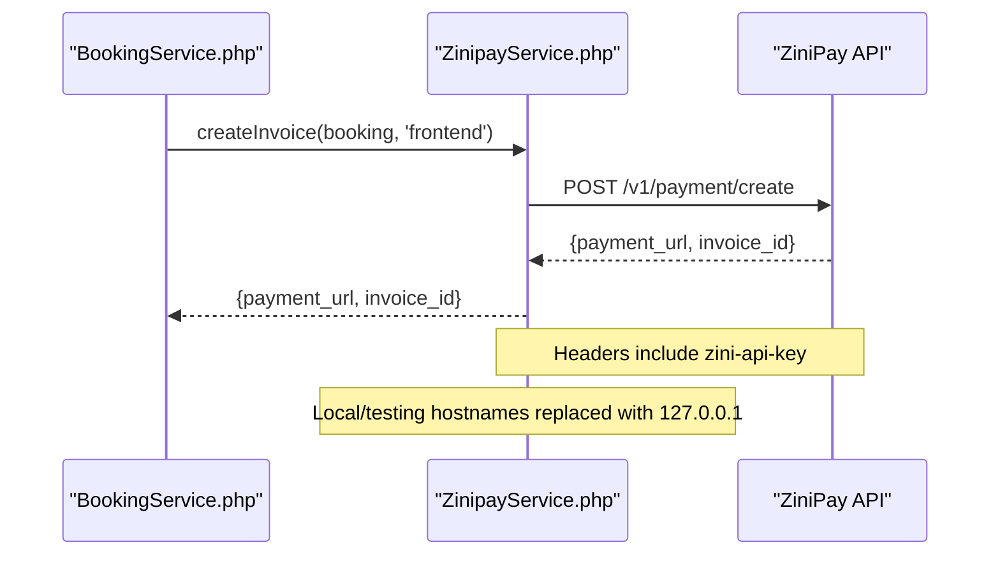
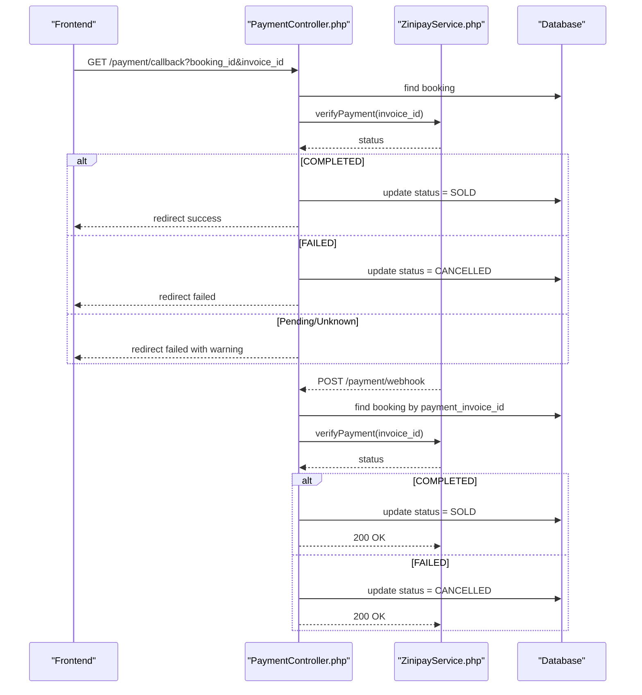
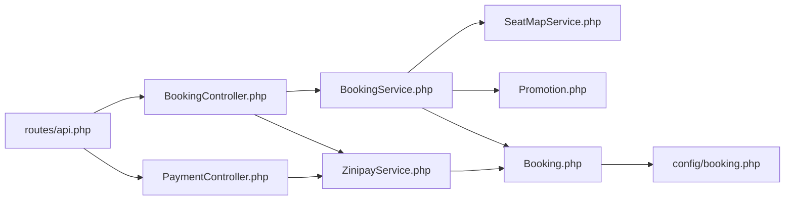

# Booking Confirmation & Payment

<cite>
**Referenced Files in This Document**   
- [BookingController.php](file://backend/app/Http/Controllers/API/BookingController.php)
- [PaymentController.php](file://backend/app/Http/Controllers/PaymentController.php)
- [BookingService.php](file://backend/app/Services/BookingService.php)
- [ZinipayService.php](file://backend/app/Services/ZinipayService.php)
- [SeatMapService.php](file://backend/app/services/SeatMapService.php)
- [Booking.php](file://backend/app/Models/Booking.php)
- [Promotion.php](file://backend/app/Models/Promotion.php)
- [api.php](file://backend/routes/api.php)
- [booking.php](file://backend/config/booking.php)
- [2026_06_01_000050_create_bookings_table.php](file://backend/database/migrations/2026_06_01_000050_create_bookings_table.php)
- [BookingPortal.jsx](file://frontend/src/components/BookingPortal.jsx)
- [zinipay.js](file://frontend/src/zinipay.js)
</cite>

## Table of Contents
1. [Introduction](#introduction)
2. [Project Structure](#project-structure)
3. [Core Components](#core-components)
4. [Architecture Overview](#architecture-overview)
5. [Detailed Component Analysis](#detailed-component-analysis)
6. [Dependency Analysis](#dependency-analysis)
7. [Performance Considerations](#performance-considerations)
8. [Troubleshooting Guide](#troubleshooting-guide)
9. [Conclusion](#conclusion)

## Introduction
This document explains the end-to-end booking confirmation and payment workflow, including passenger information collection, validation rules, promo code application, pricing calculations, ZiniPay integration, PNR generation, ticket confirmation, success/failure handling, webhook processing, refund considerations, and security measures. It is intended for developers, integrators, and support engineers who need to understand how a customer selects seats, submits a booking, pays via ZiniPay, and receives a confirmed ticket.

## Project Structure
The booking and payment flow spans:
- Frontend React components that collect passenger details, validate inputs, manage seat holds, apply promo codes, and initiate bookings.
- Backend API controllers that validate requests, orchestrate booking creation, and handle payment redirections and webhooks.
- Services that implement business logic for seat availability, pricing, promotions, SMS notifications, and ZiniPay communication.
- Database models and migrations that define the booking record, its fields, indexes, and PNR generation.

**Diagram sources**
- [BookingPortal.jsx:469-575](file://frontend/src/components/BookingPortal.jsx#L469-L575)
- [api.php:54-75](file://backend/routes/api.php#L54-L75)
- [BookingController.php:19-148](file://backend/app/Http/Controllers/API/BookingController.php#L19-L148)
- [PaymentController.php:21-160](file://backend/app/Http/Controllers/PaymentController.php#L21-L160)
- [BookingService.php:28-131](file://backend/app/Services/BookingService.php#L28-L131)
- [SeatMapService.php:343-365](file://backend/app/services/SeatMapService.php#L343-L365)
- [ZinipayService.php:27-97](file://backend/app/Services/ZinipayService.php#L27-L97)
- [Booking.php:12-47](file://backend/app/Models/Booking.php#L12-L47)
- [Promotion.php:12-16](file://backend/app/Models/Promotion.php#L12-L16)
- [booking.php:3-10](file://backend/config/booking.php#L3-L10)
- [2026_06_01_000050_create_bookings_table.php:14-42](file://backend/database/migrations/2026_06_01_000050_create_bookings_table.php#L14-L42)

**Section sources**
- [BookingPortal.jsx:469-575](file://frontend/src/components/BookingPortal.jsx#L469-L575)
- [api.php:54-75](file://backend/routes/api.php#L54-L75)
- [BookingController.php:19-148](file://backend/app/Http/Controllers/API/BookingController.php#L19-L148)
- [PaymentController.php:21-160](file://backend/app/Http/Controllers/PaymentController.php#L21-L160)
- [BookingService.php:28-131](file://backend/app/Services/BookingService.php#L28-L131)
- [SeatMapService.php:343-365](file://backend/app/services/SeatMapService.php#L343-L365)
- [ZinipayService.php:27-97](file://backend/app/Services/ZinipayService.php#L27-L97)
- [Booking.php:12-47](file://backend/app/Models/Booking.php#L12-L47)
- [Promotion.php:12-16](file://backend/app/Models/Promotion.php#L12-L16)
- [booking.php:3-10](file://backend/config/booking.php#L3-L10)
- [2026_06_01_000050_create_bookings_table.php:14-42](file://backend/database/migrations/2026_06_01_000050_create_bookings_table.php#L14-L42)

## Core Components
- Passenger input and validation: The frontend collects name, phone, email, gender, boarding/dropping points, selected seats, and promo code. It enforces minimum phone length and required fields before calling the backend.
- Seat reservation: The frontend uses hold/release endpoints to temporarily reserve seats while the user completes booking. The backend validates seat availability and prevents double booking using cache-based holds and database locks.
- Pricing and promo: The backend calculates fare based on seat count, service/gateway charges, discounts, and optional promo discount. Cash vs gateway payments affect charge application.
- Booking creation: The backend creates a booking record with status depending on payment method (PENDING for ZiniPay, SOLD for cash). For ZiniPay, it creates an invoice and returns a payment URL.
- Payment integration: ZiniPay invoice creation and verification are handled by a dedicated service. Callbacks and webhooks update booking status to SOLD or CANCELLED and send SMS notifications.
- Ticket confirmation: On successful payment, the frontend displays the booking receipt and PNR. Public booking lookup is available by ID.

**Section sources**
- [BookingPortal.jsx:469-575](file://frontend/src/components/BookingPortal.jsx#L469-L575)
- [BookingController.php:19-148](file://backend/app/Http/Controllers/API/BookingController.php#L19-L148)
- [BookingService.php:28-131](file://backend/app/Services/BookingService.php#L28-L131)
- [SeatMapService.php:343-365](file://backend/app/services/SeatMapService.php#L343-L365)
- [ZinipayService.php:27-97](file://backend/app/Services/ZinipayService.php#L27-L97)
- [PaymentController.php:21-160](file://backend/app/Http/Controllers/PaymentController.php#L21-L160)
- [Booking.php:43-47](file://backend/app/Models/Booking.php#L43-L47)

## Architecture Overview
The booking and payment architecture follows a layered approach:
- Presentation layer (React): Collects data, manages UI state, handles seat holds, applies promos, and redirects to payment.
- API layer (Laravel controllers): Validates requests, delegates to services, and returns structured JSON responses.
- Service layer: Encapsulates business rules for seat mapping, pricing, promotions, SMS, and payment gateway operations.
- Data layer: Eloquent models and migrations store bookings, promotions, and related entities; indexes optimize queries.

**Diagram sources**
- [BookingPortal.jsx:209-288](file://frontend/src/components/BookingPortal.jsx#L209-L288)
- [BookingPortal.jsx:469-575](file://frontend/src/components/BookingPortal.jsx#L469-L575)
- [api.php:63-75](file://backend/routes/api.php#L63-L75)
- [BookingController.php:82-148](file://backend/app/Http/Controllers/API/BookingController.php#L82-L148)
- [BookingService.php:28-131](file://backend/app/Services/BookingService.php#L28-L131)
- [SeatMapService.php:502-561](file://backend/app/services/SeatMapService.php#L502-L561)
- [ZinipayService.php:27-97](file://backend/app/Services/ZinipayService.php#L27-L97)
- [PaymentController.php:21-66](file://backend/app/Http/Controllers/PaymentController.php#L21-L66)

## Detailed Component Analysis

### Passenger Information Collection and Validation
- Frontend validation:
  - Required fields: passenger name, phone, email, boarding point, dropping point.
  - Phone must be at least 11 digits after removing non-digits.
  - Maximum 4 seats per booking enforced in UI.
  - Promo code applied via separate endpoint before booking submission.
- Backend validation:
  - schedule_id must exist.
  - passenger_name, passenger_phone, passenger_email required with max lengths.
  - seat_numbers required string; parsed into list.
  - payment_method required string.
  - total_fare nullable numeric min 0.
  - passenger_gender allowed values M/F.
  - boarding_point and dropping_point optional strings.
  - promo_code optional string.
  - status sometimes allowed for admin override.

Validation ensures data integrity before seat locking and pricing calculation.

**Section sources**
- [BookingPortal.jsx:469-575](file://frontend/src/components/BookingPortal.jsx#L469-L575)
- [BookingController.php:19-40](file://backend/app/Http/Controllers/API/BookingController.php#L19-L40)

### Seat Availability and Hold Mechanism
- Seat codes are generated from bus layout configuration or default rows/columns.
- Build seat map considers:
  - Blocked seats.
  - Active holds in cache (per schedule).
  - Paid bookings (PAID/SOLD/BOOKED).
  - Recent pending bookings within 10 minutes.
- Hold endpoint:
  - Validates seat code against bus layout.
  - Checks DB availability excluding cache holds.
  - Checks cache holds to prevent another user from holding the same seat.
  - Sets a 2-minute hold with expiry timestamp stored in cache.
- Release endpoint:
  - Removes user’s hold for a specific seat.
- During booking creation:
  - Locks active bookings for the schedule to avoid race conditions.
  - Re-validates seat availability against current seat map.
  - Cleans up holds for booked seats.

**Diagram sources**
- [SeatMapService.php:502-561](file://backend/app/services/SeatMapService.php#L502-L561)
- [SeatMapService.php:194-244](file://backend/app/services/SeatMapService.php#L194-L244)
- [SeatMapService.php:438-447](file://backend/app/services/SeatMapService.php#L438-L447)

**Section sources**
- [SeatMapService.php:194-244](file://backend/app/services/SeatMapService.php#L194-L244)
- [SeatMapService.php:502-561](file://backend/app/services/SeatMapService.php#L502-L561)
- [SeatMapService.php:438-447](file://backend/app/services/SeatMapService.php#L438-L447)

### Pricing Calculations and Promo Code Application
- Pricing breakdown:
  - Seat fare = base fare × seat count.
  - Service charge = configured service_charge × seat count.
  - Gateway charge = configured gateway_charge × seat count (only when payment method is not cash).
  - Discounts: service_charge_discount and gateway_charge_discount applied proportionally.
  - Total = max(0, seatFare + serviceCharge + gatewayCharge - scDiscount - gcDiscount).
- Promo code:
  - If provided, promotion is looked up by uppercase code.
  - Discount amount subtracted from total fare, floored at zero.
- Payment method affects gateway charges:
  - Cash bookings do not apply gateway charges/discounts.
  - Non-cash bookings apply gateway-related charges/discounts.

**Diagram sources**
- [SeatMapService.php:343-365](file://backend/app/services/SeatMapService.php#L343-L365)
- [BookingService.php:304-318](file://backend/app/Services/BookingService.php#L304-L318)
- [Promotion.php:12-16](file://backend/app/Models/Promotion.php#L12-L16)
- [booking.php:3-10](file://backend/config/booking.php#L3-L10)

**Section sources**
- [SeatMapService.php:343-365](file://backend/app/services/SeatMapService.php#L343-L365)
- [BookingService.php:304-318](file://backend/app/Services/BookingService.php#L304-L318)
- [Promotion.php:12-16](file://backend/app/Models/Promotion.php#L12-L16)
- [booking.php:3-10](file://backend/config/booking.php#L3-L10)

### Booking Creation Process and PNR Generation
- Booking creation steps:
  - Validate payment method restrictions (non-admin cannot book cash manually).
  - Parse and validate seat numbers (max 4).
  - Load schedule with bus and route details.
  - Lock active bookings for concurrency safety.
  - Build seat map and validate requested seats are selectable.
  - Calculate total fare including gateway charges and promo discount.
  - Create booking record with status resolved by payment method:
    - ZiniPay → PENDING.
    - Cash → SOLD (unless explicitly BOOKED or cancel states).
  - Clean up seat holds for booked seats.
  - If ZiniPay, create invoice and return payment URL; otherwise return booking details.
- PNR generation:
  - PNR is derived from booking id with prefix “SE” and zero-padded to five digits.

**Diagram sources**
- [Booking.php:12-47](file://backend/app/Models/Booking.php#L12-L47)
- [Promotion.php:12-16](file://backend/app/Models/Promotion.php#L12-L16)
- [BookingService.php:28-131](file://backend/app/Services/BookingService.php#L28-L131)
- [SeatMapService.php:343-365](file://backend/app/services/SeatMapService.php#L343-L365)
- [ZinipayService.php:27-97](file://backend/app/Services/ZinipayService.php#L27-L97)

**Section sources**
- [BookingService.php:28-131](file://backend/app/Services/BookingService.php#L28-L131)
- [Booking.php:43-47](file://backend/app/Models/Booking.php#L43-L47)

### ZiniPay Payment Integration
- Invoice creation:
  - Requires API key configured in services.zinipay.api_key.
  - Sends request to https://api.zinipay.com/v1/payment/create with customer name, email, amount, metadata (booking_id, source), redirect/cancel/webhook URLs.
  - In local/testing environments, hostnames are replaced with 127.0.0.1 to bypass sandbox domain checks.
  - Returns payment_url and invoice_id; logs errors if missing or unsuccessful.
- Verification:
  - Uses https://api.zinipay.com/v1/payment/verify with invoice_id.
  - Returns status such as COMPLETED or FAILED; logs errors.
- Security:
  - API key passed via header zini-api-key.
  - Webhook verifies status directly with ZiniPay before updating booking.

**Diagram sources**
- [ZinipayService.php:27-97](file://backend/app/Services/ZinipayService.php#L27-L97)
- [BookingService.php:283-302](file://backend/app/Services/BookingService.php#L283-L302)

**Section sources**
- [ZinipayService.php:27-97](file://backend/app/Services/ZinipayService.php#L27-L97)
- [BookingService.php:283-302](file://backend/app/Services/BookingService.php#L283-L302)

### Payment Callbacks and Webhooks
- Callback handler:
  - Receives booking_id, source, and optional invoice_id from redirect.
  - Looks up booking; if already paid, redirects to success.
  - Verifies payment status via ZiniPay; updates booking status to SOLD or CANCELLED accordingly.
  - Sends SMS verification on success.
  - Redirects to frontend success or error pages with flags.
- Webhook handler:
  - Logs incoming payload.
  - Requires invoice_id; looks up booking by payment_invoice_id.
  - If already processed, returns success.
  - Verifies status with ZiniPay; updates booking to SOLD or CANCELLED.
  - Sends SMS verification on success.

**Diagram sources**
- [PaymentController.php:21-160](file://backend/app/Http/Controllers/PaymentController.php#L21-L160)
- [ZinipayService.php:105-139](file://backend/app/Services/ZinipayService.php#L105-L139)

**Section sources**
- [PaymentController.php:21-160](file://backend/app/Http/Controllers/PaymentController.php#L21-L160)
- [ZinipayService.php:105-139](file://backend/app/Services/ZinipayService.php#L105-L139)

### Ticket Confirmation and Customer Notifications
- On successful payment:
  - Booking status updated to SOLD.
  - SMS verification sent via SmsGatewayService.
  - Frontend displays booking receipt with PNR and schedule details.
- Public booking lookup:
  - Endpoint returns formatted booking data including PNR, passenger info, seat numbers, total fare, payment method, invoice id, status, and schedule details.

**Section sources**
- [PaymentController.php:47-53](file://backend/app/Http/Controllers/PaymentController.php#L47-L53)
- [BookingController.php:75-80](file://backend/app/Http/Controllers/API/BookingController.php#L75-L80)
- [BookingService.php:242-281](file://backend/app/Services/BookingService.php#L242-L281)

### Refund Handling
- The analyzed code does not implement explicit refund workflows.
- Payment statuses include PAID, SOLD, BOOKED, CANCEL_REQUESTED, CANCELLED.
- Cancellation flows:
  - Customer can cancel PENDING bookings immediately.
  - Other statuses transition to CANCEL_REQUESTED awaiting admin approval.
- Refunds would require additional backend logic and integration with ZiniPay refund APIs, which are not present in the current implementation.

**Section sources**
- [BookingService.php:200-240](file://backend/app/Services/BookingService.php#L200-L240)
- [2026_06_01_000050_create_bookings_table.php:29-29](file://backend/database/migrations/2026_06_01_000050_create_bookings_table.php#L29-L29)

### Transaction Security Measures
- API key protection:
  - ZiniPay API calls use header zini-api-key.
  - Missing API key results in logged errors and null responses.
- Webhook verification:
  - Webhook handler verifies payment status directly with ZiniPay before updating booking records.
- Environment-specific URL rewriting:
  - Local/testing environments replace hostnames with 127.0.0.1 to bypass sandbox domain checks safely.
- Input validation:
  - Strict validation on booking inputs and seat selections.
- Concurrency control:
  - Database row-level locking for active bookings during seat validation.
  - Cache-based seat holds to prevent double booking across users.

**Section sources**
- [ZinipayService.php:27-97](file://backend/app/Services/ZinipayService.php#L27-L97)
- [PaymentController.php:90-136](file://backend/app/Http/Controllers/PaymentController.php#L90-L136)
- [BookingService.php:52-76](file://backend/app/Services/BookingService.php#L52-L76)

## Dependency Analysis
Key dependencies and relationships:
- Controllers depend on services for business logic and external integrations.
- Services depend on models and configuration.
- Models define data structure and computed attributes (PNR).
- Routes expose endpoints for customer and payment flows.

**Diagram sources**
- [BookingController.php:19-148](file://backend/app/Http/Controllers/API/BookingController.php#L19-L148)
- [PaymentController.php:21-160](file://backend/app/Http/Controllers/PaymentController.php#L21-L160)
- [BookingService.php:28-131](file://backend/app/Services/BookingService.php#L28-L131)
- [SeatMapService.php:343-365](file://backend/app/services/SeatMapService.php#L343-L365)
- [ZinipayService.php:27-97](file://backend/app/Services/ZinipayService.php#L27-L97)
- [Booking.php:12-47](file://backend/app/Models/Booking.php#L12-L47)
- [Promotion.php:12-16](file://backend/app/Models/Promotion.php#L12-L16)
- [api.php:54-75](file://backend/routes/api.php#L54-L75)
- [booking.php:3-10](file://backend/config/booking.php#L3-L10)

**Section sources**
- [BookingController.php:19-148](file://backend/app/Http/Controllers/API/BookingController.php#L19-L148)
- [PaymentController.php:21-160](file://backend/app/Http/Controllers/PaymentController.php#L21-L160)
- [BookingService.php:28-131](file://backend/app/Services/BookingService.php#L28-L131)
- [SeatMapService.php:343-365](file://backend/app/services/SeatMapService.php#L343-L365)
- [ZinipayService.php:27-97](file://backend/app/Services/ZinipayService.php#L27-L97)
- [Booking.php:12-47](file://backend/app/Models/Booking.php#L12-L47)
- [Promotion.php:12-16](file://backend/app/Models/Promotion.php#L12-L16)
- [api.php:54-75](file://backend/routes/api.php#L54-L75)
- [booking.php:3-10](file://backend/config/booking.php#L3-L10)

## Performance Considerations
- Seat map building:
  - Uses selective columns for active bookings to reduce payload size.
  - Applies cache-based holds to minimize contention.
- Database indexing:
  - Indexes on user_id, schedule_id, status, passenger_email, passenger_phone, and composite indexes improve query performance for common filters.
- Concurrency:
  - Row-level locking during booking creation avoids race conditions.
- External API calls:
  - ZiniPay requests have timeouts and logging to detect failures quickly.
- Frontend polling:
  - Schedule refresh every 5 seconds to keep seat maps fresh without excessive load.

[No sources needed since this section provides general guidance]

## Troubleshooting Guide
Common issues and resolutions:
- Invalid promo code:
  - Frontend shows error toast; ensure promo exists and discount amount is valid.
- Seat not available:
  - Another user may have held or booked the seat; try different seats or wait for hold expiry.
- Payment verification failed:
  - Check ZiniPay invoice status; ensure API key is configured and webhook/callback URLs are reachable.
- Booking not found:
  - Verify booking_id and payment_invoice_id are correctly passed in callbacks/webhooks.
- SMS not sent:
  - Ensure SMS gateway is configured; SMS is sent only on confirmed bookings (PAID/SOLD/BOOKED).

**Section sources**
- [BookingController.php:19-40](file://backend/app/Http/Controllers/API/BookingController.php#L19-L40)
- [SeatMapService.php:502-561](file://backend/app/services/SeatMapService.php#L502-L561)
- [PaymentController.php:21-160](file://backend/app/Http/Controllers/PaymentController.php#L21-L160)
- [ZinipayService.php:27-97](file://backend/app/Services/ZinipayService.php#L27-L97)

## Conclusion
The booking confirmation and payment workflow integrates seat management, pricing, promo discounts, and ZiniPay payment processing with robust validation, concurrency controls, and secure webhook handling. While refunds are not implemented, cancellation flows provide a foundation for future enhancements. Operators should monitor API keys, webhook reachability, and SMS configuration to ensure reliable ticket issuance and customer notifications.

[No sources needed since this section summarizes without analyzing specific files]